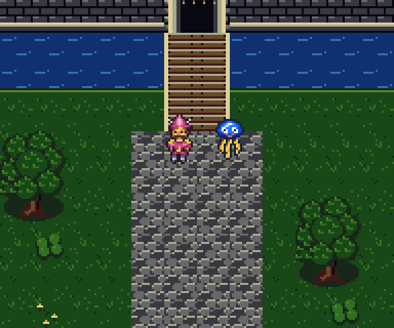
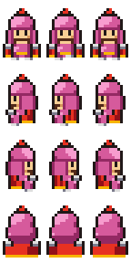
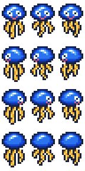
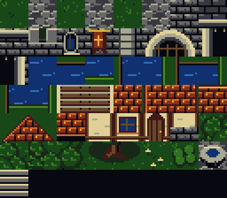
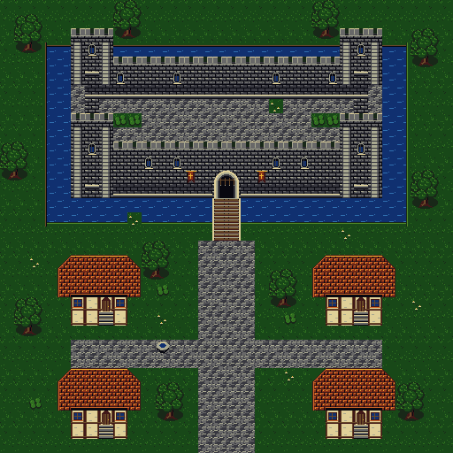
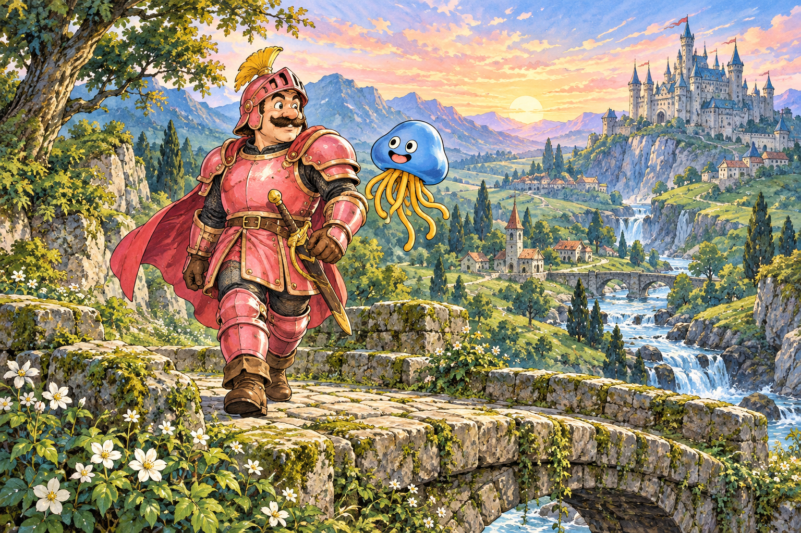

# DQ4 포팅용 그래픽 제작물

타이틀과 모험 일러스트는 사용자가 높게 평가했으며 원본과 프롬프트를 보존합니다. **스프라이트는 여러 차례 수정 후에도 최종 거절됐습니다.** 샘플 맵 역시 최종 채택되지 않았습니다. 이후 작업은 [그래픽 핸드오프](dq4-graphics-handoff.md)를 먼저 읽습니다.

이 문서는 최초 제작 도구의 출력 규격을 기록합니다. 아래 스프라이트와 합성 맵 그림은 채택된 게임 자산이 아닌 **채택되지 않은 시안**입니다. `tools/dq4sprites.py`는 이후 B3 실험이나 최종 16×24 수정본이 아니며, 인물 참고를 잘못 식별했던 초기 작업이 포함돼 있습니다. 새 스프라이트의 기준으로 사용하지 않습니다.

별도 로컬 실험에서는 MesenCE의 실제 DQ5 필드에 라이안을 표시하고 네 방향 보행을 확인했습니다. 이는 `work/`의 Lua 런타임 교체 실험이며 아래 변환 도구의 엔진 삽입 구현이나 영구 패치가 아닙니다. 따라서 변환 도구 출력의 `engine_ready`는 계속 `false`입니다. 기술 검증 통과와 시각적 채택 여부는 별개입니다.

## 초기 시안과 보존할 그림



위 그림은 Python 으로 합성한 프레임 미리보기입니다. 게임 실행 화면이나 통행 검사 결과가 아닙니다.

| 라이안 | 호이미 슬라임 |
| --- | --- |
|  |  |








## 원본과 수정 위치

| 파일 | 역할 |
| --- | --- |
| `tools/dq4pixels.py` | 스프라이트와 지형 제작물을 모으는 모듈 |
| `tools/dq4sprites.py` | 색 번호를 문자로 적은 스프라이트 행렬과 인물별 팔레트 |
| `tools/dq4terrain.py` | 블록 무늬·팔레트·블록 이름 격자 `MAP_LAYOUT` 의 편집 원본 |
| `tools/dq4art/title.png` | 이미지 생성 도구로 새로 제작한 타이틀 원본, 1341×1173 |
| `tools/dq4art/journey.png` | 이미지 생성 도구로 새로 제작한 일러스트 원본, 1536×1024 |
| `tools/dq4art/prompts.json` | 이미지 생성과 타이틀 부제 수정에 사용한 프롬프트 |
| `tools/dq4title.py` | 타이틀 축소·8개 BG 팔레트 선택 |
| `tools/dq4graphics.py` | PNG·CHR·팔레트·BG 맵 출력과 검증 |
| `tools/dq4figures.py` | 문서용 WebP 그림과 합성 애니메이션 생성 |

롬이나 다른 팬 해킹에서 추출한 그림은 사용하지 않았습니다. 스프라이트와 지형은 [원작 참고 자료](references.md#dq4-포팅용-그래픽)를 보고, 인물의 비율·윤곽과 벽돌·돌바닥·나무의 표현을 직접 작성했습니다. 타이틀은 사용자가 제공한 Nintendo DS DQ4 화면을 구도·색감 참고로 삼아 OpenAI 내장 `image_gen` 으로 새로 구성했습니다. 하늘·용·적금색 한글 로고를 그린 생성 원본이며, 참고 화면은 배포하지 않습니다. 모험 일러스트는 외부 참조 이미지 없이 생성했습니다. 같은 프롬프트로 같은 그림을 다시 얻을 수 없으므로 생성 원본을 저장소에 보관합니다. 고정된 원본과 `uv.lock` 의 의존성으로 만드는 변환 결과는 반복 생성해 비교합니다.

## 규격과 출력

스프라이트 한 프레임은 16×24픽셀입니다. 시트는 48×96픽셀이며, 위에서부터 남·서·동·북 방향, 왼쪽부터 프레임 0·1·2 를 놓습니다. 색 번호 0 은 투명입니다. 미리보기 애니메이션은 남쪽 행을 0→1→2→1 순서로 합성합니다.

블록은 16×16픽셀 49종이며, `TILE_NAMES` 순서로 8열×7행에 놓고 나머지 칸은 색 번호 0 으로 채웁니다. 성벽과 돌바닥의 무늬를 구분하고, 성탑·아치형 성문·지붕 가장자리·해자 둑을 조합합니다. 나무 한 그루는 32×48픽셀, 여섯 블록입니다. 샘플 맵은 32×32블록(512×512픽셀)입니다. 원작 맵을 복원한 배치가 아니며, 충돌·출구·인물 이벤트 데이터는 없습니다.

타이틀은 LANCZOS 로 256×224픽셀로 줄인 뒤, 8×8 타일마다 8개 BG 팔레트 중 하나를 선택합니다. 각 팔레트는 공통 배경색 1개와 고유 색 15개이며, 전체에서 최대 121개 색 번호를 씁니다. 타일별 색 오차를 비교해 팔레트를 선택하며, 디더링은 쓰지 않습니다. 팔레트는 채널당 5비트로 맞춥니다. 16색 한 줄에 비해 하늘과 로고의 색을 살리지만 BG 팔레트 8개를 모두 사용하므로 엔진 배치에 맞춘 조정이 필요합니다. 큰 생성 원본의 글자와 선을 축소한 결과이므로 실제 표시 크기에서 다듬을 여지가 있습니다. 일러스트는 색 수를 줄이지 않은 별도 시안이며 4bpp 출력 대상이 아닙니다.

| 이름 | 크기 | 사용 색 수 | 8×8 타일 수 | 중복 제거 타일 수 |
| --- | --- | --- | --- | --- |
| `ragnar` | 48×96 | 16 | 72 | 58 |
| `healie` | 48×96 | 12 | 72 | 40 |
| `tileset` | 128×112 | 16 | 224 | 136 |
| `map` | 512×512 | 16 | 4096 | 136 |
| `title` | 256×224 | 121 | 896 | 892 |

기본 출력 위치는 `work/dq4-graphics/` 입니다.

- `<이름>.png`, `<이름>-preview.png`: 색 번호를 가진 원본 크기 그림과 최근접 확대 미리보기입니다.
- `<이름>.pal`: little-endian BGR555 입니다. 타이틀은 128워드(8팔레트), 256바이트이고 나머지는 16워드, 32바이트입니다.
- `<이름>.chr`: 8×8 타일당 32바이트인 SFC 4bpp 데이터입니다. `ragnar`·`healie`·`tileset` 은 이미지의 행 순서이며 중복을 제거하지 않습니다. `map`·`title` 만 같은 타일을 합칩니다.
- `map.map`, `title.map`: 타일 번호를 2바이트씩 저장합니다. 32×32타일 화면 단위를 좌→우, 위→아래 순서로 놓고 타일 번호는 bit0–9, 팔레트 번호는 bit10–12 에 저장합니다. 맵의 팔레트 번호는 0, 타이틀은 0–7 이며 반전·우선순위 비트는 0 입니다. 맵은 64×64타일(8192바이트), 타이틀은 32×32타일(2048바이트)이며 타이틀의 보이지 않는 아래쪽 네 행은 타일 0 으로 채웁니다.
- `manifest.json`: 크기·색 수·타일 수·배치와 엔진 준비 여부입니다.
- `verification.json`: 검사 결과와 생성 파일별 SHA-256 입니다.

## 재생성과 검사

저장소 최상위에서 실행합니다. 롬은 필요하지 않습니다.

```sh
uv sync --locked
uv run --locked python tools/dq4graphics.py
uv run --locked python tools/dq4graphics.py --check
uv run --locked python tools/dq4figures.py
```

`--check` 는 파일을 쓰지 않고 메모리에서 두 번 생성한 결과를 비교합니다. 알려진 비트플레인 패턴, 타일 인코딩·디코딩의 색 번호 일치, 5비트 정밀도의 팔레트 왕복, BG 타일맵 재조립을 검사합니다. 이는 출력 형식 검사이며 에뮬레이터 검증을 대신하지 않습니다.

## 남은 것

- 스프라이트 제작 방법을 다시 정합니다. 현재 시안을 채택하거나 고해상도 B3의 축소·명암 수정만 반복하지 않습니다. 16×24 원본 크기에서 원작과 비교한 뒤 사용자 확인을 받는 작업 순서는 [핸드오프](dq4-graphics-handoff.md)에 있습니다. 로컬 Lua 실험의 OBJ 조합은 재사용 후보이며 영구 삽입 경로는 미완성입니다.
- 맵 BG 는 팔레트 0, 타이틀 BG 는 0–7 을 가정합니다. 각 팔레트의 색 번호 0 은 투명하게 처리됩니다. PNG 와 같은 결과를 내려면 CGRAM 0 을 해당 `.pal` 의 첫 색으로 맞추고 아래쪽 BG 가 비쳐 나오지 않게 해야 합니다. 타이틀의 모든 팔레트는 같은 배경색을 공유합니다. BG·OBJ 팔레트 위치와 다른 화면 요소의 색 사용을 정해야 합니다.
- DQ5 그래픽 압축·포인터·VRAM 배치와 연결하고 MesenCE 에서 타이틀·네 방향 보행·팔레트·겹침을 확인해야 합니다.
- 샘플 배치를 원작 맵 데이터와 연결하고 통행·출구·이벤트를 붙여야 합니다.
- 실제 크기로 타이틀 글자를 다듬고, 일러스트를 게임 화면에 쓸지 문서용으로 둘지 정해야 합니다.
