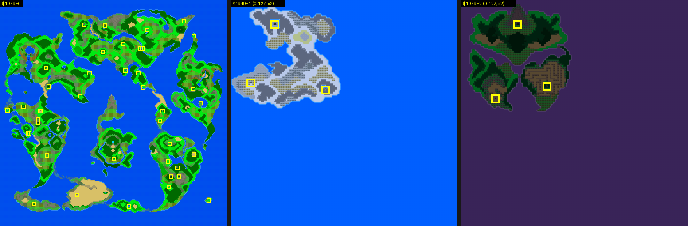

# DQ5(SFC) 필드(세계 지도) 형식

필드 지도가 ROM 에 어떻게 들어 있는지 정리한 문서입니다. 찾아낸 과정은
[2026-10-24-09 일지](journal/dq5/2026-10-24-09-field.md) 와 [2026-10-25-15 일지](journal/dq5/2026-10-25-15-field.md) 에 있습니다. 구현은 [tools/dq5field.py](../tools/dq5field.py).


## 불러오기 (`01:A5C2`)

필드에 나가면 RLE 두 덩어리를 DMA 로 WRAM 포트에 풉니다(`01:A64F`).

| 원본 | 풀린 곳 | 크기 | 내용 |
| --- | --- | --- | --- |
| `17:9A59` | `7F:0000` | 64KB | 세계 지도. 256x256 블록, 한 바이트가 블록 번호 하위 8비트 |
| `2A:8D3E` | `7E:E000` | 8KB | 블록 번호 9번째 비트(칸마다 1비트, `0x80 >> (i & 7)`) |

### 세계 셋 (`01:9F40`)

세계 지도는 셋이고, `01:9F40` 이 `$1949` 로 불러올 덩어리를 고릅니다. 블록 정의·타일 그래픽은 셋이 같고, 지도와 팔레트 2·3번 줄만 다릅니다.

| `$1949` | 지도(`7F:0000`) | 9번째 비트(`7E:E000`) | 불러오기 | `$194B` | 팔레트 2·3번 줄 |
| --- | --- | --- | --- | --- | --- |
| 0 | `17:9A59` | `2A:8D3E` | `01:A5C2` | `02` | 시간대마다(아래) |
| 1 | `2A:B722` | `2A:C310` | `01:A5F1` | `05` | `01:A199` |
| 2 | `2A:C51A` | `2A:D299` | `01:A620` | `0E` | `01:A3B5` |

세계 1 은 눈 덮인 땅, 세계 2 는 보라색 바다의 땅이고 둘 다 지도 왼쪽 위 구석만 씁니다. `$1949` 를 `POKE` 로 고정하고 필드에 서서 WRAM·VRAM 을 덤프하니,
세 세계 모두 지도·9번째 비트가 풀린 덩어리와 바이트까지 같았고, 롬의 블록 표로 그린 화면이 게임 화면과 같았습니다(3,584 표본 중 3,572·3,477·3,572 픽셀, 나머지는 인물·창).

`$1949` 는 맵에 들어갈 때마다 `2A:FEE4` 가 그 그룹의 세계(아래 `0F:EA97` +0 bit5-6 에서 1을 뺀 값)로 다시 씁니다(코드 읽기). 한 번만 바꾼 값은 다음 맵에 들어가며 사라졌습니다.



```
RLE 제어 바이트 c
  bit7 = 0: 다음 c+1 바이트를 그대로
  bit7 = 1: n = c & 7F. 0 이면 끝, 아니면 다음 한 바이트를 n+1 번
```

두 덩어리 모두 필드에 선 순간의 WRAM 과 같습니다.

## 블록 (`00:BBF7`, `00:BC4E`)

블록은 16x16 픽셀(8x8 타일 2x2)이고 아래층·위층이 있습니다. 블록 번호 `m`(0~511)의 정의는 층마다 5바이트입니다.

```
아래층 2A:A32C + m*5, 위층 2A:AD27 + m*5
  +0..+3  네 칸(왼위, 오위, 왼아래, 오아래) 타일 번호 하위 8비트
  +4      타일 번호 9번째 비트. 칸 q 는 0x80 >> q (00:BC9C)
```

타일 팔레트는 `2A:D712 + 타일/2` 의 니블입니다(짝수 타일은 위 니블). 위층은 4비트, 아래층은 3비트를 쓰고 `(값 + 8) << 8` 을 타일맵 워드에 더합니다(`00:BBAC`).
타일 512개가 쓰는 팔레트 줄은 2번(323개)·3번(185개)·4번(4개)뿐입니다.


## 타일 그래픽과 팔레트

- 타일: `12:B1A8` 의 RLE 를 `7E:C000-FFFF` 에 풀면 비트플레인 0·1·2·3 이 4KB 씩(`C000`/`D000`/`E000`/`F000`) 들어 있고,
  `01:A4CE` 가 타일마다 섞어 VRAM 워드 `2000-`(바이트 `0x4000-`)에 512개를 올립니다. 재조립한 16KB 가 필드의 VRAM 과 바이트까지 같습니다.
  그 뒤 `7E:E000-` 는 블록 9번째 비트로 덮어씁니다.
- 팔레트: [아래 절](#팔레트-01a04b).

`1F:D28E`·`1F:D2DE` 도 같은 꼴의 RLE 지만 VRAM 데이터 포트(`$2118`/`$2119`)로 바로 풀며, 필드에서는 VRAM 워드 `6000-` 근처(스프라이트로 보임)를 채웁니다.
`1F:D2DE` 쪽은 제어 바이트 `$7F` 를 「다음 뱅크 `$8000` 으로 넘어감」으로 씁니다.

## 팔레트 (`01:A04B`)

필드 BG 가 쓰는 줄은 2·3·4번입니다. WRAM 팔레트 버퍼는 `7E:3914`(줄 0)부터입니다.

| 줄 | 내용 | 쓰는 곳 |
| --- | --- | --- |
| 1, 4~7 | 실내와 같은 팔레트 세트([dq5-map-format.md 「팔레트」](dq5-map-format.md#팔레트-10de0b)). 세트는 필드에서도 남아 있는 마지막 `$BC`/`$BD` 로 고름 | 맵 팔레트 로더 |
| 2, 3 색 1~13 | 세계 0 은 `01:A16B` 표가 `$075E`(16비트 시간대)로 고르는 8벌 중 하나, 세계 1·2 는 한 벌 | `01:A090`(세계 0), `01:A6A3` |
| 4 색 1~3 | 세계 0 에서만 매 프레임 `01:A0F6 + $1961*6` 의 세 색(물결, 10단계) | `01:A0CF` |
| 2·3 색 14·15 | 8프레임쯤마다 두 값을 오감 | `02:ABEF`~`02:ABFE` |

세계 0 의 2·3번 줄 고르기(`01:A132`): `[하한 16비트][색인]` 3바이트 항목 10개를 뒤에서부터 보아 `$075E` 이상인 첫 항목의 색인으로 `01:A189` 의 포인터를 고르고,
그 주소부터 30바이트(2번 줄 색 1~15), 이어서 30바이트(3번 줄)를 옮깁니다. 포인터가 가리키는 8벌은 `01:A1D5`~`01:A3B4` 에 60바이트씩 붙어 있고, 앞뒤의 `01:A199`·`01:A3B5` 가 세계 1·2 의 것입니다.

| `$075E` | `0000` | `0001` | `0002`~`00ED` | `00EE` | `00EF` | `00F0` | `00F1` | `00F2`~`01FC` | `01FD` | `01FE`~ |
| --- | --- | --- | --- | --- | --- | --- | --- | --- | --- | --- |
| 벌 | `A2C5` | `A289` | `A24D` | `A289` | `A2C5` | `A301` | `A33D` | `A379` | `A33D` | `A301` |

`$075E` 를 11가지 값으로 고정하고 필드에 서서 CGRAM 을 덤프하니, 2·3번 줄 색 30개 중 26개가 표대로 고른 벌과 같았습니다(나머지 4개는 위의 색 14·15).
4번 줄은 세 세계 모두 세트 목록의 `$34` 번(`10:EC48`)이었고, 세계 0 은 색 1~3 이 물결 표 값으로 바뀌어 있었습니다(덤프 13개 모두 `$1961` 한 단계 앞의 항목, 표 갱신이 다음 프레임에 CGRAM 에 오름).
마지막으로 나온 맵이 01/00 이면 세트 `2E`, 02/00 이면 세트 `06` 으로 1·5번 줄이 바뀌었지만, 필드 타일은 그 줄을 쓰지 않습니다.

## 마을 입장 (`2A:F247`)

필드 좌표(`$B6`, `$B8`)가 `04:FD97` 표의 `[그룹][X 16비트][Y 16비트]` 와 정확히 같으면 그 그룹(`$BC`)으로 들어갑니다(47항목, 두 칸짜리 입구는 항목 둘).
들어가기 전에 `2A:FEF5` 가 그 그룹의 세계(`0F:EA97 + 그룹*5` 의 bit5-6 에서 1을 뺀 값, 그룹 `05`·`$50` 이상은 0)가 `$1949` 와 같은지 봅니다. 세계가 다르면 입구를 밟아도 들어가지 않습니다(그룹 `$54` 는 늘 못 들어감).
그 뒤 `2A:F384` 가 `0F:EA97` 항목으로 `$BD`·도착 X·Y·방향·`$198E` 를 정하고, `2A:FD7E` 가 `$194A` 를, `2A:F28D` 가 맵마다 예외를 덮어씁니다.

```
0F:EA97 + 그룹*5
  +0  bit0-4 $BD, bit5-6 세계+1, bit7 → $194A bit7
  +1  도착 X, +2 도착 Y, +3 방향($C3)
  +4  bit0·1·7 → $198E, bit2-6 → $194A bit0-4
```

입구 47개 중 46개를 실제로 밟았습니다(나머지 하나인 그룹 01 은 장면 이동 도구가 그 항목을 쓰므로 [2026-10-25-08 일지](journal/dq5/2026-10-25-08-warp.md) 의 실험으로 대신함).
입구 바로 아래(막히면 위·오른쪽·왼쪽)에 서서 입구 쪽으로 한 칸 걸었고, 세계 1·2 의 입구는 `$1949` 를 `POKE` 로 고정했습니다. 46개 모두 들어갔고, 42개는 `0F:EA97` 의 `$BD`·도착 좌표 그대로였습니다.
나머지 넷은 이렇습니다.

| 입구 | 그룹 | 표의 도착 | 실제 도착 | 까닭 |
| --- | --- | --- | --- | --- |
| (320,109) | `28` | 28/00 (0,23) | 28/02 (40,27) | `2A:F29D`: `$BC`=`28` 이고 `$B6` 하위 바이트가 `$40` 이면 28/02 |
| (85,269) | `13` | 13/00 (32,85) | 13/00 (16,7) | `2A:F2FB`: `$B8`=`$010D` 이면 (16,7), `$198E`=`82` |
| (452,233) | `51` | — | 51/50 (22,8) | `2A:F3E5`: 그룹 `51` 은 표 대신 51/50 (22,8) |
| (65,301) | `1F` | 1F/00 (100,29) | 1F/00 (95,29) | 도착하자 「わん わん!」 대화가 뜸. 좌표가 다른 까닭은 남은 것 |

`$1949` 를 0 으로 둔 채 세계 1·2 의 입구 6개를 밟으면 네 방향 모두 들어가지 않았습니다.

마을에서 필드로 나올 때(`2A:F425`)도 먼저 `04:FD97` 에서 그룹을 찾아 그 입구 좌표에 서고, 없으면 `04:FE83` 을 씁니다.
`04:FE83` 은 `$1954 == $82`(탈것 상태로 보임)와 함께 쓰여, 배를 대는 자리로 보입니다.


세계 0 지도에서 바다(블록 `000`) 위에 찍힌 입구 셋(그룹 `09`·`08`·`15`)과 산·숲 위에 찍힌 셋(`22`·`1C`·`30`)은 세계 1·2 의 입구입니다.
그 세계로 바꾸어 같은 자리에 서면 동굴·마을 그림 위에 있습니다(위 세계 셋 그림의 노란 틀).

## 좌표

- `$B6`/`$B8`: 주인공의 필드 좌표, 8픽셀 단위. 블록 좌표는 반으로 나눈 값입니다. 실내 맵에서 나올 때 `04:FD97`/`04:FE83` 표로 정해집니다.
- `$90`/`$92`: 칸을 검사할 때 쓰는 8픽셀 타일 좌표. 블록 색인은 `(y >> 1) * 256 + (x >> 1)`.

## 남은 것

- 1F/00 입구로 들어가면 표의 X 100 이 아니라 95 에 서는 까닭(둘째 루틴 `03:D4B5` 를 빼도 같음)
- `$1949` 가 1·2 가 되는 실제 이야기 흐름(어느 맵에서 세계가 바뀌는지), `$194A`·`$198E` 의 뜻
- 필드 VRAM 타일 `454`~`459` 가 세계 1·2 에서 롬 타일과 다른 까닭(물결 타일 `4`·`5`·`20`·`21` 은 세 세계 모두 바뀜)
- 필드 인물·조우. `04:FE83` 표(그룹 `$50`~`$54` 항목도 있음)를 쓰는 경우의 실측
- 그림은 아직 CGRAM 덤프로 칠함. 위 표로 롬만으로 팔레트를 만들 수 있음
