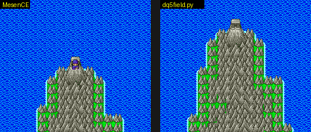

# DQ5(SFC) 필드(세계 지도) 형식

필드 지도가 ROM 에 어떻게 들어 있는지 정리한 문서입니다. 찾아낸 과정은
[2026-10-24-09 일지](journal/2026-10-24-09-dq5-field.md) 에 있습니다. 구현은 [tools/dq5field.py](../tools/dq5field.py).


## 불러오기 (`01:A5C2`)

필드에 나가면 RLE 두 덩어리를 DMA 로 WRAM 포트에 풉니다(`01:A64F`).

| 원본 | 풀린 곳 | 크기 | 내용 |
| --- | --- | --- | --- |
| `17:9A59` | `7F:0000` | 64KB | 세계 지도. 256x256 블록, 한 바이트가 블록 번호 하위 8비트 |
| `2A:8D3E` | `7E:E000` | 8KB | 블록 번호 9번째 비트(칸마다 1비트, `0x80 >> (i & 7)`) |

```
RLE 제어 바이트 c
  bit7 = 0: 다음 c+1 바이트를 그대로
  bit7 = 1: n = c & 7F. 0 이면 끝, 아니면 다음 한 바이트를 n+1 번
```

두 덩어리 모두 필드에 선 순간의 WRAM 과 같습니다.

## 블록 (`00:BBF7`, `00:BC4E`)

블록은 16x16 픽셀(8x8 타일 2x2)이고 아래층·위층이 있습니다. 블록 번호 `m`(0~511)의 정의는 층마다 5바이트입니다.

```
아래층 2A:A32C + m*5, 위층 2A:AD27 + m*5
  +0..+3  네 칸(왼위, 오위, 왼아래, 오아래) 타일 번호 하위 8비트
  +4      타일 번호 9번째 비트. 칸 q 는 0x80 >> q (00:BC9C)
```

타일 팔레트는 `2A:D712 + 타일/2` 의 니블입니다(짝수 타일은 위 니블). 위층은 4비트, 아래층은 3비트를 쓰고 `(값 + 8) << 8` 을 타일맵 워드에 더합니다(`00:BBAC`).



## 타일 그래픽과 팔레트

- 타일: `12:B1A8` 의 RLE 를 `7E:C000-FFFF` 에 풀면 비트플레인 0·1·2·3 이 4KB 씩(`C000`/`D000`/`E000`/`F000`) 들어 있고,
  `01:A4CE` 가 타일마다 섞어 VRAM 워드 `2000-`(바이트 `0x4000-`)에 512개를 올립니다. 재조립한 16KB 가 필드의 VRAM 과 바이트까지 같습니다.
  그 뒤 `7E:E000-` 는 블록 9번째 비트로 덮어씁니다.
- 팔레트(필드 CGRAM 을 롬에서 찾은 결과): 2·3번 줄은 `01:A24B`·`01:A269`, 5~7번 줄은 `10:F028-`(실내 팔레트 표 `10:E5C8` 의 `$53` 번부터). 4번 줄은 롬에 그대로 없습니다.

`1F:D28E`·`1F:D2DE` 도 같은 꼴의 RLE 지만 VRAM 데이터 포트(`$2118`/`$2119`)로 바로 풀며, 필드에서는 VRAM 워드 `6000-` 근처(스프라이트로 보임)를 채웁니다.
`1F:D2DE` 쪽은 제어 바이트 `$7F` 를 「다음 뱅크 `$8000` 으로 넘어감」으로 씁니다.

## 좌표

- `$B6`/`$B8`: 주인공의 필드 좌표, 8픽셀 단위. 블록 좌표는 반으로 나눈 값입니다. 실내 맵에서 나올 때 `04:FD97`/`04:FE83` 표로 정해집니다.
- `$90`/`$92`: 칸을 검사할 때 쓰는 8픽셀 타일 좌표. 블록 색인은 `(y >> 1) * 256 + (x >> 1)`.

## 남은 것

- 팔레트 4번 줄(롬에 그대로 없음, 물결 색 순환으로 보임)과 팔레트를 고르는 루틴. 지금 그림은 CGRAM 덤프로 칠함
- 필드에서 마을로 들어가기: 아직 못 찾음([2026-10-24-10 일지](journal/2026-10-24-10-dq5-field-walk.md)). 첫 필드 전투는 강제 이벤트, 나온 자리는 갇힌 곳이었음.
  `2A:FDCB` 는 필드 좌표가 `04:FE83` 의 좌표와 같은지 검사하고 `$1954`(탈것 상태로 보임)도 보는데, 마을 입장인지 배 관련인지 아직 모름
- 필드 영역 이동(`01:94B4` 의 `01:9635` 등)과 필드 인물·조우
- 다른 필드(`$BC` = `$50`~`$54`)
