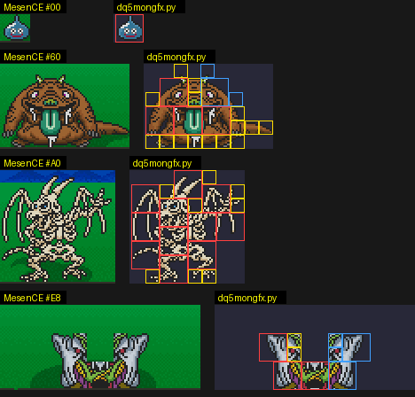
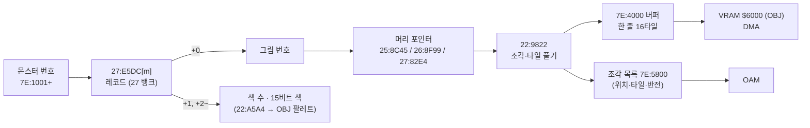
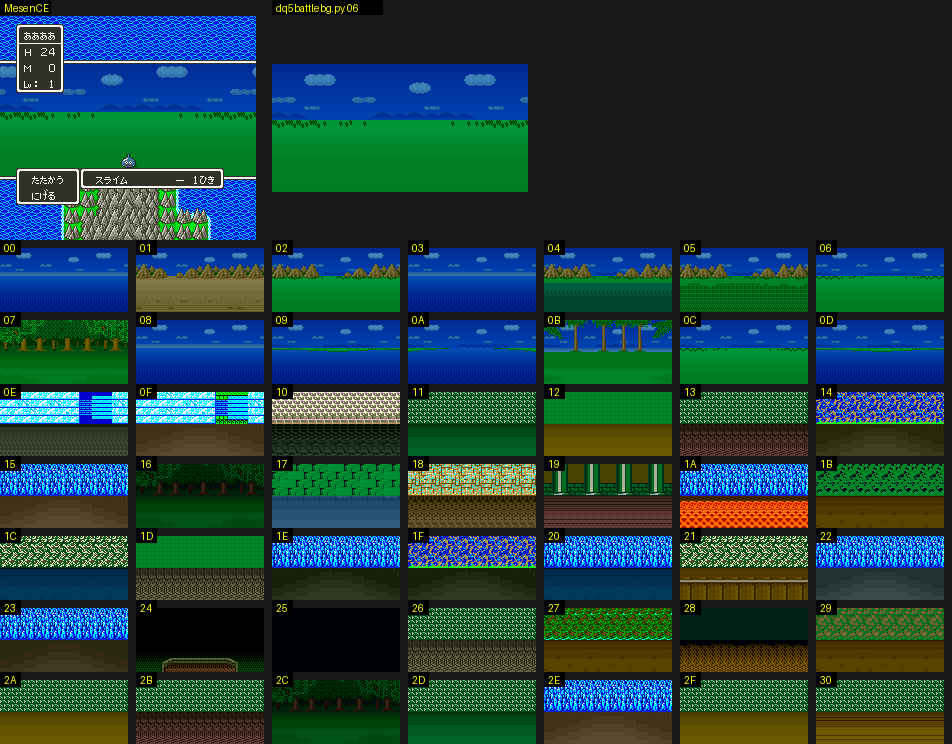

# DQ5(SFC) 전투 몬스터 그림과 배경 형식

전투 화면의 몬스터 그림과 배경이 롬 어디에 어떤 형식으로 들어 있고, 게임이 어떻게 풀어 화면에 놓는지 정리한 문서입니다. 찾아낸 과정은 일지에 있습니다.

- [2026-10-25-09: 전투 몬스터 그림](journal/dq5/2026-10-25-09-mongfx.md)
- [2026-10-25-21: 전투 몬스터 배치와 그림자](journal/dq5/2026-10-25-21-mongfx-layout.md)
- [2026-10-25-22: 전투 배경](journal/dq5/2026-10-25-22-battlebg.md)

기준과 검증:

- 기준 롬: `rom/dq5.sfc`([README](../README.md) 의 SHA-1). 주소 표기는 [dq5-map-format.md](dq5-map-format.md) 와 같습니다.
- 디코더: [tools/dq5mongfx.py](../tools/dq5mongfx.py). 몬스터 236마리가 그림 번호 107개를 쓰고, 그 머리는 104곳입니다. 머리를 주소 순으로 놓으면 그림마다 다음 머리의 첫 바이트에서 정확히 끝납니다(예외는 아래 「그림 머리 포인터」와 「남은 것」).
- 이벤트 전투(슬라임 셋)의 몬스터 번호(`7E:1001`)를 그림마다 대표 몬스터 하나로 바꿔 107번 전투를 붙였습니다.
  게임이 그림을 다 푼 직후(`22:90DC`)의 WRAM 버퍼 `7E:4000-5FFF` 에 디코더가 푼 타일이 모두 있었고(타일 3,623/3,623), 화면과도 픽셀째로 맞았습니다(아래 「검증」).

## 한눈에 보기

## 몬스터 레코드 (`27:E5DC`)

`27:E5DC` 는 몬스터 236마리의 16비트 포인터 표(27 뱅크 안)입니다. 가리키는 레코드는 이렇습니다(`22:8FF8`, `22:A5A4`).

| 오프셋 | 뜻 |
| --- | --- |
| +0 | 그림 번호(`00`~`71` 중 107개가 쓰임. `2D`·`35`·`37`·`38`·`57`·`5F`·`66` 은 아무도 안 씀) |
| +1 | 색 수 n |
| +2 ~ | 15비트 BGR 색 n개. OBJ 팔레트의 1번 색부터 채움(0번은 투명) |

같은 그림을 색만 바꿔 여러 몬스터가 나눠 씁니다(예: 그림 `15` 를 몬스터 `60`·`7A` 가 다른 색으로). `22:A5A4` 는 `22:AB23` 표(`$0DD8` 번째)가 가리키는 `7E` 뱅크 자리에 색 수 + 1 과 색들을 적습니다(코드 읽기).
CGRAM 사본 `7E:2D00` 512바이트가 그림 버퍼 DMA 다음 프레임에 `00:FDE3` 에서 CGRAM 으로 DMA 됩니다(이벤트 전투에서 890프레임). 레코드 색으로 칠한 디코더 그림이 화면 픽셀과 RGB 까지 맞으므로 색 순서(1번 색부터)는 실측으로 확인했습니다.

## 그림 머리 포인터

그림 번호 g 의 머리는 뱅크마다 다른 16비트 포인터 표에 있습니다(`22:9014`). 머리와 자료는 표와 같은 뱅크에 있습니다.

| 그림 번호 | 표 | 머리 범위 |
| --- | --- | --- |
| `00`~`29` | `25:8C45 + g*2` | `25:8C99`~`25:F9F4` |
| `2A`~`56` | `26:8F99 + (g-2A)*2` | `26:8FF3`~`26:FFCB` |
| `57`~`71` | `27:82E4 + (g-57)*2` | `27:831A`~`27:E5DC` |

뱅크의 마지막 그림은 `28`(`25:F9F4` 에서 끝나고 바로 코드 `08 E2 30` 이 이어짐), `56`(`26:FFCB` 에서 끝나고 뒤는 `00` 채움), `71`(몬스터 레코드 포인터 표 `27:E5DC` 바로 앞)입니다.
여러 번호가 같은 머리를 가리킵니다: `00`·`11`·`29`(`25:8C99`), `2A`·`2D`·`35`·`37`·`38`(`26:8FF3`), `57`·`58`·`5E`·`5F`·`66`(`27:831A`). 안 쓰는 번호는 모두 뱅크 첫 그림을 가리킵니다.

## 그림 형식 (`22:9822`)

그림은 8픽셀 칸으로 된 상자 안에 OBJ 조각(8x8 또는 16x16)을 늘어놓은 것입니다.

| 오프셋 | 뜻 |
| --- | --- |
| +0 | bit7 = 띄움(공중에 뜬 몬스터, 위쪽 줄에 놓음), bit5-6 = 8픽셀 단위로 들어 올림, bit0-4 = 그림자 모양 번호(0 이면 그림자 없음). 아래 「배치와 그림자」 |
| +1 · +2 | 그림자 위치 보정(부호 있는 바이트, x · y) |
| +3 · +4 | 타격 효과 기준점(그림 상자 안 8픽셀 칸 x · y) |
| +5 | 상위 니블 + 1 = 가로 칸 수(니블이 `F` 면 19), 하위 니블 + 1 = 세로 칸 수 |
| +6 ~ | 칸 비트맵: 가로 × 세로 비트, 가로 우선·바이트의 MSB 먼저. 1 인 칸마다 조각 하나 |
| 그다음 | 조각마다 니블 하나(바이트의 상위 니블 먼저), ⌈조각 수 / 2⌉ 바이트 |
| 그다음 | 조각 자료를 칸 순서대로 |

조각 니블:

| 비트 | 뜻 |
| --- | --- |
| bit1 | 1 이면 16x16 조각(타일 4개를 왼쪽 위·오른쪽 위·왼쪽 아래·오른쪽 아래 순서로), 0 이면 8x8(타일 1개) |
| bit2·bit3 | 둘 다 0 이면 새 타일을 푼다. 하나라도 1 이면 자료 1바이트 = 이 그림의 앞 조각 번호(0부터)이고, 그 조각의 타일을 좌우 반전해 이 칸에 다시 쓴다(`22:9E95`, OAM 속성 `EOR #$4000`). 이때 bit2 가 0 이면 1픽셀 왼쪽에 둔다 |

서로 다른 머리 104곳에서 쓰이는 니블은 `0`(716), `2`(704), `4`(17), `6`(33), `8`(34), `A`(58) 뿐입니다.

### 타일 (`22:992A`)

타일 하나(4bpp 8x8, 32바이트)는 모드 바이트 M 으로 시작합니다. 앞 16바이트(평면 0·1)와 뒤 16바이트(평면 2·3)를 따로 처리하고, 평면마다 8바이트(줄마다 1바이트)입니다.

| M 비트 | 뜻 |
| --- | --- |
| bit0~3 | 평면 0~3 이 있는지. 없는 평면은 0 |
| bit6 | (bit7 일 때) 1 이면 M 다음 바이트가 채움 값, 0 이면 채움 값 0 |
| bit7 | 0 이면 있는 평면의 바이트를 그대로 읽는다(`22:99B7`·`9A15`·`9A75`). 1 이면 마스크 압축(`22:9AEB`·`9BA5`·`9C5F`) |

마스크 압축이면 (채움 값 다음에) 있는 평면 수만큼의 마스크 바이트가 오고, 그 뒤가 자료입니다. 바이트를 줄 순서대로(평면 0·1 은 줄마다 평면 0, 평면 1 번갈아) 채우며 마스크 비트(MSB 먼저)가 1 이면 자료에서 1바이트를 읽고, 0 이면 채움 값을 씁니다.
마스크 바이트 하나가 평면 하나(8바이트)를 맡습니다. bit4·bit5 는 롬 전체에서 쓰이지 않습니다.

예: 슬라임(그림 `02`, 머리 `25:9177`)은 `06 FC 0B 01 01 11 | 80 | 20 | 87 2A FF 0B 01 …` 입니다. 2×2 칸, 비트맵 `80` 이라 조각은 (0,0) 하나, 니블 `2` 라 16x16 입니다.
첫 타일 `20` 은 평면이 하나도 없어 투명이고, 둘째 타일 `87` 은 마스크 압축·평면 4개, 마스크 `2A FF 0B 01` 입니다.

### 버퍼와 OBJ

게임은 타일을 `7E:4000` 버퍼(한 줄 16타일 = `$200` 바이트)에 16x16 단위로 쌓고, 조각마다 화면 위치(칸 × 8)와 OBJ 타일 번호·반전을 `7E:5800` 목록에 적습니다(`22:9DB0`, `22:9E1C`, 코드 읽기).
8x8 조각은 16x16 자리 하나에 넷까지 모아 넣습니다(`22:9E81` 표 `00 01 10 11`). 버퍼는 VRAM 워드 주소 `$6000`(OBJ 이름 기준) 이후로 DMA 됩니다(이벤트 전투에서 889프레임, `00:FD6D` 가 `7E:4000`→`$6000`, `7E:4200`→`$6100` 처럼 한 줄씩).
OBJ 크기는 8x8/16x16 모드(PPU 상태의 OBJ 크기 0), 둘째 이름 표는 첫째 바로 뒤(오프셋 `$1000` 워드)라 타일 번호 `000`~`1FF` 가 이어집니다.

## 배치와 그림자

전투 시작 때 `22:86B7` 이 무리 네 개(`7E:1001`~`1004` 몬스터, `1005`~`1008` 마릿수, `1009`~`100C` 무리 값)를 차례로 읽어 그림을 풀고, 무리마다 `7E:0C10`~ 표(5칸)에 몬스터·마릿수·그림 번호·머리 값을 옮깁니다(`22:92C2`).
몬스터 한 마리마다 `7E:0C60`~ 표(16칸)에 화면 상자 왼쪽 위(`0C93` x, `0CA4` y)와 그리는 순서(`0CB5`)를 둡니다.
아래 규칙을 `dq5mongfx.py --layout` 으로 옮겼고, 무리 조합 20가지 전투의 OAM 에서 찾은 상자와 모두 맞았습니다(아래 「검증」).

### 줄과 높이

몬스터는 세 줄 중 하나에 놓입니다(`22:B00F`, `22:A001`). 무리 값은 `7E:1009 + 무리` 이고, 머리 +0 bit7 이 켜진 그림은 무리 값에 `80` 이 더해집니다(`22:905C`).

| 줄 | 조건 | 상자 위 y(OAM 좌표) | 그리는 순서(`0CB5`) |
| --- | --- | --- | --- |
| 0 | 그 밖 | `$A0 - 8h - 8·들어올림` | 1 |
| 1 | 무리 값 = `01` | `$88 - 8h - 8·들어올림` | 5 |
| 2 | 무리 값 bit7(띄움) | `$58 - min(4h, 24) - 8·들어올림` | 0 |

h 는 그림의 세로 칸 수, 들어올림은 머리 +0 bit5-6 입니다. 줄 0 은 모든 몬스터의 아랫단이 `$A0` 에 맞춰지고, 띄운 몬스터는 키의 절반(최대 24)만큼 `$58` 위로 올라갑니다.
OAM 은 그리는 순서가 작은 몬스터부터 쌓이므로(`22:A1D5`) 띄운 몬스터가 맨 앞, 줄 1 이 맨 뒤에 보입니다.

### 가로 위치

한 줄 안에서 무리는 번호 순으로 왼쪽부터, 무리 안 몬스터는 가로 칸 수 × 8 간격으로 붙여 놓고, 무리와 무리 사이는 8픽셀 띄웁니다. 줄 전체 폭이 T 이면 첫 무리의 왼쪽은 `(256 - T) / 2` 입니다(`22:AF22`). 줄마다 따로 가운데에 맞춥니다.

예: 줄 0 에 スライム 1(2칸)·マッドプラント 1(6칸)·エビルスピリッツ 1(6칸), 줄 2 에 ダックカイト 1(6칸)이면 T = 16 + 48 + 48 + 8·2 = 128 이라 줄 0 의 x 는 64·88·144, 줄 2 는 104 입니다.

### 마릿수 제한

마릿수가 많으면 다음 순서로 잘립니다. 잘린 무리는 그 뒤 몬스터를 놓지 않습니다.

1. 한 줄의 가로 칸 수 합이 28 미만(`22:9284`, `7E:2FCD + 줄`). 무리 사이 8픽셀은 세지 않습니다.
2. 모든 몬스터의 OBJ 조각 수 합이 100 미만(`22:91DC`).
3. 화면 8픽셀 줄마다 걸치는 OBJ 타일 수 합이 28 미만(`22:A119`, `7E:2F00 + (y >> 3) - 7`). 그림마다 줄별 타일 수(16x16 조각은 2)를 풀 때 `7E:5B60` 에 적어 둡니다(107개 그림 모두 디코더 값과 같음). 스캔라인당 OBJ 한도를 넘지 않게 하는 장치로 보입니다.

예: シャドーサタン(9칸) 4마리는 3마리, スライム 1 + シャドーサタン 3 은 シャドーサタン 2마리만 나옵니다.

### OAM 만들기 (`22:A1D5`)

그림을 풀 때 조각마다 그림 상자 기준 위치·타일·속성 4바이트를 `7E:5800` 에 적어 두고(`22:9DB0`), `22:A1D5` 가 그리는 순서 0~15 로 몬스터를 돌며 조각마다 `[x, y] += 상자 왼쪽 위`, 속성에 무리별 팔레트(`0CD7` × 2)와 우선순위 3 을 더해 OAM 사본 `7E:0300` 에 씁니다. 남은 칸은 y = `F0` 으로 숨깁니다.

### 그림자

머리 +0 bit0-4 가 그림자 모양 번호입니다. `22:B4FE` 표(번호 × 2, 22 뱅크 포인터, `FFFF` 는 없음)가 가리키는 자료는 `[줄 수 n]` 다음 n개의 `[dy][왼쪽 x][오른쪽 x(제외)]` 가로 구간입니다. 예: 1번은 13줄로 첫 줄이 `0B`~`14`, 둘째 줄이 `07`~`18` 인 타원입니다.
`22:B44A` 가 이 구간에 몬스터 위치를 더해 전투 배경 BG 타일을 어둡게 칠합니다(프레임 898, 다음 프레임에 VRAM `$4AE0`·`$4CE0` 으로 DMA). 그림자는 OBJ 가 아니라 배경 그림의 일부입니다.
MesenCE 스크린샷(OAM y − 7 = 스크린샷 y) 기준으로 그림자 줄 dy 의 위치는 이렇습니다.

- y = 상자 위 + 8h + (+2) − 24 + dy, x = 상자 왼쪽 + 4w + (+1) + 1 + 구간 x

マッドプラント(그림 `00`, 모양 1, +1 = `F1`, +2 = `12`) 1마리에서 그림자 6줄(창에 가리기 전까지)의 가로 구간이 모양 1 의 첫 6줄과 너비·자리 모두 같았습니다. 그림자 모양을 0 으로 덮으면 그림자가 사라지고, +1 을 8 늘리면 오른쪽으로 8, +2 를 8 줄이면 위로 8 옮겨 갔습니다. スライム 3마리도 몸에 가리지 않은 그림자 픽셀이 같은 식과 맞았습니다.

### 타격 효과 기준점

머리 +3·+4 는 공격받을 때 터지는 효과의 기준 칸입니다. `22:DB3D` 가 `x = 상자 왼쪽 / 8 + (+3)`, `y = 상자 위 / 8 + (+4) − 7` 을 `7E:9E78`·`9E79` 에 두고 효과 스크립트가 씁니다.
マッドプラント 의 +3 을 `03` 에서 `06` 으로 덮자, 맞을 때 효과 불꽃이 오른쪽으로 24픽셀(3칸) 옮겨 갔습니다.

### 무리를 더하는 몬스터

`22:89E5` 가 첫 무리 몬스터를 보고 무리를 고칩니다.

| 첫 무리 | 하는 일 |
| --- | --- |
| `E7`(ミルドラース) | 둘째·셋째 무리에 `E8`·`E9` 1마리씩, 무리 값 셋 모두 `01` |
| `EA`(ミルドラース) | 둘째 무리에 `EB` 1마리, 무리 값 `00` |
| `6A`(スライム) | 마릿수가 짝수면 하나 뺌 |

`E7` 전투에서는 `E7`(그림 `6D`)과 `E8`(그림 `6E`)이 같은 원점 (72,56) 에 겹쳐 그려졌습니다(1100~2000프레임 OAM). `E9`(그림 `6F`)의 타일은 VRAM 에 21/21 올라가 있지만 기다리는 동안에는 OAM 에 나오지 않았습니다.
`E7` 이면 `22:AF61` 이 줄 폭 표 일부를 `FFFF` 로 채우는데, 이 때문에 셋이 한 원점에 모이는 것으로 보입니다(코드 읽기). `6A` 4마리 전투는 3마리, 3마리 전투는 3마리였습니다.

### 같은 머리를 가리키는 번호

그림 번호는 VRAM 에 올린 타일을 함께 쓰는 열쇠입니다. `22:91F7` 이 이미 올린 그림 번호 목록(`7E:0D3D`)에 같은 번호가 있으면 타일을 다시 풀지 않습니다.
マッドプラント(`0F`)와 わらいぐさ(`1F`)는 둘 다 그림 `00` 이라 두 무리가 같은 OBJ 타일 `000`~`01B` 를 팔레트만 달리해 썼고, マッドプラント 와 ドードリアン(`C0`, 그림 `11`, 머리는 `00` 과 같음)은 `000`~`01B` 와 `00E`~`039` 로 타일을 따로 올렸습니다.
번호를 나눈 이유(따로 올려야 하는 연출이 있는지)는 모릅니다. `11` 은 ドードリアン, `29` 는 ブルーマッコイ·オーシャンキング, `5E` 는 이름이 ダミー 인 `CB`·`D2` 가 씁니다.

### 그림 `15` 뒤의 3바이트

`25:C4E9`~`C4EB`(`81 80 FC`)는 게임도 읽지 않습니다. 몬스터 `60` 전투에서 `25:C4E0`~`C4EF` 읽기를 지켜보니 `C4E8` 까지만 읽혔습니다.

## 전투 배경

몬스터 뒤의 그림 띠입니다. 디코더는 [tools/dq5battlebg.py](../tools/dq5battlebg.py) 입니다. 전투 셋업(`22:85EE`)이 `7E:1AA0` 으로 번호를 정하고, 그림 두 장·목록 세 개·팔레트 레코드로 BG1·BG2 에 256x128 띠를 만듭니다. 띠는 HDMA 로 세로가 늘었다 줄었다 하며, 다 펴지면 화면 y 48~159 에 나옵니다.

### 번호를 정하는 곳

| 장면 | 쓰는 곳 | 값 |
| --- | --- | --- |
| 필드 | `01:84CF`(걸음마다) | 지형(`03:CB1B`, 0~D) |
| 실내 맵 | `01:83E6`(맵에 들어갈 때, `01:843A`) | 맵 표 `23:FD6A[BC] + BD*6` 의 `+3` 에 `80` OR |
| 이벤트 | 이벤트 코드 | 첫 필드 이벤트(`02:A77B`)는 `06` |

필드 세 곳은 모두 `02`, 17/00 은 `80`, 21/02(`+3` = `07`)는 `87` 이었습니다. 실내 쓰기는 DB = `23` 이라 메모리 콜백에는 `23:1AA0` 으로 잡힙니다.
bit7 이 꺼져 있으면 번호 n = `$1AA0`, 켜져 있으면 n = `$1AA0 - 72`(실내 `+3` 값 + E)라 필드 0~D, 실내 E~30 으로 나뉩니다(49개).
`7E:1AA1` 은 `01:843D` 의 `21:8000` 이 carry 를 돌려주면 1 이 되고, 그러면 팔레트 레코드만 두 번째 벌(+2)로 바뀝니다(밤으로 보임).

### 번호에서 표로

`22:8983[n]`(16비트)의 하위 바이트 & `FC` 가 종류 오프셋 k(`$0D14`), 하위 2비트가 `$0DF2`, 상위 바이트가 타일맵 상위 바이트 H(`$64`, 팔레트·타일 번호 상위 비트)입니다. k 로 찾는 표는 모두 28 뱅크 16비트 포인터입니다.

| 표 | 내용 |
| --- | --- |
| `28:82F9 + k` | 그림 A(아래 띠 타일 재료) |
| `28:82FB + k` | 그림 B(위 띠 타일, VRAM `$5000` = BG 타일 `$300`~`$3FF`) |
| `28:C9C2 + k*3/2` 의 +0 · +2 · +4 | 목록 1(BG1 위 띠) · 목록 2(BG2) · 목록 3(그림 A 에서 BG 타일 `$200`~`$2FF` 만들기) |
| `28:BDFC + k` | 팔레트 레코드(`$1AA1` 이면 k + 2. `$1949` = 1·2 이고 k < 1E 이면 + 98·+ B4, 코드 읽기) |

### 그림 (`22:CA81`)

`+0` 의 상위 니블 + 1 이 가로 칸 수 w, 하위 니블 + 1 이 세로 칸 수 h 입니다. 그 뒤 w × h 비트의 칸 비트맵(가로 우선, MSB 먼저)이 오고, 비트가 1 인 칸마다 몬스터 그림과 같은 형식의 4bpp 타일이 하나씩 이어집니다(`22:CB62`·`C959`·`C9F4`). 칸 (x, y) 는 `7E:4000 + y*$200 + x*$20` 에 풀리고, 비트가 0 인 칸은 버퍼에 있던 값이 남습니다.
그림 B 는 다 푼 뒤 첫 타일을 0 으로 지우고 `7E:4000-5FFF` 를 VRAM `$5000` 으로 보냅니다.

### 목록

- 목록 3(`22:870D`): `[t][c]` 를 `FF` 까지. 그림 A 의 타일 t 하나를 `(c & 3F) + 1` 번 되풀이해 `7E:6000` 에 이어 붙이고 VRAM `$4000`(BG 타일 `$200`~`$2FF`)으로 보냅니다.
- 목록 1·2(`22:8878`): `[타일 하위 바이트][f]` 를 `FF` 까지. 타일맵 칸 `(f & 3F) + 1` 개를 같은 값으로 채우고, 칸 값의 상위 바이트는 `H | (f bit7 → 40 좌우 반전) | (f bit6 → 04 팔레트 + 1)` 입니다. 32칸 한 줄씩 WRAM `7E:8A1D` 에 쓴 뒤 목록 1 은 BG1 `$0CC0`, 목록 2 는 BG2 `$04C0` 으로 갑니다.
- 그 뒤 BG2 `$05C0` 을 0 으로 지우고 BG1 `$0DC0` 에 타일 `$200`~`$2FF` 를 차례로 깝니다(팔레트 = 레코드 시작 칸). 띠의 위 8줄은 BG1 목록 1 위에 BG2 목록 2 를 겹친 것, 아래 8줄은 이 타일들입니다.
- `$1949` = 2 이고 `$1AA0` < 80 이고 7 이 아니면 목록 2 대신 `28:FD64` 를 씁니다(코드 읽기).

### 팔레트 (`22:8801`)

레코드는 `[개수][시작 칸 s]` 뒤에 개수만큼 `[색 수 m][15비트 색 m개]` 이고, 팔레트 s, s+1, … 의 1번 색부터 채웁니다(`22:A576` → `22:A5A4`). 셋업은 먼저 `22:8811` 이 전투 직전 맵의 색 사본(`7E:3914`)을 `7E:2D00` 에 깔기 때문에, 레코드가 채우지 않는 팔레트(예: 실내형 H = `07` 의 팔레트 1·2)는 맵마다 달라집니다. 도구는 그 색을 `--cgram` 으로 받습니다.

### 확인

배경 11개(06 낮·밤, `7E:1AA0` 을 고친 0D·0E·13·17·1A·22·29·30, 21/02 무작위 전투의 15, 필드의 02)를 `dq5battlebg.py --compare` 로 VRAM·CGRAM 덤프와 맞췄습니다.
타일맵이 쓰는 타일, BG1 `$0CC0`·`$0DC0`, BG2 `$04C0`(각 256칸), 레코드 팔레트 색이 모두 같았습니다. 다 펴진 화면은 1A 를 빼면 펴진 줄(대부분 112줄)이 모두 256픽셀째로 같았고, 1A 는 112줄 중 88줄만 다 같았습니다.
21/02 의 15번은 1100프레임 덤프라 그림자가 칠해진 타일 5개가 달랐습니다(284/289).

## 검증

- **버퍼**: 그림 107개마다 대표 몬스터 하나로 이벤트 전투를 붙이고(`walk.lua` 의 `POKE="7E1001=<번호>;7E1005=1"`), 그림을 다 푼 직후 `22:90DC` 에서 WRAM 을 덤프했습니다(`tools/lua/dq5battledump.lua` 의 `AT`). `dq5mongfx.py --compare` 가 디코더 타일(반전 복사 조각 빼고)이 버퍼에 32바이트째로 있는지 셉니다. 107번 모두 빠짐없이 있었습니다(3,623/3,623).
- **화면**: 같은 전투의 1000프레임 화면에서 `--shot` 이 그림이 가장 잘 맞는 자리를 찾아 불투명 픽셀의 RGB 를 비교합니다. 105번(`E4`·`EA` 빼고) 152,426/152,899 픽셀이 맞았고, 틀린 473픽셀은 모두 스크린샷의 y=152 줄로, 그림의 맨 아랫줄이 창 테두리에 가려진 것입니다. 같은 화면의 OAM·VRAM 으로 OBJ 만 다시 그려 색 번호로 비교하면(`--oam`) 그 줄까지 맞습니다(몬스터 `60` 1,726/1,726).
- `E4`(ブオーン)는 1000프레임에 아직 나타나지 않아 1450프레임 화면으로 비교했습니다(5,522/5,522).
- **배치**: 무리 조합 20가지(한 무리 1~8마리, 여러 무리, 줄 1·2, 띄운 그림, 넓은 그림, 마릿수 제한)로 전투를 붙이고 1000프레임 OAM 을 팔레트별로 다시 그려 그림 상자를 찾았습니다. `layout()` 의 예상(몬스터·x·y)이 20가지 모두 정확히 같았습니다.
- **경계**: 머리 104곳을 주소 순으로 놓으면 그림마다 디코더가 읽은 끝이 다음 머리와 같습니다. 예외는 그림 `15`(3바이트 남음)와 뱅크 마지막 그림입니다.

## 여러 그림으로 된 몬스터

몬스터 `EA`(이름 표의 이름은 `E8`~`EB` 모두 ミルドラース)를 넣으면 게임이 둘째 그룹(`7E:1002`)에 `EB` 를 1마리(`7E:1006`) 더해, 그림 `70`(윗몸)과 `71`(아랫몸)을 같은 원점에 겹쳐 그립니다. 1950프레임의 OAM·VRAM 으로 OBJ 를 다시 그려 색 번호로 비교하면(`--oam`) 두 그림이 같은 자리 (51,58) 에서 각각 7,332/7,332·3,401/3,401 픽셀 맞습니다.
이 전투는 OBJ 팔레트를 바꾸는 연출이 있어 레코드 색과 화면 색이 달라 `--shot` 으로는 맞지 않습니다. `EB` 만 넣은 전투는 1000프레임 화면과 3,401/3,401 맞습니다.

## 남은 것

- 그림자 모양 표의 나머지 쓰임(`0CE8`·`0CF9` 에 남기는 값), 그림자를 BG 타일에 칠하는 `22:B08A` 의 자세한 방식.
- `E7` 전투에서 `E9`(그림 `6F`)가 나오는 때, `22:AF61` 이 원점을 모으는 방식.
- 같은 머리를 다른 번호로 나눈 이유.
- 줄 1 의 그리는 순서 값 `05`, 줄 2 의 `00` 외에 쓰이는 값이 있는지.
- 배경: `$1949` = 1·2 의 팔레트 오프셋과 `28:FD64`(`$1949` 를 고치면 이벤트 전투가 열리지 않아 코드 읽기만), `21:8000` 이 보는 것, `$0DF2` 와 `$1AA0` = 7 예외의 뜻, 지형 0~D 와 지형 이름의 대응(02 만 실측), 띠를 펴는 HDMA 표, 1A 화면에서 덜 맞은 24줄.
