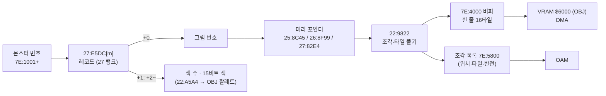

# DQ5(SFC) 전투 몬스터 그림 형식

전투 화면의 몬스터 그림이 롬 어디에 어떤 형식으로 들어 있고, 게임이 어떻게 풀어 OBJ 로 그리는지 정리한 문서입니다. 찾아낸 과정은 일지에 있습니다.

- [2026-10-25-09: 전투 몬스터 그림](journal/dq5/2026-10-25-09-mongfx.md)

기준과 검증:

- 기준 롬: `rom/dq5.sfc`([README](../README.md) 의 SHA-1). 주소 표기는 [dq5-map-format.md](dq5-map-format.md) 와 같습니다.
- 디코더: [tools/dq5mongfx.py](../tools/dq5mongfx.py). 몬스터 236마리가 그림 번호 107개를 쓰고, 그 머리는 104곳입니다. 머리를 주소 순으로 놓으면 그림마다 다음 머리의 첫 바이트에서 정확히 끝납니다(예외는 아래 「그림 머리 포인터」와 「남은 것」).
- 이벤트 전투(슬라임 셋)의 몬스터 번호(`7E:1001`)를 그림마다 대표 몬스터 하나로 바꿔 107번 전투를 붙였습니다.
  게임이 그림을 다 푼 직후(`22:90DC`)의 WRAM 버퍼 `7E:4000-5FFF` 에 디코더가 푼 타일이 모두 있었고(타일 3,623/3,623), 화면과도 픽셀째로 맞았습니다(아래 「검증」).

## 한눈에 보기

## 몬스터 레코드 (`27:E5DC`)

`27:E5DC` 는 몬스터 236마리의 16비트 포인터 표(27 뱅크 안)입니다. 가리키는 레코드는 이렇습니다(`22:8FF8`, `22:A5A4`).

| 오프셋 | 뜻 |
| --- | --- |
| +0 | 그림 번호(`00`~`71` 중 107개가 쓰임. `2D`·`35`·`37`·`38`·`57`·`5F`·`66` 은 아무도 안 씀) |
| +1 | 색 수 n |
| +2 ~ | 15비트 BGR 색 n개. OBJ 팔레트의 1번 색부터 채움(0번은 투명) |

같은 그림을 색만 바꿔 여러 몬스터가 나눠 씁니다(예: 그림 `15` 를 몬스터 `60`·`7A` 가 다른 색으로). `22:A5A4` 는 `22:AB23` 표(`$0DD8` 번째)가 가리키는 `7E` 뱅크 자리에 색 수 + 1 과 색들을 적습니다(코드 읽기).
CGRAM 사본 `7E:2D00` 512바이트가 그림 버퍼 DMA 다음 프레임에 `00:FDE3` 에서 CGRAM 으로 DMA 됩니다(이벤트 전투에서 890프레임). 레코드 색으로 칠한 디코더 그림이 화면 픽셀과 RGB 까지 맞으므로 색 순서(1번 색부터)는 실측으로 확인했습니다.

## 그림 머리 포인터

그림 번호 g 의 머리는 뱅크마다 다른 16비트 포인터 표에 있습니다(`22:9014`). 머리와 자료는 표와 같은 뱅크에 있습니다.

| 그림 번호 | 표 | 머리 범위 |
| --- | --- | --- |
| `00`~`29` | `25:8C45 + g*2` | `25:8C99`~`25:F9F4` |
| `2A`~`56` | `26:8F99 + (g-2A)*2` | `26:8FF3`~`26:FFCB` |
| `57`~`71` | `27:82E4 + (g-57)*2` | `27:831A`~`27:E5DC` |

뱅크의 마지막 그림은 `28`(`25:F9F4` 에서 끝나고 바로 코드 `08 E2 30` 이 이어짐), `56`(`26:FFCB` 에서 끝나고 뒤는 `00` 채움), `71`(몬스터 레코드 포인터 표 `27:E5DC` 바로 앞)입니다.
여러 번호가 같은 머리를 가리킵니다: `00`·`11`·`29`(`25:8C99`), `2A`·`2D`·`35`·`37`·`38`(`26:8FF3`), `57`·`58`·`5E`·`5F`·`66`(`27:831A`). 안 쓰는 번호는 모두 뱅크 첫 그림을 가리킵니다.

## 그림 형식 (`22:9822`)

그림은 8픽셀 칸으로 된 상자 안에 OBJ 조각(8x8 또는 16x16)을 늘어놓은 것입니다.

| 오프셋 | 뜻 |
| --- | --- |
| +0 | 플래그. bit0-4 → `7E:0D1C`, bit5-6 → `7E:0C5B`, bit7 → `7E:0D1B`(뜻은 남은 것) |
| +1 ~ +4 | `7E:0C2E`·`0C33`·`0C51`·`0C56` 에 그대로(뜻은 남은 것) |
| +5 | 상위 니블 + 1 = 가로 칸 수(니블이 `F` 면 19), 하위 니블 + 1 = 세로 칸 수 |
| +6 ~ | 칸 비트맵: 가로 × 세로 비트, 가로 우선·바이트의 MSB 먼저. 1 인 칸마다 조각 하나 |
| 그다음 | 조각마다 니블 하나(바이트의 상위 니블 먼저), ⌈조각 수 / 2⌉ 바이트 |
| 그다음 | 조각 자료를 칸 순서대로 |

조각 니블:

| 비트 | 뜻 |
| --- | --- |
| bit1 | 1 이면 16x16 조각(타일 4개를 왼쪽 위·오른쪽 위·왼쪽 아래·오른쪽 아래 순서로), 0 이면 8x8(타일 1개) |
| bit2·bit3 | 둘 다 0 이면 새 타일을 푼다. 하나라도 1 이면 자료 1바이트 = 이 그림의 앞 조각 번호(0부터)이고, 그 조각의 타일을 좌우 반전해 이 칸에 다시 쓴다(`22:9E95`, OAM 속성 `EOR #$4000`). 이때 bit2 가 0 이면 1픽셀 왼쪽에 둔다 |

서로 다른 머리 104곳에서 쓰이는 니블은 `0`(716), `2`(704), `4`(17), `6`(33), `8`(34), `A`(58) 뿐입니다.

### 타일 (`22:992A`)

타일 하나(4bpp 8x8, 32바이트)는 모드 바이트 M 으로 시작합니다. 앞 16바이트(평면 0·1)와 뒤 16바이트(평면 2·3)를 따로 처리하고, 평면마다 8바이트(줄마다 1바이트)입니다.

| M 비트 | 뜻 |
| --- | --- |
| bit0~3 | 평면 0~3 이 있는지. 없는 평면은 0 |
| bit6 | (bit7 일 때) 1 이면 M 다음 바이트가 채움 값, 0 이면 채움 값 0 |
| bit7 | 0 이면 있는 평면의 바이트를 그대로 읽는다(`22:99B7`·`9A15`·`9A75`). 1 이면 마스크 압축(`22:9AEB`·`9BA5`·`9C5F`) |

마스크 압축이면 (채움 값 다음에) 있는 평면 수만큼의 마스크 바이트가 오고, 그 뒤가 자료입니다. 바이트를 줄 순서대로(평면 0·1 은 줄마다 평면 0, 평면 1 번갈아) 채우며 마스크 비트(MSB 먼저)가 1 이면 자료에서 1바이트를 읽고, 0 이면 채움 값을 씁니다.
마스크 바이트 하나가 평면 하나(8바이트)를 맡습니다. bit4·bit5 는 롬 전체에서 쓰이지 않습니다.

예: 슬라임(그림 `02`, 머리 `25:9177`)은 `06 FC 0B 01 01 11 | 80 | 20 | 87 2A FF 0B 01 …` 입니다. 2×2 칸, 비트맵 `80` 이라 조각은 (0,0) 하나, 니블 `2` 라 16x16 입니다.
첫 타일 `20` 은 평면이 하나도 없어 투명이고, 둘째 타일 `87` 은 마스크 압축·평면 4개, 마스크 `2A FF 0B 01` 입니다.

### 버퍼와 OBJ

게임은 타일을 `7E:4000` 버퍼(한 줄 16타일 = `$200` 바이트)에 16x16 단위로 쌓고, 조각마다 화면 위치(칸 × 8)와 OBJ 타일 번호·반전을 `7E:5800` 목록에 적습니다(`22:9DB0`, `22:9E1C`, 코드 읽기).
8x8 조각은 16x16 자리 하나에 넷까지 모아 넣습니다(`22:9E81` 표 `00 01 10 11`). 버퍼는 VRAM 워드 주소 `$6000`(OBJ 이름 기준) 이후로 DMA 됩니다(이벤트 전투에서 889프레임, `00:FD6D` 가 `7E:4000`→`$6000`, `7E:4200`→`$6100` 처럼 한 줄씩).
OBJ 크기는 8x8/16x16 모드(PPU 상태의 OBJ 크기 0), 둘째 이름 표는 첫째 바로 뒤(오프셋 `$1000` 워드)라 타일 번호 `000`~`1FF` 가 이어집니다.

## 검증

- **버퍼**: 그림 107개마다 대표 몬스터 하나로 이벤트 전투를 붙이고(`walk.lua` 의 `POKE="7E1001=<번호>;7E1005=1"`), 그림을 다 푼 직후 `22:90DC` 에서 WRAM 을 덤프했습니다(`tools/lua/battledump.lua` 의 `AT`). `dq5mongfx.py --compare` 가 디코더 타일(반전 복사 조각 빼고)이 버퍼에 32바이트째로 있는지 셉니다. 107번 모두 빠짐없이 있었습니다(3,623/3,623).
- **화면**: 같은 전투의 1000프레임 화면에서 `--shot` 이 그림이 가장 잘 맞는 자리를 찾아 불투명 픽셀의 RGB 를 비교합니다. 105번(`E4`·`EA` 빼고) 152,426/152,899 픽셀이 맞았고, 틀린 473픽셀은 모두 스크린샷의 y=152 줄로, 그림의 맨 아랫줄이 창 테두리에 가려진 것입니다. 같은 화면의 OAM·VRAM 으로 OBJ 만 다시 그려 색 번호로 비교하면(`--oam`) 그 줄까지 맞습니다(몬스터 `60` 1,726/1,726).
- `E4`(ブオーン)는 1000프레임에 아직 나타나지 않아 1450프레임 화면으로 비교했습니다(5,522/5,522).
- **경계**: 머리 104곳을 주소 순으로 놓으면 그림마다 디코더가 읽은 끝이 다음 머리와 같습니다. 예외는 그림 `15`(3바이트 남음)와 뱅크 마지막 그림입니다.

## 여러 그림으로 된 몬스터

몬스터 `EA`(이름 표의 이름은 `E8`~`EB` 모두 ミルドラース)를 넣으면 게임이 둘째 그룹(`7E:1002`)에 `EB` 를 1마리(`7E:1006`) 더해, 그림 `70`(윗몸)과 `71`(아랫몸)을 같은 원점에 겹쳐 그립니다. 1950프레임의 OAM·VRAM 으로 OBJ 를 다시 그려 색 번호로 비교하면(`--oam`) 두 그림이 같은 자리 (51,58) 에서 각각 7,332/7,332·3,401/3,401 픽셀 맞습니다.
이 전투는 OBJ 팔레트를 바꾸는 연출이 있어 레코드 색과 화면 색이 달라 `--shot` 으로는 맞지 않습니다. `EB` 만 넣은 전투는 1000프레임 화면과 3,401/3,401 맞습니다.

## 남은 것

- 머리 +0 의 플래그와 +1~+4(`7E:0C2E` 등)의 뜻. 화면 배치·그림자·흔들림 값으로 보입니다.
- 여러 마리·여러 그룹일 때 화면 위치를 정하는 규칙, OAM 을 만드는 루틴(`7E:5800` → OAM). 한 마리일 때 그림 상자는 화면 가운데 아래쪽에 놓입니다(맨 아랫줄이 대부분 같은 높이).
- 그림 `11`·`29`·`5E` 처럼 머리를 나눠 쓰는 번호가 따로 있는 이유.
- 그림 `15` 의 머리 끝(`25:C4E9`)과 다음 그림 머리(`25:C4EC`) 사이의 3바이트 `81 80 FC`. 타일 하나로 읽히지만 이 그림의 조각 수로는 쓰이지 않습니다.
- `EA` 에 `EB` 를 더하는 곳, 다른 보스(エスターク 등)도 그림을 나눠 쓰는지.
- 전투 배경.
