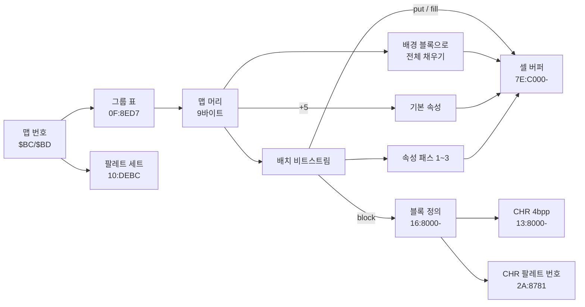

# DQ5(SFC) 실내 맵 형식

마을·성·던전 맵이 ROM 에 어떻게 들어 있고 어떻게 풀리는지 정리한 문서입니다. 찾아낸 과정은 일지에 있습니다.

- [2026-10-24 (1) 배치 비트스트림](journal/2026-10-24-dq5-map.md)
- [2026-10-24 (2) 팔레트와 셀 속성](journal/2026-10-24-dq5-map-attributes.md)

기준과 검증:

- 기준 롬: `rom/dq5.sfc`([README](../README.md) 의 SHA-1)
- 주소는 LoROM CPU 주소(`BB:AAAA`), RAM 은 `7E:xxxx` 입니다. 직접 페이지가 0 이라 `$BC` 는 `7E:00BC` 입니다.
- 구현: [tools/dq5map.py](../tools/dq5map.py)
  - 실내 맵 346개를 모두 풀고, 레코드 끝이 모두 다음 맵 시작과 맞닿습니다.
  - 02/06·02/07 은 속성까지 끝난 셀 버퍼가 게임과 바이트 단위로 같습니다.
  - 팔레트도 ROM 에서 만들며 게임 CGRAM 과 같습니다.


## 한눈에 보기



## 맵 번호

RAM `$BC`(그룹)·`$BD`(그룹 안 번호) 두 바이트가 맵 번호입니다.

| `$BC` | 종류 | 경로 |
| --- | --- | --- |
| `$00`~`$35` | 실내(마을·성·던전) | 이 문서 |
| `$50`~ | 필드 | `1F:CEB6` 표, 좌표로 고르는 청크(아직 분석 안 함) |

예: 오프닝 글래스트 성 왕좌의 방은 `02/06`, 다음 방은 `02/07`.

## 맵 포인터 (`01:92E2`)

```
그룹 포인터 = 0F:8ED7 + $BC*2  의 16비트 값(뱅크 0F)
맵 포인터   = 0F:(그룹 포인터 + $BD*3) 의 24비트 값
```

그룹은 `$00`~`$35` 54개, 맵은 모두 346개이고 데이터는 `18:8000`~`1E:D0xx` 에 빈틈없이 이어져 있습니다.
같은 루틴이 다음 값도 고정합니다.

| RAM | 값 | 뜻 |
| --- | --- | --- |
| `$1823` | `$16` | 블록 정의 뱅크 |
| `$1824`·`$1825` | `$13`·`$8000` | CHR 그래픽 시작 |
| `$B1-$B3` | `2A:8781` | CHR 팔레트 번호 표 |

## 맵 레코드

머리 9바이트, 배치 비트스트림, 속성 패스 셋이 이어진 것이 전부입니다. 인물·이벤트는 레코드 밖에 있습니다.


### 머리 (`01:97D0`)

| 오프셋 | 들어가는 곳 | 뜻 |
| --- | --- | --- |
| +0 | bit0-2 → `$1821`, bit3-5 → `$1A33` | 미해독 |
| +1 | `$BF` | 폭(셀) |
| +2 | `$C0` | 높이(셀) |
| +3 | `$182C`, `01:98A4`·`01:98BA` 표로 `$182D`·`$1830` | 미해독 |
| +4 | `$10` 미만이면 `$1827`=값·`$1828`=0, 이상이면 `$1827`=값-`$10`·`$1828`=`$FF` | 미해독 |
| +5 | 아래 니블 → `$1A6F`, 위 니블 → `$1A70` | 모든 셀의 기본 속성 |
| +6 | `$84` | 위치 비트 수(10~14) |
| +7 | bit7, bit0-2 | bit7=1 이면 배경 블록 있음, bit0-2 는 배경 블록 번호 상위 |
| +8 | | 배경 블록 번호 하위 |

`+7` 의 bit7 이 켜져 있으면(346개 중 307개) `01:A93F` 가 블록 `((+7 & 7) << 8) | +8` 로 맵 전체를
바둑판처럼 먼저 채웁니다. 블록이 맵 끝에 딱 맞지 않으면 게임도 버퍼 밖까지 씁니다.

### 배치 비트스트림 (`01:A824`)

바이트의 높은 비트부터 읽습니다(`01:AC66`). 명령은 앞 비트로 갈립니다.

| 앞 비트 | 이름 | 인자 | 하는 일 | 코드 |
| --- | --- | --- | --- | --- |
| `0` | put | 위치 | 현재 블록을 그 위치에 찍음 | `01:A839` |
| `10` | block | 블록 번호(11비트) | 현재 블록을 바꿈 | `01:A8E4` |
| `110` | fill | 시작 위치, 끝 위치 | 두 위치를 모서리로 하는 직사각형을 현재 블록 크기 간격으로 채움 | `01:A858` |
| `111` | end | | 끝 | |

위치는 `y * 폭 + x` 이고, 비트 수는 머리 `+6` 을 따릅니다. 블록 번호는 맵과 상관없이 늘 11비트입니다
(`01:ACE5` 가 쓰는 표 `$1A4D` 는 고정, `01:AEA4` 가 쓰는 표 `$1A5D` 만 `$84` 로 바뀜).

02/07 의 앞부분(`18:E17A`, 위치 11비트):

| 위치.비트 | 비트 | 명령 | 뜻 |
| --- | --- | --- | --- |
| `18E17A.0` | `10` `01011001110` | block 718 | 2x2 블록 |
| `18E17B.5` | `110` `00010111011` `10111101011` | fill 187, 1515 | (3,4)~(43,32) 를 채움 |
| `18E17E.6` | `10` `01011010000` | block 720 | 2x2 블록 |
| `18E180.3` | `110` `00101110001` `10100001001` | fill 369, 1289 | (1,8)~(1,28) |
| `18E186.5` | `10` `01011001111` | block 719 | |
| `18E188.2` | `0` `10100100111` | put 1319 | (31,28) |
| `18E189.6` | `0` `10011001011` | put 1227 | (31,26) |

이 맵은 명령 209개(put 82, block 60, fill 66, end 1)로 끝나며, 개수가 에뮬레이터에서 센 분기 횟수와 같습니다.


### 기본 속성 (`01:93D8`)

비트스트림이 끝나면 모든 셀(폭×높이+1칸, 마지막 한 칸은 버퍼 밖)에 머리 `+5` 를 적용합니다.
위 니블이 0 이 아니면 그 값을 `+0` 에 쓰고, 아래 니블은 `+1` 에 OR 합니다.

### 속성 패스 (`01:B7AC`, `01:B8FE`, `01:B9EA`)

비트스트림이 바이트 중간에서 끝났으면 다음 바이트부터(`01:A7B3`) 세 패스가 이어집니다. 셋 다 니블 단위로 읽고(`01:B8A8`·`01:B8DD`)
엔트리 형식이 같습니다.

```
패스 첫 니블 bit7: 0 이면 반복을 가로(셀+1)로, 1 이면 세로(셀+폭)로
엔트리 첫 바이트 bit7-6:
  00  셀 하나:      [위치 2바이트] [값 니블]
  11  반복(짧게):    [위치 2바이트] [n 니블] [값 니블]   → n+2 칸
  10  반복(길게):    [위치 2바이트] [n 바이트] [값 니블] → n+2 칸
  01  패스 끝(패스 1·2 는 반 바이트면 한 니블 더 읽어 맞춤)
위치 2바이트 = 첫 바이트 아래 6비트 + 둘째 바이트: x = (b0<<1 | b1>>7) & 7F, y = b1 & 7F
```

| 패스 | 값 니블이 하는 일 |
| --- | --- |
| 1 | `+1` 아래 니블을 그 값으로 |
| 2 | bit0: 위층이 비고 아래층이 있으면 아래층(+2~+4)을 위층(+5~+7)으로 복사, `+0 \|= $08` / bit1: `+1 \|= $40` / bit3: `+4` = bit2 ? `$61` : `$62` / bit3 없이 bit2: `+1 \|= $80` |
| 3 | `+0` 위 니블을 그 값으로. 첫 엔트리가 끝이 아니면 `$1A35` = 1 |

반복이 n+2 칸인 것은 `LDX n / INX / … / DEX / BPL` 꼴이라서입니다.

## 블록 (`01:8ACB`)

블록 번호 `n` 의 위치는 `7E:B000 + n*2` 의 16비트 포인터(뱅크 `$1823`=`$16`)입니다. 이 표는
`16:8000` 부터 블록을 빈틈없이 이어 놓은 순서 그대로라, 블록 크기만 알면 ROM 에서 바로 셀 수 있습니다
(오프닝 시점 RAM 표에는 1,936개).

```
+0  bit0-2 높이-1, bit3-5 폭-1, bit6-7 플래그
+1  bit4-7 위층 줄 수, bit1-3 아래쪽 표시 줄 수, bit0 플래그
+2  속성
+3  높이×폭 개의 16비트(줄 순서): bit0-11 CHR 번호, bit14 좌우 반전, bit15 상하 반전
```

## CHR 과 VRAM 슬롯 (`01:8C15`)

- 그래픽: CHR 번호 `id` 는 `(13 + id>>10):8000 + (id & 3FF)*32` 의 4bpp 8x8 타일입니다(압축 없음).
- 팔레트 번호: `2A:8781 + id/2` 의 니블(짝수 id 는 상위, 홀수는 하위)이 그 CHR 의 팔레트·우선순위입니다.
- 슬롯: 맵에서 처음 쓰이는 순서대로 VRAM 타일 번호를 `$1834` 부터 하나씩 붙입니다. 오프닝 두 맵은 모두 `$BE` 부터.
  결과는 `7E:6000 + id*2` 에 SNES 타일맵 워드(슬롯 | 팔레트·우선순위 | 반전)로 남습니다.

## 팔레트 (`10:DE0B`)

맵이 쓰는 BG 팔레트 1~7번 줄은 압축 없이 ROM 에 있습니다.

```
세트   = 10:DEBC 표에서 [$BC, 기본 세트, ($BD, 세트)..., FF] 항목을 찾아 $BD 가 맞으면 그 세트, 아니면 기본
목록   = 10:(DFE4 + 세트*4 + (7E:075E >= $F0 ? 2 : 0)) 의 16비트 포인터 → 16비트 7개
줄 r   = 10:E5C8 + 목록[r]*32 의 16색  (r = 1~7)
배경색 = 7번 줄부터 2번 줄까지 내려가며 색 0 이 0 이 아닌 첫 줄의 색 0
```

`7E:075E` 가 무엇인지(시간대인지 진행도인지)는 아직 모릅니다(`21:8000` 이 비교만 함).

## 셀 버퍼 (`7E:C000-`)

셀 하나가 8바이트, 셀 하나가 8x8 픽셀입니다. 맵 전환 때 `01:9932` 가 비웁니다.

| 오프셋 | 비트 | 채우는 곳 | 뜻(가설은 표시) |
| --- | --- | --- | --- |
| +0 | bit4-7 | 기본 속성(머리 +5 위 니블), 패스 3 | 미해독 |
| +0 | bit3 | 패스 2 bit0 | 위층이 캐릭터를 덮음(가설) |
| +1 | bit0-3 | 기본 속성(머리 +5 아래 니블), 패스 1 | 통행 종류(가설: 1 바닥, 8 벽, 9 벽 위층에 가려지는 바닥) |
| +1 | bit4-5 | 블록 +0 bit6-7 | 미해독. `2B:B8F3` 이 `$30` 인지 봄 |
| +1 | bit6 | 블록 +1 bit0, 패스 2 bit1 | 미해독 |
| +1 | bit7 | 블록의 아래쪽 줄, 패스 2 bit2 | 미해독 |
| +2, +3 | | 블록 | 아래층 타일맵 워드 |
| +4 | | 블록 +2, 패스 2 bit3 | 아래층 속성. 블록 오른쪽 아래 셀이면 bit7. `$32`·`$5A`·`$72` 를 `2B:BAB5` 가 따로 봄 |
| +5, +6 | | 블록, 패스 2 bit0 | 위층 타일맵 워드 |
| +7 | | 블록 +2, 패스 2 bit0 | 위층 속성(같은 규칙) |

블록의 위쪽 「위층 줄 수」만큼은 위층(+5~+7)에, 나머지 줄은 아래층(+2~+4)에 들어갑니다.
게임 중에는 `2B:B8F3`~`2B:BAD3` 이 매 프레임 인물 주변 셀의 `+0`·`+1`·`+4` 를 읽습니다(인물이 위층 뒤로 숨는지 판정하는 것으로 보임).


## 위키와 다른 점

[DQバイナリ改造 @Wiki](https://w.atwiki.jp/dq_binary/pages/23.html) 는 `7EFC00-` 를 「マップデータ」라 적었지만,
실제로는 셀 버퍼(`7E:C000-`) 중간일 뿐입니다.

## 남은 것

- 셀 속성의 뜻 확인: 직접 걸어 보며 통행·가림을 확인해야 가설을 확정할 수 있음
- 머리 `+0`, `+3`, `+4` 의 뜻
- `7E:075E`(두 번째 팔레트 목록 조건)
- 인물·이벤트 데이터의 위치(맵 레코드 밖)
- 필드 맵(`$BC ≥ $50`)
