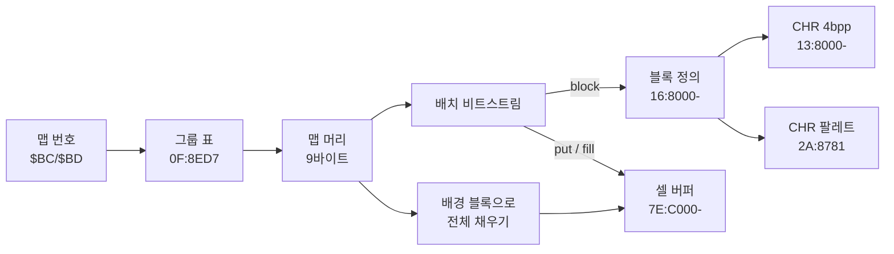

# DQ5(SFC) 실내 맵 형식

마을·성·던전 맵이 ROM 에 어떻게 들어 있고 어떻게 풀리는지 정리한 문서입니다. 찾아낸
과정은 [일지](journal/2026-10-24-dq5-map.md)에 있습니다.

- 기준 롬: `rom/dq5.sfc`([README](../README.md) 의 SHA-1)
- 주소는 LoROM CPU 주소(`BB:AAAA`), RAM 은 `7E:xxxx` 입니다. 직접 페이지가 0 이라 `$BC` 는 `7E:00BC` 입니다.
- 구현: [tools/dq5map.py](../tools/dq5map.py). 실내 맵 346개를 모두 풀고, 두 맵은 게임이 만든 셀 버퍼와 바이트 단위로 같습니다.


## 한눈에 보기



## 맵 번호

RAM `$BC`(그룹)·`$BD`(그룹 안 번호) 두 바이트가 맵 번호입니다.

| `$BC` | 종류 | 경로 |
| --- | --- | --- |
| `$00`~`$35` | 실내(마을·성·던전) | 이 문서 |
| `$50`~ | 필드 | `1F:CEB6` 표, 좌표로 고르는 청크(아직 분석 안 함) |

예: 오프닝 글래스트 성 왕좌의 방은 `02/06`, 다음 방은 `02/07`.

## 맵 포인터 (`01:92E2`)

```
그룹 포인터 = 0F:8ED7 + $BC*2  의 16비트 값(뱅크 0F)
맵 포인터   = 0F:(그룹 포인터 + $BD*3) 의 24비트 값
```

그룹은 `$00`~`$35` 54개, 맵은 모두 346개이고 데이터는 `18:8000`~`1E:D0xx` 에 있습니다.
같은 루틴이 다음 값도 고정합니다.

| RAM | 값 | 뜻 |
| --- | --- | --- |
| `$1823` | `$16` | 블록 정의 뱅크 |
| `$1824`·`$1825` | `$13`·`$8000` | CHR 그래픽 시작 |
| `$B1-$B3` | `2A:8781` | CHR 팔레트 표 |

## 맵 머리 (9바이트)

```
+0  미해독(01 이 250개, 그 밖에 09 11 19 21 29 31)
+1  폭(셀)          → $BF
+2  높이(셀)        → $C0
+3  미해독(00 이 243개, 01~0A)
+4  미해독(00 이 331개)
+5  미해독(01 이 216개, 08 이 74개, 그 밖에 02 04 11 18 21 ...)
+6  위치 비트 수(10~14) → $84
+7  bit7=1: 배경 블록 있음, bit0-2: 배경 블록 번호 상위
+8  배경 블록 번호 하위
+9  배치 비트스트림 시작
```

`+7` 의 bit7 이 켜져 있으면(346개 중 307개) `01:A93F` 가 블록 `((+7 & 7) << 8) | +8` 로 맵 전체를
바둑판처럼 먼저 채웁니다. 블록이 맵 끝에 딱 맞지 않으면 게임도 버퍼 밖까지 씁니다.

## 배치 비트스트림 (`01:A824`)

바이트의 높은 비트부터 읽습니다(`01:AC66`). 명령은 앞 비트로 갈립니다.

| 앞 비트 | 이름 | 인자 | 하는 일 | 코드 |
| --- | --- | --- | --- | --- |
| `0` | put | 위치 | 현재 블록을 그 위치에 찍음 | `01:A839` |
| `10` | block | 블록 번호(11비트) | 현재 블록을 바꿈 | `01:A8E4` |
| `110` | fill | 시작 위치, 끝 위치 | 두 위치를 모서리로 하는 직사각형을 현재 블록 크기 간격으로 채움 | `01:A858` |
| `111` | end | | 끝 | |

위치는 `y * 폭 + x` 이고, 비트 수는 머리 `+6` 을 따릅니다. 블록 번호는 맵과 상관없이 늘 11비트입니다
(`01:ACE5` 가 쓰는 표 `$1A4D` 는 고정, `01:AEA4` 가 쓰는 표 `$1A5D` 만 `$84` 로 바뀜).

02/07 의 앞부분(`18:E17A`, 위치 11비트):

| 위치.비트 | 비트 | 명령 | 뜻 |
| --- | --- | --- | --- |
| `18E17A.0` | `10` `01011001110` | block 718 | 2x2 블록 |
| `18E17B.5` | `110` `00010111011` `10111101011` | fill 187, 1515 | (3,4)~(43,32) 를 채움 |
| `18E17E.6` | `10` `01011010000` | block 720 | 2x2 블록 |
| `18E180.3` | `110` `00101110001` `10100001001` | fill 369, 1289 | (1,8)~(1,28) |
| `18E186.5` | `10` `01011001111` | block 719 | |
| `18E188.2` | `0` `10100100111` | put 1319 | (31,28) |
| `18E189.6` | `0` `10011001011` | put 1227 | (31,26) |

이 맵은 명령 209개(put 82, block 60, fill 66, end 1)로 끝나며, 개수가 에뮬레이터에서 센 분기 횟수와 같습니다.


## 블록 (`01:8ACB`)

블록 번호 `n` 의 위치는 `7E:B000 + n*2` 의 16비트 포인터(뱅크 `$1823`=`$16`)입니다. 이 표는
`16:8000` 부터 블록을 빈틈없이 이어 놓은 순서 그대로라, 블록 크기만 알면 ROM 에서 바로 셀 수 있습니다
(오프닝 시점 RAM 표에는 1,936개).

```
+0  bit0-2 높이-1, bit3-5 폭-1, bit6-7 플래그
+1  bit4-7 위층 줄 수, bit1-3 아래쪽 표시 줄 수, bit0 플래그
+2  속성
+3  높이×폭 개의 16비트(줄 순서): bit0-11 CHR 번호, bit14 좌우 반전, bit15 상하 반전
```

## CHR 과 VRAM 슬롯 (`01:8C15`)

- 그래픽: CHR 번호 `id` 는 `(13 + id>>10):8000 + (id & 3FF)*32` 의 4bpp 8x8 타일입니다(압축 없음).
- 팔레트: `2A:8781 + id/2` 의 니블(짝수 id 는 상위, 홀수는 하위)이 그 CHR 의 팔레트·우선순위입니다.
- 슬롯: 맵에서 처음 쓰이는 순서대로 VRAM 타일 번호를 `$1834` 부터 하나씩 붙입니다. 오프닝 두 맵은 모두 `$BE` 부터.
  결과는 `7E:6000 + id*2` 에 SNES 타일맵 워드(슬롯 | 팔레트·우선순위 | 반전)로 남습니다.

## 셀 버퍼 (`7E:C000-`)

셀 하나가 8바이트, 셀 하나가 8x8 픽셀입니다. 맵 전환 때 `01:9932` 가 비웁니다.

| 오프셋 | 내용 |
| --- | --- |
| +0 | 쓰지 않음 |
| +1 | 플래그(블록 +0 bit6-7, +1 bit0, 아래쪽 줄이면 bit7) |
| +2, +3 | 아래층 타일맵 워드 |
| +4 | 아래층 속성(블록 오른쪽 아래 셀이면 bit7) |
| +5, +6 | 위층 타일맵 워드 |
| +7 | 위층 속성(같은 규칙) |

블록의 위쪽 「위층 줄 수」만큼은 위층(+5~+7)에, 나머지 줄은 아래층(+2~+4)에 들어갑니다.

## 위키와 다른 점

[DQバイナリ改造 @Wiki](https://w.atwiki.jp/dq_binary/pages/23.html) 는 `7EFC00-` 를 「マップデータ」라 적었지만,
실제로는 셀 버퍼(`7E:C000-`) 중간일 뿐입니다.

## 남은 것

- 머리 `+0`, `+3`~`+5` 와 셀 플래그·속성의 뜻(통행, 문, 계단으로 추정)
- 셀 버퍼 뒤에 이어지는 데이터(`01:B8xx` 가 `18:E326-` 를 읽음, 인물·이벤트로 추정)
- 팔레트(CGRAM) 원본 위치. 지금 그림은 MesenCE 의 CGRAM 덤프로 칠함
- 필드 맵(`$BC ≥ $50`)
