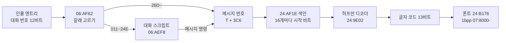
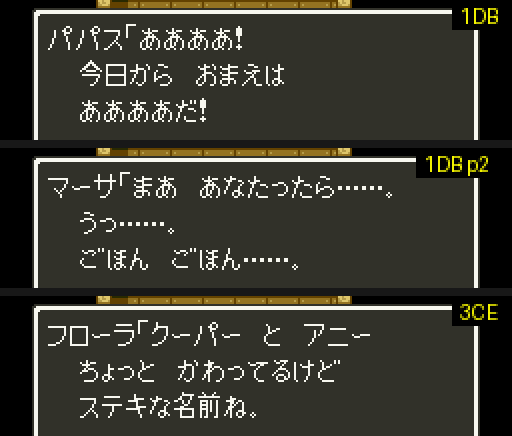

# DQ5(SFC) 메시지·폰트·대화 형식

보행 모드(필드·마을)의 메시지가 어떻게 들어 있고, 인물에게 말을 걸면 어떤 메시지가 나오는지 정리한 문서입니다. 찾아낸 과정은 일지에 있습니다.

- [2026-10-25-01: 메시지, 폰트, 대화 스크립트](journal/dq5/2026-10-25-01-text.md)
- [2026-10-25-02: 보물상자와 이름 문자열](journal/dq5/2026-10-25-02-treasure.md)
- [2026-10-25-07: 메시지 제어 코드, 대화 조건, 메뉴 문자열](journal/dq5/2026-10-25-07-textctl.md)

기준과 검증:

- 기준 롬: `rom/dq5.sfc`([README](../README.md) 의 SHA-1). 주소 표기는 [dq5-map-format.md](dq5-map-format.md) 와 같습니다.
- 메시지: [tools/dq5text.py](../tools/dq5text.py). 메시지 3,200개가 모두 끝 코드까지 풀리고, 0x129 를 푼 64개 코드가 게임이 `7E:0E4B` 에 푼 값과 같습니다.
- 폰트: 같은 도구의 `glyph`. 롬에서 그린 메시지 0x129 가 게임 화면과 같습니다.
- 대화: [tools/dq5talk.py](../tools/dq5talk.py). 대화 스크립트 574개를 실행기 길이로 읽은 끝이 게임의 건너뛰기 규칙으로 찾은 다음 스크립트 시작과 모두 같습니다.
  선실의 파파스에게 말을 걸고(`012`), 그 슬롯의 대화 번호를 `02A`·`0F3`·`199`(스크립트), `26D`·`4BE`(직접 메시지)로 바꿔 말을 걸어, 처음 나온 메시지 번호 6개가 모두 예측과 같았습니다.
- 주소 힌트는 [「ドラクエ命」 SFC 版ドラクエ 5](https://showa-yojyo.github.io/dqbook/dq5.html) 의 텍스트 해석(`24:8BAF`, `24:AF1E`, `24:9E02`)에서 얻고 롬에서 다시 확인했습니다.


## 한눈에 보기



## 메시지 (`24:8BAF`)

메시지 번호는 0~3199(0xC7F)입니다. `24:8BAF` 가 번호를 A 로 받습니다.

```
색인  = 24:AF1E + (번호 >> 4) * 3 의 24비트 값
       하위 3비트 = 시작 비트 위치, 나머지 = 바이트 주소(24:8C8D)
번호 & 0F 만큼 끝 코드(1001·1010·1018)까지 풀어 버린다
```

색인은 200개(16개씩)이고, 첫 메시지는 바이트 주소에서 바로 시작합니다.

### 허프만 부호 (`24:9E02`)

- 비트는 바이트의 LSB 부터 읽습니다(`24:9E8C` 마스크 표). 바이트를 다 읽으면 다음 바이트로, 16비트 주소가 0 으로 넘어가면 다음 뱅크의 `$8000` 으로 갑니다.
- 노드는 2바이트입니다. 읽은 비트가 1 이면 `24:8CB6 + X`, 0 이면 `24:9472 + X` 를 읽습니다. 처음 X 는 `$07BA` 입니다.
- 값의 bit15 가 켜져 있으면 잎이고 `값 & 1FFF` 가 글자 코드입니다. 아니면 `(값 & 1FFF) * 2` 가 다음 X 입니다.
- `24:8B98` 은 코드 64개를 끝 코드와 상관없이 풀어 `7E:0E4B` 부터 16비트씩 둡니다.

### 글자 코드

| 코드 | 뜻 |
| --- | --- |
| `000` | 공백(`24:A623`, 폭 8) |
| `001`~`3DA` | 폰트 글자. 가나·한자·영숫자·기호 986자. 표는 `dq5text.py` 의 `CHARS` |
| `1000` | 줄바꿈 |
| `1001`, `1010`, `1018` | 메시지 끝 |
| `1002`~`101D`, `1100`~`1118` | 제어 코드. 아래 표 |

글자 코드는 가나 순서가 아니라 폰트 묶음 순서입니다(같은 크기 글자끼리 묶음). 글자표는 폰트를 그려 읽었고,
가나는 이름 입력용 글자 목록인 메시지 `061`(「あいうえお…ガギグゲゴ…ＡＢＣＤ」)의 순서로 맞췄습니다.
모양이 같은 쌍(へ/ヘ, ぺ/ペ, 二/ニ, 一/ー, 口/ロ, 夕/タ, が/ガ)과 々(「日々」「代々」)는 그 메시지와 문맥으로 갈랐습니다.

### 제어 코드 (`24:819D`)

메시지를 찍는 루틴(`24:8178` 고리)은 코드를 하나씩 꺼내 `24:819D` 로 넘깁니다. `1000` 미만은 글자이고, 제어 코드는 `코드 & FF` 를 색인으로
`1000`~`101D` 는 `24:8204`, `1100`~`1118` 은 `24:8240` 점프 표의 처리기로 갑니다(뱅크 24 의 16비트 주소, `dq5text.py --controls`).
이름·숫자 변수의 인자는 메시지 안에 없고, 메시지를 띄우기 전에 부르는 쪽이 `$F5`~`$F8` 에 넣어 둡니다. 처리기가 `24:889F` 로 한 바이트씩 꺼내면 뒤의 값이 앞으로 당겨집니다.

말하는 사람 표시는 처리기가 아니라 줄 첫머리에서 다음 코드를 미리 보는 `24:8AF9` 가 정합니다.
첫 코드가 `1003`·`1006` 이 아니면 「＊「」(이름 문자열 바이트 `00`·`01`, `24:B270`)를 붙이고 다음 줄부터 들여 씁니다(`7E:0F0B` bit6 → 줄 첫 x = `10`, `24:9ECD`).

| 코드 | 처리기 | 쓰인 횟수 | 뜻 | 근거 |
| --- | --- | --- | --- | --- |
| `1000` | `8349` | | 줄바꿈. 줄은 `12`(18점) 간격, 셋째 줄 아래로 가면 한 줄 밀어 올림(`24:9EB0`, `24:A3EF`) | 실측 |
| `1001`·`1010`·`1018` | `8303`·`837D`·`82E4` | | 메시지 끝. 셋의 차이는 미확인 | 코드 |
| `1002` | `83AF` | 2,341 | ▼ 를 깜빡이며 버튼 대기(`24:841F`) 뒤, 지난 쪽의 줄 수만큼 밀어 올려 새 쪽 | 실측 |
| `1003` | (`24:8AF9`) | 2,014 | 「パパス「」 처럼 말하는 사람 대사. ＊「 를 붙이지 않고 다음 줄부터 들여 씀 | 실측 |
| `1006` | (`24:8AF9`) | 494 | 서술문. ＊「 도 들여쓰기도 없음 | 실측 |
| `1007` | `855E` | 14 | 들여쓰기 끄기. 다음 줄에 다른 사람의 「…」 를 이어 쓸 때 | 실측 |
| `1004` | `84BB` | 38 | 숫자. `$F5`(하위)~`$F7` 24비트를 10진으로(`04:AE7C`) | 실측 |
| `1005` | `853D` | 11 | 일행이 둘 이상이면 「たち」, 혼자면 아무것도 없음(「この者{1005}に」) | 코드 |
| `1008` | `84C0` | 182 | 이름. `$F5` 한 바이트: bit7 이 꺼져 있으면 일행 슬롯 `& 0F` 의 이름(bit6 이면 「たち」), `FF` 는 「まもののむれ」, 그 밖의 bit7 은 전투 몬스터 이름 | 실측(아래) |
| `1009`·`100A`·`100B`·`100C`·`1014` | `84D5`~`84E4`, `8537` | 0~59 | 이름 문자열 표 4(몬스터)·5(물건)·3(주문)·7·6(작전·마을)의 `$F5` 번째 | `100A`·`100B` 실측 |
| `100F` | `8506` | 1 | 몬스터 이름(표 4) 뒤에 `7E:1005 + [7E:0F23]` 가 양수면 글자 하나 | 코드 |
| `1011` | `8525` | 52 | 일행 슬롯 0 의 이름 | 실측(주인공) |
| `1012` | `852B` | 612 | 주인공 이름 `7E:2001`~(8바이트, `01` 에서 끝) | 실측 |
| `1016`·`1017` | `854C`·`8552` | 50·38 | 아들 `7E:2009`~, 딸 `7E:2011`~ 의 이름 | 실측 |
| `1015` | `8558` | 64 | 신부 이름. `7E:21B3 & 08` 이면 ビアンカ, 아니면 フローラ(`24:8A74` 의 두 문자열) | 실측 |
| `1013` | `8531` | 5 | 일행 레코드(`7E:2040 + 2A × i`) 첫 바이트가 `80` 인 동료의 이름 | 코드 |
| `101B` | `8585` | 0 | 조건에 따라 `1012` 또는 `1011` | 코드 |
| `100D` | `84E9` | 99 | 31프레임 멈춤(「…{100D}が」) | 실측 |
| `100E` | `84FF` | 0 | 아무것도 하지 않음 | 코드 |
| `1019`·`101A` | `8566`·`8579` | 51 | `1019` 부터 `101A` 까지 글자를 기다림 없이 한 프레임에 찍음(`7E:0F11` bit7). `101A` 는 `0F11` 을 모두 끔 | 실측 |
| `101C` | `8598` | 11 | 느리게: 글자마다 3프레임(평소 1), 밀어 올리기도 1점씩(`7E:0F11` bit0, `04:9DB3`·`24:A3F8`) | 실측 |
| `101D` | `85A5` | 2 | 스크립트가 `7E:0F13`~`0F15` 에 넣어 둔 루틴을 `JSL`(예 `06:F9C4` 가 `06:F9D2` 를 넣음) | 코드 |
| `1100`~`1118` | `24:A855`~`AE46` | 1~14 | 말하는 인물(`7E:0F1E` 슬롯)의 몸짓과 창·화면 효과. 아래 | 일부 실측 |

`1100` 번대는 말하는 인물 표의 값을 바꿉니다(코드 읽기). `1100` 은 창 테두리(`7E:0A43`~`0A46`), `1105` 는 화면 흔들기(`7E:0750`·`0752` 를 오르내림),
`1106`~`1109` 는 `7E:31E0 + 슬롯` 에 `88`·`44`·`22`·`11`, `110A`~`110D` 는 `7E:3260 + 슬롯` 에 `88`·`84`·`82`·`81` 을 쓰고, `110E`·`110F` 는 되돌립니다.
`1116`·`1117` 은 `03:A6CB`·`03:A73D` 를 부릅니다. 나머지는 인물 좌표(`7E:3060`·`3080`)와 `7E:33A0` 을 건드리는 짧은 동작입니다.
`7E:31E0` 등의 값이 화면에서 어떤 모양인지는 아직 보지 않았습니다(`1107` 이 `7E:31EB` 에 `44` 를 쓰는 것만 확인).

확인은 선실의 파파스 스크립트(대화 번호 `012`)의 거짓 분기 메시지 `41 2D`(`06:8139`, 파일 오프셋 `30139`)를 `ROMPATCH` 로 `6x yy`(bit5 → 메시지 `xyy` 그대로)로 덮어
아무 메시지나 띄우고, 화면과 처리기 호출 프레임(`CALLS=2481A4`, 코드를 A 로 받는 곳)을 본 것입니다.

- `1019`~`101A` 사이 공백 셋(메시지 `16B`)은 모두 136프레임에 찍히고, 앞뒤 글자는 한 프레임에 하나씩 찍혔습니다.
- 메시지 `1F9`: `100D` 뒤 다음 글자까지 31프레임(327 → 358), `101C` 뒤로는 3프레임 간격(499, 502, 505 …), `1002` 는 A 를 누를 때까지(136 → 314).
- `1003`·`1006` 은 처리기 호출 기록에 한 번도 나오지 않았습니다(`24:8AF9` 가 먹음). 처리기 표의 `24:81E4` 는 버튼을 떼고 누르기를 기다리는 고리입니다.
- `POKE` 로 `$F5`~`$F7` = `39 30 00` 을 고정하자 메시지 `058` 이 「12345ゴールド」, `$F5` = `05` 로 메시지 `008`(`100A`)이 「ブロンズナイフ」, 메시지 `18D`(`100B`)가 「ベギラマ」 였습니다.
  `1008` 은 `$F5` = `00`~`05` 가 모두 주인공(일행이 혼자), `40`·`41` 이 「ああああたち」, `80`·`81` 이 「スライム」+ 글자 하나였습니다.
- `7E:2001`·`7E:2009`·`7E:2011` 의 첫 바이트를 바꾸자 `1011`·`1012`, `1016`, `1017` 이름의 첫 글자가 바뀌었고, `7E:21B3` = `08` 이면 `1015` 가 フローラ 대신 ビアンカ 였습니다.



## 폰트 (`24:A609`)

```
24:B176 부터 5바이트 항목. 앞에서부터 개수를 더해 코드가 속한 묶음을 찾는다
+0~+1  하위 12비트 = 묶음의 글자 수, +1 의 상위 4비트 = 폭(점)
+2~+3  시작 주소(16비트)
+4     bit0-1 + 7 = 뱅크, bit2-5 = 높이(줄)
```

- 묶음 안 `n` 번째 글자는 시작 주소에서 `n × 폭 × 높이` 비트 뒤부터, 줄마다 폭 비트씩 이어 붙은 1bpp 그림입니다.
- 줄은 24비트를 읽어 비트 위치만큼 오른쪽으로 민 뒤 아래 `폭` 비트를 씁니다. 그중 높은 비트가 왼쪽 점입니다(`24:A756`).
- 높이가 `h` 인 글자는 `13 - h` 줄 내려 그립니다(`24:A6DA`). 그래서 「。」(9×3) 처럼 작은 글자는 아래에 붙습니다.
- 글자 묶음은 50개이고 986자가 `07:980E`~`07:D6xx` 에 들어 있습니다.

## 이름 문자열 (`21:955D`)

인물·몬스터·주문·물건 이름은 메시지와 따로, 1바이트 부호 문자열 표에 있습니다. 메시지의 제어 코드(예: `100A`)가 이 표에서 이름을 가져옵니다.

```
21:959B + 표 번호 * 3 = 표 시작(24비트)
표 = [길이][바이트 … ] 가 이어진 목록. n 번째는 앞의 n 개를 길이+1 씩 건너뛴 곳
```

| 표 | 시작 | 내용(앞부분) |
| --- | --- | --- |
| 0 | `23:C5CE` | 인물 이름: ビアンカ, サンチョ, ピピン, フローラ, パパス … |
| 1 | `23:C5F9` | 호칭: パパスのむすこ, やどやのむすめ … |
| 2 | `23:C690` | おとこ, おんな, ？？？ |
| 3 | `22:8000` | 첫 항목 ひとし 뒤로 주문: メラ, メラミ, メラゾーマ, ギラ … |
| 4 | `23:C69C` | 몬스터: スライム, とげぼうず, せみもぐら … |
| 5 | `23:CE0E` | 물건: ひのきのぼう, たけのやり, こんぼう … |
| 6 | `23:D5B5` | 작전·마을 이름: ガンガンいこうぜ … ラインハット, オラクルベリー … |

1바이트 부호는 `24:A7B6` 이 글자 코드로 바꿉니다.

- 보통 바이트 `b` → `24:B270 + b*2` 의 글자 코드
- `84 xx` → `24:AE9A` 에서 `xx` 를 찾은 순번 `i` 로 `24:B36E + i*2`(탁점 글자, 예 `84 29` = が)
- `83 xx` → 같은 표의 `28` 번째부터 찾음(반탁점 글자)
- `01` → 공백

상자에서 「はがねのキバ」(`14 84 29 18 27 84 1C 2F`)가 나온 화면과 디코더 결과가 같습니다.

## 대화 (`06:AF62`)

인물 엔트리의 대화 번호(12비트, [dq5-map-format.md 「인물」](dq5-map-format.md#인물-128000))는 인물 표 `7E:36E0`(하위)·`7E:3700`(상위)에 들어갑니다.
말을 걸면 `06:AF62` 가 그 값을 읽고 `06:AFF4` 가 갈래를 고릅니다.

| 대화 번호 T | 하는 일 | 낮 인물 수 |
| --- | --- | --- |
| `000`~`010` | `06:DBD2` 특수 기능. 아래 「특수 기능」 | 463 |
| `011`~`24E` | 대화 스크립트 `T - 011` | 336 |
| `24F`~`26C` | `06:B34F` 묻기: 메시지 `T + 3C6` 뒤 はい/いいえ, はい 면 `+1`, いいえ 면 `+2` 메시지(실측) | 6 |
| `26D`~ | 메시지 `T + 3C6`(`06:AFFB`) | 153 |

### 대화 스크립트 (`06:AEF8`)

```
06:AEF8 + ((T - 011) >> 5) * 2 = 32개 묶음의 시작(뱅크 06)
묶음 안에서 (T - 011) & 1F 개의 스크립트를 건너뛴다(06:AFA9)
  건너뛸 때 길이: 00·17~1C = 3, bit6 이 켜진 바이트 = 2, 나머지 = 1, 3F 를 만나면 스크립트 하나 끝
```

스크립트는 574개, `06:8129`~`06:AEE6` 입니다. 명령은 `06:B065` 가 실행합니다.

| 바이트 | 길이 | 뜻 |
| --- | --- | --- |
| `40`~`7F`(bit6) | 2 | 메시지. `v = (b0 & 3F) << 8 \| b1`, bit5 가 켜져 있으면 `v & 1FFF`, 아니면 `v + 615` 가 메시지 번호(`06:B070`) |
| `07` | 1 + 조건 | 조건문. 아래 |
| `17` | 3 | `7E:2190 + idx &= mask`(플래그 끄기) |
| `18` | 3 | `7E:2190 + idx \|= mask`(플래그 켜기) |
| `19` | 3 | `7E:2190 + idx = 값` |
| `12` | 2 | `06:DBD2` 특수 기능(인자 1바이트). 스크립트 574개에 한 번도 없음 |
| `00` | 3 | 네이티브 루틴 호출 `06:주소`(`06:B129`). 아래 「네이티브 호출」 |
| `01` | 5 | 네이티브 루틴 호출 + 인자 2바이트. 스크립트에 한 번도 없음 |
| `3E` | 1 | 블록 끝 |
| `3F` | 1 | 스크립트 끝 |

조건문은 `07 <조건> <참 분기> [0B <거짓 분기>]` 입니다(`06:B15B`, `06:B1E5`).
분기는 `06` 으로 시작하면 `3E`(또는 `3F`)까지 여러 명령, 아니면 명령 하나입니다(`06:B214`, `06:B225`).

조건 바이트의 bit7 은 결과를 뒤집고, 아래 6비트가 조건 코드입니다. 길이는 `06:B27E` 가 정하고, 처리기는 `06:B15B` 가 고릅니다.
처리기가 A = 0 을 돌려주면 참입니다.

뜻은 파파스 스크립트(`06:812D`, 파일 오프셋 `3012D`)를 `07 <조건> 61 6B 0B 61 29 3F`(참이면 메시지 `16B`, 거짓이면 `129`)로 덮어 말을 걸고
`CALLS=248BAF` 로 나온 메시지를 본 것입니다. 「코드」 는 처리기를 읽기만 한 것입니다.

| 조건 코드 | 길이(조건 바이트 포함) | 쓰인 횟수 | 처리기 | 참일 때 | 근거 |
| --- | --- | --- | --- | --- | --- |
| `1B` | 3 | 772 | `06:B31F` | `7E:2190 + idx & mask` 가 켜짐 | 실측 |
| `05` | 1 | 79 | `06:B2DE` | はい/いいえ 창(`06:B383`, 창 `32`)에서 はい. 결과는 `$E8`(はい = 0) | 실측(はい → 참, いいえ → 거짓) |
| `03` | 2 | 55 | `06:B2FB` | `BRK 8B` 조회의 `$49` 가 0. 인자 `04` 는 `7E:2190 & 40` 이면 `03` 으로 바꿈 | 실측(인자 `00` 참, `01`·`02`·`04` 거짓). 뜻 미확인 |
| `1F`·`1E` | 1 | 44·0 | `06:B2CC` | 신부가 ビアンカ(`7E:21B3 & 08`) | 실측(`08` 참, `00` 거짓) |
| `02` | 1 | 19 | `06:B2C5` | `7E:0F1D` 가 0 이 아님 | 실측(`0F1D` = 0 거짓, 1 참) |
| `13` | 2 | 1~2 | `06:B2EB` | 인자를 `$42` 로 `BRK 88 3E` 조회, `$46` bit7 이 꺼짐 | 실측(인자 `00` 참, `01` 거짓). 뜻 미확인 |
| `11` | 2 | 1~2 | `06:B2B7` | 인자를 `$43` 으로 `BRK 88 90` 조회, `$46` bit7 이 꺼짐 | 실측(인자 `00` 참, `01` 거짓). 뜻 미확인 |
| `1A` | 3 | 1~2 | `06:B33B` | `7E:2190 + idx` 가 값과 다름 | 실측(`7E:2191` = 1 에 값 1 거짓, 3 이면 참) |
| `20` | 1 | 0 | `06:B2D4` | `BRK 89 4C 45` 조회의 `$49` 가 0 | 실측(선실에서 참). 뜻 미확인 |
| `14` | 1 | 0 | `06:B314` | `21:8000` 이 C = 0 으로 돌아옴 | 실측(선실에서 참). 뜻 미확인 |
| `16` | 2 | 0 | `06:B31F` | `1B` 와 같은 처리기. 처리기는 2바이트를 더 읽는데 길이 표는 2 | 코드 |
| `1C` | 3 | 0 | `06:B32D` | `mask \| 7E:2190 + idx` 가 0 이 아님 | 코드 |

`BRK nn` 은 이 엔진의 공용 서비스 호출입니다(벡터 `00:8F80`). 지금까지 확인한 것: `BRK 0B a b` 는 `7E:2190 + b & a` 시험(위 `1F`·`1015` 로 실측),
`BRK 95 nn` 은 창 `nn` 열기(`STA $0A00`), `BRK 97+n xx` 는 메시지 `n << 8 | xx` 띄우기(`00:90FD`~`9117`, `24:8157` 호출)입니다.
`BRK 88`·`89`·`8B` 는 인물·일행 정보를 `$42`·`$43` 으로 조회해 `$46`·`$49` 에 돌려주는 것으로 보이며 아직 풀지 않았습니다.

예: 대화 번호 `012`(선실의 파파스)

```
07 1B 01 01     if 7E:2191 & 01
06                블록 시작
41 3A               메시지 74F「パパス「そうか　港に着いたか！…」
18 02 80            7E:2192 |= 80
3E                블록 끝
0B              else
41 2D             메시지 742「パパス「父さんは　ここにいるから…」
3F              끝
```

`7E:2192 & 80` 은 17/00 에 인물을 놓지 않는 조건 플래그입니다([dq5-map-format.md 「이벤트 플래그에 따른 목록」](dq5-map-format.md#이벤트-플래그에-따른-목록-1282fb-128357)).

### 특수 기능 (`06:DBD2`)

대화 번호 `000`~`010` 은 `06:DBDB` 점프 표(17개, 뱅크 06)의 처리기로 갑니다. 처리기가 끝나면 `7E:0F20` 을 지웁니다.

| 번호 | 처리기 | 하는 일 |
| --- | --- | --- |
| `00` | `DBFD` | `BRK 95 00`(대화 창), `BRK 98 CC` 로 메시지 `1CC`「その方向には　ダレモイナイ。」(실측) |
| `01`~`10` | `DC04`·`E01F`·`E026`·`E4DE`·`E03E`·`E384`·`E95A`·`E02E`·`EBF7`·`ED01`·`EE34`·`EF70`·`F1E8`·`F226`·`E036`·`E375` | 무기점·도구점·방어구점·맡기는 곳·교회·여관 등 가게. 번호별 가게는 [dq5-data-format.md 「가게 종류」](dq5-data-format.md#가게-종류-06dbd2) |

대화 번호 `000` 인 인물은 이야기 진행 중에 대사가 다른 곳(인라인 스크립트 등)에서 정해지는 인물로 보입니다. 확인은 「남은 것」 에 둡니다.

### 묻기 (`06:B34F`)

대화 번호 `24F`~`26C` 는 메시지 `T + 3C6` 을 띄우고 `BRK 95 32` 로 はい/いいえ 창을 엽니다. `$E8` 이 0(はい)이면 메시지 `+1`, 아니면 `+2` 를 띄웁니다.
파파스 슬롯에 `24F` 를 넣고 はい 를 고르자 `615` → `616`, いいえ 를 고르자 `615` → `617` 이 나왔습니다(`dq5talk.py 24F`).

### 네이티브 호출

스크립트의 `00` 명령은 229번, 대상은 뱅크 06 의 142곳입니다(`dq5talk.py --calls`). 대상은 `06:B3AD`~`06:C501` 과 `06:F646`~`06:FDEB` 두 덩어리에 있습니다.
많이 쓰는 것 몇 개를 읽었습니다(코드 읽기).

| 대상 | 횟수 | 하는 일 |
| --- | --- | --- |
| `C244`·`C24C`·`C254`·`C25C`·`C264`·`C26C` | 7·4·8·3·4·4 | `04:D977` 뒤 특수 기능 처리기로 감: `E026`(03 방어구점)·`E02E`(08 よろず屋)·`E384`(06 여관)·`E036`(0F 교회)·`E03E`(05 교회)·`E01F`(02 도구점) |
| `C342` | 9 | `04:D977` 뒤 `06:DB86` |
| `C501`·`F831` | 7·8 | 말하는 인물(`7E:0F1E` 슬롯)의 `7E:3300` 을 `10` 으로 |
| `F83B` | 11 | `7E:19AE` = 1 |
| `F6C1` | 9 | `7E:21A1` = FF 이고 `7E:21A2` bit7 이면 `7E:21BB \|= 40` |

## 메뉴 창 문자열 (`04:EB48`)

명령 창 같은 창의 글자는 메시지가 아니라 창 레코드 안에 [이름 문자열](#이름-문자열-21955d)과 같은 1바이트 부호로 들어 있습니다.

```
04:EB48 + 창 번호 * 2 = 창 레코드 주소(뱅크 04). 04:9C40 이 읽는다
레코드 +0 bit7 이 켜져 있으면 +2 의 창 번호로 다시 찾는다
명령 창(창 01) = 04:ED0C: 02 04 0C A9 00 04 | FE はなす 01 FE じゅもん FF | FE つよさ … FF
  FE = 항목 시작, FF = 줄 끝, 01 = 공백
```

- 명령 창을 여는 동안 `04:ED0C`~`04:ED11` 을 여러 루틴(`04:9C52`·`04:9F91`·`04:AFA1` 등)이 읽고, 항목 문자열은 `04:B0F0` 이 49번, `04:C6EA` 가 12번 읽었습니다(`rwatch.lua`).
- `ROMPATCH="26D13=1C2429"`(はなす → すなは)로 명령 창을 열자 첫 항목이 「すなは」로 나왔습니다.
- 작전 창(창 `0A`, `04:EE5E`)도 같은 꼴입니다(「ガンガンいこうぜ」…「めいれいさせろ」). 상태 창처럼 숫자 자리가 있는 창은 `FE` 없이 다른 바이트(`B0`·`B1` 등)가 섞여 있어 아직 풀지 않았습니다.
- 걷다가 멈춰 있으면 상태 창과 함께 왼쪽 위(주인공이 왼쪽에 있으면 오른쪽 위)에 작은 창이 뜹니다. 지금 작전의 이름입니다. `04:B912` 가 `BRK 88 4F` 조회 값을 `$42`, 이름 표 번호 6 을 `$43` 에 두고 `21:955D` 를 부릅니다. 04/00 에 서 있을 때 `$42`·`$43` = `05`·`06`, 곧 「めいれいさせろ」였습니다(`probe/trace.lua`·`wwatch.lua`).
- 창 레코드 머리(명령 창의 `02 04 0C A9 00 04`)의 뜻은 미확인입니다. `dq5text.py --window N` 이 레코드 바이트와 항목 문자열을 찍습니다.

## 남은 것

- 메시지 끝 코드 `1001`·`1010`·`1018` 의 차이, `1100` 번대 몸짓이 화면에서 어떤 모양인지(`7E:31E0`·`7E:3260`·`7E:33A0` 의 뜻)
- 이름 변수 `1013`·`100F`·`101B`·`1009`·`100C`(이름 표 7) 실측, `1008` 의 전투 몬스터 갈래, `$F5` 를 채우는 쪽(가게·전투·스크립트)
- `BRK 88`·`89`·`8B` 조회의 뜻과, 그것을 쓰는 조건 코드 `03`·`11`·`13`·`20`, `14`(`21:8000`)의 뜻
- 대화 번호 `000` 인 인물(대사 없음)이 실제로 어떻게 말하는지, 네이티브 호출 142곳 중 나머지
- 창 레코드 머리와 숫자 자리가 있는 창(상태 창 등)의 형식
- 인물 엔트리의 인라인 스크립트(대화 번호와 따로 있음)
