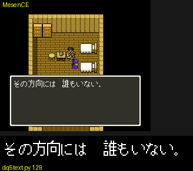
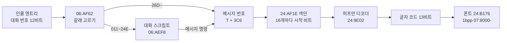

# DQ5(SFC) 메시지·폰트·대화 형식

보행 모드(필드·마을)의 메시지가 어떻게 들어 있고, 인물에게 말을 걸면 어떤 메시지가 나오는지 정리한 문서입니다. 찾아낸 과정은 일지에 있습니다.

- [2026-10-25-01: 메시지, 폰트, 대화 스크립트](journal/dq5/2026-10-25-01-text.md)
- [2026-10-25-02: 보물상자와 이름 문자열](journal/dq5/2026-10-25-02-treasure.md)

기준과 검증:

- 기준 롬: `rom/dq5.sfc`([README](../README.md) 의 SHA-1). 주소 표기는 [dq5-map-format.md](dq5-map-format.md) 와 같습니다.
- 메시지: [tools/dq5text.py](../tools/dq5text.py). 메시지 3,200개가 모두 끝 코드까지 풀리고, 0x129 를 푼 64개 코드가 게임이 `7E:0E4B` 에 푼 값과 같습니다.
- 폰트: 같은 도구의 `glyph`. 롬에서 그린 메시지 0x129 가 게임 화면과 같습니다.
- 대화: [tools/dq5talk.py](../tools/dq5talk.py). 대화 스크립트 574개를 실행기 길이로 읽은 끝이 게임의 건너뛰기 규칙으로 찾은 다음 스크립트 시작과 모두 같습니다.
  선실의 파파스에게 말을 걸고(`012`), 그 슬롯의 대화 번호를 `02A`·`0F3`·`199`(스크립트), `26D`·`4BE`(직접 메시지)로 바꿔 말을 걸어, 처음 나온 메시지 번호 6개가 모두 예측과 같았습니다.
- 주소 힌트는 [「ドラクエ命」 SFC 版ドラクエ 5](https://showa-yojyo.github.io/dqbook/dq5.html) 의 텍스트 해석(`24:8BAF`, `24:AF1E`, `24:9E02`)에서 얻고 롬에서 다시 확인했습니다.



## 한눈에 보기



## 메시지 (`24:8BAF`)

메시지 번호는 0~3199(0xC7F)입니다. `24:8BAF` 가 번호를 A 로 받습니다.

```
색인  = 24:AF1E + (번호 >> 4) * 3 의 24비트 값
       하위 3비트 = 시작 비트 위치, 나머지 = 바이트 주소(24:8C8D)
번호 & 0F 만큼 끝 코드(1001·1010·1018)까지 풀어 버린다
```

색인은 200개(16개씩)이고, 첫 메시지는 바이트 주소에서 바로 시작합니다.

### 허프만 부호 (`24:9E02`)

- 비트는 바이트의 LSB 부터 읽습니다(`24:9E8C` 마스크 표). 바이트를 다 읽으면 다음 바이트로, 16비트 주소가 0 으로 넘어가면 다음 뱅크의 `$8000` 으로 갑니다.
- 노드는 2바이트입니다. 읽은 비트가 1 이면 `24:8CB6 + X`, 0 이면 `24:9472 + X` 를 읽습니다. 처음 X 는 `$07BA` 입니다.
- 값의 bit15 가 켜져 있으면 잎이고 `값 & 1FFF` 가 글자 코드입니다. 아니면 `(값 & 1FFF) * 2` 가 다음 X 입니다.
- `24:8B98` 은 코드 64개를 끝 코드와 상관없이 풀어 `7E:0E4B` 부터 16비트씩 둡니다.

### 글자 코드

| 코드 | 뜻 |
| --- | --- |
| `000` | 공백(`24:A623`, 폭 8) |
| `001`~`3DA` | 폰트 글자. 가나·한자·영숫자·기호 986자. 표는 `dq5text.py` 의 `CHARS` |
| `1000` | 줄바꿈 |
| `1001`, `1010`, `1018` | 메시지 끝 |
| `1002`~`101D`, `1100`~`1118` | 제어 코드. 아래 표 |

글자 코드는 가나 순서가 아니라 폰트 묶음 순서입니다(같은 크기 글자끼리 묶음). 글자표는 폰트를 그려 읽었고,
가나는 이름 입력용 글자 목록인 메시지 `061`(「あいうえお…ガギグゲゴ…ＡＢＣＤ」)의 순서로 맞췄습니다.
모양이 같은 쌍(へ/ヘ, ぺ/ペ, 二/ニ, 一/ー, 口/ロ, 夕/タ, が/ガ)과 々(「日々」「代々」)는 그 메시지와 문맥으로 갈랐습니다.

제어 코드는 쓰인 자리로 짐작한 뜻만 적습니다(코드 읽기·실측 아님).

| 코드 | 쓰인 횟수 | 쓰인 자리 |
| --- | --- | --- |
| `1002` | 2,341 | 메시지 중간. 다음 창(버튼 대기)으로 보임 |
| `1003` | 2,014 | 「パパス「…」 처럼 말하는 사람 이름 앞 |
| `1004` | 38 | 「{1004}ゴールド」. 숫자 변수로 보임 |
| `1006` | 494 | 메시지 첫머리. 서술문 앞 |
| `1008`·`1011`·`1012`·`1015`·`1016`·`1017` | 50~612 | 사람 이름 자리. `1012` 는 주인공(「{1012}は　まだ　小さかった」) |
| `100A`·`100B`·`100F` | 1~59 | 물건·주문 이름 자리로 보임 |
| `1019`·`101A` | 51 | 짝을 지어 나옴 |
| 나머지 | 1~99 | 미확인 |

## 폰트 (`24:A609`)

```
24:B176 부터 5바이트 항목. 앞에서부터 개수를 더해 코드가 속한 묶음을 찾는다
+0~+1  하위 12비트 = 묶음의 글자 수, +1 의 상위 4비트 = 폭(점)
+2~+3  시작 주소(16비트)
+4     bit0-1 + 7 = 뱅크, bit2-5 = 높이(줄)
```

- 묶음 안 `n` 번째 글자는 시작 주소에서 `n × 폭 × 높이` 비트 뒤부터, 줄마다 폭 비트씩 이어 붙은 1bpp 그림입니다.
- 줄은 24비트를 읽어 비트 위치만큼 오른쪽으로 민 뒤 아래 `폭` 비트를 씁니다. 그중 높은 비트가 왼쪽 점입니다(`24:A756`).
- 높이가 `h` 인 글자는 `13 - h` 줄 내려 그립니다(`24:A6DA`). 그래서 「。」(9×3) 처럼 작은 글자는 아래에 붙습니다.
- 글자 묶음은 50개이고 986자가 `07:980E`~`07:D6xx` 에 들어 있습니다.

## 이름 문자열 (`21:955D`)

인물·몬스터·주문·물건 이름은 메시지와 따로, 1바이트 부호 문자열 표에 있습니다. 메시지의 제어 코드(예: `100A`)가 이 표에서 이름을 가져옵니다.

```
21:959B + 표 번호 * 3 = 표 시작(24비트)
표 = [길이][바이트 … ] 가 이어진 목록. n 번째는 앞의 n 개를 길이+1 씩 건너뛴 곳
```

| 표 | 시작 | 내용(앞부분) |
| --- | --- | --- |
| 0 | `23:C5CE` | 인물 이름: ビアンカ, サンチョ, ピピン, フローラ, パパス … |
| 1 | `23:C5F9` | 호칭: パパスのむすこ, やどやのむすめ … |
| 2 | `23:C690` | おとこ, おんな, ？？？ |
| 3 | `22:8000` | 첫 항목 ひとし 뒤로 주문: メラ, メラミ, メラゾーマ, ギラ … |
| 4 | `23:C69C` | 몬스터: スライム, とげぼうず, せみもぐら … |
| 5 | `23:CE0E` | 물건: ひのきのぼう, たけのやり, こんぼう … |
| 6 | `23:D5B5` | 작전·마을 이름: ガンガンいこうぜ … ラインハット, オラクルベリー … |

1바이트 부호는 `24:A7B6` 이 글자 코드로 바꿉니다.

- 보통 바이트 `b` → `24:B270 + b*2` 의 글자 코드
- `84 xx` → `24:AE9A` 에서 `xx` 를 찾은 순번 `i` 로 `24:B36E + i*2`(탁점 글자, 예 `84 29` = が)
- `83 xx` → 같은 표의 `28` 번째부터 찾음(반탁점 글자)
- `01` → 공백

상자에서 「はがねのキバ」(`14 84 29 18 27 84 1C 2F`)가 나온 화면과 디코더 결과가 같습니다.

## 대화 (`06:AF62`)

인물 엔트리의 대화 번호(12비트, [dq5-map-format.md 「인물」](dq5-map-format.md#인물-128000))는 인물 표 `7E:36E0`(하위)·`7E:3700`(상위)에 들어갑니다.
말을 걸면 `06:AF62` 가 그 값을 읽고 `06:AFF4` 가 갈래를 고릅니다.

| 대화 번호 T | 하는 일 | 낮 인물 수 |
| --- | --- | --- |
| `000`~`010` | `06:DBD2` 특수 기능(T 를 인자로, 코드 읽기) | 463 |
| `011`~`24E` | 대화 스크립트 `T - 011` | 336 |
| `24F`~`26C` | `06:B34F`(코드 읽기, 뜻 미확인) | 6 |
| `26D`~ | 메시지 `T + 3C6`(`06:AFFB`) | 153 |

### 대화 스크립트 (`06:AEF8`)

```
06:AEF8 + ((T - 011) >> 5) * 2 = 32개 묶음의 시작(뱅크 06)
묶음 안에서 (T - 011) & 1F 개의 스크립트를 건너뛴다(06:AFA9)
  건너뛸 때 길이: 00·17~1C = 3, bit6 이 켜진 바이트 = 2, 나머지 = 1, 3F 를 만나면 스크립트 하나 끝
```

스크립트는 574개, `06:8129`~`06:AEE6` 입니다. 명령은 `06:B065` 가 실행합니다.

| 바이트 | 길이 | 뜻 |
| --- | --- | --- |
| `40`~`7F`(bit6) | 2 | 메시지. `v = (b0 & 3F) << 8 \| b1`, bit5 가 켜져 있으면 `v & 1FFF`, 아니면 `v + 615` 가 메시지 번호(`06:B070`) |
| `07` | 1 + 조건 | 조건문. 아래 |
| `17` | 3 | `7E:2190 + idx &= mask`(플래그 끄기) |
| `18` | 3 | `7E:2190 + idx \|= mask`(플래그 켜기) |
| `19` | 3 | `7E:2190 + idx = 값` |
| `12` | 2 | `06:DBD2` 특수 기능(인자 1바이트) |
| `00` | 3 | 네이티브 루틴 호출 `06:주소`(`06:B129`) |
| `01` | 5 | 네이티브 루틴 호출 + 인자 2바이트 |
| `3E` | 1 | 블록 끝 |
| `3F` | 1 | 스크립트 끝 |

조건문은 `07 <조건> <참 분기> [0B <거짓 분기>]` 입니다(`06:B15B`, `06:B1E5`).
분기는 `06` 으로 시작하면 `3E`(또는 `3F`)까지 여러 명령, 아니면 명령 하나입니다(`06:B214`, `06:B225`).

조건 바이트의 bit7 은 결과를 뒤집고, 아래 6비트가 조건 코드입니다. 길이는 `06:B27E` 가 정합니다.

| 조건 코드 | 길이(조건 바이트 포함) | 쓰인 횟수 | 뜻 |
| --- | --- | --- | --- |
| `1B` | 3 | 772 | `7E:2190 + idx & mask` 가 켜져 있으면 참(`06:B31F`, 실측) |
| `05` | 1 | 79 | 미확인(예/아니요 대답으로 보임) |
| `03` | 2 | 55 | 미확인 |
| `1F` | 1 | 44 | 미확인 |
| `02` | 1 | 19 | 미확인 |
| `13`·`11`·`1A` | 2·2·3 | 1~2 | 미확인 |
| `14`·`16`·`1C`·`1E`·`20` | 1·2·3·1·1 | 0 | 미확인 |

예: 대화 번호 `012`(선실의 파파스)

```
07 1B 01 01     if 7E:2191 & 01
06                블록 시작
41 3A               메시지 74F「パパス「そうか　港に着いたか！…」
18 02 80            7E:2192 |= 80
3E                블록 끝
0B              else
41 2D             메시지 742「パパス「父さんは　ここにいるから…」
3F              끝
```

`7E:2192 & 80` 은 17/00 에 인물을 놓지 않는 조건 플래그입니다([dq5-map-format.md 「이벤트 플래그에 따른 목록」](dq5-map-format.md#이벤트-플래그에-따른-목록-1282fb-128357)).

## 남은 것

- 제어 코드(`1002`~`1118`)의 실제 처리와 이름·숫자 변수의 출처
- 조건 코드 `1B` 밖의 뜻, `06:DBD2` 특수 기능(대화 번호 `000`~`010`과 명령 `12`), `06:B34F`(대화 번호 `24F`~`26C`)
- 네이티브 호출(`00`·`01`)이 부르는 루틴들
- 전투 모드 메시지(`24:8C39`, 색인 `24:AECD`)와 메뉴 문자열
- 인물 엔트리의 인라인 스크립트(대화 번호와 따로 있음)
