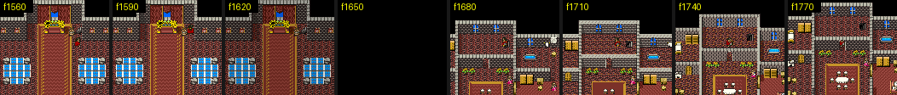

# 2026-10-24: DQ5 실내 맵 풀기

목표는 DQ4 맵을 DQ5 엔진에 넣는 것이고, 그러려면 먼저 DQ5 가 맵을 어떻게 저장하는지 알아야 합니다.
이날 한 일은 ROM 의 맵 데이터에서 화면의 맵까지 가는 길을 따라가, 같은 결과를 내는 디코더를 만든 것입니다.
결과 정리는 [dq5-map-format.md](../dq5-map-format.md) 에 있습니다.

## 출발점

- 롬: DQ5 일본판(`rom/dq5.sfc`). 헤더는 `DRAGONQUEST5`, LoROM 12Mbit.
- 앞선 분석: [「ドラクエ命」](https://showa-yojyo.github.io/dqbook/dq5.html) 는 텍스트·몬스터·인카운트를 다루지만 맵은 없습니다.
  [DQバイナリ改造 @Wiki](https://w.atwiki.jp/dq_binary/pages/23.html) 의 RAM 표에 「`7EFC00-` マップデータ」 한 줄이 있을 뿐입니다.
- 도구: MesenCE `--testrunner` 로 롬을 화면 없이 돌리며 Lua 로 메모리를 감시합니다([tools/README.md](../../tools/README.md)).

## 1. 맵이 바뀌는 순간 잡기

전원을 켜고 40프레임마다 A 를 누르기만 해도 오프닝이 진행되어, 1650프레임쯤 왕좌의 방에서 다음 방으로 맵이 바뀝니다.
이 장면 하나를 기준으로 삼았습니다.



```sh
SHOT_DIR=$PWD/work/wdump MAXF=3000 EVERY=0 PERIOD=40 TAP=a FROM=900 STEP=30 \
  "$MESENCE" --testrunner "$PWD/rom/dq5.sfc" "$PWD/tools/lua/wsnap.lua"
```

30프레임마다 WRAM 128KB 를 떠서, 위키가 말한 `7EFC00-7EFFFF` 를 비교했더니 1650프레임에만 559바이트가 바뀌었습니다.
위치는 맞는 듯했습니다.

## 2. 위키의 「マップデータ」는 맵이 아니었다

`7EFC00-` 에 쓰는 코드를 감시하니(`wwatch.lua`) `01:A9EB` 등이 `00 BE 08 80` 꼴의 4바이트를 반복해 쓰고 있었습니다.
맵이라기보다 무언가를 펼친 버퍼에 가까워 보여서, 전환 구간(1625~1710프레임)의 **WRAM 쓰기 전체**를 PC 별로 모았습니다(`wprof.lua`).

| PC | 횟수 | 범위 | 해석 |
| --- | --- | --- | --- |
| `01:9937` | 65536 | `7F0000-7FFFFF` | 비우기 |
| `01:9932` | 16384 | `7EC000-7EFFFF` | 비우기 |
| `01:A9EB` 등 | 약 1000씩 | `7EC071-7EF0DC` | **셀 버퍼 채우기** |

맵이 들어가는 곳은 `7EC000-` 부터였고, `7EFC00` 은 그 끝자락일 뿐이었습니다.

## 3. ROM 의 어디를 읽는가

같은 구간의 **ROM 읽기**를 PC 별로 모았습니다(`rprof.lua`).

| PC | 범위 | 나중에 밝혀진 정체 |
| --- | --- | --- |
| `01:8C62` | `13:8000-15:E87F` | CHR 그래픽 |
| `01:8AF1`~`8B55` | `16:8003-16:D193` | 블록 정의 |
| `01:AC81` 등 | `18:E17A-18:E320` | **배치 비트스트림** |
| `01:B8AE` 등 | `18:E326-18:E484` | 그 뒤 데이터(미확인) |

`01:AC66` 근처를 디스어셈블하니 `$81` 을 비트 위치로 쓰는 1비트 리더였고, 그걸 부르는 `01:A824` 는 비트 0/10/110/111 로
갈라지는 명령 해석기였습니다.

## 4. 맵 번호에서 포인터까지

스트림 포인터 `$A5-$A7` 에 쓰는 코드를 1620프레임 이후로 좁혀 보니 `01:9366` 이 `18:E171` 을 넣고 있었습니다.
처음 디스어셈블은 엉뚱한 곳(필드용 `$BC-$50` 계산)을 보여 줬는데, 실행된 PC 를 순서대로 찍어 보니(`pcseq.lua`)
실제 경로는 `01:92E2` → `$BC < $50` 분기 → `0F:8ED7` 표였습니다. 이때 `$BC=02, $BD=07` 이었습니다.

> 65816 은 M·X 플래그에 따라 같은 바이트가 다른 명령이 되어, 정적 디스어셈블이 쉽게 어긋납니다.
> 그래서 실행된 PC 와 그때의 플래그를 모으는 `cover.lua` 와, 그 플래그대로만 디스어셈블하는 `tools/listing.py` 를 만들었습니다.
> 이후 루틴은 모두 이 방식으로 읽었습니다.

## 5. 디코더 만들기와 바이트 단위 비교

해석기·블록 전개(`01:8ACB`)·CHR 슬롯 할당(`01:8C15`)을 Python 으로 옮기고([tools/dq5map.py](../../tools/dq5map.py)),
게임이 디코더를 막 끝낸 순간(`01:A833`)의 WRAM 과 비교했습니다(`atpc.lua`).

```sh
SHOT_DIR=$PWD/work/atpc MAXF=1700 EVERY=0 PERIOD=40 TAP=a FROM=1620 AT=01A79A,01A833 \
  "$MESENCE" --testrunner "$PWD/rom/dq5.sfc" "$PWD/tools/lua/atpc.lua"
python tools/dq5map.py rom/dq5.sfc 02 07 --compare work/atpc/at_01A833.bin
```

```
map 02/07 at 18E171: 46x34, stream ends 18E325 bit 1, slots BE-138
compare: 0 bytes differ of 12512
```

한 번에 맞았고, 스트림이 끝나는 `18:E325` 바로 다음이 `01:B8xx` 가 읽던 `18:E326` 이라 경계도 맞았습니다.

## 6. 346개 전부 돌리니 21개만 풀렸다

| 증상 | 맵 수 | 원인 |
| --- | --- | --- |
| 미구현 경로 | 307 | 머리 `+7` bit7: 배경 블록으로 먼저 채우는 `01:A93F` 경로. 하필 처음 본 02/07 이 드문 쪽이었다 |
| 블록 번호 범위 초과 | 18 | 블록 번호도 위치처럼 머리 `+6` 비트라고 가정했는데, 블록 번호는 늘 11비트였다 |

두 번째는 커버리지 리스팅을 다시 읽어 찾았습니다. 비트 수를 정하는 `$84` 분기(`01:ABA5`)가 바꾸는 것은
위치용 표 `$1A5D` 뿐이고, 블록 번호용 `$1A4D` 는 언제나 같은 표였습니다.

고친 뒤 346개 모두 오류 없이 풀렸고, 첫 맵 02/06(배경 채우기 경로)도 게임 셀 버퍼 29,952바이트와 같았습니다.

## 7. 그림으로 확인

셀 버퍼를 8x8 타일로 그리고, 같은 순간의 게임 화면이 그림의 어디인지 찾아 맞춰 봤습니다.
처음에는 표본 픽셀 41%만 같았는데, 5비트 색을 8비트로 늘리는 식이 MesenCE(`v<<3 | v>>2`)와 달라서였습니다.
고친 뒤 3,584개 중 3,569개(99.6%)가 같았고, 남은 15개는 주인공 스프라이트 자리입니다.


그림은 `python tools/figures.py` 로 다시 만듭니다(롬과 위의 `work/` 덤프 필요).

## 틀렸던 것들

- 위키의 `7EFC00-` 「マップデータ」: 셀 버퍼 끝자락이었다.
- 프레임 사이 WRAM 차이로 맵 번호 찾기: 맵 전환 한 번에 17,000바이트 넘게 바뀌어 후보가 너무 많았다. 코드에서 거꾸로 따라가는 편이 빨랐다.
- 정적 디스어셈블로 진입점 찾기: M·X 폭이 어긋나 엉뚱한 분기를 봤다. 실행 커버리지로 해결.
- 블록 번호 비트 수 = 위치 비트 수: 아니다. 블록 번호는 11비트 고정.
- `SHOT_DIR` 상대 경로: MesenCE 작업 폴더 기준으로 풀려 결과가 사라졌다.

## 다음

- 맵 머리의 남은 바이트, 셀 플래그·속성(통행·문·계단)
- 셀 버퍼 뒤 데이터(`18:E326-`, 인물·이벤트로 추정)
- 팔레트 원본 위치(지금은 CGRAM 덤프 사용)
- 그다음 FC DQ4 맵 형식을 보고, DQ5 형식으로 옮길 수 있는지 판단
