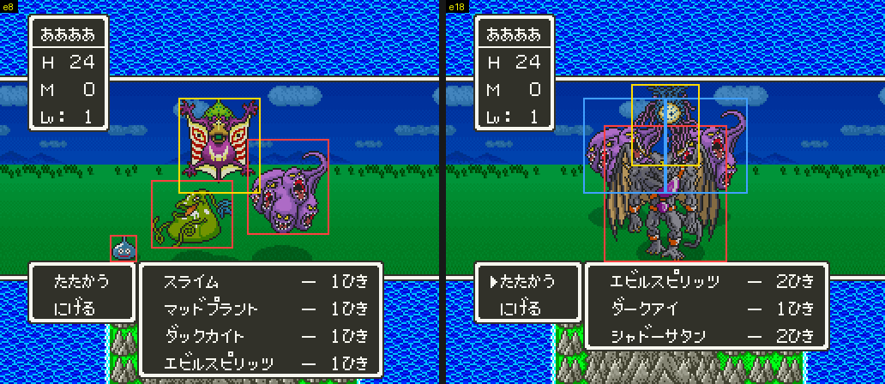

# 2026-10-25-21: 전투 몬스터 배치와 그림자

[앞 일지](2026-10-25-09-mongfx.md)에서 그림 자체는 풀었지만, 그림 머리 +0~+4 의 뜻과 여러 마리를 어디에 놓는지는 남겨 두었습니다. 이번에는 이것들과 그림 번호에 얽힌 나머지 수수께끼를 풀었습니다. 결과는 [dq5-graphics-format.md 「배치와 그림자」](../../dq5-graphics-format.md#배치와-그림자) 에 있습니다.

## 1. 머리 값이 가는 곳

이벤트 전투의 850~2400프레임 동안 22~24 뱅크에서 실행된 명령을 `cover.lua` 로 모아 `listing.py` 로 풀고, 머리 값이 들어가는 `7E:0D1C`·`0C5B`·`0C2E`~`0C56` 을 찾았습니다.

모든 실험은 [앞 일지 3절](2026-10-25-09-mongfx.md#3-그림-107개를-게임과-비교)의 이벤트 전투 명령에 프로브와 환경 변수만 바꿔 붙였습니다. 공통 부분을 함수로 둡니다(`RP` 는 덧붙일 `ROMPATCH`).

```sh
export LIBDIR=$(tools/lua/seqlib.sh "$(uv run --locked krpatch sfc lua)" work/walklib walk.lua)
battle() { probe=$1; shift; env STATE=$PWD/work/state/ship.mss PRE="b:4,wait:40,b:4,wait:40" \
  ROMPATCH="156FF5=E0253C0103${RP:+;$RP}" WAYPOINTS="3,11;3,24;7,24;7,22;37,66;37,72;down:90" \
  CHANGES=2 AFTER=400 "$@" "$MESENCE" --testrunner "$PWD/rom/dq5.sfc" "$PWD/tools/lua/$probe"; }
mkdir -p work/cov2
battle cover.lua SHOT_DIR=$PWD/work/cov2 LO=220000 HI=24FFFF FROM=840 TO=2400 MAXF=2410
uv run --locked python tools/listing.py rom/dq5.sfc work/cov2/cover.txt > work/cov2/list.txt
```

롬을 덮는 실험은 `RP=파일오프셋=바이트` 를 앞에 붙입니다.

- 머리 +0 bit7 은 `$0DFC`·`$0D1B` 에 `80` 을 넣습니다(`22:905C`). `$0D1B` 는 원래 무리 값(`7E:1009 + 무리`)이라, 이 그림은 무리 값 bit7 이 켜진 것과 같아집니다.
- bit5-6 은 8을 곱해 `0C5B` 로 가고, 상자 위 y 를 계산할 때 빠집니다(`22:A084`).
- bit0-4 는 `0C38` → `0CC6` 로 가서 `22:B44A` 가 `22:B4FE` 표를 고르는 번호가 됩니다. +1·+2 도 여기서 쓰입니다.
- +3·+4 는 공격 장면에서만 `22:DB3D` 가 읽습니다.

## 2. 배치 규칙을 실측으로 맞추기

배치를 계산하는 코드(`22:9FB0`→`22:A001`, `22:AF22`)를 읽고 세운 식을, 무리를 바꿔 붙인 전투의 OAM 과 맞춰 봤습니다. 무리는 `POKE` 로 `7E:1001`~`100C` 를 고정합니다.

```sh
mkdir -p work/p/e8
battle dq5battledump.lua SHOT_DIR=$PWD/work/p/e8 MAXF=1020 DUMPF=1000 FROM=850 TO=0 AT=2290DC \
  POKE="7E1001=00;7E1005=1;7E1002=0F;7E1006=1;7E1003=77;7E1007=1;7E1004=B4;7E1008=1"
uv run --locked python tools/dq5mongfx.py rom/dq5.sfc --layout "00:1,0F:1,77:1,B4:1"
```

OAM 과 VRAM 으로 OBJ 를 팔레트별로 따로 다시 그리고(무리마다 팔레트가 달라 겹친 몬스터도 나뉨), 그림이 색 번호·RGB 모두 맞는 자리를 찾아 예상과 견줬습니다.

```
s3 OK 3   e1 OK 8   e2 OK 3   e3 OK 2   e4 OK 2   e5 OK 2   e6 OK 2
e7 OK 3   e8 OK 4   e9 OK 3   e10 OK 2  e11 OK 5  e12 OK 2  e13 OK 3
e14 OK 3  e15 OK 2  e16 OK 4  e17 OK 4  e18 OK 4  e19 OK 4
```



- 한 무리: スライム 8마리는 x = 64, 80, …, 176(16 간격, 가운데 128), シャドーサタン(9칸) 3마리는 20·92·164.
- 여러 무리: スライム 2 + マッドプラント 1 은 84·100·124. 무리 사이에 8픽셀이 빕니다.
- 줄: 무리 값 `01` 이면 24픽셀 위(`$88`), `80` 이면 띄운 몬스터와 같은 줄(`$58` 기준)로 갔습니다. 줄마다 따로 가운데에 맞춥니다.
- 마릿수: シャドーサタン 4마리 → 3마리, イブール(10칸) 3마리 → 2마리, シャドーサタン 2 + マッドプラント 1 + スライム 2 → スライム 1마리(칸 합 26 + 2 = 28 이 되는 순간 멈춤. 무리 사이 8픽셀은 세지 않음).

## 3. 셋째 제한: 8픽셀 줄마다 OBJ 수

e18(エビルスピリッツ 2마리 줄 1, ダークアイ 1마리, シャドーサタン 2마리)은 칸 합(줄마다)도 조각 합(98 < 100)도 넘지 않는데 シャドーサタン 이 1마리만 나왔습니다.
`probe/trace.lua` 로 `22:91DC`·`22:9284` 를 찍어 보니 마릿수는 2 그대로였고, 실제로 빠진 곳은 상자를 놓는 `22:A119` 였습니다.

`22:A119` 는 그림의 8픽셀 줄마다 `7E:5B60` 의 값을 `7E:2F00 + (y >> 3) - 7` 에 더해 보고, 28 이상이 되는 줄이 있으면 그 몬스터를 놓지 않습니다. e18 의 WRAM 에서 `2F00` 은 `4 8 9 19 23 22 21 17 9 9 9 6 3` 이었고, シャドーサタン 의 줄별 값 `2 7 8 9 9 9 9 9 6 3` 을 3번 줄부터 더하면 4번 줄이 23 + 7 = 30 이 됩니다.
`5B60` 의 값은 처음에 줄마다 조각 수로 셌다가 틀려서, 16x16 조각을 2로 세는 타일 수로 고치자 맞았습니다. 앞 일지의 107번 전투 덤프로 확인하니 107개 그림 모두 디코더 값과 같았습니다.

## 4. 그림자와 타격 효과

머리 +0 bit0-4 를 0 으로 덮자 マッドプラント 발밑의 어두운 타원이 사라졌습니다. 그림자는 OBJ 가 아니라 전투 배경 BG 타일을 칠한 것이었습니다(898프레임에 `22:B44A`, 899프레임에 VRAM `$4AE0`·`$4CE0` 으로 DMA).
그림자가 있는 화면과 없는 화면의 차이를 줄마다 보면 가로 구간이 `125~133, 121~137, 119~139, …` 이고, `22:B4FE` 표의 1번 모양 `0B~14, 07~18, 05~1A, …` 와 너비가 같습니다.

그림 `00` 의 머리는 `25:8C99`(파일 오프셋 `128C99`)라, 모양 번호를 지울 때는 `RP=128C99=20` 을 붙였습니다.

+1 을 `F1`→`F9` 로 바꾸면 구간이 모두 8 오른쪽으로, +2 를 `12`→`0A` 로 바꾸면 8 위로 갔습니다.

+3·+4 는 공격 장면에서 읽혀서, 걷기 입력 뒤에 `a` 를 몇 번 눌러 공격하게 하고 프레임 1796~1830 화면을 비교했습니다. +3 을 `03`→`06` 으로 바꾸자 맞을 때의 불꽃 효과가 24픽셀 오른쪽으로 옮겨 갔습니다.

## 5. 무리를 더하는 곳과 같은 머리 번호

- `EA` 전투에서 `7E:1002` 쓰기를 `wwatch.lua` 로 지켜보니(주소는 뱅크 00 쪽 `001002` 로 잡힘) `22:8A15` 가 `EB` 를 넣었습니다. 바로 앞 `22:89E5` 는 `E7` 이면 `E8`·`E9` 를 넣고, 뒤는 `6A` 의 짝수 마릿수를 하나 줄입니다.
- `E7` 전투에서는 `E7`·`E8` 이 같은 원점 (72,56) 에 그려졌고, `E9` 는 타일만 VRAM 에 올라가고 기다리는 동안 OAM 에 나오지 않았습니다.
- マッドプラント(그림 `00`)와 わらいぐさ(그림 `00`)를 함께 붙이면 OBJ 타일 `000`~`01B` 를 같이 썼고, マッドプラント 와 ドードリアン(그림 `11`, 같은 머리)은 타일을 따로 올렸습니다. 그림 번호가 타일을 나눠 쓰는 열쇠입니다.
- 그림 `15` 뒤 3바이트(`25:C4E9`~`C4EB`)는 몬스터 `60` 전투의 읽기 감시에서 한 번도 읽히지 않았습니다.

## 틀렸던 것들

- 머리 +1~+4 를 처음에는 화면 배치 값으로 짐작했습니다. 실제로 배치는 가로·세로 칸 수와 +0 의 띄움·들어올림만으로 정해지고, +1~+4 는 그림자와 타격 효과의 기준점입니다.
- 줄별 OBJ 한도의 값을 조각 수로 셌다가 e18 이 맞지 않아 타일 수로 고쳤습니다.
- 여러 무리 실험에서 줄 1 의 スライム 이 화면에 안 보여서 빠진 줄 알았는데, OAM 에는 있었고 줄 0 의 マッドプラント 뒤에 가려 있었습니다. 줄 1 은 그리는 순서가 마지막이라 맨 뒤에 그려집니다.
- `7E:1002` 쓰기를 `7E1000-7E1010` 범위로 지켜봤더니 아무것도 잡히지 않았습니다. 게임이 DB=00 으로 쓰기 때문에 `001000-001010` 으로 지켜봐야 했습니다.

## 남은 것

- 그림자를 BG 타일에 칠하는 `22:B08A` 의 자세한 방식과 `0CE8`·`0CF9` 의 쓰임.
- `E7` 전투의 `E9`(그림 `6F`)가 나오는 때, `22:AF61` 이 원점을 모으는 방식.
- 같은 머리를 다른 번호로 나눈 이유.
