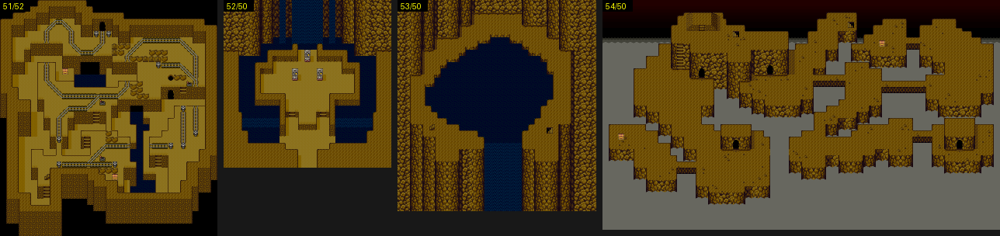

# 2026-10-25-26: 필드의 남은 것과 그룹 $50 이상 맵 마무리

[2026-10-25-15 일지](2026-10-25-15-field.md) 에서 남긴 것들을 실측으로 풀었습니다. 1F/00 도착 좌표, 세계가 바뀌는 길, 움직이는 타일, 그룹 `$50` 이상 맵 18개의 셀 버퍼, 영역 이동입니다.
가장 큰 수확은 방향으로 알던 값 셋(도착 표 `+3`, 영역 이동 `+4`·`+B`)이 사실은 주인공의 층이라는 것입니다.
결과는 [dq5-field-format.md](../../dq5-field-format.md) 와 [dq5-map-format.md](../../dq5-map-format.md) 의 「영역 이동」「그룹 `$50` 이상」「셀 버퍼」에 있습니다.

## 1. 1F/00 에서 5칸 걷는 주인공

`tools/lua/dq5warptrace.lua` 로 주인공 X(`7E:3020`) 쓰기를 지켜보았습니다. 688프레임에 표대로 100 이 들어간 뒤, 727프레임부터 8프레임마다 1씩 줄어 95 에서 멈췄습니다.
누가 입력 없이 걸리는지 보려고 표의 X·Y(파일 오프셋 `7EB33`·`7EB34`)를 바꿔 들어가 보니 (99,29)·(101,29)·(100,27)·(100,31) 은 그대로였고 (100,29) 에서만 걸었습니다.

```
62 1D -> 98,29    63 1D -> 99,29    64 1D -> 95,29    65 1D -> 101,29    64 1B -> 100,27
```

자리 하나에만 반응하니 인물 스크립트를 의심했습니다. 인물 표(`7E:348D`·`34AD`)의 스크립트 주소를 쓰는 슬롯이 `0D` 였고, `tools/dq5npc.py` 로 1F/00 의 (72,29) 인물 스크립트를 풀자 그대로였습니다.

```
+00 08 e4 1d 64 1d  주인공 자리 대기 후 이벤트 시작 (100,29)-(100,29) 안이 될 때까지
+06 37 c6 f2 05     네이티브 호출 05:F2C6
+0B 07 df 1d 5f 1d  주인공 자리로 상대 점프 (95,29)-(95,29) 밖이면 → +0A
+15 21 29 03        메시지(창 열고 닫음) 0329   「わん　わん！」
```

## 2. 세계가 바뀌는 길

`$1949` 를 쓰는 `2A:FEE4` 를 부르는 곳은 `2A:F475` 하나였고, 필드로 나가는 `2A:F425` 안이었습니다. 지난번에 「맵에 들어갈 때」라고 적은 것은 틀렸습니다.
세계 2 그룹인 1C/00 에 `TO` 로 가서 걸어 나가자 `$1949` = 2 인 필드 (96,99) 에 섰습니다.

세계를 건너는 길은 `tools/dq5exit.py` 의 출구 목적지와 `tools/dq5trigger.py` 의 영역 이동을 모든 맵에서 훑어 찾았습니다. 하나만 나왔습니다.

```
11/00 w0 -> 22/00 w1 560d570e0180220023660101
```

11/00 의 (86,12) 에서 아래로 걸어 22/00 에 들어가고, 계속 아래로 걸어 나가자 `$1949` = 1 인 필드 (107,100) 에 섰습니다. 세계 2 로 가는 길은 표에 없어 이벤트로 보입니다.

## 3. `$198E` 와 층

`$198E` 의 bit0-1 은 `00:E209` 가 `00:E873` 표(`08 01 04 02`)로 바꿔 인물 표에 넣습니다. 그룹 `1A` 항목의 `+4` 를 `04`~`07` 로 바꿔 들어가니 주인공이 등·오른쪽·앞·왼쪽을 보고 섰습니다. 도착 때의 방향입니다.

그렇다면 `0F:EA97` 의 `+3`(`$C3`)은 방향이 아닙니다. 그룹 `02`(`+3` = `01`)로 들어가면 `7E:31A0` = `01`, `1B`(`02`)는 `02` 였고, `02` 의 `+3` 을 `02` 로 덮자 02/00 에서 주인공이 걷지 못했습니다.
`7E:31A0` 은 셀 `+1` 아래 3비트와 AND 하는 층 마스크입니다. 장면 이동 도구의 `TO` 넷째 값도 같은 자리라, `TO=01/00,32,90` 처럼 기본값 1 로 01/00 에 가면 주인공이 서 있기만 합니다(01/00 바닥은 2층).

## 4. 움직이는 타일

세계 1·2 에서만 롬과 달라 보였던 타일 `454`~`459` 를 확인하려고 `$420B` 쓰기 때의 DMA 채널 값을 적는 Lua 를 얹었습니다. 세 세계 모두 같은 DMA 가 돌았습니다.

```
ch0 src=7EC800 size=00C0 vaddr=3C60   (7EC8C0 · 7EC980 … 7ECD40 의 8벌)
ch0 src=7EC400 size=0040 vaddr=2040   (타일 4·5)
ch0 src=7EC440 size=0040 vaddr=2140   (타일 20·21)
```

움직이는 타일이었고, 지난번 덤프는 세계 0 에서 마침 첫 벌일 때였습니다.

## 5. 그룹 `$50` 이상 맵 18개를 0바이트로

슬롯 시작이 맵마다 달라 보였던 것을 풀려고 CHR 슬롯 카운터 `$1834` 쓰기와 블록 전개(`01:8B92`)를 추적했습니다. 카운터는 늘 `BE` 에서 시작했고, 맵 블록보다 먼저 올라가는 블록이 있었습니다.

```
5150 16 87 88 89 8A 8B 8C 8D 8E 90 91 92 93 94 95 96 97
5152 19 87 88 89 8A 8B 8C 8D 8E 90 91 92 93 94 95 96 97 4B 65 124
```

`87`~`97` 은 `$BC` = 51 일 때 `01:8F0C` → `02:8883` 이 `02:88A5` 목록으로 올리고, 뒤의 셋은 `03:D3E9` 가 `03:D82E` 표로 올립니다.
54/52·54/53 은 `$1834` 를 `04:81A8` 이 `11A`·`121` 로 바꿨는데, `04:822D` 표에서 그 맵의 슬롯 수(`5C`·`63`)를 더한 것이었습니다.
셋을 `tools/dq5map.py` 에 넣자 13개 맵의 차이가 0~8바이트로 줄었고, 남은 차이는 모두 `+4` = `32` 인 두 칸씩이었습니다.
그 칸에 쓰는 곳을 감시하니 `01:8F93` 이 `01:9017`·`01:92A9` 표대로 `+4` 를 찍고 있었습니다. 이것까지 넣으니 지난 일지의 덤프 17개가 모두 0바이트 차이였습니다.
50/50 은 `2A:F3BF` 의 플래그 검사가 `7E:21BA` bit5 를 보아, `SET="21BA|20"` 을 주자 들어가졌고 역시 0바이트 차이였습니다.



## 6. 움직이지 않던 주인공과 영역 이동

54/51·52/50 등에서 주인공이 움직이지 않던 것은 A 를 누르면 명령 창이 떴으니 입력 문제가 아니었습니다. `7E:31A0` 이 `02` 였고 바닥 셀은 1층(`+1` = `11`)뿐이었습니다.
그룹 51 입구 코드 `2A:F3F7` 이 `$C3` 에 `02` 를 넣기 때문입니다. `1573F8` 을 `01` 로 덮어 들어가자 걸을 수 있었고, 영역 이동 레코드 11개를 밟아 모두 레코드대로 옮겨 갔습니다.

옮긴 뒤 `7E:31A0` 은 레코드 `+B` 와 같았습니다(54/53 → 54/52 `04`, 54/51 → 54/52 `01`, 51/57 → 51/52 `02`). `+B` 는 도착 층입니다.
`+4` 도 확인했습니다. 54/51 의 사각형에 위로 들어가도 옮겨 가서 바라보는 방향은 조건이 아니었고, 51/51 레코드의 `+4` 를 `01`·`03`·`04` 로 바꾸면 층 `02` 인 주인공이 밟아도 옮겨 가지 않았습니다.

## 7. `$1A33` 과 셀 비트

`$1A33` 읽기 감시(뱅크 미러 모두)를 필드 전투에서 이기기, 도망, 교회 저장(파파스의 대화 번호를 `005` 로 바꿔 「たしかに　記録しましたぞ。」까지), 탈것 값 `$1954` 여섯 가지로 걷기에도 걸었지만 한 번도 읽히지 않았습니다.
감시가 제대로 걸리는지는 같은 실행에서 `$1949` 읽기가 잡히는 것으로 확인했습니다.

셀 `+0` 은 01/00 의 bit3 칸 260개를 읽기 감시했습니다. 읽는 곳은 `00:DB38`(인물 층 마스크와 AND), `00:DF7C`(OR 해서 다시 씀), `00:DEF7`(AND 로 지움), `00:B913`·`B93E`(구역)였습니다.
`+0` 아래 니블은 인물이 선 층을 찍어 두는 자리이고, bit3 은 미리 찍힌 「8층」 표시로 보입니다. 선실의 인물 층 마스크는 모두 `01` 이었습니다.
`+1` bit4-6 칸은 `00:AC4F`·`AC57`·`AD35` 와 `2B:B8F3`~`BA20` 이 읽었습니다. 선실에서 이 비트를 매 프레임 지우고 침대 옆에 서 보았지만 화면은 같았습니다.

## 틀렸던 것들

- `0F:EA97` `+3`, 영역 이동 `+4`·`+B`, 목적지 표 종류 `60` 넷째 바이트를 방향으로 보았습니다. 모두 주인공 층(`$C3` → `7E:31A0`)입니다. 앞선 실측(「1 은 아래」)은 층이 1 인 맵에서 아래로 걸었을 뿐이었습니다.
- `$1949` 를 맵에 들어갈 때 다시 쓴다고 적었습니다. 필드로 나갈 때입니다.
- 그룹 `$50` 이상 맵의 슬롯 시작이 맵마다 다르다고 보았습니다. 시작은 늘 `BE` 이고, 슬롯을 건너뛰거나 블록을 먼저 올리는 처리 셋이 앞에 있습니다.
- 세계 1·2 의 타일 `454`~`459` 가 따로 있다고 보았습니다. 세 세계 모두 움직이는 타일입니다.

## 남은 것

- 세계 2 로 들어가는 이벤트와 세계 1·2 에서 돌아오는 길, `$194A` 값의 뜻, `$198E` bit7
- 그룹 `$50` 이상의 영역 이동 레코드 14개
- `$1A33` 을 주문(ルーラ·リレミト) 때 읽는지. 셀 `+0` bit3 을 막는 층 마스크 `08`, `+1` bit4-5·bit6 의 뜻
