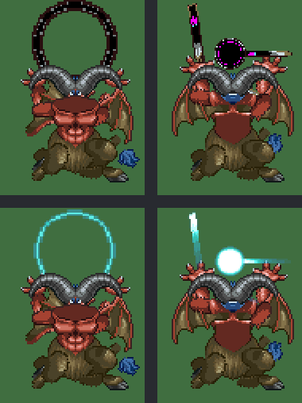

# NDS DQ4 그래픽 형식

NDS 판 「ドラゴンクエストIV 導かれし者たち」(일본판, [README 「원본 롬」](../../../README.md#원본-롬))의 그래픽 파일 형식입니다. 인물·몬스터·맵을 다시 그릴 때 참고할 그림을 뽑으려고 풀었습니다. 디코더와 내보내기는 [tools/ndsgfx.py](../tools/ndsgfx.py), 에뮬레이터 화면 캡처는 [tools/ndsplay.py](../tools/ndsplay.py), 세이브스테이트에서 VRAM·레지스터를 꺼내는 도구는 [tools/ndsvram.py](../tools/ndsvram.py), 이 문서의 그림은 [tools/ndsgfxfig.py](../tools/ndsgfxfig.py) 가 만듭니다. 분석 과정은 [2026-10-25-05](../journal/2026-10-25-05-graphics2.md)·[2026-10-25-13](../journal/2026-10-25-13-graphics3.md)·[2026-10-26-06](../journal/2026-10-26-06-graphics4.md) 일지에 있습니다. 뽑은 그림은 저작권 데이터라 이 저장소에 두지 않습니다([ROM-01](../../../.agents/skills/analysis/SKILL.md#rom-01--롬-데이터-금지)).

## 준비와 실행

파일 시스템은 원래 체크아웃의 `work/nds/jp` 에 한 번 풀어 두고 워크트리에서는 링크해 씁니다.

```sh
uv run --locked krpatch nds unpack rom/dq4ds.nds work/nds/jp
uv run --locked krpatch nds unpack rom/dq4ds-kr.nds work/nds/kr   # 한글 팬패치 쪽(선택)
uv run --locked python nds/dq4/tools/ndsgfx.py survey                       # 폴더·헤더별 파일 수
uv run --locked python nds/dq4/tools/ndsgfx.py export OUT --kr work/nds/kr  # PNG·WebP 와 OUT/manifest.json
uv run --locked python nds/dq4/tools/ndsgfx.py gallery OUT                  # OUT/index.html
```

비공개 에셋 저장소의 `nds/dq4/` 에는 `screens/`(맵 화면)·`sound/`(소리)도 있습니다. 세 가지를 한꺼번에 만들고 하위 폴더별로 동기화하는 것은 [`ndsassets.sh`](../tools/ndsassets.sh) 가 합니다([README 「에셋 다시 만들기」](../README.md#에셋-다시-만들기)). `gallery` 는 옆 폴더의 `gallery/index.html`(sound)이나 `README.txt`(screens)를 찾아 첫머리에 링크를 넣으므로, 그 폴더들이 생긴 뒤 마지막에 돌립니다. 같은 롬이면 `export` 결과(PNG·WebP·`manifest.json` 4,288개)는 실행마다 바이트까지 같습니다.

`export --only chr,monster` 처럼 단계를 골라 돌릴 수 있습니다. 단계는 `chr`, `monster`, `map`, `render`, `g2d`, `effect`, `dssa`, `banner`, `tex`, `field`, `world`, `model_anim` 입니다. 전체는 약 15분 걸립니다.

## 공통

- **압축**: 이름이 `.lz` 로 끝나는 파일만 LZ10/LZ11(첫 바이트 `10`/`11`) 입니다. 툴킷의 `kr_patch.lz11` 로 풉니다. `.tim` 도 `10` 으로 시작하지만 압축이 아닙니다. 그래서 확장자로 가립니다.
- **색**: BGR555. 8비트로 늘릴 때는 `v << 3 | v >> 2` 를 씁니다.
- **텍스처 형식 번호**: NDS 3D 하드웨어 번호 그대로입니다. 1 `A3I5`, 2 4색, 3 16색, 4 256색, 5 4×4 압축, 6 `A5I3`, 7 직접색. 팔레트 형식(2·3·4)은 0번 색을 투명으로 그렸습니다.
- **엔진 팩**: `TexturePack`, `MapPackData`, `EffectPack`, `MonsterAnimation`, `PaletteAnimation` 은 같은 머리를 씁니다. 16바이트 이름 뒤 `+0x10` 항목 수, `+0x14` 자료 시작 오프셋, `+0x20` 부터 항목마다 (오프셋, 크기) u32 두 개입니다. 오프셋은 자료 시작 기준이고 크기 0 은 빈 칸입니다.

## 형식별

### `TextureObject` — 텍스처 한 장

16바이트 이름 `TextureObject` 뒤에 아래 필드가 옵니다. 오프셋은 이 객체의 시작 기준입니다.

| 오프셋 | 크기 | 뜻 |
| --- | --- | --- |
| `+0x18` | u32 | 덧붙은 팔레트 묶음 수 |
| `+0x20` | u32 | 텍스처 형식 번호 |
| `+0x24` / `+0x28` | u32 | 폭·높이 = `8 << 값` |
| `+0x30` / `+0x34` | u32 | 픽셀 자료 크기 / 오프셋 |
| `+0x38` / `+0x3C` | u32 | 팔레트 크기(바이트) / 오프셋 |
| `+0x58`~ | u32 쌍 | 덧붙은 팔레트(크기, 오프셋). 몬스터 텍스처 194개에 1묶음 |

높이 칸은 2의 거듭제곱 텍스처 크기입니다. 실제 자료는 더 짧을 수 있어 줄 수는 자료 크기에서 셉니다(256×256 칸에 256×192 그림 등). 2D 화면(로고·마을 지도·엔딩 그림), 몬스터 부품, 효과, 변신 연출, 필드 타일 텍스처가 이 형식입니다.

### `TexturePack` — 필드 인물

엔진 팩 안에 `TextureObject` 가 들어 있습니다. `CHR/hNNN.pack` 187개가 필드 인물이고, 대부분 16색 128×32 텍스처 4장입니다. 한 장이 한 방향이고, **24×32** 프레임이 가로로 3개 놓입니다(오른쪽 56픽셀은 빔). 33개는 8장입니다. 2개는 128×128 텍스처 8장, 2개는 256×128 텍스처 2장, 8개는 128×128 이나 256×128 텍스처 1장이라 큰 인물이나 소품으로 보입니다. `FIELD/symbol/symbol.pack` 은 필드 심벌 21장입니다. 4장짜리 `h001` 은 위부터 뒷모습·왼쪽·앞모습·오른쪽입니다. 다른 팩도 같은 순서로 보이지만, 게임 안 방향 번호와 맞춰 보지는 않았습니다. 필드에 선 주인공(`h101` 다섯째 장, 아래쪽 보는 첫 프레임)을 desmume 화면과 견주면 불투명 471픽셀 중 469픽셀이 채널당 8 이내로 같습니다.

### `TextureData` — 작은 2D 그림

`TextureData`(또는 `Texture Data`) 머리입니다. 오프셋은 `+0x38` 기준입니다. `+0x24` 자료 오프셋, `+0x2C` 크기, `+0x30` 팔레트 오프셋, `+0x34` 팔레트 크기, `+0x38`/`+0x3A` 폭·높이이고, 픽셀은 8bpp 선형입니다. `2D/chricon.tex`, `temp.tex`, `toruneko00.tex` 세 개뿐입니다.

### `DSSA` — 아틀라스를 오려 붙이는 애니메이션

몬스터, 효과, 변신 연출, 오프닝이 이 형식으로 움직입니다. 그림은 따로 있는 `TextureObject` 아틀라스에서 오려 옵니다.

| 위치 | 뜻 |
| --- | --- |
| `+0x10` | 셀 수(0번은 1×1 빈 셀) |
| `+0x14` | 프레임 수 |
| `+0x20`~ | 셀 16바이트: s16 종류, s16 번호, u16 위·왼·아래·오른(아틀라스 픽셀), s16 중심 y·x(셀 안 픽셀) |
| 셀 뒤 | s16 위·왼·아래·오른: 대기 동작 첫 프레임의 경계 상자 |
| 그 뒤 | 프레임 표: (오프셋, 크기) u32 쌍 |
| `FRAM` 블록 | `FRAM`, u32 프레임 번호, u32 기록 수, u32 0, 기록 16바이트 × 기록 수 |

기록은 u16 셀(아래 8비트가 셀 번호, 비트 8~11 이 기록 종류, `0x1000` 좌우 뒤집기, `0x2000` 상하 뒤집기, `0x4000` 반투명), u16 0, s16 x·y(중심 위치), s16 배율 x·y(4.12 고정소수, 음수면 뒤집기), u16 회전(0x10000 이 한 바퀴), u8 알파(0~31), u8 순서입니다. 기록 종류는 0 이 부품, 1 이 프레임 머리(첫 기록, 셀 `0x100`·배율 0), 2 가 그리지 않는 기록입니다. 게임은 셀 번호를 아래 바이트만 읽고(`0x02056FD0`), 위 바이트의 아래 4비트가 2 이면 그 기록을 건너뜁니다(`0x020573D8`). 몬스터·변신·오프닝 DSSA 에 종류 2 기록이 11,026개 있고, 셀은 가장 많은 것도 200개라 8비트로 충분합니다. 기록은 **앞의 것이 뒤에** 깔립니다. 반대 순서로 그리면 앞발이 배 뒤로 숨어, 아틀라스 안에 미리 그려 둔 완성 그림과 어긋납니다.

`0x1000` 은 좌우 짝 부품(오른쪽 팔·다리)에만 켜져 있고, 몬스터 DSSA 기록 524,064개 중 145,945개입니다. 이것을 좌우 뒤집기로 쓰면 はさみくわがた(`m004`)가 좌우 대칭이 됩니다. 테스트 전투 화면과의 픽셀 일치율도 0.56 에서 0.71 로, 세로 1픽셀 늘림까지 넣으면 0.85 로 올라갑니다. 남은 차이는 세로 배율입니다. 조립한 프레임을 세로로만 1.02~1.05배 늘렸을 때 가장 잘 맞았습니다(29 → 30픽셀). 몬스터를 3D 사각형으로 그리는 전투 카메라의 세로 늘림으로 보입니다.

`0x2000` 은 몬스터 38번이 대기 동작에서 씁니다. 테스트 전투 화면 12장에서 이 플래그가 붙은 부품의 픽셀만 따로 쟀습니다. 상하 뒤집기 0.577, 그대로 0.320, 좌우 뒤집기 0.283, 양쪽 뒤집기 0.236 이라 **상하 뒤집기**입니다.

`0x4000` 은 **반투명 부품**입니다. 부품을 그리는 코드(`0x02057560`)가 이 비트(`0x02057050`)를 보고 텍스처 설정을 바꿉니다. 꺼져 있으면 아틀라스 그대로(`TEXIMAGE_PARAM` 에 형식 4, `0x0208481C`)와 본 팔레트(`0x0208489C`)를 씁니다. 켜져 있으면 `0x020848C8`·`0x02084938` 이 같은 텍셀 주소를 형식 1(`A3I5`)로 다시 묶고, 팔레트는 덧붙은 팔레트로 바꿉니다. 텍스처 `+0x18` 이 1 일 때 `A3I5`, 2 일 때 `A5I3` 이고 0 이면 아무것도 쓰지 않습니다. 롬의 `TextureObject` 1,506개에서 `+0x18` 은 0 이나 1 이고, 1 은 256색 텍스처 199개(몬스터 194)뿐입니다. 그래서 덧붙은 팔레트가 없는 m078·m310 에서는 앞 부품의 설정이 그대로 남아 다른 부품과 같게 그려집니다. 지난번에 78번의 불꽃에서 차이를 못 본 까닭입니다.

몬스터 부품 기록 492,161개 중 13,249개(106마리)에 이 비트가 있고, 그중 8,449개(93마리)가 덧붙은 팔레트가 있는 몬스터입니다. 덧붙은 팔레트가 32색보다 작은 77마리에서 `0x4000` 부품에만 쓰이는 셀의 텍셀은 98.6% 가 아래 5비트로 그 팔레트 안을 가리키고, 다른 셀은 59.2% 입니다. 이 셀들은 위 3비트가 알파인 `A3I5` 그림으로 그려 둔 것입니다. 쓰이는 곳은 대부분 공격·주문 동작의 빛과 궤적입니다(아래 그림). ブルデビル(m133)의 マヒャド 화면에서 하늘색 고리와 흰 빛 덩이가 이 부품으로 그려진 모습과 같았습니다(눈으로 비교). 내보내기는 이 부품을 `A3I5` 와 덧붙은 팔레트로 그립니다(`translucent_atlas`).



**셀 머리**: 첫 s16 이 2 인 셀은 그리는 그림이 아니라 표지입니다. 다음 s16(0~9)을 번호로, 그 셀 번호를 표지 칸 10개 중 하나에 적어 둡니다(`0x0205708C`, 칸은 `0x02057068` 이 비움). 첫 s16 이 1 인 셀이 769개 있고 나머지는 0 입니다.

**프레임 표 앞 8바이트**: s16 넷이 대기 동작(칸 0) 첫 프레임의 경계 상자(위, 왼, 아래, 오른)입니다. 몬스터마다 모든 칸의 DSSA 에 같은 값이 있고, 칸 0 이 있는 155마리 모두 조립한 첫 프레임의 상자와 1픽셀 안으로 같습니다. 게임은 이 8바이트를 건너뛴 곳을 프레임 표로 씁니다(`0x02057110`).


**프레임 길이**: 전투 화면을 1프레임마다 찍으면 몬스터 모양은 2프레임마다만 바뀝니다(3D 를 30fps 로 그림). 대기 동작(17프레임)의 같은 모양 묶음이 바뀌는 순서와 맞춰 보면 DSSA 한 프레임이 게임 2프레임, 곧 1/30초입니다. 내보낸 WebP 는 모든 프레임을 33ms 로 둡니다.


`MonsterAnimation`(`MONSTER/mNNN.anm.lz`)은 엔진 팩에 DSSA 를 칸 14개로 담습니다. 칸마다 동작 하나이고, 빈 칸이 많습니다. 전투가 어느 칸을 틀지는 **동작 표**가 정합니다. 오버레이 3(전투, `0x0211D540`)의 파일 `+0x114DC`(RAM `0x0212EA1C`)에 24바이트 레코드 1,123개가 있습니다(`ndsgfx.py motion`).

| 위치 | 뜻 |
| --- | --- |
| `+4` | u16 몬스터 번호. 1000 이면 앞 레코드의 몬스터 |
| `+6` | u16 행동 번호(`DEBUG/action.dat` 의 번호. 1 メラ, 16 マヒャド, 71 通常攻撃, 110 ほのお小 …) |
| `+0x10` | u8 변형 번호. 몬스터 표 `+0x28`~`+0x2D` 의 바이트(행동 칸마다 하나) |
| `+0x12` | u8 동작 칸. 255 는 동작 없음 |

몬스터가 행동 칸 k 의 행동을 고르면, 게임은 (몬스터, 행동, 몬스터 표 `+0x28 + k`) 이 맞는 레코드를 찾아(`0x0200BEFC`) 그 칸을 틉니다(`0x0211DDE0` → `0x020592AC`). 맞는 레코드가 없으면 대기 동작 그대로입니다. 몬스터 표에서 행동만 바꾸고 변형 바이트를 두면 주문을 외워도 몸은 움직이지 않았습니다. 레코드가 고르는 칸을 행동 이름으로 모으면 아래와 같습니다.

| 칸 | 행동 |
| --- | --- |
| 0 | 대기(행동 0, 변형 30) |
| 1 | 通常攻撃(255개 중 247), 痛恨 등 |
| 4 | 숨결: ほのお小·中·大·特大, ふぶき, 甘い息, 焼け付く息 등 |
| 5 | 毒攻撃 |
| 6 | 동료 부르기(同種呼び·異種呼び) |
| 7 | 주문(225개. ギラ, ラリホーマ, メラ …) |
| 8 | 不思議な踊り |
| 13 | 痛恨 |
| 2·3·9~12 | 몬스터마다 따로 정한 특기. 2 는 せいけんづき·たいあたり 등, 3 은 まわしげり·スライム 의 通常攻撃, 12 는 雄叫び·メラゾーマ·メッセージ攻撃 등 |

몬스터 표의 행동 여섯 칸과 변형 바이트 여섯 칸을 한 레코드로 고정해 전투 테스트에서 시험했고, 칸을 읽는 순간을 메모리 감시로 쟀습니다. 모두 표대로였습니다.

| 몬스터 | 행동(변형) | 화면 문장 | 읽힌 칸 |
| --- | --- | --- | --- |
| ブルデビル m133 | マヒャド(1), 그대로 둔 표 | 「ブルデビルは マヒャドを となえた！」 | 7 |
| ブルデビル m133 | 通常攻撃(0), 그대로 둔 표 | 「ブルデビルの こうげき！」 | 1 |
| ほのおのせんし m078 | ほのお小(2) | 「ほのおのせんしは 火の玉を はきだした！」 | 4 |
| チキーラ m302 | せいけんづき(1) | 「チキーラは こしを ふかく おとし まっすぐに あいてを 突いた！」 | 2 |
| チキーラ m303 | まわしげり(3) | 「チキーラは まわしげりを はなった！」 | 3 |
| ランプのまおう m242 | メッセージ攻撃２(5) | 「ランプのまおうは ぷくーっと ふくれあがって …… のしかかった！！」 | 12 |
| エビルプリースト m307 | メラゾーマ(5) | 「エビルプリーストは メラゾーマを となえた！」 | 12 |
| スライム m000 | 그대로 둔 표 | 「スライムの こうげき！」 | 3 |

몬스터 행동 파일 이름(`PAM/mNNN_<종류>.pam`)과 칸을 맞대었던 지난번 표(`ju` 칸 7, `br` 칸 4, `tu` 칸 13, `dk` 칸 5, `na` 칸 6, `fo` 칸 8)도 위 행동 이름과 맞습니다(`tu` 痛恨, `dk` 毒, `na` 仲間呼び, `fo` 踊り로 보임). 칸 2·3·12 는 공통 뜻이 없는 몬스터별 칸입니다.

몬스터 텍스처 303개 중 `.anm` 이 같은 이름으로 있는 것은 179개입니다. 나머지는 색만 바꾼 몬스터라, 아틀라스의 불투명 픽셀 위치가 가장 많이 같은 몬스터의 애니메이션을 빌려 씁니다. 일치율이 0.9 이상이고 2위보다 0.1 이상 높을 때만 짝짓습니다. `m053` → `m027`(0.937, 2위 0.804), `m121` → `m097`(0.963, 2위 0.623)은 부품 몇 개를 다시 그린 변종이라 예전 기준(0.97)으로는 짝이 없었습니다. 둘 다 조립하면 자연스러운 모습이 나옵니다. 이 짝은 픽셀 비교로 고른 것이고, 게임의 몬스터 표로 확인하지는 않았습니다. 보스 `m250`~`m263`·`m270`~`m278`(23개)과 `m142` 의 `.anm` 은 칸이 모두 비어 있습니다. 보스는 `TRANS/` 의 DSSA 로 움직입니다.

`EffectPack`(`EFFECT/*.lz`)은 2D 효과면 `TextureObject` 와 DSSA, 3D 효과면 BMD0·BCA0·BTA0·BMA0 입니다. `TRANS/mNNN_KK.dssa` 는 `TRANS/mNNN.tex` 를, `OPENING/logo1~4.dssa` 와 `staff.dssa` 는 `OPENING/logo.tex.lz`·`staff.tex.lz` 를 아틀라스로 씁니다.

`PAM/*.pam`(`PA` 머리)과 `MONSTER/*.panm.lz`(`PaletteAnimation`)는 색 값만 있어 그림이 아닙니다. 주문(`_ju`)·숨결(`_br`) 동작의 팔레트 애니메이션으로 보입니다.

### Nitro BMD0 — 3D 맵·인물 모델

표준 Nitro 형식입니다(`MDL0`·`TEX0`). 사전(info block)은 `+1` 항목 수, `+6` 첫 하위 블록 크기(사전 시작 기준)로 항목 자료 위치를 셉니다. 텍스처 항목의 u16 둘째 값이 `TEXIMAGE_PARAM >> 16` 이라, 비트 4~6 폭, 7~9 높이, 10~12 형식, 13 0번 색 투명입니다. 4×4 압축(형식 5)은 압축 자료와 팔레트 색인 자료를 따로 읽습니다. 텍스처와 팔레트는 재질 사전(텍스처 → 재질, 팔레트 → 재질)으로 짝을 짓습니다.

`MapPackData`(`MAP/*.lz` 531개, `BTLMAP/*.lz` 146개)는 엔진 팩에 BMD0, `PAMN`, `LOCN` 세 항목을 담습니다. BMD0 의 `MDL0` 에는 맵 본체와 가구·문·나무 같은 소품 모델이 여러 개 들어 있습니다. `PAMN` 의 `FMAP` 이 소품을 놓는 배치표입니다.

| `FMAP` 위치 | 뜻 |
| --- | --- |
| `+8` | 배치 수 |
| `+0x20`~ | 배치 0x50바이트 |
| 배치 `+0x00` | fx32 x·y·z(4.12) |
| 배치 `+0x0C` | u32 배치 번호 |
| 배치 `+0x10` | s32 회전 x·y·z(0x10000 이 한 바퀴). 본 것은 y 뿐 |
| 배치 `+0x1C` | u16 모델 번호(MDL0 사전 순서) |
| 배치 `+0x20` | fx32 배율 x·y·z |

| 배치 `+0x2C` | u16. 0 이 아니면 조사 대상(보물상자 `tbox` 390, 문 `door`·`wdoor` 747, 침대 240, 항아리·통 각 219, 서랍·책장·감옥 쇠창살 등). 얻는 물건 표의 번호와 같음([param-format.md](param-format.md#얻는-물건-표), 1장 haout 의 통을 「しらべる」로 열어 확인) |
| 배치 `+0x30`·`+0x32`·`+0x34` | 플래그로 보임. `+0x30` 의 4 는 등불·창문·꽃·통 같은 장식에 많음. `+0x34` 는 대개 10 |
| 배치 `+0x44` | u16. 모델 번호 사본(18,182개 전부 `+0x1C` 와 같음) |
| 배치 `+0x40`·`+0x42`·`+0x46`·`+0x48`·`+0x4A` | 대개 `FFFF`, 일부만 작은 번호 |

이 해석으로 성 바깥 `cbout` 은 탑 두 개가 x ±4.5, z 9.5 에 대칭으로 놓이고, 같은 꽃 모델이 1.3·1.5 배로 여러 번 놓였습니다. 표의 `+0x2C` 이후는 맵 531개의 배치 18,182개를 모델 이름과 맞대어 본 통계입니다. `+0x2C` 는 2,734가지이고 490~507 의 16개만 여러 맵이 함께 씁니다(501 은 140곳). 나머지는 물체마다 하나라 물체 번호로 보입니다. 같은 맵의 이벤트 스크립트(`SCRIPT/<맵>.bin`)에서 이 번호는 거의 나오지 않고(caf1 의 1001~1010 중 2개만 1~2번), 스크립트 물체 머리 0x30바이트와도 맞지 않았습니다. 게임에서 값을 바꿔 확인하지는 못했습니다. 맵을 실을 때 파일에서 새로 읽으므로, RAM 의 배치표를 고친 뒤 그 효과를 볼 방법을 찾지 못했습니다.

`LOCN` 은 **걷기 판정·바닥 높이·출입구**를 담은 충돌 자료입니다(`ndsgfx.py locn MAP`).

| 위치 | 뜻 |
| --- | --- |
| `+0x10` | u16 면 수, 바닥 면 수, 벽 면 수, 물체 면 수, 트리거 수(`mai1f2` 48·5·23·20·1). 앞의 셋을 더하면 면 수 |
| `+0x1C`~`+0x33` | 파일에서는 `7FFFFFFF`. 게임은 실을 때 다른 값을 넣음(`mai1f2` 에서 0, 0.35, 0, 0, 0.35, 0) |
| `+0x34`~`+0x5B` | 덩어리 위치 u32 열(`+0x10` 기준): 면 표, 트리거 표, 정렬 열쇠 표 여섯, 면별 바이트 둘 |
| 면 96바이트 | fx32 꼭짓점 넷, 단위 법선, u8 1(맵 531개의 면 100,934개 중 2,326개만 0), u8 종류(0 바닥, 1 벽, 2 물체), u16 트리거 번호(없으면 `FFFF`), u16 0, u16 `FMAP` 배치 번호(물체만, 아니면 `FFFF`), fx32 xyz 끝점 둘, u16 `FMAP` `+0x2C`(물체만), u16 0 |
| 트리거 표 | (u16 트리거 번호, u16 면 번호) 쌍 |
| 정렬 열쇠 표 | (s16 좌표×32, u16 면 번호) 쌍을 면 수만큼. `mai1f2` 에서 차례로 x 최솟값 오름차순, x 최댓값 내림차순, y 최댓값 오름차순, y 최솟값 내림차순, z 최솟값 오름차순, z 최댓값 내림차순 |
| 면별 바이트 둘 | 면 수만큼. 파일에서는 모두 0 이고, 걸을 때 게임이 0~10 을 씀 |

면은 종류별로 바닥, 벽, 물체 순서로 놓입니다. 물체 면은 `FMAP` 배치 하나를 네 면(사각 기둥의 옆면)으로 둘러쌉니다. `mai1f2` 의 물체 면 20개는 배치 2~6 을 넷씩 감싸고, `+0x5C` 는 그 배치의 `+0x2C`(얻는 물건 번호 `0x0C10` 등)와 같습니다.

메모리 감시를 건 에뮬레이터로 보니 게임은 이 RAM 사본을 매 프레임 읽습니다. 서 있을 때도 읽고, 걸을 때는 정렬 열쇠 표도 읽고 면별 바이트에 씁니다(코드 `0x0203EBE0`~`0x02041204`, `0x0204C52C` 등). RAM 사본을 고쳐 무엇이 바뀌는지 쟀습니다.

| `mai1f2`·`mai1f1` 의 RAM 사본에서 바꾼 것 | 결과 |
| --- | --- |
| 벽·물체 면의 끝점 x·z 를 +100 | 벽을 지나 방 밖(±8.9)까지 걸어 나감 |
| 같은 면의 꼭짓점만 +100 | 그대로 막힘 |
| 벽·물체 면의 종류 바이트를 0 | 그대로 막힘 |
| 정렬 열쇠를 모두 끝값으로 | 그대로 막힘 |
| `mai1f1` 바닥 면 넷의 y 를 +0.2 / −0.2 | 주인공 y 가 0.2 / −0.2 |
| 같은 바닥을 +0.5 나 +1.0 | 주인공 y 가 0 그대로(높이 차가 커서 무시) |
| `mai1f2` 면 4(트리거 `0x1009`) 그대로 밟기 | `mai1f1` 로 옮겨 감 |
| 그 면의 트리거 번호를 0 이나 `0x100A`, 또는 꼭짓점·끝점을 +50 | 옮겨 가지 않음 |

벽은 꼭짓점이 아니라 끝점 둘로 판정합니다. 바닥은 높이를 정하고, 트리거 바닥은 꼭짓점과 끝점이 모두 맞아야 밟힙니다. 지난번에 바닥을 옮겨도 걷기가 그대로였던 것은 걷는 범위를 벽이 정하기 때문이고, 1.0 올린 바닥은 높이 차가 커서 무시된 것으로 보입니다. 경사진 바닥은 계단입니다. `mai1f1` 면 5(법선 −0.67, 0.74, 0)를 오를 때 주인공 y 가 0.39 가 됩니다.

**트리거**: 트리거 번호가 있는 바닥을 밟으면 그 번호의 출입구로 맵을 옮깁니다. 벽에도 트리거가 있습니다(`mai1f1` 면 51 `0x1001`, 면 52 `0x1008`). `mai1f2` 의 `0x1009` 계단으로 내려가면 `mai1f1` 의 같은 번호 면(계단, 면 5) 한가운데(−1.12, 0.39, 0.5)에 섭니다. 위 바이트로 보면 맵 531개의 트리거 4,749개는 `0x10xx` 1,233, `0x70xx` 946, `0x20xx` 505, `0xA0xx` 495, `0xC0xx` 491 등입니다. 출입구로 확인한 것은 `0x10xx` 뿐입니다. `0x7000`·`0xA000`·`0xC000` 은 이벤트 스크립트에 u32 로 자주 나옵니다(8,398·1,735·933번).

64바이트짜리 빈 팩(`haout_b`, `za3f3`)이 둘 있습니다.

`render` 단계는 이 배치를 넣어 맵을 위에서 내려다본 직교 투영으로 그립니다. MDL0 의 렌더 명령(노드 행렬 곱·저장, 재질, 메시)과 GX 디스플레이 리스트(`VTX_16`·`VTX_10`·`VTX_XY`/`XZ`/`YZ`·`VTX_DIFF`·`TEXCOORD`·`MTX_RESTORE`, 삼각형·사각형·띠)를 풀어 깊이 버퍼로 칠합니다. 아래를 향한 면은 버립니다. 버리지 않으면 전투 배경의 하늘 돔 안쪽이 장면 전체를 덮습니다. 알파 128 미만도 버리고, 반투명·조명·텍스처 행렬은 무시합니다. 배율은 1단위에 32픽셀(긴 변 2048픽셀)까지입니다.


`CHR/*.nsbmd` 19개는 3D 인물·소품(피사로, 에스타크, 드래곤 등)입니다. 텍스처와 함께, 짝이 되는 `CHR/*.nsbca` 32개로 움직인 앞모습(직교 투영)을 WebP 로 뽑습니다.

### BCA0 — 3D 관절 애니메이션

`JNT0` 블록의 사전 항목마다 `J\0AC` 머리입니다. `+4` 프레임 수, `+6` 객체 수, `+0xC` 피벗 회전 표 위치, `+0x10` 기저 회전 표 위치, `+0x14` 부터 객체 위치(u16)입니다. 객체 수는 모델 노드 수와 같습니다(피사로 31·31).

| 객체 | 뜻 |
| --- | --- |
| `+0` u16 플래그 | 비트 0 변환 없음(쉬는 자세), 1 이동 0, 2 쉬는 자세의 이동, 3~5 x·y·z 상수, 6 회전 없음, 7 쉬는 자세의 회전, 8 회전 상수, 9 배율 1, 10 쉬는 자세의 배율, 11~13 x·y·z 상수 |
| `+3` u8 | 노드 번호 |
| 뒤 | 이동 x·y·z, 회전, 배율 x·y·z 순서. 상수는 값 바로(이동 fx32, 회전 u16 색인, 배율 fx32 와 역수 fx32), 움직이면 u32 정보와 u32 자료 위치 |

정보 u32 는 비트 0~15 시작 프레임, 16~27 끝 프레임, 28~29 가 0 이 아니면 표본이 fx16(이동 2바이트, 배율 4바이트), 30~31 이 표본 간격(0 매 프레임, 1 두 프레임, 2 네 프레임)입니다. 피사로 `pisaro_1` 의 이동 트랙(346프레임)은 간격이 692바이트 = 346×2 라 fx16 이 맞습니다. 비트 28 만 보던 처음 해석에서는 4개 파일이 자료 끝을 넘어 읽었습니다.

회전 색인의 비트 15 가 켜져 있으면 피벗 표(6바이트: u16 방식, s16 a·b. MDL0 노드의 피벗 압축과 같은 꼴), 꺼져 있으면 기저 표(10바이트)입니다. 기저는 u16 다섯 개의 위 13비트가 m00·m01·m02·m10·m11(1.12 고정소수)이고, c4·c0·c1·c2·c3 의 아래 3비트를 이은 값의 아래 13비트가 m12 입니다. 셋째 행은 첫 두 행의 외적입니다. 이렇게 풀면 `pisaro_0`·`msdr_opening_0`·`estrk_3` 의 기저 회전 997·3,000·3,000개 중 995·3,000·3,000개가 직교 행렬입니다. m12 를 15비트로 읽으면 절반이 어긋납니다.


### BTA0·BMA0 — 재질 애니메이션과 3D 효과

3D 효과 17개(`EffectPack` 의 BMD0·BCA0·BTA0·BMA0)는 텍스처가 대부분 `A5I3`(반투명)입니다. 알파 128 미만을 버리는 렌더에서는 거의 다 사라져 비어 나왔습니다. 반투명을 아래에 섞어 그리면 나타납니다.

| 블록 | 머리 | 재질마다 |
| --- | --- | --- |
| BTA0 `SRT0` | `M\0AT`, `+4` 프레임 수, `+8` 재질 사전 | 8바이트 트랙 다섯(배율 S·T, 회전, 이동 S·T): u16 프레임 수, u8 0, u8 플래그, u32 값. 플래그 0x10 만 켜지면 u32 가 s16 1.12 표본(프레임마다)의 위치. 이동 1.0 은 텍스처 한 장 |
| BMA0 `MAT0` | `M\0AM`, `+4` 프레임 수, `+8` 재질 사전 | 4바이트 트랙 다섯(확산, 주변, 반사, 발광, 알파): u16 값, u8 프레임 수, u8 플래그. 플래그 0 이면 값이 u8 표본(프레임마다 알파 0~31)의 위치 |

`effect003b`(メラゾーマ)의 `tama` 는 이동 T 가 프레임마다 0.031 씩 늘어 불덩이 무늬가 흐릅니다. `wakka` 는 0.5 씩 뛰어 2×2 아틀라스의 칸을 넘깁니다. `effect010` 의 `kemuri` 는 알파가 31 에서 줄어 연기가 사라집니다. 내보내기는 BCA0 자세에 이 이동(텍스처를 밀기)과 알파를 프레임마다 넣어 효과 17개를 앞에서 본 WebP 로 냅니다. BTA0 가 있는 12개에서 움직이는 트랙은 이동 S·T 뿐이고, 배율·회전은 모두 상수(1.0, 0°)였습니다. エビルプリースト(m307)에게 メラゾーマ 를 쓰게 해 4프레임마다 찍었지만, 몬스터의 DSSA 빛(칸 12) 말고 3D 불덩이는 화면에서 보지 못했습니다. 게임의 효과 화면과는 아직 견주지 못했습니다.


### 필드(세계 지도)

필드는 3D 로 그립니다(엔진 A 의 BG0 이 3D). 텍스처 VRAM 뱅크 A 의 `0x400` 에 `FIELD/field.tex` 가 그대로, 그 바로 뒤 `0x15400` 에 `FIELD/texture/pattern8.pack` 의 한 프레임이 실립니다(세이브스테이트의 VRAM 에서 확인).

| 파일 | 형식 |
| --- | --- |
| `FIELD/large/largemap.bin` | **1024×1024 8bpp, 32×32 타일 순서**. 팔레트는 `largemap.tex`. 일러스트로 그린 세계 지도 |
| `FIELD/large/*.bin`(4096바이트 8개) | 같은 팔레트의 64×64(32×32 타일 2×2). 다리 놓기 전후·용암·이민 마을 4단계·세계수 덧그림 |
| `FIELD/texture/pattern8.pack` | 8프레임. 프레임마다 256폭 8bpp(16×16 물가 칩 80개), 팔레트는 `field.tex` |
| `FIELD/texture/pattern24.pack` | 24프레임. 프레임마다 256×16 8bpp 이고 왼쪽 64×16(바다 칩 넷)만 씀 |
| `FIELD/texture/ypattern*.pack` | 어둠의 세계 쪽(팔레트 `yamifield.tex`) |
| `FIELD/bin/worldmap*.bin` | `WMAP` 256×256 u16 칸. 칸 하나가 화면 16×16 픽셀. `worldmap.bin` 은 머리 뒤 `WMAP` 덩어리, `worldmap_scene0~2.bin` 은 칸만 |


**덩어리**: `worldmap.bin`·`gotmap.bin`·`yamimap.bin` 은 머리 `WMAP` 16바이트 뒤에 (태그, u32 크기) 덩어리가 이어집니다.

| 덩어리 | 뜻 |
| --- | --- |
| `WSYN` | u8 블록 가로·세로 수, u8 블록 가로·세로 칸(`worldmap` 4·4·64·64 → 256×256, `gotmap`·`yamimap` 3·3·64·64 → 192×192) |
| `WCHA` | u16 0, x0, y0, x1, y1(`worldmap` 18·8·50·37). `gotmap`·`yamimap` 은 비어 있음 |
| `WMAP` | u16 칸(행 순서) |
| `WCMA` | `WCHA` 직사각형(32×29칸)에 바꿔 넣는 칸. `worldmap` 과 410칸이 다르고, 북서쪽 성이 있는 섬이 바다로 바뀜. `worldmap_scene1.bin` 의 그 자리와 같음 |
| `WTEX` | 칸 값 1부터 6바이트씩: u8 지형, u8 플래그, u16 물가·바다 칩, u16 field.tex 칩 |
| `SDAT` | 기호 10바이트씩: u8 0, u8 기호 그림, u16 장소 번호, u16 x·y(필드 픽셀, 기호 상자 아래 가운데), u8 상자 폭·높이 |

`worldmap_scene0~2.bin` 은 머리 없는 256×256 칸입니다. scene0·2 는 `worldmap` 에서 비트 10 이상(기호 칸) 325칸만 지운 것이고, scene1 은 거기에 `WCMA` 를 넣은 것입니다.

**칸 값 → 칩**: 칸 값의 아래 10비트 w 의 `WTEX` 레코드(w − 1 번째)가 칩을 정합니다. 플래그 8 이면 `pattern8` 의 물가 칩(+2), 8|16 이면 `pattern24` 의 바다 칩(+2), 아니면 field.tex 칩(+4, field.tex 를 16×16 으로 자른 행 순서 번호)입니다. 처음에는 이 표를 몰라 화면에서 배웠습니다. 필드 워프(`ndswarp.py field`, [debug.md](debug.md#필드-워프))로 부팅 메뉴 상태에서 81곳(좌표 100~1300, 150 간격)에 서서 화면을 찍었습니다. 그리고 칸마다 VRAM 텍스처의 16×16 칩과 밝기 상관을 재어, 값마다 가장 많이 뽑힌 칩을 모았습니다. 배운 대응(아래 표)은 `WTEX` 와 400개 값에서 같았고, 다른 80개는 지도에 나오지 않는 홀수 값이었습니다.

| w | 칩(화면에서 배운 것) |
| --- | --- |
| 2·4·6 | 물가 칩 `w/2 − 1` |
| 8~29 | field.tex 칩 `w − 7` |
| 짝수 30~174 | 물가 칩 `w/2 − 12` |
| 175~296 | field.tex 칩 `w − 153` |
| 298·300·302·304 | 바다 칩 `(w − 298)/2` |
| 305~ | field.tex 칩 `w − 161` |

좌표 단위의 3배가 필드 픽셀이고, 화면 왼쪽 위는 주인공 픽셀 − (129, 97)입니다. `WTEX` 로 그린 지도를 같은 화면들과 칸 단위로 견주었습니다.

```text
바다 아닌 칸 4,502개  상관 중앙값 0.944  0.8 이상 89.5%
바다 칸 1,953개(20화면)  24프레임 중 가장 맞는 것과 상관 중앙값 0.896  0.8 이상 96.5%
기호 칸 75개(SDAT 기호를 얹은 뒤)  상관 중앙값 0.921
```

**기호(마을·성·동굴·다리 등)**: 비트 10 이상이 켜진 칸 325개는 2×2·3×3 덩어리 74곳입니다. 위 비트(1~38)는 장소 종류로 보이고, 아래 10비트는 기호 밑의 땅(대개 풀)입니다. 실제 그림은 `SDAT` 가 정합니다. 74곳 모두에 워프해 `FIELD/symbol/symbol.pack` 의 21장을 화면에 대 보았고, 61곳이 픽셀 일치 0.95 이상이었습니다. 이 61곳은 모두 같은 그림의 `SDAT` 레코드에 대해 「그림 왼쪽 위 = (x − 폭//2 − 1, y − 높이 − 1)」 로 1픽셀 안에 맞습니다. `SDAT` 의 장소 번호는 `PARAM/param_map_field_symbol.dat`(12바이트 레코드 113개: u16 장소 번호, u8 그림, u8 x, u16 y, …)와 `DEBUG/fieldsymbol.dat`(장소 이름)의 번호와 같습니다. 그 레코드의 x·y 는 위 화면 양피지 지도의 좌표입니다(필드 픽셀 ≈ 25.6 × 좌표 − (1207, 409), 잔차 중앙값 12.6픽셀). `SDAT` 에는 이야기 단계별 변형(이민 마을, 다리 전후)이 함께 있어, 내보낸 지도에는 겹쳐 그려진 곳이 있습니다.

48픽셀 안에 레코드가 둘 이상 모인 곳은 12곳입니다. 6장 상태(`dq4ds-ch6.state`)에서 그 자리에 서서 화면과 그림을 대 보았습니다(±2픽셀 안에서 가장 잘 맞는 자리, 채널 차 24 이하 픽셀 비율).

| 자리(필드 픽셀) | 레코드(그림, 장소) | 화면 |
| --- | --- | --- |
| 다리 (1784, 1282)·(1752, 1602) | 그림 0 장소 44·42 / 그림 1 장소 43·41 | 그림 0 이 1.0, 그림 1 은 0.557. 다리를 놓은 뒤 모습은 그림 0 |
| 砂漠のバザー (1016, 1176) | 그림 7·4·3·2, 장소 34·125·126·127 | 이민자 수(`0x020ED358`) 0~8·25 에서 그림 4(장소 125)가 1.0. 9~17 에서는 네 그림 모두 0.06 이하이고 화면에 기호가 없음 |
| 海辺の村, ボンモール北の村 | 그림 4 두 레코드씩 | 둘 다 그림 4 라 1.0 으로 가릴 수 없음 |

나머지는 같은 그림인 동굴 입구 둘(`DFB1A`·`DFB1B`)과, 그림 18 레코드가 붙은 탑·성(`TC大灯台（TCF2）`~`（TCF5）` 등, 층별 출구로 보임)입니다.

**gotmap·yamimap**: 각자의 `WTEX`·`SDAT` 로 그립니다. `yamimap` 은 `yamifield.tex`·`ypattern*` 을 쓰는 어둠의 세계 섬이고, `gotmap` 은 field.tex 를 쓰는 바다 가운데 섬입니다. 오버레이 1 의 `0x0211F4C0` 이 번호 0·1·2 로 `worldmap`·`gotmap`·`yamimap` 을 고르고, 2 일 때만 `yamifield.tex`·`ypattern*` 을 씁니다. 번호는 `0x020C4EB0` 에 있고, 필드에 들어갈 때 `0x020C4EB4` 의 값으로 덮어씁니다(`0x02123900`). 그래서 `0x020C4EB4` 에 1·2 를 쓰고 필드를 요청하면 그 지도가 뜹니다. 6장 상태에서 지도마다 땅 칸 10곳에 서서 아래 화면 전체와 그린 지도를 견주었습니다.

```text
worldmap 2곳  상관 0.953·0.972
gotmap  10곳  상관 0.939~0.968(중앙값 0.955), 10곳 모두 어긋남 0
yamimap 10곳  상관 0.875~0.966(중앙값 0.963), 10곳 모두 어긋남 0
```

필드 좌표는 fx32 1.0 이 화면 1픽셀입니다(`ndswarp.py field` 의 한 칸 `0x3000` 은 3픽셀). 지도 한 칸(16픽셀)에 서려면 칸 번호 × 16/3 을 줍니다.


### G2D — 2D 화면

| 파일 | 형식 |
| --- | --- |
| `G2D/BATTLEBG/ubtl*.bgc`·`.bgp` | 8bpp 8×8 타일 256개 + 256색. 타일 배치 맵은 파일에 없음. **쓰이지 않는 자료**로 봄. 실행 파일과 오버레이의 경로 형식 문자열(`data/btlmap/%s.lz`, `data/chr/%s_%d.nsbca` 등)에 `battlebg`·`.bgc` 형식이 없음(`.bgc` 는 `G2D/SYSTEM` 둘뿐). 전투 넷(평원 테스트, 1장 필드 조우, 동굴 `dab1` 에서 연 테스트, 테스트 배경 목록을 `btldk1` 로 바꾼 것)에서도 VRAM·메인 RAM 어디에도 실리지 않음 |
| `G2D/SYSTEM/bg`·`obj` | 4bpp 타일(창 테두리·커서·숫자·영문 글꼴) |
| `G2D/ICON/*.mpt` | `MPT0` 자원 팩. `+0x10` 수, `+0x14` 표 위치, `+0x18` 표 크기, 표는 u16 번호·u16 크기·u16 순서. 자료는 표 바로 뒤. 아이콘은 8bpp 8×8 타일 순서, 파일 이름의 숫자(24·32·48)가 한 변. 번호 9998·9999 인 512바이트 항목이 팔레트 |
| `G2D/ICON/*.mptp` | 같은 내용의 압축판으로 보임(풀지 않음) |
| `G2D/FONT/*.nftr` | 표준 Nitro 글꼴(`RTFN`/`FNIF`/`PLGC`/`HDWC`/`PAMC`). 글리프는 MSB 먼저 1bpp |
| `G2D/SNAP/*.tim` | `+0x10` u16 폭·높이(256×384), `+0x14` 부터 BGR555. 단색 자리 채움 |
| `dq4banner.bnr` | DS 메뉴 아이콘(4bpp 32×32 타일 + 16색) |

## 검증

**에뮬레이터 비교**: desmume libretro 코어([EMU-01](../../../.agents/skills/analysis/SKILL.md#emu-01--에뮬레이터는-mesence) 의 NDS 쪽)로 일본판을 켜고 화면을 4프레임마다 저장했습니다. 164~176프레임에 위 화면은 `2D/sqex_logo.tex`, 아래 화면은 `2D/arte_logo.tex` 가 그대로 떠 있습니다. 두 그림을 1픽셀 아래로 옮겨 견주면 0번이 아닌 픽셀이 모두 채널마다 4 이내로 같았습니다.

```text
sqex_logo  불투명 1506픽셀  완전 일치 93.2%  차이 ≤4 100%
arte_logo  불투명 1893픽셀  완전 일치 43.1%  차이 ≤4 100%
```

완전 일치가 아닌 픽셀은 3D 엔진이 색을 6비트로 내보내며 생긴 반올림 차이로 보입니다. 이어서 나오는 스태프 크레디트는 `OPENING/staff.dssa` 를 조립한 프레임과 문구·두 줄 배치·흐려지는 순서가 같았습니다(눈으로 비교).

```sh
export DESMUME_CORE=/path/to/desmume_libretro.dylib
uv run --locked python nds/dq4/tools/ndsplay.py rom/dq4ds.nds work/emu --cmd "wait 160; every 40 4 f"
```

**전투 몬스터와 필드 인물**: 부팅 디버그 메뉴 상태(`work/state/dq4ds-boot.state`)에서 장면 `0x11`(전투 테스트)을 요청해 はさみくわがた 둘과 싸우는 화면을 찍었습니다. 위 「프레임 길이」와 뒤집기 결과가 이 실험입니다. 같은 상태에서 장면 `0x0E`(필드)로 옮기면 주인공 `h101` 이 471픽셀 중 469픽셀 일치로 서 있습니다.

```sh
uv run --locked python nds/dq4/tools/ndsplay.py rom/dq4ds.nds work/b --state work/state/dq4ds-boot.state \
  --cmd "wait 30; poke32 21080b4 11; wait 120; press a 6 0; wait 400; save work/b/b.state; every 240 1 f"
uv run --locked python nds/dq4/tools/ndsvram.py info work/b/b.state      # 레이어 설정과 VRAM 뱅크 배치
```

**메모리 감시**: libretro 코어에는 중단점이 없어서, desmume 소스(같은 커밋)의 `MMU.h` `CheckMemoryDebugEvent` 에 주소 범위 검사 한 줄을 넣은 코어를 따로 빌드했습니다. 범위 안의 ARM9 데이터 읽기·쓰기마다 PC·주소·크기·값·LR·r3~r6 을 버퍼에 쌓고, 내보낸 함수로 파이썬에서 꺼냅니다. 세이브스테이트는 원래 코어와 그대로 오갑니다. 위 `0x4000`·동작 표·`LOCN`·필드 지도 번호는 이렇게 읽는 코드를 찾은 뒤 역어셈블해 정리했습니다(과정은 [2026-10-26-06](../journal/2026-10-26-06-graphics4.md) 일지).

**눈으로 확인**: 인물 187팩, 몬스터 조립 그림, 맵 텍스처와 렌더링, 아이콘·얼굴·글꼴, 3D 모델 애니메이션(피사로가 칼을 휘두르고 에스타크가 내려치고 용이 날아다님)을 늘어놓고 봤습니다.

## 결과 수

`export --kr work/nds/kr` 한 번의 결과입니다.

| 형식 | 파일 | 결과 |
| --- | --- | --- |
| `TexturePack` | 188 | 전부. 인물 187팩 + 필드 심벌 21장 |
| `TextureObject` | 454 | 전부(몬스터 303, 2D·엔딩·필드·변신·마스크·미니게임 등 151) |
| `TextureData` | 3 | 전부 |
| `MonsterAnimation` + `DSSA` | 몬스터 303 | 조립 279(동작 WebP 1,227개), 빈 `.anm` 24 |
| `DSSA`(변신·오프닝) | 169 | 전부 |
| `EffectPack` | 188 | 전부(2D 171, 3D 텍스처 17) |
| `MapPackData` | 677 | 텍스처·렌더링 675, 빈 팩 2 |
| BMD0(`CHR`) | 19 | 텍스처 전부 |
| BCA0(`CHR`) | 32 | 전부(앞모습 애니메이션 WebP 32개) |
| `.bgc`/`.bgp` | 123 | 전부(배치는 미상) |
| `MPT0` 아이콘 | 10 | 전부(아이콘 424개) |
| NFTR | 4 | 전부, 한글패치 쪽 4 |
| `.tim`, 배너 | 5 | 전부 |
| `PAM`, `PaletteAnimation` | 607 | 그림이 아님 |
| `FIELD/large/*.bin` | 9 | 전부(1024×1024 1장, 64×64 8장) |
| `FIELD/texture/*.pack` | 4 | 전부(첫 프레임 PNG + 애니메이션 WebP) |
| `FIELD/bin/*.bin` | 6 | 전부(worldmap 4장 4096×4096, gotmap·yamimap 3072×3072, 기호 포함) |

뽑은 그림은 4,268개, 합계 약 300MB 입니다.

## 남은 것

- **DSSA 셀 머리 첫 s16 이 1 인 셀**(769개)의 뜻과, 표지 셀(종류 2)·그리지 않는 기록(종류 2)이 무엇에 쓰이는지. 주문·숨결 효과를 내는 자리로 보이지만 확인하지 않았습니다.
- **`LOCN` 정렬 열쇠 표와 면별 바이트**의 쓰임: 걸을 때 읽고 쓰지만, 열쇠를 망가뜨려도 벽·바닥 판정은 그대로였습니다. 머리 `+0x1C`~`+0x33` 에 게임이 넣는 값. 트리거 번호 `0x10xx` 밖의 종류(`0x70xx`·`0xA0xx`·`0xC0xx` 등)와 면 `+0x3C` 가 0 인 면.
- **`FMAP` `+0x2C` 다음 필드**를 게임에서 확인하기. `+0x2C` 자체는 얻는 물건 번호로 확인됨([param-format.md](param-format.md#얻는-물건-표)).
- **砂漠のバザー 이민 마을 9명 이상**의 기호: 이민자 수만 써서는 화면에 기호가 없었습니다. 단계 깃발까지 맞춘 상태에서 그림 3·2(장소 126·127)를 견주기.
- **3D 효과**(`EffectPack` BMD0)를 게임 화면과 견주기. 몬스터가 쓴 メラゾーマ 에서는 3D 효과가 보이지 않았으니, 일행이 주문을 쓰는 장면에서 찍어야 합니다.
