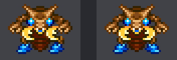
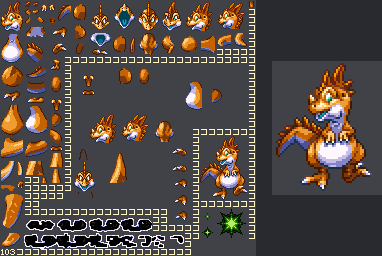
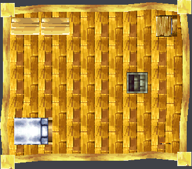
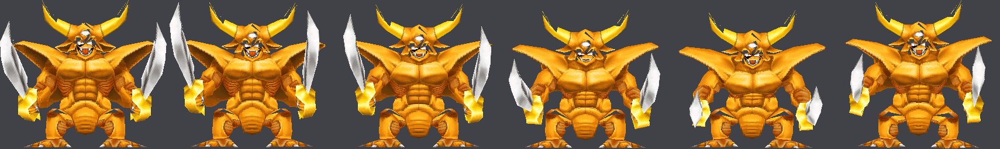
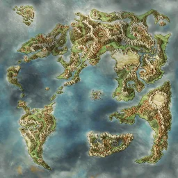
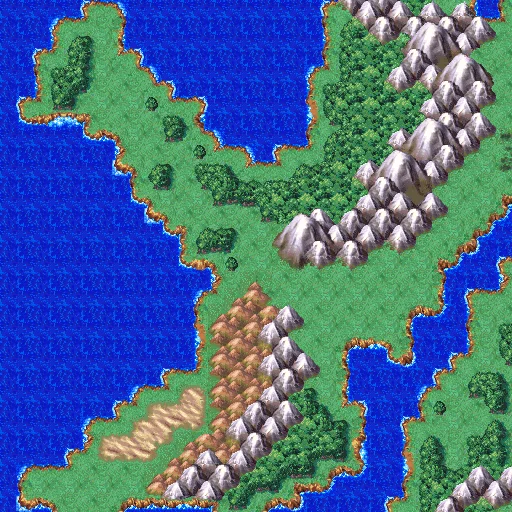

# NDS DQ4 그래픽 형식

NDS 판 「ドラゴンクエストIV 導かれし者たち」(일본판, [README 「원본 롬」](../../../README.md#원본-롬))의 그래픽 파일 형식입니다. 인물·몬스터·맵을 다시 그릴 때 참고할 그림을 뽑으려고 풀었습니다. 디코더와 내보내기는 [tools/ndsgfx.py](../tools/ndsgfx.py), 에뮬레이터 화면 캡처는 [tools/ndsplay.py](../tools/ndsplay.py), 세이브스테이트에서 VRAM·레지스터를 꺼내는 도구는 [tools/ndsvram.py](../tools/ndsvram.py), 이 문서의 그림은 [tools/ndsgfxfig.py](../tools/ndsgfxfig.py) 가 만듭니다. 2차 분석 과정은 [2026-10-25-05 일지](../journal/2026-10-25-05-graphics2.md) 에 있습니다. 뽑은 그림은 저작권 데이터라 이 저장소에 두지 않습니다([ROM-01](../../../.agents/skills/analysis/SKILL.md#rom-01--롬-데이터-금지)).

## 준비와 실행

파일 시스템은 원래 체크아웃의 `work/nds/jp` 에 한 번 풀어 두고 워크트리에서는 링크해 씁니다.

```sh
uv run --locked krpatch nds unpack rom/dq4ds.nds work/nds/jp
uv run --locked krpatch nds unpack rom/dq4ds-kr.nds work/nds/kr   # 한글 팬패치 쪽(선택)
uv run --locked python nds/dq4/tools/ndsgfx.py survey                       # 폴더·헤더별 파일 수
uv run --locked python nds/dq4/tools/ndsgfx.py export OUT --kr work/nds/kr  # PNG·WebP 와 OUT/manifest.json
uv run --locked python nds/dq4/tools/ndsgfx.py gallery OUT                  # OUT/index.html
```

`export --only chr,monster` 처럼 단계를 골라 돌릴 수 있습니다. 단계는 `chr`, `monster`, `map`, `render`, `g2d`, `effect`, `dssa`, `banner`, `tex`, `field`, `world`, `model_anim` 입니다. 전체는 약 15분 걸립니다.

## 공통

- **압축**: 이름이 `.lz` 로 끝나는 파일만 LZ10/LZ11(첫 바이트 `10`/`11`) 입니다. 툴킷의 `kr_patch.lz11` 로 풉니다. `.tim` 도 `10` 으로 시작하지만 압축이 아닙니다. 그래서 확장자로 가립니다.
- **색**: BGR555. 8비트로 늘릴 때는 `v << 3 | v >> 2` 를 씁니다.
- **텍스처 형식 번호**: NDS 3D 하드웨어 번호 그대로입니다. 1 `A3I5`, 2 4색, 3 16색, 4 256색, 5 4×4 압축, 6 `A5I3`, 7 직접색. 팔레트 형식(2·3·4)은 0번 색을 투명으로 그렸습니다.
- **엔진 팩**: `TexturePack`, `MapPackData`, `EffectPack`, `MonsterAnimation`, `PaletteAnimation` 은 같은 머리를 씁니다. 16바이트 이름 뒤 `+0x10` 항목 수, `+0x14` 자료 시작 오프셋, `+0x20` 부터 항목마다 (오프셋, 크기) u32 두 개입니다. 오프셋은 자료 시작 기준이고 크기 0 은 빈 칸입니다.

## 형식별

### `TextureObject` — 텍스처 한 장

16바이트 이름 `TextureObject` 뒤에 아래 필드가 옵니다. 오프셋은 이 객체의 시작 기준입니다.

| 오프셋 | 크기 | 뜻 |
| --- | --- | --- |
| `+0x18` | u32 | 덧붙은 팔레트 묶음 수 |
| `+0x20` | u32 | 텍스처 형식 번호 |
| `+0x24` / `+0x28` | u32 | 폭·높이 = `8 << 값` |
| `+0x30` / `+0x34` | u32 | 픽셀 자료 크기 / 오프셋 |
| `+0x38` / `+0x3C` | u32 | 팔레트 크기(바이트) / 오프셋 |
| `+0x58`~ | u32 쌍 | 덧붙은 팔레트(크기, 오프셋). 몬스터 텍스처 194개에 1묶음 |

높이 칸은 2의 거듭제곱 텍스처 크기입니다. 실제 자료는 더 짧을 수 있어 줄 수는 자료 크기에서 셉니다(256×256 칸에 256×192 그림 등). 2D 화면(로고·마을 지도·엔딩 그림), 몬스터 부품, 효과, 변신 연출, 필드 타일 텍스처가 이 형식입니다.

### `TexturePack` — 필드 인물

엔진 팩 안에 `TextureObject` 가 들어 있습니다. `CHR/hNNN.pack` 187개가 필드 인물이고, 대부분 16색 128×32 텍스처 4장입니다. 한 장이 한 방향이고, **24×32** 프레임이 가로로 3개 놓입니다(오른쪽 56픽셀은 빔). 33개는 8장입니다. 2개는 128×128 텍스처 8장, 2개는 256×128 텍스처 2장, 8개는 128×128 이나 256×128 텍스처 1장이라 큰 인물이나 소품으로 보입니다. `FIELD/symbol/symbol.pack` 은 필드 심벌 21장입니다. 4장짜리 `h001` 은 위부터 뒷모습·왼쪽·앞모습·오른쪽입니다. 다른 팩도 같은 순서로 보이지만, 게임 안 방향 번호와 맞춰 보지는 않았습니다. 필드에 선 주인공(`h101` 다섯째 장, 아래쪽 보는 첫 프레임)을 desmume 화면과 견주면 불투명 471픽셀 중 469픽셀이 채널당 8 이내로 같습니다.

### `TextureData` — 작은 2D 그림

`TextureData`(또는 `Texture Data`) 머리입니다. 오프셋은 `+0x38` 기준입니다. `+0x24` 자료 오프셋, `+0x2C` 크기, `+0x30` 팔레트 오프셋, `+0x34` 팔레트 크기, `+0x38`/`+0x3A` 폭·높이이고, 픽셀은 8bpp 선형입니다. `2D/chricon.tex`, `temp.tex`, `toruneko00.tex` 세 개뿐입니다.

### `DSSA` — 아틀라스를 오려 붙이는 애니메이션

몬스터, 효과, 변신 연출, 오프닝이 이 형식으로 움직입니다. 그림은 따로 있는 `TextureObject` 아틀라스에서 오려 옵니다.

| 위치 | 뜻 |
| --- | --- |
| `+0x10` | 셀 수(0번은 1×1 빈 셀) |
| `+0x14` | 프레임 수 |
| `+0x20`~ | 셀 16바이트: u32 플래그, u16 위·왼·아래·오른(아틀라스 픽셀), s16 중심 y·x(셀 안 픽셀) |
| 셀 뒤 | 프레임 표: (오프셋, 크기) u32 쌍 |
| `FRAM` 블록 | `FRAM`, u32 프레임 번호, u32 기록 수, u32 0, 기록 16바이트 × 기록 수 |

기록은 u16 셀(하위 12비트가 셀 번호, `0x1000` 좌우 뒤집기, `0x2000` 상하 뒤집기로 보임, `0x4000` 미상), u16 0, s16 x·y(중심 위치), s16 배율 x·y(4.12 고정소수, 음수면 뒤집기), u16 회전(0x10000 이 한 바퀴), u8 알파(0~31), u8 순서입니다. 첫 기록은 셀 `0x100`·배율 0 인 머리라 그리지 않습니다. 기록은 **앞의 것이 뒤에** 깔립니다. 반대 순서로 그리면 앞발이 배 뒤로 숨어, 아틀라스 안에 미리 그려 둔 완성 그림과 어긋납니다.

`0x1000` 은 좌우 짝 부품(오른쪽 팔·다리)에만 켜져 있고, 몬스터 DSSA 기록 524,064개 중 145,945개입니다. 이것을 좌우 뒤집기로 쓰면 はさみくわがた(`m004`)가 좌우 대칭이 됩니다. 테스트 전투 화면과의 픽셀 일치율도 0.56 에서 0.71 로, 세로 1픽셀 늘림까지 넣으면 0.85 로 올라갑니다. 남은 차이는 부품 사각형을 3D 로 그릴 때의 반올림으로 보입니다. `0x2000` 은 같은 자리의 상하 뒤집기로 두었지만 화면으로 확인하지 않았습니다.



**프레임 길이**: 전투 화면을 1프레임마다 찍으면 몬스터 모양은 2프레임마다만 바뀝니다(3D 를 30fps 로 그림). 대기 동작(17프레임)의 같은 모양 묶음이 바뀌는 순서와 맞춰 보면 DSSA 한 프레임이 게임 2프레임, 곧 1/30초입니다. 내보낸 WebP 는 모든 프레임을 33ms 로 둡니다.



`MonsterAnimation`(`MONSTER/mNNN.anm.lz`)은 엔진 팩에 DSSA 를 칸 14개로 담습니다. 칸마다 동작 하나이고, 빈 칸이 많습니다. 테스트 전투에서 화면과 맞춰 본 결과 **칸 0 이 대기**, **칸 1 이 공격**(「はさみくわがたの こうげき!」 동안 일치)입니다. 나머지 칸은 확인하지 못했습니다. 몬스터 텍스처 303개 중 `.anm` 이 같은 이름으로 있는 것은 179개입니다. 나머지는 색만 바꾼 몬스터라, 아틀라스의 불투명 픽셀 위치가 가장 많이 같은 몬스터의 애니메이션을 빌려 씁니다. 일치율이 0.9 이상이고 2위보다 0.1 이상 높을 때만 짝짓습니다. `m053` → `m027`(0.937, 2위 0.804), `m121` → `m097`(0.963, 2위 0.623)은 부품 몇 개를 다시 그린 변종이라 예전 기준(0.97)으로는 짝이 없었습니다. 둘 다 조립하면 자연스러운 모습이 나옵니다. 이 짝은 픽셀 비교로 고른 것이고, 게임의 몬스터 표로 확인하지는 않았습니다. 보스 `m250`~`m263`·`m270`~`m278`(23개)과 `m142` 의 `.anm` 은 칸이 모두 비어 있습니다. 보스는 `TRANS/` 의 DSSA 로 움직입니다.

`EffectPack`(`EFFECT/*.lz`)은 2D 효과면 `TextureObject` 와 DSSA, 3D 효과면 BMD0·BCA0·BTA0·BMA0 입니다. `TRANS/mNNN_KK.dssa` 는 `TRANS/mNNN.tex` 를, `OPENING/logo1~4.dssa` 와 `staff.dssa` 는 `OPENING/logo.tex.lz`·`staff.tex.lz` 를 아틀라스로 씁니다.

`PAM/*.pam`(`PA` 머리)과 `MONSTER/*.panm.lz`(`PaletteAnimation`)는 색 값만 있어 그림이 아닙니다. 주문(`_ju`)·숨결(`_br`) 동작의 팔레트 애니메이션으로 보입니다.

### Nitro BMD0 — 3D 맵·인물 모델

표준 Nitro 형식입니다(`MDL0`·`TEX0`). 사전(info block)은 `+1` 항목 수, `+6` 첫 하위 블록 크기(사전 시작 기준)로 항목 자료 위치를 셉니다. 텍스처 항목의 u16 둘째 값이 `TEXIMAGE_PARAM >> 16` 이라, 비트 4~6 폭, 7~9 높이, 10~12 형식, 13 0번 색 투명입니다. 4×4 압축(형식 5)은 압축 자료와 팔레트 색인 자료를 따로 읽습니다. 텍스처와 팔레트는 재질 사전(텍스처 → 재질, 팔레트 → 재질)으로 짝을 짓습니다.

`MapPackData`(`MAP/*.lz` 531개, `BTLMAP/*.lz` 146개)는 엔진 팩에 BMD0, `PAMN`, `LOCN` 세 항목을 담습니다. BMD0 의 `MDL0` 에는 맵 본체와 가구·문·나무 같은 소품 모델이 여러 개 들어 있습니다. `PAMN` 의 `FMAP` 이 소품을 놓는 배치표입니다.

| `FMAP` 위치 | 뜻 |
| --- | --- |
| `+8` | 배치 수 |
| `+0x20`~ | 배치 0x50바이트 |
| 배치 `+0x00` | fx32 x·y·z(4.12) |
| 배치 `+0x0C` | u32 배치 번호 |
| 배치 `+0x10` | s32 회전 x·y·z(0x10000 이 한 바퀴). 본 것은 y 뿐 |
| 배치 `+0x1C` | u16 모델 번호(MDL0 사전 순서) |
| 배치 `+0x20` | fx32 배율 x·y·z |

| 배치 `+0x2C` | u16. 0 이 아니면 조사 대상(보물상자 `tbox` 390, 문 `door`·`wdoor` 747, 침대 240, 항아리·통 각 219, 서랍·책장·감옥 쇠창살 등). 조사·이벤트 번호로 보임 |
| 배치 `+0x30`·`+0x32`·`+0x34` | 플래그로 보임. `+0x30` 의 4 는 등불·창문·꽃·통 같은 장식에 많음. `+0x34` 는 대개 10 |
| 배치 `+0x44` | u16. 모델 번호 사본(18,182개 전부 `+0x1C` 와 같음) |
| 배치 `+0x40`·`+0x42`·`+0x46`·`+0x48`·`+0x4A` | 대개 `FFFF`, 일부만 작은 번호 |

이 해석으로 성 바깥 `cbout` 은 탑 두 개가 x ±4.5, z 9.5 에 대칭으로 놓이고, 같은 꽃 모델이 1.3·1.5 배로 여러 번 놓였습니다. 표의 `+0x2C` 이후는 맵 531개의 배치 18,182개를 모델 이름과 맞대어 본 통계이고, 게임에서 값을 바꿔 확인하지는 않았습니다.

`LOCN` 은 **판정 면 목록**입니다. 머리 `+0x10` 이 면 수, `+0x34` 가 첫 면 위치이고, 면마다 96바이트입니다. 면 `+0x10`·`+0x1C`·`+0x28` 이 fx32 꼭짓점 셋, `+0x40` 이 단위 법선입니다. 맵 197개의 면 45,225개 중 45,222개의 법선 길이가 1 이고, 45,192개는 세 꼭짓점이 그 평면 위에 있습니다. 실내 맵 `mai1f2` 의 면은 방 바닥과 같은 높이(y 0)에 방 크기만큼 퍼져 있습니다. 머리의 나머지 수(`cbout` 은 241·6·207·28·13)와 `+0x38` 이후 오프셋 목록이 가리키는 덩어리는 풀지 않았습니다. 64바이트짜리 빈 팩(`haout_b`, `za3f3`)이 둘 있습니다.

`render` 단계는 이 배치를 넣어 맵을 위에서 내려다본 직교 투영으로 그립니다. MDL0 의 렌더 명령(노드 행렬 곱·저장, 재질, 메시)과 GX 디스플레이 리스트(`VTX_16`·`VTX_10`·`VTX_XY`/`XZ`/`YZ`·`VTX_DIFF`·`TEXCOORD`·`MTX_RESTORE`, 삼각형·사각형·띠)를 풀어 깊이 버퍼로 칠합니다. 아래를 향한 면은 버립니다. 버리지 않으면 전투 배경의 하늘 돔 안쪽이 장면 전체를 덮습니다. 알파 128 미만도 버리고, 반투명·조명·텍스처 행렬은 무시합니다. 배율은 1단위에 32픽셀(긴 변 2048픽셀)까지입니다.



`CHR/*.nsbmd` 19개는 3D 인물·소품(피사로, 에스타크, 드래곤 등)입니다. 텍스처와 함께, 짝이 되는 `CHR/*.nsbca` 32개로 움직인 앞모습(직교 투영)을 WebP 로 뽑습니다.

### BCA0 — 3D 관절 애니메이션

`JNT0` 블록의 사전 항목마다 `J\0AC` 머리입니다. `+4` 프레임 수, `+6` 객체 수, `+0xC` 피벗 회전 표 위치, `+0x10` 기저 회전 표 위치, `+0x14` 부터 객체 위치(u16)입니다. 객체 수는 모델 노드 수와 같습니다(피사로 31·31).

| 객체 | 뜻 |
| --- | --- |
| `+0` u16 플래그 | 비트 0 변환 없음(쉬는 자세), 1 이동 0, 2 쉬는 자세의 이동, 3~5 x·y·z 상수, 6 회전 없음, 7 쉬는 자세의 회전, 8 회전 상수, 9 배율 1, 10 쉬는 자세의 배율, 11~13 x·y·z 상수 |
| `+3` u8 | 노드 번호 |
| 뒤 | 이동 x·y·z, 회전, 배율 x·y·z 순서. 상수는 값 바로(이동 fx32, 회전 u16 색인, 배율 fx32 와 역수 fx32), 움직이면 u32 정보와 u32 자료 위치 |

정보 u32 는 비트 0~15 시작 프레임, 16~27 끝 프레임, 28~29 가 0 이 아니면 표본이 fx16(이동 2바이트, 배율 4바이트), 30~31 이 표본 간격(0 매 프레임, 1 두 프레임, 2 네 프레임)입니다. 피사로 `pisaro_1` 의 이동 트랙(346프레임)은 간격이 692바이트 = 346×2 라 fx16 이 맞습니다. 비트 28 만 보던 처음 해석에서는 4개 파일이 자료 끝을 넘어 읽었습니다.

회전 색인의 비트 15 가 켜져 있으면 피벗 표(6바이트: u16 방식, s16 a·b. MDL0 노드의 피벗 압축과 같은 꼴), 꺼져 있으면 기저 표(10바이트)입니다. 기저는 u16 다섯 개의 위 13비트가 m00·m01·m02·m10·m11(1.12 고정소수)이고, c4·c0·c1·c2·c3 의 아래 3비트를 이은 값의 아래 13비트가 m12 입니다. 셋째 행은 첫 두 행의 외적입니다. 이렇게 풀면 `pisaro_0`·`msdr_opening_0`·`estrk_3` 의 기저 회전 997·3,000·3,000개 중 995·3,000·3,000개가 직교 행렬입니다. m12 를 15비트로 읽으면 절반이 어긋납니다.



3D 효과 17개의 BCA0 도 같은 해석으로 읽히지만, 앞모습으로 그리면 비어 나옵니다. 효과는 반투명 면과 `SRT0`(BTA0, 텍스처 이동·배율)·`MAT0`(BMA0, 재질 색) 애니메이션에 기대는 것으로 보이고, 둘 다 머리(`M\0AT`·`M\0AM`, 프레임 수 `+4`)만 확인했습니다.

### 필드(세계 지도)

필드는 3D 로 그립니다(엔진 A 의 BG0 이 3D). 텍스처 VRAM 뱅크 A 의 `0x400` 에 `FIELD/field.tex` 가 그대로, 그 바로 뒤 `0x15400` 에 `FIELD/texture/pattern8.pack` 의 한 프레임이 실립니다(세이브스테이트의 VRAM 에서 확인).

| 파일 | 형식 |
| --- | --- |
| `FIELD/large/largemap.bin` | **1024×1024 8bpp, 32×32 타일 순서**. 팔레트는 `largemap.tex`. 일러스트로 그린 세계 지도 |
| `FIELD/large/*.bin`(4096바이트 8개) | 같은 팔레트의 64×64(32×32 타일 2×2). 다리 놓기 전후·용암·이민 마을 4단계·세계수 덧그림 |
| `FIELD/texture/pattern8.pack` | 8프레임. 프레임마다 256폭 8bpp(16×16 물가 칩 80개), 팔레트는 `field.tex` |
| `FIELD/texture/pattern24.pack` | 24프레임. 프레임마다 256×16 8bpp 이고 왼쪽 64×16(바다 칩 넷)만 씀 |
| `FIELD/texture/ypattern*.pack` | 어둠의 세계 쪽(팔레트 `yamifield.tex`) |
| `FIELD/bin/worldmap*.bin` | `WMAP` 256×256 u16 칸. 칸 하나가 화면 16×16 픽셀. `worldmap.bin` 은 머리 뒤 `WMAP` 덩어리, `worldmap_scene0~2.bin` 은 칸만 |



**칸 값 → 칩**: 칸 값의 아래 10비트 w 가 16×16 칩을 고릅니다. field.tex 칩은 field.tex 를 16×16 으로 자른 행 순서 번호, 물가 칩은 `pattern8` 한 프레임, 바다 칩은 `pattern24` 한 프레임의 왼쪽 넷입니다.

| w | 칩 |
| --- | --- |
| 2·4·6 | 물가 칩 `w/2 − 1` |
| 8~29 | field.tex 칩 `w − 7` |
| 짝수 30~174 | 물가 칩 `w/2 − 12` |
| 175~296 | field.tex 칩 `w − 153` |
| 298·300·302·304 | 바다 칩 `(w − 298)/2` |
| 305~ | field.tex 칩 `w − 161` |

field.tex 칩 번호가 값 공간에서 물가·바다 구간을 건너뛰며 이어지는 모양입니다. 이 대응은 화면에서 배웠습니다. 필드 워프(`ndswarp.py field`, [debug.md](debug.md#필드-워프))로 부팅 메뉴 상태에서 81곳(좌표 100~1300, 150 간격)에 서서 화면을 찍었습니다. 좌표 단위의 3배가 필드 픽셀이고, 화면 왼쪽 위는 주인공 픽셀 − (129, 97)입니다. 화면 칸마다 VRAM 텍스처의 16×16 칩과 밝기 상관을 재어 값마다 가장 많이 뽑힌 칩을 모은 것이 위 표입니다. 표로 그린 지도를 같은 화면들과 칸 단위로 다시 견주었습니다.

```text
바다 아닌 칸 4,577개  상관 중앙값 0.941  0.8 이상 87.4%
바다 칸 1,953개(20화면)  24프레임 중 가장 맞는 것과 상관 중앙값 0.896  0.8 이상 96.5%
```

비트 10 이상이 켜진 칸(1052 = `0x41C` 등)이 있습니다. 관찰한 칸의 0.5% 입니다. 아래 10비트 칩을 그대로·좌우·상하·양쪽으로 뒤집어 대도 상관이 0 근처라, 뒤집기가 아니라 다른 것(마을·성 같은 기호 자리로 보임)입니다. 내보내기는 이 칸도 아래 10비트로 그리므로 그 자리는 믿을 수 없습니다.



### G2D — 2D 화면

| 파일 | 형식 |
| --- | --- |
| `G2D/BATTLEBG/ubtl*.bgc`·`.bgp` | 8bpp 8×8 타일 256개 + 256색. 타일 배치 맵은 파일에 없음. 평원 낮 전투 두 번(테스트 전투, 1장 필드 조우) 모두 VRAM·메인 RAM 어디에도 실리지 않았음 |
| `G2D/SYSTEM/bg`·`obj` | 4bpp 타일(창 테두리·커서·숫자·영문 글꼴) |
| `G2D/ICON/*.mpt` | `MPT0` 자원 팩. `+0x10` 수, `+0x14` 표 위치, `+0x18` 표 크기, 표는 u16 번호·u16 크기·u16 순서. 자료는 표 바로 뒤. 아이콘은 8bpp 8×8 타일 순서, 파일 이름의 숫자(24·32·48)가 한 변. 번호 9998·9999 인 512바이트 항목이 팔레트 |
| `G2D/ICON/*.mptp` | 같은 내용의 압축판으로 보임(풀지 않음) |
| `G2D/FONT/*.nftr` | 표준 Nitro 글꼴(`RTFN`/`FNIF`/`PLGC`/`HDWC`/`PAMC`). 글리프는 MSB 먼저 1bpp |
| `G2D/SNAP/*.tim` | `+0x10` u16 폭·높이(256×384), `+0x14` 부터 BGR555. 단색 자리 채움 |
| `dq4banner.bnr` | DS 메뉴 아이콘(4bpp 32×32 타일 + 16색) |

## 검증

**에뮬레이터 비교**: desmume libretro 코어([EMU-01](../../../.agents/skills/analysis/SKILL.md#emu-01--에뮬레이터는-mesence) 의 NDS 쪽)로 일본판을 켜고 화면을 4프레임마다 저장했습니다. 164~176프레임에 위 화면은 `2D/sqex_logo.tex`, 아래 화면은 `2D/arte_logo.tex` 가 그대로 떠 있습니다. 두 그림을 1픽셀 아래로 옮겨 견주면 0번이 아닌 픽셀이 모두 채널마다 4 이내로 같았습니다.

```text
sqex_logo  불투명 1506픽셀  완전 일치 93.2%  차이 ≤4 100%
arte_logo  불투명 1893픽셀  완전 일치 43.1%  차이 ≤4 100%
```

완전 일치가 아닌 픽셀은 3D 엔진이 색을 6비트로 내보내며 생긴 반올림 차이로 보입니다. 이어서 나오는 스태프 크레디트는 `OPENING/staff.dssa` 를 조립한 프레임과 문구·두 줄 배치·흐려지는 순서가 같았습니다(눈으로 비교).

```sh
export DESMUME_CORE=/path/to/desmume_libretro.dylib
uv run --locked python nds/dq4/tools/ndsplay.py rom/dq4ds.nds work/emu --cmd "wait 160; every 40 4 f"
```

**전투 몬스터와 필드 인물**: 부팅 디버그 메뉴 상태(`work/state/dq4ds-boot.state`)에서 장면 `0x11`(전투 테스트)을 요청해 はさみくわがた 둘과 싸우는 화면을 찍었습니다. 위 「프레임 길이」와 뒤집기 결과가 이 실험입니다. 같은 상태에서 장면 `0x0E`(필드)로 옮기면 주인공 `h101` 이 471픽셀 중 469픽셀 일치로 서 있습니다.

```sh
uv run --locked python nds/dq4/tools/ndsplay.py rom/dq4ds.nds work/b --state work/state/dq4ds-boot.state \
  --cmd "wait 30; poke32 21080b4 11; wait 120; press a 6 0; wait 400; save work/b/b.state; every 240 1 f"
uv run --locked python nds/dq4/tools/ndsvram.py info work/b/b.state      # 레이어 설정과 VRAM 뱅크 배치
```

**눈으로 확인**: 인물 187팩, 몬스터 조립 그림, 맵 텍스처와 렌더링, 아이콘·얼굴·글꼴, 3D 모델 애니메이션(피사로가 칼을 휘두르고 에스타크가 내려치고 용이 날아다님)을 늘어놓고 봤습니다.

## 결과 수

`export --kr work/nds/kr` 한 번의 결과입니다.

| 형식 | 파일 | 결과 |
| --- | --- | --- |
| `TexturePack` | 188 | 전부. 인물 187팩 + 필드 심벌 21장 |
| `TextureObject` | 454 | 전부(몬스터 303, 2D·엔딩·필드·변신·마스크·미니게임 등 151) |
| `TextureData` | 3 | 전부 |
| `MonsterAnimation` + `DSSA` | 몬스터 303 | 조립 279(동작 WebP 1,227개), 빈 `.anm` 24 |
| `DSSA`(변신·오프닝) | 169 | 전부 |
| `EffectPack` | 188 | 전부(2D 171, 3D 텍스처 17) |
| `MapPackData` | 677 | 텍스처·렌더링 675, 빈 팩 2 |
| BMD0(`CHR`) | 19 | 텍스처 전부 |
| BCA0(`CHR`) | 32 | 전부(앞모습 애니메이션 WebP 32개) |
| `.bgc`/`.bgp` | 123 | 전부(배치는 미상) |
| `MPT0` 아이콘 | 10 | 전부(아이콘 424개) |
| NFTR | 4 | 전부, 한글패치 쪽 4 |
| `.tim`, 배너 | 5 | 전부 |
| `PAM`, `PaletteAnimation` | 607 | 그림이 아님 |
| `FIELD/large/*.bin` | 9 | 전부(1024×1024 1장, 64×64 8장) |
| `FIELD/texture/*.pack` | 4 | 전부(첫 프레임 PNG + 애니메이션 WebP) |
| `FIELD/bin/worldmap*.bin` | 4 | 전부(4096×4096 렌더링). 비트 10 이상 칸은 미확인 |
| `FIELD/bin/gotmap.bin`·`yamimap.bin` | 2 | 그리지 않음(남은 것) |

뽑은 그림은 4,268개, 합계 약 300MB 입니다.

## 남은 것

- **필드 칸의 비트 10 이상**(마을·성 기호 자리로 보임)과 `WSYN`·`WCHA`·`WCMA` 덩어리, `gotmap.bin`·`yamimap.bin`(어둠의 세계 쪽 표가 같은지).
- **전투 위 화면 배경 `ubtl*`**: 평원 낮 전투 두 번에서 쓰이지 않았습니다. 어떤 전투에서 쓰는지와 타일 배치.
- **DSSA 셀 플래그 `0x2000`·`0x4000`** 과 셀 머리 u32, 프레임 표 첫 8바이트.
- **몬스터 동작 칸 2~13 의 뜻**(주문·숨결·피해·죽음 등으로 보임). 칸 0 대기·칸 1 공격만 확인했습니다.
- **DSSA 조립의 남은 1픽셀 차이**: 게임 화면과 0.85 일치. 부품마다 3D 사각형으로 그릴 때의 반올림 규칙.
- **`LOCN` 머리의 나머지 수와 뒤쪽 덩어리**, `FMAP` `+0x2C` 이후 필드를 게임에서 바꿔 확인하기.
- **3D 효과 재생**: BTA0(`SRT0`)·BMA0(`MAT0`) 트랙 해석, 반투명 면, 효과용 카메라.
