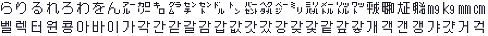

# 2026-10-25-01: 대사 파일과 한글 팬패치 글꼴 읽기

NDS 판 DQ4 의 대사와, 이미 나와 있는 한글 팬패치를 읽을 수 있게 했습니다. 목표는 FC 판을 옮길 때 이름을 통일할 대조표와, DS 판에서 늘어난 내용을 가늠할 근거입니다. 결과는 [text-format.md](../docs/text-format.md), [glossary.md](../docs/glossary.md), [extras.md](../docs/extras.md), [rom-map.md](../docs/rom-map.md) 에 있습니다.

## 1. 팬패치가 무엇을 바꿨나

두 롬을 `krpatch nds unpack` 으로 풀고 파일을 비교했습니다. 4827개 중 216개가 달랐고, 207개가 일본어 대사(`MESS/ja`) 전부, 나머지는 폰트 2개·메뉴 문자열이 든 실행 파일·로고였습니다. 파일 크기는 하나도 바뀌지 않았습니다. 그래서 팬패치가 대사를 다시 쓰되 원래 자리와 크기 안에서 한 것으로 보고, 대사 형식부터 풀었습니다.

## 2. MPT0

대사 파일은 머리 32바이트, 6바이트 색인, UTF-8 본문이었습니다. 처음 본 색인 `(0, 88, 0) (1, 94, 22)` 에서 세째 값을 바이트 위치로 읽으니 둘째 문자열이 첫째 문자열 한가운데서 시작했습니다. 22 × 4 = 88 이 첫째 길이와 같아서, 위치가 4바이트 단위라는 것을 알았습니다. 본문 시작은 머리의 「색인 크기」 바로 뒤가 아니라 파일 크기 − 본문 크기였습니다(그 사이에 `FE FE` 2바이트).

이 규칙으로 952개 파일, 91,398개 문자열이 전부 UTF-8 로 풀렸습니다. 일본판 롬인데 영어·프랑스어·독일어·스페인어·이탈리아어 대사도 147개씩 들어 있어, 영어 이름을 롬에서 바로 얻었습니다.

## 3. 한글판은 한자로 읽힌다

한글판 `b1001000`(인물 이름)을 같은 방법으로 읽으니 `ライアン` 자리가 `居章牢` 였습니다. 문자 코드는 그대로이고 폰트만 바꾼 것입니다. 일본판과 한글판 `zen12.nftr` 를 비교하니 2075개 글리프 중 1400개가 달랐고, 그려 보니 한글 음절이었습니다.

바뀐 코드를 정렬해 그리면 앞 58개를 지나 「가각간갇갈감…」이 이어집니다. 한자 코드가 커지는 순서로 KS X 1001 음절이 깔려 있었습니다. 앞 58개(키릴·히라가나 자리)는 「이무르귀엘연…」처럼 순서가 없는 자주 쓰는 음절입니다.

## 4. 글리프 → 음절

1400자를 손으로 다 읽는 대신 순서를 이용했습니다.

- 처음에는 글자 상자로 잘라 정사각형으로 늘려 비트 XOR 로 비교했는데, 첫 한자가 「가」가 아니라 「간」이 나왔습니다. 비율을 지키는 정규화와 흐린 코사인 유사도로 바꾸자 1위 후보는 대부분 맞았지만, 이름 20개 중 1개만 맞았습니다. `クリフト` 가 「크리퓬튬」이었습니다.
- 원인은 ㅡ 모음 글자였습니다. 픽셀 폰트는 「프」의 ㅍ 을 칸 위쪽에 크게 그리고 ㅡ 를 맨 아래 줄에 두는데, 기준 폰트는 납작하게 그립니다. 가로·세로를 따로 늘려 상자를 맞추니 「프·트·브」가 1위가 됐고, 이름 20개 중 15개가 맞았습니다.
- 남은 오류는 이웃의 드문 음절로 한 칸씩 밀리는 것이었습니다(걸 → 걺, 과 → 곶, 꾸 → 꾜). 맞힌 글자들로 초성·중성·종성 조각 비트맵을 배워 후보를 합성하고, 다른 한글 패치 대본에서 센 음절 빈도를 더하자 20개 모두 맞았습니다.
- 그래도 「톨네코」가 「톤네코」로 나오는 등 남은 것이 있어, 두 방법이 갈린 글자와 1400자 전부를 크게 그려 눈으로 대조했습니다. 고친 글자는 고정점으로 두고 정렬을 다시 돌려, 앞뒤로 밀린 이웃까지 바로잡았습니다. 고친 뒤 KS 순서를 거스르는 곳이 생기면 그 판독이 틀린 것이라, 순서 검사가 사람의 판독 실수도 세 번 잡았습니다(띱 → 띕, 축·춤 → 측·츰).

최종 표는 자동 1286자, 눈 판독 114자입니다. `ndskr.py draft` 가 같은 표를 바이트 단위로 다시 만들고, `ndskr.py check` 가 순서·코드 집합·확인 단어 18개를 검사합니다.

## 5. 대조표와 늘어난 것

이름 표 8개를 일본어·영어·한글판으로 나란히 놓고, FC 판 이름 목록에 같은 이름이 있는지 붙였습니다. 아이템 160개 중 39개, 몬스터 226개 중 40개가 FC 에 없습니다. 「없음」에는 새로 생긴 것(`はやぶさのけん`, `もどき` 9종)과 표기만 다른 것(`いかづち` ↔ `いかずち`)이 섞여 있습니다.

대사 파일 번호로 내용을 나누니 DS 추가분의 크기가 보였습니다. 동료 대화 7,796줄이 가장 크고, 6장 805줄(`b0154` 에 「ピサロが　仲間に加わった！」), 이민 마을 796줄, 엇갈림 통신 1,030줄입니다.

## 틀렸던 것들

- 「색인 셋째 값 = 바이트 위치」: 4바이트 단위였습니다.
- 「본문은 색인 바로 뒤」: `FE FE` 2바이트 뒤, 정확히는 파일 크기 − 본문 크기입니다.
- 「순서 구간은 한자(U+4E00)부터」: ㌃(U+3303) 같은 묶음 기호부터였습니다. 경계를 잘못 잡아 정렬이 통째로 밀렸습니다.
- 「빈도 0 인 음절은 오인」: 팬패치 폰트에는 뇔·뇜·쏢 같은 드문 음절도 실제로 들어 있었습니다.
- 「ㅁ 받침 = 네모」: 이 폰트의 ㅇ 받침도 모서리만 깎은 네모라 ㅁ·ㅇ 을 자주 헷갈렸습니다(캠 → 캥, 뎀 → 뎅).

## 남은 것

[todo.md](../todo.md) 의 「대사 나머지」, 「늘어난 내용 나머지」.
