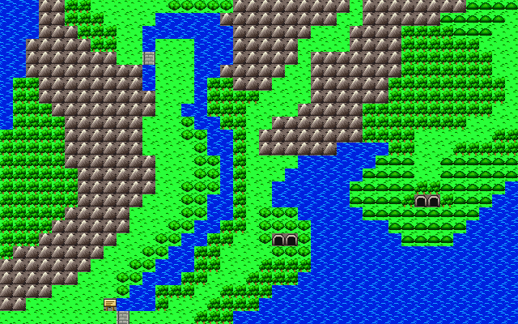
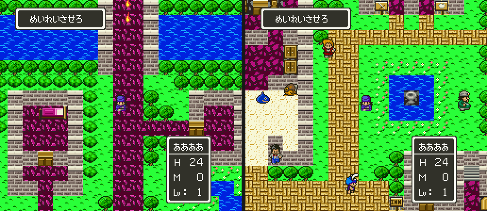
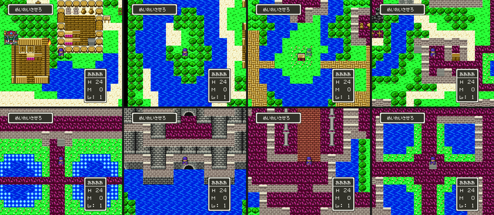

# DQ4 환경 그래픽

바트랜드와 이무르의 맵 배경·지형지물을 SFC용으로 새로 그린 에셋입니다. 캐릭터·얼굴·몬스터는 포함하지 않습니다. 그림의 사용자 채택, SFC 표시 검증, DQ5 엔진 삽입을 서로 구분합니다.

## 참고 기준

[sfc-dq4-assets](https://github.com/perfectacle/sfc-dq4-assets)는 원작 자료를 보관하는 비공개 저장소입니다. 아래 경로는 그 저장소 기준입니다. 추출 그림을 공개 소스 저장소로 복사하지 않습니다.

| 역할 | 자료 |
| --- | --- |
| 색의 역할(어느 블록이 붉은 바닥·길·모래·벽인지) | `fc/dq4/gfx/blocks/0A.png`, `fc/dq4/gfx/blocks/0E.png`, `fc/dq4/maps/02-00-バトランド.png`, `fc/dq4/maps/12-00-イムル.png` |
| 색값·도트 구조 | `sfc/dq5/maps/1A-00-アルカパ.png`, `sfc/dq5/maps/01-00-ラインハット.png` |
| 건물·소품 형태 | `nds/dq4/screens/086-haout.png`, `nds/dq4/screens/113-maout.png`, `nds/dq4/map/tex/maout.png` |

기준은 세 가지로 나눕니다.

- **색의 역할은 FC 원작 블록을 따릅니다.** 바트랜드는 실내 바닥과 바깥 길이 같은 붉은 자주 블록 `05`입니다. 이무르는 실내 바닥 `04`가 붉은 자주, 길 `05`가 주황 벽돌, 마당 `1F`가 크림 모래, 벽 `06`~`08`이 회색 벽돌입니다.
- **색값과 도트 구조는 SFC DQ5 마을 맵을 따릅니다.** 잔디는 `00ff18` 바탕에 `009c00` 점, 물은 `0021ff`에 `0094ff` 물결, 실내는 `9c006b` 계열 카펫입니다. 벽은 크림색 윗면 아래에 점 질감 벽돌, 길은 황토 벽돌 바구니 짜임입니다.
- **NDS판은 건물·소품의 형태만 참고합니다.**

DQ5 맵의 평균 채도는 0.70~0.73입니다. NDS 색감을 따른 첫 시안은 0.36~0.40이었고, 사용자 검토에서 드래곤 퀘스트답지 않다는 판정을 받았습니다. 원작 픽셀을 복사하거나 고해상도 생성 이미지를 축소한 에셋이 아닙니다.

## 생성

```sh
uv run --locked python sfc/dq4/tools/dq4environment.py \
  --out work/environment --rom rom/dq4.nes \
  --references "$DQ4_ASSETS"
```

`DQ4_ASSETS`는 비공개 에셋 저장소 체크아웃입니다. `--references`를 생략하면 원작 참고 그림을 복사하지 않습니다. `--rom`을 생략하면 새로 그린 에셋과 재질 미리보기만 만들며, 원작 배치 맵은 만들지 않습니다. 환경 에셋 코드는 `dq4environmentart.py`, 원작 배치 대응은 `dq4environmentmap.py`입니다.

| 출력 | 내용 |
| --- | --- |
| `assets/*.png` | 실제 크기의 인덱스 PNG |
| `assets/*.chr`, `*.map`, `*.pal` | 에셋별 SFC 4bpp 타일·32×32 타일맵·BGR555 팔레트 |
| `contact-sheet.png` | 이름을 붙인 확대 시트 |
| `maps/*.png` | FC 원작의 블록 배치를 이용한 정지 비교 맵(FC 맵 279곳 모두와 필드 `field0`·`field1`·`field3`) |
| `preview-*.png`, `*.chr`, `*.map`, `*.pal` | 256×224 SFC 미리보기 화면 |
| `manifest.json` | 에셋 크기·팔레트·출처, 원작 블록 대응·역할·개수·한계 |
| `verification.json` | 결정적 생성과 인코딩 왕복 검사 |
| `index.html` | 에셋·비교 맵·원작 참고 갤러리 |

갤러리의 원작 참고 화면에는 원작 인물이 보일 수 있습니다. 새로 만든 에셋이나 맵에는 인물을 그리지 않습니다. `references/`는 비교용 복사본이며 공개 저장소에 넣지 않습니다.

## SFC 데이터 규격

8×8 타일을 4bpp로 저장합니다. 각 타일은 팔레트 뱅크 하나만 쓰며, BG 뱅크 1~7을 재질별로 나눕니다. 색 번호 0은 공통 배경·투명색입니다. 뱅크별 로컬 색 번호 0을 불투명색으로 쓰지 않습니다. RGB는 5비트 값 `v`를 `v << 3 | v >> 2`로 확장한 값입니다.

CHR의 첫 타일은 빈 타일입니다. 같은 도트 배열은 팔레트와 무관하게 하나의 CHR로 합칩니다. 타일맵 워드는 `CHR 번호 | 팔레트 번호 << 10`이고 반전·우선순위 비트는 쓰지 않습니다. 보이지 않는 아래쪽 행은 빈 타일로 채웁니다. 전체 비교 맵은 이미지이며, 그 전체를 한 번에 SFC BG 화면에 싣는 데이터가 아닙니다.

맵용 블록은 16×16입니다. 투명한 물체 아래에는 지면을 채우며, 같은 8×8 안에서 팔레트가 다르면 배경 색만 물체의 팔레트에 맞춥니다. 물체 도트는 유지하고, 바뀐 배경 픽셀 수를 manifest에 기록합니다. 원작 블록의 기능·통행 속성은 manifest에 남기지만 게임 로직으로 설치하지 않습니다.

## 원작 배치

| 비교 맵 | FC 맵 | 맵 종류 | 크기 | 대응 칸 |
| --- | --- | --- | --- | --- |
| 바트랜드 | `02/00` | `0A` | 38×41 블록, 608×656픽셀 | 1,558 |
| 이무르 | `12/00` | `0E` | 28×26 블록, 448×416픽셀 | 728 |

원작 디코더의 실제 블록 ID를 명시적인 에셋 표로 바꿉니다. 주요 대응은 아래와 같습니다.

| 맵 | 블록 | 원작 모양 | 에셋 |
| --- | --- | --- | --- |
| 바트랜드 | `05` | 붉은 자주 바닥(실내·길 공용) | `red_paving` |
| 바트랜드 | `08` | 어두운 회색 성 몸체 | `castle_wall` |
| 바트랜드 | `09`~`0C` | 성탑(32픽셀 원통의 왼쪽·오른쪽, 아랫단) | `tower_left`·`tower_right`·`tower_cap_*` |
| 바트랜드 | `13` | 크림 모래 | `dirt` |
| 바트랜드 | `1C`·`1D` | 가로 침대의 발치·머리맡 | `bed_left`·`bed_right` |
| 이무르 | `04` | 붉은 자주 실내 바닥 | `carpet` |
| 이무르 | `05` | 주황 벽돌 길 | `cobble` |
| 이무르 | `1F` | 크림 모래 | `dirt` |
| 이무르 | `06`~`08` | 회색 벽돌 벽 | `stone_wall_top`·`stone_wall` |
| 이무르 | `15`·`16` | 가로 침대의 발치·머리맡 | `bed_left`·`bed_right` |
| 이무르 | `0D` | 도구점 간판 | `sign_shop` |
| 이무르 | `14` | 연못 한가운데 분수 | `fountain` |

바트랜드 성 몸체 `08`은 마을 벽 `06`·`07`과 다른 블록이고, FC에서도 더 어둡습니다. 그래서 검은 줄눈과 어두운 회색 벽돌의 `castle_wall`을 따로 둡니다. 성탑은 두 블록이 32픽셀 원통 하나가 되도록 가운데가 밝고 가장자리가 어둡게 칠합니다. 문과 성문은 DQ5처럼 줄눈 있는 돌 아치 안에 띠 두른 나무 문입니다. 간판·가구는 형태를 유지하고 색만 DQ5 램프입니다.

이무르 `0D` 는 맵에 한 칸(11,21)뿐이고, 도구점 주인(9,23, 서비스 2)의 가게 건물 윗벽 오른쪽 모서리입니다(카운터 (10,23) 의 오른쪽 위). `14` 도 한 칸(16,12)으로, 물(`01`, 속성 `83`) 3×3 의 한가운데이고 둘레를 꽃밭 `03` 이 감쌉니다. 같은 시트를 쓰는 맵에서도 뜻이 맞습니다. `0D` 는 19/00·19/01 (20,13)과 32/06 (43,13)에서 카운터 `0F` 옆에 있고, `14` 는 32/06 (36,14)에서 벽에 둘러싸인 연못 한가운데입니다. 그래서 `0D` 는 도구점 간판, `14` 는 연못 한가운데 분수로 보고, 물 줄(7번)에 물 그림의 주된 색을 바탕으로 물기둥과 양옆으로 떨어지는 물방울을 그린 `fountain` 을 씁니다.

침대 블록 쌍은 두 맵 모두 언제나 왼쪽·오른쪽으로 붙어 나옵니다(바트랜드 3쌍, 이무르 4쌍). 그래서 32×16 가로 침대를 반으로 나눠 씁니다. 가구 블록의 투명한 바탕은 그 맵의 붉은 바닥(`red_paving`·`carpet`)으로 채웁니다. 이미지 색을 보고 지형을 추측하지 않습니다. 빠진 블록이나 없는 에셋은 오류로 멈춥니다. 뜻을 확인하지 못한 장식은 manifest에 미확인이라고 남깁니다.

### 다른 마을·성 시트

블록 시트 `03`·`04`·`05`·`06`·`07`·`08`·`09`·`0B`·`0C`·`0D` 를 쓰는 FC 맵 115곳도 비교 맵을 만듭니다. 시트마다 대응표를 따로 두지 않고, 블록의 **그림**으로 에셋을 찾습니다.

- 블록 정의의 CHR 뱅크·타일 주소 넷과 팔레트 세 색이 같으면 같은 그림입니다.
- 시트 `0A`·`0E` 의 대응표(`BLOCK_ART`)와, 처음 나오는 시트·블록으로 적은 새 그림 57종의 표(`EXAMPLES`)를 이 기준으로 다른 시트에 퍼뜨립니다.
- 열 시트에서 실제로 쓰이는 블록 305개는 서로 다른 그림 95종이고, 그중 38종은 `0A`·`0E` 에 이미 있었습니다.
- 표에 없는 그림이 맵에 나오면 오류로 멈춥니다.

새 에셋은 40종입니다. 옥좌·제단·왕좌 뒤 장식(48×16 을 셋으로 나눔)·휘장·기둥·책장·화분·천 덮인 탁자·쇠창살 문·여행의 문·독늪·결계·청백 타일·벽돌 바닥·바위벽·통나무집 벽 여섯 가지·장작·그루터기·채소밭·팻말·묘비 등입니다. 같은 그림이라도 뜻이 다른 것은 FC 맵에서 쓰인 자리를 보고 정했습니다. 시트 `04/12` 는 처음 허수아비로 봤지만, `0F/00` 에서 묘지에 세 개씩 늘어서 있어 묘비로 고쳤습니다. 시트 `09/19` 의 파란 물결 무늬는 옥좌 위 벽에 걸린 휘장입니다.

가구의 투명한 바탕은 시트의 바닥으로 채웁니다. 시트 `04`(나무 마을)는 모래, `0E` 는 카펫, 나머지는 붉은 돌 포장입니다. 풀밭 위 장작(`08/0F`)만 잔디입니다.

FC 팔레트가 시트 기본값보다 어두운 맵은 `34/09`·`3C/09`·`46/01`~`03` 입니다. `46` 은 일부 색만 한 단계 낮지만 모두 `dim` 팔레트로 둡니다.

### 항구·극장과 작은 시트

시트 `01`(항구 마을 `11/00` 등 다섯)·`02`·`0F`·`27`·`2C`(극장) 를 쓰는 맵 12곳을 더했습니다. 시트 `02`·`0F` 는 이미 있는 그림만 씁니다. 새 그림은 열여덟 가지이고 에셋은 13종입니다.

- 항구 석축 11종: 포장된 물가에서 물 쪽으로 계단처럼 내려가는 둑입니다. FC 블록은 13픽셀 폭의 줄무늬로 둑을 그리고, 조각마다 땅이 놓인 방향(동서남북, 바깥 모서리 넷, 안쪽 모서리 둘)만 다릅니다. 그래서 칸마다 「포장 위에서 몇 픽셀 떨어졌는가」 를 함수로 주고, 그 깊이에 따라 크림 머릿돌·돌 면·어두운 단을 칠합니다. 포장과 둑이 한 8×8 에 섞이므로 붉은 포장 색을 회색 뱅크(3번 줄)의 같은 색으로 옮겨 그립니다.
- 물가 돌계단(`01/1A`, 세로로 느린 칸 `31`).
- 극장 객석의 관객 뒷모습 둘(분홍·초록 옷). 시트 `2C` 의 `0D`·`0E`·`19`·`1B` 입니다.
- `27/14`(떨어지는 칸 `0B`)는 검은 칸, `27/19` 는 위 계단입니다.

`34/06` 도 FC 팔레트가 어두운 세트라 `dim` 을 씁니다.

### 던전·탑 시트

남은 33가지 시트(동굴·광산·던전·탑·하늘·나무 속·마물 성)를 채워 FC 맵 279곳 모두 비교 맵이 생겼습니다. 이 시트들은 쓰이는 블록이 853개, 서로 다른 그림이 700종이 넘고, 그 대부분이 같은 바위·벽돌의 변형입니다. 그래서 블록마다 그림을 정하지 않고 시트마다 「재질」 을 정했습니다(`SHEET_STYLES`).

- 시트마다 벽·바닥 에셋과, 떨어지는 칸(`05`·`0B`)이 보일 모습(검은 칸 또는 하늘)을 적습니다.
- 그림 표(`BLOCK_ART`·`EXAMPLES`)에 없는 블록은 FC 블록 속성으로 고릅니다. 물(`83`)·계단(`08`·`09`)·상자(`04`)·여행의 문(`0A`)·독늪·결계·리프트(`0F`)·밀리는 바닥(`10`~`13`)·문·카운터·옷장·항아리는 정해진 에셋을 쓰고, 세로로 느린 칸(`31`)은 돌계단(나무 시트는 사다리)입니다. 나머지는 지나갈 수 없으면 벽, 있으면 바닥입니다.
- 석상·기둥·제단·광산 들보·구덩이처럼 벽·바닥으로 두면 뜻이 사라지는 블록 135개만 `EXAMPLES` 에 적었습니다. 853개 가운데 174개가 그림 표로, 679개가 재질로 그려집니다.

새 에셋은 23종입니다. 동굴 바위벽 넷(이끼·흙·갈색·붉은), 동굴 바닥 둘, 회색 바위벽, 얼음 벽돌·얼음 바닥, 나이테 나무벽, 구름, 사암 벽돌, 사다리, 돌계단, 승강판, 밀리는 바닥 넷, 광산 들보, 바위 더미, 구덩이, 쇠 창살 바닥입니다. 바위벽은 같은 함수로 뱅크(1·2·4·5번 줄)만 바꿔 그립니다. 이끼(1번 줄)는 형광 초록까지 올라가므로 어두운 절반만 씁니다.

마물 성(시트 `28`·`30`)은 회색 석재 램프(3번 줄 1~7번)를 보라로 바꾼 `purple` 팔레트를 씁니다. 같은 회색 에셋이 그대로 보라 성벽이 됩니다. 시트 `31`(`45/00`)은 FC 에서도 회색 성에 보라 지붕이라 바꾸지 않습니다.

맵과 나란히 놓고 고친 것:

- 시트 `1E`(마지막 길)는 길 둘레가 FC 에서 검은 허공입니다. 벽 기본을 검은 칸으로 두고, 벼랑만 흙 바위, 아래 땅은 붉은 바위로 적었습니다.
- 시트 `1C`·`20`·`21`·`22`·`32` 의 떨어지는 칸은 하늘입니다. `32`(`46/00`)는 바닥을 판석으로, 구름 블록 아홉만 구름으로 적었습니다.
- 시트 `2D` 는 사람들이 빽빽하게 선 블록이라 석상으로 두고, 바탕을 잔디로 채웁니다.

#### 벼랑·비탈

재질 기본 블록 가운데 모양이 곧 뜻인 것 112개를 `SHAPES` 에 적어 따로 그립니다. 바위 기둥 꼭대기(`1B`·`1C`), 마지막 길의 벼랑(`1E`), 나무 속 테두리(`23`·`24`), 물가·바닥 끝(`13`·`17`·`18`·`2D`), 구름 가장자리(`22`·`32`), 동굴 비탈과 밝은 바위 면(`11`·`2A`), 바닥 부조(`13`·`1A`)입니다. 블록마다 모양을 하나 고릅니다.

- `trace`: FC 블록의 검은 픽셀은 둘레에 검지 않은 픽셀이 하나라도 있으면 윤곽선, 둘레까지 모두 검으면 허공(시트의 떨어지는 칸 그림), FC 하늘색 `21`·`22` 는 하늘(`sky`, 바탕 `1aa2ff`), 시트 `22` 구름 아래의 짙은 파랑 `12` 는 짙은 하늘(`sky_deep`, 바탕 `0042ff`), 나머지는 블록의 벽·바닥 재질로 칠합니다. 디더로 그린 그림자 띠도 윤곽선 픽셀이라 그대로 남습니다. `18` 의 물(지나갈 수 없는 깊은 물, 속성 `80`)은 재질 대신 물 그림 첫 장면을 바탕으로 둡니다. FC 가 이 물을 하늘과 같은 파랑(`01`·`11`·`21`)으로 그리므로, 물 바탕에서는 이 파랑을 하늘로 가르지 않습니다. 물 루틴은 블록 0 의 CHR 슬롯만 바꾸므로 이 블록은 움직이지 않습니다.
- `slope`·`slope_r`: FC 는 비탈을 윤곽 없이, 한 색으로 칠한 바닥 삼각형과 디더 바위로 그립니다. 바닥 삼각형이 왼쪽 위(`11/02`·`16`, `2A/12`)이면 `slope`, 오른쪽 위(`11/03`·`17`, `2A/13`)이면 `slope_r` 이고, 대각선은 윤곽선, 나머지는 벽으로 칠합니다.
- `stripes`: 밝은 바위 면(`11/07`·`0B`·`1E`, `2A/10`·`15`·`17`)은 FC 가 바위 위에 오른쪽 아래로 내려가는 밝은 띠를 그립니다(밝은 픽셀이 「\」 방향으로 더 이어짐). 여덟 픽셀마다 두 픽셀 폭의 바닥색 띠와 윤곽 한 픽셀을 벽 위에 칠합니다. 주기를 16 의 약수로 두어 세로로 쌓인 블록에서 띠가 이어집니다. 같은 자리의 어두운 면(`11/06`·`0A`·`1F`, `2A/11`·`14`·`16`)은 FC 에서도 띠가 없어 바위로 둡니다.
- `relief`: 바닥 부조(`13/0C`·`0D`·`10`·`11`, `1A/12`·`13`·`16`·`17`)는 네 블록이 32×32 하나로, 칼을 든 뿔 달린 마물을 새긴 바닥 판입니다(통행 속성 `00`). FC 40/03·40/04·40/05(시트 `13`)와 FC 3C/03(`1A`)에 언제나 둘씩 나란히 놓입니다. `trace` 처럼 검은 윤곽을 따고, 판의 바탕색(검정을 뺀 가장 흔한 색)보다 NES 밝기 줄이 높은 색(시트 `13` 의 밝은 올리브, `1A` 의 주황)은 돋은 부분으로 보고 바탕 재질이 이미 쓰는 가장 밝은 색으로 칠합니다.

SNES 타일은 8×8 마다 팔레트 뱅크가 하나라, 8×8 마다 바탕 재질의 뱅크를 쓰고 하늘·허공·바닥 색은 그 뱅크의 가장 가까운 색으로 옮깁니다. 윤곽선은 그 뱅크의 가장 어두운 색입니다. 7번 줄은 1~7번이 파랑, 그 뒤는 물가 그림만 쓰는 초록이라, 7번 줄로 옮기는 색과 윤곽선은 파랑 칸에서만 고릅니다(윤곽선 `00104a`). 그러지 않으면 더 어두운 초록 `102900` 이 골라져 물·하늘 가장자리가 초록이 됩니다. 그래서 바위(4번 줄) 옆의 하늘 모서리는 회색(`7b847b`)이 됩니다. 처음에는 블록 색마다 벽·바닥 재질을 나눠 칠해 보았는데, FC 디더 때문에 두 재질이 점점이 섞였습니다. 다수결로 다듬어도 모양이 무너지는 시트(`1B`·`23`)가 있어 윤곽선만 따는 방식으로 바꿨습니다. 하늘은 구름(바탕 `9ce7ff`)보다 짙습니다. 시트 `22` 의 석상 밑 돌 바닥(`22/09`)은 시트 바닥(구름) 대신 돌 바닥입니다. 바닥 부조(`13`·`1A`)는 윤곽만 따면 동굴 바닥에 검은 낙서처럼 나와, 돋은 부분을 바닥의 가장 밝은 색으로 칠하는 `relief` 를 따로 둡니다.

롬에 들어가는 맵 가운데 `2F-00`(시트 `23`, 6개)·`43-00`(`1E`, 9개)·`48-01`(`1C`, 9개)·`2D-00`(`22`, 구름 가장자리 8개)·`46-00`(`32`, 구름 9개)의 블록이 모양대로 바뀝니다. 하늘·구름 그림을 쓰는 맵 12곳(`02-02`·`02-03`·`04-06`·`12-01`·`2D-00`·`2E-00`·`2F-00`·`30-00`~`02`·`46-00`·`48-01`)은 하늘 색이 바뀝니다.

### 필드 지형

FC 필드(필드 0·1·3)는 블록 시트 `00` 의 블록 31개 가운데 26개를 씁니다. 필드 블록은 시트와 따로 `FIELD_ART` 표로 대응합니다(`render_fields`).



| 블록 | FC 모양 | 에셋 |
| --- | --- | --- |
| `00` | 바다 | `water0` |
| `01` | 언덕 | `hill` |
| `02` | 초원 | `grass` |
| `03`·`04` | 덤불·숲 | `bush`·`forest` |
| `05` | 사막 | `dirt` |
| `06` | 산(지나갈 수 없음) | `mountain` |
| `07` | 독늪 | `swamp` |
| `08`·`09`·`0B` | 동굴 입구 | `cave_mouth` |
| `0A` | 암초 | `shoal` |
| `0C` | 사당 | `shrine` |
| `0D`·`11` | 탑 | `tower_icon` |
| `10` | 마을 | `town_icon` |
| `12`·`13` | 성(두 칸) | `castle_icon_left`·`castle_icon_right` |
| `0E`·`0F`·`14`·`17`·`1D`·`1E` | 돌길 | `rocky_path` |
| `15` | 팻말 | `signboard` |
| `16` | 다리 | `bridge` |

새 에셋은 언덕·숲·산·동굴 입구·암초·사당·탑·마을·돌길과 32×16 성을 반으로 나눈 둘입니다. 투명한 바탕은 잔디로 채웁니다. 언덕은 잔디보다 한 단계 어두운 초록만 써서, 형광에 가까운 잔디 위에 둔덕으로 보이게 했습니다.

DQ5 필드 엔진에 넣는 일은 아직입니다. DQ5 필드는 실내 맵과 다른 블록·CHR 형식이라 [dq5 필드 형식](../../dq5/docs/dq5-field-format.md)에 맞춘 쓰기가 따로 필요합니다.

비교 맵은 FC판의 노출된 실내 배치를 유지합니다. NDS판 지붕과 건물 높이를 이 평면 배치에 자동으로 얹은 완성 맵은 아닙니다. 물은 첫 프레임, 문은 닫힌 상태로 놓습니다. 별도 에셋에 있는 물의 다른 프레임과 문 열림 상태는 이벤트·애니메이션 연결 전입니다.

## 검증 방법

```sh
uv run --locked python -m unittest discover \
  -s sfc/dq4/tools -p test_dq4environment.py -v
uv run --locked python sfc/dq4/tools/dq4environmentprobe.py \
  --input work/environment --stem preview-burland \
  --out work/environment-probe/burland \
  --asar "$ASAR" --mesence "$MESENCE"
```

같은 방식으로 `preview-imuru`, `preview-materials`, `preview-architecture`를 검증합니다. 에셋 76종 기준으로 네 화면 모두 57,344픽셀 중 차이 0이었고, CHR·타일맵·팔레트 바이트가 일치했습니다. 증거를 덮어쓰지 않도록 `--out`은 새 폴더를 지정합니다. 프로브는 기존 타이틀 미리보기의 하드웨어 초기화 코드를 이용해 독립 SFC 롬을 만들고, MesenCE에서 120프레임 뒤 화면·VRAM·CGRAM을 비교합니다. 실행 중 메모리에 그림을 주입하는 방식은 아닙니다.

인코딩 검사는 알려진 비트플레인 벡터, 팔레트 뱅크 선택, 빈 타일 패딩, 예약 색·혼합 팔레트·범위 밖 타일 거부를 확인합니다. 그림별 CHR·타일맵·팔레트를 다시 읽어 원본 인덱스 PNG와 RGB가 같은지도 확인합니다.

## DQ5 엔진 삽입

`dq4environmentrom.py`가 FC 실내 맵 50곳을 DQ5 에 넣는 `dq5patch/1` 목록을 만듭니다. 1장 バトランド 성(FC `02`)·イムル(FC `12`)의 7곳은 그룹째 새 DQ5 그룹 `36`·`37` 에 넣고 출구로 잇습니다(아래 「[그룹 연결](#그룹-연결)」). 나머지 43곳은 DQ5 실내 맵 자리를 빌립니다. 블록 시트 `0A`·`0E` 를 쓰는 14곳, 다른 마을·성 시트 열 가지에서 한두 곳씩 고른 15곳, 항구·극장과 작은 시트의 6곳, 던전·탑 재질마다 하나씩 고른 8곳입니다(`46/00` 만 성문 하나). [dq5 빌더](../../dq5/docs/dq5-build-format.md)로 4MB 롬과 IPS를 만들고, `dq4environmentromcheck.py`가 MesenCE로 검사합니다.

```sh
uv run --locked python sfc/dq4/tools/dq4environmentrom.py --out work/dq4-environment-rom/patch
uv run --locked python sfc/dq5/tools/dq5build.py rom/dq5.sfc build \
  work/dq4-environment-rom/patch/dq4-environment.dq5patch.json --size 4 \
  -o work/dq4-environment-rom/dq5env.sfc --ips work/dq4-environment-rom/dq5env.ips
```

`dq4environmentromcheck.py` 는 새 그룹 맵까지 워프하므로 `dq4groupbuild.py` 로 만든 롬에서 돌립니다(아래 「[그룹 연결](#그룹-연결)」). 검사에는 `MESENCE`, `LIBDIR`, 배 선실 세이브스테이트 `work/state/ship.mss`가 필요합니다.



| FC 맵 | 이름 | DQ5 자리 | 셀 | 문 물체 |
| --- | --- | --- | --- | --- |
| `08/00` | ガーデンブルグ | `16/02` | 68×50 | 성문 |
| `09/00` | スタンシアラ | `09/00` | 70×56 | 성문 4 |
| `09/03` | スタンシアラ | `09/01` | 102×36 | 성문 2·문 |
| `09/06` | スタンシアラ | `09/04` | 44×34 | |
| `0D/00` | ミントス | `0A/01` | 56×56 | 성문·문 3 |
| `13/04` | サラン | `0A/02` | 18×12 | |
| `19/00` | うみべのむら | `0B/01` | 60×66 | 문 2 |
| `19/01` | うみべのむら | `0D/03` | 60×60 | 문 2 |
| `1B/00` | ロザリーヒル | `0D/04` | 70×80 | 성문 2·문 2 |
| `1B/01` | ロザリーヒル | `0E/01` | 40×30 | |
| `2A/00` | (사당) | `0E/03` | 22×36 | 문 |
| `32/06` | コナンベリー | `12/00` | 100×64 | 문 |
| `34/05` | アッテムト | `13/00` | 62×46 | 문 6 |
| `34/07` | アッテムト | `16/01` | 76×50 | |

다른 시트에서 고른 15곳은 시트의 블록을 많이 보여 주면서 문이 적은 맵입니다. 고를 때는 문 물체 항목이 뱅크 01 빈 자리에 들어가야 했습니다. 지금은 항목을 `3D` 에 둡니다(아래 「[물체 항목 뱅크](#물체-항목-뱅크)」).

| FC 맵 | 시트 | DQ5 자리 | 셀 | 문 물체 |
| --- | --- | --- | --- | --- |
| `1A/01` | `03` | `08/02` | 34×14 | 문 |
| `03/02` | `03` | `08/03` | 54×68 | |
| `17/00` | `04` | `03/0B` | 52×52 | 문 2 |
| `0B/00` | `04` | `03/0E` | 42×116 | |
| `08/01` | `05` | `03/0F` | 50×58 | |
| `10/00` | `05` | `03/10` | 60×68 | |
| `16/00` | `06` | `04/01` | 60×60 | 문 2 |
| `0F/00` | `07` | `04/08` | 62×54 | 문 2 |
| `0A/00` | `08` | `04/09` | 52×48 | |
| `04/06` | `09` | `0A/06` | 56×48 | |
| `00/01` | `09` | `04/0B` | 62×72 | 문 |
| `09/01` | `0B` | `04/0C` | 70×68 | |
| `00/00` | `0B` | `05/00` | 64×54 | 문 4 |
| `05/01` | `0C` | `06/03` | 68×64 | 문 |
| `01/00` | `0D` | `08/01` | 62×56 | 문 6 |
| `11/00` | `01` | `03/03` | 102×78 | |
| `1A/00` | `01` | `03/09` | 78×62 | |
| `0E/00` | `02` | `04/0A` | 52×92 | |
| `15/03` | `2C` | `0A/08` | 50×60 | |
| `34/06` | `0F` | `0A/0B` | 40×36 | |
| `2E/00` | `27` | `0B/03` | 36×36 | |
| `34/00` | `10` | `0D/01` | 56×80 | |
| `36/01` | `19` | `0D/02` | 100×76 | |
| `2F/00` | `23` | `11/01` | 54×54 | |
| `43/00` | `1E` | `12/02` | 78×92 | |
| `46/00` | `32` | `12/04` | 84×82 | 성문 |
| `31/02` | `28` | `12/06` | 64×60 | |
| `48/01` | `1C` | `12/07` | 74×70 | |
| `2D/00` | `22` | `15/00` | 50×104 | |



같은 시트를 쓰는 맵은 FC 팔레트도 같습니다. アッテムト 둘만 색마다 NES 밝기 한 단계 어두운 세트(`15`→`07`, `1a`→`0a` 등)를 씁니다. 그래서 이 둘은 색값을 0.6배로 낮춘 `dim` 팔레트를 받습니다. 문 공통 타일의 고정색은 바꾸지 않습니다.

### 자리

| 자료 | 자리 | 크기 |
| --- | --- | --- |
| CHR 4bpp | `40:8000` | 510개 |
| 물 그림 3장(물 블록 CHR 4개씩) | `41:F000` | 384바이트 |
| 열린 상자 타일 `9E`·`9F`(6번 줄 색) | `41:F180` | 64바이트 |
| CHR 팔레트 니블 | `41:8000` | |
| BG 팔레트 1~7번 줄 | `41:8400`(dim)·`41:8500`(normal) | 224바이트씩 |
| 2×2 블록 정의·포인터 | `3D:8000`·`3D:8C00` | 147개 |
| 맵 레코드(빌린 자리) | `3D:9000`~, `3E:8000`~, `3F:8000`~`3F:9B5A` | 43개 58,891바이트, 한 레코드는 한 뱅크 안 |
| 맵 레코드(새 그룹) | `34:8000`~ | 7개 9,437바이트, `dq5newmap.py` 가 놓음 |
| 바꾼 맵 표·공통 루틴·문 물체 항목 | `3D:E000` | 1,454바이트(물체 항목 282바이트), `3D:FD97` 앞까지 6,121바이트 남음 |
| 뱅크 01 표 복사(`01:FD97`~`FEB6`) | `3D:FD97` | 288바이트 |
| 뱅크 01 중계 코드 | `01:FED0` | 24바이트(빈 자리 304바이트) |

50개 맵이 CHR·블록을 함께 씁니다. CHR 이 늘어도 겹치지 않게 물 그림은 `41` 끝에, 블록 포인터는 블록 279개 뒤인 `3D:8C00` 에 둡니다. 맵 하나가 VRAM 에 올리는 CHR 은 슬롯 `BE`~`1BF`(258칸) 안에 듭니다.

블록 정의와 맵 레코드는 뱅크 `40` 아래에 둬야 합니다. 맵 로더가 레코드를 읽는 동안, 블록 리더(`01:8ACB`)가 블록을 읽는 동안 DB가 그 뱅크가 됩니다. 그 사이에도 `$1823` 같은 낮은 WRAM과 `$2180`·`$2181` WRAM 포트를 절대 주소로 읽고 씁니다. 뱅크 `40` 이상에는 그 거울이 없습니다. 처음에 레코드를 `50:8000`에 두었을 때 `LDA $1823`이 오픈 버스 값 `18`을 읽어 셀 버퍼가 망가졌습니다. CHR은 DMA로, 니블은 롱 주소로 읽으므로 `40`·`41`에 둡니다. `3D`·`3E`·`3F`는 dq4 타이틀 차분(`39:8220`에서 끝남)과 dq5 쓰기 도구의 기본 자리 어디와도 겹치지 않습니다. 뱅크 `40` 아래 늘린 자리(`30`~`3F`)에서 남은 뱅크는 `3F` 뿐이고, 지금 빌린 자리 레코드가 `3F:9B5A` 까지 씁니다.

### 훅

뱅크 01 의 원래 코드 여섯 곳을 바꿔 뱅크 01 끝의 중계 코드나 `3D:E000` 의 루틴으로 보냅니다. 루틴은 먼저 바꾼 맵 표(`$BC`·`$BD` 쌍, `FF` 로 끝)를 훑어 지금 맵의 번호를 찾고, 맵이 아니면 원래 동작만 합니다. 모두 원래 코드가 돌려주던 A·X·Y·P 를 지킵니다.

| 자리 | 원래 | 하는 일 |
| --- | --- | --- |
| `01:936E` | `PLP PLB RTS` | 맵 포인터 루틴(`01:92E2`) 끝. 바꾼 맵이면 `$1823`=`3D`, `$1824`=`40`, `$1825`=`8000`, `$B1`~`$B3`=`41:8000`으로 바꾸고 블록 포인터를 `7E:B000`에 `MVN`으로 복사함. 다른 맵인데 `7E:B002`가 새 블록 1번 포인터(`800B`)면 원래 표 빌더 `01:8CD8`을 불러 되돌림 |
| `01:93B2` | `JSR $996A` | `01:996A`(맵별로 BG 줄을 갈아 끼움)를 부른 뒤, 바꾼 맵이면 그 맵의 팔레트 224바이트를 `7E:3934`에 복사함 |
| `01:8F84`·`01:98FC`·`01:9FD6` | `JSL $15F7D0` | 맵별 루틴 선택 `15:F7D0` 을 부른 뒤, 바꾼 맵에 물이 있으면 매 프레임 루틴 `7E:1AA6`~`1AA8` 을 물 루틴으로, 물이 없는 새 그룹 맵이면 열린 상자 타일 루틴으로 바꿈(아래 「[상자](#상자)」) |
| `01:F42D` | `LDX #$0009` | 맵 위 물체 표 찾기 `01:F3F9` 가 맵의 항목 위치를 Y 에 둔 직후. 바꾼 맵이면 Y 를 `3D` 에 둔 그 맵 항목으로, DB 를 `3D` 로 바꿈 |

팔레트를 덮는 자리를 처음에 원래 팔레트 로더(`01:93A3`) 바로 뒤에 두었습니다. 그랬더니 `03/00`에서 `01:996A`가 1번 줄을 다시 바꿔 잔디가 갈색이 되었습니다.

블록 표 되돌리기를 "원래 1번 포인터(`8005`)와 다르면"으로 두면, 표를 처음 만들기 전(전원 직후 0)에도 빌더를 한 번 더 부릅니다. 그래서 새 블록 1번 포인터가 있을 때만 되돌립니다.

처음 만든 물 래퍼는 `$BC`·`$BD` 를 비교하느라 `15:F7D0` 이 돌려준 A 를 덮었습니다.

바꾼 맵 찾기 루틴은 `SEP #$30` 으로 들어가므로 X·Y 상위 바이트가 0 이 됩니다. 처음에는 문 물체 훅과 물 래퍼가 Y 를 스택에 넣지 않아, 바꾸지 않은 맵에서도 Y 상위 바이트가 지워졌습니다. 문 목록이 `01:D2FC` 에서 `100` 바이트 넘게 떨어진 맵(1A/00 (36,27) 종류 `3F`, 19/00 (32,47) 종류 `40`)은 엉뚱한 자리를 읽어 문이 사라졌습니다. 지금은 모든 훅이 같은 들어가기·나오기(`PHP REP #$30 PHA PHX PHY` … `PLY PLX PLA PLP`)를 쓰고, 문 물체 훅은 맵을 찾으면 스택에 넣은 Y 자리(`STA $01,S`)를 그 맵의 항목으로 덮습니다. 검사 도구는 두 맵의 셀 버퍼를 원래 롬과 견줍니다.

### 문과 성문

FC 의 문(블록 속성 `94`, 열쇠가 필요한 `95`·`96`)과 성문(`A0`, 2×2 또는 2×1 블록)은 DQ5 맵 위 물체로 바꿉니다. 마지막 열쇠 문 `97` 은 카운터에도 쓰이는 속성이라 쇠창살 문 그림으로 두고 막습니다.

열쇠 문은 DQ5 문 잠금([dq5 문 잠금](../../dq5/docs/dq5-map-format.md#문-잠금-01dcfc))으로 옮깁니다. DQ5 의 잠금 1·2·3 은 일행의 열쇠 단계(カギの技法·まほうのカギ·さいごのカギ)와 견주므로, FC 의 열쇠 단계(とうぞくのカギ·まほうのカギ·さいごのカギ)를 같은 자리에 둡니다. `95` 는 잠금 1, `96` 은 잠금 2 입니다. 바꾼 맵 가운데 `00/00`·`01/00`·`02/01`·`1A/01` 의 문 여섯이 잠금 문입니다. 열쇠 아이템 번호는 DQ5 의 것 그대로입니다.

명령 창의 とびら 로 문 앞에서 실측했습니다. 문 바로 아래 칸에 워프해 위를 누르고, 30프레임 뒤 A, 80프레임 뒤 아래 세 번(とびら 는 왼쪽 열 넷째 줄), A 순서입니다.

| 문 | 잠금 | 조건 | 결과 |
| --- | --- | --- | --- |
| `19/02`(イムル) (42,37) | 0 | 열쇠 없음 | 열림(`01:DFAB`, `7E:21C2` = `01`) |
| `08/01`(`01/00`) (16,3) | 1 | 열쇠 없음 | 187「カギを　持っていない。」 |
| `08/01`(`01/00`) (16,3) | 1 | `2199.1`(カギの技法) | 열림(`7E:21C2` = `01`) |
| `05/00`(`00/00`) (42,35) | 2 | 열쇠 없음 | 187 |
| `05/00`(`00/00`) (42,35) | 2 | `2199.1` | 188「カギが　合わない！」 |

처음에는 위 입력을 워프 뒤 60프레임에 넣어, 몇 번은 주인공이 위를 보지 않은 채 とびら 를 골라 「その方向には　トビラがない！」 가 나왔습니다. 명령 처리(`01:D9E9` → `01:DA4D`)가 `$1E8F`(bit7·bit6 으로 앞 칸 X·Y 를 고치므로 바라보는 방향으로 보임)로 앞 칸을 정하는데, 그 실행에서는 위가 아니었습니다. 워프 직후 바로 위를 누르면 안정적으로 열렸습니다.

- 맵 레코드에서는 그 자리를 가장 가까운 걸을 수 있는 칸의 블록(거리가 같으면 아래쪽)으로 그리고 걸을 수 있는 칸으로 둡니다. 물 위 성문처럼 둘레 세 칸 안에 걸을 칸이 없으면 맵에서 가장 흔한 걸을 칸의 블록입니다.
- 성문 칸은 왼쪽 위부터 2×2 씩 묶어 하나씩 물체로 둡니다. 처음에는 맵의 성문 칸 전체에서 가장 왼쪽·위 자리 하나만 물체로 두어, 성문이 둘 이상인 スタンシアラ·ロザリーヒル 에서 나머지 성문이 바닥으로만 그려졌습니다.
- 닫힌 물체는 DQ5 공통 타일로 위층에 그려지고, 마지막 줄 셀 `+1` bit7 로 막힙니다.
- 문은 DQ5 에서 가장 흔한 둥근 나무 문 `3B`(2×3셀)로, FC 문 블록 위 벽 한 줄에 걸쳐 놓습니다. 성문은 크기가 같은 `48`(4×4셀)입니다.
- 50개 맵에 물체가 55개(성문 12, 문 43) 있습니다.

| 항목 바이트 | 값 |
| --- | --- |
| X·Y | DQ5 셀 좌표 |
| 종류 | `3B` 또는 `48` |
| 플래그 | `i // 8` 을 위 니블, `i % 8` 을 아래 니블로(`7E:21C2 + i // 8` 의 bit `i % 8`) |
| 끝 | 잠금 종류(`00` 없음·`01`·`02`), 맵의 마지막 항목은 bit7 |

물체 표를 읽는 곳은 `01:F3F9`~`F447` 한 루틴이고, 그리기(`01:F3E8`)·とびら(`01:DE62`)·`01:D920`·`01:F122` 가 모두 이 루틴을 거칩니다. 그래서 `01:F42D` 한 곳만 바꾸면 됩니다.

#### 물체 항목 뱅크

바꾼 맵의 물체 항목은 `3D` 의 공통 루틴 바로 뒤에 둡니다. `01:F42D` 훅은 바꾼 맵이면 Y 를 항목 주소 − `D2FC` 로 두고 `SEP #$20 / LDA #$3D / PHA / PLB` 로 DB 를 `3D` 로 바꿉니다. 문 루틴으로 들어오는 여섯 입구([dq5 빌드 문서의 「문 표 늘리기」](../../dq5/docs/dq5-build-format.md#문-표-늘리기))는 모두 들어갈 때 DB 를 스택에 넣고 나갈 때 되돌리므로, 바뀐 DB 는 그 입구를 나갈 때까지만 씁니다. `$0000`~`$7FFF` 는 뱅크 `00`~`3F` 어디서나 같아, DB 가 `01`·`3B`·`3D` 어느 것이든 달라지는 것은 `$8000` 이상 롬 읽기뿐입니다. 문 루틴이 낮은 WRAM 을 abs 로 쓰므로 뱅크는 `30`~`3F` 여야 합니다. 바꾸지 않은 맵은 훅이 아무것도 바꾸지 않아 원래 DB(`01`, 문 표를 늘린 롬은 `3B`)로 읽습니다.

훅 뒤에 문 루틴이 DB 로 읽는 롬 자리는, 문 표를 늘린 그룹 빌드(DB = `3B`, 바꾸기 전)에서 `3B:8000`~`FFFF` 읽기를 PC 별로 모아 쟀습니다. 장면은 `dq4environmentromcheck.py` 전체(바꾼 맵 66곳의 물체 그리기, 성문을 연 채로 그리기, 대조 맵)와 とびら 로 문 열기(`37/00` (42,37) 잠금 0, `36/01` (6,23) 잠금 1 을 `7E:2199` bit1 로)입니다.

PC 는 읽는 명령의 주소입니다(MesenCE 읽기 콜백의 PC 는 그 명령의 다음 주소라 명령 길이만큼 뺐습니다).

| 읽는 PC | 읽은 자리 |
| --- | --- |
| `F43C`·`F447`·`F45A`~`F49A`·`DE69`~`DE8E` | 그 맵의 물체 항목 |
| `F496`·`DE7F` | `FD97`~`FD9E` |
| `F645`~`F693` | `FD9F`~`FDE6` |
| `F737`~`F7BD` | `FDFF`~`FE2E` |
| `F50A`~`F5BF` | `FE8F`~`FEAE` |

훅 앞의 `F413`·`F422`(맵 번호까지 표를 건너뜀)를 빼면 모두 항목이거나 `FD97`~`FEAE` 안이었습니다(대조 맵인 DQ5 맵의 읽기 포함). 그래서 뱅크 01 의 비트 표·그림 타일 표 `FD97`~`FEB6` 288바이트를 `3D:FD97` 에 그대로 복사합니다. 항목은 `$D2FC,Y` 와 `($09)` 로 읽으므로 `D2FC` 보다 앞이면 Y 가 다음 뱅크로 넘어갑니다. 공통 루틴 뒤(`E000` 이후)는 늘 그 위이고, 루틴·표·항목이 복사 자리 `3D:FD97` 에 닿으면 `dq4environmentrom.py` 가 넘친 바이트 수를 말하고 멈춥니다.

`30`~`3F` 가운데 그룹 빌드와 1장 통합 롬 모두에서 통째로 빈 뱅크는 없습니다. 그룹 빌드의 패치 목록에서 빈 뱅크는 `30`·`31`·`3A` 였지만, 통합 롬은 `30`~`39` 를 타이틀, `3A` 를 새 맵 레코드로 씁니다([1장 첫머리의 두는 자리](dq4-chapter1-format.md#두는-자리)). `3D` 는 이 환경 패치만 쓰는 뱅크이고 `3D:E000` 의 공통 루틴 뒤가 끝까지 비어 있어 이 자리를 골랐습니다.

같은 장면을 바꾼 뒤의 그룹 빌드에서 `3D:C000`~`FFFF` 읽기로 다시 재었습니다. 문 루틴 PC(`01:DE69`~`F693`)가 읽은 자리는 `3D:E49A`~`E5A8`(항목)과 `3D:FD97`~`FEAE`(복사)뿐이었고, `dq4environmentromcheck.py` 결과(66곳 통과, 물체 55/55, 성문 통과, 대조 맵 같음)와 とびら 두 문의 `7E:21C2` = `01` 이 바꾸기 전과 같았습니다.

공통 문 타일은 팔레트 6번 줄(문)과 5번 줄(성문)을 씁니다. DQ5 맵은 6번 줄 1·2·3·6·7·9번에 `000000`·`292121`·`52524a`·`634a00`·`c69429`·`ffde00`, 5번 줄 1·2·3·6·7번에 `000000`·`292121`·`52524a`·`4a4200`·`846b00` 을 늘 둡니다(`00/00`·`01/00`·`19/02` 등 여덟 맵에서 같음). 그래서 새 팔레트도 그 자리를 비워 두고, 그리는 코드의 색 번호를 `_REMAP` 으로 옮깁니다. 6번 줄의 어두운 나무 `523600` 과 밝은 나무 `d2ad4a` 는 DQ5 의 `634a00`·`c69429` 로 합쳤습니다.

벽 위 간판(여관·교회·무기점·방어구점·도구점)은 처음에 나무 줄(4번)로 그렸습니다. 투명한 바탕을 벽돌로 채우면 4번 줄에 벽돌 색이 없어 가장 가까운 회갈색이 들어갔습니다(채널 합 오차 최대 109). 그래서 간판을 벽돌과 같은 2번 줄로 옮겼습니다. 나무색은 2번 줄의 붉은 갈색 램프(`6d2921`·`b5604f`·`f7c69c`)가 대신하고, 교회 간판은 검은 판에 크림 십자입니다. 바탕을 바꾼 픽셀은 0개입니다.

바닥을 붉게 바꾼 뒤로는 의자·탁자·석상처럼 투명한 바탕을 가진 물체에 회색 네모가 생겼습니다. 바탕을 물체 팔레트 안의 가장 가까운 색으로 채우기 때문입니다. 2·3·4번 줄의 빈칸에 카펫·포장 색 `57072e`·`b3177f`·`de4fa9` 를 넣어 바탕이 바닥색 그대로 남게 했습니다.

### 물 애니메이션

DQ5 의 움직이는 타일(`03:D82E` 맵 목록, `03:D786` 원래 블록 번호)은 바꾼 맵에 쓸 수 없습니다. 그래서 바꾼 맵에서는 매 프레임 루틴을 바꿉니다.

- 새 루틴은 24프레임마다 물 그림 `water0`→`water1`→`water2` 의 다음 장을 올립니다. 물 블록 CHR 4개 각각의 VRAM 워드 `2000 + 슬롯 × 16` 이 받는 쪽입니다.
- 슬롯은 고정 `BE`~`C1` 입니다. 물은 블록 0(CHR 0~3)이라 CHR 로더가 물이 있는 모든 맵에서 그 넷에 둡니다(검사가 맵마다 `7E:6000 + id × 2` 로 확인). 처음에는 그 표에서 읽었는데, 전투가 `7E:6000` 을 일감 자리로 써서 전투 뒤에는 0 이 되었습니다. 물 그림이 슬롯 0 에 쓰여 BG1 빈 타일을 덮어, 전투가 끝나면 화면이 크림 바탕의 회색 점으로 덮였습니다.
- DMA 는 DQ5 가 움직이는 타일에 쓰는 NMI 목록으로 보냅니다. 항목마다 VRAM 워드 `1C1C+2i`, 바이트 수 `1C26+2i`, 출발 `1C0D+3i` 이고, 개수는 `$BA` 입니다(`00:8F53`).
- 카운터는 원래 `03:D4B5` 가 쓰는 `7E:1ECE`·`1EC2` 입니다. 바꾼 맵에서는 그 루틴이 돌지 않습니다.
- 물 루틴은 물이 있는 맵에서만 켭니다(바꾼 맵 표 옆의 맵별 플래그).
- 전투 뒤 실측: 시험 롬에서 `34/00` 을 조우가 있는 DQ5 자리 `21/02` 에 두고 조우 계수 표(`23:EA44`)를 `FF` 로 덮어 걷자 600프레임쯤 전투가 붙었습니다. 싸우고 돌아와 명령 창을 닫은 뒤 24프레임 간격 덤프 셋에서 물 슬롯이 그림 2→0→1 이었고, 슬롯 0 은 빈 타일이었습니다. 고치기 전 롬은 같은 입력에서 전투 뒤 화면이 덮였습니다. 물이 없는 맵에서는 물 CHR 이 슬롯을 받지 않아 `7E:6000 + id × 2` 가 0 입니다. 그래도 루틴을 돌리면 물 그림을 슬롯 0 에 써서, BG1 전체를 채우는 빈 타일이 팔레트 0 의 물 무늬(크림 바탕의 회색 점)가 됩니다. 앞서 넣은 물 없는 맵들은 앞 맵이 남긴 슬롯 값으로 우연히 피했습니다.

팔레트를 덮는 자리를 처음에 원래 팔레트 로더(`01:93A3`) 바로 뒤에 두었습니다. 그랬더니 `03/00`에서 `01:996A`가 1번 줄을 다시 바꿔 잔디가 갈색이 되었습니다.

블록 표 되돌리기를 "원래 1번 포인터(`8005`)와 다르면"으로 두면, 표를 처음 만들기 전(전원 직후 0)에도 빌더를 한 번 더 부릅니다. 그래서 새 블록 1번 포인터가 있을 때만 되돌립니다.

### 맵 레코드

- FC 블록 한 칸이 DQ5 2×2셀입니다.
- 배치는 블록마다 가로로 3칸 이상 이어지면 `fill`, 나머지는 `put`입니다.
- 머리는 바깥 칸 `0`(빈 타일), 기본 속성 `01`(1층으로 걸을 수 있음), 배경 블록 없음입니다.
- FC 블록 속성의 bit7(지나갈 수 없음)인 칸은 속성 패스 1로 `+1` 아래 니블을 `8`(벽)로 씁니다.
- 블록 머리는 DQ5에서 가장 흔한 2×2 블록과 같은 `09 00 00`입니다. 새 그룹 맵의 FC 계단(속성 `08`·`09`) 블록만 `09 00 05` 로, 블록 오른쪽 아래 셀 `+4` 가 출구 표시 `85` 가 됩니다(아래 「[그룹 연결](#그룹-연결)」). 같은 그림이라도 계단 여부가 다르면 다른 블록입니다. 빌린 자리 맵의 계단은 출구 표시를 넣지 않습니다. 넣으면 그 DQ5 맵의 원래 출구 목록을 따라 엉뚱한 곳으로 가고, 03/10·08/03 처럼 계단이 출구 항목보다 많은 맵은 다음 맵의 항목까지 읽습니다.

바꾸는 DQ5 맵은 원래 블록 번호나 공통 타일로 셀·VRAM을 고치는 장치가 없는 맵으로 골랐습니다.

- 움직이는 타일(`03:D82E`)이 없는 맵.
- 미리 올리는 블록과 슬롯 건너뛰기(`04:822D`)가 없는 맵.
- 맵별 루틴(`15:F907`)이 없는 맵.
- 맵 위 물체(`01:D2FC`)가 없는 맵.

처음 고른 `1A/00`은 물 애니메이션이 매 프레임 슬롯 `BE`부터 원래 물 그림을 써 새 CHR 0~4번이 지워졌습니다. `01/02`는 맵 위 물체 세 개가 셀 위층에 덮였습니다. 원래 맵의 인물·출구·상자 표는 바꾸지 않아 그대로 남습니다.

### 그룹 연결

`dq4groupbuild.py` 가 FC 그룹을 DQ5 새 그룹에 넣고, FC 출구로 잇습니다. 빌드는 DQ5 그룹 하나에 FC 그룹 여럿(`LINKS` 의 목록)을 넣도록 맵을 늘어놓습니다. 맵 번호는 그 목록 차례로 0 부터 이어 매기고(1F 까지), 한 FC 그룹 안에서는 FC 맵 순서를 지킵니다. 출구·영역 이동·인물·상자·가게는 FC 맵에서 읽어 이 번호표(`placement`)가 정한 DQ5 맵에 씁니다. 지금은 1장의 여섯 그룹과 서장의 산골 마을 `3C` 가 저마다 FC 그룹 하나만 담아, DQ5 맵 번호가 FC 맵 번호와 같습니다. 여럿을 묶은 그룹은 아직 빌드해 걸어 보지 않았습니다.

묶을 때 빌드가 막는 것이 있습니다. 상점 목록과 여관 값은 FC 그룹마다 키를 따로 받으므로(「[가게·여관 키](#가게여관-키)」), FC 그룹 하나 안에서 종류마다 상점 목록은 하나이고 여관 값도 하나입니다. 어긋나면 `dq4shopport.py` 가 멈춥니다. 필드 입구가 없는 FC 그룹은 필드로 나가는 계단이 있으면 다른 FC 그룹의 입구로 나가게 되므로, 여럿을 묶은 그룹에서는 `dq4groupbuild.py` 가 멈춥니다.

| DQ5 그룹 | FC 그룹 | 맵 | 필드에서 도착 | 맵 속성 복사 | FC 필드 입구 블록 |
| --- | --- | --- | --- | --- | --- |
| `36` | `02` バトランド 성 | `36/00`~`03` = FC `02/00`~`03` | `36/00` (0,59) | `03/00`, 곡만 `01`(성) | (A4,2E) |
| `37` | `12` イムル | `37/00`~`02` = FC `12/00`~`02` | `37/00` (26,51) | `19/02` | (9A,16) |
| `38` | `1C` 古井戸の底 | `38/00`~`01` | `38/00` (26,33) | `03/00` | (A2,1A) |
| `39` | `30`(1장 보스가 `30/04`) | `39/00`~`05` | `39/03` (32,67) | `03/00` | (88,17) |
| `3A` | `41`(1장 인물 대화 `014`) | `3A/00` | `3A/00` (6,7) | `03/00` | (8D,1B)·(8D,1F) |
| `3B` | `3A` 우물 아래 | `3B/00`~`06` | `3B/02` (6,5) | `03/00` | 없음 |
| `3C` | `14` たびだちのむら(서장) | `3C/00`~`01` = FC `14/00`~`01` | `3C/00` (12,24) | `19/02` | (91,31) |

필드는 FC 필드 0 을 블록 그대로 옮긴 DQ5 세계 0 이라, 입구는 FC 입구 블록의 DQ5 칸입니다([dq4-field-format.md 「입구」](dq4-field-format.md#입구)).

FC `14` 는 맵이 셋입니다. 필드 입구 (91,31)은 무너진 마을 `14/02` 의 (0C,18)로 들어갑니다. 습격 전 마을 `14/00` 은 5장 첫머리 이벤트로만 갑니다. 두 맵 모두 계단 (21,2)가 지하 `14/01` 로 이어지고, `14/01` 의 계단은 `14/00` 으로 돌아옵니다. 서장은 습격 전 마을이라 `14/00`·`14/01` 만 옮기고, 그룹 도착은 `14/00` 의 같은 칸 (0C,18)로 둡니다. `14/02` 는 5장 때 옮깁니다. FC `14/00` 의 인물은 5장 시작 인물이라 옮기지 않습니다(`LINKS` 의 `"people": False`, 가게도 함께 뺌). 서장 인물은 서장 이벤트가 놓습니다. 상자는 FC 대로 옮깁니다.

뒤 네 그룹의 맵 속성(조우·전투 배경·곡)은 DQ4 조우·곡을 옮기기 전까지 `03/00`(조우 없음)의 것을 씁니다. 새 맵이 23개라 맵 속성 표가 같은 뱅크에서 늘릴 수 있는 108바이트를 넘어, `dq5newmap.py --attr-table-at 3C:D000` 으로 표 덩어리를 옮깁니다. FC `3A` 는 필드 입구가 없고 古井戸の底 아래층(1C/01)의 계단으로만 들어가므로, 그룹 도착을 그 계단이 닿는 3A/02 (03,02)로 두고 보조 입구 표에는 넣지 않습니다. `3A/01`·`3A/04` 는 출구가 없어 이벤트로만 가는 맵입니다.

```sh
uv run --locked python sfc/dq4/tools/dq4groupbuild.py --out work/dq4-groups
uv run --locked python sfc/dq4/tools/dq4groupbuild.py --no-people --out work/dq4-links
uv run --locked python sfc/dq4/tools/dq4groupcheck.py --rom work/dq4-links/groups.sfc --out work/dq4-links/check
uv run --locked python sfc/dq4/tools/dq4environmentromcheck.py --rom work/dq4-groups/groups.sfc --out work/dq4-groups/envcheck
```

빌드 순서는 [dq5 빌드 문서의 「새 그룹을 필드와 잇기」](../../dq5/docs/dq5-build-format.md#새-그룹을-필드와-잇기)를 따르되, `dq5newmap.py` 만 환경 패치를 넣은 롬에서 만듭니다. `dq5newmap.py check` 가 문 표 복사본 `3B` 의 `F037`~`FFFF` 이 뱅크 01 과 같은지 보기 때문입니다. 복사본에 뱅크 01 끝의 중계 코드가 들어가야 그 검사를 지나며, 게임은 복사본의 그 자리를 읽지 않습니다(중계 코드는 PB = `01` 로 돌고, 바꾼 맵의 물체 항목은 「[물체 항목 뱅크](#물체-항목-뱅크)」대로 `3D` 에서 읽음). [dq5 문서의 「dq4 환경 맵과 함께 쓰기」](../../dq5/docs/dq5-build-format.md#dq4-환경-맵과-함께-쓰기)는 항목을 뱅크 01 끝에 두던 때의 설명입니다.

1. `dq4environmentrom.py` → 환경 패치. 새 그룹 맵은 레코드를 쓰지 않고 `dq5map/1` 문서만 냅니다.
2. 환경 패치만 넣은 롬에서 `dq5newmap.py`: 새 그룹·맵(레코드는 1 의 문서를 `34:8000`~ 에), 그룹 도착, 문 표 복사본 `3B`, 도착 표 `3C:C000`.
3. 원래 롬에서 `dq5exitreloc.py`(출구 `2A:D812`, 영역 이동 `3C:A000`), `dq5npcrelocate.py`(아래 「[인물](#인물)」의 목록, `32`·`33`), `dq5fieldtables.py`(입구 표 둘을 `3C:8000` 으로. DQ5 의 세계 0 입구는 주차 칸으로, [dq4-field-format.md](dq4-field-format.md#dq5-원래-입구)), 모두 `--new-map` 일곱 개. 그리고 `dq5textwrite.py` 로 인물 대사(보행 메시지 전체를 `35:8000`~`38` 에 다시 씀).
4. 원래 롬에서 `dq5chestplace.py`: 1~3 의 패치를 `--with-patch` 로 주고, 1 이 속성을 준 새 맵 칸에 상자·서랍 보상을 넣습니다(아래 「[상자](#상자)」).
5. `dq4fieldport.py`: FC 필드 0 을 DQ5 세계 0 으로(`dq5fieldwrite.py`, `3A:8000`, [dq4-field-format.md](dq4-field-format.md)).
6. 원래 롬에 1~5 를 함께 빌드하고, `dq5newmap.py check`(만든 롬)·`dq5exitreloc.py check`·`dq5textwrite.py check`·`dq5chestplace.py check`(원래 롬)를 돌립니다.

팔레트 세트 표에는 새 그룹을 넣지 않습니다. 팔레트 훅이 BG 1~7번 줄을 맵마다 덮기 때문이고, 새 맵의 픽셀 비교가 CGRAM 으로 다시 그려 0 차이였습니다.

#### 계단

DQ5 출구는 좌표가 아니라 셀 버퍼에서 출구 표시 셀을 센 순서입니다([dq5 맵 형식](../../dq5/docs/dq5-map-format.md#출구-2af6b8)). FC 계단 블록을 `+2` = `05` 로 만들면 블록 오른쪽 아래 셀 `+4` 가 `85` 가 되므로, 맵마다 FC 계단 칸을 (Y, X) 순으로 늘어놓은 차례가 DQ5 출구 번호입니다. 목적지 표에는 FC `08:$B22E` 의 목적지를 같은 그룹 항목(맵, 도착 맵의 출구 번호)으로 넣습니다. 도착은 그 출구 셀의 한 칸 왼쪽이라 FC 계단 칸 (x, y) 의 DQ5 셀 (2x, 2y+1) 입니다. 이 셀을 일행이 FC 칸 위에 서는 자리로 삼아 필드 도착과 영역 이동에도 씁니다.

#### 영역 이동

FC 출구 표 `$05A0`([FC 맵 형식](../../../fc/dq4/docs/dq4-map-format.md#출구-표-05a0))의 칸은 DQ5 영역 이동 레코드로 옮깁니다. 02/00 성문 칸 (12,0A)·(13,0A) → 02/01 (0F,23)·(10,23), 02/01 맵 아래 바깥 (0F,24)·(10,24) → 02/00 (12,0A)·(13,0A) 둘입니다. 목적지가 이어지는 FC 칸은 사각형 하나로 묶습니다.

- 사각형은 한 줄 높이입니다. `2A:F636` 이 사각형 높이가 1 이 아니면 `2A:F67C` 로 가서 도착 Y 를 들어선 자리에 비례해 정하고, 이때 폭 바이트를 `EOR #$FF` 로 씁니다(원본의 `FA`~`FE`). 처음에 두 줄 높이로 만들었더니 02/01 도착 Y 가 71 이 아닌 66 이 되었습니다. 높이 1 이면 X 를 폭(`span_raw`, 셀 3)에 비례해 정합니다(`2A:F650`).
- 사각형의 줄은 일행이 그 FC 칸에서 처음 밟는 DQ5 줄입니다. 도착 쪽 끝점 플래그의 방향(아래 2비트)으로 걷는 방향을 정해, 위로 들어가는 성문은 아래 줄(21), 아래로 나가는 02/01 바깥은 위 줄(72)입니다. 처음에 바깥 칸의 아래 줄(73)에 두었더니 72 에서 필드로 나가기(`2A:F425`)가 먼저 일어나 필드 (345,57)에 섰습니다.
- 도착은 FC 도착 칸의 (2x, 2y+1) 입니다. 엔진이 도착한 뒤 걷던 방향으로 한 걸음 더 가므로(`2A:F69F`), 02/01 에서 내려와 성문 칸 위에 도착해도 성문 아래로 비켜나 다시 발동하지 않습니다.

#### 필드

필드로 이어지는 FC 계단(`41/00` 의 두 칸)은 DQ5 출구 목적지 표의 특수 항목 0 으로 둡니다(`2A:F7B2` → `2A:F425`, 필드로 나가기). 다른 이식 그룹으로 이어지는 계단(1C/01 ↔ 3A/02)은 다른 그룹 출구(`other-group`)입니다. 우물(`1C`)·탑(`30`)은 계단이 아니라 맵 가장자리로 나갑니다. 맵 가장자리 밖으로 걸어 나가면 영역 이동이 없는 곳은 필드로 나가고, 아래 「입구별 도착」의 나가기 훅이 그 FC 그룹의 나오는 칸([dq4-field-format.md 「입구」](dq4-field-format.md#입구))에 세웁니다. 훅이 없으면 엔진은 보조 입구 표 항목의 (X, Y+1) 에 세웁니다. 보조 입구 표 항목은 필드에서 그 칸을 밟으면 들어가는 입구도 되고, 그룹 도착 자리(`0F:EA97` 을 옮긴 표)에 섭니다. 도착은 FC 도착 레코드(`08:$B7F9`)의 칸입니다. FC 에서 필드 입구로 걸어 들어가 `$44`/`$45` 를 읽으니 バトランド (00,1D)(방향 바이트 `01`), イムル (0D,19)(`04`)로 레코드 그대로였습니다. 처음에는 イムル 의 `04` 를 연결 표 플래그처럼 bit2 = 한 칸 옮김으로 읽어 (0D,18)로 두었습니다.

#### 입구별 도착

DQ5 는 그룹마다 도착 자리가 하나이고, 필드로 나올 때도 그 그룹의 첫 입구를 찾아 섭니다(`2A:F425`). FC 그룹 여럿을 DQ5 그룹 하나에 묶으려면 둘 다 입구마다 골라야 하므로, `dq4entrancehook.py` 가 훅 둘을 넣습니다(루틴과 표는 `3C:F800`).

| 자리 | 원래 바이트 | 하는 일 |
| --- | --- | --- |
| `2A:F28D` | `A5 BC C9 16` | 일반 입구(`2A:F278`)와 보조 입구(`2A:FE4F`) 모두 `2A:F384` 로 그룹 도착을 정한 뒤 맵별 예외(`2A:F28D`)로 갑니다. 그 앞에서 (그룹 `$BC`, 필드 `$B6`·`$B8`)을 표 `[그룹][X 16비트][Y 16비트][맵][x][y][층][$198E]` 에서 찾아 `$BD`·`$C1`·`$C2`·`$C3`·`$198E` 를 덮고, 원래 두 명령을 하고 `2A:F291` 로 돌아갑니다. |
| `2A:F425` | `08 E2 20 C2` | 필드로 나가기 첫머리. 원래 세 명령 뒤 (그룹 `$BC`, 맵 `$BD`)를 표 `[그룹][첫 맵][끝 맵][X 16비트][Y 16비트]` 에서 찾으면 그 칸을 `$B6`·`$B8` 에 넣고 `2A:F475`(`JSR $FEE4`, 돌아가기)로, 없으면 `2A:F42A`(입구 표 찾기)로 갑니다. |

맵별 예외는 다른 두 곳에서도 불립니다. 필드에서 일반 입구 표에 없는 칸을 밟으면 `2A:F27B` 갈래가, 실내 낮밤 다시 그리기는 `2A:F363` 이 `2A:F382` 뒤 `2A:F379` 에서 부릅니다. 필드에서는 `$BC` 가 마지막에 있던 그룹이라, 그 그룹의 보조 입구를 밟으면 들어가기 전에 이 훅이 먼저 값을 덮습니다. 곧바로 보조 입구 길이 같은 값으로 다시 쓰므로 들어가면 같고, 세계 검사(`2A:FEF5`)로 들어가지 못하면 덮은 값이 필드에 남습니다. 지금 새 그룹은 모두 세계 0 이라 이 경우가 없습니다. 낮밤 다시 그리기는 들어온 입구의 필드 칸이 `$B6`·`$B8` 에 남아 있어 그 입구의 도착을 다시 고릅니다(코드 읽기). 빌드는 필드 입구가 있는 FC 그룹마다 입구 칸마다 입구 행(그 FC 그룹의 도착)과, 나가기 행 하나(그 FC 그룹 맵 범위, 입구 옆 블록의 나오는 칸)를 넣고, 보조 입구 표에도 입구 칸마다 항목을 둡니다. FC 입구 블록 하나가 DQ5 칸 넷이라 입구 행도 넷입니다. FC 그룹 하나만 담은 DQ5 그룹은 나가기 범위가 맵 0~1F 입니다. 롬 없는 단위 검사(`test_dq4entrancehook.py`)는 `w65816.py` 로 두 루틴을 돌립니다. 빌드한 롬의 표만 바꿔 `36` 입구의 도착을 36/01 (30,71)로, 36/00 에서 나가는 자리를 (343,58)로 두자, 필드 (341,56)에서 `36` 입구로 걸어 들어가 36/01 (30,71)에 섰고, 36/00 에서 왼쪽으로 걸어 나가 필드 (343,58)에 섰습니다.

#### 검사

`dq4groupcheck.py` 가 배 선실(`work/state/ship.mss`)에서 워프해 장면을 봅니다. 길만 보는 검사라 인물·가게를 뺀 롬(`dq4groupbuild.py --no-people`)에서 돌립니다. 인물은 아래 「[인물](#인물)」의 `dq4npccheck.py` 가 따로 봅니다. `--groups 3C` 처럼 그룹을 고를 수 있고, 성문 영역 이동은 バトランド 의 그룹을 고를 때만 봅니다. 출구 표를 옮겨 배 사다리 출구 항목 자리가 바뀌므로 `dq5warp.lua` 에 `WARPEXIT` 를 줍니다. 들어가기 장면은 `FIELD` 워프로 입구 블록 옆에 서서 입구 쪽으로 한 칸 걷습니다. `FIELD` 가 덮는 원래 입구 표는 이 빌드가 옮겼으므로, 옮긴 표의 같은 항목을 `ROMPATCH` 로 덮습니다([dq4-field-format.md 「FIELD 워프」](dq4-field-format.md#field-워프)).

| 장면 | 결과 |
| --- | --- |
| 계단 46곳(`36` 8·`37` 10·`38` 3·`39` 12·`3A` 2·`3B` 9·`3C` 2). FC 이웃 칸에서 계단 쪽으로 32프레임 | 모두 짝 계단의 (2x, 2y+1). 그룹을 넘는 `38/01`↔`3B/02` 도 같음. 필드로 나가는 `3A/00` 두 계단은 필드 (282,57). 37/01 첫 계단은 인물을 뺀 롬에서도 일곱 번째 시작(도착 뒤 360프레임 기다림)에서 올랐음. 앞 여섯 시작(0~240프레임)에서는 주인공이 워프한 칸에서 움직이지 않음 |
| 36/00 성문 아래 (36,23), `7E:21C2=FF`, 위로 | 36/01 (30,70) |
| 같은 장면을 사각형 오른쪽 끝 (38,23)에서 | 36/01 (32,70) |
| 36/01 (30,71), 아래로 8프레임 | 36/00 (36,23) |
| 여섯 그룹의 필드 도착에서 `LINKS` 의 `out` 으로 | 그 FC 그룹의 나오는 칸 |
| 같은 도착에서 아무것도 누르지 않고 400프레임 | 도착 칸 그대로(도착 맵을 잘못 두어 맵 밖에 내리면 곧바로 가장자리 출구로 나가, 나가기 장면이 입력 없이 통과함) |
| 입구 블록마다 걸을 수 있는 FC 이웃의 두 줄(열)에서 입구 쪽으로 32프레임(66장면) | 그룹 도착 자리 |

장면은 FC 칸 단위(DQ5 셀 ÷ 2)로 견줍니다. 방향 키를 처음 누르면 몸만 돌리고, 한 셀(8픽셀)에 8프레임이 걸려, 12·20프레임으로는 계단 앞 한 셀에서 멈췄습니다. 영역 이동은 도착한 뒤에도 누르던 키로 계속 걸어, 36/01 에서 아래로 32프레임 누르면 36/00 (36,25)까지 갔습니다. 4~16프레임은 모두 (36,23)이었습니다.

#### 인물

`dq4npcport.py` 가 새 그룹 맵마다 FC 낮 목록·밤 목록의 인물 레코드(`dq4talk.npc_list`)를 DQ5 인물 목록(`dq5npcrelocate/1` 의 `lists`)으로 옮기고, `dq4groupbuild.py` 가 빌드에 넣습니다. 일곱 맵에 낮·밤 합쳐 101명입니다. 슬롯은 가장 많은 36/01 낮이 `1D`(인물 21명)로 한도 `1F` 안입니다.

```sh
uv run --locked python sfc/dq4/tools/dq4npccheck.py --build work/dq4-groups --out work/dq4-groups/npccheck
```

- FC 레코드 하나가 그 시간대(`time` = `day`·`night`)의 DQ5 엔트리 하나입니다. 자리는 FC 칸의 (2x, 2y+1), 층은 0(층 마스크 `01`). 방향은 그림 번호와 같은 바이트의 bit1-0 입니다. 낮은 바이트 3, 밤은 F bit0 이 꺼져 있으면 바이트 7([FC 대화 형식](../../../fc/dq4/docs/dq4-script-format.md), `1C:$99B3` 코드 읽기). 처음에는 밤에도 바이트 3 을 읽어 밤 인물 40명 중 9명이 다른 쪽을 보았습니다(독립 리뷰).
- DQ5 엔트리는 처음부터 만들 수 없어 견본을 복사합니다. FC 걸음 간격(머리 바이트 2, 밤은 아래 니블)이 0 이면 스크립트 없는 서기 견본 `05:86C5` 1번, 아니면 「범위 안 돌아다니기」 스크립트 `19 03 03` 을 가진 `05:8857` 6번에 FC 간격을 넣습니다. 스크립트 없는 한 벌 엔트리는 원본에서 모두 간격 0 이었습니다. 「범위 안 돌아다니기」는 출구 칸을 피하지 않습니다. 37/01 계단 옆 개는 계단 칸 (54,3)·(55,3)에 자주 섰고(60프레임 간격 22번 중 6번), 그동안 주인공이 계단에 오르지 못했습니다. 개를 `POKE` 로 치우자 바로 올랐습니다. FC 는 걷는 인물 몇을 아예 계단 위에서 시작하게 두므로(02/01 (10,0D), 12/02 (06,03)) 출구 근처 인물을 세워 두면 계단이 막힙니다. 그래서 FC 대로 걷게 두고, 연결 검사는 계단 앞에서 기다림을 바꿔 가며 다시 시도합니다.
- 그림은 DQ4 인물 스프라이트가 없어 FC 그림 번호마다 역할이 같은 DQ5 마을 사람을 임시로 씁니다(`PICTURES`, 두 롬의 스프라이트 시트를 나란히 놓고 고름). 왕 `0F`→`14`, 병사 `11`→`06`, 신부 `1B`→`15`, 개 `25`→`20` 등 15가지에, 우물·탑의 불꽃 `27`→`4E`(같은 모양의 `48` 은 말을 걸 상대에서 빼는 그림 목록 `05:862F` 에 있어 「その方向には　誰もいない。」가 뜸), 노인 `40`→`42`, 보라 몬스터 `41`→`9B`, 마법사 `45`→`1F`, 해파리 `3D`→ホイミスライム `5B` 를 더했습니다. 나머지 FC 맵의 기본 인물 목록(`fc_people`, 낮·밤)이 쓰는 그림 62가지도 같은 방법으로 골라, 그 목록의 그림은 모두 표에 있습니다. 이야기 플래그 목록에만 나오는 그림(`48`, `6D`~`75` 등)은 아직 없고, 만나면 빌드가 멈춥니다. 동료가 된 인물(クリフト `49`→`15`, ブライ `4C`→`1F` 등)은 역할이 같은 DQ5 마을 사람으로, 배·마차·구름·풍선 같은 물건은 말을 걸 수 있는 DQ5 그림 가운데 비슷한 것으로 둡니다. FC 효과음 `{SOUND:xx}` 와 끝 바로 앞의 `{STOP}` 은 DQ5 보행 메시지에 대응이 없어 임시 대사에서 뺍니다(ホイミン 합류 메시지 `0794`).
- 대사는 1장 시작 상태(장 `$615A` = 0, 플래그·일행 없음, 낮·밤)로 FC 대화를 돌려(`dq4talk.predict`) 나오는 메시지를 차례로 이어 DQ5 메시지 하나로 만듭니다. 일본어 원문을 임시로 넣는 사용자 결정에 따른 것입니다. FC `{LINE}` 은 줄바꿈 `1000`, `{WAIT}` 는 쪽 넘김 `1002`, 탁점 기호 `{3D}` 는 뒤 글자와 합친 글자, 끝은 `1001` 입니다. DQ5 는 메시지와 쪽 첫머리에 `＊「` 를 스스로 붙이므로(`24:8AF9`) 메시지 첫머리와 `{WAIT}` 뒤의 `＊「`(와 줄바꿈)는 뺍니다. 쪽 넘김은 겹치지 않게 하나만 두고 끝에도 남기지 않습니다. 두 마을 대화 스크립트에 나오는 FC 메시지 123개(실제로 쓰는 것은 74개)의 글자는 ASCII 숫자 `4` 하나(전각으로 바꿈) 말고 모두 DQ5 글자표(`dq5text.CHARS`)에 있었습니다. 묻는 대화는 「예」 쪽 대답까지 이어 붙여, 고르는 창 없이 질문과 대답이 이어집니다.
- FC 에서 가게·여관·교회·맡기는 곳을 여는 인물(낮·밤 합쳐 14명)은 같은 DQ5 시설의 대화 번호(`01`~`06`)를 받고 서 있게 둡니다. 아래 「[가게](#가게)」.
- DQ5 보행 메시지는 3,200개로 번호가 정해져 있어 늘릴 수 없습니다. 사용자 결정에 따라 DQ5 후반 마을의 대사를 덮습니다. 덮는 메시지는 대화 번호 `26D` 이상(메시지 `T + 3C6`)으로 한 맵의 인물만 쓰고, 대화 스크립트·이벤트 스크립트(명령 `60`)·인물 인라인 스크립트(명령 `21`·`30`·`31`·`32`)에 나오지 않는 메시지입니다. 그룹은 배(`17`)와 앞쪽·자주 시험하는 그룹(`00`~`0B`·`0D`~`0F`·`12`~`16`·`19`·`1A`·`21`)을 빼고 `0C`·`10`·`11`·`18`·`1B`~`20`·`22`·`23`·`25`~`27`·`29`·`2B`~`2D`·`31`·`34`·`35` 에서만 고릅니다. 후보 112개 가운데 번호 순으로 77개(`636`~`A6D`)를 씁니다. 같은 대사 경로는 메시지 하나를 함께 씁니다. 그래서 그 그룹들의 DQ5 인물은 이제 DQ4 대사를 합니다.
- 덮은 77개를 다른 길로 띄우는 곳은 정적 검색으로 찾지 못했습니다. 이벤트 스크립트(`dq5event.py` 의 시작 주소 전부와 `15:F150`~`F7CF`, 메시지 22개)와 인라인 스크립트(1,034개, 메시지 명령 368곳, 메시지 334개)에는 없었고, 그래서 이 두 목록을 빼도 후보는 112개 그대로입니다. 코드가 메시지를 띄우는 길은 둘(`BRK 97+n`, `JSL $248157`)이고, 덮은 번호를 즉값으로 싣는 곳도 따로 찾았습니다.
  - `BRK 97+n xx` 는 메시지 `n << 8 | xx` 입니다. 처리기 `00:90FD`~`9115` 는 n = 0~6 만 받으므로(`BRK 97`~`9D`) `700` 이상은 이 길로 띄울 수 없습니다. 덮은 `6xx` 30개를 `00 9D xx` 꼴로 찾은 30곳 가운데 앞 명령과 경계가 맞는 네 곳(`24:8F33`·`24:9D83`·`17:F4D4`·`1E:D471`)은 텍스트 자료 뱅크 `24`·자료 뱅크 `1E` 의 바이트이거나 `STZ $9D00` 의 일부였습니다.
  - `JSL $248157` 을 부르는 22곳 가운데 `00:911B` 는 위 `BRK` 처리기, `00:BF8D` 는 이벤트 명령 `60`, `01:CEB6` 은 인라인 스크립트입니다. `01:88B5`·`88D6` 은 바로 앞 `LDA #$02A8`·`#$02A9` 즉값입니다. 나머지는 번호를 계산합니다. 묻기 `06:B008`·`B097`·`B360` 은 `T - 24F + 615` 로 `615`~`632`, 그 대답 `06:B37C` 는 `+1`·`+2` 로 `634` 까지, `06:E018` 은 8비트 값으로 `0FF` 까지, 가게 쪽 `06:E36E` 는 X `70`~`B4` 에 `$0F2B`(0·1·2·7 만 쓰고, 위 바이트 `$0F2C` 는 0 으로만 씀)를 더해 `0BB` 까지, `11:8317`·`83D2`·`8435` 는 `196`·`452`·`48F` 에 작은 색인을 더한 값입니다. X 로 번호를 받는 `06:C802` 는 `06:C7DE` 의 `LDX #$0576` 뒤 `06:C7E1` 하나만 부릅니다. 뱅크 `12` 의 조사 쪽은 `BRK 98 xx`(`1xx`)와 조사 값 `$1E73`(팻말 `17F`~`185` 등)입니다.
  - 덮은 번호를 `LDA #`·`LDX #`·`LDY #` 즉값으로 싣는 바이트 27곳 가운데 `24:A51E` 의 `LDX #$06B8` 은 진짜 명령이지만 X 는 `STA $7E5000,X` 의 버퍼 오프셋이고, 나머지는 자료이거나 다른 명령의 일부였습니다(`21:BC6B` 의 `A9 BA` 는 표 끝, 루틴은 `21:BC6D` 의 `PHP PHB` 부터).

`dq4npccheck.py` 는 `dq5npcrecordcheck.lua` 로 장면을 밟습니다.

| 장면 | 결과 |
| --- | --- |
| 일곱 맵의 낮·밤(밤은 `7E:075E` = `F0`), 목록 로더 직후 인물 표 | 14장면 모두 빌드한 롬의 목록으로 예측한 값(`dq5npc.table_values`)과 같음 |
| 서 있는 인물 42명(가게 주인 6명 빼고). FC 이웃 칸에 서서 인물 쪽으로 돌고 A·A | 42명 모두 첫 메시지가 그 인물의 메시지(시설은 그 시설의 첫 메시지) |
| 가게 주인 6명. 말을 걸고 「かう」 | 아래 「[가게](#가게)」 |

걷는 인물 53명은 대화를 걸지 않고 인물 표로만 봅니다. 서 있는 채로 시간이 지나면 상태 창과 작전 이름 창(「めいれいさせろ」, `04:B912`)이 뜨는데, 그 창을 그리는 동안 누른 A 는 먹지 않았습니다. 돌고 나서 30프레임 뒤에 누르면 37/00·37/01 에서 명령 창이 뜨지 않고 작전 이름 창만 남았습니다. 그래서 A 를 누르는 때를 넷(10·30·60·300프레임 뒤) 차례로 시도합니다. 48장면 가운데 17장면은 10프레임, 31장면은 30프레임에서 메시지가 떴습니다.

36/01 낮(인물 21명)은 매 프레임 루틴이 두 프레임에 한 번 불립니다. 물 카운터 `7E:1ECE` 가 연속 프레임에서 12·12·13·13·14·14 로 올랐고, 36/00·イムル 은 프레임마다 올랐습니다. 주인공은 64프레임 누름에 36/01 에서 6칸, 36/00 에서 7칸 걸었습니다. DQ5 원래 맵도 인물이 많으면 이렇게 되는지는 아직 견주지 못했습니다. 환경 검사의 물 순서 검사는 이 때문에 「거꾸로 가거나 건너뛰지 않고 한 번 이상 넘어감」으로 봅니다.

FC 대사 줄은 DQ5 창 폭보다 길어(21자) 엔진이 줄을 나눕니다. 「ちかごろ　まものどもが／ちからをつけてきたような　きがするのだ。」는 「のだ。」가 셋째 줄로 넘어갔습니다. 번역할 때 줄을 다시 나눕니다.

#### 가게

`dq4shopport.py` 가 FC 가게를 DQ5 시설로 옮기고, `dq4groupbuild.py` 가 빌드에 넣습니다.

- 가게를 여는 인물은 `dq4shop.merchants`(기본 인물 목록, 이야기 플래그 목록은 뺌)로 찾습니다. 카운터 너머 대화 스크립트로 여는 바트랜드 방어구점(1F,16, 대화 `00D`)·イムル 여관(11,12, 대화 `011`)도 잡힙니다. FC 서비스 번호는 `SERVICE` 표로 DQ5 대화 번호에 대응합니다(1 무기·2 도구·3 방어구·4 맡기는 곳·5 교회·6 여관 → `01`~`06`, 교회로 가는 FC 0 → `05`). 두 마을에 나온 것은 1·2·3·5·6 이고 맡기는 곳은 실측하지 않았습니다. FC 7(무료 여관)은 DQ5 `07` 이 몬스터 맡기기라 대응이 없어 멈춥니다. 가게 판정은 기본 인물 목록에서 카운터·낮밤·주인공 Y 조건만 받고, `flag&` 이야기 플래그 조건은 장 시작처럼 모든 플래그가 꺼진 것으로 봅니다. 켜진 플래그가 필요한 갈래는 그 갈래의 다른 조건(대답·낮)을 보지 않고 빼고, 꺼진 플래그가 필요한 조건은 맞는 것으로 봅니다. テンペ 0E/00 (0C,18) 은 `flag& 06 10` 이 꺼져 있을 때의 교회로 남고, 켜져 있어야 하는 갈래는 빠집니다. 그 밖의 조건이나 한 자리에 두 시설이 나오면 멈춥니다. FC 걸음 간격이 1 인 방어구점 주인도 카운터를 벗어나지 않게 서 있게 둡니다.
- 무기·도구·방어구 목록은 `dq5progresswrite.py` 로 DQ5 상점 목록 끝에 더합니다. 키는 FC 그룹마다 따로 받은 키(아래 「[가게·여관 키](#가게여관-키)」)이고, 목록이 늘어 `3C:E000` 으로 옮깁니다. FC 품목은 이름으로 DQ5 물건 번호를 찾고, 히라가나·가타카나는 같게 봅니다(いばらのむち = いばらのムチ). DQ5 에 없는 てつのやり(イムル 무기점)는 뺍니다. 값은 DQ5 물건 값이라 FC 와 다릅니다(こんぼう FC 30G, DQ5 60G).
- 여관 1인 값 표 `04:FD6D` 는 끝 표시 없이 그룹을 찾을 때까지 훑으므로, 새 그룹이 없으면 표 뒤 자료에서 값을 읽습니다. 원래 21항목 뒤에 바트랜드 키 `60` = 4G, イムル 키 `61` = 6G(FC `dq4shop.inn_price`)를 더한 표를 `3C:F000` 에 쓰고, 표를 가리키는 `06:F567` 의 `LDA #$04`(DB)와 `06:F56D` 의 `LDA #$FD6D` 즉값을 고칩니다. 루틴은 그 DB 로 `$0F28`~`$0F36` 을 abs 로 쓰므로 표는 WRAM 거울이 있는 뱅크 `00`~`3F` 에만 둡니다. 새 항목의 bit7(자고 나서 일행을 주인공 뒤로 줄 세울지, `$0F36` → `$198E`)은 끕니다. 표에 없는 키는 이제 원래 `04:FD97` 이 아니라 새 표 뒤 바이트를 훑습니다(선실 실험의 26G 는 그대로 나오지 않음).

`dq4npccheck.py` 의 가게 장면은 `dq5progresscheck.lua`(`MODE=shop`)를 워프 드라이버와 함께 돌려, 「かう」 를 고른 뒤 목록 창이 늘어놓는 품목 번호를 봅니다.

| 장면 | 결과 |
| --- | --- |
| 무기·도구·방어구점 6곳(36/00·37/00) | 품목이 넣은 목록과 같음(바트랜드 무기 こんぼう 60·どうのつるぎ 270·いばらのムチ 350·くさりがま 900 등) |
| 여관 4장면(낮·밤), A 를 두 번 더 | 첫 메시지 낮 `070`·밤 `071`, 다음 `072` 에서 `7E:0F28` = 바트랜드 4·イムル 6 |
| 교회 4장면 | 첫 메시지 낮 `07E`·밤 `080` |

여관 값은 둘째 메시지 `072` 를 띄울 때 정해집니다. 첫 메시지만 보고 읽으면 0 이었고, 첫 메시지를 찍는 동안 누른 A 는 글자를 마저 찍을 뿐이라 기다린 뒤 두 번 누릅니다.

#### 가게·여관 키

DQ5 는 무기·방어구·도구점 목록과 여관 값을 맵 그룹 `$BC` 로 찾습니다. FC 그룹 여럿을 DQ5 그룹 하나에 묶으면 두 마을의 가게가 한 키를 나누므로, `dq4shopkey.py` 가 `$BC` 를 읽는 두 곳을 `JSL` 로 바꿔 (그룹 `$BC`, 맵 `$BD` & `1F`)을 표 `[그룹][첫 맵][끝 맵][키]`(끝 `FF`)에서 찾습니다. 표에 없으면 `$BC` 를 그대로 씁니다. 루틴과 표는 `3C:FC00` 에 둡니다.

| 자리 | 원래 바이트 | 하는 일 |
| --- | --- | --- |
| `06:DC37` | `A5 BC 8D 25 0F` | `LDA $BC / STA $0F25`. 키 찾기 `06:F49C` 가 `$0F25` 와 같은 키의 첫 목록을 찾습니다(`06:F534`). `JSL` 과 `NOP` 으로 바꿉니다. 루틴은 A 폭을 가리지 않습니다. 16비트 A 로 들어오면 원래처럼 `$0F25` = 키, `$0F26` = `$BD` 를 쓰고, 8비트면 `$0F25` 만 쓰고 A 의 위 바이트를 건드리지 않습니다. 끝에서 `$7E0F25` 를 다시 읽어 A 와 N·Z 를 원래 `LDA` 와 같게 둡니다. X·Y·P 는 그대로입니다. |
| `06:F576` | `A5 BC 85 02` | `LDA $BC / STA $02`. 뒤의 `06:F57A` 고리가 `[키][값]` 표에서 `$02` 를 찾습니다. 앞의 `06:F574` 가 `SEP #$20` 이라 8비트 A, 16비트 X 로 들어옵니다. 이때 DB 는 여관 표 뱅크라 루틴은 표를 긴 주소로만 읽습니다. |

`06:DC38`~`06:DC3B`·`06:F577`~`06:F579` 로 가는 분기·`JMP`·`JSR`, 뱅크 06 안의 16비트 주소, 다른 뱅크의 24비트 주소는 롬에 없었습니다(바이트 검색). 여관 고리는 끝 표시 없이 키를 찾을 때까지 훑고, 찾은 뒤 `06:F58E` 부터 `21`·`22`·`01` 을 따로 다룹니다. 그래서 키는 DQ5 그룹(`00`~`35`)과 끝 표시 `FF` 를 피해 `60` 부터 `FE` 까지만 씁니다. 빌드는 상점 목록이나 여관이 있는 FC 그룹마다 (DQ5 그룹, FC 그룹) 차례로 `60` 부터 키를 매기고, 행의 맵 범위는 그 FC 그룹이 놓인 DQ5 맵의 처음과 끝입니다. 지금은 36(바트랜드) 맵 00~03 이 `60`, 37(イムル) 맵 00~02 가 `61` 입니다. 빌드한 롬의 상점 목록 키에도 여관 표에도 `36`·`37` 은 없고 `60`·`61` 만 있으므로, 아래 장면이 지나는 것은 두 훅이 키를 바꾼 덕입니다.

| 장면 | 결과 |
| --- | --- |
| `test_dq4shopkey.py`(롬 없음, `w65816.py`) | 표의 범위 안·밖, 다른 그룹, M·X 8·16비트 진입에서 `$0F25`·`$0F26`·A 가 원래 쌍의 의미와 같고 X·Y·P·S 가 그대로. 여관은 `$02` 와 A 가 키 |
| `dq4npccheck.py`(MesenCE) | 무기·도구·방어구점 6곳의 품목이 넣은 목록과 같고, 여관 4장면에서 `7E:0F28` = 4·6 |
| `dq4groupcheck.py`(MesenCE) | 계단·영역 이동·출입 장면이 모두 지남 |

#### 상자

새 그룹의 FC 상자와 タンス·つぼ 를 DQ5 상자·서랍 표에 넣습니다.

- 칸: `dq4environmentrom.py` 가 새 그룹 맵(`GROUPS`)의 블록에 DQ5 조사 속성을 줍니다. FC 상자(블록 종류 `04`)는 위층 상자 `+7` = `84`(블록 `+1` = `20`, 두 줄 모두 위층. 블록 `+0` bit6 = 셀 `+1` bit4 로 인물을 위층 앞에 그림), FC 가 앞 칸 속성으로 찾는 タンス(`AB`)는 아래층 `+4` = `93`, つぼ(`AA`)는 위층 `+7` = `A7` 입니다. 상자 찾기 `12:E63B` 와 ツボ `A7` 은 `+7` 만 보고, 새 그룹 `32`~`4F` 의 아래층 상자는 다시 들어오면 닫힌 그림이라 위층에 둡니다([dq5 상자 문서](../../dq5/docs/dq5-build-format.md#새-그룹에서-엔진이-표를-찾는-법)). FC 처럼 상자 위로 걸을 수 있게 두어, 02/01 의 3×2 상자 더미도 옆 상자를 밟고 엽니다. 처음에 `+0` bit6 을 꺼 두었더니 상자 위에 선 주인공이 상자 그림 밑으로 사라졌습니다(DQ5 상자 블록 384 의 머리는 `49 24 04`). 속성은 블록에 붙으므로 물건이 없는 옷장·항아리도 조사 칸이 됩니다(빈 칸은 재지 않음).
- 보상: `dq4chestport.py` 가 FC 상자(`dq4chest.chests`)와 タンス·つぼ(`dq4block.pots`)를 `dq5chestplace/1` 입력으로 만듭니다. FC 칸 (x, y) 의 속성 칸은 (2x+1, 2y+1) 이고 블록은 놓지 않습니다. 물건은 가게처럼 이름으로 찾고, DQ5 에 없는 ラックのたね 는 ふしぎなきのみ(`B2`)로 바꿉니다(사용자 결정). 금화는 FC 와 같은 `(내용 & 7F) × 40` 입니다. 1장 여섯 그룹은 상자 17개, タンス 2개, つぼ 1개입니다. 1C/01 (3,2) 의 「위를 보면 すばやさのたね」 는 FC 발밑 표의 특수 처리라 넣지 않았습니다.
- 표: `dq4groupbuild.py` 가 원래 롬의 상자 표(`dq5chestreloc.py dump`)에서 빌린 자리(`TARGETS`) 맵의 상자·서랍 항목을 뺀 바탕 표(`--tables`)를 만듭니다. 빌린 자리는 FC 그림의 블록이라 원래 상자 칸이 없어, 그대로 두면 `dq5chestplace.py` 가 칸 수와 등록 개수가 다르다고 거부합니다. 그 바탕에 새 맵 항목을 더해 `chests` `3C:8400`, `chest_maps` `3C:8800`, `search` `3C:8C00` 에 씁니다(뒤 둘은 DB 로 읽으므로 뱅크 `00`~`3F`). 서랍 열림 비트는 원래 표가 끝나는 `2236` 다음 `2237`(`flag_index` `0B`)부터 씁니다. 상자 번호는 빌린 자리 항목이 빠져 원래 롬과 달라지고, 기존 세이브의 열림 비트는 옮기지 않습니다.

열린 상자: 엔진은 연 상자(`12:EEF7`, 들어갈 때 `1F:FC50`)를 공통 타일 `9E`(위)·`9F`(아래)와 그 좌우 반전으로, 팔레트 6번 줄에 그립니다(연 뒤 VRAM 타일맵 워드 `389E`·`789E`·`389F`·`789F`, BG 문자 기준 VRAM `4000` 바이트). 환경 맵에서는 6번 줄이 붉은 포장·분홍 뱅크라 연 상자가 분홍 체크무늬였습니다. 그래서 새 그룹 맵의 맵 루틴(물 루틴과 같은 틀)이 24프레임마다 12번째 프레임에 NMI DMA 목록(`1C0D`·`1C1C`·`1C26`, 개수 `$BA`)으로 두 슬롯에 `chest_open` 의 왼쪽 반을 6번 줄의 가까운 색으로 옮긴 타일(`41:F180`)을 올립니다. 빌린 자리의 DQ5 맵 루틴은 그대로 둡니다. 상자 블록은 위층뿐이라 밑에 가장 가까운 바닥 블록을 먼저 깔고 상자를 나중에 놓습니다. 그래야 열린 상자의 투명한 곳에 바닥이 보이고, 셀 `+1` 은 상자 것이 남습니다. 36/01 의 상자를 연 뒤와, 열림 비트를 켜고 들어간 뒤(도착 1·30프레임) 모두 열린 상자 그림이었습니다.

`dq4chestcheck.py --build 빌드폴더 --out 새폴더` 가 항목마다 걸을 수 있는 FC 이웃 칸(아래를 먼저)으로 워프하고, 주인공을 그쪽으로 돌린 뒤(`7E:31E0`) しらべる 를 고릅니다. `12:F43B` 가 조회한 보상, 조사 종류 메시지, 금화 증가와, 새로 켜진 열림 비트(상자는 `2210`~`2222` 의 한 비트, 서랍은 그 항목의 비트)를 봅니다.

| 장면 | 결과 |
| --- | --- |
| 상자 17개(36/01·39/01~03·3A/00·3B/01·3B/03·3B/04) | 메시지 `131`, 보상이 넣은 값(いのちのきのみ `B1`, 160G 등), 금화가 그만큼 늚 |
| タンス 2개(36/01 (59,53)·37/00 (49,35)) | `12F`, やくそう `A1` |
| ツボ 1개(38/01 (5,3)) | `135`, やくそう `A1` |

36/01 에 상자를 넣자 인물 검사의 서 있는 병사 셋이 「その方向には　誰もいない。」(`129`)였습니다. 상자 표를 빼면 통과했으나 롬 문제는 아니었습니다. 필드 입력은 `7E:007F & 7 = 0` 이고 `$7E = 0` 인 프레임에만 읽히는데, 상자를 더하자 맵 불러오기가 24프레임에서 29프레임으로 늘어 정해 둔 A 가 그 창을 놓쳤습니다(dq5 트랙 실측, [일지](../../dq5/journal/2026-10-30-13-chestnpc.md)). 인물 검사의 대화 입력은 이제 돌아선 뒤 `idle:N`(입력 창 바로 앞 프레임까지 최대 N프레임 기다림)을 씁니다.

### 검사 결과

50개 맵 모두 같은 검사를 통과했습니다. 아래는 그룹 연결까지 넣은 롬(`dq4groupbuild.py`)의 결과입니다.

- 셀 버퍼·VRAM·CGRAM으로 맵 전체를 다시 그려 오프라인 비교 맵과 견주었고, 모든 맵이 픽셀 차이 0이었습니다. 바트랜드는 398,848픽셀, 이무르는 186,368픽셀입니다.
- 다시 그릴 때 물은 덤프 순간의 그림으로 맞춥니다. 물이 있는 맵은 도착 후 10·34·58프레임에 물 CHR 슬롯이 한 장씩 넘어갔습니다(바트랜드 1→2→0, 이무르 2→0→1).
- 문·성문 물체가 덮는 칸은 픽셀 비교에서 빼고, 물체의 왼쪽 위 셀 `+7` 이 종류 값인지 봅니다. 물체 55개가 모두 그려졌습니다.
- 다시 그린 맵이 맞아도 화면은 다를 수 있어, 도착 뒤 세 덤프 모두에서 BG1 을 채우는 CHR 슬롯 0(VRAM 워드 `2000`)이 빈 타일인지 봅니다. 물 없는 맵에서도 물 루틴을 돌리던 때는 `1A/01`·`03/02`·`04/06` 화면이 온통 모래 무늬였습니다(위 「물 애니메이션」).
- 처음 ガーデンブルグ를 넣은 `08/00` 은 성문이 그려지지 않았습니다. 물체 그리기 첫머리 `01:F3D9` 가 `08/00` 이면 표를 보지 않고 `01:FCD5` 로 갑니다. 그래서 `16/02` 로 옮겼습니다.
- 바트랜드에서 같은 그룹 `36/01` 에 다녀오며 `7E:21C2` 를 `FF` 로 켜고 돌아오면 성문이 그려지지 않고, 성문 아래 `(36,27)` 에서 위로 걸어 성문을 지나 성 안 `36/01` 로 들어갔습니다(성문 칸의 영역 이동). 그룹 연결 전(03/00 자리)에는 성문 자리 18행까지 들어갔고, 닫혀 있을 때는 22행에서 멈췄습니다. 정면 문 `3B` 는 열면 이웃 칸이 옮겨져 벽에 뚫린 통로로 바닥이 보입니다.
- 출구 표시(`+4`·`+7` 이 `85`·`A1`·`B3`·`CC`) 셀은 빌린 자리 맵에서 0개, 새 그룹 맵에서 FC 계단 수와 같았습니다.
- 셀 `+1` 아래 니블이 FC 통행 속성과 다른 칸은 모든 맵에서 0칸이었습니다. 정의 없는 FC 블록(시트 `0E` 의 검정 `1E`)은 벽으로 둡니다. 워프 직후 네 방향 입력으로 걸을 수 있음도 확인했습니다.
- 바꾼 맵에서 `01/03`으로 나가면 셀 버퍼(사람이 선 표시 bit0~2 제외)·블록 표 `7E:B000`~`BFFF`·`$1823`~`$1826`이 원래 롬으로 같은 칸에 간 것과 같았습니다.
- 원래 DQ5 맵 다섯(`1A/00`·`19/00`, 빌렸다 되돌린 `03/00`·`19/02`·`06/06`)은 배 선실에서 워프한 셀 버퍼가 원래 롬과 같았습니다.
- `dq5boottest.py --allow-diff --scenes` 결과입니다.
  - 전원부터 켜서 배 선실 `17/00`에 닿았습니다.
  - 필드 걷기·전투·메뉴·대화 네 장면은 끝 상태가 원래 롬과 같았습니다. 물 래퍼를 넣은 뒤로는 장면 해시가 몇 프레임 달랐습니다. 아무 일 없이 `JSL $15F7D0`·`RTL` 만 하는 래퍼를 세 곳에 넣은 롬도 걷기·대화 장면 해시가 달랐으므로, 이것도 사이클 차이로 봅니다.
  - 전원부터의 해시는 2~10프레임 달랐습니다. 아무 일 없이 `JMP`로 돌아오기만 하는 훅을 `01:936E`에 넣은 롬도 10프레임이 달랐으므로, 맵을 불러올 때 사이클 수가 바뀌는 데서 오는 차이로 봅니다.

## 남은 것

- 분수(`fountain`)는 움직이지 않아, 둘레 물이 넘어가도 그 칸만 멈춰 보입니다.
- 시트 `0E` 의 `1B`(수반 모양)·`1C`(원통형 석재) 장식의 정확한 뜻.
- 입구별 도착 훅이 낮밤 다시 그리기(`2A:F363`)에서도 도는 것은 코드로만 읽었고 게임에서 재지 않았습니다.
- 열린 상자 타일은 6번 줄 색으로 옮긴 것이라 `dim`·`purple` 팔레트 맵에서는 그 팔레트의 6번 줄로 그려집니다(1장 상자 맵에서는 재지 않음). 빌린 자리와 물 있는 맵은 슬롯을 다시 올리지 않거나(빌린 자리), 물 루틴이 함께 올립니다(물 맵, 상자가 있는 물 맵은 아직 없음).
- 1C/01 (3,2) 처럼 FC 발밑 표의 특수 처리(위를 보면 얻는 것)와, 1장 밖 그룹의 상자. 빈 옷장·항아리를 조사했을 때의 메시지.
- 이벤트 연결, DQ4 인물 그림, 대사 번역(지금은 일본어 원문 임시), DQ5 에 없는 FC 물건(てつのやり 등).
- 덮은 DQ5 메시지를 표에서 읽은 값으로 띄우는 길(위 정적 검색이 보지 못하는 계산)은 게임에서 재지 않았습니다.
- 나머지 FC 그룹을 새 그룹으로 옮기기. 빌린 자리 43곳의 원래 인물·출구가 남아 있습니다.
- FC 그룹 여럿을 묶은 DQ5 그룹은 아직 빌드해 MesenCE 에서 걸어 보지 않았습니다. 한 그룹에 보조 입구가 둘 이상일 때 나가기 훅 표에 없는 맵에서 엔진이 입구 표를 찾는 차례(`2A:F42A`)도 재지 않았습니다.
- 묶은 그룹의 제약: FC 그룹 하나 안에서 종류마다 상점 목록 하나와 여관 값 하나, 필드 입구 없는 FC 그룹의 필드 계단은 빌드가 막습니다.
- `06:DC37` 에 들어올 때의 A 폭은 재지 않았습니다. 코드 읽기로는 8비트로 보이고, 훅은 두 폭 모두 원래 쌍처럼 씁니다.
- 무너진 산골 마을 `14/02` 는 5장 때 옮깁니다. 서장의 `3C` 는 지금 필드로 나갈 수 있어, 서장 이벤트가 마을 밖으로 못 나가게 막아야 합니다.
- 37/01 에 워프한 뒤 240프레임 넘게 주인공이 움직이지 않는 까닭(인물을 뺀 롬에서도 같음).
- 그룹 도착 방향은 0 으로 두었고 FC 방향과 맞추지 않았습니다.
- 옆으로 들어가는 FC 출구 표 칸(세로 영역 이동)은 아직 없습니다. 만나면 `dq4groupbuild.py` 가 멈춥니다.
- 필드 그림·FC 필드 1·3·조우 구역(지형 0 은 [dq4-field-format.md](dq4-field-format.md) 로 넣음). 실제 SFC 기기 검증은 프로젝트 작업 범위에서 제외합니다.
- 바닥 부조가 있는 FC 40/03~05·3C/03 은 아직 롬에 넣지 않아, 게임 화면으로는 보지 않았습니다.
- 나머지 맵 삽입. 맵 레코드는 `3F` 하나에 남은 약 24KB 뿐입니다(새 그룹 맵은 `dq5newmap.py` 가 다른 뱅크에 놓음). 문 물체 항목은 `3D` 에 6,121바이트가 남았고, 맵 하나에 바꾼 맵 표 10바이트와 물체마다 5바이트를 씁니다.
- 바꾼 맵에서 아직 재지 않은 문 길: 문 이벤트(`01:D915`·`01:F117`), どうぐ 로 열쇠를 쓰는 입구(`01:D97B` → `DE19` → `DFAB`), 열쇠 없이 잠긴 문에 とびら(메시지), 닫힌 성문(종류 `48` → `01:E9DB`)을 여는 것. 코드 읽기로는 이 길들도 훅 뒤에 DB 로 읽는 롬이 복사 안의 `FDB7`·`FE8F`·`FEAF` 뿐입니다. `BRK` 처리(`00:8F80`)는 DB 를 부른 쪽 PB 로 두므로 뱅크 01 코드의 `BRK` 도 DB 를 `3D` 로 남기지 않습니다. 타일 표 `F037`~`F116` 은 종류 `3F`~`42`, `C7` 길은 종류 `C7` 에서만 쓰이고, `object_entries` 는 `3B`·`48` 만 냅니다. 다른 종류를 쓰게 되면 다시 재야 합니다.
- 열쇠 아이템 번호를 DQ4 열쇠에 맞추기(지금은 DQ5 의 カギの技法·まほうのカギ·さいごのカギ), まほうのカギ 로 잠금 2 를 여는 실측. 마지막 열쇠 문 `97` 은 그림으로만 둡니다.

건물 지붕은 얹지 않습니다. FC 원작은 지붕 없이 실내를 드러내고, 색 역할을 FC에서 가져오기로 한 뒤로 NDS판 지붕을 더할 근거가 없습니다.
