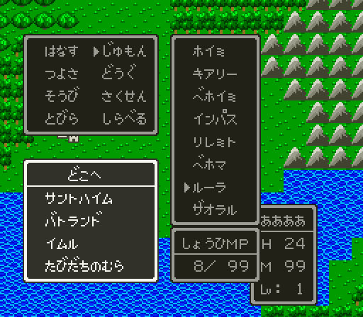

# DQ4 필드를 DQ5 세계 0·1·2 에

FC 「드래곤 퀘스트 IV」 필드 0(세계 지도)의 지형을 DQ5 필드 엔진의 세계 0 에, 필드 1·3 을 세계 1·2 에 넣은 방법과 실측입니다. 넣는 도구는 [sfc/dq4/tools/dq4fieldport.py](../tools/dq4fieldport.py), 검사는 [sfc/dq4/tools/dq4fieldcheck.py](../tools/dq4fieldcheck.py)입니다. 과정은 [2026-10-30-39 일지](../journal/2026-10-30-39-field-world0.md), 그림을 바꾼 [2026-10-30-48 일지](../journal/2026-10-30-48-field-gfx.md), 필드 1·3 을 넣은 [2026-10-30-51 일지](../journal/2026-10-30-51-field-worlds12.md), ルーラ·배·조우를 옮긴 [2026-10-30-57 일지](../journal/2026-10-30-57-field-behaviour.md)에 있습니다. FC 필드 형식은 [fc/dq4/docs/dq4-field-format.md](../../../fc/dq4/docs/dq4-field-format.md), DQ5 필드 형식은 [sfc/dq5/docs/dq5-field-format.md](../../dq5/docs/dq5-field-format.md)를 따릅니다.

FC 블록 종류마다 DQ5 블록 하나를 새로 만들어(번호 511~528) DQ4 그림을 그리고, 지형(걷기·배·조우 지형)은 아래 「블록 대응」에서 빌린 DQ5 블록의 것을 그대로 씁니다. 바다는 DQ5 의 블록 0 을 그대로 쓰고, 움직이는 물 그림만 DQ4 물결로 바꿉니다(아래 「바다」). 그림은 아래 「그림」에 있습니다.

## 놓는 자리

FC 블록 (x, y) 가 DQ5 블록 (x, y) 입니다. FC 필드 0 은 250×250 블록이고 게임이 읽는 칸은 3~252 입니다(`fc/dq4/tools/dq4field.py decode` 의 253×253, 0~2 줄·칸은 바다). DQ5 세계 0 은 256×256 블록이라 남는 253~255 줄·칸은 바다입니다. DQ5 의 필드 좌표(`$B6`·`$B8`)는 8픽셀 칸이라, FC 블록 (x, y) 는 DQ5 칸 (2x~2x+1, 2y~2y+1) 넷입니다.

`dq4fieldport.py patch` 가 이 지도를 [`dq5fieldwrite.py patch --world 0`](../../dq5/docs/dq5-build-format.md#필드-세계-지도)으로 넣습니다. 세계 1·2(아래 「FC 필드 1·3」)도 같은 한 번의 `patch` 에 넣습니다. 10·11번째 비트 훅이 하나라 세계를 나눠 만들면 빌드에서 겹치기 때문입니다. 블록 511 이상이 있어 10번째 비트 평면(`--planes-at`)을 함께 두고, 그래서 지도 패치는 그림·블록 패치를 넣은 롬에서 만듭니다(아래 「그림」의 차례). `dq5fieldwrite.py` 는 이때 `00:CF50` 이 바꾸는 칸(`changed_cells`)에 512 이상이 있으면 거부합니다. 원래 롬의 그 칸 넷은 FC 지도에서 모두 바다(블록 0)이고, 이 빌드의 상자 패치(`dq4chestport.py`)는 밤에 빛나는 풀 칸을 옮기지 않으므로 상자 패치 없이 만듭니다. 자리는 이 빌드에서 비어 있는 뱅크 `3A` 입니다(9번째 비트 RLE 2,239바이트 `3A:8000`, 지도 RLE 9,673바이트 `3A:88BF`, 그 뒤 세계 1·2 의 네 덩어리 4,221바이트가 `3A:BF05` 에서 끝남). 1장 통합 롬(`dq4chapter1.py build`)은 새 맵 레코드를 `3A:8000` 으로 돌려 `3A` 에 자리가 없으므로, 필드 지도를 타이틀 자료가 `34:BFD1` 에서 끝난 뒤인 `34:C000` 에 둡니다(`dq4chapter1.FIELD_AT`). 메뉴 롬의 `34:BFD2`~`34:FFFF` 16,430바이트는 비어 있었고(0 이거나 원래 롬 `24` 의 거울), 세 세계의 여섯 덩어리 16,133바이트가 `34:FF05` 에서 끝납니다.

## 블록 대응

FC 블록마다 지형이 같은 DQ5 세계 0 의 블록을 빌립니다. DQ5 쪽 값은 `dq5fieldtables.py dump` 의 블록 정의와 지형 니블(`03:CC48`), 타일 속성(`2A:D512`, 위층 타일이 0 이 아니면 위층)입니다. 세계 0 에서 쓰인 칸 수는 `dq5fieldwrite.py dump 0` 의 지도에서 셌습니다.

FC 블록·속성·DQ5 지형·타일 속성은 16진, DQ5 블록 번호와 칸 수는 10진입니다.

| FC 블록(16진) | 역할 | FC 속성(16진) | FC 칸 | DQ5 블록(10진) | DQ5 지형(16진) | DQ5 타일 속성(16진) | DQ5 세계 0 칸 |
| --- | --- | --- | --- | --- | --- | --- | --- |
| `00` | 바다 | `83`(배로만) | 41,331 | 0 | 0 | `80` | 37,306 |
| `01` | 언덕 | `00` | 3,470 | 8 | 2 | `43` | 2,916 |
| `02` | 초원 | `00` | 4,202 | 2 | 6 | `4A` | 3,911 |
| `03` | 덤불 | `00` | 1,086 | 366(작은 나무) | B | `4B` | 68 |
| `04` | 숲 | `00` | 7,487 | 354 | 7 | `4B` | 3,944 |
| `05` | 사막 | `00` | 1,251 | 5 | 1 | `4C` | 1,264 |
| `06` | 산 | `80`(막힘) | 5,037 | 9 | 3 | `82` | 2,282 |
| `07` | 독늪 | `01`(걸음마다 HP 1) | 9 | 7 | 4 | `4D` | 100 |
| `08`·`09`·`0B` | 동굴 입구(왼쪽·오른쪽·한 칸) | `06`·`07`·`06` | 5·5·8 | 10 | C | `45` | 3 |
| `0A` | 암초 | `80` | 32 | 1(바다 위 바위) | 8 | `81` | 246 |
| `0C` | 사당 | `06` | 11 | 17 | C | `45` | 3 |
| `0D`·`11` | 탑(그림·입구) | `00`·`06` | 3·3 | 13 | C | `45` | 5 |
| `0E`·`0F` | 돌길 | `00` | 10·10 | 5 | 1 | `4C` | 1,264 |
| `10` | 마을 | `06` | 16 | 18 | C | `45` | 3 |
| `12`·`13` | 성 왼쪽·오른쪽 | `06`·`07` | 10·10 | 153·154 | C | `45` | 5·5 |
| `15` | 팻말 | `A8`(막힘) | 5 | 21 | 5 | `96`·`96`·`97`·`98` | 4 |
| `16` | 다리 | `00` | 8 | 22 | 6 | `4E` | 11 |

필드 0 에 없는 블록(`14`·`17`·`1D`·`1E` 돌길, 필드 3)도 블록 5 로 정해 두었습니다. 필드 3 의 언덕 `01` 만 필드마다 다르게 산(블록 9)을 빌립니다(아래 「FC 필드 1·3」). 지도에 놓는 것은 이 블록이 아니라 아래 「그림」의 새 블록이고, 이 표의 블록은 새 블록의 지형 니블과 칸마다의 타일 속성을 주는 곳입니다. DQ5 의 마을·성·동굴 블록은 입구 판정이 좌표라 블록 자체에는 입구 뜻이 없습니다(`2A:F247`). 그래서 FC 입구 블록은 그림이 비슷한 지형 C 블록을 쓰고, 입구는 아래 「입구」의 표로 겁니다.

고른 기준은 이렇습니다.

- 걷기: FC 속성 bit7 이 꺼진 블록은 DQ5 타일 속성 `4x`(걸음), 켜진 블록은 `80` 이상. DQ5 바다(블록 0, `80`)는 [배로 지납니다](../../dq5/docs/dq5-field-format.md#탈것-01bc10). 암초(FC `80`)는 바다 위 바위인 블록 1(지형 8, [걸어 들어가지 못함](../../dq5/docs/dq5-graphics-format.md#번호를-정하는-곳))입니다.
- 조우 지형: DQ5 지형 니블이 전투 배경과 조우율을 정하므로, 그림이 같은 지형의 블록을 골랐습니다(바다 0, 메마른 땅 1, 언덕 2, 산 3, 풀밭 6, 숲 7).
- 세계 0 에서 많이 쓰인 블록을 먼저 골랐습니다. 덤불·독늪·팻말·다리는 그 그림이 있는 블록이 그것뿐입니다.

## 그림

FC 필드 그림(`dq4environmentmap.FIELD_ART` 의 에셋, `dq4environmentart.py`)을 DQ5 필드 타일로 바꿔 넣습니다. 만드는 도구는 [sfc/dq4/tools/dq4fieldgfx.py](../tools/dq4fieldgfx.py)이고, `dq4fieldport.py patch` 가 부릅니다.

### 새 블록을 만드는 까닭

빌린 DQ5 블록의 타일을 덮어쓰지 않고, 그림마다 새 블록과 새 타일을 둡니다. DQ5 블록과 타일 512개는 세 세계가 함께 쓰므로, 덮어쓰면 세계 1·2 의 DQ5 땅도 바뀝니다. 또 빌린 블록 여럿이 같은 타일을 나눠 씁니다. 풀밭 블록 2, 언덕 8, 덤불 366, 산 9, 동굴 10, 탑 13, 팻말 21, 성 153·154 가 모두 타일 63 을 쓰고, 언덕·산·탑 등은 위층에도 타일이 있습니다. 새 블록은 DQ5 도구가 이미 받는 방법으로 둡니다([타일 1,024개](../../dq5/docs/dq5-build-format.md#필드-그림-dq5fieldgfx1)·[블록 2,048개](../../dq5/docs/dq5-build-format.md#필드-블록입구-표-dq5fieldtables1)·[10번째 비트 평면](../../dq5/docs/dq5-build-format.md#필드-세계-지도)).

- 블록 번호: FC 블록 종류마다, 그림(에셋)과 빌린 블록이 같으면 한 블록으로 묶어 511 부터 FC 블록 번호 차례로 매깁니다(`dq4fieldport.OWN_BLOCKS`). 동굴 입구 `08`·`09`·`0B` 는 한 블록, 탑 `0D`·`11` 도 한 블록, 돌길 `0E`·`0F`·`14`·`17`·`1D`·`1E` 도 한 블록이라 필드 0 에 17개(511~527)입니다. 필드 3 의 언덕(그림 `hill`, 빌린 블록 9)이 528 입니다. 필드 0 의 블록을 먼저 매기고 필드마다 다른 것을 뒤에 붙이므로(`dq4fieldport.new_blocks`) 필드 0 의 번호는 그대로입니다. 바다 `00` 은 DQ5 블록 0 그대로입니다.
- 지형: 새 블록의 지형 니블은 빌린 블록의 것(`03:CC48`)입니다.
- 타일 속성: 새 타일마다 빌린 블록의 같은 칸(왼위·오위·왼아래·오아래)의 속성을 줍니다. `00:BCA8` 은 그 칸의 위층 타일이 0 이 아니면 위층, 0 이면 아래층 타일의 속성을 읽으므로, 빌린 블록에서도 그렇게 고른 타일의 속성입니다. 새 블록은 그림을 아래층에 그리고 위층을 0 으로 둡니다.
- 암초 `0A`: 아래층은 바다 타일 4·5·20·21(움직이는 물), 위층은 DQ4 암초 에셋에서 물결 에셋(`water0`)과 다른 점(바위)만 남긴 새 타일입니다. 위층 네 칸 모두 새 타일이라 속성은 빌린 블록 1 의 `81` 입니다.
- 나머지: 에셋의 투명 점은 `render_fields` 처럼 풀(`grass`) 에셋의 점으로 채웁니다.

| FC 블록 | 그림(에셋) | 새 블록 | 빌린 블록(지형) |
| --- | --- | --- | --- |
| `00` 바다 | `water0`(움직이는 바다 원본) | 0 | 0 |
| `01` 언덕 | `hill` | 511 | 8 |
| `02` 초원 | `grass` | 512 | 2 |
| `03` 덤불 | `bush` | 513 | 366 |
| `04` 숲 | `forest` | 514 | 354 |
| `05` 사막 | `dirt` | 515 | 5 |
| `06` 산 | `mountain` | 516 | 9 |
| `07` 독늪 | `swamp` | 517 | 7 |
| `08`·`09`·`0B` 동굴 입구 | `cave_mouth` | 518 | 10 |
| `0A` 암초 | `shoal` 의 바위(위층) | 519 | 1 |
| `0C` 사당 | `shrine` | 520 | 17 |
| `0D`·`11` 탑 | `tower_icon` | 521 | 13 |
| `0E`·`0F`·`14`·`17`·`1D`·`1E` 돌길 | `rocky_path` | 522 | 5 |
| `10` 마을 | `town_icon` | 523 | 18 |
| `12` 성 왼쪽 | `castle_icon_left` | 524 | 153 |
| `13` 성 오른쪽 | `castle_icon_right` | 525 | 154 |
| `15` 팻말 | `signboard` | 526 | 21 |
| `16` 다리 | `bridge` | 527 | 22 |
| `01` 언덕(필드 3) | `hill` | 528 | 9(산) |

FC 지도 밖 주차 섬(「DQ5 원래 입구」)도 새 산 블록 516 으로 칠합니다.

### 색

DQ5 세계 0 의 필드 팔레트를 그대로 씁니다. 필드 BG 가 쓰는 줄은 2·3·4번이고, 2·3번 줄 색 1~13 이 시간대 벌로 바뀝니다([dq5-field-format.md 「팔레트」](../../dq5/docs/dq5-field-format.md#팔레트-01a04b)). 새 타일 8×8 하나마다 2번 줄(니블 0)과 3번 줄(니블 1) 가운데 에셋 색에 더 가까운 줄을 고르고, 점마다 그 줄의 색 1~13 가운데 가장 가까운 색을 씁니다. 기준은 낮 벌(`$075E` 2~237 의 벌 2)이고, 거리는 붉은 정도로 무게를 둔 RGB 거리입니다. 색 14·15 는 `02:ABEF` 가 몇 프레임마다 덮어 쓰지 않습니다. 4번 줄은 색 1~3 만 필드 것(물결)이고 나머지는 실내 팔레트 세트가 남은 것이라 쓰지 않습니다. 새 타일 70개 가운데 9개가 2번 줄, 61개가 3번 줄입니다(필드 3 언덕의 넷은 필드 0 언덕과 그림이 같고 속성만 `82` 로 다름).

에셋의 색 몇 가지는 가장 가까운 색을 고르기 전에 DQ5 필드 색으로 옮겨 둡니다(`dq4fieldgfx.TONES`). DQ5 의 2·3번 줄은 둘 다 색 2~5 가 초록 넷(`003800`·`006800`·`00A000`(3번 줄 `009800`)·`00F818`)입니다. 에셋의 초록(뱅크 1)은 마을 맵에 맞춰 밝아, 그대로 고르면 풀밭 바탕이 가장 밝은 `00F818` 이 됩니다. 그래서 초록 여덟 단계는 한 단계 어둡게 옮깁니다. 풀 바탕(`2dff39`)은 DQ5 풀밭 타일 63 의 바탕과 같은 `00A000` 이 되고, 밝은 점(`20e30e`)만 `00F818` 입니다. 사막(`dirt`)의 바탕 `f7f7d6` 은 그대로 고르면 3번 줄의 옅은 회색 `D0D0C0` 이 되어 눈밭처럼 보였습니다. 사막 에셋에서만 바탕·점 셋을 DQ5 모래 색(`D8C068`·`B09848`·`907020`, DQ5 사막 블록 5 의 타일 12 가 쓰는 2번 줄 색 9·8 과 색 7)으로 옮깁니다.

낮밤은 DQ5 의 시간대 벌이 그대로 바꿉니다. (328,95) 에서 `SET="075E=00;075F=01"` 로 서자 CGRAM 2·3번 줄 색 26개가 세계 0 의 벌 7 과 같았고 화면의 새 블록이 함께 어두워졌습니다.

### 바다

바다는 DQ5 의 블록 0(속성 `80`, 지형 0)을 그대로 쓰고, 움직이는 물 그림만 DQ4 물결 에셋(`water0`)으로 바꿉니다. 바다 타일 4·5·20·21 은 필드 타일 RLE 가 아니라 `01:A719` 의 압축하지 않은 128바이트(타일 4·5·20·21 을 이 차례로 이은 4bpp)가 원본입니다. 필드를 불러올 때 `01:C5C8` 이 이 원본으로 16벌을 `7E:C000` 에 만들고, 세계 0 은 오른쪽·세계 1 은 왼쪽으로 한 픽셀씩 돌리고 세계 2 는 위로 한 줄씩 밉니다([dq5-field-format.md 「움직이는 바다」](../../dq5/docs/dq5-field-format.md#움직이는-바다-01c5c8)). 처음에 필드 타일 4·5·20·21 을 DQ4 물결로 바꿔 넣었을 때 (80,49) 에 선 VRAM 의 바다가 DQ5 의 물 그대로였던 까닭이 이것입니다. 그래서 물결은 `dq5fieldgfxwrite.py` 의 [`water_files`](../../dq5/docs/dq5-build-format.md#필드-그림-dq5fieldgfx1)로 넣습니다. 필드 타일의 4·5·20·21 사본은 화면에 나오지 않으므로 DQ5 것 그대로 둡니다.

- 그림: `dq4fieldgfx.water` 가 `water0` 에셋 16×16 을 네 칸으로 나눠, 2번 줄(바다 타일의 니블 0)의 세계 0 낮 벌 색 1~13 가운데 가장 가까운 색으로 고릅니다. DQ5 의 바다 타일도 2번 줄 색 11·12·13 만 씁니다. 에셋의 바탕(`0024d9`)은 색 12(`0029FF`), 물결 줄(`1aa2ff`)은 색 13(`00BDFF`)이 됩니다. 물결 끝의 점 둘(`0042ff`·`0073ff`)은 그대로 고르면 바탕과 같은 색 12 에 묻혀, 어두운 색 11(`0000CE`)과 밝은 색 13 으로 옮깁니다(`TONES`). 256점 가운데 색 12 가 206, 13 이 42, 11 이 8 입니다.
- 이음새: 에셋은 물결을 x 를 16 으로 나눈 나머지 자리에 그려 왼쪽 끝과 오른쪽 끝이 이어지고, 두 줄짜리 물결이 16줄 안에서 끝나 위아래도 이어집니다. 그래서 오른쪽·왼쪽 돌리기(세계 0·1)와 위로 밀기(세계 2) 어느 쪽에도 경계가 생기지 않습니다. 세 세계에서 16벌을 모두 화면으로 봤고 블록 경계에 끊김이 없었습니다.
- 세계: 세 세계가 같은 원본을 씁니다. 세 원본이 같으면 `dq5fieldgfxwrite.py` 가 `01:A719` 제자리에 써서, 세계 고르기 훅도 `--water-at` 자리도 들지 않습니다. 세계 1 의 2번 줄 색 1~13 은 세계 0 의 낮 벌이라(아래 「팔레트」) 세계 0 과 같은 파란 물결입니다. 세계 2(闇の世界)는 DQ5 의 어두운 벌 그대로라 같은 번호가 보라색으로 그려집니다. DQ5 세계 2 의 바다도 같은 색 11~13 의 보라였습니다. 땅을 이미 DQ4 그림으로 같은 번호에 그렸으므로, 바다만 DQ5 무늬로 남기지 않고 DQ4 물결을 보라색으로 쓰기로 했습니다. DQ5 무늬와 DQ4 물결을 세계 2 색으로 나란히 그려 보고 고른 것입니다.
- 낮밤: 색 번호만 바꾸므로 세계 0 의 시간대 벌이 바다도 함께 어둡게 합니다.

### 쓰는 차례와 자리

`dq4fieldport.patch` 가 패치 목록 셋을 차례로 만듭니다. 앞의 것을 넣은 롬이 있어야 뒤의 것을 만들 수 있습니다.

1. `dq5fieldgfxwrite.py patch --worlds-at --extra-at`: 타일 582개(DQ5 512개 + 새 70개), 니블, 속성 1,024개, 세계 1 의 팔레트 한 벌(`01:A199`), 움직이는 바다 원본 128바이트(`01:A719` 제자리, `water_files` 의 `sea-dq4.bin`). 타일 512개 앞쪽은 바뀌지 않아 필드 타일 RLE 는 다시 쓰지 않습니다.
2. 1 을 넣은 롬에서 `dq5fieldtables.py patch --blocks-at`: 블록 511~528. 블록 칸의 타일 512 이상은 타일 늘리기 훅이 있는 롬에서만 받습니다.
3. 1·2 를 넣은 롬에서 `dq5fieldwrite.py patch --planes-at`: 세계 0·1·2 지도.

| 자리 | 크기(바이트) | 내용 |
| --- | --- | --- |
| `30:E000` | 6,344 | 타일 늘리기 훅·DMA·고르기 표·니블 표·블록 칸 비트 표·팔레트 표(`01:A4A7` 이 DB 를 이 뱅크로 두고 읽어 `30`~`3F`) |
| `54:8000` | 2,240 | 새 타일 70개(VRAM 워드 `4000`~) |
| `54:C000` | 1,354 | 블록 훅·블록 표·지형 표 |
| `50:8000`·`50:86B6` | 1,718·8,192 × 3 | 10·11번째 비트 훅, 세계 0·1·2 의 10번째 비트 평면 |
| `51:8000`~`53:FFFF` | 32,768 × 3 | 세계 0·1·2 의 반 바이트 평면(세계마다 한 뱅크) |
| `3A:8000`(1장 `34:C000`) | 16,133 | 세 세계의 지도 여섯 덩어리(「놓는 자리」) |

`dq4fieldport.GFX_AT` 의 자리는 그룹 빌드와 1장 통합 롬 모두에서 비어 있는 곳입니다. 메뉴 롬(문서 차례대로 만든 것)의 `30:A8E9`~`30:FFFF` 는 0 이거나 원래 롬 `20` 의 거울이었고, `42`~`57` 은 뱅크 전체가 0 이었습니다. 평면은 세계마다 반 바이트 평면 한 뱅크를 써서 세 세계면 훅 뱅크 뒤로 세 뱅크가 듭니다. 처음 자리 `55:8000` 이면 `56`~`58` 인데, 메뉴 롬의 `58` 은 0 이 아닌 바이트가 25,331개로 원래 롬의 어느 뱅크와도 같지 않았습니다. 그래서 평면을 `50:8000`(`50`~`53`)으로 옮겼습니다. 그룹 빌드의 다른 패치는 `40`·`41`(환경 맵)까지만 씁니다. 1장 빌드가 남긴 필드 패치(`--keep`)의 쓰기를 메뉴 롬과 견주니, `30`·`34` 의 쓰기는 모두 0 이거나 원래 롬 `20`·`24` 의 같은 자리와 같은 바이트 위였고 `50`~`54` 는 모두 0 위였습니다. 1장 빌드 뒤에 붙는 조사·이름·서장 코드가 `5E`·`5F` 를, 사운드가 `6A`~`6F`·`72`~`7D` 를 씁니다. 1장 통합 롬은 `GROUP_PATCHES` 에 `field-gfx`·`field-blocks` 두 목록을 더해 얹습니다.

## 입구

`dq4groupbuild.py` 의 `LINKS` 에서 그룹마다 FC 입구 블록(`fc/dq4/tools/dq4field.py entrances` 의 필드 좌표)을 적고, 빌드가 그 블록이 정말 그 FC 그룹의 입구인지 대조합니다.

FC 는 입구 블록에 들어서면 들어갑니다. DQ5 는 8픽셀씩 걸어 블록의 네 칸 어느 것에도 설 수 있으므로, 입구 블록의 네 칸을 모두 보조 입구 표(`04:FE83` 을 옮긴 표)와 입구별 도착 훅([dq4-environment-format.md 「입구별 도착」](dq4-environment-format.md#입구별-도착))에 넣습니다. FC 의 두 칸짜리 성·동굴은 오른쪽 반(속성 `07`)도 입구입니다. FC 에서 バトランド 성 오른쪽 반 (A5,2E) 아래 (A5,2F)에서 위로 걷자 `02/00` (00,1D)에 들어갔고 `$42` 는 `A4` 였습니다. 동굴 오른쪽 반 (8E,1B)도 `41/00` 에 들어가 `$42` = `8D` 였습니다(`fc/dq4/tools/lua/warp.lua`). 그래서 입구 블록 오른쪽이 속성 `07` 이면 그 블록의 네 칸도 넣습니다.

나올 때는 FC 처럼 입구 옆 블록에 섭니다. 입구 블록 아래·왼쪽·오른쪽·위 차례로 걸을 수 있는 첫 블록의 왼쪽 아래 칸(2x, 2y+1)입니다. 탑 `30` 은 아래가 바다라 왼쪽 풀밭에 섭니다.

| DQ5 그룹 | FC 그룹 | FC 입구 블록 | DQ5 입구 칸 | 나오는 칸 |
| --- | --- | --- | --- | --- |
| `36` | `02` バトランド 성 | (A4,2E)·(A5,2E) | (328~331, 92~93) | (328,95) |
| `37` | `12` イムル | (9A,16) | (308~309, 44~45) | (308,47) |
| `38` | `1C` 古井戸の底 | (A2,1A) 숲 | (324~325, 52~53) | (324,55) |
| `39` | `30` 탑 | (88,17) | (272~273, 46~47) | (270,47) |
| `3A` | `41` | (8D,1B)·(8E,1B), (8D,1F)·(8E,1F) | (282~285, 54~55), (282~285, 62~63) | (282,57) |
| `3C` | `14` 산골 마을 | (91,31) | (290~291, 98~99) | (290,101) |

古井戸 입구 (A2,1A)는 입구 그림 없는 숲 블록입니다. FC 입구는 블록 속성이 아니라 입구 표의 좌표로 정해지므로 그대로 둡니다.

### DQ5 원래 입구

세계 0 을 FC 지형으로 바꾸면 DQ5 마을 입구가 FC 땅 위에 남습니다. 그 칸을 밟으면 DQ5 그룹으로 들어가므로, 세계 0 에서 들어가는 항목(그룹의 세계가 0 인 것, 그리고 `2A:FEF5` 가 세계 0 으로 보는 그룹 `05`·`50`~`53`)을 모두 「주차 칸」 (509,509)로 옮깁니다. 일반 입구 47개 중 41개, 보조 입구 14개 중 12개입니다. 세계 1·2 의 입구 일곱 개(`09`·`08`·`22`·`1C`·`30`·`15`·`16`)는 세계 검사로 세계 0 에서 들어가지 않지만, 세계 1·2 도 FC 땅이 되었으므로 같은 방법으로 그 세계의 주차 칸에 옮깁니다(아래 「FC 필드 1·3」). `54` 는 늘 들어가지 않으므로 그대로 둡니다.

주차 칸은 FC 지도 밖 블록 (253~255, 253~255)을 산(블록 9)으로 채운 3×3 섬의 가운데 블록입니다. 둘레가 바다이고 섬이 산이라 걸어서도 배로도 닿지 않습니다. 항목을 지우지 않고 옮기는 것은 `ルーラ` 행선지 그룹 22개가 두 표 가운데 하나에 꼭 있어야 하기 때문입니다(`dq5fieldtables.py` 의 `RULER_GROUPS`). 지금 그 그룹으로 ルーラ 를 쓰거나 그 DQ5 그룹에서 필드로 나오면 산섬에 내려 갇힙니다(아래 「남은 것」).

### FIELD 워프

`dq5warp.lua` 의 `FIELD=x,y` 는 원래 롬 `04:FD97` 의 그룹 `01` 항목을 그 좌표로 덮고 01/00 에서 걸어 나갑니다. 이 빌드는 입구 표를 `3C:8000` 으로 옮기므로 그 덮기가 듣지 않습니다. 그래서 `dq4fieldport.warp_patch` 가 `2A:F24F` 의 긴 주소로 옮긴 표를 찾아, 그 표의 그룹 `01` 항목을 같은 좌표로 덮는 `ROMPATCH` 를 함께 줍니다. dq5 도구는 고치지 않습니다.

## ルーラ·キメラのつばさ

DQ5 의 ルーラ 목록은 `25:85D5` 의 그룹 22개이고, 창에 보이는 이름은 이름 표 `0B` 의 같은 순번, 고를 수 있는지는 다녀온 플래그 `7E:2030`~`7E:2032` 의 같은 순번 비트입니다([dq5-field-format.md 「개발용 스위치」](../../dq5/docs/dq5-field-format.md#개발용-스위치-018001)). 도구는 [sfc/dq4/tools/dq4fieldtravel.py](../tools/dq4fieldtravel.py)이고, `dq4groupbuild.py` 가 목록 쓰기(`travel.dq5patch.json`)와 이름 쓰기(`names.dq5patch.json`, `dq5namewrite.py`)를 함께 냅니다.

목록 앞 열두 칸을 FC 목적지 차례(`fc/dq4/tools/dq4field.py places`)로 옮긴 마을로 바꿉니다. 나머지 10칸은 DQ5 그룹 그대로입니다. 3장 마을 셋(エンドール·ボンモール·レイクナバ)을 넣으며 FC 차례를 지키려고 イムル·たびだちのむら 의 칸이 2·3 에서 4·5 로 밀렸고, 4장 마을 넷(キングレオ·ハバリア·モンバーバラ·コーミズ)과 5장 ブランカ 를 넣으며 다시 밀렸습니다. 22칸 가운데 12칸이 찼고, 배 자리 표는 앞 13칸·다녀온 플래그는 앞 17칸까지만 봅니다. 남은 5장 마을은 FC 목적지 28개 가운데 고를 칸을 정해야 합니다.

| 칸 | FC 목적지 | FC 그룹 | DQ5 그룹 | FC 목적지 블록 | FC 입구 블록 | 내리는 칸 |
| --- | --- | --- | --- | --- | --- | --- |
| 0 | `00` キングレオ | `00` | `44` | (40,A7) | (40,A6) | (128,334) |
| 1 | `02` サントハイム | `01` | `3D` | (27,4A) | (27,49) | (78,148) |
| 2 | `03` バトランド | `02` | `36` | (A4,2F) | (A4,2E) | (328,94) |
| 3 | `05` エンドール | `04` | `40` | (67,66) | (67,65) | (206,204) |
| 4 | `06` ボンモール | `05` | `3F` | (74,47) | (74,46) | (232,142) |
| 5 | `07` ブランカ | `06` | `46` | (99,46) | (99,45) | (306,140) |
| 6 | `12` ハバリア | `11` | `43` | (42,9B) | (42,9A) | (132,310) |
| 7 | `13` イムル | `12` | `37` | (9A,17) | (9A,16) | (308,46) |
| 8 | `14` たびだちのむら | `14` | `3C` | (91,32) | (91,31) | (290,100) |
| 9 | `15` モンバーバラ | `15` | `41` | (39,E7) | (39,E6) | (114,462) |
| 10 | `16` レイクナバ | `16` | `3E` | (68,25) | (68,24) | (208,74) |
| 11 | `17` コーミズ | `17` | `42` | (33,BE) | (33,BD) | (102,380) |

- 이름: 이름 표 `0B` 의 0~3번을 FC 이름으로 바꿉니다. 표 `0B` 는 이름 자리(`23:C242`~`D6A0`)의 마지막 표라 다른 표는 움직이지 않습니다. 새 이름 네 개(25바이트)는 바꾼 DQ5 이름 네 개(29바이트)보다 짧습니다. 가나는 DQ5 이름 바이트(탁점 `84`·반탁점 `83` + 키)로 옮깁니다(`dq4fieldtravel.name_bytes`). 원래 롬의 ラインハット 가 같은 바이트로 나옵니다.
- 내리는 자리: `1E:E545` 는 고른 그룹을 일반 입구 표에서, 없으면 보조 입구 표에서 찾아 처음 나온 행의 (X, Y+1) 에 내립니다(`1E:E56C`~`E5B9`, 코드 읽기). 옮긴 그룹은 보조 표에만 있으므로, 그룹의 보조 행 가운데 FC 목적지 블록 바로 위 칸(입구 블록의 왼쪽 아래 칸)을 맨 앞에 둡니다(`dq4fieldtravel.landing_rows`). 네 목적지 모두 FC 목적지 블록이 입구 블록 바로 아래라, 그 블록의 왼쪽 위 칸에 내립니다. 목적지 블록이 입구 바로 아래가 아니면 도구가 거부합니다.
- 다녀온 플래그: 맵에 들어갈 때 `01:8EB2` 가 `06:D3ED` 로 그룹이 목록 앞 17칸에 있는지 보고, 있으면 `BRK 8A ED` 뒤 `7E:2193` 에 그룹을 씁니다(코드 읽기, 아래 실측으로 확인).
- キメラのつばさ: 목록 창 없이 `11:8CBB` 가 `7E:2193`(마지막으로 들어간 마을)을 목록 앞 17칸에서 찾아(`23:E452`) 그 칸의 자리로 내립니다(실행 기록). 선실 세이브스테이트의 `7E:2193` 은 `02` 라, 그대로 쓰면 그룹 `02` 의 주차 칸 아래 (509,510)에 내렸습니다.

실측(`dq4fieldtravelcheck.py`). 주인공에게 이동 주문을 모두 주고(`7E:2063` = `FF`, MP 99) 다른 목적지의 나오는 칸에서 섰습니다.

| 장면 | 넣은 것 | 결과 |
| --- | --- | --- |
| ルーラ 0~3 | 그 칸의 다녀온 플래그 하나, 목록 첫 줄을 고름 | 넷 모두 위 표의 내리는 칸 |
| キメラのつばさ 0~3 | 첫 칸에 물건 `A4`, `7E:2193` = 그 그룹 | 넷 모두 위 표의 내리는 칸 |
| 들어가기 0~3 | 다녀온 플래그 모두 끔, 나오는 칸에서 위로 걸음 | 그 그룹 맵에 들어가 다녀온 플래그가 그 칸 비트 하나만 켜지고 `7E:2193` 이 그 그룹 |
| 목록 | 네 칸의 플래그 | 「どこへ」 창에 サントハイム·バトランド·イムル·たびだちのむら |

그룹 빌드 롬과 1장 통합 롬 모두에서 13장면이 통과했습니다. 목록 창의 이름은 검사가 읽지 않고 화면(`end.png`)을 눈으로 보았습니다. 1장 통합 롬의 목록 창은 제목이 「어디로」 이고 이름 글자가 깨져 보였습니다. 바꾸지 않은 DQ5 이름(칸 4~7)도 같은 롬에서 똑같이 깨져, 창 글자 한글화가 아직 다루지 않은 이름 표 `0B` 의 일입니다(아래 「남은 것」).



## 배

FC 는 ルーラ 목적지 레코드마다 배 자리(바이트 3·4 → `$6195`·`$6196`)와 열기구 자리(바이트 5·6)를 두어, 그 목적지로 날면 가진 배를 그 블록으로 옮깁니다([fc/dq4/docs/dq4-field-format.md 「ルーラ 목적지」](../../../fc/dq4/docs/dq4-field-format.md#ルーラ-목적지)). DQ5 의 배 자리는 롬 표가 아니라 WRAM `7E:21CD`·`7E:21CF`(필드 칸)이고, 배를 필드에 세워 두는 것은 `7E:21B5` bit7 입니다([dq5-field-format.md 「탈것」](../../dq5/docs/dq5-field-format.md#탈것-01bc10)). DQ5 도 ルーラ 로 내린 뒤 배를 옮기는 표가 있어 그것을 씁니다.

- `1E:E4AE`(ルーラ 로 내린 뒤): 내린 그룹을 목록 앞 17칸에서 찾고(`23:E452`), 칸이 13 미만이면 그 칸의 부호 있는 (dx, dy) 두 바이트를 내린 칸(`$B6`·`$B8`)에 더해 `$90`·`$92` 에 두고 `00:D2EB` 를 부릅니다. 표는 둘(`23:E41E`·`23:E438`, 13칸씩)이고 이야기 플래그(`BRK 0B`)로 하나를 고릅니다(코드 읽기). `00:D2EB` 는 세계 0 이고 배를 가졌으면(`7E:21A5` bit1, `00:D315`) `$90`·`$92` 를 `7E:21CD`·`7E:21CF` 에 씁니다.
- 옮긴 열두 칸의 (dx, dy) 를 두 표 모두 FC 배 블록의 DQ5 칸 − 내리는 칸으로 바꿉니다(`dq4fieldtravel.writes`). 나머지 1칸은 그대로입니다.
- 배 칸은 FC 배 블록의 네 칸 가운데 오른쪽 칸도 바다인 칸, 그다음 위나 아래가 걸을 수 있는 블록인 칸, 그다음 내리는 칸에 가까운 칸입니다(`dq4fieldtravel.ship_cell`). 아래 실측에서 배 왼쪽 땅에서 오른쪽으로 걸어서는 배에 오르지 못했기 때문입니다((293,154)·(293,155)에서 60프레임, 까닭은 보지 않음). 오른쪽 칸이 땅인 배 칸 ハバリア (131,309)·コーミズ (71,366)에서는 배를 탔지만 위·아래로 나아가지 못했고, 같은 블록의 왼쪽 칸 ハバリア (130,309)에서는 위로 7칸 나아갔습니다(까닭은 보지 않음).

| 칸 | 목적지 | FC 배 블록 | 배 칸 | (dx, dy) |
| --- | --- | --- | --- | --- |
| 0 | キングレオ | (47,A3) | (142,327) | (14, −7) |
| 1 | サントハイム | (27,4E) | (78,156) | (0, 8) |
| 2 | バトランド | (9D,21) | (315,67) | (−13, −27) |
| 3 | エンドール | (67,67) | (206,206) | (0, 2) |
| 4 | ボンモール | (74,4C) | (232,152) | (0, 10) |
| 5 | ブランカ | (99,49) | (306,146) | (0, 6) |
| 6 | ハバリア | (41,9A) | (130,309) | (−2, −1) |
| 7 | イムル | (9A,13) | (308,39) | (0, −7) |
| 8 | たびだちのむら | (93,4D) | (294,154) | (4, 54) |
| 9 | モンバーバラ | (3E,E5) | (124,459) | (10, −3) |
| 10 | レイクナバ | (6A,26) | (212,76) | (4, 2) |
| 11 | コーミズ | (23,B7) | (70,366) | (−32, −14) |

실측(`dq4fieldtravelcheck.py` 의 `ship`·`sail`). 그룹 빌드 롬과 1장 통합 롬 모두에서 22장면이 통과했습니다.

- `ship`: 위 「ルーラ」 장면에 `7E:21A5` bit1·`7E:21B5` bit7 을 더해 날자, 열한 칸 모두 `7E:21CD`·`7E:21CF` 가 위 표의 배 칸이 되었습니다.
- `sail`: 배를 그 칸에 세우고(`7E:21B5` bit7, `7E:21CD`~`21D0`) 배 위·아래의 땅 칸에서 배 쪽으로 24프레임, 이어 바다가 가장 길게 이어지는 쪽으로 16프레임 눌렀습니다. 열한 칸 모두 `$1954` = `03`(배를 탐)이고 다른 바다 칸에서 끝났습니다(예: ハバリア (130,306), コーミズ (70,369)). バトランド 의 배 블록은 폭 한 블록의 강이라, 위로 저으면 건너편 땅에 내렸고 강을 따라 오른쪽으로 저었습니다.

## 조우

FC 필드의 조우 구역([fc/dq4/docs/dq4-encounter-format.md](../../../fc/dq4/docs/dq4-encounter-format.md))을 DQ5 의 구역 격자와 구역 레코드로 옮깁니다([dq5-data-format.md 「전투 조우」](../../dq5/docs/dq5-data-format.md#전투-조우-23e7c2)). 도구는 [sfc/dq4/tools/dq4fieldencounter.py](../tools/dq4fieldencounter.py)이고, `dq4groupbuild.py` 가 구역 레코드(`zones.dq5patch.json`, `dq5progresswrite.py`), 격자(`grids.dq5patch.json`, `dq5encounterwrite.py`), 지형별 조우율(`rates.dq5patch.json`)을 냅니다.

### 격자

FC 구역 지도 한 칸은 FC 블록 16×16 이고(`($43 & F0) | ($42 >> 4)`), DQ5 격자 한 칸은 필드 칸 32×32, 곧 블록 16×16 입니다(`01:854F`, `(Y >> 5) × 17 + (X >> 5)`). FC 블록이 DQ5 블록과 같은 자리이므로 FC 구역 지도 칸 (c, r) 이 DQ5 격자 칸 (c, r) 입니다. 격자는 17칸 너비라 마지막 열(블록 256~271)은 FC 바다 구역 `00` 으로 채웁니다.

| DQ5 격자 | 고르는 때(`01:A6D9`) | 줄 | 넣은 FC 줄 |
| --- | --- | --- | --- |
| 0 `23:F1FC` | 세계 0, `$1948` = 0 | 7 | 0~6 |
| 1 `23:F273` | 세계 0, `$1948` = 1 | 17 | 7~15, 9~15, 바다 |
| 2 `23:F394` | 세계 0, `$1948` ≥ 2 | 17 | 0~15, 바다 |
| 3 `23:F4B5` | 세계 1 | 5 | 첫 줄 `35`, 나머지 `34` |
| 4 `23:F50A` | 세계 2 | 4 | 모두 `36` |

- 세계 0 의 FC 지도는 1·2·4장의 것(`$A4BD`, 256바이트)입니다.
- `01:854F` 는 줄을 자르지 않아, `$1948` = 0 이면 격자 0 의 일곱째 줄부터는 바로 뒤의 격자 1 을 읽습니다. 그래서 격자 1 의 앞 9줄에 FC 줄 7~15 를 둡니다. `$1948` = 1 이면 격자 1 의 줄 9~15 만 FC 와 맞습니다. 실측한 장면은 모두 `$1948` = 0 이었고, FC 줄 12 의 구역 `0E` 에서 격자 1 을 읽어 맞는 구역이 나왔습니다(아래).
- FC 필드 1·3 은 구역 지도가 없고, 필드 1 은 Y < 0C 이면 `35`, 아니면 `34`, 필드 3 은 `36` 입니다(`18:$9C3F`). DQ5 격자 한 줄이 16블록이라 필드 1 의 첫 줄을 `35` 로 둡니다.

### 구역 레코드

FC 구역마다 DQ5 구역 하나를 정해 그 레코드를 다시 씁니다. 원래 롬에서 필드 격자만 쓰고 맵 속성(`23:FD6A`·`23:FDD6`)이 쓰지 않는 DQ5 구역 32개(바다 구역 81~84 뺌)를 번호 차례로, FC 구역 22개(지도의 19개와 `34`·`35`·`36`)에 차례로 줍니다. 배를 탈 때(`$1954` = `03`) DQ5 는 격자 대신 `01:85D8` 의 사각형으로 구역 81~84 를 고르므로, 이 넷에는 FC 가 배 위에서 늘 쓰는 구역 `00` 을 넣습니다.

| FC 구역 | DQ5 구역(10진) | FC 구역 | DQ5 구역 | FC 구역 | DQ5 구역 |
| --- | --- | --- | --- | --- | --- |
| `00` | 2, 81~84 | `0A` | 14 | `11` | 28 |
| `04` | 3 | `0B` | 17 | `12` | 31 |
| `05` | 6 | `0C` | 18 | `14` | 32 |
| `06` | 7 | `0D` | 19 | `15` | 33 |
| `07` | 11 | `0E` | 22 | `17` | 35 |
| `08` | 12 | `0F` | 24 | `34` | 36 |
| `09` | 13 | `10` | 27 | `35` | 42 |
| | | | | `36` | 43 |

필드 구역이 받고 남은 DQ5 구역은 1장 던전 구역 넷이 이어서 받습니다(44·50·54·55, [1장 던전 조우와 곡](dq4-chapter1-format.md#던전-조우와-곡)).

레코드는 이렇게 옮깁니다(`dq4fieldencounter.record`).

| DQ5 | FC 에서 |
| --- | --- |
| 레벨 | 구역 바이트 1 |
| 칸 0~4(여러 종) | 칸 0~4 의 몬스터. 마릿수 부호 1(한 마리씩), 종 수 무게는 2종 3, 3종·4종은 무게 줄 바이트 14·15 가 0 이 아니면 1 |
| 칸 5~9(한 종) | 칸 6~10 의 몬스터와 마릿수 부호(무게 줄 바이트 16·17). 부호 0~3·6·7 은 뜻이 같고, 4·5 는 FC 1~3·2~4, DQ5 2~3·3~4 |
| 비어 있는 칸 5~9 | 칸 5·11(한 마리)의 몬스터, 부호 0. 빈 칸이 없으면 버림 |
| 무게 | 무게 줄의 칸 무게를 그 구역에서 가장 큰 무게가 7 이 되게 줄임(0 이 아니면 1 이상) |
| 조우 계수 | `23:EA44` 가운데 전투까지 평균 거리가 FC 에 가장 가까운 것(아래 「조우율」, 기본 16·20·24·28 → `10`·`16`·`2B`·`2B`, 바다 구역 `16`) |
| 그 밖 | 칸 10(고정 무리) 무게 0, 동료가 되지 않음(`$1010` 0), 선제·기습 번호 0 |

몬스터는 DQ4 몬스터를 아직 옮기지 않아 자리 표(`dq4fieldencounter.MONSTERS`) 하나로 DQ5 몬스터를 빌립니다. 이름이 같은 DQ5 몬스터가 있으면 그것(スライム·バブルスライム·つちわらし·おばけキノコ·ホイミスライム·しびれくらげ·さまようよろい·メタルスライム·メタルキング 등), 없으면 그 몬스터가 나오는 FC 구역의 가장 낮은 레벨에 가장 가까운 레벨의 DQ5 구역에서 번호가 가장 작은 몬스터입니다.

### 조우율

FC 의 한 걸음 전투 확률은 기본 조우율 × 걸음 배수(처음 세 걸음 2·4·8, 그 뒤 16) × 지형 배수 >> 8 이고, 한 걸음은 16픽셀 블록입니다. DQ5 필드는 실내와 같이 8픽셀 셀마다 `00:82AB` 가 판정하고, 확률은 `23:EA44`[계수] × Y' >> 6 입니다. Y' 는 지형 조우율(`01:84CF` 의 Y)을 마지막 전투 뒤 셀 수 `$1A9A` 로 바꾼 값입니다(`23:E7C2`, [1장 던전 조우](dq4-chapter1-format.md#던전-조우와-곡)와 같은 식, `dq4fieldencounter.dq5_chance`). 두 식이 걸음 길이도 걸음 보정도 다르므로, 한 걸음의 확률이 아니라 「전투까지 평균 거리」를 맞춥니다.

- 지형 조우율: DQ5 지형 조우율 표(`23:F1E0`, 낮·밤 14개씩)를 FC 지형 배수(`$A27B`·`$A283`)로 바꿉니다. DQ5 지형 니블마다, 그 니블을 빌린 FC 블록 종류 0~7 의 배수를 넣고(바다 0, 사막 1, 언덕 2, 산 3, 독늪 4, 풀밭 6, 숲 7, 덤불 `B`), FC 타일 8 이상만 빌린 니블(팻말 5, 암초 8, 입구 `C`)은 0 으로 둡니다. 지형끼리의 비는 이 값이 지킵니다. 1장 롬은 [사용자 결정](dq4-chapter1-format.md#사용자-결정에-의한-원작과의-차이)으로 이 배수의 3/4(반올림)를 넣어 FC 보다 덜 싸웁니다(`dq4balance.ENCOUNTER`). 계수 고르기는 FC 배수 그대로 셉니다.
- 계수: 구역마다 `23:EA44` 의 여덟 계수 가운데, FC 블록 종류마다 낮·밤 배수로 셈한 DQ5 평균 셀 수(`dq5_steps`)와 FC 평균 걸음 수의 두 배(`fc_steps`)의 비가 1 에 가장 가까운 것을 고릅니다(비의 로그 절댓값 합이 가장 작은 것, `field_rate_index`). 땅 구역은 종류 1~7, 바다 구역(배 위, FC 구역 `00`)은 종류 0(바다)으로 셉니다. 계수 표는 바꾸지 않습니다.

| FC 기본 조우율 | 계수 | 풀밭(낮 `0B`) FC / DQ5 | 언덕(낮 `1A`) FC / DQ5 | 밤 풀밭(`0F`) FC / DQ5 |
| --- | --- | --- | --- | --- |
| 16(구역 `04`·`05`·`06` 등) | `10` | 51.1 / 55.4셀 | 23.9 / 22.8셀 | 38.6 / 41.2셀 |
| 20(`09`) | `16` | 43.8 / 48.1셀 | 20.2 / 19.8셀 | 32.7 / 35.4셀 |
| 24(`07`·`0C`) | `2B` | 36.2 / 35.8셀 | 17.4 / 15.3셀 | 27.6 / 26.7셀 |
| 28(`08`) | `2B` | 31.3 / 35.8셀 | 15.6 / 15.3셀 | 23.9 / 26.7셀 |

바다 구역은 기본 16·바다 배수 `04`/`05` 에서 FC 132.5·107.2셀, 계수 `16` 이 124.2·107.6셀입니다. 계수 표에 기본 28 에 맞는 값이 없어, 구역 `08` 은 풀밭에서 FC 보다 15% 드뭅니다. 전에는 계수를 4 × 기본 조우율(`40`·`50`·`60`·`70`)로 두어 한 걸음의 확률을 같게 했고, 셀 걸음과 걸음 보정 때문에 기본 16 풀밭이 29.0셀로 FC 의 0.57배였습니다.

### 실측

`dq4fieldencountercheck.py`. FC 구역 지도 칸마다 걸을 수 있는 FC 블록 둘(풀밭 먼저, 칸 가운데에 가까운 것)에 서서 좌우로 걸었습니다.

- 구역: 조우 계수 표를 모두 `FF` 로 덮어(장면 준비, 확인하는 표가 아님) 거의 걸음마다 싸우게 하고, `23:E7C2` 의 A(구역)와 무리를 정해 나가는 세 곳의 `$1001`~`$1008` 을 기록했습니다. 첫 전투에서 걷기가 멈추므로 구역마다 걷기 전 0·7·13프레임을 기다린 세 번을 돌렸습니다. 21장면 모두 걸음마다 위 표의 DQ5 구역이었고, 무리는 모두 그 구역 레코드의 몬스터였습니다.

| 장면 | FC 구역 | 선 블록 | DQ5 구역 | 무리(DQ5 몬스터, 0·7·13프레임) |
| --- | --- | --- | --- | --- |
| バトランド 성 둘레 | `04` | (A5,28)·(A6,28) | 3 | ドラキー·スライム·スライム / バブルスライム·ドラキー / バブルスライム·ドラキー·ドラキー |
| イムル 둘레 | `05` | (99,18)·(9A,18) | 6 | バブルスライム·バブルスライム·ドラキー / 같음 / スライム 2 |
| 남쪽(FC 줄 12) | `0E` | (35,C8)·(36,C8) | 22 | ドラキー 셋 / 둘 / ドラキー 2 |
| 서쪽(기본 20) | `09` | (57,28)·(58,28) | 13 | まほうつかい 7 / 셋 / 둘 |
| 서쪽(기본 28) | `08` | (36,3A)·(37,3A) | 12 | ドラキー 7 / スカルサーペント·ドラキー / スカルサーペント 3 |
| 세계 1 | `34` | (17,2D)·(18,2D) | 36 | シャドーサタン 6 / 셋 / 둘 |
| 세계 2 | `36` | (24,28)·(25,28) | 43 | スライムベホマズン 둘 / 넷 / 넷 |

- 셀 걸음: 계수를 모두 0 으로 덮고 (A5,28) 에서 좌우로 걷자 `00:82AF` 가 8프레임마다, 필드 셀 `$B6` 이 1 바뀔 때마다 한 번 돌았고, `$1A9A` 가 그때마다 1 늘었습니다. 필드에 내린 첫 걸음의 `$1A9A` 는 1 입니다.
- 걸음 보정: 계수를 모두 `40`(Y' 가 곧 확률)으로 두고 `$1A9A` 를 도착 직전에 `14`·`2C`·`60` 으로 덮어 걸으며 `23:E8B7` 의 `$00`(확률)을 적었습니다. 풀밭 Y = `0B` 에서 `$1A9A` 7·8 → 2, 9·10 → 5, 11~22 → 7, 23 → `10`, 46 이상 → `2C`, 언덕 Y = `1A` 에서 5·6 → 1, 14 → `27`, 24 → `68` 로 `dq5_chance` 와 같았습니다(실내와 같은 루틴).
- 조우율: 같은 걷기를 롬의 조우율 그대로 두고 `23:E7C2` 의 Y·`$1A9A` 와 `23:E8B7` 의 확률을 걸음마다 기록했습니다. 네 장면(기본 16 의 구역 `04`·`05`, 20 의 `09`, 28 의 `08`) 모두 계수가 위 표의 것(`10`·`10`·`16`·`2B`)이고, 걸음마다 Y 가 그 블록 종류의 FC 낮 배수(풀밭 `0B`, 언덕 `1A`)였으며 확률이 `dq5_chance` 와 같았습니다.
- 전투까지 거리: イムル 둘레 (99,18)~(9C,18) 풀밭을 오가며 첫 전투까지 걸은 셀 수를, 걷기 전 0~117프레임(3프레임 간격)을 기다린 40번씩 쟀습니다. 계수 `10` 은 평균 61.9셀(셈 55.4), 전의 `40` 은 30.9셀(셈 29.0)이었습니다. FC 는 같은 블록을 `enc.lua`(1장 필드 세이브스테이트, `POS`·`ROUTE`)로 오가 39번 평균 25.9블록(51.8셀, 셈 51.1)이었습니다.

1장 통합 롬에서 25장면이 통과했습니다(그룹 빌드 롬은 계수를 바꾸기 전 17장면). 장면의 `$1948` 은 0 이었습니다.

## 필드 곡

필드 곡은 이 문서의 도구가 바꾸지 않습니다. 사운드 포팅이 DQ5 곡 자리 `02`(필드)에 NDS 필드 곡 `05` 를 넣었고([dq4-sound-port-format.md](dq4-sound-port-format.md)), 장과 선두에 따라 필드 곡을 고르는 코드는 그 문서의 [「남은 것」](dq4-sound-port-format.md#남은-것)에 사운드 포팅의 몫으로 올라 있습니다. 표 하나만 고쳐서 될 일이 아니라 곡을 고르는 코드이므로 여기서는 옮기지 않았습니다.

## 검사

```sh
uv run --locked python sfc/dq4/tools/dq4groupbuild.py --out work/fw
uv run --locked python sfc/dq4/tools/dq4fieldcheck.py --rom work/fw/groups.sfc --out work/fwf
uv run --locked python sfc/dq4/tools/dq4groupcheck.py --rom work/fw/groups.sfc --out work/fwg
```

`dq4fieldcheck.py` 는 MesenCE 에서 필드에 서서 봅니다.

- 지도: 필드 (328,95)(バトランド 성 아래)에 서서 끝 프레임의 WRAM 을 덤프하자 `7F:0000` 65,536바이트와 `7E:E000` 8,192바이트가 `dq4fieldport.world` 를 나눈 것(`dq5fieldwrite.split`)과 바이트까지 같았습니다.
- 지형: バトランド 성 둘레에서 블록 종류마다 가장 가까운 것을 골라, 그 옆 걸을 수 있는 블록에 서서 그쪽으로 18프레임(몸 돌리기와 두 칸) 눌렀습니다.

원래 롬의 필드 (341,56)에서 18프레임 누르면 오른쪽·위·아래 모두 두 칸이었습니다(워프 뒤 아래를 보고 있어 아래는 몸 돌리기가 없어도 같음). 누르기 전에 `idle:16` 으로 필드가 입력을 읽는 프레임(`$7F & 7` = 0)의 앞 프레임까지 기다립니다. 그림을 처음 넣은 롬(dq5 도구가 타일 늘리기 롬의 필드 불러오기를 고치기 전)은 필드를 불러오는 데 걸리는 프레임이 달라, 같은 670프레임에 `$7F` 가 171(바꾸기 전 168)이었고 독늪 쪽 18프레임이 한 칸에 그쳤습니다. 기다린 뒤에는 바꾸기 전 롬과 바꾼 롬 모두 두 칸이었습니다.

| FC 블록 | 선 블록(DQ5 블록, 10진) → 누른 쪽 | 끝난 블록 | 결과 |
| --- | --- | --- | --- |
| `00` 바다 | (164,29) → 아래 | (164,29) | 막힘 |
| `06` 산 | (160,46) → 왼쪽 | (160,46) | 막힘 |
| `0A` 암초 | (40,24) → 오른쪽 | (40,24) | 막힘 |
| `15` 팻말 | (165,47) → 오른쪽 | (165,47) | 막힘 |
| `02` 초원 | → 오른쪽 | (163,46) | 들어감 |
| `01` 언덕 | → 오른쪽 | (164,39) | 들어감 |
| `03` 덤불 | → 오른쪽 | (152,24) | 들어감 |
| `04` 숲 | → 오른쪽 | (161,46) | 들어감 |
| `05` 사막 | → 왼쪽 | (164,74) | 들어감 |
| `07` 독늪 | → 오른쪽 | (130,63) | 들어감 |
| `16` 다리 | → 오른쪽 | (200,72) | 들어감 |

독늪(새 블록 517, 속성 `4D`) 장면은 독늪 칸 둘을 걸어 주인공 HP(`7E:2042`)가 24 에서 22 가 되었고, 풀밭 장면은 24 그대로였습니다.

그림은 다섯 자리에 서서(`VIEWS`: バトランド 성 아래 (328,95), イムル 앞 (308,47), 다리 (400,145), 사막 (328,149), 암초 옆 (80,49)) 세이브스테이트를 남기고 10프레임 뒤 VRAM·CGRAM 을 덤프해 봅니다(`lua/dq4environmentdump.lua`). 다섯 장면 모두 아래와 같았고, 화면은 `<out>/gfx-<이름>/end.png` 에 남습니다.

- BG 타일맵: 주인공 둘레 30×24칸(720칸)의 아래층(VRAM 워드 `0000`, 32×32 화면 둘)·위층(`0800`) 워드가 `dq4fieldport.world` 의 블록과 `dq4fieldgfx` 의 타일·니블로 셈한 값과 모두 같았습니다. 위층 워드는 타일 0 도 모두 bit13(우선순위)이 켜져 있었습니다.
- 타일: VRAM 워드 `2000` 의 타일 512개(움직이는 4·5·20·21·454~459 뺌)와 워드 `4000` 의 새 타일 66개, 568개가 만든 타일과 같았습니다.
- 바다: VRAM 워드 `2040`·`2140` 의 타일 4·5·20·21 이 `dq4fieldgfx.water` 로 셈한 그 세계의 16벌(`dq5gfx.water_frames`) 가운데 하나였습니다(다섯 장면 모두 벌 13).
- CGRAM: 2·3번 줄 색 1~13 이 세계 0 의 벌 2 와 같았습니다.

그룹 빌드 롬과 1장 통합 롬 모두에서 세계 0 의 지도·지형·그림 17장면이 통과했습니다. 세계 1·2 장면은 아래 「FC 필드 1·3」에 있습니다.

`dq4groupcheck.py` 의 들어가기 장면은 입구 블록마다 걸을 수 있는 FC 이웃 블록(다른 입구 블록이 아닌 것)에서, 이웃의 두 줄(또는 두 열) 각각에 서서 입구 쪽으로 32프레임 누릅니다. 입구 블록의 네 칸을 모두 한 번씩 밟는 셈입니다. 여섯 그룹 66장면이 모두 그룹 도착 자리에 섰습니다. 나가기 6장면은 위 표의 나오는 칸에, 필드로 나가는 계단(`3A/00` 두 곳)도 같은 칸에 섰습니다. 계단·영역 이동·머무르기를 더해 128장면이 모두 통과했습니다.

## FC 필드 1·3

| FC 필드 | 크기(데이터) | 내용 | 입구 | DQ5 세계 |
| --- | --- | --- | --- | --- |
| 1 | 61×61(64×64) | ゴットサイド 가 있는 섬(ルーラ 목적지 `18`) | 4(`47`·`3C`·`1A`·`2C`) | 1 |
| 3 | 폭·높이 자리 250×164, 데이터 62×54 | 闇の世界(きぼうのほこら) | 11(`45` 셋·`43` 둘·`26`·`27`·`28`·`29`·`33`·`2A`) | 2 |

FC 블록 (x, y) 가 그 세계의 DQ5 블록 (x, y) 이고, 둘 다 DQ5 세계 1·2 가 쓰는 왼쪽 위 128×128 블록 안에 들어갑니다. 지도는 줄 데이터가 있는 범위(`dq4field.extent`)까지만 옮깁니다. 필드 1 은 64×64 칸 모두, 필드 3 은 62×54 칸입니다. 필드 3 의 폭·높이 자리(`$D2D9`·`$D2DC`)는 코드 바이트라 게임이 그 밖을 다음 줄 데이터로 읽지만, 데이터의 가장자리는 모두 못 걷는 언덕이라 닿지 않습니다. 남는 칸은 바다(블록 0)입니다. 블록은 필드 0 과 같은 새 블록을 쓰고, 필드 3 의 언덕만 새 블록 528 입니다.

### 팔레트

세 세계는 타일·니블·블록을 함께 쓰고 2·3번 줄 색만 세계마다 다릅니다([dq5-field-format.md 「세계 셋」](../../dq5/docs/dq5-field-format.md#세계-셋-019f40)). 세계 1·2 의 줄은 시간대 없이 한 벌이고, DQ5 는 같은 색 번호를 세계마다 다른 색으로 둡니다. 세계 0 의 2번 줄 색 2~4 가 초록이면 세계 1 은 푸른 회색(눈), 세계 2 는 어두운 초록입니다.

- 세계 1(필드 1): 눈밭 색이면 ゴットサイド 의 풀과 숲이 눈으로 보입니다. 그래서 세계 1 의 한 벌(`01:A199`)을 세계 0 의 낮 벌(벌 2)의 색 1~13 으로 바꿉니다(`dq4fieldgfx.world1_set`). 색 14·15 는 `02:ABEF` 가 덮고 `dq5fieldgfxwrite.py` 가 고치기를 거부하므로 세계 1 의 것 그대로입니다. 한 벌을 제자리에 쓰므로 `--palettes-at` 은 필요 없습니다. 세계 1 은 시간대가 늘 0 이라([dq5-field-format.md 「팔레트」](../../dq5/docs/dq5-field-format.md#팔레트-01a04b)) 밤이 오지 않습니다.
- 세계 2(필드 3): 闇の世界 이므로 DQ5 세계 2 의 어두운 벌(`01:A3B5`)을 그대로 둡니다. 새 타일은 세계 0 의 색 번호로 골랐으므로 같은 번호의 어두운 색으로 그려집니다.

### 필드 3 갈래

[FC 필드 3 갈래](../../../fc/dq4/docs/dq4-field-format.md#필드-3-갈래) 가운데 지형·그림에 닿는 셋을 이렇게 옮겼습니다.

- 언덕 `01` 이 막힘(`08:$8A34` 가 속성을 `80` 으로): 필드 3 에서만 언덕이 산(블록 9, 지형 3, 타일 속성 `82`)을 빌리게 해(`dq4fieldport.FIELD_BLOCKS`) 그림은 언덕, 지형은 산인 블록 528 을 둡니다. 필드 3 의 언덕은 산과 바다에만 맞닿아 걸어서 닿는 칸이 없으므로 걷기 검사는 할 수 없었고, 블록 528 의 지형 니블 3·네 칸 속성 `82` 는 단위 시험(`test_dq4fieldgfx`)에서 블록 9 와 같음을 봅니다.
- 블록 `01` 을 난수로 블록 18(대부분)·19 그림으로 바꿔 그리기(`0F:$D487` 등): 그림 하나만 골라 언덕 에셋(`hill`)으로 그립니다. 블록 18·19 의 에셋이 없고, `dq4environmentmap.render_fields` 도 필드 3 의 블록 `01` 을 언덕으로 그립니다.
- 결계 막이(인물 슬롯 `0A`~`11`, `1E:$938D`·`0F:$CFDE`): 옮기지 않았습니다(아래 「남은 것」).

필드 3 의 팔레트 고정(`1E:$A260`)과 팔레트 3 돌리기(`1D:$8B87`)는 세계 2 의 어두운 벌로 대신했습니다. FC 의 색 돌리기는 옮기지 않았습니다.

### DQ5 원래 입구(세계 1·2)

세계 1 에서 들어가는 DQ5 입구는 일반 입구 셋(`09` (22,93)·`08` (49,27)·`22` (106,101)), 세계 2 는 일반 입구 셋(`1C` (96,97)·`30` (38,111)·`15` (63,27))과 보조 입구 하나(`16` (63,36))입니다. 일곱 개 모두 그 세계의 주차 칸 (253,253)으로 옮깁니다. 주차 칸은 블록 (125~127, 125~127)을 산(블록 516)으로 채운 3×3 섬의 가운데 블록이고, 세계 1·2 가 보이는 128×128 안의 오른쪽 아래 구석입니다. FC 지도(필드 1 은 64×64, 필드 3 은 62×54 블록) 밖이라 둘레가 바다이고 섬이 산이라, 세계 0 의 주차 섬처럼 걸어서도 배로도 닿지 않습니다. 보조 입구 `54` (62,25)는 `2A:FEF5` 가 늘 들이지 않으므로 그대로 둡니다. 세계 0 과 마찬가지로 항목은 지우지 않습니다.

FC 필드 1·3 에서 들어가는 FC 그룹은 아직 옮기지 않아 입구를 걸지 않았습니다. 그 자리는 그림만 있는 땅입니다.

### 세계 1·2 검사

`dq4fieldcheck.py` 는 세계 1·2 장면에서 `dq5warp.lua` 에 `POKE=7E1949=01`(`02`)을 함께 줍니다. 워프는 01/00 에서 걸어 나오므로 `$1949` 를 매 프레임 고정해야 그 세계에 섭니다. 장면 이름은 `w1-`·`w2-` 로 시작합니다.

- 지도: 세계 1 은 (64,59)(ゴットサイド 마을 아래), 세계 2 는 (70,65)(가운데 성 아래)에 서서 `7F:0000` 65,536바이트와 `7E:E000` 8,192바이트가 `dq4fieldport.world` 를 나눈 것과 같았습니다.
- 그림: 세계 1 은 마을·탑·동굴 앞, 세계 2 는 성·서쪽 사당·가운데 궁 앞(FC 입구 블록의 나오는 칸, `dq4fieldport.door`) 여섯 곳입니다. 여섯 장면 모두 주인공 둘레 720칸의 두 층 워드가 셈한 값과 같고, 타일 572개(움직이는 10개 뺌, 늘린 타일 70개 포함)가 만든 타일과 같았습니다. 2·3번 줄 색 1~13 은 세계 1 이 `world1_set`, 세계 2 가 DQ5 세계 2 의 벌이었습니다. 바다 타일 4·5·20·21 은 두 세계 모두 그 세계의 16벌 가운데 하나(여섯 장면 모두 벌 14)였습니다. 세계 2 의 위로 밀기도 같은 방법으로 견줍니다.
- 지형: 아래 표. 누르는 법은 세계 0 과 같습니다.

| 세계 | FC 블록 | 선 블록 → 누른 쪽 | 끝난 블록 | 결과 |
| --- | --- | --- | --- | --- |
| 1 | `00` 바다 | (23,28) → 왼쪽 | (23,28) | 막힘 |
| 1 | `06` 산 | (29,28) → 왼쪽 | (29,28) | 막힘 |
| 1 | `01` 언덕 | → 오른쪽 | (26,28) | 들어감 |
| 1 | `02` 초원 | → 오른쪽 | (32,27) | 들어감 |
| 1 | `03` 덤불 | → 오른쪽 | (32,45) | 들어감 |
| 1 | `04` 숲 | → 오른쪽 | (30,28) | 들어감 |
| 1 | `05` 사막 | → 왼쪽 | (41,27) | 들어감 |
| 1 | `07` 독늪 | → 오른쪽 | (29,34) | 들어감 |
| 2 | `00` 바다 | (31,32) → 오른쪽 | (31,32) | 막힘 |
| 2 | `06` 산 | (32,36) → 왼쪽 | (32,36) | 막힘 |
| 2 | `02` 초원 | → 오른쪽 | (35,36) | 들어감 |
| 2 | `03` 덤불 | → 오른쪽 | (34,36) | 들어감 |
| 2 | `04` 숲 | → 오른쪽 | (33,40) | 들어감 |
| 2 | `07` 독늪 | → 오른쪽 | (33,35) | 들어감 |

세계 1 의 그림·지형 장면은 [필드 그림 늘리기](#그림)의 타일·속성 훅(`01:A4A7`·`00:BCB0` 등)이 세계 1 에서도 맞게 도는지를 함께 봅니다. 늘린 타일 70개가 VRAM 워드 `4000`~ 에 올라 있었고, 새 블록 칸의 타일맵 워드가 맞았고, 늘린 타일의 속성(1,024바이트 표)대로 걷고 막혔습니다. 세계 2 도 같았습니다.

그룹 빌드 롬과 1장 통합 롬 모두에서 세 세계 39장면(세계 0 17, 세계 1 12, 세계 2 10)이 통과했습니다.


## 남은 것

- 조우 격자 끝: 세계 2 의 격자 4 는 4줄로 `23:F54E`(맵 속성 포인터 표) 앞에서 끝나, 블록 Y 64 이상을 밟으면 그 표를 구역 번호로 읽습니다. 필드 3 은 높이 54 에 둘레가 못 넘는 언덕이라 지금은 닿지 않습니다. 격자 3 도 80 이상에서 같습니다.
- 움직이는 바다를 세계를 오가는 이벤트·ルーラ·탈것 장면에서 다시 만드는지는 이 롬에서 보지 않았습니다. 원본이 세 세계 같으므로 어느 세계로 다시 만들어도 물결 무늬는 같습니다.
- 물가 이음새: FC 처럼 땅과 바다가 반듯하게 맞닿습니다. DQ5 의 물가 블록은 쓰지 않았습니다.
- 성 위 돌길(`0E`·`0F`)은 `FIELD_ART` 대로 돌길 그림이라 성 위에 회색 네모가 붙어 보입니다. FC 에서 이 칸이 성의 위쪽 그림인지는 보지 않았습니다.
- 암초 바위는 에셋 색(뱅크 7 의 어두운 파랑)이 바다와 가까워 잘 보이지 않습니다.
- 독늪(속성 `4D`) 피해가 장비·레벨에 따라 다른지는 재지 않았습니다(첫 상태의 주인공으로 두 칸에 HP 2 가 준 것만 봄). FC 독늪은 걸음마다 HP 1 을 깎습니다.
- 암초(블록 1, 속성 `81`)를 배로 지나지 못하는지 재지 않았습니다(걸어서 막히는 것만 쟀음).
- 조우의 몬스터는 자리 표(`dq4fieldencounter.MONSTERS`)의 DQ5 몬스터입니다. DQ4 몬스터를 옮기면 이 표를 바꿉니다. 이름이 같은 DQ5 몬스터가 있는 것은 표의 FC 몬스터 67종 가운데 10종뿐이고 나머지는 레벨이 비슷한 구역의 DQ5 몬스터라, 한 구역의 여러 몬스터가 같은 DQ5 몬스터가 되기도 합니다(FC `17` 은 모두 まほうつかい).
- FC 구역 지도는 1·2·4장 것(`$A4BD`)만 옮겼습니다. 3장(`$A6BD`)·5장(`$A5BD`) 지도는 장마다 격자를 고르는 훅이 필요합니다. DQ5 는 격자를 `$1948`(DQ5 이야기 단계)로 고르므로, `$1948` = 1 인 동안 세계 0 의 FC 줄 0~8 은 맞지 않습니다(위 「조우」).
- FC 고정 편성(칸 12·13), 칸이 모자라 버린 한 마리 칸(칸 11), 낮·밤 칸 마스크, 셋째·넷째 무리 확률, 무리 마릿수 상한·더 붙을 확률(`$A464`·`$A46C`), 기습·선제 문턱은 옮기지 않았습니다. DQ5 의 걸음 보정(마지막 전투 뒤 걸음 수 `$1A9A` 로 ×1.5·×4)은 FC 에 없지만 그대로라, 평균 거리는 맞춰도 전투 간격의 분포는 다릅니다(FC 는 넷째 걸음부터 같은 확률).
- 계수 표(`23:EA44`)에 기본 28 에 맞는 값이 없어 구역 `08` 은 풀밭에서 FC 보다 15% 드뭅니다. 맞추려면 계수 표에 값을 더해야 해 DQ5 구역 전체가 바뀝니다.
- 배 위(바다 구역)의 걸음은 재지 않았습니다. 계수 `16` 은 셈으로만 골랐습니다.
- FC 는 타일 8 이상(다리·돌길·입구 등)에서 싸우지 않습니다. 다리는 풀밭, 돌길은 사막과 DQ5 지형을 함께 써서 이 롬에서는 그 칸에서도 싸웁니다(코드 읽기).
- 필드 1 의 구역 `35`(Y < 0C)는 DQ5 격자 한 줄(16블록)에 맞춰 Y < 10 으로 넓어졌습니다.
- 장·선두로 필드 곡을 고르는 것은 사운드 포팅의 몫입니다(위 「필드 곡」).
- 열기구: DQ5 에는 열기구가 없어 FC ルーラ 레코드의 열기구 자리(바이트 5·6)는 옮기지 않았습니다. DQ5 의 다른 탈것(마법 융단, `7E:21DB`·`7E:21DD` 의 天空城)은 자리 표가 없거나 이벤트가 자리를 정합니다.
- 배를 처음 주는 FC 이벤트(예: `1C:$B2B5` 가 배를 (A8,89)에 놓음)와 `$628E` bit0(배를 가짐)은 옮기지 않았습니다. 지금 배를 가지게 하는 것은 실측에서 쓴 `7E:21A5` bit1·`7E:21B5` bit7 뿐입니다. 배를 가졌을 때 ルーラ 목록의 나머지 9칸(DQ5 그룹, 13칸 안)으로 날면 DQ5 의 (dx, dy) 로 주차 섬 둘레에 배가 옮겨집니다(코드 읽기).
- 배 왼쪽 땅에서 오른쪽으로 걸어 배에 오르지 못한 까닭(DQ5 원래 롬에서도 그런지)은 보지 않았습니다.
- DQ5 이벤트가 세계 0 의 칸을 바꾸는 곳 넷(`01:A01B`·`12:EFC1` 블록 (0B,53), `03:BB3C` (11,7C), `05:EF0F` (E2,75)~(E2,77))은 FC 지도에서는 모두 바다 칸입니다. 그 이벤트가 돌면 바다 위에 DQ5 블록이 생깁니다(코드 읽기, 게임에서 재지 않음).
- FC 이벤트가 바꾸는 칸 (C2,2E)(`0F:$D516`, `$62A1` bit7 이면 산 → 풀)은 옮기지 않았습니다.
- DQ5 는 8픽셀씩 걸어 FC 의 한 블록 폭 길에서 주인공 그림이 옆 블록에 반쯤 걸칠 수 있습니다. 화면으로 확인하지 않았습니다.
- FC 필드 1·3 에서 들어가는 FC 그룹(필드 1 의 `47`·`3C`·`1A`·`2C`, 필드 3 의 11개)을 옮기고 입구를 걸기. 지금 세계 1·2 로 가는 길은 DQ5 원래 길(11/00 의 영역 이동·52/50 의 석상 이벤트·주차한 입구의 그룹에서 나오기)뿐이고, 그 길로 나오면 DQ5 의 나오는 자리가 FC 지도에서는 걷지 못하는 칸입니다. 22/00 → (107,100) 은 필드 1 의 바다, 1C/00 → (96,99) 는 필드 3 의 막힌 언덕, 30/00 → (38,114) 는 필드 3 지도 밖의 바다입니다(칸은 [dq5-field-format.md 「세계 셋」](../../dq5/docs/dq5-field-format.md#세계-셋-019f40)·[「순간이동 칸」](../../dq5/docs/dq5-field-format.md#순간이동-칸-00c99e-039b9c)의 실측, 나왔을 때 어떻게 되는지는 게임에서 재지 않음).
- 필드 3 의 결계 막이(인물 슬롯 `0A`~`11` 의 스프라이트와 `0F:$CFDE` 의 걸음 막기): DQ5 필드 인물로 옮길지 정하지 않았습니다. 필드 3 의 팔레트 3 돌리기(`1D:$8B87`)도 옮기지 않았습니다.
- 세계 1·2 의 배와 탈것의 자리는 DQ5 그대로입니다(`00:D2EB` 는 세계 0 에서만 배를 옮김).
- ルーラ 목록의 나머지 18칸은 주차한 DQ5 그룹입니다. 그 칸의 다녀온 플래그가 켜져 있으면 목록에 나오고, 고르면 산섬 둘레에 내립니다(`7E:2193` = `02` 인 キメラのつばさ 가 (509,510)에 내린 것만 실측). 주차한 DQ5 그룹(예: 장면 이동 도구로 들어간 DQ5 마을)에서 필드로 나와도 산섬 둘레에 섭니다(입구 표 규칙으로 읽은 것). 새 게임에서 이 플래그와 `7E:2193` 이 무엇인지는 보지 않았습니다.
- ルーラ 목적지 テンペ·フレノール(FC 목적지 `0F`·`10`)는 サントハイム 과 같은 DQ5 그룹 `3D` 의 둘째·셋째 FC 그룹이라 칸이 없습니다. 목록은 그룹 하나에 자리 하나라, 칸을 주려면 그룹을 나누거나 내리는 자리를 칸으로 고르는 훅이 필요합니다. FC 의 나머지 목적지는 그 그룹을 옮길 때 더합니다.
- 1장 통합 롬의 ルーラ 목록 창은 이름 표 `0B` 의 가나가 깨져 보입니다. 창 글자 한글화(`dq4windowname.py`)가 이름 표 `0B` 를 다루면 한글 이름을 줄 수 있습니다.
- 1장 통합 롬에서는 `dq4fieldcheck.py` 와 `dq4groupcheck.py --groups 36` 의 필드 장면만 돌렸습니다. 다른 그룹의 입구는 그 롬에서 재지 않았습니다.
