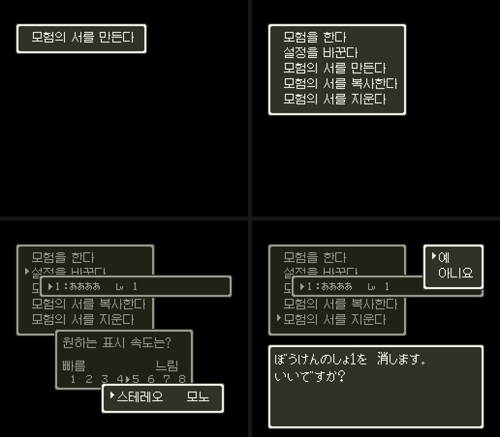
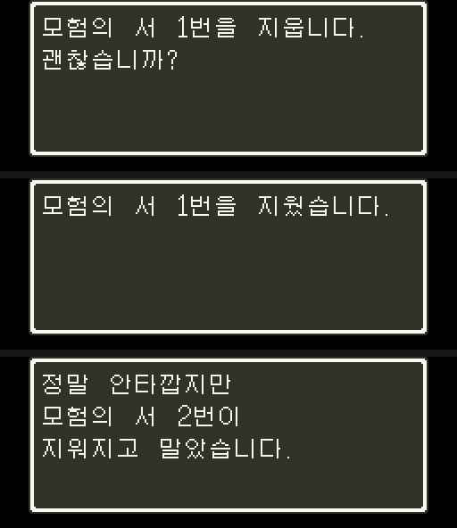

# 모험의 서 메뉴 한글화

타이틀을 나간 뒤 게임을 시작하기 전까지 나오는 모험의 서 메뉴의 창 문구를 한글로 바꾼 명세입니다. 기준 롬은 [타이틀 서곡](dq4-overture-format.md) 빌드 결과(4MB)이고, `sfc/dq4/tools/dq4menupatch.py` 가 그 위에 덧댑니다. 서곡 롬의 해시는 타이틀을 고칠 때마다 달라지므로, 빌더는 서곡이 부르는 스텁(`JSL 70:FF00`)이 있고 메시지 자리(`64:C400`)가 비어 있는지를 봅니다(디코더 머리는 `5A:8000`). 창 레코드 형식은 DQ5 트랙의 [메뉴 창 문자열](../../dq5/docs/dq5-text-format.md#메뉴-창-문자열-04eb48)과 [한글 넣기 실현성](../../dq5/docs/dq5-hangul-format.md)을 따릅니다.



## 범위

메뉴 흐름을 전원부터 돌려 띄운 창과 메시지입니다(MesenCE, 채택 롬). 메시지는 `24:8BAF` 진입의 A 를 기록해 모았습니다.

| 화면 | 창·메시지 | 원문 | 이번 결과 |
| --- | --- | --- | --- |
| 첫 메뉴(기록 없음) | 창 `5E` | ぼうけんのしょをつくる | 모험의 서를 만든다 |
| 첫 메뉴(칸이 다 참) | 창 `5F` | ぼうけんをする / せっていをかえる / ぼうけんのしょをけす | 모험을 한다 / 설정을 바꾼다 / 모험의 서를 지운다 |
| 첫 메뉴 | 창 `60` | 위 다섯 항목 | 모험을 한다 / 설정을 바꾼다 / 모험의 서를 만든다 / 모험의 서를 복사한다 / 모험의 서를 지운다 |
| 칸 고르기 | 창 `64`~`6A` | ぼうけんのしょ　1~3 | 모험의 서 1~3 |
| 예/아니요 | 창 `32`(はい/いいえ), `62`(いいえ/はい) | | 예 / 아니요 |
| 표시 속도 | 창 `63` | おこのみの　ひょうじそくどは？ はやい … おそい | 원하는 표시 속도는? 빠름 … 느림 |
| 소리 | 창 `86` | ステレオ　モノラル | 스테레오　모노 |
| 기록 목록 | 창 `61` | 1：ああああ　Lv 1 | [한글 이름 표시](dq4-name-entry-format.md)(시작 메뉴 실측으로 창 번호 정정) |
| 이름 입력 | 창 `6B`·`6C`·`6D`, 제목 `24` | なまえをいれてください, 가나 판 | [조합형 입력](dq4-name-entry-format.md): `6B`·`6C`를 교체하고 원래 제목·가나판 경로를 건너뜀 |
| 지우기 확인 | 메시지 `1CE`·`1CF` | ぼうけんのしょ{1004}を　消します。いいですか？ / 消しました。 | 모험의 서 {1004}번을 지웁니다. 괜찮습니까? / 지웠습니다.([메뉴 메시지](#메뉴-메시지)) |
| 기록 깨짐 | 메시지 `1D0` | まことに　ざんねんですが … 消えてしまいました。 | 정말 안타깝지만 모험의 서 {1004}번이 지워지고 말았습니다. |

옮기기·설정 바꾸기 경로에는 메시지가 없었습니다. 메뉴 문구는 FC DQ4 의 모험의 서 메뉴(`fc/dq4/tools/dq4text.py rom/dq4.nes windows` 그룹 1, `16:$B3AC`~)를 옮겼습니다. 둘째 항목만 FC 의 ひょうじそくどをかえる 대신, 스테레오까지 묻는 DQ5 동작에 맞춰 「설정을 바꾼다」로 했습니다(사용자 결정).

## 글자 그리는 길

창 글자는 바이트가 곧 BG3 타일 번호이고(`04:B235` 가 `STA ($E0),Y` 로 타일맵 버퍼 `7E:5000` 의 낮은 바이트만 씀), 고정 글자 타일은 `01`~`8A`(가나 138칸)뿐입니다. 그래서 메뉴 문구를 빌드할 때 문자열마다 통째로 그려 8점 폭의 열로 자르고, 메뉴 동안 비어 있는 VRAM 에 올려 둡니다.

```
열 k (0~255) = BG3 타일 200+k(글자 줄) + 300+k(아래 줄). VRAM 워드 2000+8k, 2800+8k
창 레코드: 9F n k  = 열 k 부터 n 개를 늘어놓음(문자열 하나가 3바이트)
```

- 메뉴 화면의 VRAM 덤프 일곱 장(첫 메뉴 둘, 이름 입력 둘, 표시 속도와 소리, 지우기 확인 메시지 둘)에서 워드 `2000`~`7FFF` 는 모두 0 이었습니다. 타이틀 `FadeOut`(`sfc/dq4/tools/dq4titlelayers.asm`)이 VRAM 64KB 를 지우고 메뉴로 넘어가기 때문입니다. 메시지가 뜨면 BG3 캔버스 `96`~`17F` 234칸을 모두 썼으므로, 그 안에는 자리가 없습니다.
- BG3 타일 번호는 10비트라 `200`~`3FF` 를 가리킬 수 있습니다(글자 바탕 `1000` + 타일 × 8).
- BG1·BG2 글자 바탕도 워드 `2000` 입니다. 메뉴의 BG1·BG2 타일맵은 모두 타일 0 이라, 열 0·1(타일 `200`·`201` = 4bpp 타일 0) 자리에 그림이 있으면 화면 전체가 그 무늬로 덮였습니다. 그래서 열은 2 부터 쓰고 쓰지 않는 칸은 0 으로 둡니다.
- 점은 가나 칸처럼 둘째 평면을 `FF` 로 채워 색 3, 빈 곳은 색 2(창 바탕)입니다.

### 글자 줄과 아래 줄

16점 줄 간격 창(머리 `+3` bit7)은 항목마다 글자 줄 하나와 빈 줄 하나를 씁니다. 메인 메뉴 덤프에서 항목은 타일맵 5·7·9·11·13 줄이고, 탁점은 글자 **위** 줄에 놓입니다(첫 항목 ぼ 의 탁점은 테두리 줄의 `92`, 셋째 항목부터는 앞 빈 줄의 `84`).
그래서 첫 항목의 위 줄은 테두리라 쓸 수 없고, 한글(Galmuri9 한글은 9점 높이)은 글자 줄의 둘째 점 줄부터 그려 아래 빈 줄로 2점 내려갑니다. 마지막 항목의 아래 줄은 아래 테두리이므로 창 높이(`+3` 아래 4비트)를 하나 늘립니다.
8점 줄 간격 창 `63` 은 질문 줄과 빠름·느림 줄 바로 아래가 빈 줄이라 높이를 그대로 둡니다.

### 창 접두 훅 `04:B11E`

`04:B11E`(`CMP #$01` 갈래)를 `JSL 60:8000 / BCS +5 / JSR $B235 / BRA $B0ED` 로 바꿨습니다(DQ5 트랙 `wintest` 와 같은 자리).

| 바이트 | 하는 일 |
| --- | --- |
| `01` | 원래처럼 칸만 넘김(`INY` 둘) |
| `9F n k` | 칸 셈 `$0ADE` 에 n − 1 을 더하고, 열마다 버퍼 자리 `Y` 의 낮은 바이트 = k, 높은 바이트 = (원래 & `FC`) \| `02`, 한 줄 아래(`+$40`)는 \| `03` |
| 그 밖 | `CLC` 로 돌아가 원래 `JSR $B235` |

비활성 창이 어두워질 때는 `04:A7B8` 이 창 칸을 `2C01` 로 다시 채우고 글자를 다시 그리므로(`7E:5149` 쓰기 기록: 802프레임에 `04:A7BA`), 높은 바이트의 팔레트 비트를 살려 두면 한글도 같이 어두워집니다.

### 열 그림 올리기

타이틀 `FadeOut` 끝의 `JML $03FE5C`(`30:829A`)를 `JML 60:8100` 으로 바꿨습니다. `00:9556` 으로 화면을 끄고(`$1D` bit7 도 켜서 NMI 가 되돌리지 않음) DMA 채널 7 로 `60:9000` 의 8KB 를 VRAM 워드 `2000` 에 올린 뒤, 공용 창을 한글로 복사하고(아래), FadeOut 처럼 `$1D`·`$2100` 을 0 으로 두고 `03:FE5C` 로 갑니다.

## 커서 효과음과 첫 메뉴의 B

사용자 요청으로 원래 DQ5 동작을 두 가지 바꿨습니다. 기준 롬과 같은 입력으로 먼저 원래 동작을 쟀습니다.

- 커서를 위·아래로 네 번 움직여도 DSP KON 이 곡 음뿐이었습니다(효과음 목소리 7 의 KON 없음). DQ5 의 창 커서는 움직일 때 소리가 없습니다.
- 첫 메뉴에서 B 를 누르면 창이 12~16프레임 사라졌다가 다시 그려졌습니다. 원래 동작입니다.

창의 선택 고리는 `04:CB29` 이고, 프레임마다 `04:CC9D`(A·B), 위 `CB5A`·아래 `CC0E`·왼쪽 `CC2F`·오른쪽 `CC5C` 처리기를 부릅니다. 커버리지를 아무 입력 없는 실행·아래를 누른 실행·B 를 누른 실행으로 견줘 찾았습니다. `$24` 는 새로 누른 버튼으로, bit6 이 B 이고 `04:CCA1 BVS $CD0A` 가 취소 결과(`$0AE8 |= 1`)를 두고 창을 닫습니다.

| 고친 곳 | 원래 | 바꾼 것 |
| --- | --- | --- |
| `04:CB66`·`CC1A`·`CC47`·`CC73` | `JSR $D584`·`$D68C`·`$D794`·`$D82E`(커서 자리 옮기기) | 트램펄린 `JSR`. 옛 커서 자리 `$0AD7` 을 스택에 두고 원래 루틴을 부른 뒤, 값이 바뀌었으면 `BRK 19 33 00`(창을 열고 고를 때의 효과음, 기다리지 않음) |
| `04:CD0A` | `LDA $0AE8` | 창 스택 맨 위 `$09FF + $0AD6` 이 `5E`·`5F`·`60` 이면 이 `JSR` 과 `CC9D` 를 부른 `JSR` 을 버리고 선택 고리로. 아니면 원래 `LDA $0AE8` |

- 이 선택 고리는 게임 안의 모든 창이 함께 쓰므로 효과음은 게임 전체에 납니다(사용자 결정).
- 트램펄린 넷(10바이트씩)과 효과음 꼬리(11바이트), B 검사(27바이트)는 줄어든 메뉴 레코드 뒤 빈자리(끝 `80` 뒤라 읽는 곳이 없음)에 둡니다.
- 첫 메뉴에서 창 스택 맨 위는 `7E:0A02` = `60`(`$0AD6` = 3)이었고, 기록 목록을 열자 `$0AD6` = 7, 맨 위 `61` 이었습니다.

## 공용 창 `32`·`62`

아래 주소와 48바이트 길이는 메뉴 문구만 넣은 첫 빌드의 기록입니다. [조합형 이름 입력](dq4-name-entry-format.md) 빌드는 `6B`·`6C`를 더하고 가변 길이로 배치합니다. 현재 한글 레코드는 `60:B000`, 원래 레코드는 `60:B400`, 메뉴 표시는 `7E:1BB0`입니다.

예/아니요 창 `32` 는 교회 같은 게임 안에서도 엽니다. 게임 안에서는 VRAM `2000` 이후가 BG1·BG2 그림이라 한글 열을 쓸 수 없습니다. 그래서 롬의 레코드는 그대로 두고, 창 표(`04:EB48`) 칸을 낮은 WRAM 거울 주소로 돌렸습니다.

```
창 32 → $1AC0, 창 62 → $1AD8 (뱅크 04 의 0000~1FFF 는 낮은 WRAM. 창 표를 읽는 9곳은 그대로)
메뉴: 60:8100 이 JSL 60:8200 으로 60:B000 의 한글 레코드 48바이트를 7E:1AC0 으로 MVN
게임: 2B:82BD(맵을 불러올 때마다 BG3SC 를 쓰는 곳, LDA #$1C / STA $0725)를 JSL 60:8280 으로 바꿔 60:B100 의 원래 레코드를 복사
```

- `7E:1ABC`~`1BB1` 은 DQ5 트랙이 실행한 장면 열일곱에서 접근이 없던 자리입니다([옮긴 레코드를 둘 자리](../../dq5/docs/dq5-hangul-format.md#옮긴-레코드를-둘-자리)). 증명은 아닙니다.
- 게임 안에서 복사하는 `32` 사본은 [창 글자](dq4-window-text-format.md#교회맡기는-곳예아니요)가 고정 문구(`9E k`) 레코드로 바꿉니다. 메뉴의 한글 레코드는 그대로입니다.
- `62` 가 게임 안에서 쓰이는지 쟀습니다. 선실 파파스의 대화 번호 `00`~`3F` 마다 A·아래를 열 번씩 눌러 보고, 무작위 입력 여섯 벌(선실 넷, 09/00 전투 둘)도 돌렸습니다. 창을 여는 `04:9C52` 에 레코드 주소 `1AD1`(`62`)이 온 적이 없었고, `1AC0`(`32`)은 스무 실행에서 왔습니다. 롬에서도 `$0A00`(창 번호)에 `62` 를 바로 넣는 코드나 `62` 로 넘기는 레코드(첫 바이트 bit7)는 없었습니다(`84`·`85` 는 `32` 로 넘김). 그래도 안전하게 `32` 와 같이 다룹니다(창 글자 빌드는 `62` 사본도 고정 문구로 바꿈).
- 같은 실행에서 `WRAMWATCH=1AC0-1AEF` 로 쓰는 PC 를 모으니 맵을 불러올 때의 우리 복사(`60:8253`, 전투에서 돌아올 때·장면이 바뀔 때)뿐이었습니다. 나머지 메뉴 창(`5E`·`5F`·`60`·`63`·`64`~`6A`·`86`)은 롬 레코드를 제자리에서 바꿨습니다. 교회 저장의 칸 고르기는 `70` 꼴 기록 목록이라 이 창들을 쓰지 않았습니다(선실 세이브스테이트에서 파파스를 교회로 바꾼 실행).
- 레코드가 짧아져 모두 제자리에 들어갑니다. 넘치는 레코드는 줄어든 레코드 뒤 남는 자리로 옮기고 창 표를 고치는 갈래가 도구에 있습니다.

## 글꼴

[Galmuri](https://github.com/quiple/galmuri) v2.40.4(SIL Open Font License 1.1)의 `Galmuri9.bdf`(창 글자), `Galmuri7.bdf`(자모판 한 칸), `Galmuri11.bdf`(메시지)를 씁니다. 남의 팬 패치 데이터가 아니고 OFL 은 글꼴을 다른 결과물에 넣는 것을 허락합니다. 저장소에는 글꼴 파일을 넣지 않고, 빌드가 파일 SHA-256 을 확인합니다.

| 파일 | SHA-256 |
| --- | --- |
| 릴리스 `Galmuri-v2.40.4.zip` | `c8b3d9861a62ae73c8b1178091401cd79994812437ef386413f6dd54856e60e7` |
| `Galmuri9.bdf`(창 글자) | `cc9b6d6f660d8391016be7691b3fc3f864bfa3b095f67bc5e830e9b03ce42162` |
| `Galmuri7.bdf`(자모판) | `0ec6b8707e8c47d85995b5b2b507180aed7bcc724792fe5477e998d41f8b075f` |
| `Galmuri11.bdf`(메시지) | `98716d08aa5762e6ce440d5a757d107cb5d3f32a53861878be06c00aacc23304` |
| `Galmuri11-Condensed.bdf`(비교) | `5adbdedb3d118e99cc7e114b746b3cf6f6a46a4642e0ff215d6a431e55901995` |

처음에는 Galmuri11(한글 12점 폭)·Galmuri9(10점)·Galmuri11 Condensed(8점)로 견준 뒤 사용자가 Galmuri11 을 골랐습니다. 이름 입력까지 넣고 보니 원작보다 커서 「노안 패치」 같다는 사용자 의견에 따라 다시 견줬습니다(2026-10-27). 원작 창 가나는 8×8 타일에 7점 남짓이고 메시지 가나는 11~13점입니다. 원작 일본어, Galmuri11, Galmuri9, Galmuri7(한글 7×7) 롬으로 기록 목록·표시 속도·이름 입력을 찍었습니다. 게임 안 상태 창과 전투 이름은 화면 위에 합성해 견줬습니다. Galmuri7 은 원작 칸 크기와 같지만 「을」 이 「올」 처럼 받침이 뭉개졌습니다. 사용자가 원작 가나와 높이가 비슷한 Galmuri9 를 골랐습니다. 자모판은 한 칸이 8점이라 Galmuri9 자모(ㅃ 9점)가 들어가지 않아 Galmuri7 로 그립니다. 메시지는 원작 가나 크기에 맞는 Galmuri11 을 그대로 씁니다. 메뉴 문구는 음절 36자, 열 110개(앞 두 칸은 비움, 도구 출력은 112)입니다. 자모를 좌표로 그린 DQ5 트랙의 시제품 글꼴(`dq5hangulfont.py`)은 `ㅢ` 같은 모음이 없어 이번 문구를 그리지 못했습니다.

## 메뉴 메시지

지우기 확인과 기록 깨짐은 창이 아니라 보행 모드 허프만 메시지입니다(`24:8BAF` 진입의 A 가 `1CE`·`1CF`·`1D0`). 새 글자 코드를 메시지에 넣으려면 트리를 다시 만들어야 하고, 커진 트리와 다시 부호화한 메시지는 제자리에 들어가지 않습니다. DQ5 트랙이 2MB 롬에서 실측한 [트리 다시 만들기](../../dq5/docs/dq5-hangul-format.md#메시지-옮기기와-트리-다시-만들기)를 4MB 통합 롬의 빈 뱅크로 옮겨 `sfc/dq4/tools/dq4menumsg.py` 로 만들었고, `dq4menupatch.py build` 가 마지막에 부릅니다.



### 배치

| 자리 | 내용 |
| --- | --- |
| `5A:8000`~ | 머리: 디코더(`24:9E02`~`9E46` 사본, 마스크·트리·뿌리 피연산자와 끝 `RTL` 만 바꿈), 비트 마스크, 트리 1·0(잎 1,018, 노드 1,017, 가장 긴 부호 17비트), 폰트 묶음 표. 디코더가 `PHK`/`PLB` 로 자기 뱅크에서 트리를 읽어 한 뱅크 안에 둠 |
| `64:C400`~`69:FFFF` | 메시지 |
| `24:9E02` | `JSL 5A:8000` / `RTS` |
| `24:9E07` | `JSR 8C8D` / `LDA $F2` / `ORA #$60` / `STA $F2` / `RTS` |
| `24:8BD7` | `JSR 8C8D` → `JSR 9E07` |
| `24:AF1E` | 새 색인(16개마다 3바이트, 값 = (주소 − `600000`) × 8 + 비트) |
| `24:A63C`·`A660`·`A6C2`·`A673` | 폰트 묶음 표 피연산자 → `65` 의 새 표 |
| `07:D77C`~`08:F276` | 한글 글자 그림 1bpp(마지막 묶음을 읽을 때 `08:F278` 까지 읽음) |

- 빈 뱅크는 빌드 롬을 32KB 마다 훑어 0 으로만 찬 뱅크를 골랐습니다. `40`~`5F`·`65`~`6F` 가 비었고, `70` 은 서곡 재배치 표, 소리 이식 작업이 `72`~`7D` 를 잡아 두었으므로 `65`~`69` 에 둡니다. 빌드는 쓰기 전에 자리가 0 인지 확인합니다.
- 디코더 사본은 `PHK`·`PLB` 로 데이터 뱅크를 자기 뱅크로 두고 직접 페이지 `$F0`~`$F4` 와 자기 뱅크의 표만 읽습니다(낮은 WRAM 절대 주소 접근 없음). 그래서 낮은 WRAM 거울이 없는 뱅크 `65` 에 둘 수 있습니다.
- 색인 값은 21비트 주소라 뱅크 `1F` 까지만 가리킵니다. `24:8C8D` 는 전투 메시지(`24:8C60`, 디코더 `24:9E47`, 데이터 `07:8000`~)도 부르므로 그 안은 고치지 않고 보행 쪽 호출만 `9E07` 로 돌립니다.
- 원래 보행 메시지는 `07:D77C`~`0C:8020`(메시지 `C7F` 의 마지막 비트)이었습니다. 옮긴 뒤 이 자리를 글자 그림에 씁니다. 빌드 롬의 뱅크 `07`~`0C`·`24` 는 원본 DQ5 와 바이트째 같았습니다(메뉴·이름 입력 패치가 손대지 않음).

### 글자

글자 코드 `3DB` + n 이 [이름 입력](dq4-name-entry-format.md)의 글리프 n(호환 자모 51, 완성형 2,350, ＊, 전각 공백)이고, 그 뒤 `D3E`~`D41` 이 `.`·`?`·`!`·`,`, `D42`~`D4B` 가 숫자 `0`~`9`, `D4C`~`D65` 가 로마자 대문자 `A`~`Z` 입니다. 숫자·로마자는 Galmuri11 글자를 앞 여백 없이 넣습니다(부호는 앞에 한 점을 비움). 모두 `1000` 미만이라 `24:81B0` 이 글자로 봅니다. 게임 안 이름 표시가 같은 번호를 쓸 수 있게 완성형 전체를 넣었습니다.

- 그림은 Galmuri11 을 12×11 칸에 기준선을 맨 아래 줄로 둬 그립니다. Galmuri11 은 ㅏ·ㅑ 곁줄기가 1점이라 SFC 화면에서 「리」·「라」가 거의 같아 보여, 오른쪽 세로획에 붙은 1점 곁줄기(위아래 줄은 비고 세로획은 이어지는 줄)를 비어 있는 오른쪽 끝 열로 1점 늘립니다(`widen_tick`, ㅏ·ㅑ·ㅘ 395자). 그 줄에서만 다음 글자와 틈이 없어집니다. 아래로 1점 두껍게 하는 안과 MesenCE 화면으로 견줘 사용자가 골랐습니다.
- 부호는 앞에 1점을 비웁니다. Galmuri11 부호는 앞 여백이 없어 「다.」의 마침표가 ㅏ 곁줄기에 붙어 보였습니다. 1점짜리 마침표·쉼표는 화면에서 거의 보이지 않아 2점 굵기(`.` 2×2, `,` 2×3)로 다시 그립니다. 쉼표 꼬리가 기준선 아래로 내려가 칸을 넘던 것도 함께 없어집니다. 글자 그림 루틴은 묶음 높이를 13줄 칸의 아래에 맞추므로(`24:A6DA` 의 `20 − 2×높이 − 6`), 높이 11 이면 가나 ぼ(11줄)와 바닥이 같습니다.
- `24:A6C1`~ 은 묶음 주소에 비트 위치 >> 3 을 더하고 뱅크 바이트를 따로 올려 데이터 뱅크로 삼습니다. 묶음이 뱅크 끝을 넘으면 `0000`~ 의 낮은 WRAM 을 읽으므로, 묶음은 한 뱅크 안에 두고(한 줄을 3바이트로 읽어 끝 뒤 2바이트도 같은 뱅크) 넘치면 다음 뱅크에서 새 묶음을 엽니다. 묶음 `+4` 의 뱅크는 `07` + 2비트라 `07`~`0A` 에만 둘 수 있습니다.

| 묶음 | 글자 | 크기 | 그림 |
| --- | --- | --- | --- |
| 51 | `3DB`~`64E`(ㄱ~땟) 628자 | 12×11 | `07:D77C` |
| 52 | `64F`~`D3D`(땠~전각 공백) 1,775자 | 12×11 | `08:8000` |
| 53~56 | `D3E` `.`, `D3F` `?`, `D40` `!`, `D41` `,` | 4×11, 7×11, 5×11, 4×11 | `08:F268`, `08:F26E`, `08:F278`, `08:F27F` |

### 문구

| 메시지 | 코드 |
| --- | --- |
| `1CE` | `{1006}`모험의 서 `{1004}`번을 지웁니다.`{1000}`괜찮습니까?`{1001}` |
| `1CF` | `{1006}`모험의 서 `{1004}`번을 지웠습니다.`{1001}` |
| `1D0` | `{1006}`정말 안타깝지만`{1000}`모험의 서 `{1004}`번이`{1000}`지워지고 말았습니다.`{1001}` |

원래 제어 코드(`{1006}` 시작, `{1004}` 칸 번호, `{1000}` 줄바꿈, `{1001}` 끝)를 그대로 두었습니다. `{1004}` 는 1~3 이라 받침이 바뀌므로 「번」 을 붙여 조사를 고정했습니다. 원문은 FC DQ4 그룹 1(「なまえ のぼうけんのしょを けします。いいですか？」)과 SFC 문장을 함께 보고 옮겼습니다. 공백은 원래처럼 글자 `000`(8점)입니다.

### 다른 메시지 더하기

`dq4menupatch.py build --messages 파일` 은 메뉴 메시지와 함께 다른 보행 메시지도 바꿔 트리를 만듭니다. 파일은 `{"format": "dq4messages/1", "messages": {"1D1": [...]}}` 이고, 번호는 16진, 값은 글자열(위 글자 코드로 바꿈)과 코드 정수(`4096` = `{1000}` 같은 제어 코드, DQ5 글자 코드)의 목록입니다. 메뉴 메시지 `1CE`~`1D0` 과 번호가 겹치면 멈춥니다. [1장 첫머리](dq4-chapter1-format.md)의 대사가 이 길로 들어갑니다.

번호가 `3200` 을 넘으면 색인(16개마다 3바이트)을 메시지 덩어리 밖 `59:8000` 에 두고 `24:8BC3` 의 색인 읽기 뱅크·주소를 그곳으로 고칩니다(`dq4menumsg.INDEX_AT`). 덩어리 `65:8000`~`69:FFFF` 는 1장 빌드에 3장 대사까지 넣으면 `6A0000` 앞 177바이트만 남았습니다([일지](../journal/2026-10-30-64-ch3-bundle.md)). 레벨업 능력치 메시지를 더하자 300바이트 넘쳐, 머리(약 6.4KB)를 아무도 쓰지 않는 `5A:8000` 으로 옮기고 덩어리에는 메시지만 둡니다. 4장 대사 131개를 더하자 다시 모자라, 메시지를 메뉴 빌드 자료(`64:8000`~`64:C0C5`) 뒤 `64:C400` 부터 둡니다. 4장까지 넣은 1장 빌드에서 메시지 162,218바이트가 `69:BDA8` 에서 끝나 16,983바이트 남습니다. 자리가 비어 있지 않으면 빌드가 멈춥니다.

## 재현

```sh
export ASAR=/path/to/asar                 # 조합형 이름 입력 루틴 조립
export DQ4_GALMURI="$PWD/work/galmuri"     # Galmuri-v2.40.4.zip 을 푼 폴더(Galmuri7·9·11 BDF)
uv run --locked python sfc/dq4/tools/dq4menupatch.py build --rom work/overture/dq4-title-overture.sfc \
  --out work/menu/dq4-menu.sfc
uv run --locked python -m unittest discover -s sfc/dq4/tools -p test_dq4menupatch.py
uv run --locked python -m unittest discover -s sfc/dq4/tools -p test_dq4menumsg.py
uv run --locked python sfc/dq4/tools/dq4menumsg.py work/menu/messages.png   # 세 메시지 미리보기
```

빌드는 3,200개 메시지를 새 롬의 디코더 사본·색인·`OR 60` 을 따라 다시 풀어 모두 같은지 확인하고, 다르면 멈춥니다.

입력은 [타이틀 서곡 재현](dq4-overture-format.md#재현)의 결과 롬입니다. 메뉴 문구만 넣은 첫 빌드의 SHA-1 은 `f93de73999e11792ad3b8aca599ed8a903231330`입니다. 현재 빌드는 [조합형 이름 입력](dq4-name-entry-format.md)을 포함하고, 같은 이름의 `.ips`가 함께 나옵니다. 롬 빌드 테스트는 `work/base/dq4-title-overture.sfc` 와 `DQ4_GALMURI` 가 있을 때만 돕니다.

## 검증

MesenCE 에서 전원부터 `sfc/dq5/tools/lua/dq5msg.lua` 의 `PRE` 입력으로 돌렸습니다. 기록이 있는 실행은 기준 롬으로 새 게임을 시작해 남긴 SRAM 을 롬 이름에 맞춰 MesenCE 저장 폴더에 복사했습니다.

| 경로(입력) | 확인 |
| --- | --- |
| 새 게임: A 600·900·1100·1300, Start 1400, A 1500~2700(200마다) | 첫 메뉴·칸 고르기가 한글. 2,950·3,200·3,600프레임 화면(첫 맵)이 기준 롬과 같고, 남은 SRAM 8,192바이트가 같음 |
| 이어하기: A 600·800·1000 | 1,400·1,600·1,800프레임 화면과 SRAM 이 기준 롬과 같음. `7E:1AC0` 48바이트가 760프레임(메뉴)에는 한글 레코드, 1,550프레임(맵을 불러온 뒤)에는 롬의 `32`·`62` 레코드와 바이트째 같음 |
| 설정: A 600, 아래 780, A 800·1000·1200·1400 | 설정 항목·표시 속도·스테레오 창이 한글 |
| 지우기: A 600, 아래 넷, A 820·1000 | 예/아니요(창 `32`)가 한글(메시지는 아래 「메시지 지우기」) |
| 커서: A 600, 아래 800·860·920, 위 980 | 목소리 7 KON 이 801·862·922 프레임(누른 다음 프레임). 기준 롬에는 없음 |
| B: A 600, B 800·860, A 920, B 1000 | 첫 메뉴의 B 두 번은 창이 그대로, 기록 목록의 B 는 첫 메뉴로 돌아감. 선실 세이브스테이트의 명령 창은 B 로 닫힘(209프레임 `04:CD0A`) |
| 메시지 지우기: 칸 셋이 찬 SRAM, `PRE="wait:600,a:2,wait:150,down:2,wait:30,down:2,wait:30,a:2,wait:150,a:2,wait:300,a:2,wait:300,b:2,wait:100,a:2,wait:200"` | `1CE` 976프레임, `1CF` 1,273프레임이 한글(그림 위 둘). `1CF` 를 B 로 닫은 뒤 1,600프레임 `70:0000` 20바이트(쓰는 칸 `07` → `06`)와 칸 1 앞 10바이트(0)가 기준 롬(메시지 패치 전 빌드)과 같음 |
| 메시지 취소: 위에서 마지막 `a:2` 앞에 `down:2,wait:30` | `1CE` 뒤 `1CF` 가 없고 `70:000E` = `07` |
| 기록 깨짐: 칸 2 의 금화 바이트(`0AB2+19`) 하나를 뒤집은 SRAM, `PRE="wait:600,a:2,wait:600"` | 695프레임 `1D0`, 칸 번호 변수가 2 |
| 경계 글자: 시험 빌드에서 `1CE` 를 ㄱ·ㅣ·가·땝·땟(뱅크 07 끝)·땠(08 첫)·땡 / 힛·힝·＊·`.`·`?`·전각 공백·끝 으로 바꿈 | 모두 제 모양 |
| 선실 세이브스테이트에서 파파스에게 말 걸기(메시지 `742`) | 100~500프레임 화면 8장이 기준 롬과 같음 |
| 이어하기(칸 셋 SRAM) | 1,000~1,100·1,160·1,200프레임 화면이 기준 롬과 같음. 1,120·1,140·1,600프레임은 기준 롬끼리도 실행마다 달라 비교에서 뺌 |
| 복사: A 600, 아래 셋, A 820·1000·1200 | 칸 고르기(창 `68`)가 한글. 남은 SRAM 으로 다시 켜 「모험을 한다」 를 고르자 기록이 1·2 둘 |

메시지 그림의 화면 셋은 위 「메시지 지우기」의 1,200·1,400프레임과 「기록 깨짐」의 900프레임을 `work/dq4-menu-msg/fig/` 에 `confirm`·`deleted`·`broken.png` 로 두고 `dq4figures.py` 로 모읍니다. 그림의 화면 넷은 첫 메뉴(새 게임 750프레임), 메뉴(이어하기 760), 설정(1,250), 지우기(1,100)를 `work/dq4-menu/fig/` 에 `book`·`menu`·`settings`·`delete.png` 로 두고 `dq4figures.py` 로 모읍니다. 실제 SFC 기기에서는 돌려 보지 않았습니다.

## 남은 것

- 게임 안 메시지·상태 창의 이름 한글화와 기존 가나 이름의 구분([이름 입력](dq4-name-entry-format.md))
- 원래 보행 메시지 자리 `07:D77C`~`0C:8020` 을 색인 밖에서 읽는 코드가 있는지(실행한 장면에서는 없었음), 글자 그림 뒤 `08:F277`~`0C:8020` 의 쓰임
- 창 `62` 와 `7E:1AC0`~`1AEF`: 실행한 장면(대화 번호 64개, 무작위 입력 여섯 벌)에서는 `62` 를 열지 않고 우리 복사만 그 자리를 씀. 이벤트 장면·후반 장면은 아직
- 실제 SFC 기기
