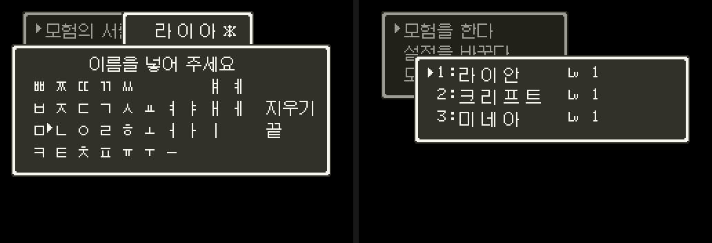
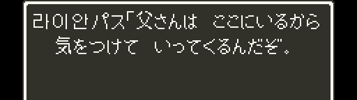

# 조합형 이름 입력

[모험의 서 메뉴](dq4-menu-format.md)에 두벌식 자모판과 네 글자 이름 입력을 더합니다. `dq4menupatch.py`가 `dq4nameentry.py`의 표·글리프와 `dq4nameentry.asm`의 실행 루틴을 함께 넣습니다. 게임 안 보행 메시지의 주인공 이름은 [게임 안 이름](#게임-안-이름)에서 한글로 찍습니다. 상태 창·전투 같은 창의 이름은 아직 아닙니다.

2026-10-26 사용자가 방향 전환과 Start 이동 개선본의 동작을 확인했습니다. 최종 롬 SHA-1은 `5400876b2b8feb7a3ffd68575647c5e548786bc3`입니다.



## 입력과 저장

자모판은 쌍자음 줄과 두벌식 세 줄로 구성합니다. 자모는 Galmuri7, 제목·이름은 Galmuri9를 씁니다([글꼴](dq4-menu-format.md#글꼴)). 「지우기」와 B는 조합 중인 글자에서 마지막 입력 하나를 되돌리고, 조합 중인 글자가 없으면 마지막 확정 글자를 지웁니다. 「끝」을 A로 고르거나 Y로 이름을 확정합니다. 빈 이름은 확정하지 않습니다.

| 항목 | 형식 |
| --- | --- |
| 글리프 번호 `n` | 호환 자모 `U+3131`~`U+3163` 51자, KS X 1001 완성형 2,350자(유니코드 순), 빈 이름 칸의 `＊`와 목록 빈칸의 전각 공백 |
| 이름 한 글자 | `85 + n // 111`, `10 + n % 111`(상수는 16진수). 첫 바이트 `85`~`9A` 가 한글 표시 |
| 이름 길이 | 최대 네 글자, 여덟 바이트 |
| 남은 자리 | 원래 엔진의 끝 부호 `01` |
| 저장 예 | 「라이안」 = `8B 2F 93 3C 91 5A 01 01` |

첫 바이트 `85`~`9A` 는 원래 이름에 나오지 않는 값입니다. 원래 가나판(창 `6C`·`6D`)의 바이트는 가나 타일 `7F` 미만과 `80`(끝)·`83`·`84`(탁점 접두)·`FC`·`FE`·`FF` 뿐이었습니다. 그래서 첫 바이트가 이 범위인 이름만 한글로 읽고, 나머지는 일본어 가나로 읽습니다. 이름 바이트가 지나는 곳의 특수 바이트도 피했습니다.

| 경로 | 특수 바이트 |
| --- | --- |
| 메시지 `24:A7B6` | `01` 공백, `83`·`84` 탁점 접두 |
| 창 글자 `04:B0ED` | `01`, `83`·`84`, `B0` 이상 자리 표시, `FF` 줄 끝, 메뉴 패치의 `9F` 접두(게임 안에서도 걸림) |
| 창 제목의 이름 `04:ABCF` | `01`, `83`·`84` |

### 예전 저장

처음 이름 입력 빌드(PR #461·#468)는 표지 없이 `10 + n // 111` 로 저장했습니다. 이 바이트는 가나 이름과 구별되지 않습니다. 원래 「ああああ」 의 `10 10 10 10` 은 예전 부호로 「ㄱㄱ」 이 됩니다. 이제 표지 없는 이름은 일본어로 읽으므로 예전 한글 저장은 기록 목록에서 가나로 보입니다. 사용자가 칸을 골라 바꿉니다.

```sh
uv run --locked python sfc/dq4/tools/dq4namesave.py show 저장.srm
uv run --locked python sfc/dq4/tools/dq4namesave.py convert 저장.srm --korean-slots 1,3 --out 새.srm
```

`show` 는 예전 부호로도 읽히는 이름에 「가나일 수도 있음」 을 붙입니다. 짝수 길이 가나 이름은 예전 한글로도 읽히기 때문입니다. `convert` 는 고른 칸의 체크섬을 먼저 확인합니다. 그 칸이 예전 한글 부호로 읽혀야 바꾸고, 이름 8바이트와 칸 체크섬만 바꿉니다. 원본을 덮어쓰거나 이미 있는 파일에 쓰지 않습니다. 사례 SRAM(라이안·크리프트·미네아)을 바꾸자 13바이트가 달라졌고 `dq5sram.py` 로 세 칸 체크섬이 맞았습니다.

받침 뒤에 모음을 넣으면 받침을 다음 글자의 초성으로 옮깁니다. 겹받침은 첫 자음을 앞 글자에 남깁니다. `ㅗ+ㅏ` 같은 겹모음과 `ㄹ+ㄱ` 같은 겹받침을 합치며, 완성형 표에 없는 조합이나 다섯째 글자는 입력 전 상태로 되돌립니다. 조합 상태 스택은 지우기 동작을 위해 남겨 둡니다.

## 자모판과 이름 칸

원래 이름 입력 진입점 `03:8B72`에서 메뉴 표시 `7E:1BB0 = A5`일 때 한글 루틴으로 갑니다. 맵을 불러오면 메뉴 표시와 공용 창 레코드를 원래 값으로 돌립니다.

창 `6B`는 네 글자 이름 칸, `6C`는 제목 「이름을 넣어 주세요」와 자모판입니다. 원래 가나판 `6D`와 제목 `24`를 부르는 경로는 한글 입력에서 쓰지 않습니다. 이름 그림은 BG3 열 `F8`~`FF`의 위·아래 타일에 놓고 NMI 전송 목록으로 보냅니다.

위아래 이동은 선택 색인에 한 줄 칸 수(`$0AE3`)를 더하거나 뺍니다. `04:C6E7`은 첫 줄의 `FE`만 세므로 빈 칸 `FC`가 있으면 줄 폭이 줄어듭니다. 각 줄은 11칸으로 맞추고 첫 줄 끝에 빈 칸 수만큼 `9F 00 FE`를 둡니다. 창 접두 훅은 열 수 0을 그리지 않으므로 화면을 바꾸지 않고 이동 폭을 11로 맞춥니다.

### 방향 전환에서 확인한 문제

처음 이름 입력을 넣은 빌드에서는 방향 이동을 원래 선택기에 맡겼습니다. 빠른 전환을 실측하니 커서 그리기 중 들어온 한 프레임 입력을 `04:D222`의 다음 프레임 대기가 덮었고, 두 방향을 겹쳐 누른 뒤 하나만 떼면 전체 방향 비트가 바뀌었다고 반복 대기를 초기화했습니다.

위+왼쪽 겹침 실행에서는 1507프레임에 왼쪽 `9→8`, 위만 뗀 뒤 1509프레임에 왼쪽 `8→4`로 다시 이동했습니다. 왼쪽은 계속 누른 상태였습니다. 효과음을 제거한 빌드에서도 같은 로그가 나와 효과음 원인은 배제했습니다. 또 맨 윗줄 왼쪽 끝에서 왼쪽을 누르면 원래 빈칸 탐색이 다음 줄 「지우기」로 이동시켰습니다.

### 방향 처리

입력 대기 `04:D1DE`, 반복 처리 `04:D222`, 끝 칸 대기 고리 `04:D209`는 모든 창에서 새 처리로 보냅니다. 원래 선택 고리(`04:CB29` 등)는 `$24`의 위·아래·왼쪽·오른쪽을 차례로 보므로, 게임 안 명령 창에서도 두 방향을 겹쳐 누르면 한 번에 두 칸을, 하나를 먼저 떼면 남은 방향으로 또 한 칸을 움직였습니다. 같은 선택 고리를 쓰는 도구 목록·하위 창도 마찬가지입니다.

- 새로 누른 방향을 우선 선택합니다. 동시에 새로 눌러 순서를 알 수 없으면 위·아래·왼쪽·오른쪽 순으로 하나를 고릅니다. 고른 방향만 `$24`에 남깁니다.
- 선택한 방향을 계속 누르면 다른 방향을 떼어도 반복 대기를 초기화하지 않습니다. 남은 방향은 새 누름이 아니라 반복 시각에만 움직입니다.
- 커서 그리기 중 들어온 방향 전환은 다음 선택 처리에서 기다리지 않고 먼저 반영합니다.
- 첫 반복 대기는 16프레임, 다음 반복부터는 7프레임입니다. 원래처럼 `$0AEA`·`$0A50`에 따라 1~3프레임 줄이고, 반복하면 `$0ADA`를 `FF`로 둡니다(좌우 끝에서 돌아가지 않는 창이 bit7 을 봄).
- 끝 칸에 닿은 이동 루틴은 `04:D1FA`에서 방향이 바뀔 때까지 기다립니다. 이 대기도 고른 방향으로 견줍니다. 걸러지지 않은 `$24`와 견주면 두 방향을 누른 채 맨 윗줄에 닿자마자 빠져나가 아래 끝으로 돌아갔습니다. 대기 중 새로 누른 방향은 이어지는 반복 처리에서도 새 누름으로 남깁니다.
- 입력 상태는 `7E:1BE0`~`1BE7`에 둡니다. 게임 안에서는 세계 지도가 `7F` 뱅크를 덮을 수 있어 `7F:F000` 대신 DQ5 가 쓰지 않는 `7E:1BBE`~`1BFE` 안을 씁니다(`1BFF`~ 는 그룹 14 의 바위 자리).

자모판(한글 메뉴 표시가 켜져 있고 이름 입력 중)에서만 하는 일은 둘입니다. Start 를 새로 누르면 「끝」으로 커서를 옮기고, 네 방향 이동(`04:D584`·`D68C`·`D794`·`D82E`)을 자모판 이웃 표로 보냅니다. 좌우는 같은 줄 안에서 빈칸을 건너뛰고 끝에서는 반대편으로 돌아갑니다. 위아래는 같은 열에서 빈 줄을 건너뛰며 맨 위·아래에서는 멈춥니다. 그 밖의 창에서는 덮어쓴 원본 명령을 실행한 뒤 원래 이동 루틴으로 돌아갑니다.

이웃 표는 `dq4nameentry.py`의 `navigation()`으로 만듭니다. 새 위치를 `$0AD7`에 둔 뒤 원래 `04:D319`로 행 범위를 갱신하므로 기존 커서 지우기·그리기와 효과음을 유지합니다. 점멸 갱신도 원래 루틴을 재사용합니다.

## 기록 목록

시작 메뉴의 기록 목록 창 `61`의 이름은 `CF` 처리기 `04:B77A`에서 공통 이름 출력 `04:B79B`로 이어집니다. 「라이안」으로 저장한 기록을 열었을 때 이 루틴의 `$01`~`$08`에 `16 2F 1E 3C 1C 5A 01 01`이 들어 있었습니다. `C1`은 이름이 아니라 숫자를 그립니다.

기존 문서에서는 기록 목록을 창 `70`으로 적었지만, 시작 메뉴에서 실제로 열린 창은 `61`이었습니다. 게임 안에서 쓰는 기록 창과 구분합니다.

이름마다 위 타일 `2D0`~`2E7`, 아래 타일 `3D0`~`3E7` 중 여덟 열을 씁니다. 메뉴 문구는 열 `D0` 앞까지만 배치하고, 입력 칸 `F8`~`FF`와도 겹치지 않게 합니다. 창 `61`은 `04:A270`에서 기록 수에 따라 높이를 다시 계산합니다. 한글 메뉴에서만 높이를 `2 × 기록 수 + 1`에서 `2 × 기록 수 + 2`로 늘리고 `04:A12A`로 돌아가 타일 높이와 픽셀 높이를 함께 갱신합니다. 메뉴 표시가 꺼져 있거나 이름 바이트가 표시 있는 한글 부호가 아니면 원래 가나 출력기로 돌아갑니다.

완료 키의 `$24 & 10`은 물리 Y입니다. 원본 입력 변환 `00:9741` 이후에서 컨트롤러 Y 비트(`$0749 & 40`)를 두 번 오른쪽으로 옮깁니다. 물리 Start는 이 입력 변환에서 제외됩니다. 한글 자모판은 원시 입력의 Start를 별도로 읽어 「끝」으로 커서만 옮깁니다. 이름을 확정하거나 버퍼를 바꾸지 않으며, A로 「끝」을 선택해야 완료합니다.

## 게임 안 이름

보행 메시지의 이름 제어 코드(`1012` 주인공 등)는 `24:8A0F` 가 `7E:2001`~ 의 이름을 `01` 앞까지 직접 페이지 `$01`~ 에 옮기고(길이 `$00`), `24:A7B6` 이 바이트마다 글자 코드를 `24:A832` 로 쌓습니다. 보통 바이트는 `24:A7D5` 의 `JSR $A81E`(`24:B270` 표)로 갑니다. 이 호출을 `24:9E11` 로 돌렸습니다(`dq4namegame.py`).

```
24:9E11  CMP #$85 / BCC 원래 / CMP #$9B / BCS 원래
         XBA / LDA $00 / CMP #2 / XBA / BCC 원래                남은 길이가 1 이면(깨진 저장) 둘째 바이트를 먹지 않음
         SEC / SBC #$85 / STA $4202 / LDA #111 / STA $4203   곱셈기
         INX / DEC $00 / LDA $01,X                           둘째 바이트
         REP #$20 / AND #$00FF / CLC / ADC $4216 / CLC / ADC #$03CB / JSR $A832 / SEP #$20 / RTS
원래:    JMP $A81E
```

글자 코드는 `3DB + n` 이고, 그림은 [메뉴 메시지](dq4-menu-format.md#글자)가 넣은 묶음입니다. `24:9E11`~`9E46` 은 메시지 디코더를 `65` 로 옮긴 뒤 비는 자리이고, 루틴이 끝까지 씁니다. 길이 확인이 없으면 표시 바이트가 마지막일 때 `24:A7D9` 의 `DEC $00` 이 `FF` 로 넘어가 버퍼 `7E:0ECB` 를 넘겨 씁니다. 곱셈기는 원래 엔진(`04:ACFF` 등)처럼 인터럽트를 막지 않고 씁니다. 둘째 바이트의 범위는 보지 않으므로, 깨진 저장이면 엉뚱한 글자가 찍힐 수 있습니다. `$70` bit7 일 때의 `24:A83C`(바이트를 그대로 `0ECB` 에 옮기는 창용 경로)는 바꾸지 않았습니다.

`dq4namegamecheck.py` 는 선실 세이브스테이트에서 이름 바이트를 넣고 파파스에게 말을 겁니다. 메시지 첫 코드를 `1012` 로 바꾼 뒤 `24:A832` 가 쌓은 코드를 파이썬 기준과 견줍니다.

| 이름 | 바이트 | 쌓인 코드 |
| --- | --- | --- |
| 라이안 | `8B 2F 93 3C 91 5A 01 01` | `0694 0A19 0959 FFFF` |
| 크리프트(여덟 바이트) | `97 33 8C 37 99 29 98 27` | `0BCC 070B 0CA0 0C2F FFFF` |
| ㄱ힝(첫·끝 표시) | `85 10 9A 55` | `03DB 0D3B FFFF` |
| 땟땠(묶음 경계) | `8A 58 8A 59` | `064E 064F FFFF` |
| ああああ(가나) | `10 10 10 10` | `0327` 넷, 원래 표 |
| はがね(탁점) | `14 84 29 18` | `0329 03BA 032B`, 원래 표 |
| 표시 바이트가 마지막(깨진 저장) | `10 85` | `0327 0301`, 원래 경로 |



창 글자는 바이트가 곧 BG3 타일이라 한글 이름은 아직 깨진 가나·기호로 찍힙니다. 표시 있는 이름으로 선실 명령 창·つよさ 창을 열었습니다. 전투 세이브스테이트에서는 「たたかう」 로 두 턴을 진행했습니다. 둘 다 화면이 진행되고 멈추지 않았습니다.

## 메모리 배치

| 자리 | 용도 |
| --- | --- |
| `30:A000`~`A8FF` | 이름 입력·조합·목록 출력 루틴과 모든 창의 방향 입력 처리. `30:A900`~ 은 1장 레코드 |
| `24:9E11`~`9E46` | 메시지 이름의 한글 부호 처리 |
| `61:8000` 이후 | 완성형 음절 번호·저장 부호·자모판과 조합 표 |
| `62:8000`~`64` 뱅크 | 글리프당 32바이트, 두 열 × 16줄 1bpp |
| `7F:F000` 이후 | 확정 글자·조합 스택·입력 전 상태 사본·그리기 임시값 |
| `7F:F100` 이후 | 네 글자 위·아래 타일의 2bpp 전송 버퍼 |
| `7E:1BE0`~`1BE7` | 모든 창의 방향 입력 상태(고른 방향, 지난 패드, 새 누름, 반복 대기) |
| `7E:1AC0`~`1BB0` | 공용 창 레코드와 메뉴 표시 |

이름 그림 전송은 기존 NMI 목록 `7E:4000`과 항목 수 `7E:0758`을 씁니다. 이름 칸은 VRAM 워드 `27C0`·`2FC0`, 목록은 `2680`·`2E80`부터 슬롯마다 `40`워드 간격입니다. 이 영역의 모든 게임 장면에 대한 안전성을 증명한 것은 아니며, 메뉴 밖에서는 기존 경로로 돌아갑니다.

## 재현

입력 롬과 글꼴 준비는 [메뉴 재현](dq4-menu-format.md#재현)을 따릅니다. 추가로 [asar](https://github.com/RPGHacker/asar) 실행 파일을 `ASAR`로 지정합니다.

```sh
export ASAR=/path/to/asar
export DQ4_GALMURI="$PWD/work/galmuri"
mkdir -p work/name-entry
export DQ4_NAMEENTRY_SYMBOLS="$PWD/work/name-entry/name-entry.sym"
uv run --locked python sfc/dq4/tools/dq4menupatch.py build \
  --rom work/base/dq4-title-overture.sfc --out work/name-entry/dq4-name-entry.sfc
uv run --locked python -m unittest discover -s sfc/dq4/tools -p 'test_dq4*entry.py'
uv run --locked python -m unittest discover -s sfc/dq4/tools -p test_dq4menupatch.py
MESENCE=/path/to/Mesen uv run --locked python sfc/dq4/tools/dq4nameentrycheck.py \
  --rom work/name-entry/dq4-name-entry.sfc --symbols work/name-entry/name-entry.sym \
  --out work/name-entry/check
MESENCE=/path/to/Mesen uv run --locked python sfc/dq4/tools/dq4namecursorcheck.py \
  --rom work/name-entry/dq4-name-entry.sfc --symbols work/name-entry/name-entry.sym \
  --out work/name-entry/cursor-check
MESENCE=/path/to/Mesen uv run --locked python sfc/dq4/tools/dq4menucursorcheck.py \
  --rom work/ch1/dq4-ch1.sfc --out work/menu-cursor
MESENCE=/path/to/Mesen uv run --locked python sfc/dq4/tools/dq4namegamecheck.py \
  --rom work/name-entry/dq4-name-entry.sfc --state work/state/ship.mss --out work/name-entry/game-check
```

`work/state/ship.mss` 는 DQ5 트랙이 쓰는 배 선실 세이브스테이트입니다(롬과 같이 커밋하지 않음).

실측 출력은 실행마다 새 폴더에 둡니다. 커서 위치는 WRAM으로 지정하고 A·B·Y는 실제 입력으로 보내므로, 조합 검사와 방향키 이동 검사는 구분합니다.

방향·Start 검사는 자모판의 시작 커서만 지정한 뒤 방향키·Start·A·B를 실제 패드 입력으로 보냅니다. 첫 메뉴부터 새로 들어가며, 실행마다 별도 롬 사본과 빈 SRAM을 씁니다.

## 검증

MesenCE에서 조합 루틴의 상태와 실제 VRAM을 확인했습니다. Python 기준 구현의 결과만으로 실행 루틴의 성공을 판단하지 않습니다.

| 실험 | 결과 |
| --- | --- |
| `ㄱㅏㅂㅅㅏ`와 B 한 번·두 번 | `갑사` → `갑ㅅ` → `갑` |
| `ㄱㅗㅏㄴ` 뒤 B 한 번부터 네 번 | `과` → `고` → `ㄱ` → 빈 이름 |
| `ㄸㅑ`와 B | 미수록 음절을 거절해 `ㄸ` 유지, B로 삭제 |
| `ㄱㅏㄴㅏㄷㅏㄹㅏㄱㅏ` | 다섯째 글자를 거절하고 `가나다락` 유지 |
| `ㄹㅏㅇㅣㅇㅏㄴ` | `라이안` |
| 빈 이름 B·Y와 위 조합·삭제 검사 | 13개 모두 통과 |
| Y 완료와 새 게임 진입 | 직렬화한 이름 일치, 게임 진입 후 메뉴 표시 `00`, 2개 통과 |
| 입력 칸 「라이안」의 VRAM | 256바이트 중 차이 0 |
| 목록 「라이안·크리프트·미네아」의 VRAM | 이름별 256바이트 중 차이 0 |
| 표시 있는 부호로 바꾼 세 기록 / 예전 부호 그대로 | 목록이 「라이안·크리프트·미네아」 / 원래 가나 출력(きみそを 등) |
| 두 기록에서 복사 | 슬롯 1 「라이안」, 2 「크리프트」, 3 「라이안」, 체크섬 일치 |
| 두 기록에서 첫 기록 삭제 | 슬롯 1·3 비어 있음, 슬롯 2 「크리프트」 유지, 체크섬 일치 |

Python 단위 검사와 실제 롬 빌드 검사는 생략 없이 통과했습니다(이름 부호·게임 이름·저장 변환 검사 포함). 자모·완성형 2,401자의 저장 부호가 모두 제어 부호를 피하며 왕복하고, 목록용 예약 열이 문구·입력 칸과 겹치지 않으며, 공백 글리프가 빈 그림임을 확인합니다.

메뉴 경로는 `sfc/dq5/tools/lua/dq5msg.lua`로 전원부터 실행합니다. 다음 표의 프레임에 버튼을 3프레임 누르고, 나머지는 기다리도록 `PRE`를 구성합니다. `MAXF`와 `VRAMDUMP`는 마지막 프레임으로 맞춥니다.

| 경로 | 입력 프레임 | 마지막 프레임 |
| --- | --- | --- |
| 세 기록 목록 | A 600·800 | 1050 |
| 이어하기 | A 600·800·1000 | 1800 |
| 두 기록에서 복사 | A 600, 아래 740·766·792, A 820·1000·1200·1600 | 1850 |
| 두 기록에서 삭제 | A 600, 아래 740·766·792·818, A 850·1050·1250·1450·1800 | 2050 |

검증 도구의 `entry.png`와 세 기록 목록 실행의 `end.png`를 `work/name-entry/fig/entry.png`·`list.png`로 두면 `dq4figures.py`의 `name_entry_figure()`가 문서 그림을 만듭니다. 목록 검사는 새 게임 저장본의 이름·체크섬을 바꾼 실험용 SRAM을 사용하며, 원본 저장 파일은 덮어쓰지 않습니다.

게임 안 명령 창의 겹침 입력 10개(`dq4menucursorcheck.py`, 롬은 `dq4build.py` 의 1장 롬)가 모두 통과했습니다. 원래 롬은 「위, 2프레임 뒤 왼쪽」에서 `5→3→1→0` 처럼 세 칸을 움직여 실패합니다. 상점 품목 창(`3A`)과 전투 명령 창(싸우기/도망, 공격/방어/도구)도 같은 입력 대기를 지나며 겹침 입력에 한 칸씩 움직였습니다([일지 2026-10-31-07](../journal/2026-10-31-07-menu-cursor.md#7-전투상점-창)).

방향·Start 실측 52개가 모두 통과했습니다. 중앙에서 위→왼쪽 전환(해제 간격 0·1·2프레임), 한 프레임씩 양방향 전환, 두 방향 겹침과 해제, 동시 누름, 길게 누르기, 빈칸 경계, 모든 유효 칸에서 Start 40프레임 유지, Start 후 B 삭제와 A 확정을 포함합니다. 조합·삭제·Y 완료·새 게임 이름 검증 15개도 다시 통과했습니다.

## 타이틀부터 새 게임까지

`dq4titlescene.py` 는 배포 롬(`dq4-ch1-full.sfc`)을 고치지 않고 libretro bsnes·snes9x 에서 전원부터 패드 입력만으로 넘기며 판정합니다([일지](../journal/2026-11-01-47-scene-sound-title.md)). `lua/dq4titleintegrationcheck.lua`·`dq4titlecheck.lua` 는 화면·소리를 남기기만 하고, `dq4nameentrycheck.py` 는 MesenCE 에서 커서를 WRAM 으로 옮겨 조합만 봅니다. 이 검사는 둘을 이어 판정으로 바꿉니다.

| 단계 | 보는 것 |
| --- | --- |
| 서곡 | 지금 곡 `$1D8B` 가 `10` 으로 바뀐 프레임의 ENVX 를 바탕으로, 120프레임 안에 DSP 목소리 0~5 가운데 하나가 앞 프레임보다 오름. 소리 RMS 가 100 이상. 화면 평균 밝기가 60 이상(하늘 그림) |
| 메뉴 | Start 로 `7E:1BB0` = `A5`. 기록이 없으면 A 가 칸 목록 없이 이름 입력(`7F:F072` = 1)으로 감 |
| 이름 입력 | 첫 커서 `$0AD7` = `0B`(ㅂ). 글자마다 `navigation()` 이웃 표로 길을 찾아 방향을 누르고 칸마다 커서가 예상과 같은지, A·B·「지우기」 뒤 확정 글자 수 `7F:F000`·글리프 `7F:F002`~·조합 칸 수 `7F:F00A` 가 파이썬 모델과 같은지 |
| 최대 길이 | 네 글자가 찬 뒤 다섯째 글자를 여는 자모는 상태를 바꾸지 않고, 대기열에 거절음(인자 `33`, X `02`)이 들어감 |
| 이름 칸 화면 | Y 앞에서 이름 칸 타일(VRAM `4F80`~`4FFF`·`5F80`~`5FFF`)이 롬 글꼴(뱅크 `62`~)로 그린 모델의 이름과 같음(`dq4nameentrycheck.field_tiles`). snes9x 는 VRAM 을 바이트로 견주고, VRAM API 가 없는 bsnes 는 위·아래 타일 줄이 직렬화 상태 안에 있는지 봄 |
| 서장 시작 | Y 로 확정(`7F:F072` = 0), `7E:2001`~`2008` 이 이름 부호. A 로 넘기면 메뉴 표시가 꺼지고 맵 `3C/01`, 곡 `4A`(서장 무음 곡) |
| 첫 기록 | SRAM 칸이 [저장 기록](dq4-savefixture-format.md) 밑판(같은 입력, 이름 ㅂㅂㅂㅂ)과 이름 8바이트·체크섬만 다름 |
| 이어 하기 | 그 SRAM 으로 전원 → Start → A 연타가 이름 입력을 거치지 않고 서장 맵에 서고, 이름이 같음 |

넣는 이름은 ㄹㅏㅇㅣㅇㅏㄴ(라이안) → B(라이아) → ㄴ → ㄷㅏ → ㄹ(라이안달) → ㅏ(거절) → 「지우기」 칸이라 「라이안다」 로 끝납니다. 조합 모델 `NameModel` 은 `compose()` 와 같은 규칙에 지우기를 더한 것입니다. 지우기는 다시 조합하지 않고 조합 칸 하나를 되돌립니다(라잉 + ㅏ 로 나뉜 「라이아」 에서 지우면 「라이ㅇ」). `dq4nameentrycheck.CASES` 의 기대와 같은지를 단위 테스트가 봅니다.

새 게임이 처음 쓰는 기록은 이어 할 자리 칸(`7E:2033`)이 `16` 이라 ルーラ 칸 표(22칸) 밖입니다. 그래서 이어 하기는 자리 표로 도착점을 정하지 않고 메뉴가 닫힌 뒤 서장 맵에 선 프레임을 봅니다.

TITLE_TABLE

숫자는 전원부터의 프레임입니다(롬 SHA-1 `705dfc34e3bd`, 두 코어 15초).

## 남은 것

- 상태 창·전투 등 창(BG3 타일) 경로의 한글 이름(`04:ABCF` 제목, `04:B0ED` 자리 표시, `24:A83C`)
- 일행 다른 인물·호칭 등 이름 표 0·1 은 롬 문자열이라 이번 부호와 무관
실제 SFC 기기 검증은 기기를 사용할 수 없어 사용자 결정으로 작업 범위에서 제외합니다. 검증 결과는 MesenCE 기준입니다.
