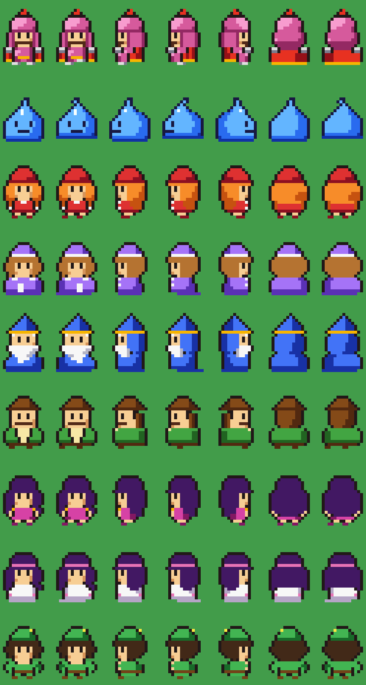
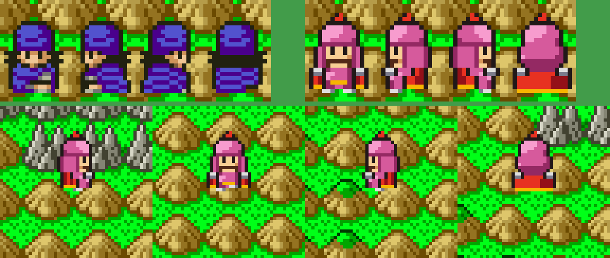
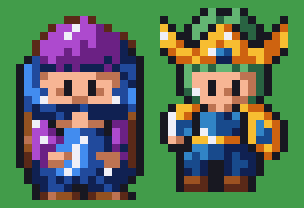

# DQ4 포팅용 인물 스프라이트 규격

SFC DQ5 필드 인물 그림을 실측해 얻은 격자 규칙과, 그 규칙으로 그린 DQ4 인물 9명의 스프라이트 규격입니다. 그린 원본은 `sfc/dq4/tools/dq4sprites.py`, 원작과 견주고 MesenCE 에 띄우는 도구는 `sfc/dq4/tools/dq4spritelab.py` 입니다. 찾아낸 과정은 [일지](../journal/2026-10-25-18-sprites2.md)에 있습니다.

## DQ5 필드 인물의 실측

필드 세이브스테이트에서 주인공을 네 방향으로 걷게 하고 멈춘 순간의 VRAM·OAM·CGRAM 을 덤프해(`sfc/dq4/tools/lua/dq4objdump.lua`), OAM 슬롯 0~7 의 8×8 OBJ 를 16×24 상자로 되돌렸습니다(`sfc/dq4/tools/dq4spritelab.py hero`). OAM 은 **낮은 슬롯이 위에** 그려지므로 슬롯을 역순으로 겹쳐야 얼굴이 나옵니다(슬롯 2·3 이 같은 자리에 겹쳐 있고 2 가 얼굴, 3 이 몸).

| 항목 | 실측값 |
| --- | --- |
| 상자 | 16×24, OBJ 8×8 여섯 개(머리 2·몸 2·다리 2). 필드에서는 상자 왼쪽 위가 화면 (120,103) |
| 실제 크기 | 폭 14(1~14열), 높이 17(5~21행). 위 5줄·아래 2줄은 비움 |
| 색 | 투명 빼고 8색. 윤곽·머리카락·눈이 모두 같은 어두운 한 색(RGB555 `(4,4,2)`) |
| 머리 | 터번 7줄(5~11행, 폭 10), 얼굴 4줄(12~15행). 머리가 전체 높이의 65% |
| 눈 | 1×2 픽셀 두 개, 6열과 9열(얼굴 폭 6 의 2·5번째 칸). 흰자 없음 |
| 측면 눈 | 5열에 1×2 하나. 얼굴은 4~6열 세 칸만 보임 |
| 몸 | 6줄(16~21행). 맨 아랫줄에는 윤곽선이 없어 땅에 붙어 보임 |
| 보행 | 방향당 **2프레임**. 머리는 고정이고 몸(16~21행)만 바뀜. 정지 자세는 둘 중 하나 |
| 명암 | 재질마다 2톤(터번 보라 2색, 살 2색, 손 회색 2색). 빛은 왼쪽 위에서 |

정면·보행 두 자세의 색 번호 행렬(`.` 투명, 글자는 OBJ 팔레트 0 의 색 번호):

```
정지(남)           보행(남)
.....111111.....   .....111111.....
....1BBBBAA1....   ....1BBBBAA1....
...1BBBBBBAA1...   ...1BBBBBBAA1...
...1ABBBBAAA1...   ...1ABBBBAAA1...
...1BBAAABBA1...   ...1BBAAABBA1...
...1ABBBBBAA1...   ...1ABBBBBAA1...
...1AAAAAAAA1...   ...1AAAAAAAA1...
.11114133131111.   .11114133131111.
..113414413311..   ..113414413311..
.11113444331111.   .11113444331111.
..11B113211B11..   ..11B113211B11..
..1BBBBAABAAB1..   ..1ABBBAAAABB1..
..1ABBBBBA55A1..   ..1BAAAAA55AA1..
..1BAAAAA566A1..   ..1BBBA5566AB1..
..1BBBA11111A1..   ..1AAA11111AA1..
..1ABA553443A1..   ..1BA343555AB1..
...AAAAA5665A...   ...A5665AAAAA...
```

## 스프라이트 규격

| 항목 | 값 |
| --- | --- |
| 프레임 | 16×24, 색 번호 0 투명, 인물마다 15색 이하 |
| 시트 | 48×96. 행은 남·서·동·북, 열은 정지·보행·정지. 동쪽은 서쪽의 좌우 반전 |
| 실제 크기 | 폭 14 이하, 높이 17~19(투구·모자가 있으면 3~4행부터). 맨 아랫줄 윤곽 없음 |
| 공통 색 번호 | 1 윤곽·눈, 2 살, 3 살 그늘. 나머지는 인물마다 다름 |
| 얼굴 | 정면 얼굴 5~10열, 눈은 6·9열에 1×2. 측면 얼굴 4~6열, 눈은 5열 |
| 보행 | 머리(0~15행) 고정, 몸(16~23행)만 바뀜. 손으로 안 그린 인물은 `_step` 이 몸 명암을 좌우로 뒤집고 발 줄을 옮김 |

인물과 복장(DS DQ4 그림을 보고 정했고, 작은 도트의 표현은 DQ5 실측을 따릅니다):

| 이름 | 장 | 색 수 | 특징 |
| --- | --- | --- | --- |
| `ragnar` | 1 | 12 | 분홍 투구·갑옷, 붉은 깃, 콧수염, 은 어깨, 금 벨트, 붉은 망토, 회색 장화. 보행 자세를 세 방향 모두 손으로 그림 |
| `healie` | 1 | 5 | 파란 슬라임. 눈 1×2, 입 한 줄. 보행은 꼭지가 반대로 휘고 바닥이 넓어짐 |
| `alena` | 2 | 8 | 붉은 모자·옷, 주황 긴 머리, 흰 장갑, 맨다리에 붉은 장화 |
| `kiryl` | 2 | 7 | 보라 사제복과 모자, 흰 띠, 갈색 머리 |
| `brey` | 2 | 8 | 파란 고깔모자(2행부터)와 옷, 금 테, 흰 수염 |
| `torneko` | 3 | 9 | 갈색 모자, 크림 셔츠에 초록 조끼, 콧수염, 넓은 몸 |
| `mara` | 4 | 7 | 긴 검보라 머리, 자홍 드레스, 금 장식, 맨팔·맨다리 |
| `nara` | 4 | 7 | 긴 검보라 머리에 분홍 띠, 흰 옷 |
| `hero` | 5 | 8 | 초록 모자(깃털)·옷, 갈색 허리띠·장화 |



## 원작과 견주기와 MesenCE 표시

```sh
export MESENCE=/path/to/MesenCE
mkdir -p work/dq4-sprites/dump work/dq4-sprites/play
STATE=$PWD/work/state/field-free.mss OUT=$PWD/work/dq4-sprites/dump \
  "$MESENCE" --testrunner "$PWD/rom/dq5.sfc" "$PWD/sfc/dq4/tools/lua/dq4objdump.lua"
uv run --locked python sfc/dq4/tools/dq4spritelab.py hero             # work/dq4-sprites/dq5-hero.png
uv run --locked python sfc/dq4/tools/dq4spritelab.py compare ragnar   # compare-ragnar.png (8배)
uv run --locked python sfc/dq4/tools/dq4spritelab.py data ragnar      # ragnar.lua
DATA=$PWD/work/dq4-sprites/ragnar.lua STATE=$PWD/work/dq4-sprites/play/start.mss \
  OUT=$PWD/work/dq4-sprites/play TEST=1 \
  "$MESENCE" --testrunner "$PWD/rom/dq5.sfc" "$PWD/sfc/dq4/tools/lua/dq4sprite.lua"
```

`dq4sprite.lua` 는 필드 `01/00` 에서 주인공의 원래 머리 타일 쌍(`000`·`001`)이 OAM 슬롯 0·1 에 있을 때만, 프레임마다 VRAM `D000`~`D0BF`(OBJ 타일 `80`~`85`)·OAM 0~5·OBJ 팔레트 3 을 덮어씁니다. 방향은 WRAM `7E:31E0` 의 위 4비트(`40` 남, `20` 서, `10` 동, `80` 북), 자세는 좌표 변화로 정합니다. 걷는 동안 전투가 나지 않게 런타임 롬의 파일 오프셋 `11EA44` 부터 8바이트를 0 으로 씁니다. `TEST` 를 빼고 MesenCE 를 GUI 로 열면 패드로 직접 걷습니다. `start.mss` 는 메뉴를 닫은 필드 세이브스테이트이며 커밋하지 않습니다.



이 표시는 Lua 가 PPU 메모리를 바꾸는 실험이지 롬에 넣은 것이 아닙니다. DQ5 인물 압축·포인터·배치는 이후 [DQ5 그래픽 형식](../../dq5/docs/dq5-graphics-format.md#필드-인물-스프라이트-1fcf1e)에서 풀었습니다. 영구 삽입은 [롬 에셋 문서](dq4-rom-assets-format.md)에서 별도로 다룹니다.

## 정면 시안

체형이 큰 인물은 DQ5 주인공 실측(폭 14·17줄)이 아니라 DQ5 뚱뚱한 NPC·DQ6 엔진 인물처럼 상자 16×24 를 끝까지 씁니다. 원본은 `sfc/dq4/tools/dq4spritedrafts.py` 이고, 정면 정지 한 장씩만 있습니다. 1차 시안이며 채택 확인 전입니다. 그린 과정은 [72번 일지](../journal/2026-10-25-72-sprite-drafts.md)에 있습니다.

| 이름 | 크기 | 색 수 | 특징 |
| --- | --- | --- | --- |
| `torneko` | 16×23(1~23행) | 11 | 꼭지 달린 보라 모자, 파란 머리, 가로로 굵은 콧수염, 보라 소매, 흰 주름 진 파란 앞치마, 배 앞에 모은 손, 양옆 등짐 |
| `hero` | 16×23(0~22행) | 13 | 금 날개 투구(0·15열까지), 초록 머리, 청록 옷, 금 어깨 장식·허리띠·방패 |

그리는 규칙:

- 검정(1)은 실루엣 바깥과 눈에만 씁니다. 모자 테두리·발밑은 짙은 갈색(4), 파란 옷 경계·머리카락·콧수염은 가장 어두운 파랑(7) 입니다.
- 재질마다 명암 3단, 빛은 왼쪽 위입니다. 어두운 쪽을 넓게 두고 흰 하이라이트는 한두 점만 둡니다.
- 맨 아래 줄은 장화·발밑으로 채웁니다(DQ5 주인공처럼 비우지 않습니다).
- `dq4spritecheck.py` 의 평평함 지표(같은 색 4칸 이상 연속, 평균 연속 길이, 좌우 비대칭, 색 경계 밀도)를 잘 그린 참고 그림과 견줍니다. 지표는 방향만 알려 주므로, 얼굴처럼 큰 면이 필요한 곳은 수치를 양보합니다.



## NDS 시트에서 줄인 서장·1장 인물 (`dq4people.py`)

서장·1장 인물은 NDS 인물 시트를 줄여 넣습니다. 손으로 그리지 않고, 자원 저장소의 NDS 시트(`nds/dq4/chr/field/hNNN.png`, [NDS 그래픽 형식](../../../nds/dq4/docs/graphics-format.md))에서 빌드할 때 만듭니다. 저장소에는 시트를 두지 않습니다.

```sh
python sfc/dq4/tools/dq4people.py --base work/ch1/dq4-ch1-sound.sfc --assets "$DQ4_ASSETS" --out work/ch1/dq4-ch1-full.sfc
python sfc/dq4/tools/dq4people.py --plan --assets "$DQ4_ASSETS"     # 인물마다 세트·타일·팔레트 줄
```

`dq4build.py` 는 곡 묶음을 얹은 롬 위에 이 단계를 붙여 `dq4-ch1-full.sfc` 로 끝냅니다. 자원 저장소에 인물 시트가 없으면 곡 롬에서 끝냅니다.

### NDS 시트 고르기

NDS 맵 스크립트의 오브젝트 모습 번호(`+04`, [스크립트 형식](../../../nds/dq4/docs/script-format.md#오브젝트))가 시트 번호이고, 그 오브젝트 대사의 화자 이름이 역할입니다. 서장·1장 맵(`caf*` 바트랜드 성, `ma*` 이무르, `ml*` 서장 마을, `ta*` 탑, `dab1` 동굴)의 서장·1장 그룹에서 모았습니다(`ndsscript.py dump`).

| 화자 | 시트 | 화자 | 시트 | 화자 | 시트 |
| --- | --- | --- | --- | --- | --- |
| 男 | `h000` | 女 | `h001` | おじさん | `h002` |
| おばさん | `h003` | 老人 | `h005` | 男子供 | `h007` |
| 商人 | `h009` | 旅の商人 | `h010` | あらくれ | `h011` |
| 兵士 | `h015` | 衛兵 | `h017` | 戦士 | `h018` |
| 剣士 | `h019` | シスター | `h022` | 農夫 | `h030` |
| 詩人 | `h031` | 学者 | `h033` | 大臣 | `h034` |
| 王 | `h036` | 貴婦人 | `h038` | 長老 | `h039` |
| シンシア | `h143` | ピサロの手先 | `h153` | カエル | `h174` |

1장 인물의 DQ5 그림 번호(`dq4npcport.PICTURES`, `dq4chapter1`, `dq4prologue`)마다 역할이 같은 시트를 붙였습니다. 표는 `dq4people.PEOPLE` 입니다. 신부 `h021`·개 `h044`·하녀 `h029`·호이민 `h130` 은 화자 이름이 없어 생김새로 골랐습니다.

### 줄이는 규칙

- **프레임**: 8방향 시트(128×256)는 줄 0 뒤·2 오른쪽 보기·4 앞·6 왼쪽 보기, 4방향 시트(128×128)는 0 뒤·1 오른쪽 보기·2 앞·3 왼쪽 보기입니다. 사람 4방향 시트 6장(`h000`·`h001`·`h002`·`h019`·`h036`·`h143`)의 줄 1·3 첫 프레임 윗절반에서 살색 점의 가로 평균은 줄 1 이 상자 가운데보다 오른쪽(+0.3~+2.0), 줄 3 이 왼쪽(−1.3~−3.0)이었습니다. 둘을 바꿔 넣으면 옆으로 걸을 때 뒷걸음질합니다. 8방향 시트는 롬에서 `h101` 을 좌우로 걸려 본 화면이 걷는 쪽을 보았습니다. 사람은 첫 프레임만 씁니다. `h101` 앞 줄에서 둘째 프레임은 16~24행(팔·몸통)만, 셋째는 4~24행만 첫째와 다르고 다리 행은 같아 걸음이 아닙니다. 몬스터·동물(호이민·개구리·개·피사로의 부하)은 첫 두 프레임이 그대로 걸음입니다.
- **크기**: DQ5 성인 NPC(세트 `00`)의 불투명 상자는 네 방향 모두 16×22이고 발이 21행입니다. 모든 인물을 같은 배율(NDS 28줄 → 22줄)로 줄여 발을 21행에 두므로 아이·몬스터는 그만큼 작습니다. 폭이 16을 넘으면 양끝을 잘라 냅니다. 24줄은 병사보다 커 보였고, DQ5 주인공 실측(17~19줄)은 병사 옆에서 작았습니다.
- **색**: 칸마다 BOX 평균에 가장 가까운 NDS 색을 고르되, 칸에 겹치는 NDS 점 가운데 Lab 밝기 15 아래(눈·외곽선)가 3분의 1 이상이면 그 어두운 색을 남깁니다. 평균만 내면 1~2픽셀 눈과 외곽선이 피부색에 섞여 사라졌고, 기준을 밝기 30·4분의 1 로 늦추면 얼굴 그늘까지 검어졌습니다. 눈은 따로 다시 찍습니다. NDS 눈은 흰자 1칸 옆의 눈동자 1×2(Lab 밝기 28 아래, 아래 칸이 밝음)라, 앞모습은 같은 높이에서 2~5칸 떨어진 짝, 옆모습은 흰자가 가장 많이 붙은 하나를 고르고, 줄인 그림의 그 자리 둘레에 번진 어두운 점·흰자를 살색으로 지운 뒤 그림에서 가장 어두운 색으로 1×2 점을 찍습니다(DQ5 실측 눈 1×2). 사람 28명 가운데 20명은 앞·옆 모두 찾았고, 못 찾은 방향은 위의 축소 결과를 그대로 둡니다. 개구리는 풀·나뭇잎과 같은 초록이라 실루엣 가장자리 픽셀을 그림에서 가장 어두운 색으로 칠합니다(크기는 그대로).
- **걸음**: DQ5 어린 주인공(세트 `82`)은 걸음 두 장이 16~21행만 다르고, 병사(세트 `00`) 옆 걸음은 몸통을 두고 발 줄만 앞뒤로 옮깁니다. 사람은 앞·뒤에서 1장째 오른발, 2장째 왼발을 1칸 들고, 옆은 발 3행을 1장째 보는 쪽, 2장째 반대쪽으로 1칸 옮깁니다.

### 세트와 타일 한도

`dq5spritewrite` 는 그림 번호의 원래 세트 타일 수를 넘지 못하게 합니다(인물마다 OBJ VRAM 을 그만큼 잡음, `1F:CF1E`).

- **장 주인공**: 새 세트 `70`(천공의 용사)·`71`(라이언). 주인공은 `1F:CF14` 가 늘 48타일을 잡습니다.
- **1장 인물**: 그림 번호의 원래 세트를 그 자리에서 바꿉니다. 세트 `80` 이상은 8타일 배치(머리 16×16 + 몸 16×16, 몸은 프레임의 8~23행)입니다.
- **서장에서만 다른 인물과 원래 세트가 모자란 주요 인물**: DQ4 가 쓰지 않는 그림 번호의 세트를 그 자리에서 바꿔 씁니다. 새 세트 레코드 자리(`1F:FE30`~, 8개)와 늘린 뱅크를 아끼려는 것입니다.

| 인물 | 그림 | 고르는 맵 그룹 | 쓰는 세트(빌려 온 그림) |
| --- | --- | --- | --- |
| 천공의 용사 | `2B`·`2E` | `3C` | 새 `70` |
| 라이언 | `2B`·`2E` | 그 밖 | 새 `71` |
| 검사·어머니·아버지·장로 | `08`·`17`·`09`·`1F` | `3C` | `63`(`90`)·`09`(`39`)·`22`(`8D`)·`2D`(`9C`) |
| 호이민·왕·귀부인·피사로의 부하 | `5B`·`14`·`04`·`9B` | 어디나 | `20`(`58`)·`04`(`18`)·`3C`(`72`)·`39`(`6F`) |

한도를 넘는 일반 NPC 는 차례로 품질을 낮춥니다: 왼쪽 보기를 오른쪽의 좌우 반전으로(칸의 반전 비트로 타일을 나눠 씀) → 위 걸음 멈춤 → 앞 걸음 멈춤 → 모든 걸음 멈춤. 주요 인물은 낮추지 않습니다(피사로의 부하만 46타일이라 옆 반전). 1장 롬에서 반전한 NPC 는 14명, 걸음을 멈춘 NPC 는 4명(여행 상인·개·하녀·시인)입니다. 바꾼 세트가 원래보다 작은 인물이 많아, 인물이 가장 많은 왕좌의 방(슬롯 29개)에서도 다음 OBJ 타일 `$1995` 가 `1B3`(512 중 77 남음)이었습니다(바꾸기 전).

원래 자리에 들어가지 않는 압축 자료(16세트, 12.6KB)는 `3E:D700`~`FBFF` 와 `3F:EB80`~`FFFF` 에 나눠 담습니다. NDS 에서 줄인 타일은 DQ5 원본보다 압축이 덜 됩니다. 두 자리는 곡 롬에서 0 인 끝 줄입니다. 앞 단계가 그 뱅크 끝을 향해 자료를 늘렸으면 쓰인 끝 다음 16바이트 경계부터 씁니다(`dq4people.tile_areas`). `3F` 의 인물 목록은 1장 끝 스크립트를 바꿀 때마다 늘어(`EACA` → `EAE2` 로 늘어 예전 고정 시작 `3F:EAE0` 을 덮어 빌드가 멈춘 일이 있음), 선언한 시작만으로는 다음에 또 겹칠 수 있습니다. 자리가 모자라면 「타일 자료 자리가 모자람」으로 멈춥니다.

### 팔레트

장 주인공·호이민은 OBJ 팔레트 한 줄씩(7·6·5)이고, 나머지는 0·1·2·4 네 줄을 나눠 씁니다. 인물마다 NDS 색(15색 이내)에서 시작해, 주요 인물부터 넣을 때 색 거리(Lab) 합이 가장 작게 늘어나는 줄에 넣고, 줄마다 가장 가까운 두 색 가운데 덜 쓴 색을 지우며 15색으로 줄입니다(주요 인물 가중 4배). 3 은 DQ5 가 맵마다 덮어써(`01:9A12`) 피합니다. 세트 → 줄은 세트 팔레트 표(`dq5objpalette`, `3D:EA00`)가 정합니다.

네 줄의 색은 맵 그룹(`36`~`45`)마다 따로 싣습니다(`dq5objpalette` 의 `new_map_palettes`, 맵 번호 `BC/FF`, 루틴·표는 `3D:EB60`). 그룹에 나오는 인물은 곡 롬의 인물 목록(대체 목록은 overrides 로 맵에 이음)에서 셉니다. 색 번호는 세트마다 하나라 모든 그룹에서 같아야 하므로, 위의 공용 15색에서 시작해 두 단계를 6번 번갈아 고칩니다: 그룹마다 칸 색 = 그 그룹에서 그 칸에 모인 NDS 색의 가중 평균(Lab), 인물 색마다 칸 = 그 인물이 나오는 그룹들의 칸 색과의 거리 합이 가장 작은 칸. 끝으로 칸 색을 그 칸에 모인 NDS 색 가운데 평균에 가장 가까운 것으로 둡니다. 1장 롬에서 인물 색 오차(Lab 거리 × 점 수, 나오는 그룹마다)의 합은 공용 4줄의 80%였습니다. 서장 마을에 들어가 CGRAM 을 읽자 OBJ 팔레트 0·2·4 가 그룹 `3C` 의 칸 색과 15칸 모두 같았습니다. DQ4 그룹이 아닌 맵(필드 등)은 칸이 가장 많이 찬 그룹의 색을 기본(`04:96D6`)으로 씁니다.

색 번호 시트(PNG)는 팔레트를 붙여 저장해야 합니다. 팔레트 없이 저장한 `P` 모드 PNG 는 다시 열었을 때 색 번호가 모두 1 로 바뀌어 인물이 한 색 덩어리로 그려졌습니다.

### 그림 번호 → 세트 훅

일행 0번의 그림 번호는 맵을 불러올 때 실내면 `02:CA5A` 가 `2B`, 그 밖에는 `05:D98F` 가 `2E` 로 둡니다. 1장 왕좌의 방에서 `7E:196F` = `2B` 였습니다. 서장과 1장은 같은 그림 번호를 다른 인물로도 씁니다(`08` 은 서장 검술 스승이자 1장 전사). 그래서 그림 번호 → 세트를 읽는 두 곳을 같은 길이의 JSL 로 바꿉니다.

| 자리 | 원래 | 부르는 곳의 폭 |
| --- | --- | --- |
| `1F:CF45` | `BF D0 86 25`(`LDA $2586D0,X`) | `1F:CF14`·`CF1E` 의 `SEP #$30` 뒤라 A·X 8비트 |
| `03:D202` | 같음 | 바로 앞 `LDX $1EC0`(위 바이트 `$1EC1` = 0)라 X 16비트일 수 있음 |

훅(`3E:FC00`)은 `PHP`·`SEP #$30` 으로 들어가 줄마다 `CPX #그림 / BNE` 와 (맵 그룹을 보는 줄은) `LDA $BC / CMP #그룹 / BNE` 를 지나면 `LDA #세트 / PLP / RTL` 로 바로 돌아갑니다. 맞는 줄이 없으면 원래 표를 읽습니다. 처음에 줄 끝마다 `BRA 끝` 을 두었더니 줄이 13개일 때 앞 줄의 분기 거리가 127바이트를 넘어, 서장 첫 맵에서 소리 대기열 루프(`2B:BED5`)만 돌며 화면이 검었습니다. 장 깃발(`CHAPTER1`)로 고르면 왕좌의 방이 깃발보다 먼저 그림을 올려 서장 주인공이 남아 맵 그룹으로 고릅니다. 맵 그룹 `3C` 는 FC `14/00`(서장 마을, 5장 첫머리도 같은 마을)입니다.

- **실측**: 1장 걷기 검사(`dq4ch1walkcheck.py`) 26구간이 모두 통과했습니다. 왕좌의 방·밤의 이무르·감옥·이무르 마을의 끝 화면에 NDS 그림 인물이 그려졌습니다. 훅은 `w65816.py` 로 돌리는 단위 검사(`test_dq4people.py`)가 실제 줄 목록 전체로 그림 번호·맵 그룹·레지스터 폭을 봅니다.

## 2장 인물

| 인물 | 그림 | NDS 시트 | 세트 | 팔레트 |
| --- | --- | --- | --- | --- |
| 아리나 | `30`, 2장 깃발이면 `2B`·`2E` 도 | `h109` | `83` | 7(2장 깃발) |
| 크리프트 | `3B` | `h112` | `1B` | 6(2장 깃발) |
| 브라이 | `2C` | `h115` | `9F` | 5(2장 깃발) |
| 공주 | `0E`(서장 밖) | `h035` | `8B` | 공용 |
| 죄수·호빗·초록 모자 상인·말 | `3D`·`45`·`1A`·`26` | `h013`·`h071`·`h009`·`h048` | 원래 세트 | 공용 |

- **시트 번호**: NDS 스크립트 오브젝트 머리 +04 의 모습 번호가 곧 시트 번호입니다. 모습 36 의 화자는 「王」 139회, 34 는 「大臣」 82회였습니다. 동료는 인물마다 시트 세 장(`h109`~`h111` 아리나 등)이고 스크립트는 첫 장만 씁니다. NDS 도 성마다 왕을 따로 그리지 않아(왕 `h036`, 대신 `h034`) 성마다 다른 왕은 두지 않습니다.
- **동료 그림**: 사람 동료의 그림은 `05:D98F` 가 사람 동료 그림 표 `05:D9D5`(인물 번호 0~11)에서 읽습니다. 크리프트(인물 `09`)는 `3B`(ヘンリー), 브라이(인물 `05`)는 `29`(サンチョ)인데 `29` 는 1장 농부도 쓰므로, 표의 `05` 칸을 DQ4 가 쓰지 않는 그림 `2C` 로 바꿉니다. 합류 전 성 안의 두 사람(`dq4ch2event.BREY_AT`·`KIRYL_AT`)도 같은 그림으로 세웁니다.
- **실내 주인공**: 2장 그림 훅(`05:D9A1`)은 바깥 갈래만 `30` 으로 바꾸고, 실내는 `02:CA5A` 가 늘 `2B` 를 둡니다. 그래서 2장 왕좌의 방의 주인공이 라이언 세트(`71`)·팔레트 6 으로 그려졌습니다(OAM 실측). 인물 훅에 깃발 줄(`LDA $7E2208 / AND #$10 / BEQ`)을 더해 2장 깃발이 켜져 있으면 `2B`·`2E` 도 아리나 세트를 싣습니다. 고친 롬에서 2장 왕좌의 방의 아리나가 앞·왼쪽·오른쪽 모두 NDS 아리나로 그려졌습니다.
- **팔레트**: 세 사람은 전용 줄 7·6·5 를 2장 깃발(`7E:2208` bit4)이 켜졌을 때만 덮습니다(`new_map_palettes` 의 flag, 2장 그룹 `3D`·`45` 와 필드 `FE/00`~`02`). 1장의 7·6·5(천공의 용사·라이언·호이민)는 그대로입니다. 2장 왕좌의 방에서 OBJ 팔레트 7 이 아리나 시트 색과 같았습니다.
- **신시아**: 그림 `0E` 는 2장 그룹에도 나와(공주), 신시아는 서장 그룹 `3C` 에서만 쓰지 않는 그림 `2D` 의 세트를 빌립니다.
- **타일 자리**: 넘치는 타일 자료(23세트 약 18KB)를 `3C:F040`~`FDFF` 와 `3D:FA80`~`FD8F`(맵 팔레트 표 뒤)에도 나눠 담습니다. 뱅크 `37`·`39`·`36:9E00`~ 는 맵 레코드 자리(`dq4chapter1.RECORDS_AT`)라 쓰지 않습니다. 큰 것부터 가장 큰 자리에만 넣으면 남은 합이 넉넉해도 막혀(남은 자리 627·652바이트에 667바이트 세트), 되돌아가며 배치를 찾습니다(`dq4people.pack`). 새 세트(`70`·`71`)의 타일은 레코드를 싣는 첫 패치에 둡니다. 다른 자리로 갔을 때 「세트 70가 없음」으로 멈췄습니다. 3·4장에만 나오는 다섯(바니걸·무희·청년·여전사·3장 상인)은 그 장 차례로 미뤘습니다.

## 남은 것

- 라이안 정면 방향만 사용자가 「훨씬 낫다」 고 확인했습니다. 나머지 8명과 측면·후면·보행은 같은 규칙으로 그린 1차 시안이라 채택 확인이 필요합니다.
- 복장 색은 DS 그림을 기억으로 옮긴 것이라 인물마다 확인이 필요합니다(특히 크리프트·주인공의 모자 모양, 미네아의 띠 색).
- `_step` 으로 만든 보행 자세는 발만 움직여 밋밋합니다. 라이안처럼 손으로 그리면 좋아집니다.
- DQ5 인물 형식과 팔레트 3의 맵별 덮어쓰기는 분석됐습니다. 포팅 인물의 고유색을 다른 인물에 영향을 주지 않고 배정하는 방식은 남아 있습니다.
- `dq4spritedrafts.py` 의 정면 시안(톨네코·주인공)을 MesenCE 필드에서 DQ5 인물 옆에 세워 보지 않았습니다. 채택되면 `dq4sprites.py` 와 합치고 측면·후면·보행을 그립니다.
- 손으로 찍는 방식은 잘 그린 SFC 인물 품질에 닿지 못했습니다. 장 주인공은 [NDS 시트를 줄이는 방식](#nds-시트에서-줄인-서장1장-인물-dq4peoplepy)으로 정했습니다.
- NDS 시트로 줄인 서장·1장 인물: 플레이하며 사용자 확인(인물 대응·옆 걸음·공용 팔레트 색), 걸음을 멈춘 NPC 4명, 2장 이후 인물, 맵마다 OBJ VRAM 을 바꾼 뒤 다시 재기, 팔레트 0·1·2·4·5 를 덮은 것이 1장의 다른 OBJ(불꽃·맵 물체 등)에 미치는지.
