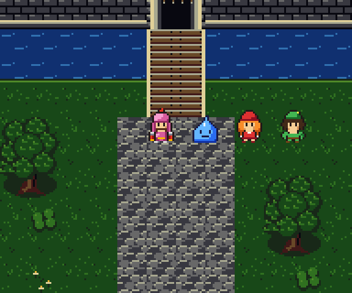
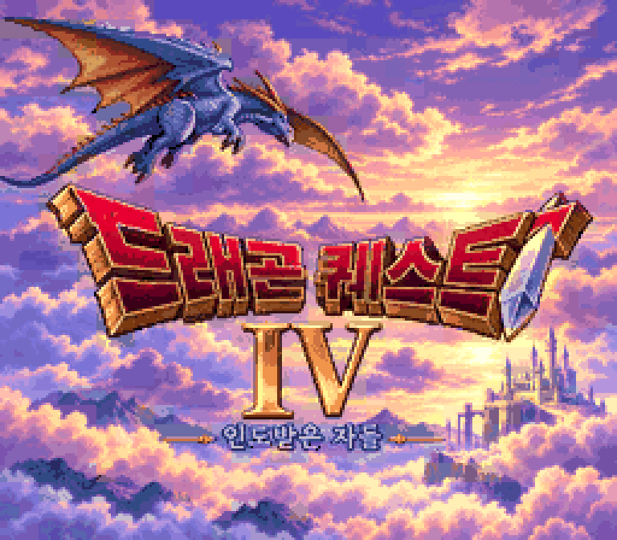

# 2026-10-25-12: 그래픽 시안 평가와 작업 인계

라이안과 호이미 슬라임의 스프라이트, 성·마을용 블록과 샘플 맵, 한글 타이틀, 모험 일러스트를 만들었습니다. 제작 원본과 출력 규격은 [DQ4 포팅용 그래픽 제작물](../docs/dq4-graphics.md)에 정리했습니다. 타이틀과 일러스트는 좋은 평가를 받았지만, 스프라이트는 최종 거절됐습니다. 이후의 실제 필드 표시 실험과 제작 방향은 [그래픽 핸드오프](../handoff.md)에 남깁니다.

## 1. 스프라이트와 블록을 코드로 그리기

FC·Nintendo DS DQ4 인물 자료와 SFC DQ5 화면을 보고 비율·윤곽·색 구분을 확인했습니다. `sfc/dq4/tools/dq4sprites.py` 에 색 번호 문자 행렬과 팔레트를 직접 작성했습니다. 두 인물은 16×24픽셀, 네 방향에 세 프레임씩입니다. `sfc/dq4/tools/dq4terrain.py` 에 성벽·돌바닥·지붕 가장자리·풀·해자 둑 등 49종 블록을 그리고 이름 격자로 성 안뜰과 마을을 배치했습니다. 벽의 높이와 성탑 윤곽, 벽돌과 불규칙한 돌바닥의 재질 차이를 표현했습니다. 이 배치는 원작 맵을 복원한 것이 아니라 블록의 연결과 인물 크기를 보는 샘플입니다.



## 2. 타이틀과 일러스트 만들기

타이틀은 사용자가 제공한 Nintendo DS DQ4 화면의 용·하늘·로고 색감을 참고해 이미지 생성 도구로 새로 구성했습니다. 부제는 「인도받은 자들」입니다. 모험 일러스트는 외부 참조 이미지 없이 생성했습니다. 생성 원본과 사용한 프롬프트는 `sfc/dq4/tools/dq4art/` 에 보관합니다. 이미지 생성 자체는 재현성이 없으므로, 저장한 원본부터 변환하는 과정을 재현 대상으로 삼았습니다.

타이틀은 256×224픽셀로 줄이고, 타일마다 8개 BG 팔레트 중 하나를 골라 최대 121색을 사용합니다. 공통 배경색을 제외하면 팔레트마다 15색입니다. 하늘과 적금색 로고의 색 구분을 살리는 대신 BG 팔레트 8개를 모두 사용하므로, 다른 화면 요소와의 배치를 정해야 합니다. 일러스트는 1536×1024픽셀 시안으로 남겨 두었으며 SFC 4bpp 변환에 포함하지 않았습니다.




## 3. SFC 타일로 내보내기

`sfc/dq4/tools/dq4graphics.py` 가 색 번호 그림을 SFC 4bpp CHR 과 BGR555 팔레트로 바꿉니다. 맵과 타이틀은 중복 타일을 합치고 BG 타일맵을 함께 출력합니다. 샘플 맵의 서로 다른 타일은 136개, 타이틀은 892개입니다. 타이틀의 BG 타일맵에는 팔레트 번호도 기록합니다.

```sh
uv run --locked python sfc/dq4/tools/dq4graphics.py --check
```

검사는 알려진 비트플레인 패턴, 타일·팔레트 왕복, BG 타일맵 재조립, 두 번 생성한 출력의 일치를 확인합니다. 세부 결과는 파일을 출력할 때 `work/dq4-graphics/verification.json` 에 기록합니다. 문서 그림은 `sfc/dq4/tools/dq4figures.py` 로 다시 만듭니다.

## 4. 실제 필드 표시와 시각적 거절

초기 픽셀 시안 이후 이미지 생성으로 만든 B3 스타일을 바탕으로 32×48 도트를 그렸습니다. 독립 SFC 롬 표시와 시안 맵 보행을 거쳐, MesenCE Lua로 DQ5 필드의 실제 OBJ 메모리를 교체했습니다. 32×48은 원작 인물보다 커서 16×24로 다시 제작했습니다. 네 방향 이동·스크롤과 원래 발 위치를 확인했지만, 작은 그림의 눈·얼굴·갑옷은 원작과 다른 느낌이라는 평가를 받았습니다. 흰 눈과 광택을 줄이고 콧수염을 고친 최종본도 채택되지 않았습니다.

로컬 실험의 마지막 시트 12프레임과 4bpp 주입 데이터를 별도로 복원해 비교한 결과는 4,608픽셀 중 차이 0입니다. 이 수치는 출력의 일치만 뜻합니다. 그림의 품질이나 사용자 채택을 증명하지 않습니다. 실험 출력과 원작 화면은 저장소에 포함하지 않습니다.

## 틀렸던 것들

- Nintendo DS 인물 시트에서 다른 갑옷 인물을 라이안으로 잘못 식별했습니다. 해당 확대 이미지를 후속 기준으로 사용하지 않습니다.
- 높은 해상도의 B3 스타일 선호를 작은 게임 스프라이트의 승인으로 취급할 수 없었습니다.
- 32×48 그림을 실제 필드에 그대로 넣어 원작 인물보다 크게 보였습니다.
- 확대 시안의 흰 눈과 복잡한 광택을 16×24로 줄이면 원작 표현이 유지될 것이라고 봤지만, 실제 화면에서는 얼굴이 튀고 DQ5의 색면과 다른 느낌이 났습니다.

## 남은 것

타이틀·일러스트는 보존하고, 스프라이트는 다른 제작 방법을 검토합니다. 맵도 최종 채택되지 않았습니다. Lua 필드 실험은 영구 롬 패치가 아니며 마을·전투·혼잡한 인물 배치까지 검증하지 않았습니다. 타이틀의 엔진 배치와 일러스트의 게임 내 사용 여부도 남았습니다. 자세한 자료와 재개 순서는 [핸드오프](../handoff.md), 후속 항목은 [남은 일](../todo.md)에 기록합니다.
