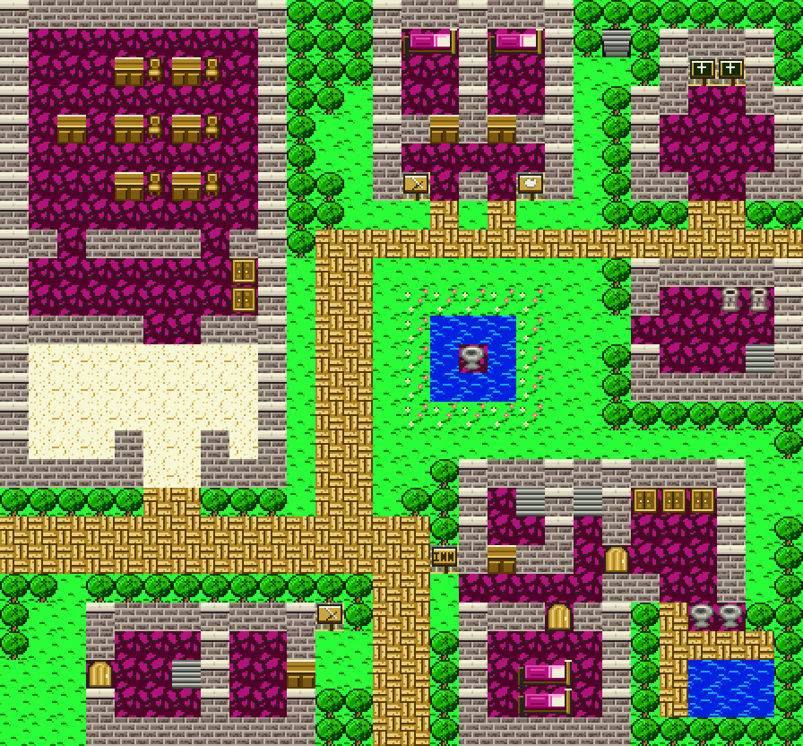
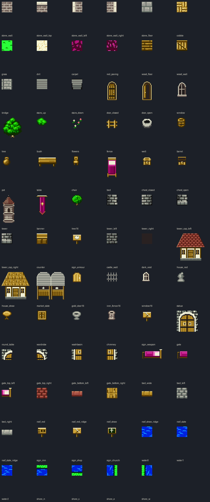

# 2026-10-27-02: 환경 타일을 드래곤 퀘스트 색으로

바트랜드와 이무르의 맵 배경·지형지물을 SFC용으로 새로 그렸습니다. 처음에는 NDS판 색감을 따랐는데 드래곤 퀘스트답지 않다는 판정을 받았습니다. 그래서 색의 역할은 FC 원작 블록에서, 색값과 도트 구조는 SFC DQ5 마을 맵에서 가져오도록 기준을 바꿨습니다. 결과는 [환경 그래픽 문서](../docs/dq4-environment-format.md)에 있습니다.



## 1. 침대와 탁자로 본 블록이 침대 한 쌍이었다

맵 대응표가 `bed_tile`·`table_tile`을 요구했는데 에셋이 없어 생성이 멈췄습니다. 바트랜드 `1C`·`1D`와 이무르 `15`·`16`이었습니다. 블록 그림만 보면 한쪽은 이불, 다른 쪽은 기둥 달린 판이라 탁자로 읽힐 만합니다. 그래서 FC 맵에서 두 블록의 이웃을 셌습니다.

```text
바트랜드 1C: 오른쪽 이웃 1D 3번 / 1D: 왼쪽 이웃 1C 3번
이무르   15: 오른쪽 이웃 16 4번 / 16: 왼쪽 이웃 15 4번
```

한 번도 따로 나오지 않습니다. 가로로 놓인 침대 하나를 두 블록으로 나눈 것이고, 머리맡이 오른쪽입니다. 32×16 가로 침대를 한 장 그려 반으로 잘라 `bed_left`·`bed_right`로 씁니다.

## 2. NDS 색감은 드래곤 퀘스트처럼 보이지 않았다

NDS 텍스처를 색감 기준으로 삼은 시안을 사용자에게 보였더니, 일반 인디 게임 색감이라는 답이 돌아왔습니다. DQ5 마을 맵과 색 통계를 견줘 봤습니다.

```text
DQ5 アルカパ     평균 채도 0.70  잔디 #00ff18 13.5%, #009c00 8.7%
DQ5 ラインハット 평균 채도 0.73  잔디 #00ff18 29.0%, 물 #0021ff
새 이무르       평균 채도 0.40  잔디 #4a8442 21.0%, 바닥 #9ca5a5 15.8%
새 바트랜드     평균 채도 0.36  물 #296b9c
```

색 수는 비슷합니다(DQ5 44~50색, 시안 60~61색). 차이는 채도와 명암 폭입니다. DQ5는 원색에 가까운 밝은 면과 거의 검은 그림자를 함께 씁니다.

팔레트 뱅크의 슬롯 순서(어두움에서 밝음)는 그대로 두었습니다. 재질별로 DQ5에서 뽑은 색 램프를 슬롯 밝기 순으로 다시 배정했습니다. 잔디는 `102900`·`005200`·`009c00`·`4abd00`·`00ff18`, 물은 `00298c`·`0021ff`·`0063ff`·`0094ff`, 돌은 `52524a`·`8c7b73`·`bdbdad`·`efefd6`입니다.

## 3. 색만 바꿔서는 모자랐다

팔레트를 바꾸자 색은 가까워졌지만 여전히 DQ로 보이지 않았습니다. DQ5 타일을 16×16 격자로 확대해 구조를 뜯어봤습니다.

- 잔디는 `00ff18` 바탕에 `009c00` 점을 성기게 찍습니다.
- 벽은 크림색 윗면 테두리 밑에 회갈색 벽돌 앞면이 있고, 벽돌마다 어두운 점 질감이 있습니다.
- 물은 파랑 바탕에 하늘색 가로 물결이 있습니다.
- 나무는 어두운 외곽선 안에 점을 섞은 둥근 수관입니다.
- 길은 황토 벽돌을 바구니 짜임으로 깝니다.
- 실내는 자주색 돌 무늬 카펫입니다.

이 구조를 따라 잔디·벽·물·물가·나무·길·카펫을 다시 그렸습니다. 돌 무늬는 16칸 둘레로 감싼 보로노이 분할로 만듭니다. 이웃 칸과 이어져서 반복해 깔아도 이음매가 보이지 않습니다.

## 4. FC 원작의 색 역할을 버리고 있었다

이무르 바깥 길이 회색 돌 모자이크로 나오자 사용자가 FC 원작을 참고했는지 물었습니다. FC 블록 시트를 다시 보니 대응 여러 개가 원작 색과 어긋나 있었습니다.

| 맵 | 블록 | FC 원작 | 바꾸기 전 | 바꾼 뒤 |
| --- | --- | --- | --- | --- |
| 바트랜드 | `05` | 붉은 자주(실내·길 공용) | 회색 판석 | 자주 돌 포장 |
| 바트랜드 | `13` | 크림 모래 | 돌길 | 크림 모래 |
| 이무르 | `04` | 붉은 자주 실내 바닥 | 회색 판석 | 자주 카펫 |
| 이무르 | `05` | 주황 벽돌 길 | 판자 바닥 | 황토 벽돌길 |
| 이무르 | `1F` | 크림 모래 | 회색 돌 | 크림 모래 |
| 이무르 | `06`~`08` | 회색 벽돌 | 목벽(NDS) | 석벽 |

가구 블록의 바탕도 원작에서는 붉은 바닥입니다. 투명 바탕을 판석 대신 그 맵의 붉은 바닥으로 채웁니다. 모래는 거의 흰 크림색으로 올렸습니다. 실내 모래와 바깥 황토 길이 같은 갈색 계열로 섞여 보였기 때문입니다. 이 조합을 사용자가 승인했습니다.



## 5. 검증

에셋 76종을 다시 생성했고 인코딩 왕복의 RGB 차이는 0이었습니다. 독립 SFC 미리보기 롬 네 개(바트랜드·이무르·재질·건축)를 MesenCE에서 120프레임 돌렸습니다. 네 화면 모두 결과가 같았습니다.

```text
pixels_compared 57344  pixel_differences 0
chr_bytes_equal True  map_bytes_equal True  palette_bytes_equal True
```

DQ5 엔진에 넣은 것은 아닙니다. 그림이 SFC 4bpp·BGR555로 손실 없이 표시된다는 확인입니다.

## 틀렸던 것들

- `1D`·`16`을 탁자로 봤습니다. 이웃 실측으로 침대 머리맡임이 나왔습니다.
- 이무르 바깥 길 `05`를 목재 바닥으로 대응했습니다. FC 원작은 주황 벽돌 길이고, NDS판은 흙길·디딤돌입니다.
- NDS 텍스처를 색감 기준으로 삼았습니다. 형태 참고에는 쓸 만하지만 DQ다운 색은 DQ5에서 나옵니다.

## 남은 것

- 바트랜드 성탑·성벽 색을 FC 원작의 어두운 회색과 견주기.
- 문·간판·가구·성탑을 DQ5 구조로 다시 그리기. 지금은 색 램프만 DQ5입니다.
- 이무르 `0D`·`14` 장식의 정확한 뜻.
- DQ5용 CHR·블록·팔레트 배정과 영구 패치, 물 애니메이션·문 열림·통행·출구·이벤트 연결.
