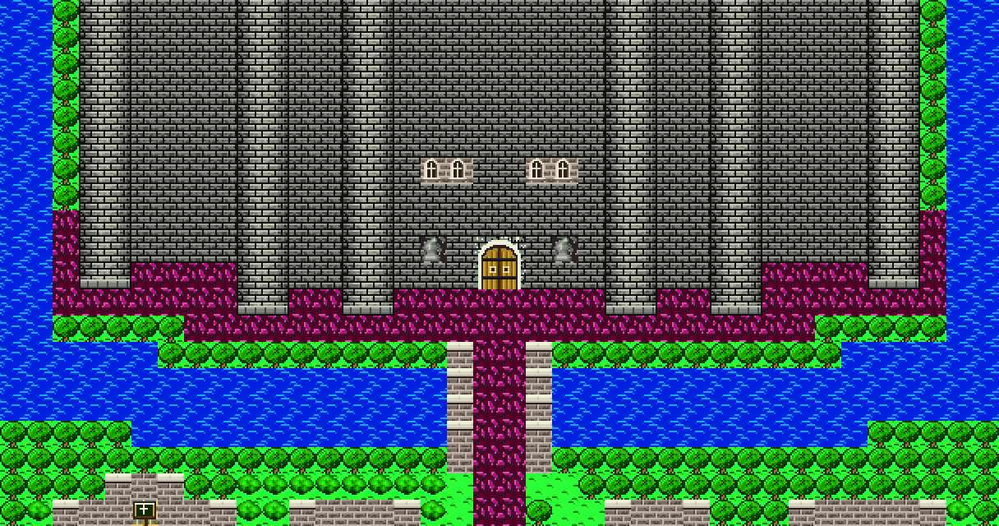

# 2026-10-27-03: 바트랜드 성을 어두운 돌로

[환경 타일](2026-10-27-02-environment.md)을 DQ5 색으로 바꾼 뒤에도 바트랜드 성은 마을 집과 같은 밝은 석벽이었습니다. FC 원작과 DQ5 라인하트 성은 둘 다 성을 마을보다 훨씬 어둡게 칠합니다. 결과는 [환경 그래픽 문서](../docs/dq4-environment-format.md#원작-배치)에 있습니다.

## 1. 성 몸체는 다른 블록이었다

바트랜드 `02/00` 의 블록 격자를 위쪽부터 찍어 봤습니다(16 이상은 `g`부터 글자로).

```text
 0 112BC8888BC88BC88888888BC88BC8888BC211
 9 115BC8888BC88BC8n8gh8n8BC88BC8888BC511
10 1159A5555BC88BC888kl888BC88BC55559A511
19 23677E77633677763055200677622267777632
```

성 몸체는 `08`이고 마을 집 벽은 `06`·`07`입니다. FC 블록 시트에서도 `08`만 검은 줄눈의 어두운 벽돌입니다. 지금까지는 `08`을 마을 벽과 같은 `stone_wall`로 그려 성과 집이 구분되지 않았습니다.

## 2. 다시 그린 것

- `castle_wall`: 검은 줄눈, 벽돌마다 밝은 윗선, 점 질감의 어두운 회색.
- 성탑 `0B`·`0C`: 두 블록이 32픽셀 원통 하나입니다. 가운데에서 가장자리로 갈수록 어둡게 칠하고 바깥 줄은 검정입니다. 아랫단 `09`·`0A`는 밝은 받침돌 띠로 끝납니다.
- 문 `0D`: DQ5처럼 검은 테를 두른 둥근 나무 문. 손잡이는 밝은 노랑입니다.
- 성문 `10`·`11`·`14`·`15`: 줄눈 있는 돌 아치 안에 쇠띠 두른 나무 문 두 짝. 한 8×8 안에 팔레트 하나만 써야 하므로 돌도 나무 팔레트의 회색 세 칸으로 칠합니다.



## 3. 검증

에셋 77종 생성, 인코딩 왕복 RGB 차이 0. 단위 테스트 7개 통과.

## 남은 것

- 창문·석상은 형태를 유지하고 색만 DQ5 램프입니다.
