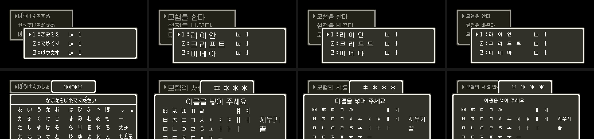

# 2026-10-27-06: 창 한글 글꼴을 원작 크기에 맞추기

메뉴·이름 입력의 한글이 원작보다 커서 「노안 패치」 같다는 의견을 받고, 글꼴 크기를 원작 화면과 나란히 놓고 다시 골랐습니다. 창 글자는 Galmuri9, 자모판은 Galmuri7, 메시지는 Galmuri11 입니다. 결과는 [메뉴 한글화 「글꼴」](../docs/dq4-menu-format.md#글꼴)에 반영합니다.



## 1. 원작 크기

원작 창 글자는 8×8 BG3 타일 하나에 가나 한 자이고, 점은 7점 남짓입니다. 메시지 글자는 11×13 칸에 높이 11~13점입니다. 그러니 메시지에 Galmuri11 을 쓴 것은 크기가 맞습니다. 창에 Galmuri11 을 쓴 것은 원작보다 한 단계 컸습니다.

## 2. 후보

같은 Galmuri v2.40.4 의 한글 크기를 BDF 로 쟀습니다.

```
Galmuri7   7×7 (8점 진행)   완성형 2,350자 모두 있음
Galmuri9   9×9 (10점 진행)
Galmuri11 11×11 (12점 진행)
```

`dq4menupatch.py build` 에 `--font`·`--jamo-font` 를 두고 세 롬을 만들었습니다. 원작 일본어 롬과 같은 입력으로 기록 목록·표시 속도·이름 입력을 찍었습니다. 게임 안 상태 창·전투 이름은 아직 구현 전이라 화면 위에 합성했습니다. 상태 창 이름 줄은 위 테두리 선 아래부터 구분선 위까지 15점(148~162)이 비어 있었습니다. 그래서 9점 글꼴도 세로로는 들어가고, 가로만 한 칸 넓히면 됩니다.

## 3. 고른 것

Galmuri7 은 원작 칸과 크기가 같지만, 받침이 뭉개져 「모험을」 의 「을」 이 「올」 처럼 보였습니다. 사용자가 원작 가나와 높이가 비슷하고 받침이 또렷한 Galmuri9 를 골랐습니다. 자모판 한 칸은 8점이라 Galmuri9 자모(ㅃ 이 9점)가 들어가지 않았고, 자모판은 Galmuri7 로 그립니다.

바꾼 롬으로 이름 조합·입력 칸 VRAM, 커서 입력 52개, 게임 안 메시지 이름 7사례를 다시 돌려 모두 통과했습니다. 메시지 글자는 그대로라 메뉴 메시지 결과도 같습니다.

## 남은 것

- 이름을 글자마다 16점 칸에 그려 「라 이 안」 처럼 벌어짐. 게임 안 창 이름을 붙여 그리는 루틴과 함께 고침
- 게임 안 상태 창·전투 이름(창 한 칸 넓힘)
