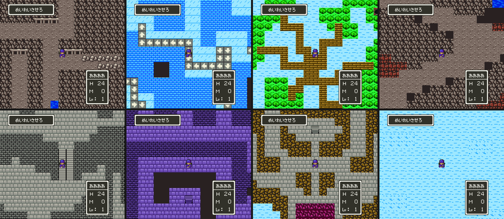

# 2026-10-27-18: 던전·탑 시트는 재질로 그리기

남은 블록 시트 33가지(동굴·광산·던전·탑·하늘·나무 속·마물 성)를 채웠습니다. 이제 FC 맵 279곳 모두 새 그림으로 비교 맵이 나옵니다. 그중 8곳을 DQ5 에 넣었습니다. 결과는 [환경 그래픽 문서](../docs/dq4-environment-format.md#던전탑-시트)에 있습니다.



## 1. 블록마다 그리면 끝나지 않는다

남은 시트의 블록을 그림(CHR 주소·팔레트 색)으로 묶었습니다.

```text
쓰이는 블록      853개
서로 다른 그림   700종 넘음
셀 수로 위 100종  79%, 위 200종 92%
```

꼬리가 깁니다. 동굴 시트는 같은 바위를 열 가지 넘는 모양으로 나눠 그리고(비탈·벼랑 모서리·그늘), 시트마다 색만 다릅니다. 블록 속성을 세어 보니 벽(`80`)이 1,071번, 바닥(`00`)이 457번 나왔습니다. 나머지는 물·계단·상자처럼 몇 가지뿐이었습니다.

## 2. 시트의 재질과 속성 기본

그래서 시트마다 벽·바닥 에셋 한 쌍을 정하고(`SHEET_STYLES`), 그림 표에 없는 블록은 속성으로 고르게 했습니다.

- 물·계단·상자·여행의 문·리프트·밀리는 바닥·문·카운터 같은 속성은 정해진 에셋.
- 세로로 느린 칸(`31`)은 돌계단, 나무 시트에서는 사다리.
- 떨어지는 칸(`05`·`0B`)은 검은 칸, 하늘 시트에서는 하늘.
- 나머지는 지나갈 수 없으면 벽, 있으면 바닥.

벽·바닥으로 두면 뜻이 사라지는 블록(석상·기둥·제단·광산 들보·구덩이 등) 135개만 표에 적었습니다. 853개 가운데 174개가 그림 표로, 679개가 재질로 그려집니다.

새 에셋은 23종입니다. 동굴 바위벽은 한 함수로 뱅크만 바꿔 이끼·흙·갈색·붉은 넷을 만듭니다. 이끼(1번 줄)는 형광 초록까지 올라가 처음 그림이 너무 밝았습니다. 어두운 절반만 쓰게 고쳤습니다.

## 3. 보라 성은 팔레트로

마물 성(시트 `28`·`30`)은 FC 에서 보라 벽돌입니다. 보라 뱅크를 새로 만들지 않고, 회색 석재 램프(3번 줄 1~7번)를 보라로 바꾼 `purple` 팔레트를 그 맵에 줍니다. 회색 성벽·판석 에셋이 그대로 보라 성이 됩니다. 처음에는 시트 `31` 에도 줬는데, `45/00` 은 FC 에서 회색 성에 보라 지붕이라 온통 보라가 되어 뺐습니다.

## 4. 나란히 놓고 고친 것

재질 기본만으로 그린 뒤 시트마다 FC 맵과 나란히 놓았습니다.

- `34/00`(광산): 벼랑의 나무 들보·바위 더미·사다리·구덩이가 모두 벽·바닥으로 사라져 있었습니다. 들보·바위 더미·구덩이·창살 바닥 에셋을 더 그렸습니다. 들보는 처음에 바위(2번 줄)와 나무(4번 줄)를 한 8×8 에 섞어 그렸습니다. 한 타일은 한 뱅크만 쓰므로 2번 줄로 다시 그렸습니다.
- `43/00`(마지막 길): FC 에서 길 둘레는 검은 허공이고 아래는 붉은 땅입니다. 벽 기본을 검은 칸으로 바꾸고 벼랑·붉은 땅만 적었습니다.
- `46/00`(天空城): 바닥 기본을 구름으로 두었더니 탑 안 바닥까지 구름이 되었습니다. 바닥은 판석으로, 구름 블록 아홉만 구름으로 적었습니다.
- `48/01`·`2D/00`: 떨어지는 칸이 하늘입니다. `2D/00` 의 붉은 성 바닥(`22/06`)도 구름이 되어 있어 적었습니다.

## 5. 넣은 맵과 자리

문 물체 자리(뱅크 01)가 거의 차서, 문이 없거나 하나뿐인 맵을 골랐습니다. 재질마다 하나씩 8곳이고, `46/00` 의 탑 성문 하나로 뱅크 01 은 304바이트 중 295바이트가 되었습니다. 레코드는 `3F:BBF8` 까지 써서 약 17KB 가 남았습니다. CHR 은 510개입니다.

## 6. 검사

46곳 모두 픽셀 차이 0, 물체 54개, 통행 차이 0, 이동, 물 순환, BG1 빈 타일 유지를 통과했습니다. 부팅 시험은 배 선실에 닿았고 네 장면 끝 상태가 원래 롬과 같았습니다.

## 틀렸던 것들

- 이끼 바위를 다른 바위와 같은 램프 자리로 그려 형광 초록이 되었습니다.
- 바닥 기본을 시트 전체에 하나로 두면, 한 시트 안의 구름과 탑 바닥이 같아집니다.
- 보라 팔레트를 시트 그림만 보고 정했습니다. 맵에서는 회색 성이었습니다.

## 남은 것

- 재질 기본으로 그린 679개 가운데 벼랑 모서리·비탈처럼 모양이 있는 블록을 따로 그리기.
- 필드 지형.
- 문이 있는 맵과 나머지 맵 삽입(뱅크 01 문 물체 자리, 레코드 자리).
