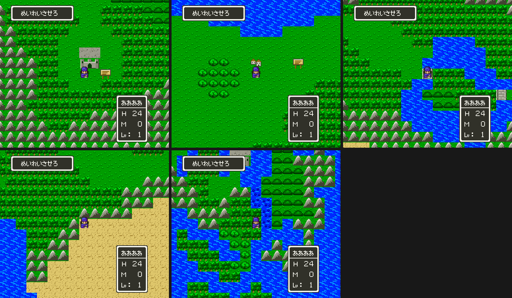

# 2026-10-30-48: 필드를 DQ4 그림으로

[39번 일지](2026-10-30-39-field-world0.md)에서 FC 필드 0 의 지형을 DQ5 세계 0 에 넣었지만, 블록은 지형이 맞는 DQ5 블록을 빌려 그림이 DQ5 그대로였습니다. 이번에는 필드 그림을 DQ4 그림(`dq4environmentmap.FIELD_ART` 의 에셋)으로 바꿨습니다. 결과는 [dq4-field-format.md 「그림」](../docs/dq4-field-format.md#그림)에 있습니다.

## 1. 덮어쓸까, 더할까

빌린 블록의 타일을 그대로 DQ4 그림으로 덮는 길과, 새 블록·새 타일을 더하는 길이 있었습니다. 빌린 블록의 타일을 롬에서 보니 풀밭 2, 언덕 8, 덤불 366, 산 9, 동굴 10, 탑 13, 팻말 21, 성 153·154 가 모두 타일 63 을 나눠 쓰고, 언덕·산·탑·성은 위층에도 타일이 있었습니다. 덮으면 한 타일에 두 그림을 넣어야 하고, 타일은 세 세계가 함께 쓰므로 세계 1·2 의 DQ5 땅도 바뀝니다.

dq5 트랙이 타일을 1,024개, 블록을 2,048개까지 늘리는 도구를 이미 만들어 두었으므로 더하는 길을 골랐습니다. FC 블록 종류마다 그림과 빌린 블록이 같은 것끼리 묶어 블록 17개(511~527)를 만들었습니다. 지형 니블은 빌린 블록의 것, 새 타일의 속성은 빌린 블록에서 같은 칸의 속성을 줍니다. 그래서 걷기·배·조우 지형이 39번 일지와 같습니다.

## 2. 색

필드 BG 의 색은 2·3번 줄 색 1~13 이 시간대로 바뀌고, 4번 줄은 물결 셋 말고는 실내 팔레트가 남은 것입니다. 팔레트를 새로 짜면 밤 벌까지 새로 만들어야 하므로, DQ5 의 낮 벌에서 가장 가까운 색을 고르고 8×8 마다 두 줄 가운데 가까운 줄을 골랐습니다. 두 줄 모두 색 2~5 가 초록 넷이라 풀이 들어간 타일은 어느 줄이든 그려집니다.

처음 그린 미리보기는 풀밭 바탕이 가장 밝은 초록 `00F818` 이었습니다. 에셋의 초록이 마을 맵에 맞춰 밝기 때문입니다. DQ5 풀밭 타일 63 은 `00A000` 바탕에 밝은 점이라, 에셋 초록 여덟 단계를 DQ5 초록 넷에 한 단계 어둡게 맞추는 표를 두었습니다. 그 뒤로는 풀밭이 DQ5 필드와 같은 밝기가 되었습니다.

게임 화면에서는 사막이 회백색이라 눈밭처럼 보였습니다. 모래 에셋의 바탕 `f7f7d6` 이 3번 줄의 옅은 회색 `D0D0C0` 에 가장 가까웠기 때문입니다. DQ5 사막 타일 12 는 2번 줄의 모래 색 9·8 을 쓰므로, 모래 에셋에서만 바탕과 점을 DQ5 모래 색으로 옮겼습니다.

밤에도 DQ5 의 벌이 그대로 바꿉니다. (328,95) 에 `$075E` = `0100` 으로 서자 2·3번 줄이 세계 0 의 벌 7 이었고 새 블록이 함께 어두워졌습니다.

## 3. 바다

바다는 블록 0 을 그대로 두고 그 타일 4·5·20·21 만 DQ4 물결로 바꾸려 했습니다. 이 네 타일은 게임이 한 픽셀씩 돌려 물을 움직이게 하므로, 물결도 함께 움직일 것으로 보았습니다. 빌드한 롬에서 VRAM 을 보니 타일 4·5·20·21 은 DQ5 의 물 그대로였습니다.

돌리는 루틴을 읽었습니다. `01:C5C8` 이 원본 포인터 `[$A5]` 를 `01:A719` 로, 대상 `$06` 을 `7E:C000` 으로 두고 `01:C746` 이 한 픽셀씩 돌린 16벌을 만듭니다. `01:A719` 에는 타일 4·5·20·21 이 압축하지 않은 채 128바이트로 있었습니다. 필드 타일 RLE 의 타일 4·5·20·21 은 VRAM 에 올라간 뒤 이 벌이 덮습니다. `dq5fieldgfxwrite.py` 는 이 128바이트를 쓰지 않으므로 바다는 DQ5 그림으로 두고 남은 것에 적었습니다. 암초는 바위만 위층에 그리고 아래층은 바다 타일이라 DQ5 의 움직이는 물 위에 DQ4 바위가 놓입니다.

## 4. 넣기

`dq4fieldport.patch` 가 패치 셋을 차례로 만듭니다. 그림(`dq5fieldgfxwrite.py --worlds-at --extra-at`), 그 롬에서 블록(`dq5fieldtables.py --blocks-at`, 타일 512 이상을 쓰는 블록은 타일 훅이 있어야 받음), 둘을 넣은 롬에서 지도(`dq5fieldwrite.py --planes-at`, 블록 511 이상은 옮긴 블록 표가 있어야 받음)입니다. 앞쪽 타일 512개는 바뀌지 않아 필드 타일 RLE 는 다시 쓰지 않습니다.

자리는 그룹 빌드와 1장 통합 롬 모두에서 빈 곳을 골랐습니다. 처음에 늘린 타일·블록·평면을 `5C`·`5D`·`5E` 에 두었더니 그룹 빌드는 되고 1장 빌드는 `5E8000: 비어 있지 않은 자리` 로 멈췄습니다. 1장 빌드 끝에 붙는 조사 코드가 `5E:8000` 을 씁니다. 메뉴 롬에서 0 인 뱅크를 다시 세어 `54`~`56` 으로 옮겼습니다. 훅·니블 표는 `01:A4A7` 이 DB 를 그 뱅크로 두고 읽으므로 `30`~`3F` 여야 해서, 처음에는 `30:F000` 에 두었습니다. 그 사이 dq5 도구가 타일 늘리기 롬의 필드 불러오기를 빠르게 고치면서 이 덩어리가 3,322바이트에서 6,344바이트로 늘어 뱅크 끝을 넘었습니다. 메뉴 롬의 `30:A8E9`~`30:FFFF` 가 비어 있어 `30:E000` 으로 옮겼습니다. 지도는 블록 번호가 바뀌어 11,912바이트로 줄었습니다(전 14,539).

## 5. 검사

`dq4fieldcheck.py` 에 그림 장면 다섯을 더했습니다. 성 아래·イムル 앞·다리·사막·암초 옆에 서서 세이브스테이트를 남기고, 그 상태에서 VRAM·CGRAM 을 덤프해 봅니다.

- 타일맵: 주인공 둘레 720칸의 두 층 워드가 만든 블록·타일·니블로 셈한 값과 모두 같았습니다. 처음에는 위층이 0칸 맞았습니다. 위층 워드는 타일 0 도 bit13(우선순위)이 켜져 있었고, 그것을 넣자 720칸이 맞았습니다.
- 타일 568개(움직이는 타일 뺌)가 같고, 바다 타일 둘씩은 롬의 그 타일을 2픽셀 돌린 것이었습니다.
- CGRAM 2·3번 줄이 세계 0 의 벌 2 였습니다.

지형 장면에서는 독늪 쪽만 한 칸에 그쳤습니다. 같은 670프레임에 `$7F` 가 바꾸기 전 롬은 168, 바꾼 롬은 171 이라, 필드를 불러오는 데 걸린 프레임이 달라 입력을 읽는 차례가 어긋난 것이었습니다. 누르기 전에 `idle:16` 으로 입력을 읽는 프레임 앞까지 기다리게 하자 두 롬 모두 두 칸을 걸었고, HP 는 24 에서 22 가 되었습니다(독늪 피해).

| 검사 | 결과 |
| --- | --- |
| `dq4groupbuild.py --out work/fg` | 성공 |
| `dq4fieldcheck.py`(그룹 롬) | 17장면 통과 |
| `dq4groupcheck.py`(그룹 롬) | 128장면 통과 |
| `dq4chapter1.py build`(메뉴 롬 위) | 성공 |
| `dq4fieldcheck.py`(1장 롬) | 17장면 통과 |
| `dq5fieldtables.py … check`(두 롬) | 블록 528개, 다른 항목 0개 |

## 남은 것

- 바다 그림(`01:A719` 를 쓰는 dq5 도구, 세계 1·2 의 바다를 남기려면 세계마다 원본을 고르는 훅).
- 물가 이음새, 성 위 돌길의 회색 네모, 잘 보이지 않는 암초 바위.
- 독늪 피해가 장비·레벨에 따라 다른지.
