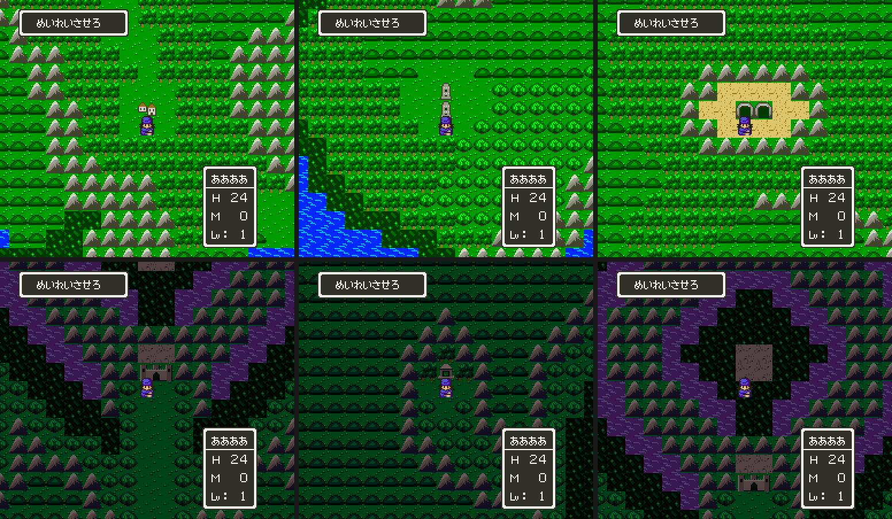

# 2026-10-30-50: FC 필드 1·3 을 DQ5 세계 1·2 에

[48번 일지](2026-10-30-48-field-gfx.md)까지 FC 필드 0 을 DQ5 세계 0 에 DQ4 그림으로 넣었습니다. 이번에는 남은 두 필드, ゴットサイド 섬(필드 1)과 闇の世界(필드 3)를 DQ5 세계 1·2 에 넣었습니다. 결과는 [dq4-field-format.md 「FC 필드 1·3」](../docs/dq4-field-format.md#fc-필드-13)에 있습니다.

## 1. 지도

두 필드 모두 세계 1·2 가 쓰는 왼쪽 위 128×128 블록 안에 들어갑니다. 세계 0 처럼 FC 블록 (x, y) 를 DQ5 블록 (x, y) 에 두고 블록은 48번 일지의 새 블록을 그대로 씁니다.

필드 3 은 폭·높이 자리가 코드 바이트(250×164)라 FC 디코더가 넓게 풉니다. 줄 데이터가 있는 범위(`dq4field.extent`)는 62×54 이고, 그 밖은 다음 줄 데이터를 읽은 값이었습니다. 데이터의 가장자리는 모두 언덕이고 필드 3 의 언덕은 막혀 있으므로, 62×54 까지만 옮기고 나머지는 바다로 두었습니다.

## 2. 필드 3 의 언덕

FC 는 필드 3 에서만 언덕의 속성을 `80`(막힘)으로 바꾸고, 그릴 때는 난수로 블록 18·19 그림을 씁니다. 블록은 세 세계가 함께 쓰므로, 필드 0 의 언덕 블록 511(걸을 수 있음)을 그대로 두면 필드 3 의 언덕이 걸어집니다. 그래서 「그림은 언덕, 빌린 블록은 산」인 블록을 하나 더 만들었습니다(528). 블록 번호는 필드 0 의 것을 먼저 매기고 필드마다 다른 것을 뒤에 붙여, 필드 0 의 511~527 은 그대로입니다. 타일 속성은 타일마다라 같은 그림이라도 속성 `82` 인 타일 넷이 새로 생겨 새 타일이 70개가 되었습니다. 블록 18·19 에 맞는 에셋은 없어 그림은 언덕 하나로 했습니다.

지형 검사로 이 언덕을 밟아 보려 했지만, 필드 3 의 언덕은 산과 바다에만 맞닿아 있어 서서 누를 칸이 없었습니다. 블록 528 의 지형 니블과 네 칸 속성이 블록 9(산)와 같은지는 단위 시험에서 봅니다.

## 3. 팔레트

세 세계는 타일과 니블을 함께 쓰고 2·3번 줄 색만 다릅니다. 세계 1·2 의 한 벌을 덤프해 보니 색 번호마다 세계 0 의 색을 바꾼 꼴이었습니다. 2번 줄 색 2~4 가 세계 0 은 초록, 세계 1 은 푸른 회색, 세계 2 는 어두운 초록입니다. 새 타일은 세계 0 의 색 번호로 골랐으므로 세계 1 에서는 눈밭, 세계 2 에서는 어두운 땅으로 그려집니다.

ゴットサイド 는 눈 섬이 아니므로 세계 1 의 한 벌을 세계 0 낮 벌의 색 1~13 으로 바꿨습니다. 색 14·15 는 게임이 덮어 쓰고 dq5 도구가 고치기를 거부하므로 세계 1 의 것을 둡니다. 闇の世界 는 DQ5 세계 2 의 어두운 벌이 어울려 그대로 두었습니다. 둘 다 미리보기(`dq4fieldgfx.py preview --field 1`·`--field 3`)로 먼저 보고 넣었습니다.

## 4. DQ5 원래 입구

세계 1·2 에서 들어가는 DQ5 입구 일곱 개가 이제 FC 땅 위에 남습니다. 세계 0 처럼 그 세계 안 오른쪽 아래 구석 (125~127, 125~127) 에 산섬을 두고, 일곱 개를 섬 가운데 칸 (253,253) 으로 옮겼습니다. 늘 들어가지 않는 `54` 는 그대로입니다.

## 5. 자리

평면은 세계마다 반 바이트 평면 한 뱅크(32KB)를 쓰므로, 세계가 셋이면 훅 뱅크 뒤로 세 뱅크가 듭니다. 처음 자리 `55:8000` 이면 `56`~`58` 인데, 그룹 빌드는 됐지만 1장 메뉴 롬의 뱅크 `58` 에 0 이 아닌 바이트가 25,331개 있었습니다. 원래 롬의 어느 뱅크와도 같지 않아 거울이 아닙니다. 메뉴 롬의 뱅크를 다시 세니 `42`~`57` 이 모두 0 이었고, 그룹 빌드의 다른 패치는 `41` 까지 씁니다. 그래서 평면을 `50:8000`(`50`~`53`)으로 옮겼습니다. 1장 빌드가 남긴 필드 패치의 쓰기를 메뉴 롬과 견주니 모두 0 이거나 원래 롬의 거울 위였습니다. 세계 1·2 의 지도 네 덩어리(4,221바이트)는 세계 0 지도 뒤에 붙어 1장 롬에서는 `34:FF05` 에서 끝납니다.

## 6. 검사

`dq4fieldcheck.py` 에 세계 1·2 장면을 더했습니다. 워프(`dq5warp.lua FIELD`)는 01/00 에서 걸어 나오므로 세계가 0 으로 돌아갑니다. `POKE=7E1949=01` 로 `$1949` 를 매 프레임 고정하자 그 세계 지도에 섰습니다. 그림 장면은 FC 입구 블록의 나오는 칸 여섯 곳에 섭니다.

세계 2 의 바다는 `01:C66B` 가 다른 꼴로 만듭니다([dq4-field-format.md 「바다」](../docs/dq4-field-format.md#바다)). 세계 2 의 그림 장면 셋에서는 롬의 바다 타일을 몇 픽셀 돌려도 VRAM 과 맞지 않아, 세계 2 에서는 바다 돌리기를 견주지 않습니다. 세계 1 은 15픽셀 돌린 것과 맞았습니다.

| 검사 | 결과 |
| --- | --- |
| `dq4groupbuild.py --out work/fw2` | 성공 |
| `dq4fieldcheck.py`(그룹 롬) | 39장면 통과(세계 0 17, 세계 1 12, 세계 2 10) |
| `dq4groupcheck.py`(그룹 롬) | 173장면 통과 |
| `dq4npccheck.py --build work/fw2` | 197장면 통과 |
| `dq4chapter1.py build`(메뉴 롬 위) | 성공 |
| `dq4fieldcheck.py`(1장 롬) | 39장면 통과 |

세계 1 장면은 48번 일지의 타일·속성 늘리기 훅이 세계 1·2 에서도 맞는지 보는 장면이기도 합니다. 두 세계 모두 늘린 타일 70개가 VRAM 에 올라 있었고 새 블록의 타일맵 워드와 걷기·막힘이 맞았습니다.

## 남은 것

- 필드 1·3 에서 들어가는 FC 그룹 옮기기와 입구 걸기. 지금 세계 1·2 로 가는 DQ5 원래 길로 나오면 나오는 칸이 FC 지도의 바다나 막힌 언덕입니다.
- 필드 3 의 결계 막이(인물 슬롯 스프라이트와 걸음 막기), 팔레트 3 돌리기.
- 세계 1·2 의 조우 구역·필드 곡·탈것 자리.
