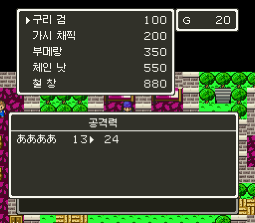

# 2026-10-31-15: 가게를 FC 값으로, てつのやり 는 빌린 자리로

옮긴 가게가 DQ5 값으로 팔고, イムル 무기점의 てつのやり 가 빠져 있었습니다. 옮긴 가게가 파는 물건의 DQ5 값을 FC 값으로 바꾸고, てつのやり 는 DQ5 たけのやり 자리를 빌려 팔게 했습니다. 명세는 [물건 값과 빌린 자리](../docs/dq4-environment-format.md#물건-값과-빌린-자리)에 있습니다.

## 1. 값이 어디에 있나

DQ5 가게 창의 값은 `21:A447` 이 물건마다 바탕(`23:B081`) × 배수(`23:B159` 아래 두 비트로 1·10·100·1000)로 셈합니다([DQ5 물건 가격](../../dq5/docs/dq5-data-format.md#물건-가격-21a447)). 가게마다 따로 매긴 값이 아니라 물건 표의 값이라, 게임 전체가 DQ4 인 이 해킹롬에서는 그 표를 FC 값으로 바꾸면 됩니다. FC 값은 가게 창이 쓰는 `dq4shop.price` 로 읽었습니다(장소별 값을 쓰는 그룹 `18`·`22`·카지노는 아직 옮기지 않음).

FC 값은 모두 1바이트 × 10 의 거듭제곱으로 나타낼 수 있었습니다. てつのやり 880 = 88 × 10, やいばのよろい 9800 = 98 × 100 입니다. 옮긴 가게의 물건 27개 가운데 한 물건을 두 곳이 다른 값으로 파는 일은 없었습니다.

## 2. てつのやり 의 자리

DQ5 에는 てつのやり 가 없습니다. 새 물건 번호를 늘리려면 물건 표 9개(216개씩)와 이름 표를 모두 옮겨야 합니다. 그래서 FC 에 같은 이름이 없는 DQ5 물건 하나를 빌렸습니다. たけのやり(`01`)는 같은 창이고, 이름이 다섯 글자로 같아 이름 표를 제자리에서 바꿀 수 있습니다(たけ `1F 18` → てつ `22 21`). 공격력은 5 → 28, 값은 50 → 880 입니다. 장비할 수 있는 인물 비트는 다른 옮긴 물건과 같이 DQ5 값(주인공 포함)으로 두었습니다.

물건 이름을 이름으로 잇는 `dq4shopport.dq5_items` 가 빌린 자리를 FC 이름으로 보므로, 상자를 옮기는 `dq4chestport` 와 인물 쪽 `dq4npcport` 도 같은 번호를 씁니다.

## 3. 한글 이름

첫 1장 롬에서 イムル 무기점 목록을 보니 철 창은 한글이었지만, いばらのムチ·ブーメラン 은 가나였습니다. adopt.tsv 에서 이 둘은 DS 가 이름을 바꾼 줄(DS せいなるナイフ, 근거 「FC:いばらのむち」)이라 DS 일본어로는 찾지 못했습니다. 근거 칸의 FC 이름으로도 찾게 하자 가시 채찍·부메랑·모닝스타가 나왔습니다.

창 글자 표는 아직 DQ5 이름이 든 롬에서 만들기 때문에, 빌린 자리 `01` 은 이름으로는 たけのやり 가 됩니다. 1장 보스 몬스터처럼 번호로 덮었습니다(`numbered_names`).

## 4. 확인

1장 롬에서 배 선실 세이브스테이트로 워프해 `dq4npccheck.py --chapter1 --maps 36/00 37/00 --no-tables` 를 돌렸습니다. 가게 장면이 목록 창의 품목과 `21:A475` 에서 읽은 값을 FC 값과 견주도록 고쳤고, 26장면이 모두 지났습니다.

```
shop-3600-6  [[02,30],[06,100],[1C,200],[07,550]]
shop-3700-15 [[06,100],[1C,200],[21,350],[07,550],[01,880]]
```

금화를 1000 으로 두고 사 보았습니다. 곤봉은 970, 가시 채찍은 800, 철 창은 120 이 되었습니다. 철 창을 고르자 목록 옆 공격력이 13 ▸ 39(선실 주인공 기본값 11 + 28)였고, 「ああああは 철 창を 装備させてもらった！」 로 메시지 이름도 한글이었습니다.



파는 값도 쟀습니다. 가진 물건 셋째 칸에 철 창을 두고 팔자 「660ゴールドで 引き取るが」 로 금화가 1660 이 되었고, 곤봉은 1022(30 × ¾ = 22.5 를 버림)였습니다. DQ5 엔진의 파는 값은 ¾ 이고 끝수를 버립니다. FC 도 ¾ 입니다.

## 틀렸던 것들

- 이름 표 주소를 `21:955D`(이름을 꺼내는 `BRK 88 2B` 의 루틴)로 두었다가, 빌드가 「orig 가 원래 롬과 다름」 으로 멈췄습니다. 표 주소는 `dq5text.STRING_TABLES`(`21:959B`)입니다.

## 남은 것

- DQ5 에 없는 나머지 FC 물건(せいぎのそろばん·てつのまえかけ·はぐれメタルよろい 등).
- 가게가 팔지 않는 물건(상자·전투에서 얻는 것)의 값과, FC 장비 표를 DQ5 인물 비트로 옮기기.
- FC 가 파는 값의 끝수를 버리는지.
- 창 글자 깨짐 검사(`dq4windowcheck.py`)는 돌리지 않았습니다. 바뀐 것은 이름 넷의 그림뿐입니다.
