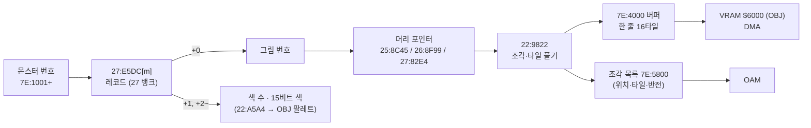
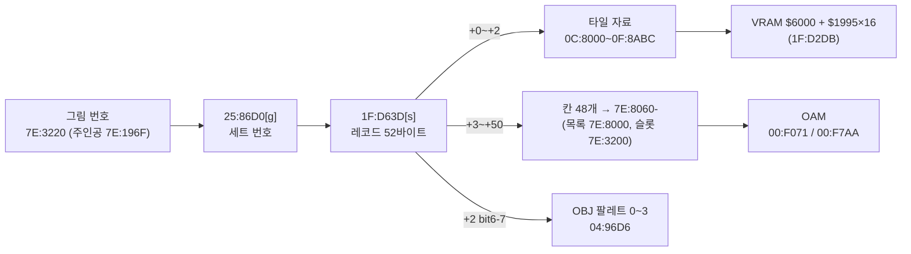

# DQ5(SFC) 전투 몬스터 그림·배경과 필드 인물 스프라이트 형식

전투 화면의 몬스터 그림과 배경, 마을·필드를 걷는 인물 스프라이트가 롬 어디에 어떤 형식으로 들어 있고, 게임이 어떻게 풀어 화면에 놓는지 정리한 문서입니다. 인물 스프라이트는 맨 아래 「[필드 인물 스프라이트](#필드-인물-스프라이트-1fcf1e)」 절에 있습니다. 찾아낸 과정은 일지에 있습니다.

- [2026-10-25-09: 전투 몬스터 그림](../journal/2026-10-25-09-mongfx.md)
- [2026-10-25-21: 전투 몬스터 배치와 그림자](../journal/2026-10-25-21-mongfx-layout.md)
- [2026-10-25-22: 전투 배경](../journal/2026-10-25-22-battlebg.md)
- [2026-10-25-28: 그래픽 내보내기와 갤러리](../journal/2026-10-25-28-gfx.md)
- [2026-10-25-31: 그림자 칠하기와 전투 배경의 남은 것](../journal/2026-10-25-31-battlebg2.md)
- [2026-10-25-32: 필드 인물 스프라이트](../journal/2026-10-25-32-sprite.md)
- [2026-10-25-65: 누운 인물, 동료 그림 번호, 세트 124개 확인](../journal/2026-10-25-65-sprite2.md)
- [2026-10-25-73: 탈것 그림과 맵 OBJ 팔레트 표](../journal/2026-10-25-73-vehicle.md)
- [2026-10-25-79: 남은 인물 세트, 주인공 그림 플래그, 탈것 한 장, 역할 이름](../journal/2026-10-25-79-sprite3.md)
- [2026-10-25-91: 맵 OBJ 물체 배치와 마지막 인물 세트](../journal/2026-10-25-91-sprite4.md)
- [2026-10-25-97: 인물 스프라이트 마무리](../journal/2026-10-25-97-sprite5.md)
- [2026-10-25-36: 창 타일과 움직이는 타일](../journal/2026-10-25-36-gfx2.md)
- [2026-10-25-37: 그림자 지우기, 남은 지형, 세계 1·2 지형, 물결 색 HDMA](../journal/2026-10-25-37-battlebg3.md)
- [2026-10-25-51: E9 는 「なかまを よんだ」, 물결 HDMA, 1A 의 덜 맞은 줄](../journal/2026-10-25-51-battlegfx4.md)
- [2026-10-25-58: 실내 맵의 움직이는 타일](../journal/2026-10-25-58-anim.md)
- [2026-10-25-67: BC 50 이상 맵의 움직이는 타일과 바다 위 배경 번호](../journal/2026-10-25-67-anim2.md)
- [2026-10-25-82: 전투 메시지의 남은 코드와 바다 배경](../journal/2026-10-25-82-battletext2.md)
- [2026-10-25-87: 바다 전투](../journal/2026-10-25-87-seabattle.md)

기준과 검증:

- 기준 롬: `rom/dq5.sfc`([README](../../../README.md) 의 SHA-1). 주소 표기는 [dq5-map-format.md](dq5-map-format.md) 와 같습니다.
- 디코더: [sfc/dq5/tools/dq5mongfx.py](../tools/dq5mongfx.py). 몬스터 236마리가 그림 번호 107개를 쓰고, 그 머리는 104곳입니다. 머리를 주소 순으로 놓으면 그림마다 다음 머리의 첫 바이트에서 정확히 끝납니다(예외는 아래 「그림 머리 포인터」와 「남은 것」).
- 이벤트 전투(슬라임 셋)의 몬스터 번호(`7E:1001`)를 그림마다 대표 몬스터 하나로 바꿔 107번 전투를 붙였습니다.
  게임이 그림을 다 푼 직후(`22:90DC`)의 WRAM 버퍼 `7E:4000-5FFF` 에 디코더가 푼 타일이 모두 있었고(타일 3,623/3,623), 화면과도 픽셀째로 맞았습니다(아래 「검증」).


## 한눈에 보기



## 몬스터 레코드 (`27:E5DC`)

`27:E5DC` 는 몬스터 236마리의 16비트 포인터 표(27 뱅크 안)입니다. 가리키는 레코드는 이렇습니다(`22:8FF8`, `22:A5A4`).

| 오프셋 | 뜻 |
| --- | --- |
| +0 | 그림 번호(`00`~`71` 중 107개가 쓰임. `2D`·`35`·`37`·`38`·`57`·`5F`·`66` 은 아무도 안 씀) |
| +1 | 색 수 n |
| +2 ~ | 15비트 BGR 색 n개. OBJ 팔레트의 1번 색부터 채움(0번은 투명) |

같은 그림을 색만 바꿔 여러 몬스터가 나눠 씁니다(예: 그림 `15` 를 몬스터 `60`·`7A` 가 다른 색으로). `22:A5A4` 는 `22:AB23` 표(`$0DD8` 번째)가 가리키는 `7E` 뱅크 자리에 색 수 + 1 과 색들을 적습니다(코드 읽기).
CGRAM 사본 `7E:2D00` 512바이트가 그림 버퍼 DMA 다음 프레임에 `00:FDE3` 에서 CGRAM 으로 DMA 됩니다(이벤트 전투에서 890프레임). 레코드 색으로 칠한 디코더 그림이 화면 픽셀과 RGB 까지 맞으므로 색 순서(1번 색부터)는 실측으로 확인했습니다.

## 그림 머리 포인터

그림 번호 g 의 머리는 뱅크마다 다른 16비트 포인터 표에 있습니다(`22:9014`). 머리와 자료는 표와 같은 뱅크에 있습니다.

| 그림 번호 | 표 | 머리 범위 |
| --- | --- | --- |
| `00`~`29` | `25:8C45 + g*2` | `25:8C99`~`25:F9F4` |
| `2A`~`56` | `26:8F99 + (g-2A)*2` | `26:8FF3`~`26:FFCB` |
| `57`~`71` | `27:82E4 + (g-57)*2` | `27:831A`~`27:E5DC` |

뱅크의 마지막 그림은 `28`(`25:F9F4` 에서 끝나고 바로 코드 `08 E2 30` 이 이어짐), `56`(`26:FFCB` 에서 끝나고 뒤는 `00` 채움), `71`(몬스터 레코드 포인터 표 `27:E5DC` 바로 앞)입니다.
여러 번호가 같은 머리를 가리킵니다: `00`·`11`·`29`(`25:8C99`), `2A`·`2D`·`35`·`37`·`38`(`26:8FF3`), `57`·`58`·`5E`·`5F`·`66`(`27:831A`). 안 쓰는 번호는 모두 뱅크 첫 그림을 가리킵니다.

## 그림 형식 (`22:9822`)

그림은 8픽셀 칸으로 된 상자 안에 OBJ 조각(8x8 또는 16x16)을 늘어놓은 것입니다.

| 오프셋 | 뜻 |
| --- | --- |
| +0 | bit7 = 띄움(공중에 뜬 몬스터, 위쪽 줄에 놓음), bit5-6 = 8픽셀 단위로 들어 올림, bit0-4 = 그림자 모양 번호(0 이면 그림자 없음). 아래 「배치와 그림자」 |
| +1 · +2 | 그림자 위치 보정(부호 있는 바이트, x · y) |
| +3 · +4 | 타격 효과 기준점(그림 상자 안 8픽셀 칸 x · y) |
| +5 | 상위 니블 + 1 = 가로 칸 수(니블이 `F` 면 19), 하위 니블 + 1 = 세로 칸 수 |
| +6 ~ | 칸 비트맵: 가로 × 세로 비트, 가로 우선·바이트의 MSB 먼저. 1 인 칸마다 조각 하나 |
| 그다음 | 조각마다 니블 하나(바이트의 상위 니블 먼저), ⌈조각 수 / 2⌉ 바이트 |
| 그다음 | 조각 자료를 칸 순서대로 |

조각 니블:

| 비트 | 뜻 |
| --- | --- |
| bit1 | 1 이면 16x16 조각(타일 4개를 왼쪽 위·오른쪽 위·왼쪽 아래·오른쪽 아래 순서로), 0 이면 8x8(타일 1개) |
| bit2·bit3 | 둘 다 0 이면 새 타일을 푼다. 하나라도 1 이면 자료 1바이트 = 이 그림의 앞 조각 번호(0부터)이고, 그 조각의 타일을 좌우 반전해 이 칸에 다시 쓴다(`22:9E95`, OAM 속성 `EOR #$4000`). 이때 bit2 가 0 이면 1픽셀 왼쪽에 둔다 |

서로 다른 머리 104곳에서 쓰이는 니블은 `0`(716), `2`(704), `4`(17), `6`(33), `8`(34), `A`(58) 뿐입니다.

### 타일 (`22:992A`)

타일 하나(4bpp 8x8, 32바이트)는 모드 바이트 M 으로 시작합니다. 앞 16바이트(평면 0·1)와 뒤 16바이트(평면 2·3)를 따로 처리하고, 평면마다 8바이트(줄마다 1바이트)입니다.

| M 비트 | 뜻 |
| --- | --- |
| bit0~3 | 평면 0~3 이 있는지. 없는 평면은 0 |
| bit6 | (bit7 일 때) 1 이면 M 다음 바이트가 채움 값, 0 이면 채움 값 0 |
| bit7 | 0 이면 있는 평면의 바이트를 그대로 읽는다(`22:99B7`·`9A15`·`9A75`). 1 이면 마스크 압축(`22:9AEB`·`9BA5`·`9C5F`) |

마스크 압축이면 (채움 값 다음에) 있는 평면 수만큼의 마스크 바이트가 오고, 그 뒤가 자료입니다. 바이트를 줄 순서대로(평면 0·1 은 줄마다 평면 0, 평면 1 번갈아) 채우며 마스크 비트(MSB 먼저)가 1 이면 자료에서 1바이트를 읽고, 0 이면 채움 값을 씁니다.
마스크 바이트 하나가 평면 하나(8바이트)를 맡습니다. bit4·bit5 는 롬 전체에서 쓰이지 않습니다.

예: 슬라임(그림 `02`, 머리 `25:9177`)은 `06 FC 0B 01 01 11 | 80 | 20 | 87 2A FF 0B 01 …` 입니다. 2×2 칸, 비트맵 `80` 이라 조각은 (0,0) 하나, 니블 `2` 라 16x16 입니다.
첫 타일 `20` 은 평면이 하나도 없어 투명이고, 둘째 타일 `87` 은 마스크 압축·평면 4개, 마스크 `2A FF 0B 01` 입니다.

### 버퍼와 OBJ

게임은 타일을 `7E:4000` 버퍼(한 줄 16타일 = `$200` 바이트)에 16x16 단위로 쌓고, 조각마다 화면 위치(칸 × 8)와 OBJ 타일 번호·반전을 `7E:5800` 목록에 적습니다(`22:9DB0`, `22:9E1C`, 코드 읽기).
8x8 조각은 16x16 자리 하나에 넷까지 모아 넣습니다(`22:9E81` 표 `00 01 10 11`). 버퍼는 VRAM 워드 주소 `$6000`(OBJ 이름 기준) 이후로 DMA 됩니다(이벤트 전투에서 889프레임, `00:FD6D` 가 `7E:4000`→`$6000`, `7E:4200`→`$6100` 처럼 한 줄씩).
OBJ 크기는 8x8/16x16 모드(PPU 상태의 OBJ 크기 0), 둘째 이름 표는 첫째 바로 뒤(오프셋 `$1000` 워드)라 타일 번호 `000`~`1FF` 가 이어집니다.

## 배치와 그림자

전투 시작 때 `22:86B7` 이 무리 네 개(`7E:1001`~`1004` 몬스터, `1005`~`1008` 마릿수, `1009`~`100C` 무리 값)를 차례로 읽어 그림을 풀고, 무리마다 `7E:0C10`~ 표(5칸)에 몬스터·마릿수·그림 번호·머리 값을 옮깁니다(`22:92C2`).
몬스터 한 마리마다 `7E:0C60`~ 표(16칸)에 화면 상자 왼쪽 위(`0C93` x, `0CA4` y)와 그리는 순서(`0CB5`)를 둡니다.
아래 규칙을 `dq5mongfx.py --layout` 으로 옮겼고, 무리 조합 20가지 전투의 OAM 에서 찾은 상자와 모두 맞았습니다(아래 「검증」).

### 줄과 높이

몬스터는 세 줄 중 하나에 놓입니다(`22:B00F`, `22:A001`). 무리 값은 `7E:1009 + 무리` 이고, 머리 +0 bit7 이 켜진 그림은 무리 값에 `80` 이 더해집니다(`22:905C`).

| 줄 | 조건 | 상자 위 y(OAM 좌표) | 그리는 순서(`0CB5`) |
| --- | --- | --- | --- |
| 0 | 그 밖 | `$A0 - 8h - 8·들어올림` | 1 |
| 1 | 무리 값 = `01` | `$88 - 8h - 8·들어올림` | 5 |
| 2 | 무리 값 bit7(띄움) | `$58 - min(4h, 24) - 8·들어올림` | 0 |

h 는 그림의 세로 칸 수, 들어올림은 머리 +0 bit5-6 입니다. 줄 0 은 모든 몬스터의 아랫단이 `$A0` 에 맞춰지고, 띄운 몬스터는 키의 절반(최대 24)만큼 `$58` 위로 올라갑니다.
OAM 은 그리는 순서가 작은 몬스터부터 쌓이므로(`22:A1D5`) 띄운 몬스터가 맨 앞, 줄 1 이 맨 뒤에 보입니다.

### 가로 위치

한 줄 안에서 무리는 번호 순으로 왼쪽부터, 무리 안 몬스터는 가로 칸 수 × 8 간격으로 붙여 놓고, 무리와 무리 사이는 8픽셀 띄웁니다. 줄 전체 폭이 T 이면 첫 무리의 왼쪽은 `(256 - T) / 2` 입니다(`22:AF22`). 줄마다 따로 가운데에 맞춥니다.

예: 줄 0 에 スライム 1(2칸)·マッドプラント 1(6칸)·エビルスピリッツ 1(6칸), 줄 2 에 ダックカイト 1(6칸)이면 T = 16 + 48 + 48 + 8·2 = 128 이라 줄 0 의 x 는 64·88·144, 줄 2 는 104 입니다.

### 마릿수 제한

마릿수가 많으면 다음 순서로 잘립니다. 잘린 무리는 그 뒤 몬스터를 놓지 않습니다.

1. 한 줄의 가로 칸 수 합이 28 미만(`22:9284`, `7E:2FCD + 줄`). 무리 사이 8픽셀은 세지 않습니다.
2. 모든 몬스터의 OBJ 조각 수 합이 100 미만(`22:91DC`).
3. 화면 8픽셀 줄마다 걸치는 OBJ 타일 수 합이 28 미만(`22:A119`, `7E:2F00 + (y >> 3) - 7`). 그림마다 줄별 타일 수(16x16 조각은 2)를 풀 때 `7E:5B60` 에 적어 둡니다(107개 그림 모두 디코더 값과 같음). 스캔라인당 OBJ 한도를 넘지 않게 하는 장치로 보입니다.

예: シャドーサタン(9칸) 4마리는 3마리, スライム 1 + シャドーサタン 3 은 シャドーサタン 2마리만 나옵니다.

### OAM 만들기 (`22:A1D5`)

그림을 풀 때 조각마다 그림 상자 기준 위치·타일·속성 4바이트를 `7E:5800` 에 적어 두고(`22:9DB0`), `22:A1D5` 가 그리는 순서 0~15 로 몬스터를 돌며 조각마다 `[x, y] += 상자 왼쪽 위`, 속성에 무리별 팔레트(`0CD7` × 2)와 우선순위 3 을 더해 OAM 사본 `7E:0300` 에 씁니다. 남은 칸은 y = `F0` 으로 숨깁니다.

### 그림자

머리 +0 bit0-4 가 그림자 모양 번호입니다. `22:B4FE` 표(번호 × 2, 22 뱅크 포인터, `FFFF` 는 없음)가 가리키는 자료는 `[줄 수 n]` 다음 n개의 `[dy][왼쪽 x][오른쪽 x(제외)]` 가로 구간입니다. 예: 1번은 13줄로 첫 줄이 `0B`~`14`, 둘째 줄이 `07`~`18` 인 타원입니다.
`22:B44A` 가 이 구간에 몬스터 위치를 더해 전투 배경 BG 타일을 어둡게 칠합니다(프레임 898, 다음 프레임에 VRAM `$4AE0`·`$4CE0` 으로 DMA). 그림자는 OBJ 가 아니라 배경 그림의 일부입니다.
칠하는 방식(`22:B08A`): `22:B44A` 가 구간을 `7E:4000` 에 `[버퍼 주소 $6000][…][y][왼쪽][오른쪽]…FF` 꼴로 늘어놓으면, `22:B08A` 가 구간마다 배경 아래 띠 타일(BG 타일 `$200`~`$2FF` 의 WRAM 사본 `7E:6000`)의 비트평면 3 바이트에 비트를 켭니다. 끝 조각은 `22:B203` 표의 마스크로 OR, 가운데는 `FF` 입니다. 고친 타일은 `7E:5A20 + 타일` 에 1 을 적어 표시해 두고 다음 프레임에 그 타일만 VRAM 으로 보냅니다.
비트평면 3 을 켜면 색 번호가 8 커지므로, 배경 팔레트의 9~15번이 어두운 색으로 짜여 있는 셈입니다. 아래 띠는 목록 3 이 화면 칸마다 따로 타일을 하나씩 두었기 때문에(같은 그림 타일도 되풀이해 복사) 칸마다 그림자를 칠할 수 있습니다.
マッドプラント 1마리 전투에서 그림자가 있을 때와 없을 때의 VRAM 을 비교하니 BG 타일 `$2AE`~`$2B1`·`$2CE`~`$2D1` 의 비트평면 3 바이트 46개만 달랐고, 모두 비트가 켜지기만 했으며 타일맵은 같았습니다.

몬스터가 사라질 때 그림자를 지우려고 칸마다 기록을 남깁니다. `22:B08A` 는 칠한 타일마다 `7E:8000 + 타일*2` 에 그 몬스터 칸의 비트(`22:B215` 표 = 1 << 칸 번호, 16비트)를 OR 하고, 칠한 타일 번호의 최소·최대를 `0CE8 + 칸`·`0CF9 + 칸` 에, 모든 몬스터를 합친 범위를 `0D7D`·`0D7E` 에 둡니다.
몬스터가 쓰러지면 `22:B38C` 가 `7E:8000` 에서 그 칸의 비트를 지우고, `22:B347` 이 `0CE8`~`0CF9` 범위의 타일을 원래대로 돌린 뒤 남은 그림자를 다시 칠해 VRAM 으로 보냅니다(코드 읽기).
실측: スライム 3 + マッドプラント 1 전투에서 `0CE8` = `170 172 174 177`, `0CF9` = `203 205 207 213`, `7E:8000` 에는 타일 22개에 칸 비트 `1`·`2`·`4`·`8` 이 칠한 대로 있었습니다. スライム 3마리 전투에서 가운데 スライム(칸 1)을 쓰러뜨리자 `7E:8000` 의 값이 `1 2 3 4 6` 에서 `1 4` 로 줄고, 배경 아래 띠의 비트평면 3 비트가 168개에서 112개로 줄었습니다(그 スライム 의 그림자만 지워짐).

MesenCE 스크린샷(OAM y − 7 = 스크린샷 y) 기준으로 그림자 줄 dy 의 위치는 이렇습니다.

- y = 상자 위 + 8h + (+2) − 24 + dy, x = 상자 왼쪽 + 4w + (+1) + 1 + 구간 x

マッドプラント(그림 `00`, 모양 1, +1 = `F1`, +2 = `12`) 1마리에서 그림자 6줄(창에 가리기 전까지)의 가로 구간이 모양 1 의 첫 6줄과 너비·자리 모두 같았습니다. 그림자 모양을 0 으로 덮으면 그림자가 사라지고, +1 을 8 늘리면 오른쪽으로 8, +2 를 8 줄이면 위로 8 옮겨 갔습니다. スライム 3마리도 몸에 가리지 않은 그림자 픽셀이 같은 식과 맞았습니다.

### 타격 효과 기준점

머리 +3·+4 는 공격받을 때 터지는 효과의 기준 칸입니다. `22:DB3D` 가 `x = 상자 왼쪽 / 8 + (+3)`, `y = 상자 위 / 8 + (+4) − 7` 을 `7E:9E78`·`9E79` 에 두고 효과 스크립트가 씁니다.
マッドプラント 의 +3 을 `03` 에서 `06` 으로 덮자, 맞을 때 효과 불꽃이 오른쪽으로 24픽셀(3칸) 옮겨 갔습니다.

### 무리를 더하는 몬스터

`22:89E5` 가 첫 무리 몬스터를 보고 무리를 고칩니다.

| 첫 무리 | 하는 일 |
| --- | --- |
| `E7`(ミルドラース) | 둘째·셋째 무리에 `E8`·`E9` 1마리씩, 무리 값 셋 모두 `01` |
| `EA`(ミルドラース) | 둘째 무리에 `EB` 1마리, 무리 값 `00` |
| `6A`(スライム) | 마릿수가 짝수면 하나 뺌 |

`E7` 전투에서는 `E7`(그림 `6D`)과 `E8`(그림 `6E`)이 같은 원점 (72,56) 에 겹쳐 그려졌습니다(1100~2000프레임 OAM). `E9`(그림 `6F`)의 타일은 VRAM 에 21/21 올라가 있지만 기다리는 동안에는 OAM 에 나오지 않았습니다.
그림을 다 푼 뒤 `22:8A57` 이 `E7` 이면 무리를 하나로 합칩니다. 첫 무리의 조각 수(`0C29`)에 `E8` 의 9를 더하고, 둘째·셋째 무리(`0C11`·`0C12`)와 그림 목록(`0D3E`·`0D3F`)을 `FF` 로 지우고, 무리 수(`0D0E`)를 1 로 둡니다. 그래서 `E7`+`E8` 이 한 마리로 놓입니다.
실측: `E7` 전투의 WRAM 에서 `0C10` = `E7 FF FF`, `0C29` = `19 9 11`(`E7` 10 + `E8` 9, `E9` 11), `7E:5800` 조각 목록은 30개(`E7`+`E8` 19개 뒤에 `E9` 11개)였습니다. `E9` 의 조각 11개는 목록에 있지만 900~1550프레임(첫 턴, 주인공이 쓰러질 때까지) 동안 OAM 을 만드는 `22:A277` 이 한 번도 읽지 않았습니다.
더 길게 보려고 이벤트 무리를 `E7` 1마리로 덮고(`ROMPATCH` 의 `11D764=D0E7FFFFFF01…`) `E7` 의 HP(`7E:07C2`)를 1, 주인공 HP 를 999 로 고정해 싸웠습니다. 880~1700프레임(서로 공격하고 `E7` 이 쓰러질 때까지) 동안에도 `E9` 의 조각 항목(`7E:584C`~`5877`)을 OAM 쪽 루틴이 읽지 않았습니다. 실제 이벤트 무리 `2B`(`dq5warp.lua` 의 `GROUP=2B`)로 붙인 전투도 무리 구성(`0C10` = `E7 FF FF`, 무리 값 `01 01 01`)이 같았습니다.
`E9` 는 `E7` 이 「なかまを よんだ！」를 쓸 때의 팔을 벌린 모습입니다. `E7` 의 행동 6개(`94 3B A6 73 B6 B7`) 중 끝의 둘 `B6`·`B7` 이 부르기이고(실행 루틴 `20:D9F9`·`20:DA0F`), 레코드의 행동 칸(파일 오프셋 `1196A0`)을 모두 `B6` 또는 `B7` 로 덮자 메시지가 나오는 동안 1240~1250·1300~1310프레임에 `E8` 대신 `E9` 가 같은 원점 (72,56) 에 그려졌습니다(OAM 1,456/1,456 픽셀). `B6` 은 あくましんかん(`AE`), `B7` 은 キラーマシン(`B7`)을 2마리 불렀고, 불려 온 둘은 `E7` 의 왼쪽·오른쪽(`AE` 는 x 24·168, `B7` 은 16·168)에 놓였습니다. 부르기 뒤 다시 늘어놓는 것은 `20:C047`·`20:E9DC` 가 부르는 `22:9638` 이고, 그 안의 `E7` 갈래(`22:9664`)가 `E7` 을 가운데에 둔 채 나머지를 놓습니다(코드 읽기).
`EA` 도 `22:8A85` 에서 같은 방식으로 `EB` 를 합칩니다(`0C29` += `2B`, `0C42` = `68`, 코드 읽기). `6A` 4마리 전투는 3마리, 3마리 전투는 3마리였습니다.

### 같은 머리를 가리키는 번호

그림 번호는 VRAM 에 올린 타일을 함께 쓰는 열쇠입니다. `22:91F7` 이 이미 올린 그림 번호 목록(`7E:0D3D`)에 같은 번호가 있으면 타일을 다시 풀지 않습니다.
マッドプラント(`0F`)와 わらいぐさ(`1F`)는 둘 다 그림 `00` 이라 두 무리가 같은 OBJ 타일 `000`~`01B` 를 팔레트만 달리해 썼고, マッドプラント 와 ドードリアン(`C0`, 그림 `11`, 머리는 `00` 과 같음)은 `000`~`01B` 와 `00E`~`039` 로 타일을 따로 올렸습니다.
그림 번호는 이 중복 확인에만 쓰이고, 그 뒤로는 올린 자리 번호(`22:AC79` 가 돌려준 값, `0C47`)가 그림을 가리킵니다.
`11` 은 ドードリアン(`C0`), `29` 는 ブルーマッコイ(`D3`)·オーシャンキング(`DA`), `5E` 는 이름이 ダミー 인 `CB`·`D2` 가 씁니다. 이 다섯은 `dq5encounter.py` 가 푸는 조우 구역 85개와 이벤트 전투 무리 표 어디에도 나오지 않습니다(같은 머리를 쓰는 マッドプラント·わらいぐさ·エビルプラント·マムー·グレイトマムー 는 나옴). 전투 시작 때의 실행 기록에서 그림 번호(`$0D1A`)를 쓰는 곳은 머리 포인터 표를 고르는 `22:9014` 와 이 중복 확인 `22:9201` 뿐이었고, 풀기 직전 `22:90D6` 이 `$0D1A` 를 올린 자리 번호로 바꿉니다. 그래서 번호를 나눈 효과는 「같은 그림을 쓰는 몬스터가 한 전투에 나와도 타일을 따로 올린다」는 것뿐입니다(코드로 결론). 왜 이 다섯에게 그것이 필요했는지는 롬에 근거가 없습니다.

### 그림 `15` 뒤의 3바이트

`25:C4E9`~`C4EB`(`81 80 FC`)는 게임도 읽지 않습니다. 몬스터 `60` 전투에서 `25:C4E0`~`C4EF` 읽기를 지켜보니 `C4E8` 까지만 읽혔습니다.

## 전투 배경

몬스터 뒤의 그림 띠입니다. 디코더는 [sfc/dq5/tools/dq5battlebg.py](../tools/dq5battlebg.py) 입니다. 전투 셋업(`22:85EE`)이 `7E:1AA0` 으로 번호를 정하고, 그림 두 장·목록 세 개·팔레트 레코드로 BG1·BG2 에 256x128 띠를 만듭니다. 띠는 HDMA 로 세로가 늘었다 줄었다 하며, 다 펴지면 화면 y 48~159 에 나옵니다.


### 번호를 정하는 곳

| 장면 | 쓰는 곳 | 값 |
| --- | --- | --- |
| 필드 | `01:84CF`(걸음마다) | 지형(`03:CB1B`, 0~D) |
| 실내 맵 | `01:83E6`(맵에 들어갈 때, `01:843A`) | 맵 표 `23:FD6A[BC] + BD*6` 의 `+3` 에 `80` OR |
| 이벤트 | 이벤트 코드 | 첫 필드 이벤트(`02:A77B`)는 `06` |

필드 세 곳은 모두 `02`, 17/00 은 `80`, 21/02(`+3` = `07`)는 `87` 이었습니다. 실내 쓰기는 DB = `23` 이라 메모리 콜백에는 `23:1AA0` 으로 잡힙니다.
bit7 이 꺼져 있으면 번호 n = `$1AA0`, 켜져 있으면 n = `$1AA0 - 72`(실내 `+3` 값 + E)라 필드 0~D, 실내 E~30 으로 나뉩니다(49개).
`7E:1AA1` 은 `01:843D` 의 `21:8000`(시간대 `$075E` 가 `$F0` 이상이면 밤, [dq5-map-format.md](dq5-map-format.md))이 carry 를 돌려주면 1 이 되고, 그러면 팔레트 레코드만 두 번째 벌(+2)로 바뀝니다. 이벤트 전투에 `$075E` = `0190` 을 고정하자 `$1AA1` = 1 이 되고 레코드 +2 의 색이 CGRAM 과 같았습니다.

필드의 지형 값은 `03:CB1B` 가 정합니다. `00:BDC1` 로 좌표 (`$B6 >> 1`, `$B8 >> 1`)의 필드 블록 번호(9비트)를 얻고, `03:CC48` 표의 니블(짝수 블록은 상위, 홀수는 하위)을 씁니다. 지형 값이 그대로 배경 번호입니다(`dq5battlebg.py --terrain X,Y`).
세계 0 의 지형별 블록 수와 실측은 이렇습니다. 실측은 `dq5warp.lua` 로 그 지형 칸에 선 뒤 좌우로 한 걸음씩 걷고, 걸음이 끝난 칸의 예상 지형과 `$1AA0` 을 견준 것입니다. 지형 5 는 이웃한 땅에서 걸어 들어가 확인했습니다.
지형 0·8·D 는 걸어 들어갈 수 없습니다. 이웃한 땅에서 걸으면 경계에서 멈추고, 주인공 옆 칸의 지도 바이트(`7F:` 세계 지도)를 이 지형의 블록(0 = 블록 `000`, 8 = `001`, D = `0AB`)으로 `POKE` 해도 그 칸으로 걸어가지 못했습니다. 0 은 바다 블록이라 배로 지날 때 쓰일 것으로 보입니다. 배를 타면 `$1954` 가 `03` 이 됩니다. 배에 오르는 코드 `01:82F5`·`01:832A` 가 `LDA #$03 / STA $1954` 이고(코드 읽기), 주인공 그림을 배(`98`)로 바꾸는 것은 `7E:21BE` bit0 입니다. 바다 위 (328,27)에서 `LATESET="1954=03;21BE|01"` 로 배를 띄워 저으면 걸음마다 `00:82AB` → `01:84CF` 가 돌아 `$1AA0` = `00`(바다 그림 배경)이 되었고, 조우 검사 `23:E7C2` 도 바다 구역 `52` 로 돌았습니다. `$1954` = `80` 으로 저으면 걸음 처리가 돌지 않아 `$1AA0` 이 그대로였습니다. 배로 계속 저으면 바다 전투도 그대로 붙었습니다. 바다의 조우율은 지형 0 의 `23:F1E0[0]` = 2 로 낮고(풀밭 2 는 12), 걸음 수 `$1A9A` 가 3 미만이면 확률이 0 이라, 몇 걸음만 저어서는 계수를 `FF` 로 해도 붙지 않았던 것입니다. 계수를 `FF` 로 하면 23걸음째에 しびれくらげ 2마리, 그대로 두면 두 번의 시험에서 しびれくらげ·ゆうれいせんちょう·しびれくらげ 무리와 しんかいりゅう 3마리가 붙었습니다(모두 구역 `52` 의 칸). 세 전투 모두 `$1AA0` = `00` 이었고, 배경 00 의 타일맵 256칸 셋과 팔레트 38색이 VRAM·CGRAM 과 같았습니다(아래 띠 타일 12개만 달랐는데, 그 12개는 `7E:8000` 에 그림자 칸 비트가 남은 타일과 정확히 같고 모두 비트평면 3 의 비트가 켜지기만 한 것이라 몬스터 그림자를 칠한 자국입니다). 이벤트 전투에 `$1AA0` = `00` 을 고정한 화면도 펴진 110줄이 모두 맞았습니다.

| 지형 | 블록 수 | 실측 | 지형 | 블록 수 | 실측 |
| --- | --- | --- | --- | --- | --- |
| 0 | 37,319 | 걸을 수 없음 | 7 | 6,734 | 같음 |
| 1 | 1,545 | 같음 | 8 | 382 | 걸을 수 없음 |
| 2 | 4,325 | 같음 | 9 | 3,065 | 같음 |
| 3 | 5,268 | 같음 | A | 104 | 같음 |
| 4 | 129 | 같음 | B | 150 | 같음 |
| 5 | 532 | 같음 | C | 76 | 같음 |
| 6 | 5,898 | 같음 | D | 9 | 걸을 수 없음 |

지형별 그림은 위 그림의 00~0D 입니다(예: 01 은 메마른 땅, 07 은 숲).
세계 1·2 도 같은 `03:CC48` 표를 씁니다(`03:CB1B` 에 `$1949` 를 보는 곳이 없음). `$1949` 를 매 프레임 1·2 로 고정하고 각 세계 다섯 곳에서 걸었더니, WRAM 의 세계 지도(`7F:0000`)가 `dq5field.py` 의 그 세계 지도와 같았고, 걸음마다 `$1AA0` 이 같은 표로 찾은 지형(1·2·4·6·7)과 모두 같았습니다.

### 번호에서 표로

`22:8983[n]`(16비트)의 하위 바이트 & `FC` 가 종류 오프셋 k(`$0D14`), 하위 2비트가 `$0DF2`, 상위 바이트가 타일맵 상위 바이트 H(`$64`, 팔레트·타일 번호 상위 비트)입니다. k 로 찾는 표는 모두 28 뱅크 16비트 포인터입니다.

| 표 | 내용 |
| --- | --- |
| `28:82F9 + k` | 그림 A(아래 띠 타일 재료) |
| `28:82FB + k` | 그림 B(위 띠 타일, VRAM `$5000` = BG 타일 `$300`~`$3FF`) |
| `28:C9C2 + k*3/2` 의 +0 · +2 · +4 | 목록 1(BG1 위 띠) · 목록 2(BG2) · 목록 3(그림 A 에서 BG 타일 `$200`~`$2FF` 만들기) |
| `28:BDFC + k` | 팔레트 레코드(`$1AA1` 이면 k + 2. `$1949` = 1·2 이고 k < 1E 이면 + 98·+ B4) |

### 그림 (`22:CA81`)

`+0` 의 상위 니블 + 1 이 가로 칸 수 w, 하위 니블 + 1 이 세로 칸 수 h 입니다. 그 뒤 w × h 비트의 칸 비트맵(가로 우선, MSB 먼저)이 오고, 비트가 1 인 칸마다 몬스터 그림과 같은 형식의 4bpp 타일이 하나씩 이어집니다(`22:CB62`·`C959`·`C9F4`). 칸 (x, y) 는 `7E:4000 + y*$200 + x*$20` 에 풀리고, 비트가 0 인 칸은 버퍼에 있던 값이 남습니다.
그림 B 는 다 푼 뒤 첫 타일을 0 으로 지우고 `7E:4000-5FFF` 를 VRAM `$5000` 으로 보냅니다.

### 목록

- 목록 3(`22:870D`): `[t][c]` 를 `FF` 까지. 그림 A 의 타일 t 하나를 `(c & 3F) + 1` 번 되풀이해 `7E:6000` 에 이어 붙이고 VRAM `$4000`(BG 타일 `$200`~`$2FF`)으로 보냅니다.
- 목록 1·2(`22:8878`): `[타일 하위 바이트][f]` 를 `FF` 까지. 타일맵 칸 `(f & 3F) + 1` 개를 같은 값으로 채우고, 칸 값의 상위 바이트는 `H | (f bit7 → 40 좌우 반전) | (f bit6 → 04 팔레트 + 1)` 입니다. 32칸 한 줄씩 WRAM `7E:8A1D` 에 쓴 뒤 목록 1 은 BG1 `$0CC0`, 목록 2 는 BG2 `$04C0` 으로 갑니다.
- 그 뒤 BG2 `$05C0` 을 0 으로 지우고 BG1 `$0DC0` 에 타일 `$200`~`$2FF` 를 차례로 깝니다(팔레트 = 레코드 시작 칸). 띠의 위 8줄은 BG1 목록 1 위에 BG2 목록 2 를 겹친 것, 아래 8줄은 이 타일들입니다.
- `$1949` = 2 이고 `$1AA0` < 80 이고 7 이 아니면 목록 2 대신 `28:FD64` 를 씁니다.

### 팔레트 (`22:8801`)

레코드는 `[개수][시작 칸 s]` 뒤에 개수만큼 `[색 수 m][15비트 색 m개]` 이고, 팔레트 s, s+1, … 의 1번 색부터 채웁니다(`22:A576` → `22:A5A4`). 셋업은 먼저 `22:8811` 이 전투 직전 맵의 색 사본(`7E:3914`)을 `7E:2D00` 에 깔기 때문에, 레코드가 채우지 않는 팔레트(예: 실내형 H = `07` 의 팔레트 1·2)는 맵마다 달라집니다. 도구는 그 색을 `--cgram` 으로 받습니다.

### 띠 펴기와 움직임 (HDMA)

띠는 HDMA 로 BG 의 세로 스크롤을 줄마다 바꿔 보여 줍니다.

- 펴는 동안(860~890프레임): `22:8C0A` 가 채널 1·2(모드 `42`, 간접)를 BG1·BG2 세로 스크롤(`$210E`·`$2110`)에 걸고, 표 `7E:5C00` 을 `[38줄 → 0][38줄 → 0][반복 1줄 → 7E:5D00][반복 1줄 → 7E:5C14][38줄 → 0]` 로 만듭니다. 매 프레임 `22:8C68` 이 위아래 빈 줄을 2씩 줄이고 가운데 반복 줄을 2씩 늘려, `5C06` 이 `B8` 이 되면 끝냅니다.
- 다 펴진 뒤: 채널 1·2 를 모드 `02` 직접 표 `7E:0DAD` 로 바꿉니다. `[33줄 → 0000][75줄 → 0100][40줄 → 0000]` 이라 화면 51번째 줄부터 BG 의 `$100` 줄 아래(띠가 있는 38줄째 근처)를 보여 줍니다.
- 움직임 종류는 `22:8983` 의 하위 2비트를 뒤집어 넣은 `$0DF2` 가 고릅니다(`22:860B`, 하위 비트가 `$0DF2` bit1).

| `$0DF2` | 배경 번호 | 채널 3(·4) | 실측 |
| --- | --- | --- | --- |
| 0 | 07, 0E~19, 1B, 1D~1F, 21~24, 26~30 | 없음 | 87(15번): `$420C` = `06`, 채널 3 꺼짐 |
| 1 | 1A·1C·20 | 모드 `42` → BG1 가로 스크롤(`$210D`), 표 `7E:0DB9` | 8C(1A번): 950→1000프레임에 값 `FE9E` → `FEA8` |
| 2 | 00~0D(07 빼고) | 모드 `02` → BG2 가로 스크롤(`$210F`), 표 `7E:0DB9` 의 세 구간 | 06: 896→1000프레임에 세 구간이 `0002→0025`·`0001→0013`·`0001→000A` 로 다른 속도 |
| 3 | 25 | 모드 `43` → CGRAM 주소·자료(`$2121`), 채널 4 는 모드 `02` → BG1 가로 스크롤(표 `7E:0DC0`) | 97(25번): `$420C` = `1E` |

`$0DF2` = 3 의 채널 3 은 간접 표 `7E:0DB9` = `[1줄 → 27:FF9E][반복 2줄 → 27:FFxx]` 로, 롬 `27:FF9E` 의 4바이트 항목을 줄마다 씁니다. 항목은 `[31 31 lo hi]` 와 `[39 39 lo hi]` 가 번갈아 오고(CGRAM 주소 2번, 색 16비트), 값은 `0000`·`0400`·`0800`·…·`1800`·…·`0800` 으로 오르내립니다. 곧 팔레트 3 의 1번·9번 색(9번은 그림자가 칠해진 쪽 색)을 2줄마다 다른 파란색으로 바꾸고, 매 프레임 간접 주소(`0DBC`)가 옮겨 가(950→1000프레임에 `FFD2` → `FFAA`) 무늬가 흐릅니다. 채널 4 의 BG1 가로 스크롤 값도 같은 동안 `0042` → `0074` 로 바뀌었습니다.

`$0DF2` = 1 의 채널 3 은 간접 표 `7E:0DB9` 로 롬 `27:FE9C` 의 16비트 값을 줄마다 BG1 가로 스크롤에 넣습니다. `27:FE9E`~ 는 `0 0 0 0 1 1 1 1` 이 되풀이되는 물결 표이고, 매 프레임 간접 주소가 옮겨 가(`FE9E` → `FEA8`) 물결이 흐릅니다. `22:8CFD` 는 `$1AA0` 이 `8C`(배경 1A)일 때만 표를 `[38줄 → 0][70줄 → 물결]` 로 띠 거의 전체에, 그 밖(1C·20)에는 `[70줄 → 0][3A줄 → 물결]` 로 아래쪽에만 겁니다. 실측: `8C` 는 `0DB9` = `38 9C FE F0 9E FE 01 9C FE`, `8E`(1C)는 `70 9C FE BA 9E FE 01 9C FE` 였습니다.

### 확인

배경 11개(06 낮·밤, `7E:1AA0` 을 고친 0D·0E·13·17·1A·22·29·30, 21/02 무작위 전투의 15, 필드의 02)를 `dq5battlebg.py --compare` 로 VRAM·CGRAM 덤프와 맞췄습니다.
타일맵이 쓰는 타일, BG1 `$0CC0`·`$0DC0`, BG2 `$04C0`(각 256칸), 레코드 팔레트 색이 모두 같았습니다. 다 펴진 화면은 1A 를 빼면 펴진 줄(대부분 112줄)이 모두 256픽셀째로 같았고, 1A 는 112줄 중 88줄만 다 같았습니다.
1A 의 덜 맞은 줄은 물결 때문입니다. 1000프레임 화면을 줄마다 띠와 견주면서 1픽셀 밀림을 허용하자, 펴진 112줄 중 44줄은 그대로, 16줄은 1픽셀 왼쪽으로 민 띠 줄과 256픽셀 모두 맞았습니다. 나머지 52줄의 틀린 픽셀은 왼쪽 위 상태 창(x < 64), 맨 아래 메시지 창(152~159줄), OBJ(OAM 으로 그린 몬스터), 몬스터 그림자(149~151줄의 3~5픽셀)뿐이었습니다.
21/02 의 15번은 1100프레임 덤프라 그림자가 칠해진 타일 5개가 달랐습니다(284/289).
세계 값은 `22:881D`·`22:88AD` 의 `LDA $1949` 를 `LDA #$0001`·`#$0002` 로 덮어 이벤트 전투에서 봤습니다(`$1949` 를 처음부터 고치면 이벤트가 열리지 않음). 06·01(필드)·1C·15(실내, `--indoor`)의 `--era 1`·`--era 2` 가 타일·타일맵 256칸·팔레트 모두 같았고, 필드의 세계 2 는 BG2 가 `28:FD64` 목록과 256/256 같았습니다. `$1AA0` = `07` 은 세계 2 에서도 원래 목록 2 를 썼습니다(256/256).

## 검증

- **버퍼**: 그림 107개마다 대표 몬스터 하나로 이벤트 전투를 붙이고(`walk.lua` 의 `POKE="7E1001=<번호>;7E1005=1"`), 그림을 다 푼 직후 `22:90DC` 에서 WRAM 을 덤프했습니다(`sfc/dq5/tools/lua/dq5battledump.lua` 의 `AT`). `dq5mongfx.py --compare` 가 디코더 타일(반전 복사 조각 빼고)이 버퍼에 32바이트째로 있는지 셉니다. 107번 모두 빠짐없이 있었습니다(3,623/3,623).
- **화면**: 같은 전투의 1000프레임 화면에서 `--shot` 이 그림이 가장 잘 맞는 자리를 찾아 불투명 픽셀의 RGB 를 비교합니다. 105번(`E4`·`EA` 빼고) 152,426/152,899 픽셀이 맞았고, 틀린 473픽셀은 모두 스크린샷의 y=152 줄로, 그림의 맨 아랫줄이 창 테두리에 가려진 것입니다. 같은 화면의 OAM·VRAM 으로 OBJ 만 다시 그려 색 번호로 비교하면(`--oam`) 그 줄까지 맞습니다(몬스터 `60` 1,726/1,726).
- `E4`(ブオーン)는 1000프레임에 아직 나타나지 않아 1450프레임 화면으로 비교했습니다(5,522/5,522).
- **배치**: 무리 조합 20가지(한 무리 1~8마리, 여러 무리, 줄 1·2, 띄운 그림, 넓은 그림, 마릿수 제한)로 전투를 붙이고 1000프레임 OAM 을 팔레트별로 다시 그려 그림 상자를 찾았습니다. `layout()` 의 예상(몬스터·x·y)이 20가지 모두 정확히 같았습니다.
- **경계**: 머리 104곳을 주소 순으로 놓으면 그림마다 디코더가 읽은 끝이 다음 머리와 같습니다. 예외는 그림 `15`(3바이트 남음)와 뱅크 마지막 그림입니다.

## 여러 그림으로 된 몬스터

몬스터 `EA`(이름 표의 이름은 `E8`~`EB` 모두 ミルドラース)를 넣으면 게임이 둘째 그룹(`7E:1002`)에 `EB` 를 1마리(`7E:1006`) 더해, 그림 `70`(윗몸)과 `71`(아랫몸)을 같은 원점에 겹쳐 그립니다. 1950프레임의 OAM·VRAM 으로 OBJ 를 다시 그려 색 번호로 비교하면(`--oam`) 두 그림이 같은 자리 (51,58) 에서 각각 7,332/7,332·3,401/3,401 픽셀 맞습니다.
이 전투는 OBJ 팔레트를 바꾸는 연출이 있어 레코드 색과 화면 색이 달라 `--shot` 으로는 맞지 않습니다. `EB` 만 넣은 전투는 1000프레임 화면과 3,401/3,401 맞습니다.

## 그래픽 내보내기와 갤러리

스프라이트를 새로 그릴 때 원작 그림을 같은 배율로 찾아보려고, 지금까지 푼 형식을 모두 PNG 로 뽑는 도구를 두었습니다. 그림은 롬에서 뽑은 것이라 공개 저장소에는 커밋하지 않습니다.

```sh
uv run --locked python sfc/dq5/tools/dq5gallery.py rom/dq5.sfc --out work/dq5gfx   # 분류 폴더 + gallery/index.html
uv run --locked python sfc/dq5/tools/dq5gfx.py rom/dq5.sfc --only maps --maps 02/06  # 일부만
```

[dq5gfx.py](../tools/dq5gfx.py) 가 `--out` 아래 분류 폴더에 그림을 쓰고, [dq5gallery.py](../tools/dq5gallery.py) 가 `gallery/index.html`(맵·필드·블록·CHR·창·움직이는 타일)과 `gallery/sprites.html`(인물 스프라이트·몬스터·전투 배경)을 만듭니다.
뽑아 둔 결과는 비공개 저장소 `sfc-dq4-assets` 의 `sfc/dq5/` 에 있고(`--out <체크아웃>/sfc/dq5`), 폴더 구성과 파일 이름은 그 저장소 README 의 「폴더·파일 규칙」(`fc/dq4/` 와 같은 꼴)을 따릅니다.
인물 스프라이트는 `sprites/index.json` 이 있으면 그 목록을 링크하고, 없으면 `dq5sprite.export_all` 로 뽑습니다. 분류 폴더마다 `index.json`(항목·크기·롬 주소)과 `SOURCE.txt`(만든 커밋·명령·롬 SHA-1)를 남깁니다.

| 폴더 | 내용 | 근거 |
| --- | --- | --- |
| `maps/` | 실내 맵 346개와 그룹 `$50` 이상 18개, `<BC>-<BD>[-마을 이름].png`(1배). 맵별 루틴(`15:F907`)이 셀 버퍼에 쓰고 지우는 값과 닫힌 문 같은 [맵 위 물체](dq5-map-format.md#맵-위-물체-01f3c9)까지, 이야기 플래그가 모두 꺼진 상태로 그림. 변형 `-night`(밤 팔레트가 다를 때), `-flags`(이야기 플래그를 모두 켠 상태: 문이 열리고 맵별 루틴의 셀 지우기도 켜진 쪽, 달라지는 맵 115개), `-setNN`([플래그로 바꾸는 팔레트 세트](dq5-map-format.md#플래그로-바꾸는-팔레트-세트-019771)), `-annot`(노랑 인물 번호, 하늘색 출구, 빨강 T 보물상자, 분홍 S タンス·ツボ·タル, 분홍 F 발밑, 주황 D 맵 위 물체) | `dq5map`, `dq5exit`, `dq5npc`, `dq5chest` |
| `field/` | `field0`(낮 `01:A24D`), `field0-night`(`01:A379`), `field0-<포인터>`(나머지 시간대 벌), `field1`·`field2`, `fieldN-annot`(입구 그룹·이름) | [dq5-field-format.md](dq5-field-format.md) |
| `monsters/` | 몬스터 236마리 `<번호>-<이름>.png` | 이 문서 위쪽 |
| `battlebg/` | 배경 49개 `<번호>.png`(세계 0)·`<번호>-1`·`-2`(`$1949`) | 이 문서 「전투 배경」 |
| `gfx/blocks/` | `chrNN-color`·`-gray`(CHR 뱅크마다 1,024개, 2배), `maps/<맵>.png`(맵이 쓰는 블록과 번호), `field`·`field-lower`·`field-upper`(필드 블록 512개), `field-tiles`(필드 타일 512개) | [블록](dq5-map-format.md#블록-018acb) |
| `gfx/screens/` | 창·메뉴 BG3 타일 149개(팔레트 넷), 창 견본, 창 레코드로 그린 창 41개(`windows/`), たびびとのちず 세계 지도(`world-map.png`, 세계 1·2 전체 `world-map-1`·`-2`) | 아래 [창·메뉴 타일](#창메뉴-타일-04e17d) |
| `gfx/anim/` | 필드 타일 454~459 8벌, 물 타일 4·5·20·21 16단계, 물결 팔레트 10단계, 실내 움직이는 타일 종류마다(`indoor-NN`), 움직이는 타일이 있는 실내 맵 100개의 GIF(`maps/`)(시트와 GIF) | [dq5-field-format.md 「타일 그래픽과 팔레트」](dq5-field-format.md#타일-그래픽과-팔레트) |
| `gfx/font.png` | 폰트 글자 `3DB` 개(n 번째 칸 = 글자 코드 n, 2배) | [dq5-text-format.md 「폰트」](dq5-text-format.md#폰트-24a609) |

맵 이름은 ルーラ 목적지 목록 `25:85D5` 의 그룹 22개에 이름 표 `0B`(`23:D5F3`)의 같은 순번 이름을 붙인 것입니다. 그룹마다 인물 대사의 「ここは ○○」가 이 이름과 맞습니다(01 ラインハット, 1A アルカパ, 1B カボチ, 1C ジャハンナ, 1F サラボナ, 21 サンタローズ, 2D ネッドのやどや 등). 이름이 없는 그룹(던전 등)은 번호만 씁니다.

필드 팔레트는 롬만으로 만듭니다(`field_cgram`). 1·5~7번 줄은 마지막 맵(01/00)의 세트, 2·3번 줄 색 1~15 는 `01:A189` 의 벌(세계 1·2 는 `01:A199`·`01:A3B5`), 4번 줄은 세트 목록 `$34` 번(`10:EC48`)에 세계 0 이면 색 1~3 을 `01:A0F6 + $1961*6` 으로 바꿉니다.
`01:A189` 의 8벌 중 `A1D5`·`A211` 은 시간대 표(`01:A16B`)가 고르지 않지만 함께 뽑습니다.

### 창·메뉴 타일 (`04:E17D`)

창 테두리·숫자·가나 같은 고정 글자는 BG3(2bpp) 타일 1~149 에 있고, 게임을 시작할 때 `04:E17D` 가 VRAM 포트로 직접 씁니다(DMA 아님).

```
VRAM 워드 = $1000(플래그에 따라 $4000) 부터. 타일 0 은 0
04:E528 부터 1bpp 138개(8바이트씩): 둘째 평면을 FF 로 채워 타일 01~8A 에. 점은 색 3, 빈 곳은 색 2
이어서 2bpp 11개(16바이트씩: 평면 0 여덟 줄, 평면 1 여덟 줄): 타일 8B~95 에. 창 테두리 8C(모서리)·8D(위)·8E(옆)·8F·90(가로줄)
04:9870: CGRAM 0번 줄(BG3 팔레트 넷) 32바이트를 04:98D7 에서
```

타일 96 부터는 메시지·메뉴 글자를 [폰트](dq5-text-format.md#폰트-24a609)에서 그때그때 그려 넣는 칸입니다(`24:8100`). 창은 이 타일을 BG3 타일맵에 늘어놓은 것이고, 테두리의 다른 모서리는 8C 를 좌우·상하 반전해 씁니다.
전원을 켜고 232~236프레임 사이에 이 타일이 VRAM 에 들어가는 것을 프레임마다 덤프해 잡고, `$2118`·`$2119` 쓰기를 모든 뱅크 미러에서 감시해(`sfc/dq5/tools/lua/dq5vramlog.lua`) 쓰는 명령 `04:E1C3`·`04:E1C8`(1bpp), `04:E1DD`·`04:E1E4`(2bpp)를 찾았습니다.
롬에서 만든 타일은 배 선실·필드 덤프의 VRAM 2,384바이트와, `04:98D7` 은 두 덤프의 CGRAM 0번 줄과 같았습니다.

### 타이틀 화면

전원을 켠 뒤 나오는 「ENIX PRESENTS」~「DRAGON QUEST V」는 그림이 아니라 글자입니다. BG3 CHR 을 VRAM 워드 `$4000` 으로 옮기고 타일 `1A1` 부터 폰트 글자를 그려 넣습니다(1600프레임 덤프의 BG3 타일맵이 `21A1`~ 만 씀). 그 뒤는 바로 모험의 서 고르기 창이라, 따로 뽑을 로고 그림은 없습니다.
글자 그림은 메시지 폰트가 아니라 따로 있습니다. `1E:D7E3` 의 필드 RLE(`01:A64F` 꼴, `1E:DB44` 에서 끝)를 풀면 2bpp 타일 59개가 나옵니다. 앞에 빈 타일 하나를 두고 두 개씩 위·아래로 짝지으면 A·B·C·I·J·K·L·N·O·S·T·Z 같은 글자는 8x16 한 칸이지만, D·E·G·M·P·Q·R·W 처럼 타일을 나눠 쓰는 글자는 그렇게 짝지어지지 않습니다. 그래서 `credits-font.png` 는 글자표가 아니라 타일을 위·아래 짝으로 늘어놓은 것입니다. 타이틀 200·1600프레임 덤프의 BG3 글자 타일 15·24개가 모두 이 안에 있었습니다(`gfx/screens/credits-font.png`). 

글자를 늘어놓는 것은 `02:FB2B` 입니다. `02:FF3B` 의 24비트 포인터 둘이 문자열이고, 0 이 엔딩 스태프 롤(`1E:F5B8`~`1E:FEEB`, `F5` 로 끝), 1 이 타이틀(`1E:FEEC`)입니다.

```
00~3F  글자 번호. 1E:F539 + 번호*3 = [위 타일][아래 타일][너비]. 너비 0 이면 8점, 아니면 그 점 수
       0~17 = A~L·N~V·X~Z(M·W 는 없음), 18·19·1A = 9·2·1, 1D = 「.」, 1B+1C = &, 1E+1F = M, 20+21 = W, 23+24 = ©
       (넓은 글자는 둘째 칸의 너비가 2 라 다음 글자가 2점 뒤에 겹쳐 놓임)
FC n   n*8점 띄움(줄 첫머리면 들여쓰기)      FE  줄 끝      FD  빈 줄
F9     이 프레임 처리를 끝냄(02:FBC1)          F8  VRAM 칸 자리($1F20)를 하나 되돌림. 점 자리는 그대로
FB·F7·F6 n  인자 하나(화면 넘기기·기다리기로 보임, 코드 읽기)     F4  기다림     F5  끝
```

타이틀 400프레임 덤프의 BG3 「ARMOR PROJECT」 줄(32칸×16점)이 이 규칙으로 그린 줄과 4,096/4,096 점 같았습니다(A 80점, M 96·104점, O 106점처럼 넓은 글자 뒤가 2점에 겹침).
엔딩 스태프 롤은 띄우지 못해 같은 규칙으로 그린 것이고(`gfx/screens/staff-roll.png`, 78줄), 줄은 「DRAGON QUEST V / STAFF / SCENARIO&GAMEDESIGN / YUJI HORII …」 로 끝까지 읽힙니다. 화면에서 줄을 올리는 방식(`FB`·`F7`·`F6`)은 남은 것입니다.
스태프 롤을 부르는 쪽은 필드·맵의 매 걸음 처리입니다. `00:841D`·`00:8436` 이 `7E:21EA` bit7 이 켜져 있으면 `02:FE5D` 와 `02:FAD8` 을 부르고, `02:FAE4` 는 `7E:21EA` bit2(또는 `$0752` 아래 니블 `0D`·`0E`)일 때만 `02:FB2B` 로 다음 글자를 놓습니다. 이때 `$1C9A` 는 0 이라 문자열 0 을 읽습니다(타이틀은 `03:FDE8` 이 1 로 둠).
`7E:21EA` bit7 을 켜는 것은 `02:F974` 하나입니다(`BRK 0C 80 5A`). 이 루틴은 `$1954` = 81, `$075E` = FF, `$1C9A` = 0, `7E:21A5` bit7 등을 두는 엔딩 준비이고, 02/06(グランバニア 왕좌의 방) 대체 인물 목록 `10:9B81`(`7E:2190` bit7)의 인물 스크립트 끝 네이티브 호출(`10:9BE1`)이 부릅니다.
그 스크립트의 처음(`10:9B89`, 파일 오프셋 `81B89`)을 `37 74 F9 02`(네이티브 호출 `02:F974`)로 덮고 `dq5warp.lua` 로 `TO=02/06,39,9 SET="2190|80"` 에 들어가면 天空城 을 타고 세계 위를 나는 엔딩 장면이 됩니다. 장면 연출이 켜 주는 `7E:21EA` bit2 는 한 번 `84` 로 고쳐 주었습니다.
그 뒤 150프레임마다 덤프한 BG3 타일맵(18장)의 글자 줄 1,174점줄 중 1,089점줄이 이 규칙으로 그린 스태프 롤의 어느 점줄과 그대로 같았습니다. 나머지 85점줄은 글자가 아니라 같은 무늬가 되풀이되는 띠입니다(지운 줄 자리로 보임). 스태프 롤이 끝나면 「THE END」 가 뜹니다.

### 엔딩 「THE END」

BG3 2bpp 타일 41개를 `03:B459` 의 런 길이 압축(인물 스프라이트와 같은 `1F:D28B`, 낮은 바이트 줄기 뒤 높은 바이트 줄기)에서 VRAM 워드 `4000` 에 올리고, CGRAM 0~11 을 `03:A502` 에서 칠합니다. 타일 41개가 덤프 VRAM 과 모두 같았습니다.
타일맵은 코드가 `7E:A007` 에 만들어 `0F:EBCE` 가 VRAM `1D80` 에 올리는데 만드는 곳은 아직 몰라, 덤프의 BG3 12~15줄을 그대로 옮겨 그립니다(`gfx/screens/the-end.png`). 이 그림이 덤프 화면의 같은 자리와 6,656/6,656 점 같았습니다.

### 세계 지도 화면 (`03:C8B3`)

도구 たびびとのちず(`B6`)를 쓰면 모드 7 로 세계 지도가 뜹니다. 그림은 롬에 없고 `03:CAC2` 가 필드 지도에서 만듭니다.

```
VRAM 워드 0~3FFF 마다: 낮은 바이트 = 타일맵(16x15 타일만 0~EF, 나머지 FF), 높은 바이트 = 점 하나
점 = 03:CC48 + 블록/2 의 니블(짝수 블록은 위 니블) + 20.  블록은 필드 좌표($CE,$D0, 처음 0·10)의 블록 번호(00:BDC1)
점마다 좌표에 03:CD48·03:CD58 표(점 번호가 400·40·8 의 배수인지로 고름)를 더함. 색 20~2D 는 03:CC2C
```

세계 1·2(`$1EBE` bit7)에서는 갈래가 달라, 주인공 필드 좌표(`$1EC4`,`$1EC6`)에서 (40, 3C) 를 뺀 자리부터 걸음 표의 뒤 절반(`03:CD50`·`03:CD60`, 점마다 필드 좌표 1)으로 128x120 을 찍습니다. 곧 그 세계 지도를 블록당 2점으로 확대해 주인공 둘레만 잘라 보여 주는 것입니다.
세계 1 (22,97)·세계 2 (37,79) 에서 띄운 덤프의 점 15,360개가 이 규칙과 모두 같았습니다. 그래서 내보내기는 세계 1·2 의 128x128 블록 전체를 256x256(`world-map-1.png`·`-2.png`)으로 그립니다.

만든 버퍼(`7E:4005-`)는 `00:8D54` 가 `$800` 바이트씩 VRAM 으로 DMA 합니다. 롬으로 그린 128x120 이 덤프한 VRAM·CGRAM 으로 그린 모드 7 화면의 같은 자리와 15,360/15,360 픽셀 같았습니다(세계 0, 롬 색은 14개까지 확인).

### 실내 맵의 움직이는 타일

실내 맵의 물처럼 움직이는 타일은 맵 CHR 슬롯 맨 앞 `BE`~ 입니다. 매 프레임 `00:8F74` 가 바뀐 타일을 VRAM 으로 보냅니다(01/01 이면 `7E:2D00` 의 `$140` 바이트 → VRAM 워드 `2BE0`). 디코더는 [sfc/dq5/tools/dq5anim.py](../tools/dq5anim.py) 입니다.

맵에 들어갈 때 `03:D3E9` 가 `03:D82E` 의 `[BC][BD][k]` 목록(103개, `FF` 로 끝)에서 맵을 찾고, `03:D806[k]` 16비트를 종류 비트마스크로 씁니다. 목록에 없는 맵은 움직이는 타일이 없습니다. 종류 t 마다 `03:D471` 이 `03:D786 + t*8` 의 블록 4개(`FFFF` 는 없음)를 `01:8B98`(맵 블록 풀기)로 올려 CHR 슬롯을 `$1834` 부터 차례로 받고, 그 VRAM 워드 주소를 `7E:1ED2 + t*2` 에 둡니다. bit15 는 종류 15 로, 블록만 올리고 움직이지 않습니다(`7E:1ED0` 에는 `& 7FFF`).
매 프레임 `03:D4B5` 가 카운터 `7E:1ECE` 를 0~`BF`(192프레임 주기)로 돌리고, 켜진 종류마다 `1ECE % 주기` 가 0 인 프레임에만 움직입니다(`00:A025` 나눗셈의 나머지).

| 표 | 내용 |
| --- | --- |
| `03:D964 + t*2` | 주기 p(프레임) |
| `03:D965 + t*2` | 벌 수(t < 6) 또는 돌릴 타일 수(t ≥ 6) |
| `03:D982 + t*2` | 보낼 타일 수 n |
| `03:D9A0 + t*2` | 자료 주소. t < 6 은 롬 `03` 뱅크, t ≥ 6 은 WRAM `7E` 뱅크 |

| 종류 | 주기 | 움직임 | 원본 |
| --- | --- | --- | --- |
| 0~5 | 24·24·8·8·24·8 | 미리 그린 벌을 바꿔 낌. 벌 = `(1ECE / p) % 수`(종류 4 는 3 → 1 이라 0·1·2·1 왕복) | 롬 `03:(D9A0[t] + 벌 * n * 32)`(`03:D9BE`~) |
| 6~13 | 2·2·24·24·24·24·2·24 | `03:D751` 이 WRAM 사본의 타일을 한 줄씩 아래로 돌림(평면 0·1, 2·3 의 8워드를 각각) | 블록 CHR 을 처음 나온 순서대로 담은 사본(`7E:2D00`·`2E40`·`2E80`) |
| 14 | 1 | 걷는 방향 `7E:$C4` 가 왼쪽·오른쪽(bit0·bit1)일 때만 가로로 밀림(`03:D5CC`) | `7E:3D14` |
| 7 | 2 | 가로로 1픽셀씩 오른쪽으로 돌림(`03:D5EC`). `1ECE % 4 == 0` 이면 첫 타일, 매번 타일 1·2 와 3·4 를 16픽셀 줄로 묶어 | `7E:2D00` |
| 15 | - | 블록만 올림 | |

실측: 장면 이동 도구로 맵 13곳(02/00·01/01·03/05·06/00·20/06·04/00·1B/00·0C/04·0F/00·54/50·53/51·52/50·50/50)에 들어가 61~170프레임 동안 매 프레임 VRAM·WRAM 을 덤프하고 `dq5anim.py --check` 로 견줬습니다.

- 종류 0~5: 프레임마다 VRAM 의 타일이 롬 `03:D9BE`~ 의 「앞 프레임 `1ECE` 로 고른 벌」과 같았습니다(종류마다 60/60, 종류 4 의 왕복 포함).
- 종류 6·8·9·10·13: 바뀐 프레임은 모두 `1ECE` 가 주기(6 은 2, 나머지 24)의 배수인 다음 프레임이었고, 바뀐 타일은 앞 프레임 타일을 한 줄 아래로 돌린 것과 같았습니다(6 은 30번, 8 은 맵 다섯에서 11번, 9·10·13 은 2~3번). 그 타일들은 블록 CHR(01/01 은 블록 `0FD`·`23D`·`27B` 의 CHR 10개)을 모두 같은 줄 수만큼 돌린 꼴이었습니다.
- 종류 14(04/00): 위아래로 걸을 때는 그대로였고, 왼쪽·오른쪽으로 걷는 동안(`$C4` = 2·1) 89 프레임에서 바뀌었습니다.
- 종류 7·11·12(BC `50` 이상 맵): 54/50 은 15/06 아래 출구로 걸어 나가(`2A:F52A` 대체 표), 53/51 은 12/02 아래 출구로, 52/50·50/50 은 필드 입구 51 을 덮어([handoff](../handoff.md) 의 방법) 들어갔습니다. 종류 11 은 52/50·50/50 에서 3/3, 12 는 53/51·52/50 에서 34/34·39/39 가 한 줄 돌림과 맞았고, 종류 7 은 54/50 에서 33번 바뀐 것이 모두 위의 가로 돌림과 같았습니다.
- 06/00 의 마스크 `8103` 에서 `7E:1ED0` 은 `0103` 이었습니다(bit15 는 움직이지 않음).

### 창 레코드로 그린 창 (`gfx/screens/windows/`)

창 레코드(`04:EB48`, [dq5-text-format.md 「창 레코드 머리」](dq5-text-format.md#창-레코드-머리))의 너비·높이와 항목 바이트로 창을 그립니다. 그리는 것은 85개입니다: 머리 `+4` 아래 니블이 0 인 목록 창(빈 틀 둘 포함), `+4` 가 `D0`~`D3` 인 상태 창 꼴 넷(`02`·`17`·`26`·`27`), 제목 있는 창(`+4` 아래 니블 ≠ 0, `+5` 제목 번호, `+6` 줄 수, dq5-text2 실측). 줄이 창 너비를 넘는 레코드(뒤에 다른 자료가 붙은 것으로 보임)는 그리지 않습니다. 위치는 `+0`·`+1` 아래 5비트, 너비는 `+2` 아래 5비트입니다.
항목은 `FE` 마다 커서 칸 하나를 두고, 바이트를 BG3 타일 번호로 그대로 놓고, `FF` 에서 다음 줄(머리 `+3` bit7 이면 두 줄 아래)로 갑니다. `84 xx` 는 글자 xx 위 칸에 탁점 타일 `84`(위 칸이 테두리면 `92`, `04:B258`)를 놓습니다.
명령 창(창 `01`)을 연 덤프의 BG3 타일맵 12×9 칸이 그린 격자와 타일 번호 108/108 같았습니다.
제목 있는 창은 둘째 줄 넷째 칸부터 제목(`04:AD78`, `92`·`93` 은 위 칸 테두리에 탁점·반탁점), 셋째 줄이 가로줄, 넷째 줄부터 항목입니다. 줄 간격은 줄 수 × 2 - 1 이 남는 높이에 들어가면 16점입니다. 가로줄 위에 걸리는 탁점은 `94` 입니다.
작전 창(창 `09`)을 연 덤프와 견주면 위 네 줄 44칸 중 42칸이 같고, 다른 두 칸은 겹친 명령 창과 이어지는 테두리 `8B` 와 커서 `7C` 였습니다. 그 아래는 게임이 일행 수만큼 창을 줄여 그려서 다릅니다.
상태 창 꼴은 `+4` 뒤 4바이트가 이름 자리, 다음 `81`~`83` 이 가로줄(`8F`·`90`) 하나이고, 줄 간격은 `+3` bit7 과 상관없이 16점입니다. 자리 표시는 빈칸으로 두고 너비만 셉니다(HP `B0`·MP `B1` 3칸, 레벨 `C6`·`BD` 2칸).
배 선실 덤프의 상태 창(창 `02`, (22,19) 6×9 칸)과 비교하면 54칸 중 이름 넷과 숫자 넷 자리만 다르고 나머지 46칸이 같았습니다. 반탁점의 테두리 칸 타일(`93` 으로 둠)은 확인하지 못했습니다.

### 실내 맵의 움직이는 타일 그리기

[dq5anim.py](../tools/dq5anim.py) 의 종류 표로 카운터(`7E:1ECE`) 값마다 움직이는 CHR 의 그림을 만들어 맵 그림에 끼웁니다(`dq5gfx.anim_override`). 덤프마다 그 순간의 카운터로 그리자 1F/00·2A/00·35/03·33/00 이 게임 BG 화면과 57,344/57,344 픽셀 같아졌습니다(전에는 물 타일만 달랐음).
움직이는 타일이 있는 맵 100개는 가장 짧은 주기(4 이상)마다 한 장씩 192프레임 한 바퀴를 GIF 로 남깁니다(`gfx/anim/maps/`). 종류 14(걸을 때만 밀림)는 멈춘 그림입니다.

### 덤프한 VRAM 으로 BG 그리기

비교용으로 [sfc/dq5/tools/lua/dq5gfxdump.lua](../tools/lua/dq5gfxdump.lua) 가 정한 프레임의 WRAM·CGRAM·VRAM·OAM·화면과 PPU 상태(`emu.getState()` 의 `ppu.*`)를 남기고, `dq5gfx.bg_layer` 가 그 상태의 타일맵 주소·CHR 주소·크기로 BG 하나를 통째로 그립니다(모드 1 이면 BG1·BG2 4bpp, BG3 2bpp).
실내 맵과 필드는 BG2 가 아래층, BG1 이 위층(64x32 칸), BG3 이 창입니다.

### 검증

장면 이동 도구(`dq5warp.lua`)로 맵마다 들어가 세이브스테이트를 남기고, 거기서 5프레임 뒤를 덤프해 BG2 위에 BG1 을 겹친 화면(스크롤 적용)을 `dq5gfx` 의 맵 그림에서 가장 잘 맞는 자리와 픽셀째 비교했습니다. 맵 밖 칸은 세지 않았습니다.

| 맵 | 같은 픽셀 | 다른 곳 |
| --- | --- | --- |
| 06/03, 0B/00, 12/00, 18/02 | 모두(35,840·57,344·55,552·12,544) | 없음 |
| 04/00 (세트 `26`) | 57,344/57,344 | 없음. 기본 세트 `00` 으로 그리면 1,088 뿐(팔레트가 다름) |
| 00/00 (낮·밤) | 56,408/57,344 → 57,344 | 닫힌 문 하나(맵 위 물체를 그린 뒤 없음) |
| 23/01 | 11,954/12,288 → 12,288 | 닫힌 문(같음) |
| 2A/00, 33/00 | 96.0%·94.1% → 모두 | 물 타일, 닫힌 문(33/00). 움직이는 타일·맵 위 물체를 그린 뒤 없음 |
| 35/03 | 97.2% → 모두 | 물 타일, 게임 화면에 없는 보물상자 하나(움직이는 타일과 맵별 루틴의 STZ 를 반영한 뒤 없음) |
| 1F/00, 01/01 | 88.7%·77.8% | 물 타일, 닫힌 문, 주인공이 없는 구역의 칸(머리 `+4`) |
| 필드 (341,56), 시간대 `$075E`=`0050` | 56,929/57,344 | 물 블록(물결 색) |

다른 곳은 모두 게임이 맵을 푼 뒤에 바꾸는 그림입니다. 물은 같은 VRAM 슬롯의 타일이 프레임마다 바뀌는 것으로 보이고(디코더가 쓰는 CHR 중 01/01 은 86개 중 2개, 1F/00 은 368개 중 22개가 덤프한 VRAM 어디에도 없음), 닫힌 문은 맵 레코드에 없고 게임이 따로 덮습니다.
CHR 자체는 맵마다 디코더가 쓰는 CHR 이 덤프한 VRAM 에 32바이트째로 있는지도 셌습니다(12개 맵 중 빠진 CHR 이 있는 것은 물이 있는 01/01·1F/00·2A/00·35/03 뿐). VRAM 슬롯 번호는 오프닝 두 맵처럼 `$BE` 부터 차례로 주는 맵(06/03 등)과 그렇지 않은 맵이 섞여 있어, 그림은 슬롯이 아니라 CHR 번호로 그립니다.
몬스터 그림은 위 「검증」, 폰트는 [dq5-text-format.md](dq5-text-format.md) 의 확인을 그대로 씁니다.

## 남은 것

- 줄 1 의 그리는 순서 값 `05`, 줄 2 의 `00` 외에 쓰이는 값이 있는지.

## 필드 인물 스프라이트 (`1F:CF1E`)

마을·던전·필드를 걷는 주인공·일행·인물의 그림입니다. 맵을 불러올 때 인물마다 한 번 풀어 VRAM 의 OBJ 영역에 올려 두고, 걷는 동안에는 OAM 의 타일 번호만 바꿉니다(걸을 때 OBJ 쪽 DMA 가 없음).
디코더는 [sfc/dq5/tools/dq5sprite.py](../tools/dq5sprite.py) 입니다.

```sh
uv run --locked python sfc/dq5/tools/dq5sprite.py rom/dq5.sfc --out work/sprites          # 1배 시트·색 번호 보기·index.json
uv run --locked python sfc/dq5/tools/dq5sprite.py rom/dq5.sfc --list                      # 세트 147개 목록
uv run --locked python sfc/dq5/tools/dq5sprite.py rom/dq5.sfc --compare work/v/* -q       # 덤프와 비교
```

`--out` 이 쓰는 그림은 롬에서 나온 것이라 이 저장소에는 커밋하지 않고 `work/` 아래에만 둡니다(ROM-01). 뽑아 둔 결과는 비공개 저장소 `sfc-dq4-assets` 의 `sfc/dq5/sprites/` 에 있고, 그 저장소 README 의 「폴더·파일 규칙」을 따릅니다(만든 커밋·명령·롬은 그 폴더의 `SOURCE.txt`).
그림은 1배이고(확대는 갤러리가 함, `--scale` 로 바꿀 수 있음) 이름은 `<세트>[-<이름>][-<변형>].png` 입니다. 세트마다 `82-パパスのむすこ.png`(행 아래·왼쪽·오른쪽·위, 열 걸음 프레임 0·1, 투명 배경)와 `82-パパスのむすこ-index.png`(색 번호를 고정 색으로 칠하고 8픽셀 격자를 그은 것), 누운 모양 `82-パパスのむすこ-lying.png`(행 아래·왼쪽·오른쪽·위, 24x16 한 열)와 그 `-lying-index.png`, 맵 OBJ 타일 `obj-<BC>-<BD>.png`(그룹 모든 맵이면 `xx`, 필드는 `obj-field<세계>`)를 씁니다. 맵 OBJ 타일은 배치를 모르는 타일 묶음이지만 맵 위 물체로 쓰는 OBJ 라 `gfx/blocks/` 가 아니라 `sprites/` 에 둡니다.
이름은 세 갈래로 붙입니다(`set_names`). 먼저 아래 「[일행의 그림 번호](#일행의-그림-번호-05d98f)」 의 두 표로 동료 몬스터 41종(몬스터 이름)과 사람 일행 8명(이름 표 0)을 잇고, 어린 주인공 `82` 는 `7E:196F` = `2E` 와 이름 표 1 의 `パパスのむすこ` 로 붙입니다. 나머지는 그 세트를 쓰는 인물 엔트리의 대화에서 `{1003}이름「` 꼴로 말하는 화자를 세어 고른 추정입니다. 이름이 나온 엔트리의 60% 이상이면서 그 세트 엔트리 전체의 20% 이상인 이름만 쓰고, 그림 번호 넷 이상이 나눠 쓰는 세트(`00`)는 뺍니다. 마지막으로, 이름이 없는 세트 중 그 세트 인물의 자기 대사에 「わたしは…神父」 처럼 자기를 가리키는 말 뒤에 오는 역할 단어가 한 가지만, 4엔트리 이상이면서 그 세트 엔트리의 5% 이상 나오면 그 단어를 붙입니다(`89` 神父 4/66, `90` 父さん 7/53). 일행 표 사람 1·2 번(그림 `90`·`91` → 세트 `63`·`6C`)은 짝이 되는 이름 표 0 항목이 없어 이름 표 1 의 `！のむすこ`·`！のむすめ` 로 `むすこ`·`むすめ` 를 붙였습니다. 일행 레코드(`7E:2040 + n*42` 의 `+0`)에 인물 번호 1·2 를 넣자(`dq5warp.lua` 의 `PARTY=02,05 SET=206A=01;2094=02`) 그림 `90`·`91` 이 올라와 VRAM·OAM 이 맞았고, `7E:21B3` bit3(결혼 상대)이 꺼져 있으면 팔레트 0, 켜져 있으면 레코드 팔레트 2 로 머리 색이 바뀌었습니다(`1F:D051`).
147개 중 66개(동료 41, 일행 8, 주인공 1, 대화 화자 12, 역할 2, 아이 2)에 이름이 붙고 나머지는 번호만입니다. 근거는 `index.json` 의 `label_from` 에 있습니다.
`index.json` 은 에셋 저장소의 `fc/dq4/sprites/index.json` 과 같은 꼴(`note`·`obj_palettes`·`sprites`)입니다. 그림마다 `file`·`set`·`label`(이름)과 `label_from`(근거)·`gfx`·`rows`·`cols`·`rom`(세트 레코드 주소)·`data`(타일 자료 주소)·`obj_palette`·`colors`(그 팔레트의 15비트 색 16개)·`places`(그 그림을 쓰는 맵)·`frames`(프레임마다 색 번호 행렬, `.` 투명)를 담고, 누운 모양은 `rotated: true` 입니다. `export_all(rom, outdir)` 는 갤러리용 항목 목록을 돌려줍니다. [dq5gallery.py](../tools/dq5gallery.py) 가 이 함수를 불러 갤러리의 「인물 스프라이트」 분류로 보여 줍니다(`--only sprites`).



### 그림 번호와 세트

인물 표의 그림 번호(`7E:3220 + 슬롯`, 인물 엔트리 `+5`)는 `00`~`A8` 이고, `25:86D0` 의 바이트 표(169개)가 세트 번호로 바꿉니다(`1F:CF45`). 세트는 `00`~`6F`(112개)와 `80`~`A2`(35개)이고 `70`~`7F` 는 포인터가 `FFFF` 입니다.
여러 그림 번호가 한 세트를 나눠 씁니다(예: `00`·`0F`·`11` → 세트 `87`). 세트 `00` 은 그림 번호 14개가 가리키고, 세트 `A2`(타일 1개)는 아무 그림 번호도 가리키지 않습니다.

부르는 곳은 둘입니다.

| 입구 | 누가 | 다른 점 |
| --- | --- | --- |
| `1F:CF1E` | 인물(`1E:DC8C`, A = 그림 번호, B = `7E:31C0`), 일행 슬롯 3 이상(`00:E3DA`·`E43B`) | 세트 타일 수만큼 VRAM 을 잡고, 같은 세트는 `7E:AC00 + 세트*2` 에 적어 둔 칸 목록을 다시 씀 |
| `1F:CF14` | 주인공(`00:E232`, A = `7E:196F`), 일행 슬롯 1·2(`00:E3D4`·`E450`·`E463`) | `$A0 = 80`. 타일 수와 상관없이 48타일을 잡음(그림이 바뀌어도 자리가 같게) |

돌려주는 값은 칸 목록 번호(→ `7E:3200 + 슬롯`)와 `$00`(→ `7E:32A0`): 세트 `< 80` 이면 `01`, `80` 이상이면 `41` 입니다. 그리는 루틴(`00:EC82`)은 `32A0 & C0` 이 0 이면 `00:F071`, `40` 이면 `00:F7AA` 로 갑니다.
그림 번호 `9A` 는 `7E:21B3` bit3 에 따라 `25:86D0` 의 `97`·`2F` 칸을 대신 읽고, 세트 `63`·`6C` 는 같은 bit 가 꺼져 있으면 팔레트를 0 으로 둡니다. `7E:21D1` bit6 이 켜져 있으면 아무것도 풀지 않습니다(셋 모두 코드 읽기).

### 일행의 그림 번호 (`05:D98F`)

일행 순서마다의 그림 번호 `7E:196F + n` 은 `05:D98F` 가 일행 레코드의 인물 번호로 정합니다.

| 인물 번호 | 그림 번호 |
| --- | --- |
| bit7 이 켜짐(동료 몬스터) | `05:D9E1[번호 & 7F]`. 동료 종류(`23:AED1` 레코드 번호)마다 42바이트 |
| `00`(주인공) | `7E:2190` bit6 이 꺼져 있으면 `2E`(어린 주인공), 켜져 있으면 `7E:21BE` bit5 가 켜져 있을 때 `2D`(망토), 아니면 `3A`(노예 시절 차림). `ADULT=1`(`2190` = `6A`, `21BE` = `00`) 에서 `3A`, `ADULT=2`(`21BE` = `20`) 에서 `2D` 로 실측 |
| 그 밖의 사람 | `05:D9D5[번호]`(12바이트). `03`·`07` 은 `7E:2190+30` bit1 이 켜져 있으면 `96`·`95` |

사람 표의 인물 번호 n 은 이름 표 0 의 n-3 번째 이름과 짝이 맞습니다. 3 ビアンカ(그림 `2F`), 4 ビアンカ(`30`), 5 サンチョ(`29`), 6 ピピン(`18`), 7 フローラ(`97`), 8 パパス(`2C`), 9 ヘンリー(`3B`), 10 ベラ(`0F`) 이고, 이 가운데 パパス·サンチョ·フローラ·ヘンリー·ビアンカ 다섯은 그 세트를 쓰는 인물의 대화 화자 이름과도 같습니다. 1·2 번(그림 `90`·`91`, 세트 `63`·`6C`)은 짝이 되는 이름이 없습니다(코드 읽기, 표는 롬에서 그림 번호로 찾음).
`dq5warp.lua` 의 `PARTY` 로 동료 둘씩 21번(종류 `01`~`29`) 필드에 세우고 걸어 보니, 동료 41종의 그림이 모두 `05:D9E1` 의 그림 번호대로 VRAM 에 올라왔습니다(슬라임 `50`, ホイミスライム `5B` 등).

### 세트 레코드 (`1F:D63D`)

`1F:D63D + 세트*2` 의 16비트 포인터(163개)가 1F 뱅크 레코드를 가리킵니다. 레코드는 `1F:D787` 부터 52바이트씩 빈틈없이 이어집니다.

| 오프셋 | 뜻 |
| --- | --- |
| +0, +1 | 타일 자료 주소 아래 16비트 |
| +2 | bit0-5 타일 자료 뱅크, bit6-7 OBJ 팔레트(0~3) |
| +3 ~ +50 | 칸 48개. bit0-6 = 세트 안 타일 번호(여기에 그 인물의 첫 VRAM 타일 `$1995` 를 더함), bit7 = 좌우 반전(OAM `EOR 40`) |
| +51 | 타일 수. 다 푼 뒤 `$1995` 에 더함 |

147개 세트의 타일 자료는 `0C:8000` 부터 `0F:8ABC` 까지 세트 번호 순서로 빈틈없이 이어집니다. 디코더가 읽은 끝이 147개 모두 다음 세트의 시작과 같고, 풀린 타일 수가 147개 모두 `+51` 과 같습니다.

### 타일 자료 (`1F:D2DB`)

VRAM 주소를 `$6000 + $1995*16`(워드)으로 두고, 먼저 `$2115 = 00`·B = `$18` 로 낮은 바이트 줄기를, 다시 같은 주소에서 `$2115 = 80`·B = `$19` 로 높은 바이트 줄기를 DMA 채널 7 로 씁니다(`1F:D200`). 4bpp 타일 하나는 낮은 바이트 16개(평면 0 의 8줄, 평면 2 의 8줄)와 높은 바이트 16개(평면 1·3)입니다.
줄기 하나는 이런 런 길이 압축입니다.

| 바이트 c | 뜻 |
| --- | --- |
| `00`~`7E` | 뒤 c+1 바이트를 그대로 |
| `7F` | 다음 뱅크 `$8000` 에서 이어 읽음 |
| `80` | 줄기 끝 |
| `81`~`FF` | 다음 1바이트를 (c & 7F)+1 번 |

DMA 가 롬 뱅크를 DB 로 둔 채 `$420B` 를 쓰므로(`1F:D2DB` 가 `PHA PLB`), CPU 주소 `00:420B` 만 감시하면 이 업로드가 안 잡힙니다. 감시는 `$2118`·`$2119` 쓰기로 했습니다.

### 프레임 배치

칸 48개는 방향 4 × 프레임 2 의 OBJ(8x8) 타일 번호입니다. 방향은 인물 표 `7E:31E0` 의 위 니블(`8` 위, `1` 오른쪽, `4` 아래, `2` 왼쪽), 프레임은 `00:EDD0` 이 걷기·서기 애니메이션 간격(`7E:32C0`·`32E0`)으로 0·1 을 번갈아 냅니다.

세트 `< 80`(6타일, `00:F071`, 방향 오프셋 표 `00:EE5C`):

| 방향 | 프레임 0 칸 | 프레임 1 칸 |
| --- | --- | --- |
| 위 | 0~5 | 6~11 |
| 오른쪽 | 12~17 | 18~23 |
| 아래 | 24~29 | 30~35 |
| 왼쪽 | 36~41 | 42~47 |

6칸은 (0,0) (8,0) (0,8) (8,8) (0,16) (8,16) 자리입니다.

세트 `80` 이상(8타일, `00:F7AA`, 방향 오프셋 표 `00:EE8C`): 머리 16x16(타일 4개)과 몸 16x16(타일 4개)을 8픽셀 겹칩니다. 머리를 OAM 의 앞 슬롯에 두므로 겹친 8줄은 머리가 위에 그려집니다.

| 방향 | 머리 칸(y 0~15) | 몸 프레임 0 칸(y 8~23) | 몸 프레임 1 칸 |
| --- | --- | --- | --- |
| 위 | 0~3 | 16~19 | 20~23 |
| 오른쪽 | 4~7 | 24~27 | 28~31 |
| 아래 | 8~11 | 32~35 | 36~39 |
| 왼쪽 | 12~15 | 40~43 | 44~47 |

4칸은 (0,0) (8,0) (0,8) (8,8) 자리입니다. 머리는 프레임과 상관없이 같고, 프레임마다 몸만 바뀝니다.
머리는 `7E:3260`, 몸은 `7E:3240` 의 방향을 따로 봅니다(`00:F7E4`·`00:F808`). 대화 중 몸짓에서 둘이 갈려, 머리는 아래를 보고 몸은 옆을 보는 프레임이 화면에 나옵니다(00/02 덤프). `--compare` 는 이 조합도 맞춰 봅니다.
OAM 의 우선순위 비트는 `7E:33A0` bit7 이 켜져 있으면 그 값의 bit4-5(`00:F565`), 꺼져 있으면 칸마다 `7E:1AB1`~ 에서 고릅니다(`00:F680`, 주인공이 지붕 밑을 지날 때 등).

### 누운 모양

인물 엔트리 기타 bit7(→ `7E:31C0` bit0, 엔트리 182개)이면 `1F:CF1E` 가 B = 1 로 불려 같은 세트를 누운 모양으로 올립니다.

- 타일: 줄기를 WRAM `7E:9000` 에 푼 뒤 `1F:D413` 이 비트 평면마다 8x8 을 전치해 시계 방향으로 90도 돌립니다(새 (x, y) = 옛 (y, 7-x)).
- 칸: 6타일은 `1F:D0AC`, 8타일은 `1F:D1B3` 의 48바이트 표로 칸을 다시 고릅니다(`1F:D066`·`1F:D16D`). 표 값 bit0-6 = 원래 칸 번호, bit7 = 좌우 반전을 더함. 원래 칸의 좌우 반전은 상하 반전(OAM `80`)이 됩니다.
- 그리기: 걸음 프레임이 없고, 24x16 상자를 원래 자리보다 8픽셀 아래에 둡니다. 6타일(`00:EC9B`)은 방향마다 칸 6개를 오른쪽 위부터 (16,0) (8,0) (0,0) (16,8) (8,8) (0,8) 에, 8타일(`00:F3CE`)은 머리 16x16 과 몸 16x16 을 가로로 8픽셀 겹치고 왼쪽을 볼 때(`7E:31E0` bit5)만 머리를 왼쪽에 둡니다.

덤프에 나온 누운 인물(세트 `01`·`0E`·`15`·`1A`·`82`·`8F`·`94`·`A0`)은 돌린 타일이 VRAM 과, 칸 48개가 `7E:8060-` 과 모두 같았고, OAM 묶음 9가지(세트, 방향)가 디코더의 누운 모양과 픽셀째로 같았습니다.

### 팔레트

OBJ 팔레트 0~3 은 `04:96D6` 의 16색 네 줄(128바이트)입니다. 세트 147개 중 팔레트 0 이 98개, 1 이 40개, 2 가 7개, 3 이 2개(`17`·`33`)입니다.
팔레트 3 은 맵 OBJ 타일이 있는 맵에서 다른 색으로 바뀝니다. 바꾸는 곳은 맵을 불러올 때의 `01:996A` 이고, `01:9A12` 의 0x23바이트 항목 36개(`FF` 로 끝)를 훑습니다.

| 바이트 | 뜻 |
| --- | --- |
| +0 | `$BC`. `FE` 면 필드(+1 이 세계 `$1949`) |
| +1 | `$BD`. `FF` 면 그 그룹 모든 맵 |
| +2, +3 | 이야기 플래그 번호(`FF` 면 늘 참, bit7 이면 꺼졌을 때 참)와 마스크 |
| +4 | CGRAM 16색 줄 번호(`0B` = OBJ 팔레트 3, `0A` = OBJ 팔레트 2, `0C` = 4, `01` 등은 BG). CGRAM 사본 `7E:3914 + 줄*32` 에 씀 |
| +5 ~ | 색 1~15(0 번 색은 0) |

04/06·07/00·1D/04·1D/0F 덤프의 OBJ 팔레트 3 이 각 맵 항목(`01:9BD9`·`01:9C65`·`01:9EDB`)의 15색과 모두 같았습니다. `dq5sprite.py` 는 맵 OBJ 타일 그림을 이 항목의 색으로 칠합니다(플래그 조건은 보지 않음). 팔레트 0~2 는 전투가 아닌 덤프 모두 `04:96D6` 과 같았습니다. 2B/00 의 이벤트 장면에서는 세트 `80` 인물 하나가 레코드의 팔레트 0 대신 팔레트 4 로 그려졌습니다(색 번호는 같음, OAM 묶음 12개). 팔레트 4~7 은 색 연산 쪽이라 연출로 보입니다.

### 맵 OBJ 타일 (`1F:D4AF`)

인물을 다 놓은 뒤(`00:E1BA`) `1F:D59A` 의 6바이트 항목 27개(`FF` 로 끝)를 훑어, 지금 맵에 맞는 항목의 타일을 `$1995` 자리에 더 올립니다. 그 자리는 `7E:1997` 에 남습니다. `obj-<BC>-<BD>.png` 는 이 타일을 한 줄 16개로 늘어놓은 것이고, 실제 배치는 아래 물체 표를 따릅니다.

### 맵 OBJ 물체 (`16:F862`)

맵 OBJ 타일로 그리는 물체(창살 문·석상·옥좌·필드의 그림자 등) 74개는 `16:F60D` 가 `16:F862` 의 9바이트 항목(`FF` 로 끝)에서 맵에 맞는 것을 골라 탈것과 같은 슬롯(`7E:3220` = `FE`)으로 만듭니다. 칸은 `16:F7DD`, 그리기는 `00:FC08` 이 탈것과 같습니다.

| 바이트 | 뜻 |
| --- | --- |
| +0 | `$BC`. `FE` 면 필드, `FF` 면 끝 |
| +1 | `$BD`(아래 7비트, `7F` 면 그룹 전부). 필드면 세계 |
| +2, +3 | X·Y 칸. 128 이면 놓지 않고 스크립트가 나중에 놓음 |
| +4 | bit0-5 가로 칸 수. bit7 이면 `21:8000` 의 이야기 조건으로 놓을지 정하고, bit6 은 그 반대 |
| +5 | 세로 칸 수 |
| +6 | bit0·1 X·Y 의 위 비트, bit2-4 OBJ 팔레트, bit5-6 우선순위(`7E:33A0`) |
| +7, +8 | 칸 바이트 주소(16 뱅크). bit7 좌우 반전, bit0-6 + `7E:1997`(맵 OBJ 타일 첫 번호) |

`dq5sprite.py` 는 항목마다 `objat-<맵>-<번호>.png` 로 물체를 그립니다. 팔레트는 그 맵이 `01:9A12` 표로 덮는 줄을 씁니다.
장면 덤프(실내 맵 10곳·그룹 `$50` 이상 6곳·필드)에서 74개 중 65개의 칸 목록이 슬롯의 칸 목록(`7E:8060-`)과 같았고, 화면에 나온 OAM 묶음 271개가 칸 배치·반전·팔레트까지 같았습니다. 07/02 의 `00`~`07` 은 자리가 128(스크립트가 놓음)이라, 항목의 X·Y(파일 오프셋 `B7864` 부터 9바이트 간격)를 `ROMPATCH` 로 맵 안 자리로 바꿔 들어가자 8개 모두 칸 목록과 OAM 묶음(48개)이 같았습니다. 04/0A 의 `0E` 는 (5,25) 에 슬롯이 생기지만 맵을 푼 뒤 가로·세로 칸 수가 0 으로 지워져 그려지지 않습니다. 칸 바이트(`16:FB97`)는 04/00 의 `0D` 와 같고 `0D` 는 맞았습니다.

| 바이트 | 뜻 |
| --- | --- |
| +0 | `$BC`. `7E` 는 필드 |
| +1 | bit7 = 압축(`1F:D28B`, 위 형식에서 `7F` 도 128바이트 그대로), 아니면 타일 수 × 32바이트를 그대로(`1F:D56A`). 아래 7비트 = `$BD`(`7F` 면 그 그룹 모든 맵), 필드면 세계 `$1949` |
| +2 ~ +4 | 자료 주소(16비트 + 뱅크) |
| +5 | VRAM 에 잡는 타일 수(`$1995` 에 더함) |

필드 세계 0 의 항목(`02:BBAA`, 타일 82개)이 필드 덤프의 OBJ 타일 `$090`~ 에, 02/07·04/06·07/00·1D/04·1D/0F 의 항목이 각 맵 덤프의 `7E:1997` 자리에 모두 그대로 있었습니다.

### 탈것 (`01:C4BE`, `16:F7DD`, `00:FC08`)

마법의 양탄자·天空城·マスタードラゴン 은 인물 세트 체계 밖의 「탈것 슬롯」(`7E:3220` = `FE`)으로 그려집니다. 배는 탈것이 아니라 주인공 그림이 `98`(세트 `64`)로 바뀐 것입니다.

- 타일: `01:C4BE`(A 뱅크, X 주소, Y 타일 수, `$00` VRAM 워드 주소)가 런 길이 압축(`1F:D28B` 꼴, `7F` 도 그대로)을 4bpp 그대로 WRAM `7E:4005` 에 풀고 `00:8D76` 이 VRAM 으로 보냅니다.
- 칸: `16:F7DD` 가 04 뱅크의 바이트를 칸으로 바꿉니다(bit7 좌우 반전, bit0-6 + `7E:1997` = `180`, 팔레트는 `$00`). 슬롯마다 가로 칸 수 `7E:34E0`, 세로 칸 수 `7E:3500`, 방향 간격 `7E:37C0`, 프레임 간격 `7E:37E0`(바이트)을 둡니다. 상하 반전 칸은 `01:C42D`(天空城 그림자)·`01:C160`(マスタードラゴン 그림자) 표의 칸 오프셋에 나중에 더합니다.
- 그리기: `00:FC08` 이 프레임 × `37E0` + `00:EE7C[방향]` × `37C0` 의 칸부터 가로 × 세로로 8픽셀씩 늘어놓습니다. 팔레트 5 는 색이 모두 0 인 그림자(색 연산)입니다.

| `$1954` | 탈것 | 타일 | 부분(04 뱅크 칸, 가로×세로, 방향 4 × 프레임) |
| --- | --- | --- | --- |
| `80` | まほうのじゅうたん | `16:E7BD`(47) | `04:952A` 3×2 ×2, `04:94CF` 3×3 ×2, `04:955B` 3×1 ×2(팔레트 5) |
| `81` | 天空城 | `2B:84F0`(20) | `04:9634` 4×4(방향 없음, 팔레트 3), `04:96C6` 4×2(팔레트 5) |
| `82` | マスタードラゴン | `16:EAF2`(64)·`16:F115`(57) | `04:9574` 4×4 ×3(날갯짓), `04:9685` 2×2 ×3(팔레트 5) |

장면 넷(마법의 양탄자를 쓴 필드, `LATESET=1954=80`·`81`·`82`)의 덤프에서 탈것 타일이 VRAM `180`~ 과 모두 같았고(47/47, 20/20, 121/121), 칸 목록이 04 뱅크 표와 같았으며, OAM 묶음이 부분 프레임과 모두 같았습니다(양탄자 부분마다 38개, 天空城·マスタードラゴン 부분마다 19개).
부분을 한 장에 겹친 `v80-まほうのじゅうたん.png` 도 씁니다. 겹치는 자리(양탄자는 부분 1 을 (0,8), 2 를 (0,0), 3 을 (0,24), 天空城 그림자는 (0,48), マスタードラゴン 그림자는 (8,56))는 장면 덤프 84개의 OAM 에서 방향·프레임과 상관없이 같았고, 앞 부분(부분 1)을 위에 그립니다. 부분마다의 에셋 파일은 `v80-まほうのじゅうたん-1.png` 처럼 탈것 번호·이름·부분 번호이고, 행은 아래·왼쪽·오른쪽·위, 열은 프레임입니다. 팔레트 3 은 필드의 OBJ 팔레트 3(`01:9BFF` 줄과 같은 색), 팔레트 5 그림자는 반투명 회색으로 칠합니다.

### 측정한 크기

세트 147개를 롬에서 그려 불투명 픽셀의 상자를 쟀습니다(`index.json` 의 `size`·`down_size`·`colors`). 프레임 상자는 모두 16x24 이고, 맨 아래 두 줄(22·23행)을 쓰는 세트는 6타일 15개뿐입니다.

| 배치 | 세트 수 | 아래 방향 프레임 0 의 크기(많은 순) | 투명 빼고 색 수 | 바닥 행 |
| --- | --- | --- | --- | --- |
| 8타일(`80`~) | 35 | 16x22 (9), 16x21 (7), 16x20·16x19·15x21 (각 3), 14x17 (주인공 어린 시절 `82`) | 7~13(11 이 가장 많음) | 21행이 33개 |
| 6타일(`00`~`6F`) | 112 | 16x22 (26), 16x21 (11), 16x18 (7), 14x20 (6), 14x19 (5) | 2~15(11 이 가장 많음) | 21행이 92개 |

세트 `82`(그림 `2E`, 어린 주인공)의 아래 방향 프레임 0 행렬은 [dq4-sprite-format.md](../../dq4/docs/dq4-sprite-format.md) 에 VRAM 덤프로 되돌려 적은 행렬과 한 글자도 다르지 않습니다(14x17, 1~14열·5~21행, 8색).

### 검증

`sfc/dq5/tools/lua/dq5sprdump.lua` 로 덤프한 장면 97곳의 1,605개 덤프를 `--compare` 로 비교했습니다.
실내 맵 장면 75곳은 `dq5warp.lua` 로 인물이 모인 자리에 가서(아직 화면에 안 나온 세트를 쓰는 맵을 골라, 대체 목록이면 그 플래그를 `SET` 으로 켜고), 필드 장면 22곳은 `PARTY` 로 동료를 둘씩 세워 4방향으로 걸으며 덤프했습니다. 도착하자 전투가 붙은 덤프(팔레트 0~2 가 다른 263개)에는 인물이 없습니다.

```
덤프 1605개, OBJ 팔레트 0~2 가 ROM 과 같은 덤프 1342개, 팔레트 3 까지 같은 덤프 734개
세트 124개, VRAM 타일 269111/269111 같음
OAM 묶음 5639개 중 5639개가 디코더 프레임과 색 번호까지 픽셀째로 같음(그중 레코드와 다른 OBJ 팔레트로 그린 것 12개), 서로 다른 (세트, 방향, 프레임) 523개
누운 모양 (세트, 방향) 9개: 01right 0Eright 15right 15up 1Aright 82right 8Fright 94right A0right
```

- **VRAM**: 인물 슬롯마다 칸 목록(`7E:8060-`)에서 첫 타일을 구하고, 디코더가 푼 세트 타일(누운 인물은 돌린 타일)이 그 자리부터 32바이트째로 같은지 셉니다. 칸 목록 48칸도 레코드(누운 인물은 다시 고른 칸) + 첫 타일과 모두 같았습니다.
- **OAM**: 세트 타일 범위의 OBJ 가 이어진 슬롯 6개(또는 8개)를 한 인물로 묶어 상자에 다시 그리고, 디코더 프레임(머리·몸 방향 조합과 누운 모양 포함) 중 하나와 색 번호가 픽셀째로 같은지 봅니다. 팔레트가 레코드와 다르면 따로 셉니다. 화면 가장자리에서 OBJ 몇 개가 빠진 인물이 앞에 있으면 묶음을 한 칸씩 밀어 다시 봅니다.
- VRAM 은 세트 124개, OAM 은 그중 112개를 확인했습니다. 4방향 × 2프레임이 모두 확인된 세트는 27개(주인공 `82`, 동료 `05`·`23` 등)입니다.
- 탈것·청년기 장면(`dq5warp.lua` 의 `ADULT=2`·`WAGON=1`·`LATESET=1954=80`)에서 세트 `80`(망토 어른 주인공, `7E:196F` = `2D`) 4방향 × 2프레임, 마차를 끄는 일행 슬롯 1·2 의 세트 `5D`·`5E`(그림 `25`·`24`, `05:D936` 이 마차가 있을 때 넣는 값), 배(주인공 그림이 `98` 로 바뀐 세트 `64`, 배를 뒤에서 본 모양)가 VRAM·OAM 과 같았습니다(덤프 100개, OAM 묶음 133개).
- 남은 23개는 `08` `16` `17` `19` `33` `35` `36` `45` `50` `55` `58` `59` `5A` `5B` `5C` `5D` `5E` `64` `6A` `93` `98` `9E` `A2` 이었고, 위 장면으로 `5D`·`5E`·`64` 를 더했습니다(앞서 `5C`·`5D` 로 적은 것은 틀렸습니다. 그림 `24` 는 세트 `5E` 입니다).
- 남은 것 중 밤 목록(`dq5sprdump.lua` 의 `POKE=7E075E=F0`)과 그룹 `$50` 이상 맵(필드 (452,231) 의 입구를 `ROMPATCH` 로 바꿔 들어감, 플래그는 `POKE=7E2190=4A`)으로 12개를 더 확인했습니다: `08` `16` `17` `19` `35` `45` `55` `58` `59` `5A` `5B` `98`(덤프 347개, VRAM 타일 21,717/21,717, OAM 묶음 595/595). 세트 `45` 는 대부분 투명한 그림이라 빈 프레임끼리도 같은 것으로 셉니다.
- 그 뒤 남은 세트도 확인했습니다(덤프 404개, VRAM 타일 38,532/38,532, OAM 묶음 704/704).
  - `33`·`50`·`93`: 17/01·17/02 는 배(17/00)와 같은 그룹이라 `dq5warp.lua` 의 `TO` 가 도착을 알아채지 못합니다. 필드 (452,231) 입구의 목적지를 `ROMPATCH` 로 17/01 로 바꿔 걸어 들어갔고, `50` 은 대체 목록 플래그(`7E:2192` = `20`)를 켰습니다.
  - `36`: 15/0B 의 인물 12명은 맵 밖((72,6) 등)에 놓여 있다가, 주인공이 정해진 사각형에 들어가면 인라인 스크립트 `2B`(순간이동)로 맵 안에 나타납니다. (12,18) 에서 왼쪽으로 걸어 (8,18) 에 들어가자 (4,8)·(6,8) 로 옮겨 와 그려졌고, VRAM 6/6·칸 48/48·OAM 묶음이 맞았습니다. 처음 덤프에서 칸 목록 번호가 0 이고 `7E:31C0` bit7 이 켜져 보였던 것은 다른 장면 상태였습니다.
  - `6A`: 54/50 의 대체 목록(`7E:2190` bit5)이 놓이는 자리 (31,6) 로 들어가 확인했습니다.
  - `9E`: 06/01 은 「인물을 놓지 않음」 표(`12:839C`)의 `C4 04`(`7E:21D4` bit2 가 꺼져 있으면 놓지 않음)에 걸려 있어, `SET=21D4|04` 로 켜자 놓였습니다.
  - `5C`(그림 `35`): 일행 순서의 `7E:1978` bit7(마차에 탐)이 켜진 동료가 걷는 슬롯에 오면 그 슬롯의 그림이 `35` 가 됩니다(`02:C6F2` 쪽, 코드 읽기). `PARTY=02,05,03` 뒤 `SET=201E=04` 로 걷는 수를 넷으로 두자 마차가 있든 없든 슬롯에 `35` 가 올라와 VRAM·OAM 이 맞았습니다. 같은 장면에서 bit6 이 켜진 동료는 그림 `41`(세트 `11`)이었습니다.
- 세트 `A2` 는 그림 번호 → 세트 표(`25:86D0`, 169개) 어디에도 없고, 세트 번호는 이 표로만 정해지므로(`1F:CF45`) 게임에서 쓰이지 않습니다. 타일 1개짜리 세트입니다. 그래서 인물 세트 147개 중 146개를 실측으로 확인했습니다.

### 남은 것

- 07/02 물체를 실제로 놓는 스크립트(자리를 롬에서 바꿔 그림만 확인함)와 04/0A 의 `0E` 를 지우는 곳.
- 그림 번호 `9A`·세트 `63`·`6C` 의 예외와 `7E:21D1` bit6 의 실측.
