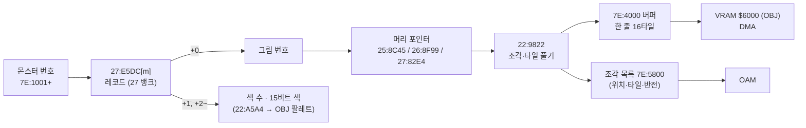
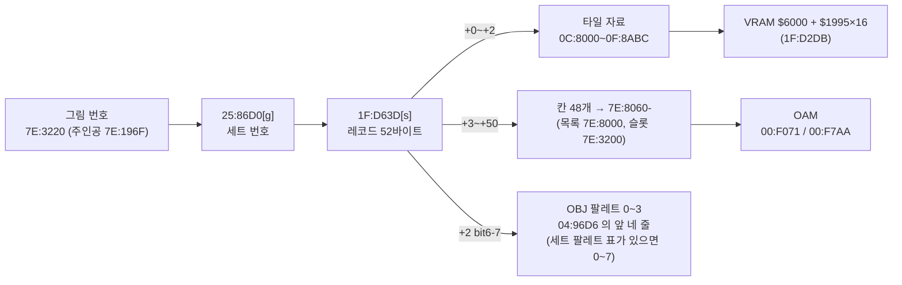

# DQ5(SFC) 전투 몬스터 그림·배경과 필드 인물 스프라이트 형식

전투 화면의 몬스터 그림과 배경, 마을·필드를 걷는 인물 스프라이트가 롬 어디에 어떤 형식으로 들어 있고, 게임이 어떻게 풀어 화면에 놓는지 정리한 문서입니다. 인물 스프라이트는 맨 아래 「[필드 인물 스프라이트](#필드-인물-스프라이트-1fcf1e)」 절에 있습니다. 찾아낸 과정은 일지에 있습니다.

- [2026-10-25-09: 전투 몬스터 그림](../journal/2026-10-25-09-mongfx.md)
- [2026-10-25-21: 전투 몬스터 배치와 그림자](../journal/2026-10-25-21-mongfx-layout.md)
- [2026-10-25-22: 전투 배경](../journal/2026-10-25-22-battlebg.md)
- [2026-10-25-28: 그래픽 내보내기와 갤러리](../journal/2026-10-25-28-gfx.md)
- [2026-10-25-31: 그림자 칠하기와 전투 배경의 남은 것](../journal/2026-10-25-31-battlebg2.md)
- [2026-10-25-32: 필드 인물 스프라이트](../journal/2026-10-25-32-sprite.md)
- [2026-10-25-65: 누운 인물, 동료 그림 번호, 세트 124개 확인](../journal/2026-10-25-65-sprite2.md)
- [2026-10-25-73: 탈것 그림과 맵 OBJ 팔레트 표](../journal/2026-10-25-73-vehicle.md)
- [2026-10-25-79: 남은 인물 세트, 주인공 그림 플래그, 탈것 한 장, 역할 이름](../journal/2026-10-25-79-sprite3.md)
- [2026-10-25-91: 맵 OBJ 물체 배치와 마지막 인물 세트](../journal/2026-10-25-91-sprite4.md)
- [2026-10-25-97: 인물 스프라이트 마무리](../journal/2026-10-25-97-sprite5.md)
- [2026-10-25-111: 07/02 물체를 놓는 곳과 04/0A 물체](../journal/2026-10-25-111-sprite6.md)
- [2026-10-25-122: 전투 메시지 창](../journal/2026-10-25-122-battlewin.md)
- [2026-10-25-126: 스태프 롤 올리기와 07/02 ゲマ 장면 물체 실측](../journal/2026-10-25-126-ending3.md)
- [2026-10-25-115: 「THE END」 타일맵과 스태프 롤의 밑줄·올리기](../journal/2026-10-25-115-ending2.md)
- [2026-10-25-36: 창 타일과 움직이는 타일](../journal/2026-10-25-36-gfx2.md)
- [2026-10-25-37: 그림자 지우기, 남은 지형, 세계 1·2 지형, 물결 색 HDMA](../journal/2026-10-25-37-battlebg3.md)
- [2026-10-25-51: E9 는 「なかまを よんだ」, 물결 HDMA, 1A 의 덜 맞은 줄](../journal/2026-10-25-51-battlegfx4.md)
- [2026-10-25-58: 실내 맵의 움직이는 타일](../journal/2026-10-25-58-anim.md)
- [2026-10-25-67: BC 50 이상 맵의 움직이는 타일과 바다 위 배경 번호](../journal/2026-10-25-67-anim2.md)
- [2026-10-30-05: 몬스터 그림의 16x16 자리·타일 한도와 레코드 색 15개](../journal/2026-10-30-05-mongrow.md)
- [2026-10-25-82: 전투 메시지의 남은 코드와 바다 배경](../journal/2026-10-25-82-battletext2.md)
- [2026-10-25-87: 바다 전투](../journal/2026-10-25-87-seabattle.md)

기준과 검증:

- 기준 롬: `rom/dq5.sfc`([README](../../../README.md) 의 SHA-1). 주소 표기는 [dq5-map-format.md](dq5-map-format.md) 와 같습니다.
- 디코더: [sfc/dq5/tools/dq5mongfx.py](../tools/dq5mongfx.py). 몬스터 236마리가 그림 번호 107개를 쓰고, 그 머리는 104곳입니다. 머리를 주소 순으로 놓으면 그림마다 다음 머리의 첫 바이트에서 정확히 끝납니다(예외는 아래 「그림 머리 포인터」).
- 이벤트 전투(슬라임 셋)의 몬스터 번호(`7E:1001`)를 그림마다 대표 몬스터 하나로 바꿔 107번 전투를 붙였습니다.
  게임이 그림을 다 푼 직후(`22:90DC`)의 WRAM 버퍼 `7E:4000-5FFF` 에 디코더가 푼 타일이 모두 있었고(타일 3,623/3,623), 화면과도 픽셀째로 맞았습니다(아래 「검증」).


## 한눈에 보기



## 몬스터 레코드 (`27:E5DC`)

`27:E5DC` 는 몬스터 236마리의 16비트 포인터 표(27 뱅크 안)입니다. 가리키는 레코드는 이렇습니다(`22:8FF8`, `22:A5A4`).

| 오프셋 | 뜻 |
| --- | --- |
| +0 | 그림 번호(`00`~`71` 중 107개가 쓰임. `2D`·`35`·`37`·`38`·`57`·`5F`·`66` 은 아무도 안 씀) |
| +1 | 색 수 n |
| +2 ~ | 15비트 BGR 색 n개. OBJ 팔레트의 1번 색부터 채움(0번은 투명) |

같은 그림을 색만 바꿔 여러 몬스터가 나눠 씁니다(예: 그림 `15` 를 몬스터 `60`·`7A` 가 다른 색으로). `22:A5A4` 는 `22:AB23` 표(`$0DD8` 번째)가 가리키는 `7E` 뱅크 자리에 색 수 + 1 과 색들을 적습니다(코드 읽기).
포인터 표는 256칸이라(`27:E5DC`~`27:E7DB`) 몬스터가 아닌 `EC`~`FF` 도 몬스터 `00` 의 레코드를 가리킵니다. 레코드는 235개가 `27:E7DC`~`27:FE9C` 에 빈틈 없이 붙어 있고(`3B`·`3C` 가 하나를 함께 씀), 원본 색 수는 4~15 입니다.

레코드를 찾는 곳은 둘입니다(롬 전체에서 `BF DC E5 27` 을 찾은 결과).

| 곳 | 하는 일 |
| --- | --- |
| `22:8FF8` | `$0D14`(몬스터 번호) × 2 로 `LDA $27E5DC,X`(`22:9003`) 해 `$50` 에, `LDA #$27`(`22:900B`) 을 `$52` 에 둔다. 그 뒤 그림 번호(`22:900F LDA [$50]`)와 색(`22:A5A4 LDA [$50],Y`)은 모두 `[$50]` 으로 읽는다 |
| `02:F489` | 몬스터 `E4` 의 레코드만, `LDA #$27 / STA $02`(`02:F48D`) 와 `LDA $27E5DC,X`(`02:F498`) + 2 로 색 10개(20바이트)를 `7E:3B56` 에 옮긴다 |

그래서 이 네 곳의 주소와 뱅크를 바꾸면 표와 레코드를 다른 뱅크로 옮길 수 있습니다. 표와 레코드를 `3C:8000` 으로 옮기고 몬스터 `7E`·`00` 등의 색을 15개로 늘린 롬에서, 전투의 CGRAM OBJ 팔레트 한 줄의 색 1~15 가 레코드와 같았습니다(아래 「[16x16 자리와 타일 한도](#16x16-자리와-타일-한도)」 의 실측). `22:A5A4` 는 색 수 0 이면 `DEX` 가 0 에서 내려가 65,536번 돕니다(코드 읽기).
CGRAM 사본 `7E:2D00` 512바이트가 그림 버퍼 DMA 다음 프레임에 `00:FDE3` 에서 CGRAM 으로 DMA 됩니다(이벤트 전투에서 890프레임). 레코드 색으로 칠한 디코더 그림이 화면 픽셀과 RGB 까지 맞으므로 색 순서(1번 색부터)는 실측으로 확인했습니다.

## 그림 머리 포인터

그림 번호 g 의 머리는 뱅크마다 다른 16비트 포인터 표에 있습니다(`22:9014`). 머리와 자료는 표와 같은 뱅크에 있습니다.

| 그림 번호 | 표 | 머리 범위 |
| --- | --- | --- |
| `00`~`29` | `25:8C45 + g*2` | `25:8C99`~`25:F9F4` |
| `2A`~`56` | `26:8F99 + (g-2A)*2` | `26:8FF3`~`26:FFCB` |
| `57`~`71` | `27:82E4 + (g-57)*2` | `27:831A`~`27:E5DC` |

뱅크의 마지막 그림은 `28`(`25:F9F4` 에서 끝나고 바로 코드 `08 E2 30` 이 이어짐), `56`(`26:FFCB` 에서 끝나고 뒤는 `00` 채움), `71`(몬스터 레코드 포인터 표 `27:E5DC` 바로 앞)입니다.
여러 번호가 같은 머리를 가리킵니다: `00`·`11`·`29`(`25:8C99`), `2A`·`2D`·`35`·`37`·`38`(`26:8FF3`), `57`·`58`·`5E`·`5F`·`66`(`27:831A`). 안 쓰는 번호는 모두 뱅크 첫 그림을 가리킵니다.
머리를 주소 순으로 늘어놓으면(`dq5monheads.py`) 한 머리의 자료 끝이 다음 머리와 바로 붙고, 틈은 그림 `15` 뒤의 3바이트뿐입니다. 예를 들어 `10` 은 `25:BCD3` 에서 끝나고 그 자리가 `12` 의 머리이고, `5D` 는 `27:9AD5` 에서 끝나고 그 자리가 `60` 의 머리입니다. 그래서 `11`·`29`·`2D`·`35`·`37`·`38`·`5E`·`5F`·`66` 은 자기 자료가 롬에 없는 빈 번호이고, 표에는 뱅크 첫 머리가 채워져 있습니다(롬 바이트로 확인).

## 그림 형식 (`22:9822`)

그림은 8픽셀 칸으로 된 상자 안에 OBJ 조각(8x8 또는 16x16)을 늘어놓은 것입니다.

| 오프셋 | 뜻 |
| --- | --- |
| +0 | bit7 = 띄움(공중에 뜬 몬스터, 위쪽 줄에 놓음), bit5-6 = 8픽셀 단위로 들어 올림, bit0-4 = 그림자 모양 번호(0 이면 그림자 없음). 아래 「배치와 그림자」 |
| +1 · +2 | 그림자 위치 보정(부호 있는 바이트, x · y) |
| +3 · +4 | 타격 효과 기준점(그림 상자 안 8픽셀 칸 x · y) |
| +5 | 상위 니블 + 1 = 가로 칸 수(니블이 `F` 면 19, 그래서 16~18 은 없음), 하위 니블 + 1 = 세로 칸 수 |
| +6 ~ | 칸 비트맵: 가로 × 세로 비트, 가로 우선·바이트의 MSB 먼저. 1 인 칸마다 조각 하나 |
| 그다음 | 조각마다 니블 하나(바이트의 상위 니블 먼저), ⌈조각 수 / 2⌉ 바이트 |
| 그다음 | 조각 자료를 칸 순서대로 |

조각 니블:

| 비트 | 뜻 |
| --- | --- |
| bit1 | 1 이면 16x16 조각(타일 4개를 왼쪽 위·오른쪽 위·왼쪽 아래·오른쪽 아래 순서로), 0 이면 8x8(타일 1개) |
| bit2·bit3 | 둘 다 0 이면 새 타일을 푼다. 하나라도 1 이면 자료 1바이트 = 이 그림의 앞 조각 번호(0부터)이고, 그 조각의 타일을 좌우 반전해 이 칸에 다시 쓴다(`22:9E95`, OAM 속성 `EOR #$4000`). 이때 bit2 가 0 이면 1픽셀 왼쪽에 둔다 |

서로 다른 머리 104곳에서 쓰이는 니블은 `0`(716), `2`(704), `4`(17), `6`(33), `8`(34), `A`(58) 뿐입니다.

### 머리가 가는 곳 (`22:9059`·`22:92C2`)

전투가 그림을 풀 때 머리 `+0`~`+5` 를 읽는 곳은 아래뿐이고, 그림마다 한 번씩 읽었습니다(スライム·マッドプラント 전투에서 두 머리의 읽기를 모두 모음). 그 뒤로는 무리 표(`7E:0C10`~, 무리마다 한 칸, 5칸)의 사본만 씁니다.

| 읽는 곳 | 머리 | 두는 곳 |
| --- | --- | --- |
| `22:905C`·`9068` | `+0` bit7, bit0-4 | `$0D1B`·`$0DFC`(무리 값에 `80`) → `0C24`, `$0D1C` → `0C38`(그림자 모양) |
| `22:9072`·`918D` | `+5` 상위·하위 니블 | `$0D13`(가로 칸) → `0C3D`, `$0D9A`·`$0D9B`(디코더의 가로·세로 칸), `$0D9B` × 8 → `0C42` |
| `22:92FE` | `+0` bit5-6 | `AND #$60` 를 오른쪽으로 두 번 민 값(들어올림 × 8) → `0C5B`. 몬스터 `E4` 면 2 를 더 뺍니다(`22:930A`). ブオーン(`E4`, 들어올림 2) 1마리 전투에서 `0C5B` 는 14, 상자 y `0CA4` 는 74 로 줄 0 식의 72 보다 2 아래였습니다 |
| `22:9314`~`9328` | `+1`~`+4` | `0C2E`·`0C33`(그림자 보정)·`0C51`·`0C56`(타격 기준점) |

이 사본을 읽는 곳은 실측 전투(공격하고 몬스터가 쓰러질 때까지)에서 다음이었습니다. 상자 위 y(`22:A085`·`A088`, 아래 「줄과 높이」), 줄 폭(`22:A009`)과 가로 자리(`22:AFF0`), 그림자(`22:B46E`~`B487`), 타격 효과(`22:DB57`·`DB64`), 몬스터가 쓰러진 뒤 다시 늘어놓기(`22:9503`·`952C`)와 블록 옮기기(`22:962E` 의 `MVN`)입니다. 롬에서 `0C3D`·`0C42` 를 피연산자로 읽는 명령을 찾으면 싸우는 도중 몬스터를 더하는 `22:D1A9`~`D6AA`, `22:DE38`~`DF8A`, `22:E7FB`~`EA1D`, `22:F23F`~`F436` 도 나오지만, 이 실측에서는 불리지 않았습니다.

`+5` 의 세로 칸 수만큼 줄 목록에도 칸을 씁니다. 디코더는 8픽셀 줄을 다 풀 때마다 그 줄의 타일 수를 `7E:5B60 + 칸` 에 적고(`22:9882`), `22:AD73` 이 사슬 `7E:5B20` 에서 다음 빈 칸(`FF`)을 찾아 잇습니다. 그림의 마지막 줄 칸에는 `40` 을 적습니다. 그림마다 첫 칸은 `7E:0D6D`(그림 표 `0D3D` 와 같은 순번)에 두고, `22:A177` 이 이 사슬을 따라 줄마다 타일 합을 셉니다. 사슬은 전투 시작 때 `22:ABB4` 가 `5B20`~`5B9F` 128바이트(사슬 64칸과 줄 목록 64칸)를 `FF` 로 두지만, 남은 수 `$0D2B` 는 `40` 으로 두고 늘리기만 할 뿐(`22:AE43`) 받을 때 견주는 곳이 없습니다. 다음 빈 칸 찾기(`22:AD84`·`22:ADA1`)는 8비트 Y 로 `5B20 + Y` 에서 `FF` 를 찾을 때까지 돕니다. 다 쓴 칸을 돌려받는 `22:ADE7` 은 아래 부르기 실측 전투에서 한 번도 불리지 않았습니다.

64칸이 다 차면 게임이 멈춥니다. 그림 넷을 세로 16칸·가로 1칸·띄움으로 고친 시험 롬에서 넷을 함께 붙이자(세로 칸 합 64), 넷째 그림의 마지막 줄을 칸 63(`5B5F`)에 적은 뒤 `22:ADA1`~`ADA5` 를 끝없이 돌았습니다(650~3900 프레임에 50프레임마다 본 PC 가 모두 이 고리). 찾기는 칸 64 부터 줄 목록 `5B60`~`5B9F`(타일 수, 모두 `01`), `5BA0`~`5BFF`(모두 0), 전투를 열 때의 HDMA 표 `5C00`~ 를 지나 `5B20` 으로 돌아오는데 그 안에 `FF` 가 없었습니다. 화면은 배경만 남고 몬스터·창이 나오지 않았습니다. 넷째 그림을 15칸으로 하면(합 63) 넷 모두 놓이고(OBJ 63개) 끝까지 싸워 쓰러뜨렸습니다.

싸우는 도중 부르기로 새 종이 와도 같습니다. 무리 셋을 16칸 그림으로 두고(합 48) スライム 의 행동을 모두 `AE`(몬스터 `1E` 부르기)로 바꾼 뒤 `1E` 의 그림 `34` 를 16칸으로 하자 부르는 순간(1475 프레임) 같은 고리에서 멈췄고, 15칸이면 `1E` 가 나타났습니다(OBJ 48 → 63). 무리가 넷이면 부르기는 「しかし たすけは こなかった！」로 끝나 그림을 풀지 않았습니다. 그만두는 갈래는 `22:D322` 입니다. 무리 수 `$0D0E` 가 4 이상이면 몬스터가 없는(`0C1A` = 0) 무리를 찾아 `9487`·`93CC` 로 무리 칸에서 지우고, 그림을 정리하는 `22:95A1` 을 부르지 않은 채 실패로 돌아갑니다(코드 읽기). 몬스터가 쓰러질 때의 `22:CBC5` 도 `95A1` 을 부르지 않고, 다음 부르기 `22:D36C` 는 새 그림을 먼저 풀고(`22:D388` 에서 `9088`) 나서야 `95A1` 로 정리하는 `22:D3A1` 에 닿습니다(코드 읽기, 아래 전투에서는 `D3A1` 까지 가지 않음). `95A1` 을 부르는 곳은 이 밖에 `9FB0`(전투 시작)·`22:96A8`·`22:F5DE` 입니다.

쓰러진 무리의 그림이 풀린 채 남는 것은 원본 롬에서 쟀습니다. 무리 넷(`01`·`02`·`03`·`00` 1마리씩, `01` 은 HP 1, `00` 의 행동은 모두 `AE`)으로 싸우며 위 주소들의 실행과 그림 표 `0D3D`, 사슬 `5B20`~`5B5F` 의 빈 칸(`FF`) 수를 적었습니다.

```text
 613  9FB0 → 95A1      0D3D 03,14,42,02  빈 칸 51(그림 넷의 세로 칸 4+4+3+2 = 13)
1270  CBC5 (01 쓰러짐)  0C1A 00,01,01,01  빈 칸 51
1511  D2FE → D322      무리 칸 117C 에서 쓰러진 무리를 지우고 실패     빈 칸 51
1998  D322 → D36C → D388 → 9088  그림 34(1E, 4칸)를 풂            0D3D 03,14,42,02,34  빈 칸 47
```

쓰러진 `01` 의 그림 `03` 은 `0D3D` 에 남고 줄 칸 4개도 돌아오지 않았습니다. 3900프레임까지 여러 차례가 지났지만 `95A1`·`96A8`·`F5DE`·`ADE7` 은 한 번도 실행되지 않았습니다. 그래서 무리가 넷이어도 쓰러진 무리가 있으면 새 종을 부를 수 있고, 그 그림은 앞 그림들 위에 더해집니다. 부르기 `AE`~`B5` 가 부르는 몬스터는 `20:D9D6`~ 의 `LDA #` 여덟 개(`1E`·`27`·`1B`·`61`·`67`·`8C`·`B2`·`CF`)입니다. 부른 몬스터가 다시 부르기도 합니다(`27` 은 `1E` 를 부르고, `27` 은 `1F`·`40`·`64` 가 부름). 원본 그림의 세로 칸은 가장 큰 것이 13 이고, 부르기를 거듭해 닿는 그림을 모두 더한 원본 조합의 합은 47(구역 26 칸 0·3·4 의 `6C`·`64`·`56`, 구역 29 칸 1~3 의 `69`·`68`·`64`)이 가장 큽니다.

### 타일 (`22:992A`)

타일 하나(4bpp 8x8, 32바이트)는 모드 바이트 M 으로 시작합니다. 앞 16바이트(평면 0·1)와 뒤 16바이트(평면 2·3)를 따로 처리하고, 평면마다 8바이트(줄마다 1바이트)입니다.

| M 비트 | 뜻 |
| --- | --- |
| bit0~3 | 평면 0~3 이 있는지. 없는 평면은 0 |
| bit6 | (bit7 일 때) 1 이면 M 다음 바이트가 채움 값, 0 이면 채움 값 0 |
| bit7 | 0 이면 있는 평면의 바이트를 그대로 읽는다(`22:99B7`·`9A15`·`9A75`). 1 이면 마스크 압축(`22:9AEB`·`9BA5`·`9C5F`) |

마스크 압축이면 (채움 값 다음에) 있는 평면 수만큼의 마스크 바이트가 오고, 그 뒤가 자료입니다. 바이트를 줄 순서대로(평면 0·1 은 줄마다 평면 0, 평면 1 번갈아) 채우며 마스크 비트(MSB 먼저)가 1 이면 자료에서 1바이트를 읽고, 0 이면 채움 값을 씁니다.
마스크 바이트 하나가 평면 하나(8바이트)를 맡습니다. bit4·bit5 는 롬 전체에서 쓰이지 않습니다.

예: 슬라임(그림 `02`, 머리 `25:9177`)은 `06 FC 0B 01 01 11 | 80 | 20 | 87 2A FF 0B 01 …` 입니다. 2×2 칸, 비트맵 `80` 이라 조각은 (0,0) 하나, 니블 `2` 라 16x16 입니다.
첫 타일 `20` 은 평면이 하나도 없어 투명이고, 둘째 타일 `87` 은 마스크 압축·평면 4개, 마스크 `2A FF 0B 01` 입니다.

### 버퍼와 OBJ

게임은 타일을 `7E:4000` 버퍼(한 줄 16타일 = `$200` 바이트)에 16x16 단위로 쌓고, 조각마다 화면 위치(칸 × 8)와 OBJ 타일 번호·반전을 `7E:5800` 목록에 적습니다(`22:9DB0`, `22:9E1C`, 코드 읽기).
8x8 조각은 16x16 자리 하나에 넷까지 모아 넣습니다(`22:9E81` 표 `00 01 10 11`). 버퍼는 VRAM 워드 주소 `$6000`(OBJ 이름 기준) 이후로 DMA 됩니다(이벤트 전투에서 889프레임, `00:FD6D` 가 `7E:4000`→`$6000`, `7E:4200`→`$6100` 처럼 한 줄씩).
OBJ 크기는 8x8/16x16 모드(PPU 상태의 OBJ 크기 0), 둘째 이름 표는 첫째 바로 뒤(오프셋 `$1000` 워드)라 타일 번호 `000`~`1FF` 가 이어집니다.

### 16x16 자리와 타일 한도

버퍼와 VRAM 의 OBJ 타일은 16x16 자리 단위로 나눠 씁니다. 자리 s 는 OBJ 타일 `(s % 8) * 2 + (s / 8) * 32`(와 그 +1·+16·+17)이고, 전투마다 자리 128개(타일 `000`~`1FF`)가 있습니다.

| 곳 | 하는 일 |
| --- | --- |
| `22:ABB4` | 전투를 시작할 때 자리 사슬 `7E:8400`·조각 목록 사슬 `7E:8480` 128칸을 `FF`(빈 칸)로, 남은 수 `$0D1F`·`$0D27` 을 `80` 으로 둡니다 |
| `22:91F7` | 그림 번호가 이미 푼 그림 표 `7E:0D3D`(16칸)에 있으면 다시 풀지 않습니다. 없으면 니블을 세어 자리 수 `$0D19` = 반전 복사가 아닌 16x16 조각 수 + ⌈반전 복사가 아닌 8x8 조각 수 / 4⌉ 을 셉니다 |
| `22:AC65` | `$0D1F` ≥ `$0D19` 이고 `$0D27` ≥ 조각 수(`$0D17`) 일 때만 받습니다. 아니면 그 무리는 풀지 않습니다(`22:9088` 의 다섯 검사 가운데 하나) |
| `22:AC79` | 받으면 첫 자리를 `7E:0D4D`, 첫 조각 목록 칸을 `7E:0D5D` 에 적고 남은 수를 줄입니다 |
| `22:ACFE` | 16x16 조각마다(8x8 은 넷째마다, `22:9D8F`) 다음 빈 자리로 갑니다. 그림의 마지막 자리에는 `80` 을 적어 사슬을 끝냅니다 |
| `22:9F3E` | 그림의 타일을 첫 자리 줄의 첫 타일부터 `7E:4000 + (타일 - 그 줄 첫 타일) × 32` 에 풀고, 푼 타일마다 `7E:5A20 + 같은 값` 에 표시합니다 |
| `22:B235` | 표시된 타일이 이어지는 구간마다 `7E:0F5E` 에 `[바이트 수][버퍼 주소][VRAM 주소]` 를 적고, `22:8BA9` 가 한 프레임 기다리는 동안 NMI 의 `00:FD4A` 가 그 목록을 한 번에 DMA 합니다. 목록 길이에는 제한이 없습니다 |
| `22:AD39` | 조각마다 조각 목록 사슬 `7E:8480` 의 다음 빈 칸(`FF`)을 찾아 잇고(`22:AD4A`), 그림의 마지막 조각 칸에는 `80` 을 적은 뒤 다음 그림이 쓸 빈 칸을 찾습니다(`22:AD67`). 찾기에 끝이 없어, 128칸을 모두 쓰면 사슬 뒤 `7E:8500`~(전투 중 `00`)를 돌다 `Y` 가 돌아 처음으로 가서, `FF` 를 찾지 못한 채 끝없이 돕니다 |

새 전투에서는 자리를 무리 차례대로 0 부터 이어서 줍니다. 무리 `0F`(그림 `00`)·`7E`(그림 `43`)·`00`(그림 `02`) 셋의 전투에서 `7E:0D3D`·`0D4D` 가 `00` 0·`43` 7·`02` 21, `$0D1F` 가 106(= 128 - 7 - 14 - 1)이었습니다. 무리 `AC`·`AA`·`AD` 의 전투에서는 그림 `46`·`07`·`50` 이 자리 0·`11`·`24` 부터 17·19·13개를 썼고, 사슬 `7E:8400` 은 `01 02 …` 로 이어지다 그림마다 마지막 자리(`10`·`23`·`30`)에 `80` 이 있었습니다. 원본의 무리 조합(`dq5monlimits.py`) 가운데 자리 합이 가장 큰 것은 56(구역 48 칸 0 의 `B5`·`B7`·`A9`·`AC`, 그림 `07`·`62`·`4B`·`46` 이 19·11·9·17)이고, 한 그림이 걸치는 자리 줄(자리 8개)은 4줄까지입니다. 연출의 OBJ 그림도 같은 자리를 `22:BB3D` 에서 받고, 모자라면 그 조각을 건너뜁니다(코드 읽기).

한 그림의 타일은 NMI 한 번에 보냅니다. 그림 `43` 의 반전 복사를 모두 없애 타일 150개(자리 14 → 38)로 만들자, 처음 105개만 VRAM 에 있었고 뒤 45개(타일 `085`~`0A9`)는 그 전투 전의 VRAM 그대로였습니다. 원본 그림 가운데 타일이 가장 많은 그림 `6C`(110개, 몬스터 `E4`)는 `22:90FA` 가 `$0D14` = `E4` 일 때만 한 프레임 뒤에 타일 6개(`7E:4E00` → VRAM `$6700`)를 다시 보냅니다.

전송 시각을 `lua/dq5nmidma.lua` 로 쟀습니다(목록 항목마다 `00:FD6A` 의 `STA $420B` 직전, 목록 끝 `00:FD6F`, NMI 첫머리 `00:885D` 의 줄·마스터 주기). 전투 화면은 overscan(239줄)이라 NMI 가 240줄 76~104 에 들고, `00:8952` 가 `$0DF3` 이 켜진 프레임에는 다른 전송보다 먼저 몬스터 목록을 보내 첫 DMA 가 241줄 346~378 에 걸립니다(전투 첫머리 그림 열다섯 번). DMA 는 바이트마다 8, 줄마다 메모리 새로 고침 40, 한 항목의 DMA 가 끝나고 다음 항목의 DMA 까지 446~486 마스터 주기가 듭니다. VRAM 쓰기는 다음 프레임 0줄에서 끊깁니다.

| 그림 `43` 타일(자리 7 부터) | 목록 항목(줄:마스터 주기 [첫 타일, 수]) | 목록 끝 | 닿은 타일 |
| --- | --- | --- | --- |
| 102 | 241:354 [14,2]·241:1352 [30,100] | 261:632 | 102 |
| 103 | 241:352 [14,2]·241:1350 [30,100]·261:924 [144,1] | 261:1340 | 103 |
| 104 | 241:354 [14,2]·241:1352 [30,100]·261:918 [144,2] | 0:266 | 103 |
| 106 | 241:346 [14,2]·241:1344 [30,102]·0:98 [144,2] | 0:818 | 104 |
| 109 | 241:370 [14,2]·242:4 [30,103]·0:378 [144,4] | 1:326 | 105 |
| 150 | 241:366 [14,2]·242:8 [30,140]·7:890 [176,8] | 9:474 | 105 |

그래서 닿는 수는 타일 수만이 아니라 목록 항목 수에 따라 달라집니다. 항목은 OBJ 타일 번호가 이어지는 구간이고, 타일 번호는 첫 자리와 조각 차례로 정해집니다. 16x16 조각은 자리 하나씩 쓰고, 8x8 조각은 넷째마다 새 자리를 잡아 0·1·16·17 칸에 놓는데 그 자리를 잡자마자 다음 16x16 조각은 그 뒤 자리를 씁니다(`22:9D8F`·`22:9E1C`). 자리 줄(8자리, 타일 32개)의 중간에서 시작하거나 끝나면 위·아래 타일 줄이 끊겨 항목이 늘어납니다. `dq5mongfx.obj_tiles`·`transfer_runs`·`nmi_tiles` 가 이 셈을 옮긴 것으로, 위 여섯 전투의 목록 항목과 닿은 타일 수가 모두 예측과 같았습니다(`dq5monnmicheck.py`). 그림 `6C` 를 자리 0 부터 풀면 항목이 [0,104]·[112,6] 이고 둘째 항목의 첫 타일까지 닿는다는 예측이라, 게임이 다시 보내는 `$6700`(타일 112~117)과 맞습니다(`E4` 전투는 재지 않았습니다).

## 배치와 그림자

전투 시작 때 `22:86B7` 이 무리 네 개(`7E:1001`~`1004` 몬스터, `1005`~`1008` 마릿수, `1009`~`100C` 무리 값)를 차례로 읽어 그림을 풀고, 무리마다 `7E:0C10`~ 표(5칸)에 몬스터·마릿수·그림 번호·머리 값을 옮깁니다(`22:92C2`).
몬스터 한 마리마다 `7E:0C60`~ 표(16칸)에 화면 상자 왼쪽 위(`0C93` x, `0CA4` y)와 그리는 순서(`0CB5`)를 둡니다.
아래 규칙을 `dq5mongfx.py --layout` 으로 옮겼고, 무리 조합 20가지 전투의 OAM 에서 찾은 상자와 모두 맞았습니다(아래 「검증」).

### 줄과 높이

몬스터는 세 줄 중 하나에 놓입니다(`22:B00F`, `22:A001`). 무리 값은 `7E:1009 + 무리` 이고, 머리 +0 bit7 이 켜진 그림은 무리 값에 `80` 이 더해집니다(`22:905C`).

| 줄 | 조건 | 상자 위 y(OAM 좌표) | 그리는 순서(`0CB5`) |
| --- | --- | --- | --- |
| 0 | 그 밖 | `$A0 - 8h - 8·들어올림` | 1 |
| 1 | 무리 값 = `01` | `$88 - 8h - 8·들어올림` | 5 |
| 2 | 무리 값 bit7(띄움) | `$58 - min(4h, 24) - 8·들어올림` | 0 |

h 는 그림의 세로 칸 수, 들어올림은 머리 +0 bit5-6 입니다. 줄 0 은 모든 몬스터의 아랫단이 `$A0` 에 맞춰지고, 띄운 몬스터는 키의 절반(최대 24)만큼 `$58` 위로 올라갑니다.
OAM 은 그리는 순서가 작은 몬스터부터 쌓이므로(`22:A1D5`) 띄운 몬스터가 맨 앞, 줄 1 이 맨 뒤에 보입니다.

### 가로 위치

한 줄 안에서 무리는 번호 순으로 왼쪽부터, 무리 안 몬스터는 가로 칸 수 × 8 간격으로 붙여 놓고, 무리와 무리 사이는 8픽셀 띄웁니다. 줄 전체 폭이 T 이면 첫 무리의 왼쪽은 `(256 - T) / 2` 입니다(`22:AF22`). 줄마다 따로 가운데에 맞춥니다. 이 계산은 `22:AF61`~ 입니다: 줄마다 무리 폭(`0C4C`)과 무리 사이 8 을 더해 T 를 만들고, `(0 - T) / 2` 를 그 줄의 시작으로 둔 뒤 무리마다 시작 x 를 `0C4C` 에, 몬스터마다 `0C93` 에 더합니다(코드 읽기, 결과 규칙은 위 실측).

예: 줄 0 에 スライム 1(2칸)·マッドプラント 1(6칸)·エビルスピリッツ 1(6칸), 줄 2 에 ダックカイト 1(6칸)이면 T = 16 + 48 + 48 + 8·2 = 128 이라 줄 0 의 x 는 64·88·144, 줄 2 는 104 입니다.

### 마릿수 제한

마릿수가 많으면 다음 순서로 잘립니다. 잘린 무리는 그 뒤 몬스터를 놓지 않습니다.

1. 한 줄의 가로 칸 수 합이 28 미만(`22:9284`, `7E:2FCD + 줄`). 무리 사이 8픽셀은 세지 않습니다.
2. 모든 몬스터의 OBJ 조각 수 합이 100 미만(`22:91DC`).
3. 화면 8픽셀 줄마다 걸치는 OBJ 타일 수 합이 28 미만(`22:A119`, `7E:2F00 + (y >> 3) - 7`). 그림마다 줄별 타일 수(16x16 조각은 2)를 풀 때 `7E:5B60` 에 적어 둡니다(107개 그림 모두 디코더 값과 같음). 스캔라인당 OBJ 한도를 넘지 않게 하는 장치로 보입니다.

예: シャドーサタン(9칸) 4마리는 3마리, スライム 1 + シャドーサタン 3 은 シャドーサタン 2마리만 나옵니다.

나올 수 있는 무리 조합마다 이 셋으로 놓이는 수를 세는 도구는 `dq5monlimits.py` 이고, 그림의 조각·줄마다 타일을 늘릴 여유와 고친 그림 둘의 전투 실측은 [쓰기 형식의 「무리 조합 한도」](dq5-build-format.md#무리-조합-한도-dq5monlimitspy)에 있습니다.

### OAM 만들기 (`22:A1D5`)

그림을 풀 때 조각마다 그림 상자 기준 위치·타일·속성 4바이트를 `7E:5800` 에 적어 두고(`22:9DB0`), `22:A1D5` 가 그리는 순서 0~15 로 몬스터를 돌며 조각마다 `[x, y] += 상자 왼쪽 위`, 속성에 무리별 팔레트(`0CD7` × 2)와 우선순위 3 을 더해 OAM 사본 `7E:0300` 에 씁니다. 남은 칸은 y = `F0` 으로 숨깁니다.

### 그림자

머리 +0 bit0-4 가 그림자 모양 번호입니다. `22:B4FE` 표(번호 × 2, 22 뱅크 포인터, `FFFF` 는 없음)가 가리키는 자료는 `[줄 수 n]` 다음 n개의 `[dy][왼쪽 x][오른쪽 x(제외)]` 가로 구간입니다. 예: 1번은 13줄로 첫 줄이 `0B`~`14`, 둘째 줄이 `07`~`18` 인 타원입니다.
`22:B44A` 가 이 구간에 몬스터 위치를 더해 전투 배경 BG 타일을 어둡게 칠합니다(프레임 898, 다음 프레임에 VRAM `$4AE0`·`$4CE0` 으로 DMA). 그림자는 OBJ 가 아니라 배경 그림의 일부입니다.
칠하는 방식(`22:B08A`): `22:B44A` 가 구간을 `7E:4000` 에 `[버퍼 주소 $6000][…][y][왼쪽][오른쪽]…FF` 꼴로 늘어놓으면, `22:B08A` 가 구간마다 배경 아래 띠 타일(BG 타일 `$200`~`$2FF` 의 WRAM 사본 `7E:6000`)의 비트평면 3 바이트에 비트를 켭니다. 끝 조각은 `22:B203` 표의 마스크로 OR, 가운데는 `FF` 입니다. 고친 타일은 `7E:5A20 + 타일` 에 1 을 적어 표시해 두고 다음 프레임에 그 타일만 VRAM 으로 보냅니다.
비트평면 3 을 켜면 색 번호가 8 커지므로, 배경 팔레트의 9~15번이 어두운 색으로 짜여 있는 셈입니다. 아래 띠는 목록 3 이 화면 칸마다 따로 타일을 하나씩 두었기 때문에(같은 그림 타일도 되풀이해 복사) 칸마다 그림자를 칠할 수 있습니다.
マッドプラント 1마리 전투에서 그림자가 있을 때와 없을 때의 VRAM 을 비교하니 BG 타일 `$2AE`~`$2B1`·`$2CE`~`$2D1` 의 비트평면 3 바이트 46개만 달랐고, 모두 비트가 켜지기만 했으며 타일맵은 같았습니다.

몬스터가 사라질 때 그림자를 지우려고 칸마다 기록을 남깁니다. `22:B08A` 는 칠한 타일마다 `7E:8000 + 타일*2` 에 그 몬스터 칸의 비트(`22:B215` 표 = 1 << 칸 번호, 16비트)를 OR 하고, 칠한 타일 번호의 최소·최대를 `0CE8 + 칸`·`0CF9 + 칸` 에, 모든 몬스터를 합친 범위를 `0D7D`·`0D7E` 에 둡니다.
몬스터가 쓰러지면 `22:B38C` 가 `7E:8000` 에서 그 칸의 비트를 지우고, `22:B347` 이 `0CE8`~`0CF9` 범위의 타일을 원래대로 돌린 뒤 남은 그림자를 다시 칠해 VRAM 으로 보냅니다(코드 읽기).
실측: スライム 3 + マッドプラント 1 전투에서 `0CE8` = `170 172 174 177`, `0CF9` = `203 205 207 213`, `7E:8000` 에는 타일 22개에 칸 비트 `1`·`2`·`4`·`8` 이 칠한 대로 있었습니다. スライム 3마리 전투에서 가운데 スライム(칸 1)을 쓰러뜨리자 `7E:8000` 의 값이 `1 2 3 4 6` 에서 `1 4` 로 줄고, 배경 아래 띠의 비트평면 3 비트가 168개에서 112개로 줄었습니다(그 スライム 의 그림자만 지워짐).

MesenCE 스크린샷(OAM y − 7 = 스크린샷 y) 기준으로 그림자 줄 dy 의 위치는 이렇습니다.

- y = 상자 위 + 8h + (+2) − 24 + dy, x = 상자 왼쪽 + 4w + (+1) + 1 + 구간 x

マッドプラント(그림 `00`, 모양 1, +1 = `F1`, +2 = `12`) 1마리에서 그림자 6줄(창에 가리기 전까지)의 가로 구간이 모양 1 의 첫 6줄과 너비·자리 모두 같았습니다. 그림자 모양을 0 으로 덮으면 그림자가 사라지고, +1 을 8 늘리면 오른쪽으로 8, +2 를 8 줄이면 위로 8 옮겨 갔습니다. スライム 3마리도 몸에 가리지 않은 그림자 픽셀이 같은 식과 맞았습니다.

크기를 바꾼 그림도 같은 식을 따릅니다. 그림자 모양만 0 으로 덮은 롬과 같은 프레임 화면을 견주어, 다른 픽셀을 그림자로 보았습니다. 키운 `4F`(`E2`, 8x9)·줄인 `1C`(`E6`, 8x9)와 원래 크기 1마리 전투에서 그림자 픽셀은 모두 식의 자리 안이었고(밖 0), 식의 자리 가운데 안 보인 것은 몬스터 OBJ 아래이거나 아래 창(스크린샷 y 152 부터) 아래였습니다. 그림이 상자 안에서 옮긴 만큼 보정이 그대로라 원본과 고친 롬의 그림자가 같은 자리(`E2` x 110~132·y 145~151, `E6` x 95~165)였습니다. 고친 `4F` 의 머리를 하나씩 바꾸어 다시 싸웠습니다.

| 바꾼 머리 | 상자(OAM) | 그림자(스크린샷) |
| --- | --- | --- |
| 그대로(들어올림 1, 모양 4, +1 = −19, +2 = 17) | (96,80) | x 110~132, y 145~151(아래는 창) |
| +1 = −11 | 그대로 | x 118~140 |
| +2 = 9 | 그대로 | y 137~146, 10줄 모두 |
| 모양 1 | 그대로 | x 112~138, 모양 1 의 너비 |
| 들어올림 0 | (96,88) | y 153~ 이라 모두 창 아래 |
| 들어올림 2 | (96,72) | y 137~146 |
| 띄움 | (96,56)(줄 2) | y 121~130 |

들어올림과 띄움은 상자를 옮기고 그림자도 상자를 따라갑니다. 모두 OAM 의 몬스터 OBJ 가 `layout` 의 상자 자리였고, 그림자 픽셀이 식의 자리 밖으로 나간 것은 없었습니다.

### 타격 효과 기준점

머리 +3·+4 는 공격받을 때 터지는 효과의 기준 칸입니다. `22:DB3D` 가 `x = 상자 왼쪽 / 8 + (+3)`, `y = 상자 위 / 8 + (+4) − 7` 을 `7E:9E78`·`9E79` 에 두고 효과 스크립트가 씁니다.
マッドプラント 의 +3 을 `03` 에서 `06` 으로 덮자, 맞을 때 효과 불꽃이 오른쪽으로 24픽셀(3칸) 옮겨 갔습니다.

효과는 BG3 타일로 그립니다(모드 1, BG3 타일맵 VRAM 워드 `$1C00`, 스크롤 0). 기준 칸이 쓰인 두 프레임 뒤 바뀐 BG3 칸은 효과마다 기준 칸에서 같은 자리입니다. パパス 의 칼은 타일 `E7`~`EC` 12칸을 (x, y + 5) 부터 왼쪽 아래로 비스듬히, 주인공의 맨손은 2x2 칸을 (x − 2, y + 5) 에 놓았습니다. BG3 좌표와 OAM 좌표는 화면에서 같은 자리입니다(효과 픽셀의 스크린샷 y 가 BG3 y − 7).
`dq5hitlog.lua` 로 기준 칸 쓰기와 그 뒤 BG3 를 모아, 크기를 바꾼 몬스터에서도 기준 칸이 식과 같고 효과가 기준 칸을 따라가는 것을 보았습니다(주인공 HP 를 999 로 고정하고 A 를 눌러 싸움).

| 전투 | 상자 | `+3`·`+4` | 기준 칸(예측 = 실측) |
| --- | --- | --- | --- |
| `E2` 원본 6x7 | (104,96) | 2·4 | (15,9), 타격 2번 |
| `E2` 고친 8x9 | (96,80) | 3·6 | (15,9) |
| `E2` 고친 8x9, `+3`·`+4` = 5·2 | (96,80) | 5·2 | (17,5) |
| `E2` 고친 8x9, 들어올림 0·2·띄움 | (96,88)·(96,72)·(96,56) | 3·6 | (15,10)·(15,8)·(15,6) |
| `E6` 원본 10x11 | (88,72) | 5·5 | (16,7), 타격 5번 |
| `E6` 고친 8x9 | (96,88) | 4·4 | (16,8) |

같은 차례의 타격끼리 견주면 원본과 고친 롬에서 기준 칸에서 잰 BG3 칸이 모두 같았습니다(칼 12칸, 맨손 4칸, 상하좌우로 뒤집은 2x2 칸 4칸). 몬스터가 주문을 자기에게 걸 때(ザイル 의 ホイミ) 반짝임은 다른 루틴 `22:E9C2` 가 기준 칸을 `((상자 왼쪽 + 4w) / 8, 상자 위 / 8 − 7)` 로 두어, 머리 +3·+4 가 아니라 상자 가운데·위를 따릅니다(`E2` 원본 (16,5), 고친 (16,3)).

### 무리를 더하는 몬스터

`22:89E5` 가 첫 무리 몬스터를 보고 무리를 고칩니다.

| 첫 무리 | 하는 일 |
| --- | --- |
| `E7`(ミルドラース) | 둘째·셋째 무리에 `E8`·`E9` 1마리씩, 무리 값 셋 모두 `01` |
| `EA`(ミルドラース) | 둘째 무리에 `EB` 1마리, 무리 값 `00` |
| `6A`(スライム) | 마릿수가 짝수면 하나 뺌 |

`E7` 전투에서는 `E7`(그림 `6D`)과 `E8`(그림 `6E`)이 같은 원점 (72,56) 에 겹쳐 그려졌습니다(1100~2000프레임 OAM). `E9`(그림 `6F`)의 타일은 VRAM 에 21/21 올라가 있지만 기다리는 동안에는 OAM 에 나오지 않았습니다.
그림을 다 푼 뒤 `22:8A57` 이 `E7` 이면 무리를 하나로 합칩니다. 첫 무리의 조각 수(`0C29`)에 `E8` 의 9를 더하고, 둘째·셋째 무리(`0C11`·`0C12`)와 그림 목록(`0D3E`·`0D3F`)을 `FF` 로 지우고, 무리 수(`0D0E`)를 1 로 둡니다. 그래서 `E7`+`E8` 이 한 마리로 놓입니다.
실측: `E7` 전투의 WRAM 에서 `0C10` = `E7 FF FF`, `0C29` = `19 9 11`(`E7` 10 + `E8` 9, `E9` 11), `7E:5800` 조각 목록은 30개(`E7`+`E8` 19개 뒤에 `E9` 11개)였습니다. `E9` 의 조각 11개는 목록에 있지만 900~1550프레임(첫 턴, 주인공이 쓰러질 때까지) 동안 OAM 을 만드는 `22:A277` 이 한 번도 읽지 않았습니다.
더 길게 보려고 이벤트 무리를 `E7` 1마리로 덮고(`ROMPATCH` 의 `11D764=D0E7FFFFFF01…`) `E7` 의 HP(`7E:07C2`)를 1, 주인공 HP 를 999 로 고정해 싸웠습니다. 880~1700프레임(서로 공격하고 `E7` 이 쓰러질 때까지) 동안에도 `E9` 의 조각 항목(`7E:584C`~`5877`)을 OAM 쪽 루틴이 읽지 않았습니다. 실제 이벤트 무리 `2B`(`dq5warp.lua` 의 `GROUP=2B`)로 붙인 전투도 무리 구성(`0C10` = `E7 FF FF`, 무리 값 `01 01 01`)이 같았습니다.
`E9` 는 `E7` 이 「なかまを よんだ！」를 쓸 때의 팔을 벌린 모습입니다. `E7` 의 행동 6개(`94 3B A6 73 B6 B7`) 중 끝의 둘 `B6`·`B7` 이 부르기이고(실행 루틴 `20:D9F9`·`20:DA0F`), 레코드의 행동 칸(파일 오프셋 `1196A0`)을 모두 `B6` 또는 `B7` 로 덮자 메시지가 나오는 동안 1240~1250·1300~1310프레임에 `E8` 대신 `E9` 가 같은 원점 (72,56) 에 그려졌습니다(OAM 1,456/1,456 픽셀). `B6` 은 あくましんかん(`AE`), `B7` 은 キラーマシン(`B7`)을 2마리 불렀고, 불려 온 둘은 `E7` 의 왼쪽·오른쪽(`AE` 는 x 24·168, `B7` 은 16·168)에 놓였습니다. 부르기 뒤 다시 늘어놓는 것은 `20:C047`·`20:E9DC` 가 부르는 `22:9638` 이고, 그 안의 `E7` 갈래(`22:9664`)가 `E7` 을 가운데에 둔 채 나머지를 놓습니다(코드 읽기).
`EA` 도 `22:8A85` 에서 같은 방식으로 `EB` 를 합칩니다(`0C29` += `2B`, `0C42` = `68`, 코드 읽기). `6A` 4마리 전투는 3마리, 3마리 전투는 3마리였습니다.

### 그리는 순서 값

`0CB5` 에 쓰는 곳은 다섯입니다. 줄 0 의 `01`(`22:A03F`), 줄 1 의 `05`(`22:A064`), 줄 2 의 `00`(`22:A075`), 몬스터를 하나 빼고 뒤 칸을 당길 때 옮겨 쓰는 `22:94BA`, 싸우는 도중 몬스터를 더하는 `22:D1A9` 입니다.
`22:D1A9` 는 무리 값(`$0D1B`)이 bit7(띄움)이면 그 아래 7비트, 아니면 `01` 을 둡니다. 무리 값은 `00`·`01`·`80`·`81` 이므로 값은 `00`·`01`·`05` 셋뿐입니다(코드 읽기). `22:D1A9` 의 높이 계산에는 줄 1(`$88`) 갈래가 없어, 도중에 더해진 몬스터는 줄 0 이나 줄 2 에 놓이고 순서도 `01`·`00` 입니다.

### 몬스터 움직임

몬스터의 보이기는 `0C60 + 칸` bit6 입니다. `22:CE24` 가 bit6 을 끄고 OAM 을 다시 만들어(`22:A1D5`) 한 프레임 기다린 뒤 그림자를 지우고(`0CC6` = 0, `22:B347`), `22:CE6A` 가 거꾸로 켭니다. 다른 움직임은 상자 y(`0CA4`)나 무리 팔레트(`0CD7`)를 바꾸고 OAM 을 다시 만드는 꼴입니다. [sfc/dq5/tools/dq5monmotion.py](../tools/dq5monmotion.py) 가 몬스터 그림(`dq5mongfx.py`)에 이 움직임을 얹어 프레임으로 그립니다.

| 움직임 | 루틴 | 하는 일 | 실측 |
| --- | --- | --- | --- |
| 맞음 | `26:8BAE` → `22:FD09` | 대상 칸(`$10F6` 아래 니블)을 숨김 3프레임·보임 3프레임으로 네 번 깜빡임(그림자도 함께) | 슬라임이 맞을 때 OAM 에서 182~202 프레임에 숨김 3·보임 3 이 네 번 |
| 보스 전투에서 맞음 | 같은 곳, `$1014` ≠ 0(전투 곡 등급 1·2, [dq5-data-format.md 「이벤트 전투 무리」](dq5-data-format.md#이벤트-전투-무리-23d757)) | 깜빡이지 않고 무리 팔레트를 팔레트 7 로 베낀 뒤(`22:A5D7`) 무리 팔레트를 7 로 두고, 팔레트 7 을 흰색 2프레임·원래 색 2프레임으로 다섯 번 바꿈(20프레임). 소리도 `04` 대신 `14`(`26:8BBB`) | 무리 `20`(`$1014` = 1)에서 보스를 치자 266~286 프레임에 팔레트 7 이 (31,31,31) 과 원래 색으로 2프레임마다 바뀜. `26`·`2B`·`2C`·`2F` 도 `22:FD26` 으로 감 |
| 쓰러짐 | `22:CBC5` → `22:94E5`·`22:CE24` | 맞음 깜빡임이 끝나고 15프레임 뒤 한 번에 지움. 다시 켜지 않음 | 526 프레임 깜빡임 시작, 565 프레임 OAM 에서 빠짐, 그 사이 VRAM 의 배경 쪽(그림자 타일)이 563·566 프레임에 바뀜 |
| 行動 `89`(そらたかく まいあがった) | `20:DB11` → `22:D142` | `22:D199` 의 8바이트(−16·−32·−40·−44·−44·−40·−32·−16)를 한 프레임씩 상자 y 에 더하고 되돌림 | 슬라임 셋이 차례로 뛸 때 `0CA4` 와 OAM y 가 표대로(OAM 은 한 프레임 뒤) |

- 몬스터가 칠 때는 몬스터 그림이 움직이지 않습니다. 슬라임이 주인공을 친 216~256 프레임에 OAM·팔레트가 그대로였습니다. 대신 맞은 쪽의 BG3(위 상태 창)가 흔들렸습니다(아래 「흔들림」). 266~287 프레임(22프레임)에 BG3 가로·세로 스크롤이 4프레임마다 (0, +2) 2프레임 → (0, 0) 2프레임 → (+2, 0) 2프레임 → (0, 0) 2프레임으로 바뀌었습니다.
- 쓰러질 때 점멸·디졸브 같은 따로 된 효과는 없었습니다. 몬스터 OBJ 의 타일(VRAM `C000`~)과 팔레트는 지워질 때까지 그대로였고, 모자이크·색 더하기도 켜지지 않았습니다(`ppu.mosaicEnabled` = 0, `colorMathEnabled` = 0).
- 보스 전투의 번쩍임 색은 `22:A668` 이 만듭니다. `$858B` 번째 팔레트(`22:AB23` 표의 `7E:2D00 + 번호*$20`, 원래 색은 `22:AB03` 표)의 색마다 밝기 (3R + 6G + B) / 10 을 구하고 `$8585` 번째 처리(`22:A7E2` 표)를 거친 값과 `$8587` 번째 처리를 거친 값을 `$8589` / `$858A` 비율로 섞습니다. 처리 번호와 셈은 아래 「`22:CC16` 의 처리 번호」 에 있고, `22:CC16` 의 270프레임으로 실측했습니다. `22:FD5A` 는 `$8585` = `0C`, `$858A` = `0A` 로 두고 `$8589` 를 `0A`(흰색)와 `0`(원래 색)으로 번갈아 부릅니다.
- かいしん 은 깜빡임을 바꾸지 않습니다. 회심 판정 `20:C6B8` 을 `80 04`(늘 회심)로 덮고 슬라임 1마리를 치자 「かいしんの いちげき！」(`063`)가 떴고, 그때 `$1014` = 0 이라 `22:FD13` 의 보통 깜빡임이었습니다.

#### 등장 — 전투 배경 열기 (`22:8BE8`)

필드에서 전투로 들어갈 때 전투 배경은 화면 가운데 줄에서 위아래로 열립니다. `22:8BE8` 이 `$0DC9` 단계로 돕니다.

```
단계 1  BG1·BG2 타일맵 주소($2107·$2108)를 둠
단계 2  간접 HDMA 표 7E:5C00 을 짬: [38줄 → 5C12][38줄 → 5C12][81 → 5D00][81 → 5C14][38줄 → 5C12]
        값은 5C12 = 0, 5C14·5D00 = 78. 채널 둘(22:8F5A, B 버스 $0E·$10 = BG1·BG2 세로 스크롤)에 같은 표를 검
단계 3  프레임마다 두 번: 위·아래 칸 줄 수(5C03·5C0C)를 하나씩 줄이고 가운데 두 칸(5C06·5C09)을 하나씩 늘림
        가운데 칸이 B8 이 되면 끝내고 HDMA 를 다른 표로 바꿈(22:8C9C)
```

가운데 칸이 `81` 에서 `B8` 까지 프레임마다 2씩 늘어 28프레임에 다 열립니다. 필드 덤프의 화면에서 열린 띠가 576~603 프레임(28프레임)에 위아래로 넓어졌고, 몬스터는 다 열린 뒤 616 프레임(슬라임)·621 프레임(ドラキー)에 한꺼번에 OAM 에 나왔습니다.

#### 흔들림 (`22:FC93`)

우리 편이 맞으면 `26:8B98` 이 `22:FC93` 을 부릅니다(코드 읽기). `22:FC93` 은 12걸음을 2프레임씩 돌며, 걸음 k 의 bit1 이 켜져 있으면 BG3 가로 스크롤(`$0750`), 아니면 세로 스크롤(`$0752`)에 d 를 더합니다. d 는 +2 에서 시작해 걸음마다 부호가 바뀝니다. 그래서 세로 +2·0·가로 +2·0 이 2프레임씩 세 번, 24프레임입니다. `$0750`·`$0752` 는 NMI(`00:8B6F`)가 `$2111`·`$2112` 로 씁니다.
`$0752` 쓰기 감시에서 잡힌 것은 `22:FCBC` 하나였고, 266~287 프레임의 스크롤 값이 위 순서와 같았습니다.

#### 행동이 부르는 몬스터 쪽 연출

| 루틴 | 부르는 곳(행동·상황) | 하는 일 | 실측(장면) |
| --- | --- | --- | --- |
| `22:D1A9` + `22:CE56` | 부르기 `AB`·`AC`·`AD`(같은 몬스터, `20:DA4B` 에서 이미 있는 무리면) | 같은 줄에 한 마리 더하고 바로 보임. 자리는 무리의 왼쪽·오른쪽 끝 바깥을 번갈아 | 슬라임 셋(x 104·120·136) 옆에 88 → 152 → 72 → 168 차례로. 다섯째는 「しかし たすけは こなかった！」 |
| `22:D2FE` + `22:CE56` | 부르기 `AE`~`B5`(`20:DA4B` 에 `1E`·`27`·`1B`·`61`·`67`·`8C`·`B2`·`CF` 를 넘김), 새 몬스터면 | 새 무리로 그림을 풀어 놓고 바로 보임 | `AE`: 몬스터 `1E` 가 슬라임 왼쪽에 나타남 |
| `22:D2FE` | がったいだ `6F` 의 끝 | 남은 몬스터를 모두 지우고 A 의 몬스터(`6B` キングスライム)를 놓음 | 슬라임 여덟이 한가운데로 모인 뒤 465 프레임에 모두 지워지고 469 프레임에 (96,104) 에 キングスライム |
| `22:CEA5` | 부르기, 전투 번호 `$100D` = `2B`(ミルドラース)일 때 `22:CE56` 대신 | 보이게 한 뒤 그 무리 팔레트를 검정에서 원래 색으로 20프레임 동안 밝힘 | `E7` 이 `B7` 로 キラーマシン 을 부르자 171~190 프레임에 OBJ 팔레트 5 가 0 → 원래 색 |
| `22:CBC5` | 쓰러짐, `99`(どこかへ いってしまった), `AA`(たいあたり 뒤 ちからつき いきたえた) | 한 번에 지움 | `AA`: 465 프레임 |
| `22:D3B9` | 몬스터 モシャス `58` 의 행동 평가 조건 `09`(`21:B7E6`)와 연출 쪽 `22:F285` | 쓴 몬스터를 우리 편 몬스터 동료의 몬스터로 바꿔 다시 놓음 | 동료 ニトロ 가 있는 일행에서 スライムB 가 「ニトロ そっくりに かえた」 뒤 ニトロ 의 그림이 됨(596 프레임, 자리 120 → 80) |
| `22:D45D` | パルプンテ 효과 `1A`(`20:EA5F`), 앞서 `22:D42B` 가 띄운 무리가 없는지 봄 | 모든 몬스터를 몬스터 `2D` 로 바꿈(그림자 지우고 무리 다시 풂) | 「メタルスライムに なってしまった！」 245~246 프레임에 슬라임 셋의 팔레트가 한꺼번에 바뀜. ドラキー 가 있으면 `22:D42B` 가 막아 「むなしく ひびきわたった」 |
| `22:CC16` | 마지막 적이 쓰러질 때(`20:A387`), `$1015` bit7 이고 무리 번호 `$100D` = `2B`·`2F`(ミルドラース 두 모습)이며 `$42` = 0 | 칸 1·2 를 숨기고, 칸 0 의 팔레트를 프레임마다 바꾼 뒤 지움 | `2B`: 1024 프레임에 불림, 1025·1028 프레임 칸 1·2 숨김, 1039~1160 프레임 팔레트가 바뀜, 1160 프레임 지움. `2F`: 684 프레임에 불림, 689 프레임부터 팔레트가 바뀌고 972 프레임 지움 |
| `22:CDA9` | 같은 곳, `$100D` = `26`(ブオーン)·`2C`(エスターク) | 칸 0 을 3프레임마다 x +1·−2·+1 로 떨며 y 를 1씩 80번 내리고 지움 | `26`: 431 프레임에 불림, y 74 → 154, 674 프레임 지움. `2C`: 861 프레임, y 64 → 144, 1103 프레임 지움 |

`22:CC16` 의 팔레트는 보스 무리의 OBJ 팔레트(`$858B` = 8, `7E:2E00`)를 `22:A650` 으로 바꿉니다. 한 단계는 `$8587`(처음 처리)에서 `$8585`(끝 처리)로 `$8589` 를 0 부터 `$858A` = 30 까지 프레임마다 하나씩 늘리며 섞고(`22:A668`), 단계마다 효과음 `44` 를 냅니다. 처리 번호는 `22:A7E2` 표의 칸입니다.

```
첫 무리가 E7(2B): 00 → 20 → 1E → 02 → 24                         4단계 120프레임
첫 무리가 EA(2F): 00 → 20 → 0A → 10 → 04 → 06 → 08 → 1E → 02 → 24  9단계 270프레임
```

`2B` 덤프에서 단계 끝의 색은 원래 색(1036 프레임) → 푸르스름한 흰색(1066, 색 2 = (30,30,30)) → 주황(1096, (31,16,2)) → 붉은색(1126, (31,9,7)) → 검정(1159, (2,0,0))이었고, 1160 프레임에 지워졌습니다. `2F` 는 689 프레임부터 270프레임 뒤인 959 프레임에 마지막 단계가 끝나고 972 프레임에 지워졌습니다.

#### `22:CC16` 의 처리 번호

`22:A668` 은 바꿀 팔레트의 버퍼(`22:AB23[$858B]`, `7E:2D00 + 번호*$20`)의 색 0 자리를 색 수로 읽고(`22:A68E`, 0 이거나 `11` 이상이면 아무것도 안 함), 색 1 부터 색 수 - 1 까지 원래 색(`22:AB03[$858B]`, `7E:0520 + 번호*$20`)마다 이렇게 셉니다. 색 수는 몬스터 레코드를 풀 때 `22:A5A4` 가 「레코드 색 수 + 1」 로 적어 둔 값입니다(`E7` 은 13색이라 14, `EA` 는 15색이라 16).

1. 회색 g = (3R + 6G + B) / 10(하드웨어 나눗셈 `$4204`, 몫의 아래 5비트).
2. 끝 처리 `$8585` 와 처음 처리 `$8587` 의 루틴(`22:A7E2` 의 16비트 표, 처리 번호가 곧 바이트 오프셋)으로 목표 색 둘을 만듭니다. 처리 번호 `00` 은 루틴을 부르지 않고 원래 색 그대로입니다.
3. 색 성분마다 (끝 × `$8589` + 처음 × (`$858A` − `$8589`)) / `$858A` 의 아래 5비트(`22:AA39`·`22:AA84`).

아래 표의 min 은 31 로 자르는 것(`CMP #$1F`)이고, 나눗셈은 모두 버림입니다.

| 처리 | 루틴 | R | G | B | 보이는 색 |
| --- | --- | --- | --- | --- | --- |
| `00` | 없음 | 원래 | 원래 | 원래 | 원래 색 |
| `02` | `22:A855` | min(2g) | g/2 | g/2 | 붉은색 |
| `04` | `22:A822` | min(8g) | min(2·min(2g+2)) | G 와 같음 | 분홍빛 흰색 |
| `06` | `22:A808` | g/2 | g/2 | min(2g) | 푸른색 |
| `08` | `22:A86F` | min(2g+2) | min(2g+2) | g/2 | 노란색 |
| `0A` | `22:A8E8`(`RTS`) | g | g | g | 회색 |
| `0C` | `22:A8E9` | 31 | 31 | 31 | 흰색 |
| `0E` | `22:A833` | min(8g) | min(2g) | min(2g) | 분홍 |
| `10` | `22:A8B7` | min(8g) | min(2g) | min(8g) | 자주 |
| `12` | `22:A88B` | g/2 | g | min(g/2 + min(g/2/4 + g)) | 하늘색 |
| `14` | `22:A8D9` | g/2 | g/2 | g/2 | 어두운 회색 |
| `16` | `22:A905` | g | g/4 | g/2 | 어두운 자주 |
| `18` | `22:A910` | 31 | 28 | 19 | 연노랑 한 색 |
| `1A` | `22:A922` | 원래 R/2 | 원래 G/2 | 원래 B/2 | 원래 색의 반 밝기 |
| `1C` | `22:A95A` | 31−g | 31−g | 31−g | 회색 뒤집기 |
| `1E` | `22:A96C` | min(2g) | R/2 | 0 | 주황 |
| `20` | `22:A985` | min(2g) | min(2g) | min(8g) | 푸르스름한 흰색 |
| `22` | `22:A9A7` | g ≥ 24 면 min(2g), 아니면 g/2 | R 과 같음 | R 과 같음 | 밝은 곳만 희게 |
| `24` | `22:A8F7` | 0 | 0 | 0 | 검정 |

그래서 `E7`(`2B`)은 원래 색 → 푸르스름한 흰색 → 주황 → 붉은색 → 검정, `EA`(`2F`)는 원래 색 → 푸르스름한 흰색 → 회색 → 자주 → 분홍빛 흰색 → 푸른색 → 노란색 → 주황 → 붉은색 → 검정으로 30프레임씩 옮겨 갑니다. 단계를 고르는 것은 첫 무리 몬스터 `$0C10` 이 `EA` 인지뿐입니다.
[sfc/dq5/tools/dq5bossfade.py](../tools/dq5bossfade.py) 가 롬에서 두 단계 목록(`22:CC16` 의 `LDA #x / STA $8587`·`STA $8585` 짝)과 몬스터 레코드 색을 읽어 이 셈으로 프레임마다의 색을 냅니다.

실측: `GROUP=2B`·`2F` 로 붙인 전투에서 보스 HP 를 1, 주인공 HP 를 999 로 고정해 쓰러뜨리며 `lua/dq5monlog.lua`(`EXEC=22CC16,22A650`)로 프레임마다 CGRAM 을 남기고 `dq5bossfade.py --check` 로 견줬습니다. 단계 시작(`22:A650` 실행) 뒤 k 번째 색은 k + 2 프레임 끝의 CGRAM 에 나왔습니다.

```
2B(E7, 13색): 단계 시작 277·308·341·372, 줄 8 의 색 1~15 가 같은 프레임 120/120
2F(EA, 15색): 단계 시작 616·647·678·711·743·774·807·841·875, 같은 프레임 265/270
              다른 프레임 646·647(색 4), 727·728·729(색 1)
```

`2F` 의 다섯 프레임은 버퍼가 아니라 CGRAM 쪽 차이입니다. 같은 장면에서 버퍼 `7E:2E00` 을 프레임마다 읽자 270가지 (단계, k) 색이 모두 나왔고, 디코더와 다른 버퍼는 하나도 없었습니다(색 수 자리는 `0010`). 그 프레임들에는 화면 56줄째에 `$2121` = `84`·`81` 과 `$2122` 쓰기가 있었고, 그때의 PC 는 소리 대기열 루프(`2B:BEDx`)나 `22:A6xx` 처럼 그때 돌던 코드 아무 데나였습니다. CPU 가 아니라 HDMA 입니다. 그 프레임의 `$420C` 는 `3E`(채널 1~5)이고, 채널 4 가 `$4340` = `43`(간접, 쓰기 꼴 3 = `$2121`·`$2121`·`$2122`·`$2122`), `$4341` = `21`, 표 `00:0DB9`, 간접 뱅크 `27` 이었습니다.

이 채널은 첫 무리 몬스터가 `EA` 일 때만 `22:8A85` 가 만듭니다(`LDX #$8EA1 / LDA #$21 / JSR $8F5A`, 설명자 `22:8EA1` = `43 27 00 B9 0D`, 2F 전투 611 프레임에 `22:8F81`~`8F9D` 가 `$4340`~`$4343`·`$4347` 을 씀). 같은 설명자는 배경 종류(`$0DF2`, `22:8983` 하위 2비트) 3 의 길(`22:8D7D`)이 쓰는 것이고, 그때 표 `0DB9` 의 간접 주소는 `FF9E`·`FFA2`(롬 `27:FF9E`·`27:FFA2`, 코드 읽기)입니다. 2F 의 배경은 종류 2(`$0DF0` = `$0DF2` = `02`)라 `22:8D97` 이 표를 `[38][0000] [18][0000] [08][0000] [07][0000] [38][0000]` 으로 두고, NMI 의 `00:FDF0` 이 3프레임마다 둘째 줄 주소(`$0DBD`)를, 그것이 홀수가 될 때 셋째(`$0DC0`)를, 다시 그때 넷째(`$0DC3`)를 1 씩 올립니다. 뱅크 `27` 의 `0000`~`1FFF` 는 WRAM 하위 8KB 의 거울이라, 채널 4 는 화면 56·80·88·95줄에서 직접 페이지 `7E:00xx` 의 네 바이트를 CGRAM 주소·주소·색 낮은·높은 바이트로 씁니다. 646 프레임 56줄에서 HDMA 가 `27:0002`~`0005` 를 읽어(`6A 84 55 68`) `$2121` 에 `6A`·`84`, `$2122` 에 `55`·`68` 을 쓴 것이 OBJ 팔레트 0 색 4 = `6855` 입니다(WRAM 읽기 감시). 곧 EA 전투가 종류 3 의 CGRAM HDMA 를 종류 2 의 표에 그대로 얹은 것이고, 쓰는 값은 그 순간 CPU 가 직접 페이지에 둔 임시 값이라 롬만으로는 정해지지 않습니다. CGRAM 전체를 다시 올리지 않는 프레임에는 그 값이 다음 프레임까지 남습니다(727~729 의 색 1).
`dq5bossfade.py --check` 는 덤프 폴더에 `cgw.txt`(`lua/dq5monlog.lua` 의 `CGW=1`, 화면을 그리는 동안의 `$2121`·`$2122` 쓰기)가 있으면, 디코더와 다른 색이 모두 그 프레임까지 HDMA 가 그 칸에 마지막으로 쓴 값인 프레임을 따로 셉니다. 2F 는 265프레임이 디코더와 같고 나머지 5프레임이 모두 HDMA 값이라 270프레임 모두 설명됩니다. 원래 색 0 자리 값은 `2B` 덤프에서는 CGRAM 에도 `000E` 로 보였지만 `2F` 덤프에서는 `0000` 이었습니다. 색 0 은 투명이라 화면에는 상관없습니다.
`CC16`·`CDA9` 을 부르는 무리 번호는 이야기 속 싸움을 거는 곳에서 옵니다. `01:86C3` 을 즉값으로 부르는 곳이 `26` 은 `02:F8A6`, `2B` 는 `02:F868`, `2F` 는 `02:F88E`([dq5-story.md](dq5-story.md) 의 「さすがだな…」 뒤 `02:F884`), `2C` 는 `06:B595` 이고, `26:8E0A` 가 그 번호를 `$100D` 에 둡니다. `GROUP=2B` 로 붙인 전투에서 `$100D` 쓰기를 감시하니 `26:8E0C` 가 `2B` 를 썼습니다.

`CC16`·`CDA9` 은 `dq5warp.lua` 의 `GROUP=` 로 그 무리와 붙이고, 보스 HP(`7E:07C2`)를 1, 주인공 HP(`7E:2042`)를 999 로 매 프레임 고정해 쓰러뜨려 띄웠습니다. 이 둘과 맞을 때의 번쩍임은 무리 번호·곡 등급만 보고 몬스터를 보지 않습니다(코드 읽기). `22:D42B` 는 무리 값 bit7 이 켜진 무리가 있으면 carry 를 켜는 검사입니다.
화면을 찍은 GIF 는 에셋 `monsters/motion/` 의 `entrance`·`party-shake`·`summon-*`·`merge-6F`·`mosyas-58`·`parupunte-1A`·`boss-*`·`self-ko-AA` 입니다(`dq5monmotion.py --shots`). `lua/dq5monlog.lua` 가 프레임마다 화면 버퍼(`emu.getScreenBuffer`)를 남겨 흔들리지 않습니다. 프레임 f 끝에 덤프한 OAM 은 늘 f+1 의 화면에 나왔습니다(맞음 깜빡임에서 숨김 OAM 182~184, 화면 183~185).

### 같은 머리를 가리키는 번호

그림 번호는 VRAM 에 올린 타일을 함께 쓰는 열쇠입니다. `22:91F7` 이 이미 올린 그림 번호 목록(`7E:0D3D`)에 같은 번호가 있으면 타일을 다시 풀지 않습니다.
マッドプラント(`0F`)와 わらいぐさ(`1F`)는 둘 다 그림 `00` 이라 두 무리가 같은 OBJ 타일 `000`~`01B` 를 팔레트만 달리해 썼고, マッドプラント 와 ドードリアン(`C0`, 그림 `11`, 머리는 `00` 과 같음)은 `000`~`01B` 와 `00E`~`039` 로 타일을 따로 올렸습니다.
그림 번호는 이 중복 확인에만 쓰이고, 그 뒤로는 올린 자리 번호(`22:AC79` 가 돌려준 값, `0C47`)가 그림을 가리킵니다.
`11` 은 ドードリアン(`C0`), `29` 는 ブルーマッコイ(`D3`)·オーシャンキング(`DA`), `5E` 는 이름이 ダミー 인 `CB`·`D2` 가 씁니다. 이 다섯은 `dq5encounter.py` 가 푸는 조우 구역 85개와 이벤트 전투 무리 표 어디에도 나오지 않습니다(같은 머리를 쓰는 マッドプラント·わらいぐさ·エビルプラント·マムー·グレイトマムー 는 나옴). 전투 시작 때의 실행 기록에서 그림 번호(`$0D1A`)를 쓰는 곳은 머리 포인터 표를 고르는 `22:9014` 와 이 중복 확인 `22:9201` 뿐이었고, 풀기 직전 `22:90D6` 이 `$0D1A` 를 올린 자리 번호로 바꿉니다. 그래서 번호를 나눈 효과는 「같은 그림을 쓰는 몬스터가 한 전투에 나와도 타일을 따로 올린다」는 것뿐입니다(코드로 결론).
나눈 이유는 타일을 따로 올리려는 것이 아니라, 이 번호들이 그림이 없는 빈 번호이기 때문입니다. `11`·`29`·`5E` 는 위 「그림 머리 포인터」 처럼 자기 자료가 롬에 없고 표에 뱅크 첫 머리가 채워져 있을 뿐입니다. 이 번호를 쓰는 다섯 몬스터는 능력치 레코드도 비어 있습니다. 몬스터 레코드(`23:8000`, 25바이트, [dq5-data-format.md](dq5-data-format.md))의 `+00`~`+10` 이 모두 `00`, 행동 6개와 떨어뜨리는 물건 `+11`~`+17` 이 모두 `FF` 입니다. 몬스터 236마리 가운데 이렇게 빈 레코드는 여덟(`C0`·`CB`·`CC`·`D2`·`D3`·`D4`·`DA`·`DE`)이고, 빈 그림 번호를 쓰는 몬스터는 모두 그 안에 있습니다. 나머지 셋은 `CC`·`D4` 가 그림 `19`, `DE`(てんくうびと)가 그림 `02` 입니다. 곧 이름만 남기고 그림·능력치를 넣지 않은 몬스터에게 빈 그림 번호가 붙은 것입니다(롬 바이트로 확인).

### 그림 `15` 뒤의 3바이트

`25:C4E9`~`C4EB`(`81 80 FC`)는 게임도 읽지 않습니다. 몬스터 `60` 전투에서 `25:C4E0`~`C4EF` 읽기를 지켜보니 `C4E8` 까지만 읽혔습니다.

## 전투 배경

몬스터 뒤의 그림 띠입니다. 디코더는 [sfc/dq5/tools/dq5battlebg.py](../tools/dq5battlebg.py) 입니다. 전투 셋업(`22:85EE`)이 `7E:1AA0` 으로 번호를 정하고, 그림 두 장·목록 세 개·팔레트 레코드로 BG1·BG2 에 256x128 띠를 만듭니다. 띠는 HDMA 로 세로가 늘었다 줄었다 하며, 다 펴지면 화면 y 48~159 에 나옵니다.


### 번호를 정하는 곳

| 장면 | 쓰는 곳 | 값 |
| --- | --- | --- |
| 필드 | `01:84CF`(걸음마다) | 지형(`03:CB1B`, 0~D) |
| 실내 맵 | `01:83E6`(맵에 들어갈 때, `01:843A`) | 맵 표 `23:FD6A[BC] + BD*6` 의 `+3` 에 `80` OR |
| 이벤트 | 이벤트 코드 | 첫 필드 이벤트(`02:A77B`)는 `06` |

필드 세 곳은 모두 `02`, 17/00 은 `80`, 21/02(`+3` = `07`)는 `87` 이었습니다. 실내 쓰기는 DB = `23` 이라 메모리 콜백에는 `23:1AA0` 으로 잡힙니다.
bit7 이 꺼져 있으면 번호 n = `$1AA0`, 켜져 있으면 n = `$1AA0 - 72`(실내 `+3` 값 + E)라 필드 0~D, 실내 E~30 으로 나뉩니다(49개).
`7E:1AA1` 은 `01:843D` 의 `21:8000`(시간대 `$075E` 가 `$F0` 이상이면 밤, [dq5-map-format.md](dq5-map-format.md))이 carry 를 돌려주면 1 이 되고, 그러면 팔레트 레코드만 두 번째 벌(+2)로 바뀝니다. 이벤트 전투에 `$075E` = `0190` 을 고정하자 `$1AA1` = 1 이 되고 레코드 +2 의 색이 CGRAM 과 같았습니다.

필드의 지형 값은 `03:CB1B` 가 정합니다. `00:BDC1` 로 좌표 (`$B6 >> 1`, `$B8 >> 1`)의 필드 블록 번호(9비트)를 얻고, `03:CC48` 표의 니블(짝수 블록은 상위, 홀수는 하위)을 씁니다. 지형 값이 그대로 배경 번호입니다(`dq5battlebg.py --terrain X,Y`).
세계 0 의 지형별 블록 수와 실측은 이렇습니다. 실측은 `dq5warp.lua` 로 그 지형 칸에 선 뒤 좌우로 한 걸음씩 걷고, 걸음이 끝난 칸의 예상 지형과 `$1AA0` 을 견준 것입니다. 지형 5 는 이웃한 땅에서 걸어 들어가 확인했습니다.
지형 0·8·D 는 걸어 들어갈 수 없습니다. 이웃한 땅에서 걸으면 경계에서 멈추고, 주인공 옆 칸의 지도 바이트(`7F:` 세계 지도)를 이 지형의 블록(0 = 블록 `000`, 8 = `001`, D = `0AB`)으로 `POKE` 해도 그 칸으로 걸어가지 못했습니다. 0 은 바다 블록이라 배로 지날 때 쓰일 것으로 보입니다. 배를 타면 `$1954` 가 `03` 이 됩니다. 배에 오르는 코드 `01:82F5`·`01:832A` 가 `LDA #$03 / STA $1954` 이고(코드 읽기), 주인공 그림을 배(`98`)로 바꾸는 것은 `7E:21BE` bit0 입니다. 바다 위 (328,27)에서 `LATESET="1954=03;21BE|01"` 로 배를 띄워 저으면 걸음마다 `00:82AB` → `01:84CF` 가 돌아 `$1AA0` = `00`(바다 그림 배경)이 되었고, 조우 검사 `23:E7C2` 도 바다 구역 `52` 로 돌았습니다. `$1954` = `80` 으로 저으면 걸음 처리가 돌지 않아 `$1AA0` 이 그대로였습니다. 배로 계속 저으면 바다 전투도 그대로 붙었습니다. 바다의 조우율은 지형 0 의 `23:F1E0[0]` = 2 로 낮고(풀밭 2 는 12), 걸음 수 `$1A9A` 가 3 미만이면 확률이 0 이라, 몇 걸음만 저어서는 계수를 `FF` 로 해도 붙지 않았던 것입니다. 계수를 `FF` 로 하면 23걸음째에 しびれくらげ 2마리, 그대로 두면 두 번의 시험에서 しびれくらげ·ゆうれいせんちょう·しびれくらげ 무리와 しんかいりゅう 3마리가 붙었습니다(모두 구역 `52` 의 칸). 세 전투 모두 `$1AA0` = `00` 이었고, 배경 00 의 타일맵 256칸 셋과 팔레트 38색이 VRAM·CGRAM 과 같았습니다(아래 띠 타일 12개만 달랐는데, 그 12개는 `7E:8000` 에 그림자 칸 비트가 남은 타일과 정확히 같고 모두 비트평면 3 의 비트가 켜지기만 한 것이라 몬스터 그림자를 칠한 자국입니다). 이벤트 전투에 `$1AA0` = `00` 을 고정한 화면도 펴진 110줄이 모두 맞았습니다.

| 지형 | 블록 수 | 실측 | 지형 | 블록 수 | 실측 |
| --- | --- | --- | --- | --- | --- |
| 0 | 37,319 | 걸을 수 없음 | 7 | 6,734 | 같음 |
| 1 | 1,545 | 같음 | 8 | 382 | 걸을 수 없음 |
| 2 | 4,325 | 같음 | 9 | 3,065 | 같음 |
| 3 | 5,268 | 같음 | A | 104 | 같음 |
| 4 | 129 | 같음 | B | 150 | 같음 |
| 5 | 532 | 같음 | C | 76 | 같음 |
| 6 | 5,898 | 같음 | D | 9 | 걸을 수 없음 |

지형별 그림은 위 그림의 00~0D 입니다(예: 01 은 메마른 땅, 07 은 숲).
세계 1·2 도 같은 `03:CC48` 표를 씁니다(`03:CB1B` 에 `$1949` 를 보는 곳이 없음). `$1949` 를 매 프레임 1·2 로 고정하고 각 세계 다섯 곳에서 걸었더니, WRAM 의 세계 지도(`7F:0000`)가 `dq5field.py` 의 그 세계 지도와 같았고, 걸음마다 `$1AA0` 이 같은 표로 찾은 지형(1·2·4·6·7)과 모두 같았습니다.

### 번호에서 표로

`22:8983[n]`(16비트)의 하위 바이트 & `FC` 가 종류 오프셋 k(`$0D14`), 하위 2비트가 `$0DF2`, 상위 바이트가 타일맵 상위 바이트 H(`$64`, 팔레트·타일 번호 상위 비트)입니다. k 로 찾는 표는 모두 28 뱅크 16비트 포인터입니다.

| 표 | 내용 |
| --- | --- |
| `28:82F9 + k` | 그림 A(아래 띠 타일 재료) |
| `28:82FB + k` | 그림 B(위 띠 타일, VRAM `$5000` = BG 타일 `$300`~`$3FF`) |
| `28:C9C2 + k*3/2` 의 +0 · +2 · +4 | 목록 1(BG1 위 띠) · 목록 2(BG2) · 목록 3(그림 A 에서 BG 타일 `$200`~`$2FF` 만들기) |
| `28:BDFC + k` | 팔레트 레코드(`$1AA1` 이면 k + 2. `$1949` = 1·2 이고 k < 1E 이면 + 98·+ B4) |

### 그림 (`22:CA81`)

`+0` 의 상위 니블 + 1 이 가로 칸 수 w, 하위 니블 + 1 이 세로 칸 수 h 입니다. 그 뒤 w × h 비트의 칸 비트맵(가로 우선, MSB 먼저)이 오고, 비트가 1 인 칸마다 몬스터 그림과 같은 형식의 4bpp 타일이 하나씩 이어집니다(`22:CB62`·`C959`·`C9F4`). 칸 (x, y) 는 `7E:4000 + y*$200 + x*$20` 에 풀리고, 비트가 0 인 칸은 버퍼에 있던 값이 남습니다.
그림 B 는 다 푼 뒤 첫 타일을 0 으로 지우고 `7E:4000-5FFF` 를 VRAM `$5000` 으로 보냅니다.

### 목록

- 목록 3(`22:870D`): `[t][c]` 를 `FF` 까지. 그림 A 의 타일 t 하나를 `(c & 3F) + 1` 번 되풀이해 `7E:6000` 에 이어 붙이고 VRAM `$4000`(BG 타일 `$200`~`$2FF`)으로 보냅니다.
- 목록 1·2(`22:8878`): `[타일 하위 바이트][f]` 를 `FF` 까지. 타일맵 칸 `(f & 3F) + 1` 개를 같은 값으로 채우고, 칸 값의 상위 바이트는 `H | (f bit7 → 40 좌우 반전) | (f bit6 → 04 팔레트 + 1)` 입니다. 32칸 한 줄씩 WRAM `7E:8A1D` 에 쓴 뒤 목록 1 은 BG1 `$0CC0`, 목록 2 는 BG2 `$04C0` 으로 갑니다.
- 그 뒤 BG2 `$05C0` 을 0 으로 지우고 BG1 `$0DC0` 에 타일 `$200`~`$2FF` 를 차례로 깝니다(팔레트 = 레코드 시작 칸). 띠의 위 8줄은 BG1 목록 1 위에 BG2 목록 2 를 겹친 것, 아래 8줄은 이 타일들입니다.
- `$1949` = 2 이고 `$1AA0` < 80 이고 7 이 아니면 목록 2 대신 `28:FD64` 를 씁니다.

### 팔레트 (`22:8801`)

레코드는 `[개수][시작 칸 s]` 뒤에 개수만큼 `[색 수 m][15비트 색 m개]` 이고, 팔레트 s, s+1, … 의 1번 색부터 채웁니다(`22:A576` → `22:A5A4`). 셋업은 먼저 `22:8811` 이 전투 직전 맵의 색 사본(`7E:3914`)을 `7E:2D00` 에 깔기 때문에, 레코드가 채우지 않는 팔레트(예: 실내형 H = `07` 의 팔레트 1·2)는 맵마다 달라집니다. 도구는 그 색을 `--cgram` 으로 받습니다.

### 띠 펴기와 움직임 (HDMA)

띠는 HDMA 로 BG 의 세로 스크롤을 줄마다 바꿔 보여 줍니다.

- 펴는 동안(860~890프레임): `22:8C0A` 가 채널 1·2(모드 `42`, 간접)를 BG1·BG2 세로 스크롤(`$210E`·`$2110`)에 걸고, 표 `7E:5C00` 을 `[38줄 → 0][38줄 → 0][반복 1줄 → 7E:5D00][반복 1줄 → 7E:5C14][38줄 → 0]` 로 만듭니다. 매 프레임 `22:8C68` 이 위아래 빈 줄을 2씩 줄이고 가운데 반복 줄을 2씩 늘려, `5C06` 이 `B8` 이 되면 끝냅니다.
- 다 펴진 뒤: 채널 1·2 를 모드 `02` 직접 표 `7E:0DAD` 로 바꿉니다. `[33줄 → 0000][75줄 → 0100][40줄 → 0000]` 이라 화면 51번째 줄부터 BG 의 `$100` 줄 아래(띠가 있는 38줄째 근처)를 보여 줍니다.
- 움직임 종류는 `22:8983` 의 하위 2비트를 뒤집어 넣은 `$0DF2` 가 고릅니다(`22:860B`, 하위 비트가 `$0DF2` bit1).

| `$0DF2` | 배경 번호 | 채널 3(·4) | 실측 |
| --- | --- | --- | --- |
| 0 | 07, 0E~19, 1B, 1D~1F, 21~24, 26~30 | 없음 | 87(15번): `$420C` = `06`, 채널 3 꺼짐 |
| 1 | 1A·1C·20 | 모드 `42` → BG1 가로 스크롤(`$210D`), 표 `7E:0DB9` | 8C(1A번): 950→1000프레임에 값 `FE9E` → `FEA8` |
| 2 | 00~0D(07 빼고) | 모드 `02` → BG2 가로 스크롤(`$210F`), 표 `7E:0DB9` 의 세 구간 | 06: 896→1000프레임에 세 구간이 `0002→0025`·`0001→0013`·`0001→000A` 로 다른 속도 |
| 3 | 25 | 모드 `43` → CGRAM 주소·자료(`$2121`), 채널 4 는 모드 `02` → BG1 가로 스크롤(표 `7E:0DC0`) | 97(25번): `$420C` = `1E` |

`$0DF2` = 3 의 채널 3 은 간접 표 `7E:0DB9` = `[1줄 → 27:FF9E][반복 2줄 → 27:FFxx]` 로, 롬 `27:FF9E` 의 4바이트 항목을 줄마다 씁니다. 항목은 `[31 31 lo hi]` 와 `[39 39 lo hi]` 가 번갈아 오고(CGRAM 주소 2번, 색 16비트), 값은 `0000`·`0400`·`0800`·…·`1800`·…·`0800` 으로 오르내립니다. 곧 팔레트 3 의 1번·9번 색(9번은 그림자가 칠해진 쪽 색)을 2줄마다 다른 파란색으로 바꾸고, 매 프레임 간접 주소(`0DBC`)가 옮겨 가(950→1000프레임에 `FFD2` → `FFAA`) 무늬가 흐릅니다. 채널 4 의 BG1 가로 스크롤 값도 같은 동안 `0042` → `0074` 로 바뀌었습니다.

`$0DF2` = 1 의 채널 3 은 간접 표 `7E:0DB9` 로 롬 `27:FE9C` 의 16비트 값을 줄마다 BG1 가로 스크롤에 넣습니다. `27:FE9E`~ 는 `0 0 0 0 1 1 1 1` 이 되풀이되는 물결 표이고, 매 프레임 간접 주소가 옮겨 가(`FE9E` → `FEA8`) 물결이 흐릅니다. `22:8CFD` 는 `$1AA0` 이 `8C`(배경 1A)일 때만 표를 `[38줄 → 0][70줄 → 물결]` 로 띠 거의 전체에, 그 밖(1C·20)에는 `[70줄 → 0][3A줄 → 물결]` 로 아래쪽에만 겁니다. 실측: `8C` 는 `0DB9` = `38 9C FE F0 9E FE 01 9C FE`, `8E`(1C)는 `70 9C FE BA 9E FE 01 9C FE` 였습니다.

### 확인

배경 11개(06 낮·밤, `7E:1AA0` 을 고친 0D·0E·13·17·1A·22·29·30, 21/02 무작위 전투의 15, 필드의 02)를 `dq5battlebg.py --compare` 로 VRAM·CGRAM 덤프와 맞췄습니다.
타일맵이 쓰는 타일, BG1 `$0CC0`·`$0DC0`, BG2 `$04C0`(각 256칸), 레코드 팔레트 색이 모두 같았습니다. 다 펴진 화면은 1A 를 빼면 펴진 줄(대부분 112줄)이 모두 256픽셀째로 같았고, 1A 는 112줄 중 88줄만 다 같았습니다.
1A 의 덜 맞은 줄은 물결 때문입니다. 1000프레임 화면을 줄마다 띠와 견주면서 1픽셀 밀림을 허용하자, 펴진 112줄 중 44줄은 그대로, 16줄은 1픽셀 왼쪽으로 민 띠 줄과 256픽셀 모두 맞았습니다. 나머지 52줄의 틀린 픽셀은 왼쪽 위 상태 창(x < 64), 맨 아래 메시지 창(152~159줄), OBJ(OAM 으로 그린 몬스터), 몬스터 그림자(149~151줄의 3~5픽셀)뿐이었습니다.
21/02 의 15번은 1100프레임 덤프라 그림자가 칠해진 타일 5개가 달랐습니다(284/289).
세계 값은 `22:881D`·`22:88AD` 의 `LDA $1949` 를 `LDA #$0001`·`#$0002` 로 덮어 이벤트 전투에서 봤습니다(`$1949` 를 처음부터 고치면 이벤트가 열리지 않음). 06·01(필드)·1C·15(실내, `--indoor`)의 `--era 1`·`--era 2` 가 타일·타일맵 256칸·팔레트 모두 같았고, 필드의 세계 2 는 BG2 가 `28:FD64` 목록과 256/256 같았습니다. `$1AA0` = `07` 은 세계 2 에서도 원래 목록 2 를 썼습니다(256/256).

## 검증

- **버퍼**: 그림 107개마다 대표 몬스터 하나로 이벤트 전투를 붙이고(`walk.lua` 의 `POKE="7E1001=<번호>;7E1005=1"`), 그림을 다 푼 직후 `22:90DC` 에서 WRAM 을 덤프했습니다(`sfc/dq5/tools/lua/dq5battledump.lua` 의 `AT`). `dq5mongfx.py --compare` 가 디코더 타일(반전 복사 조각 빼고)이 버퍼에 32바이트째로 있는지 셉니다. 107번 모두 빠짐없이 있었습니다(3,623/3,623).
- **화면**: 같은 전투의 1000프레임 화면에서 `--shot` 이 그림이 가장 잘 맞는 자리를 찾아 불투명 픽셀의 RGB 를 비교합니다. 105번(`E4`·`EA` 빼고) 152,426/152,899 픽셀이 맞았고, 틀린 473픽셀은 모두 스크린샷의 y=152 줄로, 그림의 맨 아랫줄이 창 테두리에 가려진 것입니다. 같은 화면의 OAM·VRAM 으로 OBJ 만 다시 그려 색 번호로 비교하면(`--oam`) 그 줄까지 맞습니다(몬스터 `60` 1,726/1,726).
- `E4`(ブオーン)는 1000프레임에 아직 나타나지 않아 1450프레임 화면으로 비교했습니다(5,522/5,522).
- **배치**: 무리 조합 20가지(한 무리 1~8마리, 여러 무리, 줄 1·2, 띄운 그림, 넓은 그림, 마릿수 제한)로 전투를 붙이고 1000프레임 OAM 을 팔레트별로 다시 그려 그림 상자를 찾았습니다. `layout()` 의 예상(몬스터·x·y)이 20가지 모두 정확히 같았습니다.
- **경계**: 머리 104곳을 주소 순으로 놓으면 그림마다 디코더가 읽은 끝이 다음 머리와 같습니다. 예외는 그림 `15`(3바이트 남음)와 뱅크 마지막 그림입니다.

## 여러 그림으로 된 몬스터

몬스터 `EA`(이름 표의 이름은 `E8`~`EB` 모두 ミルドラース)를 넣으면 게임이 둘째 그룹(`7E:1002`)에 `EB` 를 1마리(`7E:1006`) 더해, 그림 `70`(윗몸)과 `71`(아랫몸)을 같은 원점에 겹쳐 그립니다. 1950프레임의 OAM·VRAM 으로 OBJ 를 다시 그려 색 번호로 비교하면(`--oam`) 두 그림이 같은 자리 (51,58) 에서 각각 7,332/7,332·3,401/3,401 픽셀 맞습니다.
이 전투는 OBJ 팔레트를 바꾸는 연출이 있어 레코드 색과 화면 색이 달라 `--shot` 으로는 맞지 않습니다. `EB` 만 넣은 전투는 1000프레임 화면과 3,401/3,401 맞습니다.

## 전투 주문·특기 연출 조각 (`29:8296`)

주문이나 숨을 쓸 때 몬스터 위에 겹쳐 나오는 불꽃·얼음·바람 같은 그림은 BG3(2bpp)에 그리는 조각과 OBJ 조각입니다. 연출 번호로 찾고, 연출이 시작될 때 `22:BBBF` 가 두 표를 읽습니다. 연출 번호는 아래 「연출 번호와 프레임 덤프」 처럼 행동 번호에서 바꾼 것이고, 우리 편 주문 `01`~`38`·몬스터용 주문 `39`~`65`·숨·たたかう 는 행동과 같은 번호입니다. 그림 파일 이름은 그 번호를 쓰는 행동의 이름입니다.

```
29:8296[연출*2] = 29 뱅크 조각 목록(00~A9). 2바이트 조각 주소를 FFFF 까지, 이어서 0000 이 오면 그 뒤가 OBJ 조각
29:FACF[연출*2] = 29 뱅크 색 묶음 [색 수 n][15비트 색 n개]. 첫 묶음은 BG3 팔레트 4, 둘째는 OBJ 팔레트 4
                  주소 한 바이트 앞의 위 니블이 0 이 아니면 둘을 읽음(앞 묶음 끝 바이트와 겹쳐 둔 꼴, 22:BBE4)
조각 = [가로-1 (위 니블)·세로-1 (아래 니블)][칸 비트맵(가로 우선, 위 비트 먼저)] 뒤에 켜진 칸마다 타일
       타일은 몬스터 그림과 같은 꼴(모드 바이트, 마스크 압축, 22:992A → 7E:4000)
       OBJ 조각만 비트맵 뒤에 칸마다 니블이 더 있음(몬스터와 같이 bit1 16x16, bit2·3 앞 조각 좌우 반전 복사)
```

조각은 차례로 이어져 있어, 조각 하나를 풀고 난 자리가 목록의 다음 조각 주소와 같습니다(`8B4C`→`8B70`→`8B94`→`8C2D` 등). 연출이 있는 행동은 51개입니다. 주인공 쪽 공격 주문, ラリホー·マホトーン·マヌーサ 같은 상태 주문, 몬스터 쪽 회복 주문(`5A`~`61`), 숨(`8E`~`94`), メガンテ, 보통 공격(`73`)이 들어 있습니다. 주인공 쪽 회복 주문(`27`~`2B`)은 목록이 `FFFF` 입니다.
색 표가 `FFFF` 인 연출도 있습니다.
- バギ 계열: 스크립트가 부르는 `22:DEA3` 이 색을 고릅니다. 전투 배경 번호 `$1AA0`(위 「전투 배경」)이 `00`(바다)·`09`·`0A`·`8E`·`92` 이면 `22:DEE8` 의 첫 묶음(`22:DEEB`), 아니면 둘째(`22:DEF2`)를 BG3 팔레트 4 에 칠합니다. 풀밭 배경(`02`) 덤프는 둘째와 같았습니다. 슬라임 셋 이벤트 전투에서 파파스의 행동을 모두 バギ(`0D`, 파일 오프셋 `11958D`)로 하고, `22:DEA3` 에 들어올 때 `7E:1AA0` 을 바꿔 `22:DEDC` 의 CGRAM 색 17~19 를 읽었습니다. `00`·`09`·`0A`·`8E`·`92` 는 `7F73 7EAF 762C`(첫 묶음), 그대로(`06`)와 `02` 는 `4F5F 2A5D 0D55`(둘째)였습니다. 묶음은 `[한 바이트][색 수][색 …]` 이고, `22:A5A4` 는 색 수 바이트(`03`)부터 읽어 그 수만큼 `$0DD8` 칸(`22:AB23`)이 가리키는 버퍼에 옮깁니다(첫 바이트는 읽지 않음).
- ミナデイン: `22:DEFA` 가 같은 조건으로 `22:DF42` 의 두 묶음(`22:DF45`·`22:DF54`, 7색씩) 중 하나를 씁니다. 풀밭 배경에서 띄운 덤프의 BG3 팔레트 4 가 둘째의 앞 세 색(`7FFF`·`7DD2`·`6D47`)과 같았습니다.
- たたかう: 색을 바꾸지 않아 전투 기본 색(`24:F987`)이었습니다.

실측: 슬라임 셋 이벤트 전투([dq5-data-format.md 「주문과 행동」](dq5-data-format.md#주문과-행동-268765) 의 틀)에서 파파스의 행동을 メラ·メラゾーマ·ギラ·イオ·ヒャド·バギ·ライデイン 으로, 슬라임의 행동을 ひのいき·つめたいいき·たたかう 로 바꿨습니다. 그리고 행동 뒤 200프레임을 6프레임마다 덤프했습니다.
- 조각 목록 BG3 묶음의 타일은 행동마다 모두 VRAM BG3 CHR 에 있었습니다(メラ 19, メラゾーマ 92, ギラ 37, イオ 110, ヒャド 37, バギ 105, ライデイン 107, ひのいき 77, つめたいいき 5, たたかう 115개).
- OBJ 묶음은 メラ 의 조각 넷(불덩이와 꼬리 불티 셋, 타일 12개 = OBJ 타일 `02`~`06`·`08`·`0A`·`0C`·`12`~`15`)과 メラゾーマ 의 11개가 VRAM OBJ 타일과 같았습니다. 덤프의 OAM 도 불덩이 조각의 16x16 하나와 8x8 다섯 배치였습니다.
- イオ·イオラ·イオナズン 이 함께 쓰는 목록의 OBJ 조각 넷(`B1C5`~`B1F8`)은 イオナズン 덤프에만 넷 모두 나왔습니다. イオ·イオラ 의 덤프에는 없어, 이 둘의 스크립트는 OBJ 조각을 쓰지 않습니다.
- 색 묶음은 메라의 BG3·OBJ 팔레트 4 와 같았고, 나머지는 첫 묶음이 BG3 팔레트 4 와 같았습니다.

`gfx/effects/<행동>-<이름>.png` 는 조각을 목록 차례로 늘어놓은 것입니다(OBJ 조각은 이름 앞에 `O`).

### 움직임 스크립트 (`22:D8FE`)

조각을 놓는 차례는 연출마다 스크립트가 정합니다. `22:D7AA[연출*2]` 가 24 뱅크 주소(`FFFF` 는 없음)이고, `22:D8FE` 가 한 바이트씩 읽어 실행합니다. 프레임마다 BG3 타일맵 사본 `7E:8A1D`(BG3 7~20줄, 32×14칸)을 비우고 조각을 그린 뒤 `00:FDAB` 가 VRAM 워드 `1CE0` 으로 올립니다(メラ 에서는 4프레임마다).

```
00~1F (+40·80)  조각 그리기 [명령][X][Y]: 아래 5비트 = BG3 조각 번호(목록 차례), bit6·7 = 좌우·상하 반전(전역 반전 $9D9E 와 XOR)
                X·Y 는 기준 칸($9E78·$9E79)에 더하는 타일 단위 부호 있는 값. 타일 번호 = B0 + 그 조각까지 앞 조각들의 타일 수 + 차례
20~26  화면에 내고 (명령 & 0F) 프레임 더 둔 뒤 사본을 비움        27 n  n 프레임 기다림(비우지 않음)      33  한 프레임 냄
28 x v  변수[x] = v     39 x d  변수[x] += d     3C x m  변수[x] &= m     29 x / 2A x  변수 넣기·꺼내기(9E55 쌓기)
2B x a  변수[x] 하나 줄여 FF 가 아니면 a 로     2C x v a / 2D x v a  같으면·다르면 a 로     3D a  a 로     2E a / 2F  부르기·돌아가기
32 x t  표 t(24 뱅크)의 변수[x] 번째 주소로 부르기     34 f  전역 반전·속성($9D9E, 처음 30 = 팔레트 4·우선순위)
35 / 36  사본 왼쪽 절반을 오른쪽에 좌우 반전으로, 위 절반을 아래에 상하 반전으로 베낌     37  기준 칸을 대상 몬스터 자리로
30 a b c / 31 a b / 38 a b  색·번쩍임 값(8585~858B)     3A  효과음(28:8000)     3B  사본 비우기     3E a  22 뱅크 루틴 a 부르기     3F  끝
```

변수는 `7E:9E73`~ 입니다(주소는 모두 스크립트 기준). `3E` 로 부르는 22 뱅크 루틴은 스크립트에 83곳이 있고, 전투에서 실제로 불린 것은 62곳입니다([아래](#3e-루틴의-실측)). 이 루틴들이 메라 불덩이 같은 OBJ 를 날리고, 몬스터 배치 표(`7E:5BA0`~`5BFF`, 연출이 그때그때 만듦)를 읽어 기준 칸과 변수를 정합니다(ギラ 의 `22:E120`, バギ 의 `22:DF9B` 는 열마다 몬스터 아래 끝을 찾음). 그래서 움직임은 싸우는 몬스터에 따라 달라 롬만으로는 그리지 않고, `dq5effectgif.py` 가 게임을 돌려 찍습니다. 슬라임 셋 이벤트 전투에서 파파스가 쓴 メラ~ギガデイン 17개와 슬라임이 쓴 이름 없는 행동 `A9` 만 몬스터 줄에 연출이 드러났습니다. 몬스터 쪽 회복·숨·상태 주문은 이 틀로는 띄우지 못했습니다(슬라임이 고르지 않거나 몬스터 줄 밖에 그려짐).
스크립트 명령만 흉내 내고 네이티브 루틴을 건너뛴 시험에서도 ヒャド 의 덤프 9프레임 중 5프레임, イオ 3프레임 중 1프레임이 그대로 나왔습니다. 나머지는 네이티브가 바꾼 기준 칸과 변수 때문에 갈렸습니다.

### 스크립트가 부르는 22 뱅크 루틴 (`3E`)

연출 스크립트 81개를 명령만 흉내 내어 돌리면서 `3E` 로 부르는 주소를 모으니 66개였습니다. 아래는 각 루틴이 쓰는 주소와 부르는 루틴으로 묶은 것입니다(코드 읽기). 루틴마다 실제로 읽고 쓴 것은 다음 절 「[3E 루틴의 실측](#3e-루틴의-실측)」 에 있습니다.

| 묶음 | 루틴 | 쓰는 곳 | 쓰는 연출(예) |
| --- | --- | --- | --- |
| 기준 칸을 대상 몬스터로 | `E9C4`·`E9F7` | `$9E78`·`$9E79`(몬스터 칸 `0C93`·`0CA4` 에서) | メラ·ミナデイン·몬스터 회복 |
| 열마다 몬스터 아래 끝 찾기 | `E120`·`DF9B`·`E895` | `$9E79`·변수 1(몬스터 배치 `5BA0`·`5BC0`) | ギラ·バギ·ギガデイン |
| 몬스터 배치 읽기·고치기 | `DFC2`·`DFD6`·`E72A`·`E73A`·`E792`·`E7D2`·`E7E6`·`E848` | `5BA0`·`5BC0`·`5BE0`, 변수 | ギラ·マヒャド·ギガデイン |
| 변수에 값 | `DDD3`(변수 1 = `$0DA8`)·`EA2A` | `$9E74` | 숨·몬스터 회복·たたかう |
| 연출 색 올리기 | `E8B8`·`E8EF`·`E95A`·`DE67`·`DEFA` | `$0DD8`·`$0DDA`, `22:A5D7`·`A5A4`·`8BB6` 호출 | 거의 모든 연출의 첫 명령 |
| 색 되돌리기 | `E8DE`·`E92E`·`E9A1` | `$0CD7`, `22:A428` 호출 | 위와 짝 |
| CGRAM 바로 쓰기 | `DD9B` | `$2121`·`$2122`(`$9E76`·`$9E77`) | 숨 |
| 색 더하기·빼기 | `E15E`·`E18A`·`E1C4`·`E1E7`·`E203`·`E20F`·`E318`·`EE8C`·`F005` | `$2130`~`$2132`, 몇은 HDMA 표 `5C00`~ | ギラ·イオラ·ライデイン·トヘロス |
| 창·BG3 자리 | `E6F8`·`E719`·`E646`·`E6EB`·`EF64` | `$2109`·`$2125`·`5C00`~ | バギクロス·マホトラ·イオナズン |
| OBJ 날리기 | `ED21`·`EDD1`·`ED7C`·`EE49`·`EEA1`·`EF01`·`F01F` | OBJ 물체 표 `9DA5`~`9E35`, `$0DD6` | メラ·メラミ·メラゾーマ·リレミト |
| OBJ 매 프레임 | `F06D`·`F0D8`·`E460`·`E479`·`EA7A`·`EA81`·`EA84` | `$0D84`, `22:ADE7`·`BAFD` 호출 | メラ 계열·イオナズン·メガンテ |
| 전투 화면 셋업 | `F2C6`·`F36F`·`D12B` | 몬스터 표 `0C00`~ | がったいだ·シャナク |
| 그 밖 | `8B84`·`DDC1`·`DDC9`·`DDEC`·`E357`·`E383`·`E458`·`EFED`·`F091`·`F0C0`·`F0C6` | `$0D14`·`$0D84`·`$0DAB`·`5BE0`, 번쩍임 `8585`·`8587`(`F091`) 등 | イオナズン·トヘロス·マヒャド |

메라에서는 `E9F7` 로 기준 칸을 슬라임에 맞추고, `ED21` 이 불덩이 OBJ 물체를 만든 뒤 `F0D8` 을 21번 1프레임씩 불러 날립니다(스크립트 `24:C151` 의 `28 00 14 … 3E D8 F0 27 01 2B 00`). 이 표는 롬만으로 움직임을 그리려면 흉내 내야 할 루틴의 목록이기도 합니다.

### 3E 루틴의 실측

`lua/dq5fx3e.lua` 는 `3E` 가 `JMP ($0053)` 으로 루틴에 들어가는 `22:DBE1` 부터 해석기로 돌아오는 `22:D934` 까지 WRAM 읽기·쓰기(WRAM 안 오프셋)와 PPU·DMA 레지스터 쓰기, 변수 `7E:9E73`~`9EA2` 의 바뀐 값을 루틴 한 번마다 한 줄로 남깁니다. NMI·IRQ 안의 접근은 뺍니다. 배치 표(`7E:5BA0`~`5BFF`)를 쓴 루틴은 돌아온 뒤의 표 96바이트도 적습니다.
[연출 덤프](#연출-번호와-프레임-덤프-268b59)와 같은 틀 넷(우리 편 26개, 몬스터 쪽 40개, 행동 평가 조건을 끈 몬스터 쪽 15개, 동료가 있는 ミナデイン)으로 82번 돌려(연출 81벌) 루틴 호출 1,010번(같은 연출의 같은 루틴은 처음 3번만 자세히)을 모았습니다.

배치 표는 32열(BG3 타일 한 칸 = 열 하나) 세 줄입니다. 연출을 시작할 때(`22:D73C`) 81벌 모두 96바이트가 0 이었고, 표를 쓰는 루틴은 모두 그 연출의 `3E` 루틴입니다. 그래서 표는 전투 내내 이어지는 몬스터 배치가 아니라 연출마다 몬스터 표(`7E:0C60` 상태, `0C93` X, `0CA4` Y, 무리 `$0DA6` 의 폭 `0C3D`·높이 `0C42`)에서 다시 만드는 작업 자리입니다.

| 자리 | ギラ 계열·ヒャダルコ | バギ 계열 | マヒャド | ギガデイン |
| --- | --- | --- | --- | --- |
| `5BA0+열`(A) | 그 열을 덮는 몬스터의 아래 끝 줄 비트(줄 13~20 → bit0~7) | 아래 끝 줄 비트(줄 12~19, 슬라임은 넘쳐 0) | 얼음 기둥이 아직 없는 열 = `FF` | 몬스터 가운데 열에 (아래 끝 Y/8 − 6) |
| `5BC0+열`(B) | 불길 단계(`FF` = 없음) | 회오리 단계(`FF` = 없음) | 얼음 기둥 단계 | 번개 단계 |
| `5BE0`~ (C) | 쓰지 않음 | 쓰지 않음 | 몬스터마다 얼린 단계(`5BE0+m`), 남은 몬스터 비트(`5BF0`·`5BF1`) | 번개가 퍼진 왼쪽·오른쪽 끝 열(`5BE0`·`5BE1`) |

슬라임 셋(대상 무리 열 `0D`~`12`)에서 잰 값입니다.

```
ギラ   DDEC 뒤  A[0D..12]=80
       DFD6 뒤  A[0C..13]=80   B[0C..13]=10 08 FF FF 08 FF FF 11 (나머지 FF)
       E7D2 를 부를 때마다 B 의 10 미만 값이 1씩: 08→09→0A→0B
バギ   DE67 뒤  B[0E]=00 B[10]=01 B[12]=00 (나머지 FF), A 는 모두 0
       DFC2 를 부를 때마다 B 의 F0 미만 값이 1씩
マヒャド E318 뒤 C[0..4]=01 (살아 있는 몬스터 다섯), 5BF0=1F
       E72A 뒤  A·B 64바이트 FF,  E73A 한 번에 왼쪽 16열·오른쪽 16열에서 이웃한 두 열씩 A=00, 그 왼쪽 열 B=20
                (첫 번 A[02,03,1E,1F]=00 B[02]=B[1E]=20, 둘째 번 A[09,0A,14,15] 가 더해짐)
       E357 한 번에 C 하나에 80, 5BF0 에서 그 비트를 지움(1F→1D→0D),  E383 이 80 이상인 C 를 1씩(81→82)
ギガデイン E7E6 뒤 A[0D]=A[0F]=A[11]=0E, B[11]=01, C[0]=C[1]=10
```

열을 읽는 루틴은 모두 열 번호를 기준 칸 X(`$9E78`)로 받고, 그 열에 그릴 것이 없으면 변수 1(`$9E74`)을 `FF` 로, 있으면 단계×2 로 둡니다. 스크립트는 변수 1 로 표 명령 `32` 의 그림 차례를 고르고 `FF` 면 건너뜁니다. 실측한 슬라임 열에서는 아래와 같았습니다.

| 루틴 | 읽는 것 | 변수 1(`9E74`) | 기준 칸 Y(`9E79`) | 실측 |
| --- | --- | --- | --- | --- |
| `E120`(ギラ 계열) | B[X], A[X] | B×2, B=`FF` 면 `FF` | `0C` − (A 의 위쪽 0 비트 수). A=0 이면 `0C` | 빈 열: 변수 1 `FF`, 9E79 `0C` |
| `DF9B`(バギ 계열) | B[X], A[X] | 같음 | 같은 셈을 `0B` 에서 | 빈 열: `FF`, `0B` |
| `E792`(マヒャド) | B[X] | B×2. 그리고 B 를 1 늘려 `05`·`17` 이면 그 열, `2A` 면 두 열을 `FF` 로 끝냄 | 바꾸지 않음 | 빈 열: `FF` |
| `E895`(ギガデイン) | A[X], B[X], 변수 0 | A·B 가 모두 있으면 변수 0×2, 아니면 `FF` | A[X] | 빈 열: `FF` |

나머지 셋은 표를 프레임마다 고칩니다. `E7D2`·`DFC2` 는 위처럼 단계를 늘리고, `E848`(ギガデイン)은 변수 0 을 하나 늘려 `0D` 가 되면 0 으로 되돌리고 번개를 왼쪽·오른쪽 끝(`5BE0`·`5BE1`)에서 다음 몬스터 열로 한 칸씩 옮깁니다(옮긴 열의 B 를 늘림). 옮길 열이 없으면 변수 1 = `FF`, 아니면 0 입니다(실측: 변수 0 이 `00→01`, `01→02` 로, 변수 1 이 `FF→00`). 표를 만드는 쪽의 셈(몬스터 Y+높이를 8 로 나눈 줄, X/4+폭을 2 로 나눈 열, 무리 `$0DA6` 만, `0C60` bit7·bit6 이 켜진 몬스터만)은 코드 읽기이고, 그 결과가 위 실측값과 맞습니다. `E73A` 는 `00:9546`(마스크에서 무작위 비트)과 `00:953A`(난수)를 불러 놓을 열과 단계를 고르므로 같은 몬스터라도 실행마다 다릅니다.

나머지 루틴이 실제로 한 일입니다. 「프레임」은 루틴 안에서 프레임을 넘긴 수, 「본 연출」은 실측에서 부른 연출입니다.

| 루틴 | 본 연출 | 프레임 | 읽고 쓴 것(실측) |
| --- | --- | --- | --- |
| `E9F7` | メラ·メラミ·メラゾーマ·ミナデイン | 0 | `0DA6`·`0C93`·`0CA4`·`0C3D`·`0C42` 를 읽어 9E78·9E79 = `0E`·`0D`(가운데 슬라임) |
| `E9C4` | 몬스터 쪽 회복 `5A`~`61` | 0 | 같은 표에서 9E78·9E79 = 건 몬스터 자리(`0E`·`0B`, `10`·`0B` 등 24번) |
| `DDD3` | 숨·몬스터 쪽 주문 일부(25벌) | 0 | 변수 1 = `$0DA8`(실측 `10→00`, `00→FF`) |
| `EA2A` | たたかう `73` | 1 | 변수 1 = `10`, 팔레트 버퍼 `7E:0520`~`071F` 와 `2D20`~`2D27` |
| `DDC1` | イオナズン | 0 | `$0D14`(연출 번호)만 씀 |
| `E8B8`·`E8DE` | 거의 모든 연출(62벌) | 1·0 | 대상 무리의 OBJ 속성(OAM 버퍼 `7E:0373`+4k 바이트)과 `0CD7`~ 를 바꾸고 팔레트 버퍼를 다시 씀(`2121`·`2122`), `E8DE` 가 되돌림 |
| `E8EF`·`E92E` | ギラ 계열·ヒャダルコ·バギ 계열·ギガデイン | 1·0 | 같은 꼴, 색 버퍼 `2EE0`~ 와 HDMA 표 `5E00`~`5EDF` |
| `E95A`·`E9A1` | イオ 계열·マヒャド·ライデイン | 1·0 | 같은 꼴, 색 버퍼 `2E80`~·`2EA0`~ 와 `5C00`~`5C1B` |
| `DE67` | バギ 계열 | 1 | 위 배치 표에 더해 팔레트 버퍼·`5D00`~`5DDF`·`2D20`~ |
| `DEFA` | ミナデイン | 1 | 팔레트 버퍼와 `2D20`~`2D2F` |
| `DD9B` | 몬스터 쪽 주문·숨(44벌, 639번) | 1 | `$9E76`·`$9E77` 을 `2121`·`2122` 로(CGRAM 바로 쓰기) |
| `E15E`·`E18A` | ギラ 계열·ヒャダルコ·ミナデイン | 1·0 | HDMA 채널 4·5 설정과 표 `5E00`~`5EDF`, 색 더하기 `2130`~`2132`. `E18A` 가 `2130`·`2131` 을 되돌림 |
| `E203`·`E20F`·`E458` | メラゾーマ·ベギラゴン·イオ 계열·バギ 계열·ライデイン·ギガデイン·ミナデイン | 0 | `E203` 이 HDMA 채널 4~6 과 `5C00`~`5C03`·색 더하기를 켜고, `E20F` 가 부를 때마다(51번) `5C00`~`5C03`·`2130`·`2131` 을 바꾸고, `E458` 이 `2111`·`0DE0` 으로 끝냄 |
| `E460`·`E479` | メラ 계열·イオナズン·メガンテ·がったいだ | 0 | `E460` 이 HDMA 채널 4·5(원본 `22:E471` 등)를 켜고, `E479` 가 `212C`·`2132` 와 BG3 스크롤을 되돌림 |
| `E521`·`E5B5`·`E6EB` | スカラ 계열 `55`~`57`·ルカニ·ルカナン | 0 | HDMA 채널 4 를 B 버스 `2121`(CGRAM 주소)로, 간접 표 `5C00`~`5C43`. `E6EB` 가 끝냄 |
| `E6F8`·`E719` | ベギラゴン·バギクロス | 1·0 | BG3SC(`2109`)를 바꾸고 HDMA 채널 4 와 표 `5D00`~`5DDF`, `E719` 가 `2109` 를 되돌림 |
| `EE8C` | メラゾーマ·ベギラゴン | 0 | `$9E77` 을 읽어 `5C00`·`2130`·`2131` |
| `E318`·`E72A`·`E73A`·`E357`·`E383` | マヒャド | 1·0·0·0·0 | 위 배치 표. `E318` 은 색 더하기(`2130`=00, `2131`=07)도 켬. `E357`·`E383` 은 OAM 버퍼 속성(`038B`~`03A7`)과 `0CD7`~ 를 고침 |
| `EF64`·`EFED`·`F005` | イオナズン | 2·1·0 | 창 레지스터 `2125`~`2127`, 색 더하기, HDMA 채널 5 와 표 `5C00`~`5F5B`, 변수 C~11 = `EC EF 22 80 78`. `F005` 가 `2125`·`2131` 을 끔 |
| `ED21`·`EDD1`·`EEA1`·`F014` | メラ·メラミ·メラゾーマ·メガンテ(몬스터) | 0 | OBJ 물체 표 `9DA5`+16k(열 칸)의 첫 바이트와 `0D84`·`0DD6` 을 씀. `EDD1` 은 변수 F·11·13 = `60 88 18`, `EEA1` 은 변수 F·11·13·14 = `78 6A 0E 6E` |
| `F0D8` | メラ 계열·イオナズン·メガンテ(몬스터) | 0 | OBJ 물체 표 열 칸을 한 걸음씩(`9DA5`~`9E46`), 창 `2126`·`2127`, BG3 스크롤. 메라에서 21번 |
| `F06D` | メラ 계열·イオナズン·メガンテ | 0 | OBJ 물체를 끝내고 `0D1D`~`0D73`·`5B25`~`5B2A`·`8404`~`848F` 를 되돌림 |
| `EA84`·`EA7A`·`EA81` | メラ 계열·イオナズン·メガンテ·ギガデイン·がったいだ | 2~5 | 프레임을 넘기며 전송 목록 `7E:4000`~ 과 VRAM 직접 쓰기(`2116`~`2119`), 변수 9·A·C(예: `F6→02`, `83→84`, `29→30`) |
| `8B84`·`DD8C` | ベギラゴン·バギクロス·ヒャダルコ | 1 | BG3 사본 `7E:8A1D`~`8D9C` 를 DMA 로 VRAM 에(`DD8C` 는 해석기가 명령마다 부르는 그 루틴) |
| `DDC9` | ギガデイン | 1 | 고정색 `2132`, 소리 포트 `2140`~`2143`, `7E:1D8C`~`1DD1` |
| `F283` | モシャス | 1 | 몬스터 표 `0C09`~`0C5D` 를 다시 씀 |
| `D08E`·`CF6C` | ニフラム·ザオリク | 24·55 | 몬스터 표·그림 자리(`5A20`~`5B21`)·전송 목록·OAM 버퍼를 다시 만듦 |
| `F2C6`·`F36F` | `00`·なにもしない６(`6B`)·がったいだ | 2·134 | 몬스터 OAM 버퍼(`0370`~`04FF`)와 몬스터 표를 다시 만듦. `F36F` 는 소리 포트도 씀 |

스크립트 바이트에서 `3E` 로 찾았지만 이 실행들에서 불리지 않은 것은 21곳입니다. 필드 주문 연출(`33` リレミト `ED7C`, `34` トヘロス `E1C4`·`E1E7`·`F091`·`F0C0`·`F0C6`, `36` トラマナ `EE49`, `37` ラナルータ `F305`, `38` シャナク `D12B`), 전투에서 `22:D73C` 를 부르지 않는 マホトラ(`E646`·`EF01`)·ザキ·ザラキ(`EC9A`), 숨 스크립트에서 변수 1(`DDD3`)이 `FF` 가 아닐 때만 가는 갈래(`E279`·`E2BB`·`E2DC`·`E2FD`·`E481`·`E50F`, 몬스터가 숨을 쉬면 늘 `FF` 쪽), 그리고 `EB40`(`24:F7F2`~ 열한 곳)·`F01F`(`24:F09D`, メガンテ 안)·`DDDC`(`24:DC18`, 아래) 입니다.
이 목록은 스크립트를 명령 길이대로 훑은 것이라, 표 명령 `32` 가 가리키는 갈래는 표 길이를 몰라 지나치게 따라간 곳이 섞여 있을 수 있습니다. 앞 절의 66곳에서 빠졌던 `CF6C`·`D08E`·`DD8C`·`E521`·`E5B5`·`F014`·`F283` 일곱은 이번 실측에서 불린 것입니다.

#### 불리지 않았던 21곳을 억지로 부르기

전투 세이브스테이트에서 연출 번호를 바꾸거나(`ROMPATCH="11BE31=01;130BE1=<연출>"`, 주문 하나를 고른 연출로) 연출을 시작할 때 WRAM 을 써 넣어(`dq5fx3e.lua` 의 `FORCE`) 갈래를 바꾸자 21곳 가운데 19곳이 불렸고, `F01F` 는 연출 `A9` 에서 불렸습니다(아래). 숨 갈래는 `DDD3` 이 `$0DA8` 을 보고 변수 1 을 두는 곳이라 `FORCE="0DA8=80"` 로, `EB40` 은 공격의 무기 번호를 `FORCE="0DA7=21"` 로 바꿔 연출 `73` 에서 불렀습니다.

| 루틴 | 부른 연출 | 한 일(읽기·쓰기 기록) |
| --- | --- | --- |
| `ED7C` | `33` リレミト | OBJ 물체 칸 `9DA5`~`9E35`(`10` 간격 열 칸)를 난수(`$075B`~)와 곱셈으로 채우고 효과음 대기열 `1D91`~ 에 넣음. 연출 안에서 세 번 |
| `E1C4` | `34` トヘロス | HDMA 채널 4(모드 1, `$2126`·`$2127` 창 자리, 표 `22:E1E1`)와 색 더하기 `2130=20`·`2131=37` |
| `E1E7` | `34` トヘロス | 위 HDMA 상태 `0DE0`~`0DE4`·`$60` 을 고침(끝낼 때) |
| `F091` | `34` 의 `07` 연출 | 색 `8585`·`8587` 과 BG2 스크롤(`210E`~`2110`)을 난수로 흔듦, 변수 5·6 |
| `F0C0`·`F0C6` | `34` | 셈 `0DAC`·`0D84`·`0DAB` 를 둠 |
| `EE49` | `36` トラマナ | OBJ 물체 칸 `9DA5`~`9E25` 아홉을 `0D3D`~`0D3F` 에서 채움 |
| `F305` | `37` ラナルータ | 19프레임 동안 OAM 버퍼 `0300`~`051F`·색 버퍼·캔버스를 다시 만듦 |
| `D12B` | `38` シャナク | OAM 버퍼 `0371`~ 을 4바이트 간격으로 씀(몬스터 칸 Y) |
| `E646` | `1C` マホトラ | HDMA 채널 5(모드 3, `$2121`·`$2122` 줄마다 색, 표 `22:E6CD`)와 표 `7E:5C00`~`5C41` |
| `EF01` | `1C` マホトラ | OBJ 물체 칸을 기준 칸 `9E78`·`9E79` 로 채움(변수 F·11 = `70`·`78`) |
| `EC9A` | `13`·`14` ザキ·ザラキ | 17프레임 동안 OAM·색 버퍼(`2D00`~`2EFF`)를 다시 만듦 |
| `E279`·`E2BB`·`E2DC` | `94`·`93`·`92` 숨(변수 1 ≠ FF) | HDMA 채널 6(간접 모드 0, `$2132` 고정색, 표 `22:E3FE`)과 표 `7E:5C00`~ |
| `E2FD` | `90` 숨 | HDMA 채널 5(같은 꼴, `2131=47`) |
| `E481` | `92`~`94` 숨 | HDMA 채널 4(모드 2, `$2112` BG3 세로)·5(간접 모드 2, `$2111` BG3 가로)의 표를 `7E:5BA0`·`5BB4` 에 만듦. 이 갈래에서는 배치 표 자리가 HDMA 표로 쓰임 |
| `E50F` | `92`~`94` 숨 | 위 표의 `5BA3`·`5BB7` 을 읽어 프레임마다 HDMA 상태 `0DE0`~`0DE5` 를 고침 |
| `EB40` | `73`(무기 번호 `21`) | 배치 표 B 줄 `5BC0`~`5BDF` 와 `5CBF` 를 채우고 변수 6 = `0A` |

- `F01F`: 연출 포인터 표 `22:D7AA` 는 `A9` 까지 있는데(마지막 칸 `22:D8FC` = `F086`), 앞의 훑기는 `94` 까지만 봐서 `F086`~ 을 メガンテ(`15`, `F068`~`F085` 에서 `3F` 로 끝남) 안으로 잘못 붙였습니다. 연출 `A9`(슬라임이 쓴 이름 없는 행동)로 바꿔 띄우자 `F01F` 가 한 번 불려, 몬스터 표(`0C10`·`0C60`·`0C82`·`$0DA6`)를 읽고 OAM 버퍼 `03A0`·`03A1`·`03A4`·`03A5`(OBJ 두 칸의 X·Y)와 `0D84`·`0DD6` 을 썼습니다.
- `DDDC`: `3E DC DD` 는 롬에 `24:DC18` 한 곳뿐이고, 연출 `36`(トラマナ)·`9E`·`A4`·`A6` 이 함께 쓰는 꼬리(`24:DBBF`~)에 있습니다. `DBBF` 의 `3E D3 DD` 가 변수 1 = `$0DA8` 을 두고, `2D 01 00 18 DC`(변수 1 ≠ 0 이면 `DC18` 로)를 지나야 닿습니다. 연출 `9E`·`A6` 은 스크립트가 `DBBF` 에서, `A4` 는 `DBD3` 에서 바로 시작합니다. 이 셋은 몬스터 행동 ぶきみなひかり(`9E`)·まぶしいひかり(`A4`)·いてつくはどう(`A6`)로, `26:8D3A` 가 `26:8DB3` 의 행동 목록(`39`~`65`·`8E`~`94`·`9E`·`A4`~`A6` 등)에 있는 행동을 그 번호 그대로 연출 번호로 넘깁니다. 실행 루틴 `20:D226`·`D4CE`·`D5B7` 은 대상 `$10F6` bit7 이 켜져 있으면(우리 편이 몬스터에게 쓸 때) `DEC $0DA8` 로 `$0DA8` 을 `FF` 로 만듭니다(코드 읽기). 그래서 `DDDC` 는 **우리 편이 이 셋을 몬스터에게 쓸 때** 불립니다. 주인공 주문 칸을 그 행동으로 바꾸자(`ROMPATCH="11BE31=9E"`·`A4`·`A6`, `FORCE` 없음) 세 번 모두 `DDD3` 이 변수 1 을 `00 → FF` 로 두고 `DDDC` 가 불렸습니다. `DDDC` 는 변수 0 을 0 으로 두고 연출이 `9E` 가 아니면 `FF` 로 줄입니다(`9E` 는 그대로 0, `A4`·`A6` 은 `00 → FF`). 몬스터가 같은 행동을 쓰면(슬라임 행동 여섯 칸, 대기 시간을 바꾼 여섯 실행씩 192번) `$0DA8` 이 늘 0 이라 한 번도 불리지 않았습니다.
  トラマナ 는 스크립트 앞(`DBBA` 의 `2C 05 00 E2 DB`, 변수 5 = `$9E78` 이 0 이면 `DBE2` 로)에서 늘 갈라집니다. 연출 입구 `22:D774` 가 `$9E78` 을 0 으로 지우고(입구에 `08` 을 써 넣은 실행에서 해석기가 `DBBA` 에 닿을 때 0), 그 앞의 루틴은 변수 5 를 쓰지 않으므로, トラマナ 로는 `DDD3`·`DDDC` 에 닿지 않습니다.

#### 롬 코드로 돌리기 (`dq5fxvm.py`)

루틴을 하나씩 흉내 내는 대신, 해석기 `22:D8FE` 와 `3E` 루틴을 작은 65C816 해석기(`sfc/dq5/tools/w65816.py`)로 롬 코드 그대로 돌렸습니다. 입력은 연출 입구 `22:D73C` 에서 남긴 WRAM 128KB·레지스터·VRAM·CGRAM·OAM(`dq5fx3e.lua` 의 `VMDUMP=1 VMSCREENS=1`) 한 벌입니다. 프레임 기다림 `00:969A` 에서 NMI 처리기 `00:885D` 를 롬 코드로 돌리고(NMI 안의 DMA 도 따라 함), 효과음 대기열은 비운 것으로 둡니다.

- 실행 139벌(연출 81벌, 4,453프레임)의 BG3 사본 `7E:8A1D` 는 137벌이 게임과 프레임마다 같았습니다.
- VRAM·CGRAM·OAM 을 따라 해 그린 연출 층(`dq5fx.render_frame`)은 133벌이 같았습니다. `0C`·`02`·`03`·`6F` 넷은 메모리가 갈렸고, `06`·`0F` 는 메모리가 같고 BG3 가로 스크롤만 달랐습니다.
- 처음에는 입구 뒤 화면이 거의 맞지 않았습니다. 해석기는 VMAIN(`$2115`)을 0 으로 시작했는데 연출 코드는 VMAIN 을 다시 쓰지 않고 DMA 를 하므로, VRAM 에 낮은 바이트만 들어가며 어긋났습니다. 입구에서 VMAIN 을 `80`(높은 바이트를 쓴 뒤 1 늘림)으로 두자 맞았습니다.

갈린 넷은 CPU 시간을 흉내 내지 않아서입니다. 해석기는 NMI 를 `00:969A` 에서만 돌리지만, 게임은 프레임 처리가 길면 처리 도중에 NMI 가 들어옵니다.

- `0C`: NMI 가 난수 루틴 `00:9895`(`$075B`·`$075C` 를 비트마다 밀고 섞음) 도중에 들어온 것을 NMI 처리기에서 스택의 돌아갈 주소로 세니 연출 안에서 7번이었습니다(`98A1`·`989C` 등). NMI 의 `INC $075B`(`00:8897`)가 계산 중인 값을 바꿔 8프레임째부터 갈립니다. 같은 셈에서 `04` 는 0번, `03` 은 1번이었고, `03` 은 그 뒤부터 OAM 이 갈렸습니다.
- `02`: 입구에서 해석기까지(그림을 올리는 동안) 게임에는 NMI 가 하나 더 있어 프레임 수 `$075B` 가 첫 프레임부터 1 컸고, 이 값으로 자리를 고르는 반짝이 OBJ 가 9프레임째부터 다른 곳에 났습니다.
- `6F`: 게임 쪽에 처리가 한 프레임을 넘긴 프레임이 하나 있어 프레임 수가 147·148 로 달랐습니다.
- `06`·`0F`: BG3 가로 스크롤을 HDMA 채널 4(간접 모드 2, 표 `7E:5C80`)가 줄마다 바꿉니다(물결). 게임 덤프의 스크롤 값은 `00:969A` 에 닿은 그 순간 줄의 값이라 프레임마다 흔들립니다. 해석기는 HDMA 를 흉내 내지 않습니다.

`--clock` 은 처음에 타이틀에서 맞춘 주기 모형(`dq5titlevm.Cpu`: 메모리 접근 주기, 65C816 내부 주기, 보이는 줄마다 HDMA 가 멈추는 주기, 한 프레임을 넘기면 처리 도중 NMI)으로 돌렸습니다. 전투도 겹쳐 보기 모드라 NMI 가 240줄에 들어옵니다(MesenCE `ppu.scanline` 으로 확인). 같은 139벌에서 연출 층 그림이 135벌 같았지만, `0C`·`6F` 는 처리 도중 NMI 가 끼는 명령이 게임과 달랐습니다(`6F` 는 게임 `22:B3B2`·`B3BE`·`B3AF`·`B3C5`·`B3B2`·`AD05`, 해석기 `B3BE`·`B3B5`·`B3BF`·`B3BB`·`B3B2`·`9A77`).

이것을 마스터 클록 단위 해석기 `dq5clock.Cpu` 로 바꿨습니다([일지 2026-10-27](../journal/2026-10-27-11-fxclock.md)). 입구의 v<연출>.clock0 이 있으면 `--clock` 이 이것으로 돕니다.

- 시각: 입구의 MesenCE 상태(`masterClock`·`memoryManager.hClock`·`ppu.scanline`, DMA 채널 내부 상태)에서 출발해 절대 시각을 셉니다. 명령마다 메모리 접근과 내부 주기의 차례를 MesenCE 의 65C816(`SnesCpu.Instructions.h`)과 같게 두었습니다. 주기마다 먼저 걸린 DMA·HDMA 를 하고, 그다음 접근 시간(ROM·WRAM 8, `$2100`~ 6, `$4000`~`$41FF` 12, 내부 6)만큼 시계를 밉니다.
- 줄: 1364 마스터 주기이고, 240줄이 짧은 프레임(홀수 프레임)은 1360 입니다. 줄 첫머리 클록에 따라 538 - (클록 & 7) 에서 리프레시로 40 을 멈춥니다(줄마다 534·538 을 오감). 보이는 줄의 1104 에서 HDMA, 0줄의 12 + (클록 & 7) 에서 HDMA 초기화가 걸리고, 둘 다 한 주기 뒤에 합니다.
- DMA·HDMA: 시작에서 8 마스터 주기 단위로 맞추고(2~8), 덧 8, 채널마다 8, 바이트마다 8, 간접 주소 16, 끝에서 그 주기의 접근 시간 단위로 다시 맞춥니다. HDMA 는 PPU 레지스터에 실제로 써서 줄마다 바뀌는 스크롤·색이 기다림 때의 값으로 남습니다.
- NMI: 240줄 줄 안 6 에서 신호가 서고 다음 주기에 받기로 정해져, 그 명령 뒤에 받습니다(코드 읽기 8·내부 6·스택 넷·벡터 둘). 받기로 정해진 뒤의 내부 주기 하나짜리 명령은 그 주기를 코드 읽기로 합니다.
- 프레임 기다림 `00:969A` 도 롬 코드 그대로 돕니다. 기다림은 `2B:C473` 의 소리 대기열 고리로 들어가 NMI 를 기다리고, NMI 처리기가 그 자리(`2B:BECE`~`C422`)를 저장해 두었다가 다음 기다림에서 이어 돕니다. NMI 를 받는 순간의 명령이 이 고리 안의 어디냐에 따라 처리기 시작이 수십 주기씩 흔들리므로, 고리를 건너뛰면 맞지 않습니다.
- 입력 둘: 조이패드(NMI 마다 `00:8BEB` 가 읽은 값, v<연출>.pad)와 소리 칩 포트(`$2140`~`$2143` 에서 CPU 가 읽은 값과 그 마스터 클록, v<연출>.apu)입니다. 소리 칩(SPC700)은 흉내 내지 않습니다. 효과음을 보낼 때 `2B:C373` 등이 포트 bit7 이 바뀔 때까지 기다리는데, 그 시간은 소리 칩에 달려 있습니다.

처음 차이는 게임의 명령마다 마스터 클록(`emu.getMasterClock`, 명령 실행 콜백)을 남긴 추적과 해석기를 한 명령씩 견주어 찾았습니다. 리프레시 자리 하나(상태 값 534 를 줄마다 바꾸지 않은 것), HDMA 시작이 한 주기 늦는 것, 짧은 줄의 프레임, 입력 둘이 차례로 드러났습니다.

- `0C`: 114프레임, 명령 2,268,227개 모두 게임 추적과 같은 차례·같은 주기(차이 0). 앞의 모형에서 7번 난수 루틴 안에 끼던 NMI 도 같은 명령에 낍니다.
- `6F`: 148프레임(전에는 147), 명령 1,768,864개 모두 게임 추적과 같은 차례·같은 주기(차이 0). 해석기가 소리 포트를 읽은 시각이 모두 게임 기록과 같았습니다.
- 139벌 모두: BG3 사본 139/139, 연출 층 그림 139/139(4,453프레임), 프레임마다 VRAM·CGRAM·OAM 139/139. `06`·`0F` 의 물결 스크롤과 `1F`·`20` 의 CGRAM `1E2`(HDMA 가 쓰는 OBJ 팔레트 7 색 1)도 HDMA 를 실제로 써서 맞게 됐습니다. `DDDC` 를 부른 `9E`·`A4`·`A6` 세 벌도 21/21프레임씩 같았습니다.

`--gif` 로 연출 층을 한 프레임 한 장의 GIF 로 남깁니다. 다른 도구는 `vm_images(rom, folder, fx)`(기본으로 `--clock`)·`run_exact(rom, folder, fx)`·`save_gif(images, path)` 를 import 해서 씁니다. `dq5titlevm.py` 는 그대로입니다.

남은 것:
- 입구 상태 없이 롬만으로: 범위 결정으로 닫았습니다. 포팅에 쓰는 연출 그림은 입구 상태 한 벌과 롬 코드(`dq5fxvm.py --clock`)로 139/139벌이 0 차이라 이것으로 씁니다. 롬만으로 재현하려면 두 가지가 더 필요해 하지 않기로 했습니다.
  - 소리 칩: 게임이 `$2140`~`$2143` 응답을 기다리는 고리가 있어 포트 값이 CPU 시간과 처리 도중 NMI 자리를 바꿉니다. 저장소의 `spc700.py` 는 디스어셈블러뿐이라, SPC700 해석기와 DSP 타이머를 새로 짜서 마스터 클록 단위로 맞춰야 합니다.
  - 전투 입구 상태: 몬스터 표(`7E:0C10`~)·OAM 버퍼·팔레트 사본(`7E:2D00`)·BG3 버퍼(`7E:8A1D`)·배경 띠·난수(`$075B`)·프레임 수를 롬만으로 세우려면 전원부터 돌리거나 전투 시작 루틴을 해석기로 돌려야 합니다.
  - 따져 본 두 길: 소리 칩을 명령 바이트를 되돌려 주는 가짜로 두고 전투 시작 루틴부터 돌리는 길(1~2 세션, 같은 가짜 조건의 MesenCE 실행과만 견줄 수 있음)과, SPC700 을 주기 단위로 맞춰 전원부터 돌리는 길(3~5 세션, 선실까지 약 6,600프레임이라 파이썬으로 시간 단위)입니다.
- 해결됨: CPU 시간(`0C`·`6F` 의 처리 도중 NMI) — `dq5clock.Cpu` 로 명령마다 주기 0 차이, 139벌 모두 같음.
- 해결됨: `DDDC` 를 부르는 장면 — 우리 편이 ぶきみなひかり·まぶしいひかり·いてつくはどう 를 몬스터에게 쓸 때(위).

### 연출 번호와 프레임 덤프 (`26:8B59`)

행동을 실행할 때 `26:8B59` 가 행동 `$10F7` 을 연출 번호로 바꿔 `22:D73C` 에 넘기고, `22:D73C` 가 그것을 `$0D14` 에 둡니다(dq5-sprite 실측).

```
20:FF02(행동하는 쪽의 $1023)가 carry 를 끄면 26:8BE0[행동](우리 편), 켜면 26:8C75[행동](몬스터)   (표는 95개)
$100E bit7 이 켜져 있으면 22:D73C 대신 28:8000(효과음)만 부름
22:D73C: $0D14 = 연출 번호 → 22:D7AA 스크립트·29:8296 조각·29:FACF 색, 22:D796 에서 끝
```

몬스터용 주문 `39`~`65` 는 `26:8C75` 가 그대로 두고, 우리 편(손님 동료)이 쓰면 `26:8BE0` 이 주인공 쪽 연출(メラ `39` → `01`)로 바꿉니다. 숨(`8E`~`94`)과 たたかう(`73`~`75` → `73`)는 두 표가 같습니다.

`lua/dq5fxdump.lua` 는 `22:D73C` 에 들어온 프레임부터 `22:D796` 뒤 4프레임까지 프레임마다 VRAM·CGRAM·OAM·BG3 스크롤을 남기고, `dq5fx.py` 가 그중 연출 층만 그립니다. 연출 층은 BG3 7~20줄과 OBJ 팔레트 4~7 입니다. 몬스터 OBJ 는 팔레트 0~3 이라 빠지고, 연출 중 팔레트 4 로 바뀐 몬스터는 들어갑니다.
연출을 띄운 틀은 셋입니다.
- 우리 편: 주인공에게 주문 칸 8 을 주고(`11BE31` = 주문) 슬라임 셋·ドラキー 둘과 싸웠습니다.
- 몬스터 쪽: 슬라임의 MP 를 255 로 둔 상태에서 행동 여섯 칸(`118011`)을 그 행동으로 채웠습니다.
- 회복·メガンテ·モシャス·マホキテ·がったいだ: 위 틀로는 슬라임이 고르지 않았습니다. 필드 `68`(행동 평가 조건, 레코드 바이트8 bit0-1, `118008`)을 0 으로 해 조건을 끄자 900프레임 안에 모두 걸었습니다.
- ミナデイン: 동료가 있어야 걸립니다. `dq5warp.lua` 의 `PARTY="02,03"` 으로 スラリン·ドラきち 를 넣고 동료 MP 도 99 로 둔 전투(`SET` 에 `207A=63;20A4=63` 등)에서 주인공이 걸자 연출 `12` 가 돌았습니다.

연출이 돈 것은 81개입니다.
- 우리 편 26개: `01`~`12`·`15`~`18`·`1A`·`1B`·`1F`·`20`
- 몬스터 쪽 46개: `39`~`65` 45개 모두와 めいそう `70`
- 숨 7개, たたかう `73`, がったいだ `6F`

나머지는 이렇습니다.
- 우리 편 회복·보조 주문(ホイミ `27` 등)은 「となえた」·「かいふくした」가 떠도 `26:8B59` 를 부르지 않았습니다. ザキ(`13`)·マホトーン(`19`)·マホトラ(`1C`)도 `22:D73C` 를 부르지 않았습니다.
- `33`~`38` 은 필드 주문입니다.
몬스터 쪽 공격 주문과 숨은 몬스터 줄에 그림을 내지 않고, 건 몬스터의 OBJ 팔레트를 4 로 돌려 번쩍입니다(숨 25~26프레임). 몬스터 쪽 회복(`5A`~`64`)은 건 몬스터 위에 반짝이 OBJ 를 냅니다.

그린 연출 층을 같은 실행의 화면(`SHOTS=1`)과 견줄 때는 세 가지를 맞춥니다. MesenCE 화면은 위 8줄을 자르고, 화면을 찍는 프레임이 1~3프레임 흔들리며, 창(HDMA)이 화면 56줄 위·160줄 아래의 OBJ 를 가립니다. 그래서 4프레임 동안 그대로인 덤프만 골라 56~159줄을 셋 중 가장 맞는 화면과 견줍니다.

```
01 メラ 703/703        09 イオナズン 57,285/57,285   10 ライデイン 29,812/29,812   15 メガンテ 1,959/1,959
1A マヌーサ 3,062/3,062  1B メダパニ 1,529/1,529       몬스터 쪽 주문 17벌 2,502/2,502  숨 3벌 1,668/1,668
4A メガンテ(몬스터) 2,502/2,502   6F がったいだ 712/712
02 メラミ 1,755/1,847   03 メラゾーマ 17,014/22,847  06 ベギラゴン 23,794/39,700  1F·20 ルカニ·ルカナン 693/973
```

맞지 않은 다섯 벌은 팔레트 4 로 바뀐 슬라임이 BG3 불꽃과 겹친 곳의 색이 달랐습니다. 처음에는 색 더하기로 보았지만, 아래 「연출 층과 화면 전체」 에서 잰 대로 까닭은 셋이었습니다. 연출 층 그림이 BG3 우선순위를 무시했고(`02`), 화면에는 HDMA 로 줄마다 바꾸는 고정색 더하기(`03`·`06`)와 CGRAM 쓰기(`1F`·`20`)가 더해져 있었습니다. 지금 연출 층은 우선순위 비트가 선 BG3 타일을 OBJ 위에 그립니다.
그림은 `gfx/effects/frames/<연출>-<이름>.png`(연출 층이 있는 프레임만, 칸 위 숫자는 연출 안 프레임)와 `.gif`(60fps) 81벌입니다. 덤프는 롬 밖 자료라 그 폴더의 `SOURCE.txt` 에 덤프 폴더를 적습니다.

### 연출 층과 화면 전체 (`dq5fxscreen.py`)

연출 층 대조가 어긋난 다섯 벌을 보려고, 화면 전체를 `dq5ppu.py` 로 그려 MesenCE 화면 버퍼와 같은 프레임끼리 견줬습니다(`lua/dq5fxscreen.lua`). 화면을 PNG 로 찍지 않고 프레임 끝의 화면 버퍼를 그대로 받으므로 흔들림이 없습니다.

- `02` メラミ: 연출 72프레임 내내 색 계산이 꺼져 있었습니다(`ppu.colorMathEnabled` = 0). 처음 화면 전체를 그리자 166줄 한 줄만 달랐는데, 전투가 HDMA 채널(표 `22:E471`, `$212C`)로 OBJ 를 화면 56~166줄에만 켜기 때문이었습니다. 이 채널을 따르자 72/72프레임이 같았습니다. 연출 층이 어긋난 것은 BG3 우선순위 때문입니다. 전투는 모드 1 에 BG3 우선(`$2105` bit3)이라 우선순위 비트가 선 BG3 불꽃 타일이 OBJ 위에 옵니다. 연출 층을 그렇게 그리자 56~159줄의 불투명 점 44,139개가 모두 화면과 같았습니다(전에는 1,637개가 달랐음).
- `03` メラゾーマ·`06` ベギラゴン: 색 계산이 BG1~3 에 켜져 있었습니다. HDMA 채널(간접, `$2132`, 표 `22:E26C`, 자료 `7E:5C00`~)이 줄마다 고정색을 바꿔 불길 높이만큼 붉게 더합니다. `06` 은 서브 화면 층(`$212D`, 표 `22:E184`)도 HDMA 로 56~166줄에 OBJ 를 켜고, 반으로 나누기를 겁니다. 이때 화면은 31 로 자르기 전의 합을 반으로 나눕니다(BG3 31 + OBJ 10 → 20).
  - `03` 은 몇 프레임이 첫머리 WRAM 으로도 끝 WRAM 으로도 맞지 않았습니다. 표 자리 `7E:5C00` 을 화면을 그리는 도중에 CPU 가 고쳤기 때문입니다. 쓰기 감시로 줄을 적으니 12프레임은 33줄, 16프레임은 59줄에 썼고, 이 값을 읽는 HDMA 는 54줄입니다. 줄 i 의 HDMA 는 그 줄 i 의 끝 무렵(마스터 주기 1104 로 어림)에 읽으므로 그보다 앞선 쓰기만 보게 하자 맞았습니다.
- `1F`·`20` ルカニ·ルカナン: HDMA 채널(간접, 꼴 3, `$2121`·`$2121`·`$2122`·`$2122`, 표 `22:E6CD`)이 144~158줄에서 CGRAM 색을 바꿔 슬라임을 파랗게 칠합니다. 프레임 끝 CGRAM 에는 이미 바뀐 색이 남아 있으므로, 프레임 첫머리 CGRAM 에 줄마다 HDMA 쓰기를 더하자 맞았습니다.
- `09` イオナズン: `$2130` = `20`(색 창 밖에서만 색 계산)이고 색 창은 창 0 을 뒤집은 것이라, HDMA 가 줄마다 정하는 창 0 의 좌우 범위(`$2126`·`$2127`) 안에서만 고정색 (1,1,1) 을 뺍니다. `$2130` 은 MesenCE 상태 키에 없어 쓰기 감시로 받았습니다.
- `0B` ヒャダルコ: 48프레임 33줄에서 CPU 가 `$2131` 을 `00` 으로 쓴 것이 줄 도중(마스터 주기 210)이라, 그 줄의 x 30 까지는 색 계산이 남았습니다. 점 x 를 그리는 자리를 88 + 4x 로 보고 그보다 늦은 점부터 새 값을 걸자 맞았습니다.

`dq5ppu.py` 에 더한 것은 이렇습니다. 롬에 있는 HDMA 표 읽기, `$212C`·`$212D`·`$2132`·`$2121`/`$2122` HDMA, 화면을 그리는 동안의 CPU 표 쓰기와 레지스터 쓰기, `$2130` 의 색 창(검게·색 계산 막기), 반으로 나누기를 자르기 전에 하는 것입니다.
앞 「롬 코드로 돌리기」 의 전투 실행 91벌을 같은 방식으로 떠서(몬스터 쪽은 `ONLY` 로 그 행동의 연출을 골라) 견주자, 연출 84가지 4,355프레임이 모두 화소째 같았습니다. 연출마다 첫 프레임은 연출이 그 프레임 도중에 시작해 첫머리 덤프가 없어 뺐고, 슬라임이 끝내 고르지 않은 `m6F` 한 벌은 연출이 없었습니다(`6F` 는 `n6F` 벌에서 견줌).
타이틀(`dq5titlevm.py`)은 `title-opening-rom.gif` 가 고치기 전과 바이트째 같았고, 세이브스테이트(`work/state/dq5-title5560.mss`)에서 돌린 1,297프레임도 모두 화소째 같았습니다.

## 그래픽 내보내기와 갤러리

스프라이트를 새로 그릴 때 원작 그림을 같은 배율로 찾아보려고, 지금까지 푼 형식을 모두 PNG 로 뽑는 도구를 두었습니다. 그림은 롬에서 뽑은 것이라 공개 저장소에는 커밋하지 않습니다.

```sh
uv run --locked python sfc/dq5/tools/dq5gallery.py rom/dq5.sfc --out work/dq5gfx   # 분류 폴더 + gallery/index.html
uv run --locked python sfc/dq5/tools/dq5gfx.py rom/dq5.sfc --only maps --maps 02/06  # 일부만
```

[dq5gfx.py](../tools/dq5gfx.py) 가 `--out` 아래 분류 폴더에 그림을 쓰고, [dq5gallery.py](../tools/dq5gallery.py) 가 `gallery/index.html`(맵·필드·블록·CHR·창·움직이는 타일)과 `gallery/sprites.html`(인물 스프라이트·몬스터·전투 배경)을 만듭니다.
뽑아 둔 결과는 비공개 저장소 `sfc-dq4-assets` 의 `sfc/dq5/` 에 있고(`--out <체크아웃>/sfc/dq5`), 폴더 구성과 파일 이름은 그 저장소 README 의 「폴더·파일 규칙」(`fc/dq4/` 와 같은 꼴)을 따릅니다.
인물 스프라이트는 `sprites/index.json` 이 있으면 그 목록을 링크하고, 없으면 `dq5sprite.export_all` 로 뽑습니다. 분류 폴더마다 `index.json`(항목·크기·롬 주소)과 `SOURCE.txt`(만든 커밋·명령·롬 SHA-1)를 남깁니다.

| 폴더 | 내용 | 근거 |
| --- | --- | --- |
| `maps/` | 실내 맵 346개와 그룹 `$50` 이상 18개, `<BC>-<BD>[-마을 이름].png`(1배). 맵별 루틴(`15:F907`)이 셀 버퍼에 쓰고 지우는 값과 닫힌 문 같은 [맵 위 물체](dq5-map-format.md#맵-위-물체-01f3c9)까지, 이야기 플래그가 모두 꺼진 상태로 그림. 변형 `-night`(밤 팔레트가 다를 때), `-flags`(이야기 플래그를 모두 켠 상태: 문이 열리고 맵별 루틴의 셀 지우기도 켜진 쪽, 달라지는 맵 115개), `-setNN`([플래그로 바꾸는 팔레트 세트](dq5-map-format.md#플래그로-바꾸는-팔레트-세트-019771)), `-annot`(노랑 인물 번호, 하늘색 출구, 빨강 T 보물상자, 분홍 S タンス·ツボ·タル, 분홍 F 발밑, 주황 D 맵 위 물체) | `dq5map`, `dq5exit`, `dq5npc`, `dq5chest` |
| `field/` | `field0`(낮 `01:A24D`), `field0-night`(`01:A379`), `field0-<포인터>`(나머지 시간대 벌), `field1`·`field2`, `fieldN-annot`(입구 그룹·이름) | [dq5-field-format.md](dq5-field-format.md) |
| `monsters/` | 몬스터 236마리 `<번호>-<이름>.png` | 이 문서 위쪽 |
| `battlebg/` | 배경 49개 `<번호>.png`(세계 0)·`<번호>-1`·`-2`(`$1949`) | 이 문서 「전투 배경」 |
| `gfx/blocks/` | `chrNN-color`·`-gray`(CHR 뱅크마다 1,024개, 2배), `maps/<맵>.png`(맵이 쓰는 블록과 번호), `field`·`field-lower`·`field-upper`(필드 블록 512개), `field-tiles`(필드 타일 512개) | [블록](dq5-map-format.md#블록-018acb) |
| `gfx/screens/` | 창·메뉴 BG3 타일 149개(팔레트 넷), 창 견본, 창 레코드로 그린 창 98개(`windows/`), たびびとのちず 세계 지도(`world-map.png`, 세계 1·2 전체 `world-map-1`·`-2`), 오프닝 타이틀(`title*.png`), 모험의 서·이름 입력 화면(`menu-*.png`) | 아래 [창·메뉴 타일](#창메뉴-타일-04e17d), [오프닝 타이틀 로고](#오프닝-타이틀-로고-02e840) |
| `gfx/anim/` | 필드 타일 454~459 8벌, 물 타일 4·5·20·21 16단계, 물결 팔레트 10단계, 실내 움직이는 타일 종류마다(`indoor-NN`), 움직이는 타일이 있는 실내 맵 100개의 GIF(`maps/`)(시트와 GIF) | [dq5-field-format.md 「타일 그래픽과 팔레트」](dq5-field-format.md#타일-그래픽과-팔레트) |
| `gfx/effects/` | 전투 주문·특기 연출 조각 51벌 `<연출>-<이름>.png`, 게임 화면을 찍은 GIF 18개 `anim/`(`dq5effectgif.py`), 연출 층만 프레임마다 그린 81벌 `frames/`(`dq5fx.py`) | 위 [전투 주문·특기 연출 조각](#전투-주문특기-연출-조각-298296) |
| `gfx/font.png` | 폰트 글자 `3DB` 개(n 번째 칸 = 글자 코드 n, 2배) | [dq5-text-format.md 「폰트」](dq5-text-format.md#폰트-24a609) |

맵 이름은 ルーラ 목적지 목록 `25:85D5` 의 그룹 22개에 이름 표 `0B`(`23:D5F3`)의 같은 순번 이름을 붙인 것입니다. 그룹마다 인물 대사의 「ここは ○○」가 이 이름과 맞습니다(01 ラインハット, 1A アルカパ, 1B カボチ, 1C ジャハンナ, 1F サラボナ, 21 サンタローズ, 2D ネッドのやどや 등). 이름이 없는 그룹(던전 등)은 번호만 씁니다.

필드 팔레트는 롬만으로 만듭니다(`field_cgram`). 1·5~7번 줄은 마지막 맵(01/00)의 세트, 2·3번 줄 색 1~15 는 `01:A189` 의 벌(세계 1·2 는 `01:A199`·`01:A3B5`), 4번 줄은 세트 목록 `$34` 번(`10:EC48`)에 세계 0 이면 색 1~3 을 `01:A0F6 + $1961*6` 으로 바꿉니다.
`01:A189` 의 8벌 중 `A1D5`·`A211` 은 시간대 표(`01:A16B`)가 고르지 않지만 함께 뽑습니다.

### 창·메뉴 타일 (`04:E17D`)

창 테두리·숫자·가나 같은 고정 글자는 BG3(2bpp) 타일 1~149 에 있고, 게임을 시작할 때 `04:E17D` 가 VRAM 포트로 직접 씁니다(DMA 아님).

```
VRAM 워드 = $1000(플래그에 따라 $4000) 부터. 타일 0 은 0
04:E528 부터 1bpp 138개(8바이트씩): 둘째 평면을 FF 로 채워 타일 01~8A 에. 점은 색 3, 빈 곳은 색 2
이어서 2bpp 11개(16바이트씩: 평면 0 여덟 줄, 평면 1 여덟 줄): 타일 8B~95 에. 창 테두리 8C(모서리)·8D(위)·8E(옆)·8F·90(가로줄)
04:9870: CGRAM 0번 줄(BG3 팔레트 넷) 32바이트를 04:98D7 에서
```

타일 96 부터는 메시지·메뉴 글자를 [폰트](dq5-text-format.md#폰트-24a609)에서 그때그때 그려 넣는 칸입니다(`24:8100`). 창은 이 타일을 BG3 타일맵에 늘어놓은 것이고, 테두리의 다른 모서리는 8C 를 좌우·상하 반전해 씁니다.
전원을 켜고 232~236프레임 사이에 이 타일이 VRAM 에 들어가는 것을 프레임마다 덤프해 잡고, `$2118`·`$2119` 쓰기를 모든 뱅크 미러에서 감시해(`sfc/dq5/tools/lua/dq5vramlog.lua`) 쓰는 명령 `04:E1C3`·`04:E1C8`(1bpp), `04:E1DD`·`04:E1E4`(2bpp)를 찾았습니다.
롬에서 만든 타일은 배 선실·필드 덤프의 VRAM 2,384바이트와, `04:98D7` 은 두 덤프의 CGRAM 0번 줄과 같았습니다.

### 타이틀 화면

전원을 켠 뒤 나오는 「ENIX PRESENTS」~「DRAGON QUEST V」는 그림이 아니라 글자입니다. BG3 CHR 을 VRAM 워드 `$4000` 으로 옮기고 타일 `1A1` 부터 폰트 글자를 그려 넣습니다(1600프레임 덤프의 BG3 타일맵이 `21A1`~ 만 씀). 전원을 켠 뒤에는 「ENIX PRESENTS」 다음이 바로 모험의 서 고르기 창입니다. 로고 그림은 새로 시작한 뒤 태어나는 장면이 끝나고 나옵니다(아래 [오프닝 타이틀 로고](#오프닝-타이틀-로고-02e840)).
글자 그림은 메시지 폰트가 아니라 따로 있습니다. `1E:D7E3` 의 필드 RLE(`01:A64F` 꼴, `1E:DB44` 에서 끝)를 풀면 2bpp 타일 59개가 나옵니다. 앞에 빈 타일 하나를 두고 두 개씩 위·아래로 짝지으면 A·B·C·I·J·K·L·N·O·S·T·Z 같은 글자는 8x16 한 칸이지만, D·E·G·M·P·Q·R·W 처럼 타일을 나눠 쓰는 글자는 그렇게 짝지어지지 않습니다. 그래서 `credits-font.png` 는 글자표가 아니라 타일을 위·아래 짝으로 늘어놓은 것입니다. 타이틀 200·1600프레임 덤프의 BG3 글자 타일 15·24개가 모두 이 안에 있었습니다(`gfx/screens/credits-font.png`). 

글자를 늘어놓는 것은 `02:FB2B` 입니다. `02:FF3B` 의 24비트 포인터 둘이 문자열이고, 0 이 엔딩 스태프 롤(`1E:F5B8`~`1E:FEEB`, `F5` 로 끝), 1 이 타이틀(`1E:FEEC`)입니다.

```
00~3F  글자 번호. 1E:F539 + 번호*3 = [위 타일][아래 타일][너비]. 너비 0 이면 8점, 아니면 그 점 수
       0~17 = A~L·N~V·X~Z(M·W 는 없음), 18·19·1A = 9·2·1, 1D = 「.」, 1B+1C = &, 1E+1F = M, 20+21 = W, 23+24 = ©
       (넓은 글자는 둘째 칸의 너비가 2 라 다음 글자가 2점 뒤에 겹쳐 놓임)
FC n   n*8점 띄움(줄 첫머리면 들여쓰기)      FE  줄 끝      FD  빈 줄
F9     이 프레임 처리를 끝냄(02:FBC1)          F8  VRAM 칸 자리($1F20)를 하나 되돌림. 점 자리는 그대로
FB n        줄 무늬 칸 n 개(02:FC66)                             F7·F6 n  인자 하나(00:CE51·00:CE4D 를 부름, 코드 읽기)     F4  기다림     F5  끝
```

타이틀 400프레임 덤프의 BG3 「ARMOR PROJECT」 줄(32칸×16점)이 이 규칙으로 그린 줄과 4,096/4,096 점 같았습니다(A 80점, M 96·104점, O 106점처럼 넓은 글자 뒤가 2점에 겹침).
엔딩 스태프 롤은 띄우지 못해 같은 규칙으로 그린 것이고(`gfx/screens/staff-roll.png`, 78줄), 줄은 「DRAGON QUEST V / STAFF / SCENARIO&GAMEDESIGN / YUJI HORII …」 로 끝까지 읽힙니다. `FB n` 은 지금 자리부터 8점 칸 n 개에 줄 무늬 타일(`1E:F5A8` 의 2bpp 16바이트, 칸 위 8점. 아래 8점은 비움)을 놓고 n×8점 나아갑니다(`02:FC66`). 섹션 제목 밑의 밑줄입니다. `F7`·`F6` 은 스태프 롤 문자열에 쓰이지 않습니다.
스태프 롤은 화면이 올라가지 않습니다. BG3 세로 스크롤은 매 프레임 0 으로 쓰이고(`$2112`), 타일맵도 그대로입니다. 글자 줄 자리 16개가 고정되어 있고, 새 줄이 그 자리에 바뀌어 그려집니다.
글자는 BG3 타일 그림(`7E:6000` 버퍼 → VRAM 워드 `4000`~)에 그려집니다. 타일맵은 두 줄(16점)이 한 자리이고, 자리 k 의 타일 번호는 `40k+1`~ 입니다. 윗줄은 홀수, 아랫줄은 짝수 번호입니다.
`02:FE5D`(`$0752` 아래 니블 `F`, 또는 `7E:21EA` bit2 일 때)는 자리 하나의 타일맵 두 줄(`$40` 워드)을 다시 씁니다. 타일 번호는 `02:FEE3` 이 셉니다.
엔딩 장면에서 900~964 프레임을 프레임마다 기록했습니다. 실행 횟수는 exec 감시로, VRAM DMA 는 `dq5vramlog.lua` 로, 화면은 프레임마다 찍었습니다. 8프레임이 한 주기였고, `02:FE5D` 가 실행된 프레임을 f 라 하면 다음과 같습니다.

```
f      02:FE5D 한 번 → 같은 프레임에 타일맵 두 줄 $80 바이트 DMA (1F80·1FC0·1C00·1C40 …, 16자리 고리)
f+2, f+4, f+6  02:FAD8 → 02:FB2B 가 다음 글자를 7E:6000 에 놓음
f+6    글자 그림 한 자리 $3C0 바이트 DMA (VRAM 워드 5E08·4008·4208 …, 16자리 고리)
```

128프레임(16자리 한 바퀴) 간격으로 덤프한 BG3 타일맵 `1C00`~`1FFF` 는 1004·1132·1260·1388 프레임에서 모두 같았고, 900~1412 프레임의 8프레임마다 덤프도 900 프레임과 한 칸도 다르지 않았습니다. 다시 쓰는 타일맵은 늘 같은 값입니다.
바뀌는 것은 글자 그림뿐입니다. 자리 3 은 940 프레임에 바뀌었습니다(「GRAPHICS DESIGNER」 위에 「SOUND PROGRAMMER」 가 나타남). 자리 0 은 1052·1180 프레임에 바뀌었습니다. 화면에서도 「TAKASHI YASUNO」 자리에 「TADASHI FUKUZAWA」 가 같은 높이로 바뀌어 들어섰고, 글자 줄의 높이는 그대로였습니다.
화면 전체가 프레임마다 달라지는 것은 뒤의 세계 지도 쪽입니다. f+1 프레임에는 스태프 롤과 다른 VRAM 쓰기 넷(`041E`·`0C1E`·`067E`·`0E7E`, 크기 `26`·`1A`)이 있었습니다. 그 주소는 8프레임마다 1 워드씩 줄었습니다. 세계 지도 쪽이라 따로 보지 않았습니다.
스태프 롤을 부르는 쪽은 필드·맵의 매 걸음 처리입니다. `00:841D`·`00:8436` 이 `7E:21EA` bit7 이 켜져 있으면 `02:FE5D` 와 `02:FAD8` 을 부르고, `02:FAE4` 는 `7E:21EA` bit2(또는 `$0752` 아래 니블 `0D`·`0E`)일 때만 `02:FB2B` 로 다음 글자를 놓습니다. 이때 `$1C9A` 는 0 이라 문자열 0 을 읽습니다(타이틀은 `03:FDE8` 이 1 로 둠).
`7E:21EA` bit7 을 켜는 것은 `02:F974` 하나입니다(`BRK 0C 80 5A`). 이 루틴은 `$1954` = 81, `$075E` = FF, `$1C9A` = 0, `7E:21A5` bit7 등을 두는 엔딩 준비이고, 02/06(グランバニア 왕좌의 방) 대체 인물 목록 `10:9B81`(`7E:2190` bit7)의 인물 스크립트 끝 네이티브 호출(`10:9BE1`)이 부릅니다.
그 스크립트의 처음(`10:9B89`, 파일 오프셋 `81B89`)을 `37 74 F9 02`(네이티브 호출 `02:F974`)로 덮고 `dq5warp.lua` 로 `TO=02/06,39,9 SET="2190|80"` 에 들어가면 天空城 을 타고 세계 위를 나는 엔딩 장면이 됩니다. 장면 연출이 켜 주는 `7E:21EA` bit2 는 한 번 `84` 로 고쳐 주었습니다.
그 뒤 150프레임마다 덤프한 BG3 타일맵(18장)의 글자 줄 점줄이 이 규칙으로 그린 스태프 롤의 어느 점줄과 그대로 같은지 셌습니다. 처음에는 85점줄이 남았는데 `FB` 의 줄 무늬(밑줄)였고, 그것을 그리게 하자 스태프 롤이 도는 덤프 12장의 글자 점줄 970줄이 모두 같았습니다(나머지 6장은 「THE END」 화면). 스태프 롤이 끝나면 「THE END」 가 뜹니다.

### 전투 메시지 창 (`24:A4A4`, `24:A5D9`)

전투 메시지(`24:8C39`, [dq5-data-format.md 「전투 모드 메시지」](dq5-data-format.md))의 1바이트 부호는 BG3 타일 번호 그대로입니다. 창은 [sfc/dq5/tools/dq5battlewin.py](../tools/dq5battlewin.py) 가 롬만으로 그립니다.

- 글자 격자: `24:A4A4` 가 한 글자씩 `7E:1DD5` 의 26칸 × 6줄에 둡니다. 메시지 줄 k(`7E:0F0E`, 0~2)의 글자는 격자 1+2k 줄, 칸은 `7E:0F0D` 입니다. `84`(탁점)·`83`(반탁점)은 칸을 늘리지 않고 바로 위 줄 같은 칸에 `84`·`83` 을 두는데, 첫 줄 위는 창 위 테두리라 테두리에 탁점을 얹은 타일 `92`·`93` 을 둡니다. 격자 0 줄은 처음에 `8D`, 나머지는 `01`(빈칸)입니다.
- 타일맵: `24:A5D9` 가 격자 바이트를 그대로 BG3 타일맵 버퍼 `7E:5546`(VRAM 워드 `1C00` 의 21줄 3칸)부터 한 줄 32칸 간격으로 옮깁니다. 위 바이트는 창을 열 때 둔 `20`(우선순위, 팔레트 0)입니다. 창 틀은 왼쪽 위 `8B`, 옆 `8E`, 아래 모서리 `97`, 아래 `98`(오른쪽은 좌우 반전)이고 21~27줄 2~29칸을 씁니다.
- 타일: 창·메뉴 타일(`04:E528`, 위 「창·메뉴 타일」)과 전투 글자(`04:EA28` 의 2bpp 4개 `96`~`99` 와 1bpp 22개 `9A`~`AF`). 2bpp 는 평면 0 여덟 바이트 다음에 평면 1 여덟 바이트입니다.
- 줄 바꿈: `FF`·`FD` 는 다음 줄(`24:A4F3`)입니다. 칸을 0 으로 두고, 셋째 줄이 아니면 `7E:0F0E` 를 하나 늘립니다. 셋째 줄에서는 `7E:0F0B` bit7 을 봅니다.
  - bit7 이 켜져 있으면 `24:A569` 가 줄을 올리고, `7E:0F0E` 는 2 그대로입니다. 걸음은 둘입니다. 첫 걸음은 0 줄을 `8D` 로 다시 쓰고, 격자 2~5 줄을 1~4 줄로 한 타일 줄 올리고(`24:A5C5`), 5 줄을 비워 타일맵 버퍼로 옮깁니다. 4프레임 뒤 둘째 걸음은 1 줄(둘째 줄의 탁점 줄)의 `84`·`83` 을 0 줄의 `92`·`93` 으로 올리고, 한 번 더 한 타일 줄 올립니다. 둘째 줄이 첫 줄로, 셋째 줄이 둘째 줄로 가고 셋째 줄은 빕니다.
  - bit7 이 꺼져 있으면 아무것도 지우지 않고 셋째 줄 처음부터 덮어 씁니다.
  - `FE`(`24:8771`)도 끝에서 한 번 다음 줄로 가고, `EF`(`24:8859`)는 칸이 0 이 아닐 때만 갑니다. 그래서 한 줄짜리 `05E` 가 끝나면 `7E:0F0E` 는 1 입니다.
  - `FD`(`24:87FE`)는 다음 줄로 간 뒤 `24:880A` 가 누르기를 기다립니다. 기다리는 동안 그 줄 가운데(셋째 줄이면 VRAM 타일맵 26줄 15칸)에 ▼ 타일 `7B` 가 8프레임마다 깜빡입니다.
  - `F2`(`24:886C`)는 글자를 두지 않습니다(코드 읽기로는 효과음).
- 다음 메시지: 같은 창에 메시지를 찍는 것은 BRK 명령(`00:8F80` 이 `BRK` 다음 바이트로 고름)입니다. 셋씩 짝이고, 셋 중 무엇이냐에 따라 `A` 에 0·1·2 를 둡니다. 둘째 메시지가 둘째 줄에 오는 것은 이 명령 때문입니다.

  ```
  BRK A1~A3  24:8609  세 줄(격자 0~5 줄)을 지우고 첫 줄부터. 0F0B bit7 끔        (턴 첫 메시지. 20:84AA 는 JSL 로 직접)
  BRK A4~A6  24:8634  둘째·셋째 줄(격자 2~5 줄)을 지우고 둘째 줄부터. bit7 끔    (20:C62B 의 BRK A4 가 069·06A 를 찍음)
  BRK A7~A9  24:865D  7E:0F10 줄부터 셋째 줄까지 지우고 그 줄부터
  BRK 9E~A0  24:85E4  지우지 않고 bit7 을 켬. 셋째 줄 가운데에서 이어 받으면 먼저 다음 줄로 감 (20:BD8E 의 BRK 9E 가 006)
  ```

  `7E:0F0E` 쓰기를 모든 뱅크 미러에서 감시해 확인했습니다. `05E` 가 끝날 때 `24:A508` 이 1 을 쓰고, `BRK A4` 의 `24:8634` 가 1 을 쓰고 격자 2~5 줄을 지운 뒤 다시 1 을 둡니다. `24:87AA` 는 줄 k 를 지우는 루틴이고, 격자 2k·2k+1 줄을 지웁니다(줄 0 이면 0 줄은 `8D`).

전투 세이브스테이트(`dq5warp.lua` 의 `FIELD=341,56 BATTLE=00:1`)에서 たたかう 로 싸우며 15프레임마다 덤프하고, 공격 메시지를 주문 메시지 `005` 로 바꿔 띄운 덤프(`lua/dq5msgswap.lua`)도 더해, VRAM 의 BG3 타일맵 21~27줄 2~29칸(196칸)을 타일·속성째 견주었습니다.

```
05E(ああああの こうげき！)                  196/196
05E + 069(スライムに 4の ダメージ！！)        196/196
001 + 06A(ああああは 1の ダメージを うけた！) 196/196
005(パパスは ベホマを となえた！ 두 줄)       196/196
005 + 069                                    195/196  (피해 숫자 값만 다름: 덤프 6, 예시 4)
```

줄 올리기는 스테이트에서 `20:C62B` 의 `BRK A4` 를 `BRK 9E` 로 바꾸고(PRG 롬 오프셋 `10462C` = `9E`), `069` 를 네 쪽짜리 `006`(キラーパンサー가 リボン 냄새를 맡는 메시지, 원래 `20:BD8E` 의 `BRK 9E` 가 찍음)으로 바꿔 띄웠습니다.
`24:A569` 는 189·218·274·300·343·362 프레임에 불렸습니다. `FD` 셋, `FF` 둘, 끝의 `FE` 하나입니다. 둘째 걸음은 모두 4프레임 뒤였습니다. 그 사이 2프레임마다 덤프한 WRAM 격자(`7E:1DD5`, 156바이트)를 모형과 견주었습니다.

```
첫 줄 올리기 첫 걸음 뒤(190)            156/156 바이트
FD 뒤 기다리는 중(198·260·320)            156/156
끝(380, 05E + 006 이어 찍기)               156/156, VRAM 타일맵 196/196
BRK A4 그대로 + 세 줄짜리 10E(230)         156/156, VRAM 타일맵 196/196  (셋째 줄 「あやまった！」 가 덮어 씀)
```

갤러리용 예시(`gfx/screens/battle-message-*.png`, `dq5gfx.py` 의 `battlewin`)는 이름·숫자에 예시 값(ああああ·スライム·4·1·メラ)을 넣어 그립니다. `battle-message-05E-006-scroll.png` 는 줄 올리기로 끝난 창입니다(`--scroll`, `F5` 는 덤프에 찍힌 はめつのたて).

### 오프닝 타이틀 로고 (`02:E840`)

새 모험의 서로 시작해 이름·말 빠르기·소리를 고르면 グランバニア 의 태어나는 장면이 나오고, 그 끝에 원형으로 좁아지며 꺼진 뒤 로고가 나옵니다. 그 화면은 모드 0(BG 넷 모두 2bpp)이고 BG 마다 따로 그립니다.

| 층 | 그림 | 타일(1F:D28B 압축, 낮은·높은 바이트 줄기) | 타일맵 | 색 |
| --- | --- | --- | --- | --- |
| BG1 | 「DRAGON QUEST」 로고 | `0F:D97B` → VRAM 워드 `5000` | `02:EDA1` 비트맵 8줄 | `0F:ECFB` 8색(팔레트 0·1) |
| BG2 | 「V」 | `0F:DED5` → `2000` | `02:EDC1` 비트맵 11줄 | `0F:ED1B` 24색(팔레트 0~5) |
| BG3 | 바다 반짝임(색 더하기) | BG4 와 같은 CHR | `0F:E9D1` 줄기(타일 `52` 하나) | 롬에서 못 찾음 |
| BG4 | 성과 바다, 별 | `0F:E41F` → `6000` | `0F:E7D4` 줄기 + `02:EA62` | `02:EE70` 32색 |
| OBJ | V 를 감는 링 | `0F:E13C` → `7000`(4bpp, 타일 `100`~) | `02:EDFE` 배치표 | `0F:ED4B` 16색 |

```
02:E840 비트맵: 한 줄 4바이트 = 32칸, 켜진 비트(위 비트가 왼쪽)마다 다음 타일 번호(1 부터)
  로고: 타일 번호가 02:EDED 의 12개 중 하나면 팔레트 1, 아니면 0
  V:    02:EDF9 의 문턱 다섯(14·19·23·2B·31) 중 타일 번호 이하인 개수 = 팔레트(줄마다 1~5)
02:EA62 성 높은 바이트: 02:EA84 의 [문턱][값] 열 쌍을 뒤에서부터 보며 타일 번호 < 문턱이면 그 값, 없으면 02:EA83
02:EDFE 링 배치: [X][Y][세로 타일 수][속성] 4바이트씩 FF 까지. 8x8 을 아래로 이어 붙이고 타일 번호는 100 부터 차례로
  속성 30(우선순위 3)은 로고 앞, 00 은 로고 뒤(모드 0 에서 BG1·BG2 아래, BG3·BG4 위)
```

연출은 로고가 어둠에서 밝아지고(덤프 260~480프레임), 성과 바다가 아래에서 올라온 뒤(1100프레임 무렵), V 가 내려와 색이 바뀌고 링이 감기는 순서입니다(1640프레임 뒤로는 CGRAM 이 더 바뀌지 않음). 밝아지는 동안의 팔레트는 코드가 만들어 롬에 그대로 있지 않고, V 는 `0F:ED0B`~`ED4A` 의 색 벌을 차례로 거칩니다.
마지막 화면에서 성은 프레임 끝 스크롤 레지스터 값(BG4 가로 508)이 아니라 가로 0 자리에 보입니다. HDMA 가 줄마다 스크롤을 바꾸기 때문입니다(1300·2900프레임에 `$43x0`~ 을 덤프).
- ch5: `$2113`(BG4 가로)에 표 `7E:A4DC` 를 씁니다. 0~190줄은 0 이라 성이 그 자리에 서고, 191줄부터 바다 줄만 흐릅니다. 표는 `02:EC67` 이 프레임마다 다시 씁니다: 191줄 0, 8줄 `$75/16`, 16줄 `$75/8`, 1줄 `$75/4`(값은 2바이트, 마지막 값이 화면 끝까지 남음). `$75` 는 `03:AA71` 이 프레임마다 1 씩 올립니다.
- ch7: 간접 표 `7E:A000`(120줄씩 둘)로 `$2111`(BG3 가로)를 씁니다. 줄마다 `7E:A007`~ 의 물결 값을 읽어 BG3 반짝임을 흔듭니다.
- 간접 표 머리 `F8 07 A0 F8 F7 A0 00` 은 `03:99DA` 가 한 번 쓰고, 물결 값 240낱말(`7E:A007`~`A1E6`, 줄 L 의 값이 `A007 + 2L`)은 아래처럼 움직입니다.
  - 준비(`03:AA3C`): 240낱말을 `$2B`(0)로 채우고 `$71 = 0`, 진폭 `$73 = 30`, `$75 = 0` 으로 둔 뒤 `03:AA92` 를 240번 부릅니다. 한 번에 `MVP` 로 478바이트를 옮겨 한 프레임에 11~12번밖에 못 돌아, 준비가 21프레임에 걸칩니다. 그동안 프레임 끝의 표는 `MVP` 가 옮기던 중간 모양일 때가 있습니다.
  - 그 뒤 프레임마다(`03:AA71`): `$75` 를 올리고 `($75 + 1) & 7 = 0` 이면 `03:AA92` 를 한 번. 물결이 8프레임에 한 줄씩 아래로 내려갑니다.
  - `03:AA92`: 표를 한 낱말 뒤로 밀고(`03:99B7`, `MVP` 가 `A006`~`A1E3` → `A008`~`A1E5` 라 끝 낱말의 높은 바이트 `A1E6` 은 그대로 남음), 맨 앞 `A007` 에 `$2B + sin($71) × $73` 을 둡니다(`03:998E`, 각도는 360 을 넘으면 뺌). 그 뒤 `$71 += 10 + ($075B & 0F)`. `$075B` 는 NMI(`00:8897`)가 프레임마다 1 씩 올리는 수입니다.
  - sin(`03:A82C`): 0~90도는 `03:A88E` 의 87바이트 표 × 진폭 ÷ 256(87도부터는 진폭 그대로), 91~180도는 180−각, 181~359도는 부호를 바꿉니다.
- 부르는 곳은 NMI 가 아니라 타이틀 고리 `02:ED3E` 입니다. `JSL 00:9506` 다음에 `7E:21EA` bit1 이 켜져 있으면 `03:AA67`(물결)과 `02:EC67`(BG4 표)을 부릅니다. 같은 짝을 `02:E8D9` 도 부릅니다(코드 읽기).
- `sfc/dq5/tools/dq5titlefx.py` 가 이 계산을 롬만으로 하고, `lua/dq5titlefx.lua` 덤프와 견줍니다. 타이틀 세이브스테이트(`dq5titlegif.py` 와 같은 입력을 `dq5savestate.lua` 로 재생해 전원부터 5,560프레임에 저장)에서 1,300프레임을 돌려, 준비가 끝난 383프레임 상태에서 출발한 물결 표가 917프레임 내내, BG4 표가 918프레임 내내 덤프와 바이트째 같았습니다.
- ch6: 같은 간접 표로 창 `$2126`·`$2127` 을 씁니다.
- BG3 의 색 셋(`0421`·`0021`·`0441`)은 `02:E9F4` 가 코드 안의 값으로 둡니다.
화면이 8점 위로 보이던 것은 이 화면이 겹쳐 보기(overscan, PPU 상태 `overscanMode`) 모드라, MesenCE 의 224줄 화면이 위 8줄을 잘라 내기 때문입니다. 그림은 그 화면에 맞춰 `TITLE_Y` 만큼 올려 겹칩니다. OBJ 는 OAM Y 보다 한 줄 아래에 그려집니다.

순서는 `02:E69F` 가 정합니다.
1. 120프레임 쉰 뒤 `02:E7EE` 가 로고 팔레트의 현재 색을 0 으로, 목표 색을 `0F:ECFB` 로 둡니다.
2. `02:E83E` 가 비트맵으로 로고 타일맵을 만듭니다.
3. `02:ED8C`(X=3)가 3프레임마다 `03:A5CE` 를 불러 밝힙니다. `03:A5CE` 는 현재 색(`7E:3914`)의 R·G·B 를 목표 색(`7E:3B14`)으로 한 단계씩 옮기고, 256색이 모두 같아지면 끝냅니다. 이것을 흉내 내어 검정에서 `0F:ECFB` 로 31단계를 만들자, 프레임마다 남긴 CGRAM 기록의 로고 색 8개가 31단계 모두 같았습니다. 단계 사이는 처음 세 번이 5프레임, 그 뒤가 4프레임이었습니다.
4. 이어서 성(`02:E9A8`, 스크롤 값 `$31` 을 48프레임 동안 `1D0` 에서 하나씩 올림), 별 둘(`02:ECCC`), V 팔레트(`01BF` 로 밝힌 뒤 `0F:ED1B` 로)가 나옵니다. 별 둘은 OAM `0300`·`0304` 에 타일 `14A`·`14B` 를 (C0,01)·(C1,00) 에 두고, 매 프레임 X 를 2 줄이고 Y 를 2 늘려 왼쪽 아래로 떨어뜨립니다. Y 가 60 을 넘고 밝히기가 끝나면 지웁니다. 프레임 기록에서 854~934프레임 동안 두 OAM 이 이대로 움직였습니다(4프레임마다 21번 확인).
5. 링(`02:EB22`)은 `02:EDFE` 표를 한 열씩 늘려 OAM `0380`~ 에 그리고, 열을 하나 그릴 때마다 반짝이를 다시 둡니다. 처음은 1프레임에 한 열, 그 뒤 기다리는 동안은 2프레임에 한 열로 되풀이합니다.
   반짝이는 3줄 × 4개(OAM `0300`~`032F`)입니다(`02:EB66`·`EB96`·`EC00`). 머리 열이 j 이면 줄 k(0~2)의 i 번째(0~3) OBJ 는 열 c = j + 1 − i 에 붙습니다.
   - X = 열의 X + 3, Y = 열의 Y + `02:EE5A[c]`(열마다 22바이트) + `02:EE57[k]`(`FC`·`00`·`08`).
   - 타일 `142 + 2i`(c 가 홀수면 +1), 속성은 열의 속성. c 가 0~21 밖이면 X·Y 를 `F7` 로 숨깁니다. 링을 다 그리면 12개를 모두 `F7` 로 숨깁니다.
   - 프레임 덤프(위 세이브스테이트의 1,081~1,300프레임, 220프레임)의 OAM 0~11 이 모두 이 계산과 같았습니다. 머리 열은 0~21 을 한 프레임씩 → 66프레임 숨김 → 0~21 을 두 프레임씩 → 숨김 차례였습니다.

`gfx/screens/anim/title-opening.gif` 는 이 연출을 `dq5titlegif.py` 가 전원부터 입력을 재생해 찍은 것입니다(5,570~6,788프레임, 2프레임마다, 342장). 별·링 반짝이·HDMA 표는 롬만으로 계산할 수 있게 됐고(위), 연출 전체를 롬 코드로 돌려 그린 것은 아래 「롬 코드로 그린 타이틀」 입니다.
`dq5titlegif.py` 를 돌릴 때마다 장 수가 달랐던 까닭은 둘이었습니다.
- SRAM: `rom/dq5.sfc` 의 SRAM 파일(`MesenCE/Saves/dq5.srm`)은 모든 실행이 함께 씁니다. 모험의 서가 있으면 메뉴가 달라 입력이 어긋났습니다(280프레임 무렵 WRAM 이 갈림). 그래서 `dq5titlegif.py` 는 `dq5boottest.py` 처럼 롬을 시험용 이름으로 복사하고, 그 이름의 SRAM 파일을 지운 뒤 RAM 0 켜기 인자(`--Snes.RamPowerOnState=AllZeros`, 롬·스크립트 뒤에 두어야 먹음)로 돌립니다. 이렇게 두 번 돌리자 3,000프레임 내내 WRAM 해시가 같았습니다.
- 화면 찍기: 에뮬레이션이 같아도 Lua 에서 프레임 끝에 읽는 화면은 갈렸습니다(`emu.takeScreenshot`·`emu.getScreenBuffer` 모두, 같은 범위 5,570~6,790프레임에서 302·325장). MesenCE 의 프레임 건너뛰기 때문입니다. 테스트 실행은 최대 속도로 돌아 PPU 가 몇 프레임을 그리지 않고, 화면 버퍼에는 앞에 그린 그림이 남습니다. 건너뛰는 프레임은 실행마다 달랐습니다. 전원부터 100~600프레임을 매 프레임 찍은 두 실행은 501장 중 43장이 달랐고, 인자 `--Snes.DisableFrameSkipping=true` 를 더하자 0장이 달랐습니다. 이 인자를 넣은 `dq5titlegif.py` 를 두 번 돌리자 두 GIF 가 바이트째 같았습니다(5,570~6,788프레임, 342장). `dq5effectgif.py`·`dq5boottest.py` 에도 같은 인자를 넣었습니다.

실측: 로고가 뜬 1500·2900프레임 덤프에서 롬으로 만든 BG1·BG2·BG4 타일맵이 VRAM 타일맵과 낱말째 같았고(로고 232칸, V 11줄, 성 1,024/1,024), 덤프 VRAM·CGRAM 으로 그린 층과 픽셀째 같았습니다(성 29,466, 로고 5,396, V 1,660점, 1500프레임의 V 는 색이 바뀌는 중이라 278점). 링 CHR 은 1500~2900프레임 내내 VRAM 과 같았고 2900프레임 OAM 이 배치표와 같았습니다.
겹친 `title.png` 는 2900프레임 화면의 위쪽 160줄(40,960점)과 모두 같았습니다. 아래쪽 바다는 BG3 반짝임과 줄마다 흐르는 스크롤 때문에 다릅니다.

### 롬 코드로 그린 타이틀 (`dq5titlevm.py`)

층·밝히기·성·V·링을 하나씩 흉내 내는 대신, 타이틀 고리와 NMI 처리기를 롬 코드 그대로 돌리고(`w65816.py`) 그 결과로 화면을 그렸습니다(`dq5ppu.py`).

- 입력: 타이틀 고리가 처음 프레임 기다림 `00:969A` 에 닿은 때의 WRAM·VRAM·CGRAM·OAM·PPU/DMA/CPU 상태 한 벌(`lua/dq5titlesnap.lua` 의 `snap.*`). 세이브스테이트에서도(`STATE`), 전원부터 입력을 재생하면서도(`BOOT=1`) 뜹니다.
- 돌리기: `00:969A` 마다 NMI 처리기 `00:885D` 를 롬 코드로 돌립니다. w65816 에 WRAM 포트(`$2180`~`$2183`, 이 화면은 두 번 씀)를 더했습니다.
- 그리기: 해석기가 쓴 PPU·DMA 레지스터를 MesenCE 상태 키에 옮기고(BG 스크롤은 두 레지스터가 앞 바이트 하나를 함께 쓰는 하드웨어 규칙대로), WRAM 의 HDMA 표로 줄마다 스크롤·창 자리를 바꿔 모드 0·1, 창, 색 더하기, 밝기, OBJ 를 그립니다.

처음에는 172프레임까지만 맞았습니다. 98프레임에 화면을 바꾸며 BG 모드·타일맵·창·색 더하기 레지스터를 새로 쓰는데, 그 레지스터를 상태에 옮기지 않았기 때문입니다. 옮기자 431프레임까지 맞았습니다.

그다음은 지연 프레임이었습니다. 게임은 프레임 처리가 길면 처리 도중 NMI 가 들어오고, 그 NMI 가 프레임 수 `$075B` 를 올립니다. 물결 준비 고리(240번, `MVP`)는 반복마다 `$075B` 를 더하므로, 어느 반복에 NMI 가 끼는지까지 맞아야 물결 각도 `$71` 이 같습니다.

- 처음에는 기다림에서만 NMI 를 돌려 지연 NMI 가 없었고, 물결이 432프레임부터 달랐습니다.
- 명령 수로 프레임 길이를 어림하자 지연 프레임 수는 맞았지만, 반복 안에서 NMI 자리가 달라 `$71` 이 몇 도 어긋났습니다.
- 메모리 접근마다 마스터 주기를 세자 맞았습니다. ROM·WRAM 8, I/O 6(`$4000`~`$41FF` 12), 명령마다 메모리에 닿지 않는 내부 주기 6씩(65C816 주기 표: 묵시·전송 1, 넣기 1, 빼기 2, `RTS` 3, `RTL`·`RTI` 2, 분기 성립 1, `dp,X`·읽고 고쳐 쓰기·색인 쓰기 1, 16비트 색인 읽기 1), `MVP`·`MVN` 한 바이트에 내부 주기 2를 둡니다. 한 프레임은 1364 × 262 − 40 × 262(리프레시) 마스터 주기입니다.
  - 이 모형으로 첫 1,250번 기다림 동안 지연이 난 22곳(로고 밝히기 동안 20곳, 227프레임, 물결 준비의 19프레임 연속)이 게임과 같은 프레임에 났습니다.
- 그러나 A 로 타이틀을 끝내며 어두워지는 동안의 지연 다섯(6,759~6,767프레임 하나 건너) 가운데 6,763·6,765·6,767 셋이 해석기에서 나지 않았습니다. 게임에서 이 프레임들은 NMI 를 240줄에서 받은 뒤 다음 프레임 255·254·247줄에서야 기다림에 닿아, 한 프레임(262줄)을 겨우 넘겼습니다. MesenCE 의 `ppu.scanline` 을 NMI 와 기다림에서 적어 해석기의 셈과 견주자, 해석기는 타이틀 고리에서 실제의 0.94배쯤만 셌습니다.
  - 빠진 것은 HDMA 입니다. HDMA 는 보이는 줄마다 CPU 를 멈추고 18 + 켠 채널마다 8 + 옮기는 바이트마다 8 마스터 주기를 씁니다. 타이틀은 채널 셋(5·6·7, 2바이트씩)이라 줄마다 90, 240줄이면 프레임의 6% 입니다.
  - 이것을 더하자(해석기의 비율 0.97) 전원부터 실행의 스냅숏 뒤 1,232프레임에서 지연·기다림 순서가 하나도 다르지 않았습니다.
  - 그 뒤 HDMA 비용을 WRAM 의 표를 줄마다 따라가는 셈으로 바꿨습니다(살아 있는 채널마다 8, 옮기는 줄에만 바이트마다 8, 항목을 읽을 때 8, 간접 주소 16, 프레임 첫머리 초기화). 타이틀 결과는 그대로였습니다(GIF 342장, 세이브스테이트 1,285프레임). 일반 DMA 동안 CPU 가 멈추는 시간(바이트마다 8)도 넣어 보았지만, 로고 밝히기의 지연이 어긋나 GIF 335장이 달라져 넣지 않았습니다(`DQ5_DMA_COST=1`).

세이브스테이트(`work/state/dq5-title5560.mss`)에서 1,285프레임(4~1,288)을 돌려 같은 실행의 프레임 끝 화면과 견주자 모든 프레임이 화소째 같았습니다. 지연 프레임에 찍힌 화면도 포함합니다.

`gfx/screens/anim/title-opening.gif`(전원부터 5,570~6,788프레임, 342장)와도 견줬습니다. 전원부터 같은 입력으로 5,562프레임 뒤 스냅숏을 떠서(`BOOT=1`) 돌리고, 그 실행이 40프레임마다 누르는 A 도 같은 프레임에 `$4218` 로 넣었습니다(`--taps`).

- HDMA 를 넣기 전에는 328장(5,570~6,760)만 같았습니다. 6,759프레임의 A 로 타이틀이 끝나 어두워지는 14장에서, 위의 지연 셋이 빠져 팔레트가 2배 빠르게 어두워졌습니다.
- HDMA 를 넣은 뒤 342장이 모두 같았습니다. `--out` 으로 쓴 `title-opening-rom.gif` 는 `title-opening.gif` 와 바이트째 같습니다.

### 모험의 서·이름 입력 화면

전원을 켠 뒤의 모험의 서 화면과 새로 만들 때의 이름 입력은 모두 BG3 창입니다. 창 레코드를 차례로 겹쳐 `menu-*.png` 로 그립니다.

| 화면 | 창 |
| --- | --- |
| 모험의 서 첫 메뉴 | `60`(2,4) |
| 만들기(빈 칸 고르기) | `60` + `68`(12,10. 빈 칸에 따라 `64`~`6A`) |
| 이름 입력 | `60` + `6B` 이름 칸(11,4) + `6C` 히라가나 판(2,7). 가타카나는 `6D` |
| 말 빠르기 | 위 + `63`(7,15) |
| 소리 | 위 + `86` ステレオ·モノラル(13,22) |

이름 입력 판(`6C`·`6D`)은 제목 있는 창이고, 오른쪽 열 `カナ`·`もどる`·`おわり` 앞의 `FC` 는 한 칸을 띄웁니다. 줄 끝에 뒤 글자 없이 오는 `84`·`83` 은 위 칸에 탁점·반탁점만 놓습니다(゛゜ 칸).
이름 칸(`6B`)과 말 빠르기(`63`)처럼 머리 `+4` 가 0 이고 `+6` 부터 커서 없이 글이 오는 창은 `+5` 위 니블만큼 첫 줄을 들여 씁니다(`6B` 2칸, `63` 0칸). `F3` 은 이름 넉 자 자리로, 아직 넣지 않은 글자는 `089`(＊)입니다. `85` 는 2바이트 제어가 아니라 「:」 타일입니다([dq5-text-format.md](dq5-text-format.md) 의 상태 창 실측). `B0` 이상 자리 표시는 `04:B3A2` 표의 처리기가 찍습니다(코드 읽기).
- `B0`~`BA`: 일행 필드를 읽어 같은 꼬리(`04:B443`)로 세 자리를 찍습니다. 필드는 `B0` = `00`(HP), `B1` = `07`(MP), `B2`~`BA` = `05`·`0D`·`1C`·`17`·`1E`·`20`·`22`·`0F`·`13` 입니다.
- `BB`: 필드 `49` 를 다섯 자리로 찍습니다. 창 `05`(「G」 와 `BB`)이 이것으로 새로 그려져 창 그림이 98개가 되었습니다.
- `E0`~`E3`: 필드 `3D` 의 장비 칸 넷(`$46`~`$49`, `FF` 면 비움)의 물건 이름을 찍어 너비가 정해지지 않으므로, 이 자리가 있는 창은 그리지 않습니다.
실측: 전원을 켜고 버튼을 눌러 각 화면을 띄운 덤프의 BG3 타일맵과 견주면 첫 메뉴 154/154, 만들기 191/194, 이름 입력 417/421, 말 빠르기 466/475, 소리 491/502 칸이 같았습니다. 다른 칸은 겹친 테두리가 만나는 `8B`, 커서 `7C`, 입력한 이름 글자뿐입니다. 뒤 창이 어두워지는 팔레트는 넣지 않았습니다.

### 엔딩 「THE END」

BG3 2bpp 타일 41개를 `03:B459` 의 런 길이 압축(인물 스프라이트와 같은 `1F:D28B`, 낮은 바이트 줄기 뒤 높은 바이트 줄기)에서 VRAM 워드 `4000` 에 올리고, CGRAM 0~11 을 `03:A502` 에서 칠합니다. 타일 41개가 덤프 VRAM 과 모두 같았습니다.
타일맵은 `03:A40A` 가 `03:A478` 의 바이트 128개(bit0-6 타일, bit7 좌우 반전)로 `7E:A007` 에 32칸 × 4줄을 만들고 `0F:EBCE` 가 VRAM `1D80`(12~15줄)에 올립니다(`7E:A007` 쓰기 감시로 찾음). 속성 위 바이트는 `03:A4F8` 의 [타일 한계][속성] 쌍에서 타일 번호보다 한계가 큰 첫 쌍(타일 `00`~`0F` 은 `08`, `10`~`1B` 은 `04`, `1C`~`27` 은 `00`, `28` 은 `08`)입니다. 롬에서 만든 타일맵이 전에 덤프에서 옮긴 3~28칸 104칸과 모두 같았고, 그린 `gfx/screens/the-end.png` 도 바이트째 같습니다. 이 그림이 덤프 화면의 같은 자리와 6,656/6,656 점 같았습니다.

### 세계 지도 화면 (`03:C8B3`)

도구 たびびとのちず(`B6`)를 쓰면 모드 7 로 세계 지도가 뜹니다. 그림은 롬에 없고 `03:CAC2` 가 필드 지도에서 만듭니다.

```
VRAM 워드 0~3FFF 마다: 낮은 바이트 = 타일맵(16x15 타일만 0~EF, 나머지 FF), 높은 바이트 = 점 하나
점 = 03:CC48 + 블록/2 의 니블(짝수 블록은 위 니블) + 20.  블록은 필드 좌표($CE,$D0, 처음 0·10)의 블록 번호(00:BDC1)
점마다 좌표에 03:CD48·03:CD58 표(점 번호가 400·40·8 의 배수인지로 고름)를 더함. 색 20~2D 는 03:CC2C
```

세계 1·2(`$1EBE` bit7)에서는 갈래가 달라, 주인공 필드 좌표(`$1EC4`,`$1EC6`)에서 (40, 3C) 를 뺀 자리부터 걸음 표의 뒤 절반(`03:CD50`·`03:CD60`, 점마다 필드 좌표 1)으로 128x120 을 찍습니다. 곧 그 세계 지도를 블록당 2점으로 확대해 주인공 둘레만 잘라 보여 주는 것입니다.
세계 1 (22,97)·세계 2 (37,79) 에서 띄운 덤프의 점 15,360개가 이 규칙과 모두 같았습니다. 그래서 내보내기는 세계 1·2 의 128x128 블록 전체를 256x256(`world-map-1.png`·`-2.png`)으로 그립니다.

만든 버퍼(`7E:4005-`)는 `00:8D54` 가 `$800` 바이트씩 VRAM 으로 DMA 합니다. 롬으로 그린 128x120 이 덤프한 VRAM·CGRAM 으로 그린 모드 7 화면의 같은 자리와 15,360/15,360 픽셀 같았습니다(세계 0, 롬 색은 14개까지 확인).

### 실내 맵의 움직이는 타일

실내 맵의 물처럼 움직이는 타일은 맵 CHR 슬롯 맨 앞 `BE`~ 입니다. 매 프레임 `00:8F74` 가 바뀐 타일을 VRAM 으로 보냅니다(01/01 이면 `7E:2D00` 의 `$140` 바이트 → VRAM 워드 `2BE0`). 디코더는 [sfc/dq5/tools/dq5anim.py](../tools/dq5anim.py) 입니다.

맵에 들어갈 때 `03:D3E9` 가 `03:D82E` 의 `[BC][BD][k]` 목록(103개, `FF` 로 끝)에서 맵을 찾고, `03:D806[k]` 16비트를 종류 비트마스크로 씁니다. 목록에 없는 맵은 움직이는 타일이 없습니다. 종류 t 마다 `03:D471` 이 `03:D786 + t*8` 의 블록 4개(`FFFF` 는 없음)를 `01:8B98`(맵 블록 풀기)로 올려 CHR 슬롯을 `$1834` 부터 차례로 받고, 그 VRAM 워드 주소를 `7E:1ED2 + t*2` 에 둡니다. bit15 는 종류 15 로, 블록만 올리고 움직이지 않습니다(`7E:1ED0` 에는 `& 7FFF`).
매 프레임 `03:D4B5` 가 카운터 `7E:1ECE` 를 0~`BF`(192프레임 주기)로 돌리고, 켜진 종류마다 `1ECE % 주기` 가 0 인 프레임에만 움직입니다(`00:A025` 나눗셈의 나머지).

| 표 | 내용 |
| --- | --- |
| `03:D964 + t*2` | 주기 p(프레임) |
| `03:D965 + t*2` | 벌 수(t < 6) 또는 돌릴 타일 수(t ≥ 6) |
| `03:D982 + t*2` | 보낼 타일 수 n |
| `03:D9A0 + t*2` | 자료 주소. t < 6 은 롬 `03` 뱅크, t ≥ 6 은 WRAM `7E` 뱅크 |

| 종류 | 주기 | 움직임 | 원본 |
| --- | --- | --- | --- |
| 0~5 | 24·24·8·8·24·8 | 미리 그린 벌을 바꿔 낌. 벌 = `(1ECE / p) % 수`(종류 4 는 3 → 1 이라 0·1·2·1 왕복) | 롬 `03:(D9A0[t] + 벌 * n * 32)`(`03:D9BE`~) |
| 6~13 | 2·2·24·24·24·24·2·24 | `03:D751` 이 WRAM 사본의 타일을 한 줄씩 아래로 돌림(평면 0·1, 2·3 의 8워드를 각각) | 블록 CHR 을 처음 나온 순서대로 담은 사본(`7E:2D00`·`2E40`·`2E80`) |
| 14 | 1 | 걷는 방향 `7E:$C4` 가 왼쪽·오른쪽(bit0·bit1)일 때만 가로로 밀림(`03:D5CC`) | `7E:3D14` |
| 7 | 2 | 가로로 1픽셀씩 오른쪽으로 돌림(`03:D5EC`). `1ECE % 4 == 0` 이면 첫 타일, 매번 타일 1·2 와 3·4 를 16픽셀 줄로 묶어 | `7E:2D00` |
| 15 | - | 블록만 올림 | |

실측: 장면 이동 도구로 맵 13곳(02/00·01/01·03/05·06/00·20/06·04/00·1B/00·0C/04·0F/00·54/50·53/51·52/50·50/50)에 들어가 61~170프레임 동안 매 프레임 VRAM·WRAM 을 덤프하고 `dq5anim.py --check` 로 견줬습니다.

- 종류 0~5: 프레임마다 VRAM 의 타일이 롬 `03:D9BE`~ 의 「앞 프레임 `1ECE` 로 고른 벌」과 같았습니다(종류마다 60/60, 종류 4 의 왕복 포함).
- 종류 6·8·9·10·13: 바뀐 프레임은 모두 `1ECE` 가 주기(6 은 2, 나머지 24)의 배수인 다음 프레임이었고, 바뀐 타일은 앞 프레임 타일을 한 줄 아래로 돌린 것과 같았습니다(6 은 30번, 8 은 맵 다섯에서 11번, 9·10·13 은 2~3번). 그 타일들은 블록 CHR(01/01 은 블록 `0FD`·`23D`·`27B` 의 CHR 10개)을 모두 같은 줄 수만큼 돌린 꼴이었습니다.
- 종류 14(04/00): 위아래로 걸을 때는 그대로였고, 왼쪽·오른쪽으로 걷는 동안(`$C4` = 2·1) 89 프레임에서 바뀌었습니다.
- 종류 7·11·12(BC `50` 이상 맵): 54/50 은 15/06 아래 출구로 걸어 나가(`2A:F52A` 대체 표), 53/51 은 12/02 아래 출구로, 52/50·50/50 은 필드 입구 51 을 덮어([handoff](../handoff.md) 의 방법) 들어갔습니다. 종류 11 은 52/50·50/50 에서 3/3, 12 는 53/51·52/50 에서 34/34·39/39 가 한 줄 돌림과 맞았고, 종류 7 은 54/50 에서 33번 바뀐 것이 모두 위의 가로 돌림과 같았습니다.
- 06/00 의 마스크 `8103` 에서 `7E:1ED0` 은 `0103` 이었습니다(bit15 는 움직이지 않음).

### 창 레코드로 그린 창 (`gfx/screens/windows/`)

창 레코드(`04:EB48`, [dq5-text-format.md 「창 레코드 머리」](dq5-text-format.md#창-레코드-머리))의 너비·높이와 항목 바이트로 창을 그립니다. 그리는 것은 98개입니다: 머리 `+4` 아래 니블이 0 인 목록 창(빈 틀 둘 포함), `+4` 가 `D0`~`D3` 인 상태 창 꼴 넷(`02`·`17`·`26`·`27`), 제목 있는 창(`+4` 아래 니블 ≠ 0 이 제목의 가로 자리, `+5` 제목 번호, `+4` bit6-7 만큼 건너뛴 `+6` 이 줄 수, dq5-text2 실측), 커서 없는 글 창(위 [모험의 서·이름 입력 화면](#모험의-서이름-입력-화면)). 줄이 창 너비를 넘는 레코드(뒤에 다른 자료가 붙은 것으로 보임)는 그리지 않습니다. `+2` bit6-7(상태에 따른 글자 색)은 HP 가 적거나 쓰러졌을 때만 팔레트를 바꾸므로 그림에는 넣지 않았습니다. 상태 창 꼴(`+4` = `D0`~`D3`)은 제목 자리 0~3, 제목 뒤 3바이트 건너뛰기에 해당합니다. 위치는 `+0`·`+1` 아래 5비트, 너비는 `+2` 아래 5비트입니다.
항목은 `FE` 마다 커서 칸 하나를 두고, 바이트를 BG3 타일 번호로 그대로 놓고, `FF` 에서 다음 줄(머리 `+3` bit7 이면 두 줄 아래)로 갑니다. `84 xx` 는 글자 xx 위 칸에 탁점 타일 `84`(위 칸이 테두리면 `92`, `04:B258`)를 놓습니다.
명령 창(창 `01`)을 연 덤프의 BG3 타일맵 12×9 칸이 그린 격자와 타일 번호 108/108 같았습니다.
제목 있는 창은 둘째 줄의 `+4` 아래 니블 칸부터 제목(`04:AD78`, `92`·`93` 은 위 칸 테두리에 탁점·반탁점), 셋째 줄이 가로줄, 넷째 줄부터 항목입니다. 줄 간격은 줄 수 × 2 - 1 이 남는 높이에 들어가면 16점입니다. 가로줄 위에 걸리는 탁점은 `94` 입니다.
작전 창(창 `09`)을 연 덤프와 견주면 위 네 줄 44칸 중 42칸이 같고, 다른 두 칸은 겹친 명령 창과 이어지는 테두리 `8B` 와 커서 `7C` 였습니다. 그 아래는 게임이 일행 수만큼 창을 줄여 그려서 다릅니다.
상태 창 꼴은 `+4` 뒤 4바이트가 이름 자리, 다음 `81`~`83` 이 가로줄(`8F`·`90`) 하나이고, 줄 간격은 `+3` bit7 과 상관없이 16점입니다. 자리 표시는 갤러리용 예시 값으로 채웁니다(HP `B0`·MP `B1` 3칸에 999, 레벨 `C6`·`BD` 2칸에 99, 이름 자리·제목 `E0` 이상은 「ああああ」).
배 선실 덤프의 상태 창(창 `02`, (22,19) 6×9 칸)과 비교하면 54칸 중 이름 넷과 숫자 넷 자리만 다르고 나머지 46칸이 같았습니다. 반탁점은 `04:B2B0` 이 위 칸이 테두리면 `93`, 제목 아래 가로줄이면 `95`, 그 밖에는 `83` 을 놓습니다(탁점 `04:B258` 의 `92`·`94`·`84` 와 같은 꼴, 코드 읽기).

### 실내 맵의 움직이는 타일 그리기

[dq5anim.py](../tools/dq5anim.py) 의 종류 표로 카운터(`7E:1ECE`) 값마다 움직이는 CHR 의 그림을 만들어 맵 그림에 끼웁니다(`dq5gfx.anim_override`). 덤프마다 그 순간의 카운터로 그리자 1F/00·2A/00·35/03·33/00 이 게임 BG 화면과 57,344/57,344 픽셀 같아졌습니다(전에는 물 타일만 달랐음).
움직이는 타일이 있는 맵 100개는 가장 짧은 주기(4 이상)마다 한 장씩 192프레임 한 바퀴를 GIF 로 남깁니다(`gfx/anim/maps/`). 종류 14(걸을 때만 밀림)는 멈춘 그림입니다.

### 덤프한 VRAM 으로 BG 그리기

비교용으로 [sfc/dq5/tools/lua/dq5gfxdump.lua](../tools/lua/dq5gfxdump.lua) 가 정한 프레임의 WRAM·CGRAM·VRAM·OAM·화면과 PPU 상태(`emu.getState()` 의 `ppu.*`)를 남기고, `dq5gfx.bg_layer` 가 그 상태의 타일맵 주소·CHR 주소·크기로 BG 하나를 통째로 그립니다(모드 1 이면 BG1·BG2 4bpp, BG3 2bpp).
실내 맵과 필드는 BG2 가 아래층, BG1 이 위층(64x32 칸), BG3 이 창입니다.

### 검증

장면 이동 도구(`dq5warp.lua`)로 맵마다 들어가 세이브스테이트를 남기고, 거기서 5프레임 뒤를 덤프해 BG2 위에 BG1 을 겹친 화면(스크롤 적용)을 `dq5gfx` 의 맵 그림에서 가장 잘 맞는 자리와 픽셀째 비교했습니다. 맵 밖 칸은 세지 않았습니다.

| 맵 | 같은 픽셀 | 다른 곳 |
| --- | --- | --- |
| 06/03, 0B/00, 12/00, 18/02 | 모두(35,840·57,344·55,552·12,544) | 없음 |
| 04/00 (세트 `26`) | 57,344/57,344 | 없음. 기본 세트 `00` 으로 그리면 1,088 뿐(팔레트가 다름) |
| 00/00 (낮·밤) | 56,408/57,344 → 57,344 | 닫힌 문 하나(맵 위 물체를 그린 뒤 없음) |
| 23/01 | 11,954/12,288 → 12,288 | 닫힌 문(같음) |
| 2A/00, 33/00 | 96.0%·94.1% → 모두 | 물 타일, 닫힌 문(33/00). 움직이는 타일·맵 위 물체를 그린 뒤 없음 |
| 35/03 | 97.2% → 모두 | 물 타일, 게임 화면에 없는 보물상자 하나(움직이는 타일과 맵별 루틴의 STZ 를 반영한 뒤 없음) |
| 1F/00, 01/01 | 88.7%·77.8% | 물 타일, 닫힌 문, 주인공이 없는 구역의 칸(머리 `+4`) |
| 필드 (341,56), 시간대 `$075E`=`0050` | 56,929/57,344 | 물 블록(물결 색) |

다른 곳은 모두 게임이 맵을 푼 뒤에 바꾸는 그림입니다. 물은 같은 VRAM 슬롯의 타일이 프레임마다 바뀌는 것으로 보이고(디코더가 쓰는 CHR 중 01/01 은 86개 중 2개, 1F/00 은 368개 중 22개가 덤프한 VRAM 어디에도 없음), 닫힌 문은 맵 레코드에 없고 게임이 따로 덮습니다.
CHR 자체는 맵마다 디코더가 쓰는 CHR 이 덤프한 VRAM 에 32바이트째로 있는지도 셌습니다(12개 맵 중 빠진 CHR 이 있는 것은 물이 있는 01/01·1F/00·2A/00·35/03 뿐). VRAM 슬롯 번호는 오프닝 두 맵처럼 `$BE` 부터 차례로 주는 맵(06/03 등)과 그렇지 않은 맵이 섞여 있어, 그림은 슬롯이 아니라 CHR 번호로 그립니다.
몬스터 그림은 위 「검증」, 폰트는 [dq5-text-format.md](dq5-text-format.md) 의 확인을 그대로 씁니다.

## 남은 것

없음.

## 필드 인물 스프라이트 (`1F:CF1E`)

마을·던전·필드를 걷는 주인공·일행·인물의 그림입니다. 맵을 불러올 때 인물마다 한 번 풀어 VRAM 의 OBJ 영역에 올려 두고, 걷는 동안에는 OAM 의 타일 번호만 바꿉니다(걸을 때 OBJ 쪽 DMA 가 없음).
디코더는 [sfc/dq5/tools/dq5sprite.py](../tools/dq5sprite.py) 입니다.

```sh
uv run --locked python sfc/dq5/tools/dq5sprite.py rom/dq5.sfc --out work/sprites          # 1배 시트·색 번호 보기·index.json
uv run --locked python sfc/dq5/tools/dq5sprite.py rom/dq5.sfc --list                      # 세트 147개 목록
uv run --locked python sfc/dq5/tools/dq5sprite.py rom/dq5.sfc --compare work/v/* -q       # 덤프와 비교
```

`--out` 이 쓰는 그림은 롬에서 나온 것이라 이 저장소에는 커밋하지 않고 `work/` 아래에만 둡니다(ROM-01). 뽑아 둔 결과는 비공개 저장소 `sfc-dq4-assets` 의 `sfc/dq5/sprites/` 에 있고, 그 저장소 README 의 「폴더·파일 규칙」을 따릅니다(만든 커밋·명령·롬은 그 폴더의 `SOURCE.txt`).
그림은 1배이고(확대는 갤러리가 함, `--scale` 로 바꿀 수 있음) 이름은 `<세트>[-<이름>][-<변형>].png` 입니다. 세트마다 `82-パパスのむすこ.png`(행 아래·왼쪽·오른쪽·위, 열 걸음 프레임 0·1, 투명 배경)와 `82-パパスのむすこ-index.png`(색 번호를 고정 색으로 칠하고 8픽셀 격자를 그은 것), 누운 모양 `82-パパスのむすこ-lying.png`(행 아래·왼쪽·오른쪽·위, 24x16 한 열)와 그 `-lying-index.png`, 맵 OBJ 타일 `obj-<BC>-<BD>.png`(그룹 모든 맵이면 `xx`, 필드는 `obj-field<세계>`)를 씁니다. 맵 OBJ 타일은 배치를 모르는 타일 묶음이지만 맵 위 물체로 쓰는 OBJ 라 `gfx/blocks/` 가 아니라 `sprites/` 에 둡니다.
이름은 세 갈래로 붙입니다(`set_names`). 먼저 아래 「[일행의 그림 번호](#일행의-그림-번호-05d98f)」 의 두 표로 동료 몬스터 41종(몬스터 이름)과 사람 일행 8명(이름 표 0)을 잇고, 어린 주인공 `82` 는 `7E:196F` = `2E` 와 이름 표 1 의 `パパスのむすこ` 로 붙입니다. 나머지는 그 세트를 쓰는 인물 엔트리의 대화에서 `{1003}이름「` 꼴로 말하는 화자를 세어 고른 추정입니다. 이름이 나온 엔트리의 60% 이상이면서 그 세트 엔트리 전체의 20% 이상인 이름만 쓰고, 그림 번호 넷 이상이 나눠 쓰는 세트(`00`)는 뺍니다. 마지막으로, 이름이 없는 세트 중 그 세트 인물의 자기 대사에 「わたしは…神父」 처럼 자기를 가리키는 말 뒤에 오는 역할 단어가 한 가지만, 4엔트리 이상이면서 그 세트 엔트리의 5% 이상 나오면 그 단어를 붙입니다(`89` 神父 4/66, `90` 父さん 7/53). 일행 표 사람 1·2 번(그림 `90`·`91` → 세트 `63`·`6C`)은 짝이 되는 이름 표 0 항목이 없어 이름 표 1 의 `！のむすこ`·`！のむすめ` 로 `むすこ`·`むすめ` 를 붙였습니다. 일행 레코드(`7E:2040 + n*42` 의 `+0`)에 인물 번호 1·2 를 넣자(`dq5warp.lua` 의 `PARTY=02,05 SET=206A=01;2094=02`) 그림 `90`·`91` 이 올라와 VRAM·OAM 이 맞았고, `7E:21B3` bit3(결혼 상대)이 꺼져 있으면 팔레트 0, 켜져 있으면 레코드 팔레트 2 로 머리 색이 바뀌었습니다(`1F:D051`).
147개 중 66개(동료 41, 일행 8, 주인공 1, 대화 화자 12, 역할 2, 아이 2)에 이름이 붙고 나머지는 번호만입니다. 근거는 `index.json` 의 `label_from` 에 있습니다.
`index.json` 은 에셋 저장소의 `fc/dq4/sprites/index.json` 과 같은 꼴(`note`·`obj_palettes`·`sprites`)입니다. 그림마다 `file`·`set`·`label`(이름)과 `label_from`(근거)·`gfx`·`rows`·`cols`·`rom`(세트 레코드 주소)·`data`(타일 자료 주소)·`obj_palette`·`colors`(그 팔레트의 15비트 색 16개)·`places`(그 그림을 쓰는 맵)·`frames`(프레임마다 색 번호 행렬, `.` 투명)를 담고, 누운 모양은 `rotated: true` 입니다. `export_all(rom, outdir)` 는 갤러리용 항목 목록을 돌려줍니다. [dq5gallery.py](../tools/dq5gallery.py) 가 이 함수를 불러 갤러리의 「인물 스프라이트」 분류로 보여 줍니다(`--only sprites`).



### 그림 번호와 세트

인물 표의 그림 번호(`7E:3220 + 슬롯`, 인물 엔트리 `+5`)는 `00`~`A8` 이고, `25:86D0` 의 바이트 표(169개)가 세트 번호로 바꿉니다(`1F:CF45`). 세트는 `00`~`6F`(112개)와 `80`~`A2`(35개)이고 `70`~`7F` 는 포인터가 `FFFF` 입니다.
여러 그림 번호가 한 세트를 나눠 씁니다(예: `00`·`0F`·`11` → 세트 `87`). 세트 `00` 은 그림 번호 14개가 가리키고, 세트 `A2`(타일 1개)는 아무 그림 번호도 가리키지 않습니다.

부르는 곳은 둘입니다.

| 입구 | 누가 | 다른 점 |
| --- | --- | --- |
| `1F:CF1E` | 인물(`1E:DC8C`, A = 그림 번호, B = `7E:31C0`), 일행 슬롯 3 이상(`00:E3DA`·`E43B`) | 세트 타일 수만큼 VRAM 을 잡고, 같은 세트는 `7E:AC00 + 세트*2` 에 적어 둔 칸 목록을 다시 씀 |
| `1F:CF14` | 주인공(`00:E232`, A = `7E:196F`), 일행 슬롯 1·2(`00:E3D4`·`E450`·`E463`) | `$A0 = 80`. 세트 타일 수만큼 올리되 `$1995` 에는 늘 48 을 더함(`1F:D24E`). 칸 목록 캐시 `7E:AC00` 을 읽지도 적지도 않음(`1F:CF4F`·`CF91`) |

맵에 들어갈 때 `00:E977` 이 `$1995` 를 0 으로 두고 그 안의 고리 `00:E98F` 가 캐시 `7E:AC00`~`AFFF` 를 지우며, 주인공(슬롯 0)이 OBJ 타일 0~47 을 잡습니다. 일행 슬롯 1·2 는 일행이 모자라도 `00:E45E` 가 그림 `00` 으로 48타일씩 자리를 잡으므로 인물은 타일 `090` 부터 놓입니다(`00:E3BD`, 코드 읽기). `02:C784` 가 carry 를 돌려주면 슬롯 3·4 를 `1F:CF14`, 슬롯 1·2 를 `1F:CF1E` 로 올리는 다른 갈래(`00:E3F8`)가 있고, 이 갈래가 도는 장면은 재지 않았습니다.
실측: 어린 주인공 그림 `2E`(세트 `82`, 타일 34개)를 타일 48개 세트 `70` 으로 이은 롬에서 02/06 의 `$1995` 가 원본과 같은 `0CF` 였고, 세트 `70` 의 타일 48개가 VRAM 에 그대로 있었습니다. 같은 세트 `70` 을 02/06 인물의 그림 `2B` 에도 이으면 `$1995` 가 `0DB` 가 되고 VRAM 에 세트 `70` 이 두 벌(96타일) 올라와, 주인공의 사본을 인물이 함께 쓰지 않았습니다([일지](../journal/2026-10-31-06-herotiles.md)).

돌려주는 값은 칸 목록 번호(→ `7E:3200 + 슬롯`)와 `$00`(→ `7E:32A0`): 세트 `< 80` 이면 `01`, `80` 이상이면 `41` 입니다. 그리는 루틴(`00:EC82`)은 `32A0 & C0` 이 0 이면 `00:F071`, `40` 이면 `00:F7AA` 로 갑니다.
그림 번호 표는 `1F:CF45`·`03:D202` 두 곳이 `LDA $2586D0,X` 로 범위 검사 없이 읽고, `1E:DC67` 은 그림 `46`~`48`·`78`·`7F`·`84`·`A2` 이상의 인물을 말을 걸 수 없는 물체(`7E:33A0 |= 09`)로 만듭니다. 말을 걸 대상을 찾는 `05:85F8` 은 따로 `05:862F` 목록(그림 `46`~`4F`·`63`·`78`~`81`·`83`·`84`·`99`·`12`·`24`·`35`·`98`·`A4`~`A8`·`FE`, `FF` 로 끝)에 있는 그림을 건너뜁니다. 그래서 원래 롬에서 그림 `A9` 이상은 표 뒤의 바이트를 세트로 읽고 말을 걸 수 없습니다. 표를 늘려 옮기고 물체 판정을 표로 바꾸는 쓰기는 [`dq5pictures/1`](dq5-build-format.md#인물-그림-번호-표-늘리기-dq5pictures1)입니다.
그림 번호 `9A` 는 `7E:21B3` bit3 에 따라 `25:86D0` 의 `97`·`2F` 칸을 대신 읽고(`1F:CF32`), 세트 `63`·`6C` 는 같은 bit 가 꺼져 있으면 팔레트를 0 으로 둡니다. `7E:21D1` bit6 이 켜져 있으면 아무것도 풀지 않습니다(`1F:CF29`).
실측: 02/06 인물 목록 첫 인물(`05:8CD4`)의 그림 칸(파일 오프셋 `28CD9`)을 `9A` 로 덮고 들어가자, `7E:21B3` bit3 이 꺼져 있으면 VRAM 에 세트 `60`(フローラ, 그림 `97`)의 타일 26/26, 켜져 있으면 세트 `1C`(ビアンカ, 그림 `2F`)의 35/35 가 올라왔습니다(`dq5sprite.py --compare` 는 덤프의 `7E:21B3` 을 보고 이 갈래를 따름). 세트 `63`·`6C` 의 팔레트는 아래 「일행의 그림 번호」 의 실측입니다. 필드에서 `SET=21D1|40` 으로 들어가자 주인공 세트 `82` 의 타일이 VRAM 에 0/34 이고 OAM 에도 없었습니다.

### 일행의 그림 번호 (`05:D98F`)

일행 순서마다의 그림 번호 `7E:196F + n` 은 `05:D98F` 가 일행 레코드의 인물 번호로 정합니다.

| 인물 번호 | 그림 번호 |
| --- | --- |
| bit7 이 켜짐(동료 몬스터) | `05:D9E1[번호 & 7F]`. 동료 종류(`23:AED1` 레코드 번호)마다 42바이트 |
| `00`(주인공) | `7E:2190` bit6 이 꺼져 있으면 `2E`(어린 주인공), 켜져 있으면 `7E:21BE` bit5 가 켜져 있을 때 `2D`(망토), 아니면 `3A`(노예 시절 차림). `ADULT=1`(`2190` = `6A`, `21BE` = `00`) 에서 `3A`, `ADULT=2`(`21BE` = `20`) 에서 `2D` 로 실측 |
| 그 밖의 사람 | `05:D9D5[번호]`(12바이트). `03`·`07` 은 `7E:2190+30` bit1 이 켜져 있으면 `96`·`95` |

사람 표의 인물 번호 n 은 이름 표 0 의 n-3 번째 이름과 짝이 맞습니다. 3 ビアンカ(그림 `2F`), 4 ビアンカ(`30`), 5 サンチョ(`29`), 6 ピピン(`18`), 7 フローラ(`97`), 8 パパス(`2C`), 9 ヘンリー(`3B`), 10 ベラ(`0F`) 이고, 이 가운데 パパス·サンチョ·フローラ·ヘンリー·ビアンカ 다섯은 그 세트를 쓰는 인물의 대화 화자 이름과도 같습니다. 1·2 번(그림 `90`·`91`, 세트 `63`·`6C`)은 짝이 되는 이름이 없습니다(코드 읽기, 표는 롬에서 그림 번호로 찾음).
`dq5warp.lua` 의 `PARTY` 로 동료 둘씩 21번(종류 `01`~`29`) 필드에 세우고 걸어 보니, 동료 41종의 그림이 모두 `05:D9E1` 의 그림 번호대로 VRAM 에 올라왔습니다(슬라임 `50`, ホイミスライム `5B` 등).

### 세트 레코드 (`1F:D63D`)

`1F:D63D + 세트*2` 의 16비트 포인터(163개)가 1F 뱅크 레코드를 가리킵니다. 레코드는 `1F:D787` 부터 52바이트씩 빈틈없이 이어집니다.

| 오프셋 | 뜻 |
| --- | --- |
| +0, +1 | 타일 자료 주소 아래 16비트 |
| +2 | bit0-5 타일 자료 뱅크, bit6-7 OBJ 팔레트(0~3) |
| +3 ~ +50 | 칸 48개. bit0-6 = 세트 안 타일 번호(여기에 그 인물의 첫 VRAM 타일 `$1995` 를 더함), bit7 = 좌우 반전(OAM `EOR 40`) |
| +51 | 타일 수. 다 푼 뒤 `$1995` 에 더함 |

147개 세트의 타일 자료는 `0C:8000` 부터 `0F:8ABC` 까지 세트 번호 순서로 빈틈없이 이어집니다. 디코더가 읽은 끝이 147개 모두 다음 세트의 시작과 같고, 풀린 타일 수가 147개 모두 `+51` 과 같습니다.

### 타일 자료 (`1F:D2DB`)

VRAM 주소를 `$6000 + $1995*16`(워드)으로 두고, 먼저 `$2115 = 00`·B = `$18` 로 낮은 바이트 줄기를, 다시 같은 주소에서 `$2115 = 80`·B = `$19` 로 높은 바이트 줄기를 DMA 채널 7 로 씁니다(`1F:D200`). 4bpp 타일 하나는 낮은 바이트 16개(평면 0 의 8줄, 평면 2 의 8줄)와 높은 바이트 16개(평면 1·3)입니다.
줄기 하나는 이런 런 길이 압축입니다.

| 바이트 c | 뜻 |
| --- | --- |
| `00`~`7E` | 뒤 c+1 바이트를 그대로 |
| `7F` | 다음 뱅크 `$8000` 에서 이어 읽음 |
| `80` | 줄기 끝 |
| `81`~`FF` | 다음 1바이트를 (c & 7F)+1 번 |

DMA 가 롬 뱅크를 DB 로 둔 채 `$420B` 를 쓰므로(`1F:D2DB` 가 `PHA PLB`), CPU 주소 `00:420B` 만 감시하면 이 업로드가 안 잡힙니다. 감시는 `$2118`·`$2119` 쓰기로 했습니다.

### 프레임 배치

칸 48개는 방향 4 × 프레임 2 의 OBJ(8x8) 타일 번호입니다. 방향은 인물 표 `7E:31E0` 의 위 니블(`8` 위, `1` 오른쪽, `4` 아래, `2` 왼쪽), 프레임은 `00:EDD0` 이 걷기·서기 애니메이션 간격(`7E:32C0`·`32E0`)으로 0·1 을 번갈아 냅니다.

세트 `< 80`(6타일, `00:F071`, 방향 오프셋 표 `00:EE5C`):

| 방향 | 프레임 0 칸 | 프레임 1 칸 |
| --- | --- | --- |
| 위 | 0~5 | 6~11 |
| 오른쪽 | 12~17 | 18~23 |
| 아래 | 24~29 | 30~35 |
| 왼쪽 | 36~41 | 42~47 |

6칸은 (0,0) (8,0) (0,8) (8,8) (0,16) (8,16) 자리입니다.

세트 `80` 이상(8타일, `00:F7AA`, 방향 오프셋 표 `00:EE8C`): 머리 16x16(타일 4개)과 몸 16x16(타일 4개)을 8픽셀 겹칩니다. 머리를 OAM 의 앞 슬롯에 두므로 겹친 8줄은 머리가 위에 그려집니다.

| 방향 | 머리 칸(y 0~15) | 몸 프레임 0 칸(y 8~23) | 몸 프레임 1 칸 |
| --- | --- | --- | --- |
| 위 | 0~3 | 16~19 | 20~23 |
| 오른쪽 | 4~7 | 24~27 | 28~31 |
| 아래 | 8~11 | 32~35 | 36~39 |
| 왼쪽 | 12~15 | 40~43 | 44~47 |

4칸은 (0,0) (8,0) (0,8) (8,8) 자리입니다. 머리는 프레임과 상관없이 같고, 프레임마다 몸만 바뀝니다.
머리는 `7E:3260`, 몸은 `7E:3240` 의 방향을 따로 봅니다(`00:F7E4`·`00:F808`). 대화 중 몸짓에서 둘이 갈려, 머리는 아래를 보고 몸은 옆을 보는 프레임이 화면에 나옵니다(00/02 덤프). `--compare` 는 이 조합도 맞춰 봅니다.
OAM 의 우선순위 비트는 `7E:33A0` bit7 이 켜져 있으면 그 값의 bit4-5(`00:F565`), 꺼져 있으면 칸마다 `7E:1AB1`~ 에서 고릅니다(`00:F680`, 주인공이 지붕 밑을 지날 때 등).

### 누운 모양

인물 엔트리 기타 bit7(→ `7E:31C0` bit0, 엔트리 182개)이면 `1F:CF1E` 가 B = 1 로 불려 같은 세트를 누운 모양으로 올립니다.

- 타일: 줄기를 WRAM `7E:9000` 에 푼 뒤 `1F:D413` 이 비트 평면마다 8x8 을 전치해 시계 방향으로 90도 돌립니다(새 (x, y) = 옛 (y, 7-x)).
- 칸: 6타일은 `1F:D0AC`, 8타일은 `1F:D1B3` 의 48바이트 표로 칸을 다시 고릅니다(`1F:D066`·`1F:D16D`). 표 값 bit0-6 = 원래 칸 번호, bit7 = 좌우 반전을 더함. 원래 칸의 좌우 반전은 상하 반전(OAM `80`)이 됩니다.
- 그리기: 걸음 프레임이 없고, 24x16 상자를 원래 자리보다 8픽셀 아래에 둡니다. 6타일(`00:EC9B`)은 방향마다 칸 6개를 오른쪽 위부터 (16,0) (8,0) (0,0) (16,8) (8,8) (0,8) 에, 8타일(`00:F3CE`)은 머리 16x16 과 몸 16x16 을 가로로 8픽셀 겹치고 왼쪽을 볼 때(`7E:31E0` bit5)만 머리를 왼쪽에 둡니다.

덤프에 나온 누운 인물(세트 `01`·`0E`·`15`·`1A`·`82`·`8F`·`94`·`A0`)은 돌린 타일이 VRAM 과, 칸 48개가 `7E:8060-` 과 모두 같았고, OAM 묶음 9가지(세트, 방향)가 디코더의 누운 모양과 픽셀째로 같았습니다.

### 팔레트

OBJ 팔레트는 `04:96D6` 의 16색 여덟 줄(256바이트, OBJ 팔레트 0~7)입니다. 맵을 불러오는 `01:93AE` 가 `1F:D463` 을 부르고, 이 루틴이 WRAM 포트(`$2181` = `3A14`)와 DMA 채널 7(`$4375` = `0100`)로 CGRAM 사본 `7E:3A14`(줄 8~15)에 옮깁니다. 세트 레코드는 그중 0~3 만 고릅니다. 세트 147개 중 팔레트 0 이 98개, 1 이 40개, 2 가 7개, 3 이 2개(`17`·`33`)입니다.
팔레트 3 은 맵 OBJ 타일이 있는 맵에서 다른 색으로 바뀝니다. 바꾸는 곳은 맵을 불러올 때의 `01:996A` 이고, `01:9A12` 의 0x23바이트 항목 36개(`FF` 로 끝)를 훑습니다.

| 바이트 | 뜻 |
| --- | --- |
| +0 | `$BC`. `FE` 면 필드(+1 이 세계 `$1949`) |
| +1 | `$BD`. `FF` 면 그 그룹 모든 맵 |
| +2, +3 | 이야기 플래그 번호(`FF` 면 늘 참, bit7 이면 꺼졌을 때 참)와 마스크 |
| +4 | CGRAM 16색 줄 번호(`0B` = OBJ 팔레트 3, `0A` = OBJ 팔레트 2, `0C` = 4, `01` 등은 BG). CGRAM 사본 `7E:3914 + 줄*32` 에 씀 |
| +5 ~ | 색 1~15(0 번 색은 0) |

04/06·07/00·1D/04·1D/0F 덤프의 OBJ 팔레트 3 이 각 맵 항목(`01:9BD9`·`01:9C65`·`01:9EDB`)의 15색과 모두 같았습니다. `dq5sprite.py` 는 맵 OBJ 타일 그림을 이 항목의 색으로 칠합니다(플래그 조건은 보지 않음). 팔레트 0~2 는 전투가 아닌 덤프 모두 `04:96D6` 과 같았습니다. 2B/00 의 이벤트 장면에서는 세트 `80` 인물 하나가 레코드의 팔레트 0 대신 팔레트 4 로 그려졌습니다(색 번호는 같음, OAM 묶음 12개). 팔레트 4~7 은 색 연산 쪽이라 연출로 보입니다.

세트 팔레트가 OAM 까지 가는 길은 세 곳입니다(코드 읽기, 아래 실측).

| 곳 | 하는 일 |
| --- | --- |
| `1F:CFC8`(6타일 `1F:CFA9`)·`1F:D0FB`(8타일 `1F:D0DC`) | 레코드 `+2` 를 `AND #$C0`·`LSR` ×5 해 `$01` 에 둠. 칸 48개마다 `세트 안 타일 + $1995 \| $00` 을 칸 목록에 씀. 칸 워드의 위 바이트가 OAM 속성이 되어 `00:F136` 등이 `ORA ($AE),Y` 로 우선순위만 더함 |
| `03:D24D` | 인물 그림을 그 자리에서 바꾸는 `03:D1FE` 의 같은 계산. `AND #$C0` 이 없어 레코드의 자료 뱅크 bit5(뱅크 `20`~`3F`)가 `$08` bit0, 곧 OAM 타일 bit8 로 갑니다. 그림 `90`·`91` 은 플래그에 따라 `$08` 을 0·4 로, 슬롯의 `7E:3800` bit7 이 켜져 있고 bit5·6 이 꺼져 있으면 그 bit0-2 × 2 로 덮음 |
| `12:8B8E` | 실내(`$BE` bit7)에서 슬롯마다 `7E:3800` bit7 이면 그 칸 목록의 팔레트를 바꿈(`12:8C02`·`8C0E`). `12:8C3D` 가 `3800` 에 `80 \| 팔레트` 를 씀 |

칸 목록이 OAM 속성의 세 비트를 그대로 담으므로, 세트 팔레트 표를 두면(`dq5objpalette.py --at`) 레코드 칸이 2비트여도 팔레트 4~7 을 고를 수 있습니다. 쓰기는 [쓰기 형식의 「OBJ 팔레트·세트 팔레트 배정」](dq5-build-format.md#obj-팔레트세트-팔레트-배정-dq5objpalette1)입니다. 02/06·04/06 에서 6타일 세트 `04` 를 5, 8타일 세트 `84` 를 6, 주인공 `82` 를 7 로 둔 롬을 덤프하자, 그 세트 타일을 쓰는 OAM 이 모두 그 팔레트로 그려졌습니다(`dq5setpalettecheck.py`).

원본 `04:96D6` 의 OBJ 팔레트 4~7 은 색이 모두 0 입니다. `12:8C9F` 는 `12:8C43` 으로 CGRAM 사본의 OBJ 팔레트 0~3(`7E:3A14`)을 4~7(`7E:3A94`)로 베끼고, 색 연산(`$212D` = `07`, `$2130` = `02`)을 켜고, `$1A0C` 를 `06` 으로 둡니다. `12:8BBC` 는 `$1A0C` 가 `06` 이상이면 이 루틴을 다시 부릅니다. SNES 의 색 연산은 OBJ 팔레트 4~7 에만 걸리므로, `7E:3800` 으로 팔레트를 4~7 로 옮긴 인물을 반투명하게 그리는 장치입니다. 아래 훑기에서 걷는 동안 `$1A0C` 가 `06` 이 된 맵 8곳은 끝 프레임의 OBJ 팔레트 4~7 이 0~3 과 같은 색이었습니다.

`12:8C9F` 를 부르는 것은 맵을 불러온 뒤 도는 맵 루틴입니다. `12:8B4E` 가 실내(`$BE` bit7)에서 `12:AF3B` 의 `[BC][BD][주소]` 표(155항목)로 그 맵의 루틴을 고릅니다. 12/01·12/05·12/08·12/09 는 루틴이 `12:8C9F` 자체이고, 23/00(`12:9D3B`)·12/03(`12:AEC4`)은 첫 명령이 `JSR $8C9F` 입니다. 04/00(`12:90E4`)·04/03(`12:976A`)·06/00(`12:AD20`)·06/05(`12:A9C2`)·04/01(`12:91F6`)·21/08(`12:9416`)은 플래그를 보고 부릅니다. 04/00 은 `21B6.0`·`21A7.3` 이 꺼지고 `2198.6` 이 켜져 있으면 `12:911D` 에서 슬롯 `0E`·`0F`·`08`·`09` 의 `33A0` 에 `08` 을 더하고 `12:8C02` 로 `3800` = `84`(팔레트 4)를 둔 뒤 `12:8C9F` 를 부릅니다(코드 읽기, 아래 실측). 선실 세이브스테이트에서 실내 맵 346곳에 들어가 걸은 훑기에서 `12:8C9F` 가 실행된 맵은 04/00·04/01·04/03·12/01·12/03·12/05·12/08·12/09·21/08·23/00 이었습니다(04/0B·12/02·12/04·12/06 은 걷다 옆 맵으로 나가 그 맵에서 불림). 같은 훑기에서 `3800`~`381F` 에 0 아닌 값을 쓴 맵은 04/00·04/01·04/03·04/0B·21/08·1B/00·1B/07·2B/00·2B/02·03/02 의 `84`(팔레트 4), 12/03·12/04·12/09 의 `C0`, 23/00 의 `C1` 이었습니다(맵 이름은 그 실행의 첫 맵). 21/09 는 32바이트 모두를 `05`·`0C`·`18`·`85` 로 차례로 채웠는데, 슬롯 팔레트가 아닌 다른 쓰임으로 보입니다(재지 않음).

`dq5spritescenecheck.py` 가 잰 것입니다. 12/09·23/00 에 들어가면 `12:8C9F` 가 한 번 돌고 `$212D` = `07`, `$2130` = `02`, `$2131` = `50`(OBJ 반 더하기)을 쓰며, CGRAM OBJ 팔레트 4~7 이 0~3 과 같았습니다. 23/00 은 슬롯 `09`~`0B` 의 `3800` 에 `C1` 을 두었고, 500프레임 OAM 에는 팔레트 0·1 만 있었습니다. 04/00 에 `2198.6` 을 켜고 들어가면 슬롯 `08`·`09`·`0E`·`0F` 의 `3800` 이 `84` 가 되고 같은 레지스터 셋을 썼으며, 끄면 둘 다 없었습니다. 주인공 세트 `82` 를 `dq5objpalette.py` 로 OBJ 팔레트 5(색 띠)에 둔 롬은 12/00 에서는 OAM 8장이 팔레트 5 로 띠 색이었고, 12/09 에서는 같은 8장이 팔레트 5 인데 팔레트 5 가 1 의 사본이었습니다. 이 맵들에 팔레트 4~7 을 준 세트는 0~3 의 색으로 반투명하게 그려집니다. 04/00 에 들어가 걷지 않고 500프레임 서 있으면 `$1A0C` 는 0 이고 4~7 은 0 그대로였으며, 그동안 `7E:3A94`~`3B13` 에 쓴 것은 맵을 불러올 때의 DMA(`1F:D463`)뿐이었습니다.

### 맵마다 남는 OBJ 팔레트 줄과 VRAM

`dq5objsweep.py` 로 선실 세이브스테이트에서 실내 맵 346곳에 모두 들어가, 맵을 다 놓은 뒤(맵 번호가 바뀌고 60프레임 뒤부터) 상하좌우로 걷는 동안 매 프레임을 셌습니다. 인물 슬롯은 다음 빈 슬롯 `$1983` 앞에서 그림 번호가 `A9` 미만인 것(주인공 포함), OAM 은 Y 가 `E0` 미만인 것입니다.

```sh
MESENCE="$MESENCE" uv run --locked python sfc/dq5/tools/dq5objsweep.py rom/dq5.sfc work/state/ship.mss work/objsweep
```

```
맵 346곳 중 346곳 도착, 못 간 곳 0:
인물 슬롯 최대 24(03/05), 맵에 나온 세트 종류(센 프레임 합집합) 최대 14(02/01)
OBJ 팔레트 4: OAM 에 보인 맵 7, 01:9A12 가 덮는 맵 5, 끝 CGRAM 이 04:96D6 과 다른 맵 18 (04/01 04/03 12/09 1B/00 2B/00 2B/02 31/0B)
OBJ 팔레트 5: OAM 에 보인 맵 0, 01:9A12 가 덮는 맵 0, 끝 CGRAM 이 04:96D6 과 다른 맵 12
OBJ 팔레트 6: OAM 에 보인 맵 0, 01:9A12 가 덮는 맵 0, 끝 CGRAM 이 04:96D6 과 다른 맵 9
OBJ 팔레트 7: OAM 에 보인 맵 1, 01:9A12 가 덮는 맵 3, 끝 CGRAM 이 04:96D6 과 다른 맵 11 (2A/00)
$1995 최대 1FE(19/00) → 탈것 180 까지 -126타일, 최소 090(00/08)
```

| OBJ 팔레트 | 원래 쓰는 곳(실내 346곳) | 끝 CGRAM 이 `04:96D6` 과 다른 맵 |
| --- | --- | --- |
| 4 | OAM 에 7곳(04/01·04/03·12/09·1B/00·2B/00·2B/02·31/0B). 맵 OBJ 물체 `07/02`·`16/03`·`54/53`·필드, 맵 줄 `0C` 5곳 | 18곳: 걷는 동안 `$1A0C` = `06` 이 된 8곳, 03/02(`$1A0C` = `04`)·2B/00·2B/02(회색 띠), 17/04(모두 흰색), 맵 줄 `0C` 이 있는 07/02·31/06, 그 밖에 17/01·1B/07·31/07·31/0D |
| 5 | OAM 에 없음. 필드 탈것 그림자(색 0)·필드 맵 OBJ 물체 | 12곳: `$1A0C` = `06` 8곳, 03/02·2B/00·2B/02, 17/04 |
| 6 | 없음 | 9곳: `$1A0C` = `06` 8곳, 17/04 |
| 7 | OAM 에 2A/00 하나. 맵 줄 `0F` 21/08·22/00·2A/00 | 11곳: `$1A0C` = `06` 8곳, 17/04, 22/00·2A/00(맵 줄) |

걷는 동안 `$1A0C` 가 `06` 이 된 맵은 04/00·04/04·04/0B·12/02·12/04·12/06·12/09·23/00 입니다. 필드는 훑지 않았습니다. 필드 세계 0 은 낮밤 루틴 `01:A3F1` 이 OBJ 팔레트 3·4 의 색 1~15 를 시간대마다 덮고([필드 그림 일지](../journal/2026-10-29-01-fieldgrow.md#3-세계-0-의-낮밤-인물-팔레트)), 탈것 그림자가 팔레트 5 를 씁니다. 346곳 가운데 322곳은 OBJ 팔레트 4~7 을 OAM 이 쓰지 않고 색도 `04:96D6` 그대로였습니다. 세트에 팔레트 4~7 을 줄 때는 6·7·5 가 가장 덜 겹칩니다. 그 세트가 위 맵에 나오면 다른 색으로 보이거나(맵 줄·`$1A0C`) 같은 줄을 맵 물체와 나눠 씁니다. `dq5objpalette.py patch` 는 맵 물체·맵 줄과 겹치는 것만 알립니다(`$1A0C` 맵과 연출은 알리지 않음).

OBJ 팔레트는 여덟 줄뿐이라 한 맵에 모든 세트가 제 줄을 가질 수는 없습니다. 인물 슬롯은 대부분의 맵에서 6개 이하이고(346곳 중 300곳), 많은 맵은 03/05·19/02 가 24개, 맵에서 센 프레임 전체에 나온 세트 종류는 02/01·19/00·20/00 이 14개로 가장 많고 1D/04 가 13개였습니다. 같은 줄을 쓰는 세트끼리는 색을 나누므로, 한 맵에서 세트마다 다른 색을 줄 수 있는 것은 그 맵에서 남는 줄 수까지입니다. 맵마다 다른 색이 필요하면 새 맵 줄 항목(`new_map_palettes`)으로 그 맵에서만 줄을 덮습니다.

OBJ VRAM(이름 표 `$6000`, 512타일)의 다음 타일 `$1995` 는 맵을 다 놓은 뒤 가장 작은 맵이 `090`(00/08), 가운데 값이 `0AD`, 가장 큰 맵이 `1FE`(19/00)였습니다. 21곳이 탈것 자리 `180` 을 넘었고(19/00 `1FE`, 19/02 `1F7`, 2B/02 `1F6`, 02/01 `1F2`, 1F/01 `1F1`, 1A/00 `1D2` 등), 이 맵들은 실내라 탈것 타일을 올리지 않습니다. 실내에서 남는 타일은 `200 - $1995` 로 19/00 이 2타일, 가운데 값이 338타일입니다. 훑는 동안 `$1995` 이상의 타일을 쓴 OAM 은 없었습니다. 세트 타일 수를 원래보다 늘리면 그 세트가 나오는 맵의 `$1995` 에 늘린 만큼을 더해 512 를 넘지 않아야 합니다. 이 셈은 아래 「[인물 OBJ VRAM 셈](#인물-obj-vram-셈)」 이 롬만으로 합니다. 장면 중에 슬롯을 더 쓰는 경우(`04:FB1C`·`01:BA95`)와 필드는 이 훑기에 들지 않았습니다.

### 인물 OBJ VRAM 셈

맵을 다 놓은 뒤의 `$1995` 는 아래 셈과 같습니다. 인물 목록(기본·대체)마다 낮·밤 한 줄씩 셉니다.

```
$1995 = 090(주인공·일행 슬롯 1·2, 48타일씩)
      + 그 맵의 맵 OBJ 타일(1F:D59A 에서 표 순서로 첫 맞는 항목의 +5)
      + 그 시간대에 놓이는 인물의 (세트, 누웠는지)마다 타일 수(같은 쌍은 한 번)
```

맵 OBJ 타일은 `1F:D4AF` 가 표를 훑다 첫 맞는 항목을 올리고 돌아가므로(`1F:D4F6` → `D508` → `RTS`) 한 항목만 셉니다(코드 읽기, 두 항목이 맞는 맵은 53/52 하나). 누운 인물(엔트리 기타 bit7 → `7E:31C0` bit0)은 같은 세트를 쓰는 서 있는 인물과 따로 올라갑니다. 캐시 자리가 `7E:AC00 + (B<<8 | 세트)*2` 이고 B 가 `7E:31C0` 바이트 그대로이기 때문입니다(`1E:DC53` `LDA $31C0,Y` / `XBA` → `1F:CF45`·`CF49`, 코드 읽기). 그래서 누운 것끼리는 한 번만 올립니다. `$0C` 를 `1F:CF4D` 의 16비트 `ASL` 로 두 배 하므로 B 의 bit7 은 밀려 떨어집니다. 그래서 `7E:31C0` 의 bit1~6 이 켜진 채 들어오면 캐시 자리가 `00:E977` 이 지우는 `AFFF` 를 넘고(bit1 이면 `B000`~, bit6 이면 뱅크 `7F`), bit7 은 bit7 을 뺀 값과 같은 칸(`80` 이면 선 인물, `81` 이면 누운 인물의 칸)이 됩니다(코드 읽기). 셈은 엔트리 기타 bit7 → bit0 만 보므로 이 경우를 따로 세지 않습니다(코드 읽기). 17/00 은 그림 `2E` 인물이 누운 것 하나·선 것 하나라 세트 `82`(34타일)가 두 번 들어 `105` 였습니다.

그림 `9A` 는 `7E:21B3` bit3 에 따라 그림 `97`·`2F` 의 세트를 쓰므로, 플래그를 모를 때는 둘 가운데 큰 쪽을 셉니다. 인물을 놓는 `1E:DC8C` 는 그림이 물체(`A2` 이상 등)여도 `1F:CF1E` 를 부릅니다.
실측: `dq5objsweep.py` 로 실내 346곳에 들어가 잰 `$1995` 최대가, 그때 플래그로 고른 목록의 셈과 334곳에서 같았습니다. 다른 12곳 가운데 11곳(0A/00·0C/00·0D/00·0F/00·11/00·15/01·16/00·16/05·21/02·31/00·34/00)은 훑기의 최대가 모두 `105` 였는데, 원본 롬으로 다시 들어가 맵에 선 뒤(620·700프레임) 덤프하자 11곳 모두 셈과 같았습니다(`--maps`). `105` 가 어디서 왔는지는 재지 않았습니다. 1E/00 은 다시 재도 `188` 로 셈 `178` 보다 16타일 많았습니다. 그림 `FE`(물체) 슬롯의 칸 목록이 타일 `178` 부터라, 맵 OBJ 표 밖에서 무엇인가 16타일을 더 올립니다(무엇인지는 재지 않음).

| 맵 | 원래 `$1995` | 그림을 타일 48개 세트 `70` 으로 이으면(셈 = 잼) |
| --- | --- | --- |
| 02/06 | `0CF`(일행 `090` + 세트 `00` 36 + `84` 27) | 주인공 그림 `2E`: `0CF`. 인물 그림 `2B`: `0DB`(세트 `00` 은 이 맵에서 `2B` 만 써서 빠짐) |
| 19/00 | `1FE`(512 까지 2타일) | 인물 그림 `08`(세트 `03`, 38): `208`. 그림 `01`(세트 `8C`, 35): `20B` |

`$1995` 가 512 를 넘으면 마지막에 놓인 세트가 깨집니다. 19/00 에서 그림 `08` 을 세트 `70` 으로 이으면 마지막 세트 `8B`(그림 `0E`, 타일 44개)가 타일 `1DC` 부터 놓여 앞 36개만 OBJ 영역에 들어갔고, 뒤 8개는 VRAM 덤프 어디에도 없었습니다(원본 덤프와 다른 곳은 세트들이 놓인 워드 `6900`~`7FFF` 뿐). 칸 목록(`7E:8060`~)은 `세트 안 타일 + $1995 | 팔레트` 를 OR 로 써서 타일 번호의 9번째 비트를 넘긴 값이 팔레트 비트와 겹치므로, 그 8칸은 `0201`·`0202` 처럼 팔레트 1·타일 `001`~`007`, 곧 주인공의 타일을 가리켰습니다. 멈추거나 다른 인물의 VRAM 을 덮지는 않았습니다(400프레임). 그 인물의 왼쪽 몸(칸 40~47)과 아래 몸 프레임 1 의 칸 하나가 이 타일을 쓰는데, 화면에서 그 방향이 나온 것은 보지 못했습니다.

```sh
uv run --locked python sfc/dq5/tools/dq5spritewrite.py rom/dq5.sfc vram [work/sprite.json] [--top 10]
MESENCE="$MESENCE" uv run --locked python sfc/dq5/tools/dq5spritevramcheck.py rom/dq5.sfc --state work/state/ship.mss --sweep work/objsweep \
  --maps 0A/00,0C/00,0D/00,0F/00,11/00,15/01,16/00,16/05,21/02,31/00,34/00
```

```
2B/02 목록 05:CD73 낮: 1FF, 남는 타일 1(맵 OBJ 0, 그림 01 02 03 04 07 08 09 17 19 2D 9A)
19/00 목록 05:AB26 낮: 1FE, 남는 타일 2(맵 OBJ 0, 그림 01 02 03 04 06 08 09 0B 0E 19 1A)
19/00 목록 10:B394 낮: 1FE, 남는 타일 2(맵 OBJ 0, 그림 01 02 03 04 06 08 09 0B 0E 19 1A(누움))
20/04 목록 05:C18F 밤: 1FC, 남는 타일 4(맵 OBJ 0, 그림 01 02 03 04 04(누움) 08 09 0D 1F(누움) 21 38)
…
목록 818줄, 가장 큰 7E:1995 1FF(2B/02 목록 05:CD73), 200 을 넘는 줄 0개
```

원본 롬에서 512 를 넘는 목록은 없고, 가장 큰 것은 2B/02 의 `1FF`(그림 `9A` 가 ビアンカ 쪽일 때. フローラ 쪽이면 잰 값 `1F6`)입니다. 장면이 더하는 슬롯, 일행 슬롯 3 이상(`1F:CF1E`)과 `00:E3F8` 갈래, 필드(탈것 타일 `180`~)는 이 셈에 들지 않습니다. 어느 맵도 가리키지 않는 숨은 목록(`10:8000`~)도 셈에서 뺍니다.

### 쓰기 (`dq5spritewrite.py`)

[sfc/dq5/tools/dq5spritewrite.py](../tools/dq5spritewrite.py) 는 색 번호 PNG 를 받아 세트의 타일 자료와 레코드를 다시 씁니다. 입력은 팔레트 모드 PNG 이고 픽셀 값이 그대로 OBJ 팔레트의 색 번호(0 투명)입니다. PNG 안의 팔레트는 보지 않으므로, 그림판이 저장할 때 색 번호를 다시 매기지 않게 해야 합니다.

| 배치 | 크기 | 열 | 행 |
| --- | --- | --- | --- |
| 6타일(`00`~`7F`) | 32x96 | 걸음 프레임 0·1(16x24) | 아래·왼쪽·오른쪽·위 |
| 8타일(`80`~`A2`) | 48x64 | 머리·몸 프레임 0·몸 프레임 1(16x16) | 아래·왼쪽·오른쪽·위 |

8타일 세트는 화면의 모양만으로는 머리와 몸을 가를 수 없어 따로 받습니다. 원본 35개 세트 140방향 중 머리 아래 8줄이 「두 프레임이 같은 픽셀」 과 같은 것은 6방향뿐이고, 머리 아래 8줄이 비어 있는 것은 4방향뿐이었습니다. 몸짓(머리와 몸의 방향이 갈림)과 누운 모양도 이 두 층에서 나옵니다.

```sh
uv run --locked python sfc/dq5/tools/dq5spritewrite.py rom/dq5.sfc dump 84 -o work/sprite/84.png
uv run --locked python sfc/dq5/tools/dq5spritewrite.py rom/dq5.sfc patch work/sprite.json -o work/sprite.dq5patch.json --at 3A:8000
uv run --locked python sfc/dq5/tools/dq5spritewrite.py rom/dq5.sfc check work/sprite.json --at 3A:8000
```

- **나누기**: 칸 48개를 칸 번호 순서로 8x8 타일로 자르고, 같은 타일과 좌우 반전 타일을 합칩니다(칸 bit7). 원본 147세트를 `dump` 한 PNG 로 다시 나누면 타일 목록과 칸 48개가 147세트 모두 원본과 바이트까지 같았습니다.
- **압축**: 낮은 바이트·높은 바이트 줄기를 따로 가장 짧은 런 길이 명령으로 나눕니다. 명령이 뱅크 끝을 넘으면 `7F` 를 두고 다음 뱅크 `8000` 에서 잇습니다(`1F:D2DB`). 원본 147세트를 다시 압축하면 모두 원래 자리 안에 들어갔고(뱅크를 넘는 `2F`·`66`·`9E` 도 `7F` 로 넘겨), 10개는 바이트까지 같았으며 나머지는 더 짧았습니다.
- **자리**: 그 세트의 원래 자료 자리(원래 자료 끝까지)에 들어가면 그 자리에 씁니다. 명령 끝은 뱅크의 `FFFE` 까지만 쓰고 `FFFF` 는 `7F` 에만 씁니다(다음 바이트가 다음 뱅크 `0000`, WRAM 거울이 되지 않게). 넘거나 새 세트이면 `--at` 부터 차례로 놓습니다. 레코드 `+2` 의 아래 6비트가 뱅크이므로 자료는 뱅크 `00`~`3F` 안이어야 합니다. 원래 롬 안의 `--at` 은 빈 자리 지도 안만 빌더가 받습니다. 기본값이 없으므로 다른 쓰기 도구의 기본 자리(`30:8000`·`32:8000`·`34:8000`·`38:8000`)와 겹치지 않게 고릅니다.
- **타일 수**: 세트는 칸 48개라 타일도 48개까지입니다. 주인공·일행 슬롯 1·2 는 세트와 상관없이 48타일을 잡으므로 주인공으로만 쓰는 그림은 48개까지 늘려도 `$1995` 가 그대로입니다. 인물이 쓰는 그림은 맵마다 세트 타일 수만큼 늘므로, 바꾼 뒤 「[인물 OBJ VRAM 셈](#인물-obj-vram-셈)」 이 512 를 넘는 목록이 원래보다 늘었으면 거부합니다(원래부터 넘는 목록은 그 문서 탓이 아니라 둠). 그림 번호를 다른 세트로 옮겨 그 세트가 인물 목록에 새로 나와도 같이 셉니다. 셈에 드는 목록에 한 번도 나오지 않는 그림(원본에서 43개, 동료 몬스터 그림 `5A`~`5F` 등)은 장면 슬롯·일행 슬롯·필드로만 올라가 셈이 보지 못하므로, 원래 세트의 타일 수를 넘지 못하게 합니다. 그림 `9A` 가 목록에 있으면 `97`·`2F` 도 목록에 있는 것으로 봅니다. 주인공 슬롯만 쓰는 그림이 실측으로 확인된 것은 없어 따로 풀어 주지 않습니다(주인공 그림 `2E`·`2D`·`3A` 도 인물 목록에 나와 예산으로 판정됨). 목록에 있는 그림도 장면이 더하는 슬롯과 필드는 셈에 들지 않으므로, 여유가 적은 맵(위 `vram` 의 남는 타일)은 게임에서 확인합니다.
- **새 세트**: `1F:D63D` 의 포인터가 `FFFF` 인 `70`~`7F`(16개)에 레코드를 더합니다. 세트 번호 bit7 이 배치를 정하므로(`1F:CF1E` 가 돌려주는 `$00` 이 `7E:32A0` 으로 가서 그리는 루틴 `00:EC82` 를 고름) 원래 표에서는 새 세트가 6타일뿐입니다. 레코드 포인터가 뱅크 1F 의 16비트이므로 레코드는 뱅크 1F 빈 자리 `1F:FE30`~`FFFF`(464바이트, 8개)에 둡니다(`--records-at`). 다른 도구가 같은 빈 자리를 쓰면 빌더가 겹침으로 거부합니다. `--sets-at` 을 주면 표를 256칸으로 늘려 옮기고 새 8타일 세트 `A5`~`FF` 도 받습니다([쓰기 형식의 「인물 세트 표 늘리기」](dq5-build-format.md#인물-세트-표-늘리기-dq5spritewritepy---sets-at)).
- **그림 번호**: `gfx` 로 `25:86D0` 의 그림 번호 → 세트를 바꿉니다. 같은 그림 번호를 쓰는 모든 인물이 함께 바뀝니다. 그림 `9A`(아내)는 `1F:CF32` 가 `7E:21B3` bit3 에 따라 `2F`·`97` 칸을 대신 읽으므로 받지 않습니다. 새 그림 번호는 더하지 않습니다. `1F:CF45` 는 `25:86D0,X` 를 범위 검사 없이 읽어 `A9` 이상은 표 뒤 바이트를 세트로 쓰고, `1E:DC67` 이 그림 `A2` 이상을 말을 걸 수 없는 물체로 만듭니다.
- **팔레트**: 레코드 `+2` bit6-7 로 OBJ 팔레트 0~3 을 고를 뿐 색은 바꾸지 않습니다. 네 줄을 147세트가 나눠 씁니다. 색과 팔레트 4~7 은 `dq5objpalette.py` 가 씁니다. 세트 팔레트 표가 있는 롬에서는 표 값이 `FF` 인 세트만 레코드의 팔레트를 씁니다.

`check` 는 원본 147세트를 PNG 로 내보내 다시 나눠도 걸음 8·몸짓 24(8타일)·누운 4 모양 2,604개가 모두 같은지, 원본 그대로인 문서가 쓰기 0개인지, 다시 압축한 자료가 147세트 모두 원래 자리 안에 들고 뱅크의 `8000` 아래나 `FFFF` 에 명령이 걸치지 않는지(뱅크를 넘는 `2F`·`66`·`9E` 포함) 봅니다. 문서를 주면 빌드한 롬에서 바꾼 세트가 입력대로 풀리고, 나머지 세트·그림 번호 연결·OBJ 팔레트가 그대로인지도 봅니다.

`dq5spritewritecheck.py` 는 02/06 의 밤 인물 둘을 낮으로 바꿔 주인공 위에 세운 롬(`dq5npcrecord.py`)과, 거기에 그림을 바꾼 롬을 MesenCE 에서 `dq5gfxdump.lua` 로 덤프합니다. 바꾼 그림은 세트 `04`(6타일, 그림 `18`) ← 세트 `20` 의 그림, `84`(8타일, 그림 `29`) ← `91` 의 그림, 새 세트 `70` ← 방향·프레임마다 다른 시험 무늬(그림 `2B` 를 연결)입니다. 덤프마다 그 롬의 디코더로 VRAM 타일·칸 목록·OAM 묶음 픽셀을 견줍니다. 표를 늘린 롬의 실측은 쓰기 형식에 있습니다.

```sh
MESENCE="$MESENCE" uv run --locked python sfc/dq5/tools/dq5spritewritecheck.py rom/dq5.sfc \
  --state work/state/ship.mss --out work/spritewritecheck --at 3A:8000
```

```
original: 덤프 4개, 세트 00 144/144 04 164/164 82 136/136 84 108/108, OAM 묶음 16/16, 프레임 00 right1 04 down0 82 down0 84 down0
edited: 덤프 4개, 세트 04 164/164 70 128/128 82 136/136 84 108/108, OAM 묶음 16/16, 프레임 04 down0 70 right1 82 down0 84 down0
```

고친 롬에서 세 세트의 VRAM 타일이 덤프 4개 모두 입력 그림과 같았고, 화면에 나온 OAM 묶음 16개가 입력 그림의 프레임과 픽셀째로 같았습니다. 그림 `2B` 를 쓰던 걷는 인물은 새 세트 `70` 의 무늬로 그려졌습니다. 서 있는 인물은 아래 방향만 화면에 나왔으므로, 나머지 방향·프레임은 VRAM 타일과 칸 목록으로만 확인했습니다.

### 맵 OBJ 타일 (`1F:D4AF`)

인물을 다 놓은 뒤(`00:E1BA`) `1F:D59A` 의 6바이트 항목 27개(`FF` 로 끝)를 훑어, 지금 맵에 맞는 항목의 타일을 `$1995` 자리에 더 올립니다. 그 자리는 `7E:1997` 에 남습니다. `obj-<BC>-<BD>.png` 는 이 타일을 한 줄 16개로 늘어놓은 것이고, 실제 배치는 아래 물체 표를 따릅니다.

### 맵 OBJ 물체 (`16:F862`)

맵 OBJ 타일로 그리는 물체(창살 문·석상·옥좌·필드의 그림자 등) 74개는 `16:F60D` 가 `16:F862` 의 9바이트 항목(`FF` 로 끝)에서 맵에 맞는 것을 골라 탈것과 같은 슬롯(`7E:3220` = `FE`)으로 만듭니다. 칸은 `16:F7DD`, 그리기는 `00:FC08` 이 탈것과 같습니다.

| 바이트 | 뜻 |
| --- | --- |
| +0 | `$BC`. `FE` 면 필드, `FF` 면 끝 |
| +1 | `$BD`(아래 7비트, `7F` 면 그룹 전부). 필드면 세계 |
| +2, +3 | X·Y 셀(8픽셀). 필드에서는 Y 의 아래 바이트가 `80`(128·384)이면 `16:F741` 이 슬롯 X·Y 위 바이트를 `80` 으로 두어 놓지 않고 스크립트가 나중에 놓음. 실내는 128 을 따로 보지 않아 그 칸에 놓임(실내 맵은 폭 128·높이 124 이하라 맵 바로 밖이고, 16/00 의 X 128·129, 50/50 의 Y 128·129 칸 물체가 그 칸에 보임, [일지](../journal/2026-10-31-02-oammeasure.md)) |
| +4 | bit0-5 가로 칸 수. bit7 이면 `21:8000`(`7E:075E` >= `F0` 이면 C = 1, 밤)으로 놓을지 정해 bit6 이 0 이면 낮에만, 1 이면 밤에만 놓음(`16:F659`·`16:F66D`, 코드 읽기) |
| +5 | 세로 칸 수 |
| +6 | bit0·1 X·Y 의 위 비트, bit2-4 OBJ 팔레트, bit5-6 우선순위(`7E:33A0`). bit7 은 읽는 곳이 없음(`16:F60D` 의 `+6` 읽기 다섯 곳이 `01`·`02`·`1C`·`1C`·`60` 으로 가림, 코드 읽기. 항목 `02`·`03`·`0A` 에만 켜져 있음) |
| +7, +8 | 칸 바이트 주소(16 뱅크). bit7 좌우 반전, bit0-6 + `7E:1997`(맵 OBJ 타일 첫 번호) |

`dq5sprite.py` 는 항목마다 `objat-<맵>-<번호>.png` 로 물체를 그립니다. 팔레트는 그 맵이 `01:9A12` 표로 덮는 줄을 씁니다.
장면 덤프(실내 맵 10곳·그룹 `$50` 이상 6곳·필드)에서 74개 중 65개의 칸 목록이 슬롯의 칸 목록(`7E:8060-`)과 같았고, 화면에 나온 OAM 묶음 271개가 칸 배치·반전·팔레트까지 같았습니다. 07/02 의 `00`~`07` 은 자리가 128(스크립트가 놓음)이라, 항목의 X·Y(파일 오프셋 `B7864` 부터 9바이트 간격)를 `ROMPATCH` 로 맵 안 자리로 바꿔 들어가자 8개 모두 칸 목록과 OAM 묶음(48개)이 같았습니다. 07/02 의 물체는 고대 유적의 ゲマ 장면(인물 대체 목록 `7E:219C` bit2)에서 `02:9D84`~`9E1F` 가 「슬롯 X 를 (A, Y) 칸에 놓기」(`12:8CFD`)로 놓습니다. 물체 첫 슬롯 번호는 `7E:1982` 에 남습니다(`00:E1C0`, 물체를 만들기 직전의 `$81`). `SET=219C|04` 로 07/02 에 들어가 A 를 눌러 대사를 넘기며 30프레임마다 6,000프레임 덤프하고, 슬롯마다 칸 목록으로 물체 번호를 가려 자리를 따라갔습니다(물체 첫 슬롯은 장면 중간에 인물 목록이 바뀌어 `11` 에서 `13` 으로 바뀜). 그 좌표를 쓴 곳은 `12:8D11`·`12:8D1A` 였습니다(쓰기 감시).

| 프레임 | 놓인 물체(칸) |
| --- | --- |
| 30~ | `02` ゲマ (10,18) |
| 2970 | `03` ゲマ (10,18), `04`~`07` 모두 (11,16) |
| 3000 | `04`~`07` 이 (11,13)·(11,14)·(11,15)·(11,16) 으로 세로로 펼쳐짐 |
| 3060 | `00`(3x3) (11,14) |
| 3120~ | `04`~`07`·`00` 이 다시 128 로, 3150 부터 `02` |
| 3810 | `02` 가 (9,18) 로 |
| 4080~4560 | `01` 이 (9,18) 에서 위로 올라가 화면 밖으로 |

여덟 물체 모두 화면에 나온 OAM 묶음(142개)이 그림과 같았습니다. `02:9D8C` 가 (10,17) 에 놓는 슬롯 `11` 은 물체가 아니라 인물 슬롯입니다(그때 물체 첫 슬롯은 `13`, 슬롯 `11` 은 그림 `78` 인물).
04/0A 의 `0E` 는 맵 안 (7,22) 에서 들어가자 칸 목록과 OAM 묶음 7개가 맞았습니다. 앞서 칸 수가 0 으로 지워진다고 본 것은, 순간이동한 자리 (7,27) 가 맵 밖이라 곧바로 필드로 나가면서 슬롯 전체를 지우는 `00:E8C2` 가 돈 것이었습니다.

| 바이트 | 뜻 |
| --- | --- |
| +0 | `$BC`. `7E` 는 필드 |
| +1 | bit7 = 압축(`1F:D28B`, 위 형식에서 `7F` 도 128바이트 그대로), 아니면 타일 수 × 32바이트를 그대로(`1F:D56A`). 아래 7비트 = `$BD`(`7F` 면 그 그룹 모든 맵), 필드면 세계 `$1949` |
| +2 ~ +4 | 자료 주소(16비트 + 뱅크) |
| +5 | VRAM 에 잡는 타일 수(`$1995` 에 더함) |

필드 세계 0 의 항목(`02:BBAA`, 타일 82개)이 필드 덤프의 OBJ 타일 `$090`~ 에, 02/07·04/06·07/00·1D/04·1D/0F 의 항목이 각 맵 덤프의 `7E:1997` 자리에 모두 그대로 있었습니다.

### 탈것 (`01:C4BE`, `16:F7DD`, `00:FC08`)

마법의 양탄자·天空城·マスタードラゴン 은 인물 세트 체계 밖의 「탈것 슬롯」(`7E:3220` = `FE`)으로 그려집니다. 배는 탈것이 아니라 주인공 그림이 `98`(세트 `64`)로 바뀐 것입니다. 필드에서 배에 탄 채 시작한 장면(`dq5warp.lua` 의 `FIELD=328,39 SET=21BF|10`, `$1954` = `03`)의 흰 돛단배는 주인공 슬롯 0 의 그림 `4A`(세트 `68`, 6타일 배치, 타일 35개)였습니다. 배처럼 인물 세트로 그리는 것의 칸 배치는 세트 레코드의 칸 48개입니다.

- 타일: `01:C4BE`(A 뱅크, X 주소, Y 타일 수, `$00` VRAM 워드 주소)가 런 길이 압축(`1F:D28B` 꼴, `7F` 도 그대로)을 4bpp 그대로 WRAM `7E:4005` 에 풀고 `00:8D76` 이 VRAM 으로 보냅니다.
- 칸: `16:F7DD` 가 04 뱅크의 바이트를 칸으로 바꿉니다(bit7 좌우 반전, bit0-6 + `7E:1997` = `180`, 팔레트는 `$00`). 슬롯마다 가로 칸 수 `7E:34E0`, 세로 칸 수 `7E:3500`, 방향 간격 `7E:37C0`, 프레임 간격 `7E:37E0`(바이트)을 둡니다. 상하 반전 칸은 `01:C42D`(天空城 그림자)·`01:C160`(マスタードラゴン 그림자) 표의 칸 오프셋(바이트, `FF` 로 끝)에 나중에 더합니다. 표는 `01:C40D`·`01:C132` 의 `LDA long,X` 로 읽어 어느 뱅크에 두어도 됩니다.
- 그리기: `00:FC08` 이 프레임 × `37E0` + `00:EE7C[방향]` × `37C0` 의 칸부터 가로 × 세로로 8픽셀씩 늘어놓습니다. 팔레트 5 는 색이 모두 0 인 그림자(색 연산)입니다.

| `$1954` | 탈것 | 타일 | 부분(04 뱅크 칸, 가로×세로, 방향 4 × 프레임) |
| --- | --- | --- | --- |
| `80` | まほうのじゅうたん | `16:E7BD`(47) | `04:952A` 3×2 ×2, `04:94CF` 3×3 ×2, `04:955B` 3×1 ×2(팔레트 5) |
| `81` | 天空城 | `2B:84F0`(20) | `04:96B6` 4×4(방향 없음, 팔레트 3), `04:96C6` 4×2(팔레트 5) |
| `82` | マスタードラゴン | `16:EAF2`(64)·`16:F115`(57) | `04:9574` 4×4 ×3(날갯짓), `04:9685` 2×2 ×3(팔레트 5) |

탈것을 세우는 루틴(`01:BD29` 양탄자, `01:C436` 天空城, `01:C087` マスタードラゴン)이 부분마다 가로·세로 칸 수(`7E:34E0`·`3500`)·방향·프레임 간격(`37C0`·`37E0`)을 즉값으로 쓰고, `LDY #칸 표`·`$00`(속성)·`$06`(옮겨 쓸 블록 수 − 1)을 둔 채 `16:F7D9`(`JSR 16:F7DD` / `RTL`)를 부릅니다. 칸 표의 뱅크는 탈것마다 한 번의 `LDA #$04` / `PHA` / `PLB` 입니다. 양탄자 부분 2(`01:BD75`)·天空城 부분 1(`01:C44C`)·マスタードラゴン 두 부분(`01:C091`·`01:C0BF`)은 `LDA #` 하나를 `34E0`·`3500` 에 함께 써서 가로·세로 칸 수가 같습니다. 天空城 은 두 간격을 `STZ` 로 둡니다. マスタードラゴン 은 부분 2 를 `LDX #$0008` 로 슬롯 8 에 두고, 상하 반전 표 `01:C160` 도 슬롯 8 의 칸 목록에 더합니다(天空城 의 `01:C42D` 는 슬롯 9).

프레임 수는 `7E:32A0` 의 아래 4비트입니다. 같은 루틴이 부분 모두의 `32A0` 에 양탄자 `81`(`01:BD56`), マスタードラゴン `82`(`01:C0A9`), 天空城 `80` 을, `32E0`·`32C0` 에 `F0`(天空城 은 `STZ`)을 둡니다. 그리기 앞의 `00:EDD0` 은 `32E0` 위 4비트가 0 이면 프레임 0 을 돌려주고, 아니면 아래 4비트를 하나씩 세어 위 4비트에 닿을 때마다 프레임(`3280`)을 하나 넘기되 프레임이 `32A0` 아래 4비트와 같으면 0 으로 되돌립니다. `32A0` 의 위 2비트는 그리는 루틴을 고릅니다(`00:EC82`, `80` 이면 `00:FBEB`). 두 문장은 코드 읽기이고, 프레임 수가 아래 4비트 + 1(양탄자 2, マスタードラゴン 3)인 것은 아래처럼 쟀습니다.

`16:F7DD` 는 가로 × 세로 칸을 `$06` + 1 번 옮기는데, 이 수가 그리는 블록 수(방향 4 × 프레임)보다 1~6 블록 많습니다(양탄자 9·11·9, 天空城 2·3, マスタードラゴン 18·13). 그래서 天空城 부분 1 은 `04:96B6` 에서 32칸을 옮기고, 그 뒤 16칸은 부분 2 의 칸 표(`04:96C6`)와 겹칩니다. 양탄자도 부분 2 의 뒤 블록이 부분 1 의 칸 표와, 부분 1 의 뒤 블록이 부분 3 의 칸 표와, 부분 3 의 뒤 블록이 マスタードラゴン 부분 1 의 칸 표와 겹치고, マスタードラゴン 부분 1 의 뒤 블록은 부분 2 의 칸 표와 겹칩니다. 옮기기만 하는 블록이 그려지는지 `lua/dq5vehicleblocks.lua` 로 쟀습니다. `00:FC60`(방향까지 더한 첫 칸 주소를 `$AE` 에 둔 뒤)마다 슬롯의 칸 목록 첫 주소에서 센 오프셋을 모읍니다. `dq5warp.lua` 로 필드에 내려 `$1954` 를 바꾸고(`LATESET`, 양탄자 (328,27), 天空城·マスタードラゴン (310,60)) 네 방향으로 걸은 560~1375 프레임입니다.

```
80-1: 그린 블록 0~7 / 옮긴 블록 9     81-1: 그린 블록 0 / 옮긴 블록 2     82-1: 그린 블록 0~11 / 옮긴 블록 18
80-2: 그린 블록 0~7 / 옮긴 블록 11    81-2: 그린 블록 0 / 옮긴 블록 3     82-2: 그린 블록 0~11 / 옮긴 블록 13
80-3: 그린 블록 0~7 / 옮긴 블록 9
```

걷는 동안 세 탈것 모두 네 방향 × 모든 프레임의 블록이 그려졌고(`32A0` 은 늘 `81`·`80`·`82`), 오프셋은 모두 블록 경계였으며, 그 뒤의 옮기기만 하는 블록(양탄자 8·8~10·8, 天空城 1·1~2, マスタードラゴン 12~17·12)은 한 번도 그려지지 않았습니다. 天空城 은 앞서 66개 덤프에서도 칸 목록 앞 16칸·8칸만 OAM 에 나왔습니다(`LATESET=1954=81`, 필드 (341,56), [일지](../journal/2026-10-30-17-objlayout-low.md)). 앞서 적은 `04:9634` 는 앞 16바이트가 같은 다른 자리였습니다(`LDY #$96B6`, `01:C48D`).

マスタードラゴン 은 걷기 밖에서 즉값이 아닌 고정값으로 간격·프레임을 두고 부분 1 의 뒤 블록을 그립니다.

- 착륙·이륙: `01:BF7C` 가 슬롯 7 에 `32A7` = `87`·`3287` = `7` 을 두고 한 번 세어 6 으로 내린 뒤, `32A7` 을 되돌리고 프레임을 0 으로 둡니다. 착륙(`01:C200`, 날다가 A)과 이륙(`01:BF47`, `01:BEA9`)이 이 루틴을 부릅니다. 필드 (341,56) 에서 내려가 멈춘 (344,111)·(338,111) 에서 오른쪽·왼쪽으로 돈 뒤 A 로 착륙했을 때와, (251,200) 에서 그룹 03 에 내렸다가 (251,216) 으로 걸어 나와 이륙했을 때(`7E:2190` bit5, 그 자리에서 `00:CCE5` 가 `01:BEA9` 를 부름) 모두 부분 1 의 블록 16(프레임 7)·15(프레임 6)를 한 번씩 그렸습니다. 오른쪽·왼쪽으로 돈 착륙과 아래로 걸어 나온 이륙이 모두 방향 3 자리였습니다. 슬롯 8(그림자)은 이 두 프레임에 그려지지 않았습니다. 방향 자리는 `01:BF7C` 가 `31E7` 에 둔 `20` 에서 옵니다. `00:FC2F` 는 `3240` bit7 이 꺼져 있을 때 `31E0` 위 4비트가 0 이 아니면 그것을 방향 대신 `00:EE7C` 의 색인으로 쓰고, `EE7C[2]` 가 `03` 입니다(코드 읽기, 프레임 7 뒤 `31E7` 은 `40` 으로 `EE7C[4]` = `02`. bit7 이 켜져 있으면 `00:FC2A` 가 `3240` 아래 4비트를 `EE7C` 의 색인으로 씀).
  원본 착륙(오른쪽)을 744~762 프레임마다 덤프하자 OAM 에는 749~756 에 블록 16, 757 부터 블록 6(`down0`)이 놓였고 블록 15 는 한 번도 나오지 않았습니다. 블록 15 는 `00:FC60` 이 한 번 그리지만, 같은 프레임 안에 `01:BFC1`~`BFCD` 가 `31E7` = `40`·프레임 0 으로 되돌려 다시 그려진 것으로 보입니다(추측, 코드 읽기·덤프). 착륙 둘·이륙 모두 블록 15 는 OAM 에 나오지 않았습니다(아래 「장면 블록 옮기기」).
- 天空城 06/00·06/05(`7E:2190` bit7): 맵 루틴(`12:AD29`, `12:AA05`·`12:AA2F`)이 `01:BB7C` 를 불러 슬롯 7 을 (36,51)·(29,21) 에 두고 `37C7` = `80`·`32A7` = `83` 으로 둡니다. 두 맵 모두 슬롯 7 은 `3227` = `FE`, 4x4, `37E7` = `20` 이었고, 06/00 에서 슬롯 칸 목록 앞 256칸의 타일 번호가 부분 1 의 칸 표(`04:9574`)와 같아 マスタードラゴン 입니다. 두 맵 모두 블록 12~15(방향 3 × 4 + 프레임 0~3)를 그렸습니다. 방향 자리 3 은 착륙과 같이 `31E7` = `20` 에서 옵니다. `01:BB7C` 를 부르는 나머지 두 곳도 같은 값을 둡니다(아래 「타고 내리는 장면」).

그래서 부분 1 은 블록 0~16 을 그리고(블록 15 는 天空城 프레임 3 과 착륙 프레임 6 이 함께 씀), 옮기기만 하는 블록은 17 하나입니다. `01:BF7C` 는 프레임을 7 까지, `01:BB7C` 는 방향 간격 `80` 에 프레임 3 까지만 두므로 어느 길로도 블록 17 에 닿지 않습니다(코드 읽기, `32A7`·`37C7`·`3287` 에 쓰는 절대 주소 명령은 이 둘뿐). 부분 1 의 블록 17 은 부분 2 의 칸 표 앞 15칸과 겹치므로, 부분 2 를 고쳐도 부분 1 의 그림은 바뀌지 않습니다. 양탄자·天空城 도 겹쳐 옮겨지는 블록은 걷는 동안 그려지지 않아, 한 부분의 칸 표를 고쳐도 다른 부분의 걷는 그림은 그대로입니다. 물건으로 양탄자를 펴는 장면 등 걷기 밖의 장면은 재지 않았습니다.

장면 블록 옮기기: `dq5objlayout.py` 로 부분 1 의 칸 수·프레임 수를 바꾸면, 도구가 장면 블록을 걷기 블록 뒤에 두고 `01:BF86`(`3287` = X)·`01:BF81`(`32A7` = `8X`)·`01:BBB4`(`37C7` = S)를 고칩니다. 착륙·이륙은 슬롯 7 의 걷기 간격을 그대로 써서 블록 3 × 프레임 수 + X 와 그 앞을, 天空城 은 블록 3 × S / (칸 수 × 2) + 프레임 0~3 을 그립니다. 4프레임 4x4(X = `5`, S = `C0`)와 3프레임 5x5(X = `8`, S = `C8`) 롬에서 쟀습니다([쓰기 형식](dq5-build-format.md#맵-obj-물체탈것세트-칸-배치-dq5objlayout1)).

```
dragon4: 걷기 블록 0~15, 착륙 오른쪽·왼쪽·이륙 16·17, 天空城 06/00 18~21
dragon5x5: 걷기 블록 0~11, 착륙 오른쪽·왼쪽·이륙 16·17, 天空城 06/00 12~15
```

두 롬 모두 그린 블록이 도구가 둔 자리와 같았고, 걷기·天空城 의 블록과 착륙의 첫 블록(`land0`)은 OAM 에 칸 표 그대로 놓여 화면 픽셀이 모두 같았습니다. 착륙의 둘째 블록(`land1`)은 원본처럼 OAM 에 나오지 않았습니다. 까닭은 그리는 때입니다. 원본 롬에서 슬롯 7 을 그리는 `00:FC60` 과 OAM DMA(`$420B`, B 버스 `04`, 원본 `7E:0300`)를 주사선과 함께 기록하자, 755번째 프레임의 NMI(주사선 240) 뒤 주사선 248 에 `01:BFB1` 이 프레임을 6 으로 내리고 257 에 블록 15(칸 오프셋 `1E0`)를 그렸습니다. 그 루프가 다음 화면 주사선 41 까지 이어져 `01:BFC1`·`BFCD` 가 프레임 0 으로 되돌리고, 주사선 58 에 블록 6(`C0`)을 다시 그린 뒤 다음 NMI 의 OAM DMA 가 돌았습니다. 블록 15 는 OAM 사본에만 있다가 옮겨지기 전에 덮입니다(`dq5spritescenecheck.py` 의 `land`). 4프레임 롬의 그림자 상하 반전 32칸은 원래 표(24칸)보다 길어 칸 표 뒤로 옮겼고 `01:C132` 의 피연산자를 고쳤습니다. 걷는 동안 슬롯 8 의 칸 목록이 옮긴 표를 반영한 칸과 같았고 OAM 에 `right3` 등 새 프레임이 나왔습니다.

한도: `16:F7DD` 는 슬롯 칸 목록(`$1A2C` → `7E:8000`, `$1A2A` → `7E:8060`~)에, 그리기 루틴은 OAM 사본(`7E:0300 + $86`, 높은 표 `7E:0500 + $BB / 4`)에 한도를 보지 않고 이어 씁니다(코드 읽기). 필드 OBJ 는 `00:ED9D` 가 크기 비트를 늘 지워 모두 8x8 입니다. 양탄자를 늘려 잰 결과입니다([일지](../journal/2026-10-31-02-oammeasure.md), `dq5oamlimitcheck.py`).

- OAM: 128장(`$1993` = `80`)까지는 모두 보입니다. 129장째부터는 OAM 129번 자리 `7E:0500`~ 에 써서 높은 표를 덮습니다. 129장이면 OBJ 0~15 가운데 8장이 16x16, 9장이 화면 밖으로 가 119장만 보였고, 137장이면 51장만 보이고 쓰기가 `7E:0520`~ 까지 닿았습니다. 넘치는 것은 `00:EB3F` 가 마지막에 그리는 슬롯입니다.
- 한 줄: 8줄에 41장이 걸친 롬에서 PPU `rangeOver` 가 켜지고, 그 줄의 OBJ 가운데 OAM 번호가 큰 9장이 그 줄에서 사라졌습니다(`timeOver` 는 꺼짐). 8x8 뿐이라 34타일보다 32장에 먼저 걸립니다.
- 슬롯 칸 목록: 필드에서 탈것 칸은 일행 슬롯 뒤(`7E:8180`~)에 놓이고, 양탄자를 세운 뒤에도 `$1A2A` 는 일행 몫 그대로입니다. 9프레임 7x2·3x3·7x2(1,332칸, `7E:8180`~`8BE7`)로 걷고 창을 열었다 닫는 동안 칸 목록이 칸 표와 같았고, `7E:8060`~`9FFF` 에 쓴 것은 맵 불러오기(`1F:D15D`·`1F:D02D`)와 `16:F855` 뿐이었습니다. `dq5objlayout.py` 가 받는 가장 큰 탈것(양탄자 1,524칸)도 `7E:8D67` 에서 끝나므로 OAM 이 먼저 넘칩니다.
- 상하 반전 표: `01:C40D`·`01:C132` 는 표 색인이 16비트, 칸 오프셋이 한 바이트라 표 길이에는 한도가 없고 반전할 칸은 부분의 앞 128칸까지입니다(코드 읽기). `v` 칸이 원래 표(天空城 8칸, マスタードラゴン 24칸)보다 많으면 표를 옮겨야 하고, 天空城 표 `01:C42D` 바로 뒤는 `01:C436` 루틴입니다. 天空城 그림자를 4x4 로 하고 12칸을 반전한 롬에서 옮긴 표(`04:FF10`)대로 슬롯 9 칸 목록과 OAM 그림자 16장 가운데 12장이 상하 반전이었습니다. 그림자는 세로 칸이 늘면 위로 자랍니다.
- 슬롯: 양탄자는 부분 1 을 슬롯 1, 부분 2·3 을 슬롯 8·9 에(주인공 그림은 슬롯 7), 天空城 은 슬롯 8·9, マスタードラゴン 은 슬롯 7·8 에 둡니다(덤프). 어른 시절 필드에서 양탄자에 타자 첫 두 필드 물체(슬롯 8·9)가 양탄자 부분으로 바뀌었습니다([맵 형식의 「인물 슬롯」](dq5-map-format.md#인물-슬롯-81)).

타고 내리는 장면: `dq5vehscenecheck.py` 가 `lua/dq5vehscene.lua` 로 장면마다 그린 블록, `03:CB1B` 를 부른 곳과 돌려준 A, 주소 실행, `$1954`·맵·좌표가 바뀐 프레임을 모읍니다([일지](../journal/2026-10-31-01-vehmeasure.md)).

| 장면 | 부르는 길(실행 기록, 따로 적은 것은 코드 읽기) | 슬롯 7·그린 블록 |
| --- | --- | --- |
| 융단 펴기·내리기 | どうぐ → つかう 가 `01:BBD4`(`$BE` bit7 이 꺼지고 `$1949` = 0 일 때만 `01:C1A5` 로 (x,y−1)·(x+1,y−1)·(x,y)·(x+1,y) 네 칸이 지형 `01`·`06` 인지 봄), 847프레임 `01:BE8E` 4번 뒤 900프레임 `$1954` = `80`. 내릴 때는 A 로 1,356프레임 `01:BE8E` 4번, 1,357프레임 `00` | 세 부분 모두 걷기 블록(0~7)만. 펴는 장면에 따로 그리는 그림은 없고, 메시지 창이 닫히면 902프레임부터 걷기 블록 4·5(아래)를 그림 |
| 세계 1·2 의 융단 | `01:BBDE` 가 `$1949` ≠ 0 이면 지형을 보지 않고 「ここでは ひろげられない!」 | 없음(`01:BE8E` 0번) |
| てんくうのベル(`D2`) | `11:8E0F` → `01:BBF0`(융단과 같은 검사, 좁으면 「もっと広い場所が 必要だ。」) → `11:8E18` → `01:BEA9` → `01:BF47` → `01:BF7C` | 이륙에 `37C7` = `60`·`32A7` = `87` 로 블록 16·15, 날다가 A 로 착륙(`01:C200`)도 같음 |
| 天空城 내려앉기 | 날다가 A 면 `01:BC3F` → `01:C30A` → `01:C375` 가 4x3 칸(x−1~x+2, y−1~y+1)의 지형이 모두 `01`·`06` 인지 봄(`01:BE8E` 12번). 맞으면 `01:C319`, 73프레임 뒤 `$1954` = `00`, 06/08 로 들어감. 하나라도 아니면 `01:C36D` 「ここでは 降りられない。」 | 天空城 두 부분 모두 블록 0 만 |
| 스크립트 41(`15:F60B`, プサン 이 マスタードラゴン 이 되는 장면) | `03:8EC7` 의 `03:8F1F` 가 `01:BB7C` | 원래 자리 (36,51) 에 `37C7` = `80`·`32A7` = `83`. 그 뒤 프레임을 넘기지 않아 블록 12(`tenkuu0`)만 |
| 天空城 에서 전투 뒤 | 실행 기록: 1,294프레임 `20:8001`(전투), 2,021프레임 `01:867B`·`01:872B`, 2,027프레임 `12:8BBC`·`12:8BE9` → `01:BB7C`. `2B:80E5` 는 맵을 불러올 때만 돌고 전투 뒤에는 돌지 않음. 그 사이 `01:867C` → `01:8715` → `01:872B`(`JSL $018A87`) → `01:8AA4` → `12:8B82` 가 `$1A0C` = `05` 를 보고 `12:8BE9` 로 가는 길은 코드 읽기 | 블록 12~15, 칸 목록 주소만 `8360` → `83C0` |

`12:8BE9` 는 `$1A0C` = `05` 인 실내 맵에서 전투가 끝날 때만 닿습니다. 06/00·06/05 는 조우 구역이 `FF` 라 무작위 전투가 없어, 06/00 에 조우 구역 `01` 을 단 롬으로 쟀습니다. 06/00 에서 쓰는 たびびとのちず 는 「何も おこらなかった」 였습니다.

고친 マスタードラゴン(4프레임, `--dragon-at 0B:FBB0`)도 세 장면에서 도구가 둔 즉값과 블록을 썼습니다: 벨은 `37C7` = `80`·`32A7` = `85` 로 블록 17·16, 스크립트 41 은 `37C7` = `C0` 으로 블록 18, 전투 뒤는 18~21. 그린 블록은 두 프레임 뒤 OAM 에 칸 표 그대로 놓였습니다(착륙 둘째 블록은 원본처럼 나오지 않음). 칸 수·프레임 수를 그대로 두고 두 부분의 `up1`·`down1` 과 부분 1 의 `land0`·`tenkuu1` 을 좌우로 뒤집은 롬(제자리 쓰기 1개)도 걷기·착륙 둘·이륙·天空城 06/00 에서 OAM·화면 픽셀이 모두 같았습니다.

장면 넷(마법의 양탄자를 쓴 필드, `LATESET=1954=80`·`81`·`82`)의 덤프에서 탈것 타일이 VRAM `180`~ 과 모두 같았고(47/47, 20/20, 121/121), 칸 목록이 04 뱅크 표와 같았으며, OAM 묶음이 부분 프레임과 모두 같았습니다(양탄자 부분마다 38개, 天空城·マスタードラゴン 부분마다 19개).
부분을 한 장에 겹친 `v80-まほうのじゅうたん.png` 도 씁니다. 겹치는 자리(양탄자는 부분 1 을 (0,8), 2 를 (0,0), 3 을 (0,24), 天空城 그림자는 (0,48), マスタードラゴン 그림자는 (8,56))는 장면 덤프 84개의 OAM 에서 방향·프레임과 상관없이 같았고, 앞 부분(부분 1)을 위에 그립니다. 부분마다의 에셋 파일은 `v80-まほうのじゅうたん-1.png` 처럼 탈것 번호·이름·부분 번호이고, 행은 아래·왼쪽·오른쪽·위, 열은 프레임입니다. 팔레트 3 은 필드의 OBJ 팔레트 3(`01:9BFF` 줄과 같은 색), 팔레트 5 그림자는 반투명 회색으로 칠합니다.

### 측정한 크기

세트 147개를 롬에서 그려 불투명 픽셀의 상자를 쟀습니다(`index.json` 의 `size`·`down_size`·`colors`). 프레임 상자는 모두 16x24 이고, 맨 아래 두 줄(22·23행)을 쓰는 세트는 6타일 15개뿐입니다.

| 배치 | 세트 수 | 아래 방향 프레임 0 의 크기(많은 순) | 투명 빼고 색 수 | 바닥 행 |
| --- | --- | --- | --- | --- |
| 8타일(`80`~) | 35 | 16x22 (9), 16x21 (7), 16x20·16x19·15x21 (각 3), 14x17 (주인공 어린 시절 `82`) | 7~13(11 이 가장 많음) | 21행이 33개 |
| 6타일(`00`~`6F`) | 112 | 16x22 (26), 16x21 (11), 16x18 (7), 14x20 (6), 14x19 (5) | 2~15(11 이 가장 많음) | 21행이 92개 |

세트 `82`(그림 `2E`, 어린 주인공)의 아래 방향 프레임 0 행렬은 [dq4-sprite-format.md](../../dq4/docs/dq4-sprite-format.md) 에 VRAM 덤프로 되돌려 적은 행렬과 한 글자도 다르지 않습니다(14x17, 1~14열·5~21행, 8색).

### 검증

`sfc/dq5/tools/lua/dq5sprdump.lua` 로 덤프한 장면 97곳의 1,605개 덤프를 `--compare` 로 비교했습니다.
실내 맵 장면 75곳은 `dq5warp.lua` 로 인물이 모인 자리에 가서(아직 화면에 안 나온 세트를 쓰는 맵을 골라, 대체 목록이면 그 플래그를 `SET` 으로 켜고), 필드 장면 22곳은 `PARTY` 로 동료를 둘씩 세워 4방향으로 걸으며 덤프했습니다. 도착하자 전투가 붙은 덤프(팔레트 0~2 가 다른 263개)에는 인물이 없습니다.

```
덤프 1605개, OBJ 팔레트 0~2 가 ROM 과 같은 덤프 1342개, 팔레트 3 까지 같은 덤프 734개
세트 124개, VRAM 타일 269111/269111 같음
OAM 묶음 5639개 중 5639개가 디코더 프레임과 색 번호까지 픽셀째로 같음(그중 레코드와 다른 OBJ 팔레트로 그린 것 12개), 서로 다른 (세트, 방향, 프레임) 523개
누운 모양 (세트, 방향) 9개: 01right 0Eright 15right 15up 1Aright 82right 8Fright 94right A0right
```

- **VRAM**: 인물 슬롯마다 칸 목록(`7E:8060-`)에서 첫 타일을 구하고, 디코더가 푼 세트 타일(누운 인물은 돌린 타일)이 그 자리부터 32바이트째로 같은지 셉니다. 칸 목록 48칸도 레코드(누운 인물은 다시 고른 칸) + 첫 타일과 모두 같았습니다.
- **OAM**: 세트 타일 범위의 OBJ 가 이어진 슬롯 6개(또는 8개)를 한 인물로 묶어 상자에 다시 그리고, 디코더 프레임(머리·몸 방향 조합과 누운 모양 포함) 중 하나와 색 번호가 픽셀째로 같은지 봅니다. 팔레트가 레코드와 다르면 따로 셉니다. 화면 가장자리에서 OBJ 몇 개가 빠진 인물이 앞에 있으면 묶음을 한 칸씩 밀어 다시 봅니다.
- VRAM 은 세트 124개, OAM 은 그중 112개를 확인했습니다. 4방향 × 2프레임이 모두 확인된 세트는 27개(주인공 `82`, 동료 `05`·`23` 등)입니다.
- 탈것·청년기 장면(`dq5warp.lua` 의 `ADULT=2`·`WAGON=1`·`LATESET=1954=80`)에서 세트 `80`(망토 어른 주인공, `7E:196F` = `2D`) 4방향 × 2프레임, 마차를 끄는 일행 슬롯 1·2 의 세트 `5D`·`5E`(그림 `25`·`24`, `05:D936` 이 마차가 있을 때 넣는 값), 배(주인공 그림이 `98` 로 바뀐 세트 `64`, 배를 뒤에서 본 모양)가 VRAM·OAM 과 같았습니다(덤프 100개, OAM 묶음 133개).
- 남은 23개는 `08` `16` `17` `19` `33` `35` `36` `45` `50` `55` `58` `59` `5A` `5B` `5C` `5D` `5E` `64` `6A` `93` `98` `9E` `A2` 이었고, 위 장면으로 `5D`·`5E`·`64` 를 더했습니다(앞서 `5C`·`5D` 로 적은 것은 틀렸습니다. 그림 `24` 는 세트 `5E` 입니다).
- 남은 것 중 밤 목록(`dq5sprdump.lua` 의 `POKE=7E075E=F0`)과 그룹 `$50` 이상 맵(필드 (452,231) 의 입구를 `ROMPATCH` 로 바꿔 들어감, 플래그는 `POKE=7E2190=4A`)으로 12개를 더 확인했습니다: `08` `16` `17` `19` `35` `45` `55` `58` `59` `5A` `5B` `98`(덤프 347개, VRAM 타일 21,717/21,717, OAM 묶음 595/595). 세트 `45` 는 대부분 투명한 그림이라 빈 프레임끼리도 같은 것으로 셉니다.
- 그 뒤 남은 세트도 확인했습니다(덤프 404개, VRAM 타일 38,532/38,532, OAM 묶음 704/704).
  - `33`·`50`·`93`: 17/01·17/02 는 배(17/00)와 같은 그룹이라 `dq5warp.lua` 의 `TO` 가 도착을 알아채지 못합니다. 필드 (452,231) 입구의 목적지를 `ROMPATCH` 로 17/01 로 바꿔 걸어 들어갔고, `50` 은 대체 목록 플래그(`7E:2192` = `20`)를 켰습니다.
  - `36`: 15/0B 의 인물 12명은 맵 밖((72,6) 등)에 놓여 있다가, 주인공이 정해진 사각형에 들어가면 인라인 스크립트 `2B`(순간이동)로 맵 안에 나타납니다. (12,18) 에서 왼쪽으로 걸어 (8,18) 에 들어가자 (4,8)·(6,8) 로 옮겨 와 그려졌고, VRAM 6/6·칸 48/48·OAM 묶음이 맞았습니다. 처음 덤프에서 칸 목록 번호가 0 이고 `7E:31C0` bit7 이 켜져 보였던 것은 다른 장면 상태였습니다.
  - `6A`: 54/50 의 대체 목록(`7E:2190` bit5)이 놓이는 자리 (31,6) 로 들어가 확인했습니다.
  - `9E`: 06/01 은 「인물을 놓지 않음」 표(`12:839C`)의 `C4 04`(`7E:21D4` bit2 가 꺼져 있으면 놓지 않음)에 걸려 있어, `SET=21D4|04` 로 켜자 놓였습니다.
  - `5C`(그림 `35`): 일행 순서의 `7E:1978` bit7(마차에 탐)이 켜진 동료가 걷는 슬롯에 오면 그 슬롯의 그림이 `35` 가 됩니다(`02:C6F2` 쪽, 코드 읽기). `PARTY=02,05,03` 뒤 `SET=201E=04` 로 걷는 수를 넷으로 두자 마차가 있든 없든 슬롯에 `35` 가 올라와 VRAM·OAM 이 맞았습니다. 같은 장면에서 bit6 이 켜진 동료는 그림 `41`(세트 `11`)이었습니다.
- 세트 `A2` 는 그림 번호 → 세트 표(`25:86D0`, 169개) 어디에도 없고, 세트 번호는 이 표로만 정해지므로(`1F:CF45`) 게임에서 쓰이지 않습니다. 타일 1개짜리 세트입니다. 그래서 인물 세트 147개 중 146개를 실측으로 확인했습니다.

