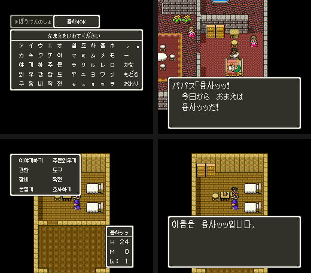

# DQ5(SFC) 한글 넣기 실현성

한글 해킹롬을 만들 때 롬을 늘리고, 보행 모드 메시지를 새 허프만 트리로 다시 부호화해 옮기고, 한글 글자를 넣는 일이 실제로 되는지 실험으로 확인한 문서입니다. 해킹 자체가 아니라 그 앞의 실현성 확인입니다.
글자 코드·폰트·트리·메시지 형식은 [dq5-text-format.md](dq5-text-format.md) 에 있고, 찾아낸 과정은 일지에 있습니다.

- [2026-10-25-66: 롬 확장, 트리 다시 만들기, 한글 메시지](../journal/2026-10-25-66-hangul.md)
- [2026-10-25-86: 늘린 롬의 교회 저장, 이름 길이, BG3 타일 칸, 창 머리 마무리](../journal/2026-10-25-86-text5.md)
- [2026-10-25-103: 한글 시제품(메시지 한 줄·이름·명령 창)](../journal/2026-10-25-103-hangul2.md)
- [2026-10-25-116: 한글 시제품을 전원부터, 긴 창 레코드 옮기기](../journal/2026-10-25-116-hangul3.md)
- [2026-10-25-140: 창 2바이트 부호의 두 길, 옮긴 레코드를 둘 자리](../journal/2026-10-25-140-hangul4.md)
- [2026-10-25-153: 옮긴 레코드 자리 다시 재기, VRAM 배치, 창 머리 +0 bit5·6](../journal/2026-10-25-153-hangul5.md)
- [2026-10-25-173: WRAM 포트 주소와 BG3 타일맵 옮기기 시도](../journal/2026-10-25-173-hangul6.md)
- [2026-10-25-195: 옮긴 레코드 자리의 접근 카운터, BG3 타일맵을 쓰는 곳 전부](../journal/2026-10-25-195-bg3map.md)
- [2026-10-26-14: BG3SC 를 쓰는 곳, 거울 뱅크로 찾은 타일맵 쓰기, 3C00·4C00 으로 옮겨 보기](../journal/2026-10-26-14-bg3move2.md)

기준과 검증:

- 기준 롬: `rom/dq5.sfc`([README](../../../README.md) 의 SHA-1). 실험용 롬은 [sfc/dq5/tools/dq5hangul.py](../tools/dq5hangul.py) 가 `work/` 아래에 만들고 커밋하지 않습니다.
- 게임 실측은 MesenCE 와 `sfc/dq5/tools/lua/dq5msg.lua` 입니다. 같은 롬을 두 번 돌려도 인물 걸음·▼ 깜빡임 자리는 몇 점 다르게 찍히므로, 화면 비교는 그 자리를 뺀 메시지 창으로 봅니다.

## 한눈에 보기

| 할 일 | 결과 | 근거 |
| --- | --- | --- |
| 롬을 2·3·4MB 로 늘리기 | 됨. 세 크기 모두 전원을 켜 이름 입력 창까지 원래 롬과 같은 화면, 선실 세이브스테이트에서 말 걸기도 같음 | 실측 |
| 메시지를 늘린 뱅크로 옮기고 트리를 다시 만들기 | 됨. 메시지 3,199개가 롬만으로 다시 풀어 같고, 게임에서 띄운 9개 메시지 창이 같음 | 실측 |
| 새 글자 코드에 한글 그리기 | 됨. 「한」「글」(코드 `3DB`·`3DC`)이 메시지에 찍힘 | 실측 |
| 이름·창·전투 문자열(1바이트 부호)에 한글 | 그대로는 안 됨. 아래 「1바이트 부호」 | 코드 읽기와 실측 |

## 롬 확장

`dq5hangul.py rom/dq5.sfc expand --size N` 은 롬 뒤를 0 으로 채우고, 늘린 자리 뱅크마다 첫 8바이트에 표지(`DQ5X` + 파일 뱅크 번호)를 쓰고, 머리 체크섬(`7FDC`~`7FDF`)을 고칩니다.
머리 롬 크기(`7FD7`)는 원래 롬이 1.5MB 인데도 `0B`(2MB)이고, 3·4MB 는 `0C` 로 둡니다. 맵 모드(`7FD5`)는 `20`(LoROM) 그대로입니다.

전원을 켜고 5프레임째에 CPU 주소를 읽은 결과입니다(MesenCE).

| 롬 | `30:8000` | `40:8000` | `60:8000` | `7D:8000` |
| --- | --- | --- | --- | --- |
| 원래(1.5MB) | `20:8000` 과 같음 | 0 | `20:8000` 과 같음 | 머리 문자열 |
| 2MB | 표지 `30` | 0 | `20:8000` 과 같음 | 표지 `3D` |
| 3MB | 표지 `30` | 표지 `40` | 표지 `40` | 표지 `40` |
| 4MB | 표지 `30` | 표지 `40` | 표지 `60` | 표지 `7D` |

- 2MB 면 뱅크 `30`~`3F`(512KB)가 새로 생깁니다. 4MB 면 뱅크 `40`~`7D` 의 `8000`~`FFFF` 가 파일 `200000` 부터로 이어집니다. 3MB 는 `40`~`5F` 만 새 자료이고 `60` 부터는 `40` 이 되풀이됩니다.
- 세 크기 모두 새 SRAM 으로 전원을 켜 3,000프레임(이름 입력 창)까지 찍은 화면 두 장이 원래 롬(이름만 바꾼 복사본)과 같았습니다. MesenCE 는 롬 파일 이름마다 SRAM 을 따로 두므로 이름이 다른 롬은 새 SRAM 으로 시작합니다.
- 원래 롬의 SRAM(모험의 서가 든 것)을 4MB 롬과 `retree` 롬 이름으로 복사해 켜자 1,400·3,000프레임 화면(모험의 서를 불러 성 안)이 원래 롬과 같았습니다. 불러오기는 됩니다.
- 교회 저장 → 리셋 → 불러오기도 했습니다. 4MB 롬과 원래 롬(이름만 바꾼 복사본)에 원래 SRAM 을 붙이고, 선실 세이브스테이트에서 주인공 이름 첫 두 바이트를 `12`·`13`(うえ)으로 바꾼 뒤 파파스를 교회(대화 번호 `05`)로 바꿔 おいのり → 1번 모험의 서에 저장했습니다(「たしかに 記録しましたぞ。」, 메시지 `084`).
  두 롬이 남긴 SRAM 파일 8,192바이트가 같았고, 원래 SRAM 과는 달랐습니다. 그 SRAM 으로 전원을 켜 모험의 서를 불러오자 두 롬 모두 02/06 에서 「よくぞもどられた！ うえああどの。」 였고 `7E:2001` = `12 13 10 10` 이었습니다.
- 원래 롬으로 만든 선실 세이브스테이트를 늘린 롬에 불러 파파스에게 말을 걸자 메시지 번호(`742`)와 화면이 같았습니다.

## 메시지 옮기기와 트리 다시 만들기

`dq5hangul.py rom/dq5.sfc retree` 는 2MB 롬에서 아래를 합니다.

1. 메시지 3,200개를 원래 트리로 풀고, 메시지 `129` 만 `{1006}` `3DB` `3DC` `{1001}` 로 바꿉니다.
2. 코드별 횟수로 허프만 트리를 새로 만들어(잎 993, 노드 992, 가장 긴 부호 17비트) 메시지를 다시 부호화합니다. 결과 141,244바이트를 뱅크 `30` 에 둡니다.
3. 디코더 `24:9E02`~`9E46` 을 뱅크 `30:8000` 에 그대로 옮기고 표 주소(트리 1·0, 비트 마스크)와 뿌리를 새것으로, 끝의 `RTS` 를 `RTL` 로 바꿉니다. `24:9E02` 에는 `JSL 30:8000` / `RTS` 를 둡니다.
4. 색인 `24:AF1E`(16개마다 3바이트)를 새로 씁니다.
5. 폰트 묶음 표를 뱅크 `30` 으로 옮겨 글자 2개(11×13) 묶음을 더하고, 그림은 옮긴 메시지가 비운 `07:D77C` 에 둡니다. 표를 읽는 피연산자 넷을 고칩니다([dq5-text-format.md 「한글 넣기 준비」](dq5-text-format.md#한글-넣기-준비)).

색인 값은 24비트를 3 오른쪽으로 민 21비트 주소라 뱅크 `1F` 까지만 가리킵니다. 그래서 색인에는 `주소 - 200000` 을 넣고 풀 때 뱅크에 `20` 을 OR 해야 하는데, 색인을 푸는 `24:8C8D` 는 전투 메시지(`24:8C60`)도 부릅니다.
처음에 `24:8C8D` 안을 고치자 전투 메시지가 엉뚱한 곳을 읽어 슬라임·ドラキー 전투의 메시지 프레임이 원래 롬(161·202·246 …)과 달라졌습니다(161·231·271 …). 보행 모드 쪽 호출(`24:8BD6`)만 비운 디코더 자리 `24:9E07` 의 `JSR 8C8D` / `LDA $F2` / `ORA #$20` / `STA $F2` / `RTS` 로 돌리자 전투 메시지 프레임이 원래와 같아졌습니다.

| 고친 곳 | 바이트 |
| --- | --- |
| `24:9E02` | `22 00 80 30 60`(`JSL 30:8000` / `RTS`) |
| `24:9E07` | `20 8D 8C A5 F2 09 20 85 F2 60` |
| `24:8BD7` | `07 9E`(`JSR 8C8D` → `JSR 9E07`) |
| `24:AF1E`~`24:B175` | 새 색인 200개 |
| `24:A63C`·`A660`·`A6C2`·`A673` | 새 폰트 묶음 표 주소 |
| `30:8000`~ | 디코더 사본, 마스크, 트리 1·0, 폰트 묶음 표, 메시지 |
| `07:D77C`~ | 새 글자 그림 |

확인한 것:

- 롬만으로 다시 풀기(`decode_check`, 디코더 사본·새 색인·`OR 20` 을 그대로 따름): 메시지 3,199개(129 제외)가 원래 롬에서 푼 코드와 모두 같습니다.
- 선실에서 메시지 `1DB`·`3CE`·`0B6`·`16B`·`2D2`·`1F9`·`058`·`742`·`061` 을 띄우고 A 를 눌러 세 번씩 찍은 27장의 메시지 창(▼ 자리 제외)이 원래 롬과 같았습니다. 다른 자리(파파스·주인공, ▼)는 원래 롬을 두 번 돌린 것끼리도 달랐습니다.
- 전원을 켜 이름 입력 창까지, 전투 메시지 번호와 프레임(161·202·246·287·330·395)이 원래 롬과 같았습니다.
- 메시지 `129` 가 「한글」 로 찍혔습니다(위 그림).

## 한글 규모로 늘릴 때

| 항목 | 지금 쓴 양 | 한글 2,350자를 넣을 때 |
| --- | --- | --- |
| 글자 코드 | `001`~`3DA` | `3DB`~`FFF` 3,109칸이 비어 있음(`24:81B0` 이 `1000` 미만을 글자로 봄) |
| 글자 그림(뱅크 `07`~`0A` 만) | 원래 폰트 16,238바이트 | 메시지를 옮기면 `07:D77C`~`0A:FFFF` 108,676바이트가 빔. 11×13 한 자 18바이트로 6,037자 |
| 트리 | 잎 993, 표 3,968바이트(뱅크 30) | 잎 약 3,300 이면 표 약 13KB. 안쪽 노드 번호가 13비트라 8,191노드까지. 표는 디코더 사본과 같은 뱅크(`LDA abs,X`) |
| 메시지 | 141,244바이트(뱅크 `30`~`34`) | 2MB 롬의 뱅크 `30`~`3F` 512KB. 메시지는 디코더가 뱅크를 넘어 읽으므로 경계에 맞출 필요 없음 |
| 폰트 묶음 표 | 51묶음 | 묶음 수 제한 없음(`24:A638` 고리), 표는 long 주소라 어느 뱅크나 |

## 1바이트 부호

이름 표·창·전투 메시지 글자는 보행 모드 메시지와 다른 길로 그려집니다. 지금까지 확인한 것:

| 쓰는 곳 | 그리는 길 | 근거 |
| --- | --- | --- |
| 메시지 안 이름(`1008`·`1009`~`1017`) | `24:84C9` → `24:A7B6` 이 바이트를 글자 코드로 바꿔(`24:B270` 127칸, `84`·`83` 은 `24:AE9A`·`24:B36E` 탁점 표) 보행 모드 폰트로 그림 | 코드 읽기. 세 표를 읽는 명령은 롬 전체에서 뱅크 24 의 이 루틴뿐 |
| 창 문자열 | `04:B0F0` 이 바이트를 BG3 타일 번호로 그대로 씀(`04:B235`, `STA ($E0),Y`). `84`·`83` 은 탁점 타일을 덧붙이고(`04:B258`·`B2B0`), `B0` 이상은 숫자·이름 자리(`04:B33A`) | 명령 창을 연 뒤 VRAM 의 BG3 타일맵(워드 `1CA4`)이 `2029 2024 201C`(はなす = `29 24 1C`) |
| 전투 메시지 | `24:8C39` 가 푼 1바이트 부호를 글자 격자 `7E:1DD5`(한 줄 26바이트)에 두고, `24:A5D9` 가 그 바이트를 BG3 타일맵 버퍼 `7E:5546` 에 그대로 옮김. 버퍼는 `00:8E70`·`8E90` 의 DMA 로 VRAM 워드 `1C00` 에 감 | 전투 메시지가 뜨는 동안 VRAM 으로 가는 DMA 는 이 타일맵뿐이고 글자 타일은 올리지 않음(`dq5vramlog.lua`). `7E:5000`~`57FF` 쓰기 기록에서 `24:A5F0` 이 8,268번 |
| 전투 글자 타일 | 전투를 시작할 때 `26:8030` → `04:E2A1` 이 `04:EA28` 의 2bpp 4개를 BG3 타일 `96`~`99` 에, 이어서 1bpp 22개를 `9A`~`AF` 에 올림(전송 목록 `7E:4000`, VRAM 워드 `14B0`). 「。」(`9A`)·「「」(`9C`)·「…」(`9D`)·「Ａ」~(`A0`~) 같은 전투 전용 글자 | 전투 세이브스테이트의 VRAM 타일 `9A`·`9C`·`9D`·`A0`·`A1` 평면 0 이 `04:EA68`·`EA78`·`EA80`·`EA98`·`EAA0` 의 8바이트와 같음 |
| 전투의 타일 `B0` 이후 | 보행 모드와 같은 글자 캔버스 `7E:5800` 을 `00:8ECA` 의 DMA(`0750` 바이트, VRAM 워드 `14B0` = 타일 `96`~`10A`)로 올린 것. 버퍼는 `24:80B4` 가 지움 | 필드에서 전투를 붙이며 VRAM 워드 `1580`~`15FF` 쓰기와 DMA 를 기록(`dq5vramlog.lua`): 501·550프레임에 이 DMA, 549프레임에 `24:80C3` 이 `7E:59A0`~ 를 0 으로 |

BG3 타일 칸은 VRAM 워드 `1000`~`1BFF`(타일 `000`~`17F`, 384칸)이고 `1C00` 부터가 타일맵입니다. 메시지 `2D2` 를 띄운 동안의 타일맵은 `96`~`17F` 234칸을 모두 썼고(보행 모드 글자 그리기 칸), 메시지 없이 명령 창만 열었을 때는 `92` 까지만 썼습니다.
메시지 창이 떠 있는 동안에는 남는 BG3 타일이 없어서, 창·전투 글자를 `96` 이후에 그려 넣으려면 메시지 창과 번갈아 쓰거나 타일 칸을 넓혀야 합니다.

그래서 한글을 이름·창·전투에 쓰려면 다음 가운데 하나가 필요합니다.

- 1바이트 그대로: 창·전투 글자는 BG3 타일 `01`~`8A`(전원을 켤 때 `04:E17D` 가 `04:E528` 의 1bpp 138자를 올림, [dq5-graphics-format.md 「창·메뉴 타일」](dq5-graphics-format.md#창메뉴-타일-04e17d))이고, 바이트가 곧 타일 번호입니다. `04:E528` 의 타일 `29`(は) 자리 8바이트를 상자 모양으로 바꾸자 이름 입력 창의 「は」 가 상자로 나왔습니다. 그러니 이 138칸과 이름 부호 표(127칸) 안에서 자주 쓰는 한글만 고르는 길이 있습니다.
- 2바이트 부호를 쓸 때 길이 쪽 실측:
  - 주인공 이름은 `7E:2001`~`2008` 8바이트입니다. 여덟 칸을 모두 글자(あ~く)로 채우자 메시지(`1012`)는 「あいうえおかきく」 여덟 자를 찍었고, 상태 창 제목(이름)은 「あいうえ」 넉 자만 찍었습니다. 이름 입력 창은 넉 자(`****`)입니다. 한글 넉 자를 2바이트로 쓰면 8바이트에 들어가지만, 상태 창처럼 넉 칸만 찍는 곳은 글자 수를 따로 세어야 합니다.
  - 이름 표(`21:955D`)는 `[길이][바이트…]` 이고 표마다 24비트 주소(`21:959B`)라, 길어진 표를 늘린 뱅크로 옮길 수 있습니다(코드 읽기).
  - 창 레코드는 뱅크 04 안의 16비트 주소(`04:EB48`)로 찾고 뱅크 04 에는 쓰지 않는 빈 곳이 거의 없어(00·FF 가 16바이트 이상 이어진 곳이 모두 합쳐 561바이트, 쓰임 미확인), 항목 문자열이 길어지면 레코드를 다른 뱅크로 옮기고 읽는 코드(`04:9C40`)를 고쳐야 합니다(코드 읽기).
- 2바이트 부호: 탁점 접두(`84`·`83`)처럼 비어 있는 접두 바이트를 정해 뒤 바이트와 함께 글자 코드를 고릅니다. 고칠 곳은 `24:A7B6`(`24:A7C7` 의 `CMP #$84` 갈래), `04:B0F0`(`CMP #$B0`·`#$84`·`#$83` 갈래와 타일을 그때그때 그려 넣는 길), 이름 표 길이(`21:955D`), 전투 메시지를 그리는 곳입니다. 창은 타일 번호를 그대로 쓰므로 BG3 타일을 그때그때 그려 넣는 길을 새로 만들어야 합니다.

## 시제품

`dq5hangul.py rom/dq5.sfc proto` 는 `retree` 위에 한글을 얹은 2MB 롬을 만듭니다. 글꼴은 `sfc/dq5/tools/dq5hangulfont.py` 가 자모를 선분·타원 좌표로 정의해 조합한 것(직접 그림)이고, 보행 모드용 11×13 과 창용 8×8 두 크기를 같은 정의에서 뽑습니다.

| 부분 | 만든 것 | 고친 곳 |
| --- | --- | --- |
| 메시지 한 줄 | 메시지 129 = `{1006}이름은 {1012}입니다。{1001}`, 한글 8자(`3DB`~`3E2`, 11×13) | `retree` 의 트리·메시지·폰트 묶음(뱅크 30) |
| 이름 | 주인공 이름 바이트 `5E 5D`(용사). 같은 바이트가 메시지에서는 `24:B270[5E]`·`[5D]` 로 11×13 글자가, 창에서는 BG3 타일 `5E`·`5D` 가 됨 | `24:B270` 의 두 칸, `04:E528` 의 타일 두 개 |
| 명령 창 | 항목 8개를 한글 두 자(문은 한 자)로, 글자 하나 = BG3 타일 하나(8×8). 너비를 가장 긴 줄(커서 칸 1 + 2 + 공백 1 + 커서 칸 1 + 2 = 7) + 테두리 2 = 9 로 다시 잡음(원래 12) | 창 레코드 `04:ED0C`(같은 길이 안), `04:E528` 의 타일 15개(`50`~`5E`) |

트리 표는 뱅크 30 에 디코더 사본과 함께 둡니다. 뱅크 24 에는 00·FF 가 48바이트 넘게 이어진 곳이 없어 늘어난 표(잎 997, 3,984바이트)를 둘 수 없고, 사본 디코더는 `PHK`/`PLB` 로 표를 같은 뱅크에서 `LDA abs,X` 로 읽으므로 표와 사본이 한 뱅크에 있으면 됩니다.

확인한 것(선실 세이브스테이트, 이름은 `POKE="7E2001=5E;7E2002=5D;7E2003=01"`):

- 명령 창을 열고 VRAM 을 덤프하자 BG3 타일맵 다섯째 줄이 `8E 7C 50 51 01 01 52 53 8E`(테두리·커서·대화·공백·주문·테두리)로, 테두리가 2~10열이라 너비 9 였습니다. 상태 창 제목 줄은 `8E 5E 5D 01 01 8E`(용사)였습니다.
- 빈 쪽에 말을 걸자 메시지 `129` 가 「이름은 용사입니다。」 로 한 줄에 찍혔습니다.
- 세이브스테이트의 VRAM 에는 고친 롬의 창 글자가 없으므로(창 글자는 전원을 켤 때 `04:E17D` 가 올림), `dq5msg.lua` 의 `BG3FONT=26528:8A` 로 롬의 `04:E528` 을 `04:E17D` 와 같은 꼴(둘째 평면 FF)로 VRAM 타일 1~ 에 다시 써 넣고 찍었습니다. 덤프의 타일 `50`~`5E` 가 롬 바이트와 같았습니다. 롬을 바꾸면 전원을 켤 때 그 타일이 올라가는 것은 [위](#1바이트-부호)의 타일 `29` 실험으로 확인했습니다.
- 창 레코드 끝에는 `80` 이 있어야 합니다. 처음에 새 항목 뒤를 옛 바이트 그대로 두자 그 바이트를 이어 읽어 화면 오른쪽 위에 빈 상태 창 하나가 더 떴고, 새 항목 뒤에 `80` 을 쓰자 없어졌습니다.

### 전원부터 켜기

시제품 롬을 새 SRAM(롬 이름을 새로 지음)으로 전원부터 켜고, ぼうけんのしょをつくる → 1번 → 이름 입력에서 가타카나 쪽으로 바꿔 한글이 된 칸(ヘ → 용, フ → 사)을 골라 새 게임을 시작했습니다. 세이브스테이트는 쓰지 않았습니다.

- 이름 입력 창의 가타카나 쪽에 바꾼 타일(대·화·주·문 …)이 그대로 나왔습니다. 전원을 켤 때 `04:E17D` 가 바꾼 `04:E528` 을 올린 것입니다.
- 이름은 `5E 5D 70 70` 으로 저장됐습니다. 남은 두 칸 `＊` 가 `70`(ッ)으로 들어가는 것은 원래 롬에서 같은 입력(ヘフ)을 해도 같았습니다(「ヘフッッ」).
- 6,788프레임에 파파스가 이름을 짓는 메시지 `1DB` 가 「용사ッッ！ 今日から おまえは 용사ッッだ！」 로, 배 선실에서 연 명령 창·상태 창과 빈 쪽에 말을 건 메시지 `129` 가 세이브스테이트 실험과 같은 모양으로 나왔습니다. 이때 VRAM 의 BG3 타일맵도 세이브스테이트 실험과 같은 타일 번호였습니다.

### 긴 창 레코드 옮기기

`proto --long` 은 명령 창 항목을 「이야기하기·주문외우기·강함·도구·장비·작전·문열기·조사하기」 로 바꿉니다. 레코드가 56바이트로 원래 자리에 들어가지 않고, 너비는 15 입니다.
창 레코드를 읽는 코드(`04:9C4F`·`9F8E`·`A97A`·`B0F0` 등)는 데이터 뱅크 04 에서 16비트 주소(`$DA`)로 읽으므로, 레코드는 뱅크 04 안이나 뱅크 00~3F 의 `$0000`~`$1FFF`(낮은 WRAM 거울)에만 둘 수 있습니다.
그래서 레코드를 뱅크 36 에 두고, 창 표의 창 01 칸을 `$11A0` 으로 바꾸고, 표를 읽는 `04:9C46`(`LDA $EB48,X` / `STA $DA`)을 `JSL 36:8100` 으로 바꿨습니다. 훅은 원래 두 명령을 하고, 주소가 `$11A0` 이면 `MVN` 으로 레코드를 `7E:11A0` 에 복사합니다.
`7E:119F`~ 610바이트는 선실·필드·전투 세이브스테이트에서 명령 창·대화·전투를 돌리며 찍은 낮은 WRAM 덤프 27개에서 모두 0 이었던 자리였지만, 뒤의 쓰기 감시에서 전투가 쓰는 자리로 드러나 `7E:1C40` 으로 옮겼습니다(아래 「옮긴 레코드를 둘 자리」).

- 선실 세이브스테이트에서 명령 창을 열자 `7E:11A0` 이 `02 04 0F A9 00 04 FE 4B 4C 4D 4E 4D 01 FE …` 였고, BG3 타일맵의 테두리가 2~16열(너비 15)이었습니다.
- 전원부터 켠 새 게임에서도 같은 창이 나왔습니다(아래 그림 셋째).

### 2바이트 이름 부호

`proto --twobyte` 는 이름 문자열을 글자 코드로 바꾸는 `24:A7B6` 에 접두 `85` 를 더합니다. 보통 바이트를 `24:B270` 으로 바꾸는 `JSR $A81E`(`24:A7D5`)를 `JSR $9E11` 로 돌리고, `retree` 가 비운 디코더 자리 `24:9E11` 에 「`85` 면 다음 바이트 `xx` 를 읽어 글자 코드 `3DB + xx - 10` 을 쓰고, 아니면 `24:A81E`」 루틴(27바이트)을 둡니다.
`xx` 를 `10` 부터 쓰는 것은 이름 끝 `01`(`24:8A0F` 가 여기서 멈춤)과 겹치지 않게 하려는 것입니다. 처음에 `00` 부터 쓰자 넷째 글자 `85 01` 의 `01` 에서 이름이 끝나 남은 바이트 수가 어긋났고, 메시지가 이름 앞에서 멈췄습니다.

주인공 이름 8바이트를 `85 18 85 19 85 10 85 11`(한글이름)로 두자 메시지 `129` 가 「이름은 한글이름입니다。」, 메시지 `1DB` 가 「パパス「한글이름！ 今日から おまえは 한글이름だ！」 였습니다. 이름 8바이트에 2바이트 넉 자가 들어갑니다.
창은 바이트를 BG3 타일 번호로 바로 쓰므로(`04:B235`) 이 접두를 쓰려면 `04:B0F0` 에 타일을 그려 넣는 길을 따로 만들어야 하고, 이번 시제품에는 넣지 않았습니다.

### 옮긴 레코드를 둘 자리

낮은 WRAM 쓰기를 주소마다 처음 한 번씩 기록하는 `dq5msg.lua WRAMWATCH=1100-1EFF WRAMWATCHBY=addr` 로 세이브스테이트 실행 다섯을 돌렸습니다: 전투(A 40번), 필드에서 좌우로 걸어 무작위 전투와 싸움, 무기점, 교회 저장, 31/00 이벤트 전투.

- `7E:119F`~`13FF` 는 610바이트 가운데 609바이트가 쓰였습니다. 전투에서 `20:A782`(`7E:11A0`)와 `21:FEB2`~(`7E:1200`~`129A`)가 씁니다. 시제품은 창을 열 때마다 레코드를 다시 복사하므로 화면은 맞았지만, 빈 자리는 아니었습니다.
- 다섯 실행 모두에서 한 번도 쓰이지 않은 48바이트 넘는 자리는 `7E:1868`~(220)·`7E:1ABC`~(246)·`7E:1BBE`~(79)·`7E:1C33`~(344)·`7E:1E71`~(61)였습니다. 전원부터 켠 실행은 처음에 낮은 WRAM 을 모두 지워서 이 셈에서 뺐습니다.
- 롬 전체에서 이 범위를 절대 주소로 쓰는 명령 모양을 세면 수백 곳이 나오지만 자료 바이트가 섞여 가를 수 없었습니다. 그래서 증명이 아니라 「다섯 실행에서 쓰이지 않은 자리」 입니다.
- 처음엔 복사 자리를 `7E:1C40` 으로 옮겼으나, 다시 재 보니 세이브스테이트 셋 모두 `7E:1C30`~`1C52` 에 자료(`7E 3C C3 66 …`)가 남아 있었고 필드 루틴 `02:ACB2`~ 가 `7E:1C0D`~`1C31` 을 씁니다. 그래서 다시 옮겼습니다.

다시 잰 방법과 결과(`7E:1ABC`~`1BB1`, 246바이트). 끝 바이트 `7E:1BB1` 은 쓰이는 자리였습니다. 맵 17/01 에 들어설 때 `02:A2FF STZ $1BB1` 이 0 으로 지우고, 항구 장면에서 `03:F472 AND $1BB1` 이 읽습니다(아래 「CDL 을 늘려 다시 나누기」). 옮긴 레코드는 `7E:1ABC`~`1BB0`(245바이트) 안에 둡니다:

- 읽기·쓰기 감시(`WRAMWATCH=1ABC-1BB1 WRAMWATCHREAD=1`)로 일곱 실행을 돌렸습니다: 전원부터 켠 새 게임(1,600프레임 뒤부터, 처음 지우기 제외), 전투, 필드 무작위 전투, 무기점, 교회 저장, 31/00 이벤트 전투, 일행 셋의 메뉴. 쓰기는 한 번도 없었습니다.
- 읽기는 무기점 실행의 `06:F53D` 한 번이었습니다. 이 루틴(`06:F534`)은 `FF` 로 끝나는 목록을 `($00),Y` 로 훑는데, 파파스 대화 번호를 가게로 바꾼 실험이라 목록 주소가 낮은 WRAM 을 가리킨 것으로 보입니다. 같은 실행에서 `7E:1C33`·`1C4B` 도 읽었습니다.
- 세이브스테이트 셋(선실·필드·전투)에서 이 범위는 모두 0 이었습니다.
- 롬 전체에서 이 범위를 절대·롱 주소로 가리키는 명령 모양 1,373곳(`7E:1C33`~`1D8A` 기준, 자료 바이트 포함)에 실행 감시를 걸고 전투·가게·교회·이벤트 전투·일행 메뉴를 돌렸을 때 실행된 곳은 없었습니다. 전원부터 켠 실행과 필드 실행은 이 감시를 걸면 MesenCE 테스트 실행이 끝나지 못했습니다.
- DP 상대 주소는 D 가 `1Bxx` 이상이어야 닿고, 간접 주소는 감시로만 잡힙니다. 그래서 이것도 증명은 아닌 「일곱 실행에서 쓰이지 않은 자리」 입니다.
- `proto --long` 의 복사 자리를 `7E:1AC0` 으로 바꾸고 명령 창을 열어 `7E:1AC0` 에 레코드가 있는 것을 확인했습니다.
- WRAM 포트(`$2180`)로 쓰는 것은 메모리 감시에 걸리지 않으므로, 포트 주소 레지스터 `$2181`~`$2183` 쓰기를 전투·필드 무작위 전투·무기점 실행에서 기록해 주소를 되살렸습니다(`WW=002181,002182,002183`). 낮은 WRAM 쪽 시작 주소는 `0000`~`0378` 뿐이었고 `7E:1ABC` 근처를 가리킨 적은 없었습니다.
- 메모리 감시는 주소 지정 방식마다 빠지는 것이 있을 수 있어, MesenCE 접근 카운터(`emu.getAccessCounters`, 콜백 없이 CPU 의 모든 읽기·쓰기를 셈)로 다시 쟀습니다(`dq5msg.lua` 의 `ACCESS="1ABC-1BB1"`). 장면 아홉에서 실행 끝까지 셌습니다. 전원을 켜고 새 게임을 시작해 오프닝 대화를 넘긴 10,700프레임, 이어하기 4,000프레임, 선실 무기점·교회·장면 `36EB=06`, 무작위 전투 2,500프레임, 필드 12,000프레임(걷기와 명령 창), 사건 대화 5,500프레임, 동료가 있는 일행의 명령 창입니다.
  - 쓰기: 전원을 켤 때 `00:864A STZ $00,X`(낮은 WRAM 8KB 를 0 으로) 한 번뿐입니다.
  - 읽기: 전원을 켤 때 `00:865B` 이후의 `MVN`(0 을 나머지 WRAM 으로 퍼뜨림)이 네 번 읽습니다. 그 밖에는 선실 상태를 `SET 36EB=01` 로 억지로 무기점으로 바꾼 실행 하나에서 `06:F534`(`LDA ($00),Y` 로 상점 표를 훑음)가 57번 읽었습니다. 표에 없는 상점 번호를 찾느라 뱅크 04 끝을 넘어 `05:0000`~(낮은 WRAM 거울)까지 읽은 것이고(감시에서 `05:1ABC` 읽기, 그 고리 120,636번), 쓰지는 않습니다.
- 같은 아홉 실행에서 롬의 실행된 바이트(84,848개, 카운터 `execCount`) 가운데 2바이트 연산자가 `1ABC`~`1BB1` 인 자리 32곳을 뽑아 그 앞뒤 16바이트를 다시 커버리지로 돌렸습니다(`COVER` 를 쉼표로 여러 범위). 32곳 모두 다른 명령의 중간 바이트였고(`22:AD02` 의 `0D F0 1A` 는 `22:AD00 LDA $0D1E` 의 끝 등), 이 범위를 연산자로 쓰는 명령은 실행되지 않았습니다.
- 직접 페이지: 장면 여섯(선실, 전투, 필드, 사건, 일행, 전원)의 50~60프레임 커버리지에서 D 레지스터는 `0000` 만 나왔고(`dregs.txt`), 실행된 `TCD` 는 모두 바로 앞이 `LDA #$0000` 이었습니다.
- 다른 장면 여덟로 접근 카운터를 다시 셌습니다: 전원부터 로고·파일 고르기·새 게임 3,000프레임, 타이틀을 그대로 둔 7,000프레임, 새 모험의 서·이름 넣기 2,600프레임, 설정 바꾸기 1,800프레임, 필드 무작위 전투 5,000프레임, 선실 명령 창·대화, 무기점, 전투 2,000프레임. 실행된 롬 바이트는 합쳐 68,657개입니다. `1ABC`~`1BB1` 246바이트는 전원부터 켠 넷에서 모두 「읽기 4·쓰기 1」(위의 0 채우기와 `MVN`)이었고, 세이브스테이트 넷에서는 한 번도 읽히거나 쓰이지 않았습니다.
- 접근 카운터는 CPU 버스의 읽기·쓰기를 주소 지정 방식과 상관없이 세므로, 실행된 명령 가운데 절대·롱·DP(+D)·간접·색인 주소 어느 것도 이 범위에 닿지 않았다는 뜻입니다. 실행되지 않은 코드는 이것으로 말할 수 없어, 여전히 증명이 아니라 「실행한 열일곱 장면에서 접근이 없는 자리」 입니다.
- 롬 전체를 정적으로 훑었습니다(`dq5wramrefs.py`). 모든 바이트를 명령 시작으로 보고 이 범위에 닿을 수 있는 모양을 셌습니다. 절대·롱 피연산자, 간접 포인터 자리, 16비트 즉값(간접 주소의 바탕 후보), D 를 알 수 없거나 범위에 걸치는 `TCD`·`PLD`, 대상 범위를 알 수 없거나 걸치는 `MVN`·`MVP` 입니다. 실행 커버리지는 장면 열셋(`lua/dq5execcov.lua`: 전원부터 셋, 타이틀 연출, 필드 전투, 선실 메뉴, 무기점, 전투, 주문 연출 여섯)과 앞의 장면 여덟을 합친 85,676바이트입니다.
- 실행된 후보 자리 352곳에 실행 감시를 걸어, 그 자리가 실제 명령 시작으로 실행되는지와 그때의 레지스터를 적었습니다. 명령 시작은 14곳뿐이었습니다.
  - `PLD` 11곳(`00:8923`·`8FA7`·`96C2`·`A36F`~`A65D`, `21:8B1F`): 스택에서 꺼내는 값이 모두 `0000` 이라 D 는 0 이었습니다.
  - `MVN` 셋: `00:866D`(전원 지우기, 대상 `7E:8000`~), `22:8758`(대상 `7E:6000`~), `25:84D3`(대상 `7E:2001`~). 대상이 범위 밖입니다.
  - 나머지 338곳은 다른 명령의 중간 바이트였습니다.

| 모양 | 후보 | 실행된 명령 시작 | 실행된 다른 명령 중간 | 실행 코드가 없는 뱅크 | 코드가 있는 뱅크의 미실행 |
| --- | --- | --- | --- | --- | --- |
| abs | 353 | 0 | 16 | 161 | 176 |
| abs,X | 235 | 0 | 2 | 112 | 121 |
| abs,Y | 144 | 0 | 4 | 50 | 90 |
| long | 94 | 0 | 1 | 57 | 36 |
| long,X | 519 | 0 | 3 | 50 | 466 |
| 간접 포인터 | 22 | 0 | 0 | 15 | 7 |
| 즉값 | 40 | 0 | 0 | 29 | 11 |
| TCD | 2,046 | 0 | 86 | 1,174 | 786 |
| PLD | 3,148 | 11 | 121 | 1,506 | 1,510 |
| MVN·MVP | 6,185 | 3 | 105 | 2,621 | 3,456 |
| 합계 | 12,786 | 14 | 338 | 5,775 | 6,659 |

- 실행된 바이트가 하나도 없는 뱅크는 22개입니다(`07`~`0E`, `11`, `13`, `14`, `18`~`1D`, `27`, `2C`~`2F`). 그림·소리·글 같은 자료 뱅크로 보이고, 그 안의 5,775곳은 자료 바이트로 보입니다.
- 남은 미확인은 코드가 있는 뱅크의 미실행 6,659곳입니다. 그중 피연산자가 직접 범위를 가리키는 모양(절대·롱·간접 포인터·즉값)은 907곳이고, 나머지 5,752곳은 `TCD`·`PLD`·`MVN`·`MVP` 바이트(`5B`·`2B`·`54`·`44`)라 값을 정적으로 알 수 없습니다. 그래서 이것도 완전한 증명은 아닙니다.
- MesenCE 가 이 롬에 쌓아 둔 코드·자료 기록(CDL, `emu.getCdlData`, 지금까지 이 저장소의 모든 실행이 쌓은 것)으로 직접 피연산자 907곳을 더 나눴습니다(`dq5wramrefs.py --cdl`).
  - 327곳은 게임이 자료로 읽은 바이트라 명령이 아닙니다.
  - 11곳(과 실행 코드가 없던 뱅크 `11` 의 2곳)은 다른 실행에서 코드로 실행된 바이트였습니다. 13곳을 정렬된 디스어셈블로 보니 모두 다른 명령의 중간이었습니다(`00:CC88` 은 `A5 BC`·`C9 1A` 사이, `11:BB44` 는 `LDA #$04FF` 안, `22:D23C` 는 `STA $0CF9,Y`·`LDA $0D1B` 사이 등).
  - 남은 569곳은 코드로도 자료로도 한 번도 닿지 않은 바이트입니다. 이것이 직접 피연산자의 미확인 수입니다(실행 코드가 없는 뱅크까지 치면 274곳 더).

#### CDL 을 늘려 다시 나누기

MesenCE 의 CDL 은 바이트마다 bit0 코드, bit1 자료, bit2 점프 대상, bit3 서브루틴 입구, bit4·bit5 실행 때 X·M 이 8비트였는지를 남깁니다. 여러 MesenCE 를 함께 돌리면 디스크의 CDL 을 나중에 끝난 쪽이 덮어써 앞 실행의 기록이 사라지므로, 실행마다 `emu.getCdlData` 를 받아(`lua/dq5cdldump.lua`) 바이트 OR 로 합쳤습니다(`dq5cdlsweep.py`). 장면은 실내 맵 346곳 걷기, 몬스터 236종과 싸우기, 세계 셋 걷기, 시퀀스 0x47개 전송, 행동 0x00~0xAA 를 파파스·슬라임이 쓰는 전투 171번, 슬롯 셋, 슬라임 레이스, 격투장입니다. 코드 바이트는 124,461 → 157,339, 자료 바이트는 559,791 → 902,310 이 되었습니다.

`dq5wramrefs.py --cdl … --align` 은 CDL 코드 구간을 구간 첫 바이트부터 그 바이트에 적힌 M·X 폭으로 디스어셈블해 명령 시작 자리를 얻습니다(75,948개). 구간 끝을 넘는 구간과, 점프 대상 표시인데 명령 시작이 아닌 자리는 0개였습니다. BRK 인자 바이트는 CDL 이 자료로 표시해 구간이 거기서 끊기므로 정렬이 어긋나지 않습니다. 이 기준으로 12,786곳을 다시 나눴습니다.

| 후보 | 명령 시작으로 실행 | 실행된 명령 중간 | 자료로 읽힘 | 표시 없음 |
| --- | --- | --- | --- | --- |
| 직접 피연산자 | 2 | 47 | 724 | 634 |
| 값 모름(`TCD`·`PLD`·`MVN`·`MVP`) | 19 | 472 | 6,837 | 4,051 |

명령 시작으로 실행된 것은 실행 감시로 값을 쟀습니다.

- `02:A2FF STZ $1BB1`(M 8비트): 맵 17/01 의 맵별 루틴(`15:F907` 표의 17/01 항목, 처음 루틴 `02:A2D5`)이 들어설 때 부릅니다. 다른 맵에서 17/01 로 옮기자 `02:A2FF` 가 실행되고 `15:1BB1`(데이터 뱅크 `15`, 낮은 WRAM 거울)에 `00` 쓰기가 잡혔습니다.
- `03:F472 AND $1BB1`(`LDA $7F` 뒤, 결과가 0 이 아니면 `03:F4B8` 로): 17/01 의 대체 목록 `10:B135`(`7E:2192` bit7)에서 (49,53) 인물이 `21A1.7`·`21A4.7` 을 기다린 뒤 부르는 `06:D39A` → `02:A35C` → `03:F349` 의 고리입니다. `TO=17/01,40,56 SET="2192|80" LATESET="21A1|80;21A4|80"` 로 들어가자 541 프레임부터 2프레임마다 `03:F472` 가 실행되며 `03:1BB1` 을 읽었습니다. 같은 고리 안의 `03:F5C4 AND $1BB1` 은 실행되지 않았지만 앞의 실행 명령에서 이어 읽으면 명령 시작입니다.
- `00:D282 TCD`: 저장해 둔 문맥(`00:D227` 이 `7E:1A72`~`1A81` 에 X·Y·S·P·D·B·돌아갈 곳을 둠)을 되살리는 `00:D267` 안입니다. D 는 `7E:1A7B` 이고, 세이브스테이트 여섯(선실·필드·전투·타이틀·02/07·슬롯) 모두 `0000` 이었습니다.
- `00:88DA PLD`: NMI 처리기(`00:885D`)가 들어올 때 `PHD` 한 값을 되돌립니다. `03:9F5A PLD`: `03:9F2C` 의 끝이고, 01/0A 의 여행의 문(출구 속성 `33`)을 밟자 D = `0000` 이었습니다. `11:FCD7 PLD`: 슬라임 레이스에서 D = `1200` 이었습니다(직접 페이지 `1200`~`12FF`).
- 앞에서 잰 `PLD` 열하나(D = 0)와 `MVN` 셋(대상이 범위 밖)은 그대로입니다.

표시가 없는 바이트는 롬만으로 나눴습니다. 형식 문서가 「빈틈없이 이어진다」 고 적은 덩어리와 디코더가 실제로 읽어 내는 자료(대화 스크립트 574개, 메시지 3,200개, 전투 메시지와 글자 그림, 인물 목록, 이름 표, 창 레코드, 몬스터·구역·성장 표, 필드 조우 격자, 맵 레코드·블록, 필드 지도·블록 정의, 출구·영역 이동 표, 스프라이트·탈것 그림, 몬스터 그림, 전투 배경, 연출 조각과 연출 스크립트, 보상 표 등) 안이면 그 자료입니다. 이 범위들은 CDL 이 코드로 표시한 바이트와 하나도 겹치지 않았습니다. 그 밖은 같은 뱅크에서 바로 앞의 실행 명령부터 틈을 이어 읽어(폭은 REP·SEP 로, BRK 는 서비스마다의 인자 수로) 후보가 명령 시작인지 중간인지 봤습니다. 이렇게 읽어 다음 실행 명령까지 닿은 직접 피연산자 45곳은 모두 틈 끝이 그 명령 시작에 꼭 맞았습니다. 연출 스크립트는 명령표의 길이대로 흐름을 따라가 읽었고, 목록에 없는 연출 조각은 아는 조각의 끝에서 이어 풀어 다음 아는 조각 시작에 꼭 맞게 닿은 것만 받았습니다.

| 표시 없는 후보 | 자료 구조 안 | 명령 중간 | 모양으로 자료 보임 | 명령 시작 | 미정 |
| --- | --- | --- | --- | --- | --- |
| 직접 피연산자 | 564 | 46 | 14 | 1 | 9 |
| 값 모름 | 3,294 | 425 | 124 | 29 | 179 |

- 「모양으로 자료 보임」 은 실측이 아니라 모양입니다. 앞뒤 자료 표시 사이가 16바이트 이하인 틈, 둘레가 1씩 느는 바이트·같은 간격의 16비트 값이 이어지는 자리, 바로 앞 1~3바이트의 BRK 서비스 인자가 덮는 자리(`02:9055` 의 `00 19 44 02` 처럼 코드라면 BRK 의 인자), 그리고 바로 앞이 자료 표시라 실행 명령부터 읽을 수 없는 틈을 그 자료 뒤 바이트부터 M·X 네 가지로 읽어 다음 실행 명령에 꼭 닿는 읽기가 모두 명령 중간이라 한 자리입니다. 마지막 읽기는 직접 피연산자에서 눈으로 본 `03:CF90`·`23:DE3F`·`23:DF8C`(아래)와 같은 판정을 냈습니다. 같은 읽기의 「명령 시작」 은 `2B 2B 2B 2A 2A`(1바이트 명령처럼 읽히는 자료)도 이어서 명령 시작이 되어 쓰지 않습니다.
- 직접 피연산자의 「명령 시작」 1곳은 위 `03:F5C4` 입니다. 「미정」 9곳과 모양 판정 몇 곳은 리스팅을 눈으로 봤습니다. `03:CF90`(`CMP #$7E / BNE` 의 `7E D0 1A`)·`23:DE3F`(`JSR $DEF3` 의 끝)·`23:DF8C`(`EOR #$FFFF` 안)는 실행되지 않은 코드의 명령 중간입니다. `13:9EC4`·`14:886A` 는 실내 맵 CHR 뱅크에서 32바이트 타일 하나·둘이 통째로 읽히지 않은 자리이고, 그 타일은 어느 맵도 쓰지 않는 블록(`#189`·`#545`)만 가리킵니다. 나머지 10곳(`02:8FF7`·`02:DA6B`·`04:FBDB`·`10:FE02`·`11:AC5F`·`11:AF7B`·`11:DCA4`·`11:F9E5`·`15:F78F`·`1E:F57F`)은 작은 수의 표, `FF` 로 나뉜 목록, 포인터 표(`04:FBD5`~ 상점 목록 포인터), 15비트 색 같은 자료 모양입니다.
- 값 모름의 「명령 시작」 29곳은 대부분 `RTS`·`RTL` 뒤의 자료가 우연히 명령처럼 읽힌 것(`03:9AAC`·`22:E50E`·`04:D4EA` 등)이거나 8비트 M 에서 분기의 피연산자인 것(`06:DAED`)이고, `00:A350`·`00:A550` 은 실측한 `00:A36F` 등과 같은 `PHD`…`PLD` 끝맺음입니다. 값 모름의 「미정」 179곳과 함께 아직 하나씩 보지 않았습니다. 미정은 대부분 실행되지 않은 코드 뱅크의 큰 틈(`21:BC6C`~`D15E`·`23:DD3E`~`E14F` 등)과 뜻을 모르는 표(`2A:8000`~`868F` 는 `0xD2` 바이트마다 같은 바이트가 되풀이되는 자료 모양)에 있습니다.
