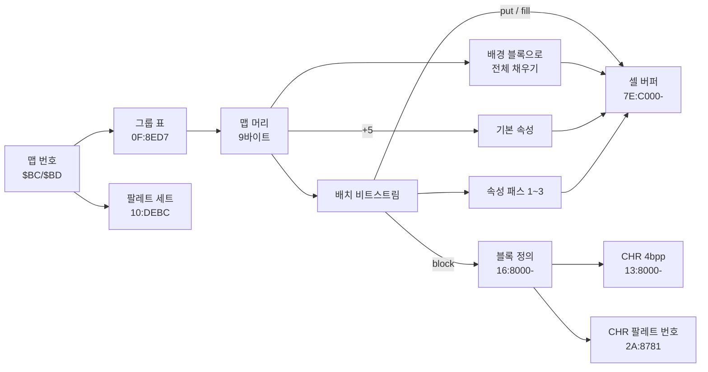

# DQ5(SFC) 실내 맵 형식

마을·성·던전 맵이 ROM 에 어떻게 들어 있고 어떻게 풀리는지 정리한 문서입니다. 찾아낸 과정은 일지에 있습니다.

- [2026-10-24-01: 배치 비트스트림](../journal/2026-10-24-01-map.md)
- [2026-10-24-02: 팔레트와 셀 속성](../journal/2026-10-24-02-map-attributes.md)
- [2026-10-24-03: 인물과 낮·밤](../journal/2026-10-24-03-npc.md)
- [2026-10-24-04: 출구](../journal/2026-10-24-04-exits.md)
- [2026-10-24-05: 가장자리 출구와 필드로 나가기](../journal/2026-10-24-05-edge-exit.md)
- [2026-10-24-06: 영역 이동(트리거)](../journal/2026-10-24-06-triggers.md)
- [2026-10-24-07: 셀 속성과 맵 머리 확인](../journal/2026-10-24-07-cells-header.md)
- [2026-10-24-08: 이벤트 플래그로 바뀌는 인물](../journal/2026-10-24-08-npc-flags.md)
- [2026-10-24-12: 맵별 루틴과 출구 번호](../journal/2026-10-24-12-exit-hook.md)
- [2026-10-25-02: 보물상자와 이름 문자열](../journal/2026-10-25-02-treasure.md)

기준과 검증:

- 기준 롬: `rom/dq5.sfc`([README](../../../README.md) 의 SHA-1)
- 주소는 LoROM CPU 주소(`BB:AAAA`), RAM 은 `7E:xxxx` 입니다. 직접 페이지가 0 이라 `$BC` 는 `7E:00BC` 입니다.
- 구현: [sfc/dq5/tools/dq5map.py](../tools/dq5map.py)
  - 실내 맵 346개를 모두 풀고, 레코드 끝이 모두 다음 맵 시작과 맞닿습니다.
  - 02/06·02/07 은 속성까지 끝난 셀 버퍼가 게임과 바이트 단위로 같습니다.
  - 팔레트도 ROM 에서 만들며 낮·밤 모두 게임과 같습니다.
- 인물: [sfc/dq5/tools/dq5npc.py](../tools/dq5npc.py). 1,077개 엔트리의 경계가 모두 맞고, 346개 맵 낮·밤 덤프 692개에서 인물 표 23칸이 모두 게임과 같습니다. 인라인 스크립트 1,034개를 명령으로 풀 수 있습니다.
- 영역 이동: [sfc/dq5/tools/dq5trigger.py](../tools/dq5trigger.py). 레코드 405개가 색인·출구 표와 빈틈없이 이어지고, 06/05 → 06/03 을 실제로 밟은 결과와 같습니다.
- 출구: [sfc/dq5/tools/dq5exit.py](../tools/dq5exit.py). 346개 맵 모두 [맵별 루틴](#맵별-루틴-15f907)까지 반영한 출구 셀이 게임 셀 버퍼와 같고, 출구 셀 수와 목적지 항목 수가 맞습니다(출구 없는 맵의 끝 표시 포함). 배의 사다리, 01/04 ↔ 01/05, 04/06 → 04/05, 06/04 → 06/05, 18/02 → 18/00 을 실제로 밟은 도착 자리가 예측과 같습니다. 가장자리로 걸어 나가 필드에 선 좌표도 표와 같습니다.


## 한눈에 보기



## 맵 번호

RAM `$BC`(그룹)·`$BD`(그룹 안 번호) 두 바이트가 맵 번호입니다.

| `$BC` | 종류 | 경로 |
| --- | --- | --- |
| `$00`~`$35` | 실내(마을·성·던전) | 이 문서 |
| `$50`~`$54` | 실내와 같은 꼴의 맵 18개(동굴·탑 등) | [그룹 `$50` 이상](#그룹-50-이상-01933d) |
| (필드) | 세계 지도. 필드에서도 `$BC`/`$BD` 는 마지막에 나온 맵 번호가 남음 | [dq5-field-format.md](dq5-field-format.md) |

예: 오프닝 글래스트 성 왕좌의 방은 `02/06`, 다음 방은 `02/07`.

## 맵 포인터 (`01:92E2`)

```
그룹 포인터 = 0F:8ED7 + $BC*2  의 16비트 값(뱅크 0F)
맵 포인터   = 0F:(그룹 포인터 + $BD*3) 의 24비트 값
```

그룹은 `$00`~`$35` 54개, 맵은 모두 346개이고 데이터는 `18:8000`~`1E:D0xx` 에 빈틈없이 이어져 있습니다.
같은 루틴이 다음 값도 고정합니다.

| RAM | 값 | 뜻 |
| --- | --- | --- |
| `$1823` | `$16` | 블록 정의 뱅크 |
| `$1824`·`$1825` | `$13`·`$8000` | CHR 그래픽 시작 |
| `$B1-$B3` | `2A:8781` | CHR 팔레트 번호 표 |

## 맵 레코드

머리 9바이트, 배치 비트스트림, 속성 패스 셋이 이어진 것이 전부입니다. 인물은 레코드 밖([인물](#인물-128000))에 있습니다.


### 머리 (`01:97D0`)

| 오프셋 | 들어가는 곳 | 뜻 |
| --- | --- | --- |
| +0 | bit0-2 → `$1821`, bit3-5 → `$1A33` | bit0-2 는 실내 맵 346개 모두 1(맵 종류로 보임, `00:8B35` 가 매 프레임 봄). bit3-5 는 맵마다 0~6 인데 읽는 코드를 찾지 못함(아래) |
| +1 | `$BF` | 폭(셀) |
| +2 | `$C0` | 높이(셀) |
| +3 | `$182C`, `01:98A4`·`01:98BA` 표로 `$182D`·`$1830` | 맵 바깥 칸을 그리는 방법. `$182D` = 바깥 칸 타일 워드(예 `1CA5`), `$1830` = 그리는 루틴(`00:BAD6`·`BA74`·`BAEA`·`BB4C`) |
| +4 | `$10` 미만이면 `$1827`=값·`$1828`=0, 이상이면 `$1827`=값-`$10`·`$1828`=`$FF` | 주인공이 있는 구역 밖 칸을 그리는 방식(`00:B900`~`B970`, [셀 버퍼](#셀-버퍼-7ec000-) 의 구역 참고) |
| +5 | 아래 니블 → `$1A6F`, 위 니블 → `$1A70` | 모든 셀의 기본 속성 |
| +6 | `$84` | 위치 비트 수(10~14) |
| +7 | bit7, bit0-2 | bit7=1 이면 배경 블록 있음, bit0-2 는 배경 블록 번호 상위 |
| +8 | | 배경 블록 번호 하위 |

`+0` bit3-5(`$1A33`)는 맵을 푸는 동안·던전 보행·무작위 전투 시작·명령 창 메뉴(はなす·じゅもん·つよさ·どうぐ·さくせん·しらべる)·필드 전투(싸워 이기기, 도망)·교회에서 저장(「たしかに　記録しましたぞ。」까지)·탈것 상태 `$1954` = `01`·`02`·`80`·`81`·`82`·`84` 로 필드 걷기·リレミト(21/02 에서 21/00 으로 나감)·ルーラ(21/02 천장, 필드에서 ラインハット 로 날아감) 동안
`7E:1A33` 과 뱅크 `00` 미러 `00:1A33` 을 모두 읽기 감시해도 한 번도 읽히지 않았습니다. 실측한 범위에서는 쓰지 않는 값입니다. 롬 전체에서 `$1A28`~`$1A33` 을 읽는 절대 주소 명령도 이 바이트를 덮지 않습니다.
값은 던전 계열 맵에 `6` 이 많습니다(`0B`·`0D`·`10`·`12`·`18`~`23` 그룹 등).

`+7` 의 bit7 이 켜져 있으면(346개 중 307개) `01:A93F` 가 블록 `((+7 & 7) << 8) | +8` 로 맵 전체를
바둑판처럼 먼저 채웁니다. 블록이 맵 끝에 딱 맞지 않으면 게임도 버퍼 밖까지 씁니다.

### 배치 비트스트림 (`01:A824`)

바이트의 높은 비트부터 읽습니다(`01:AC66`). 명령은 앞 비트로 갈립니다.

| 앞 비트 | 이름 | 인자 | 하는 일 | 코드 |
| --- | --- | --- | --- | --- |
| `0` | put | 위치 | 현재 블록을 그 위치에 찍음 | `01:A839` |
| `10` | block | 블록 번호(11비트) | 현재 블록을 바꿈 | `01:A8E4` |
| `110` | fill | 시작 위치, 끝 위치 | 두 위치를 모서리로 하는 직사각형을 현재 블록 크기 간격으로 채움 | `01:A858` |
| `111` | end | | 끝 | |

위치는 `y * 폭 + x` 이고, 비트 수는 머리 `+6` 을 따릅니다. 블록 번호는 맵과 상관없이 늘 11비트입니다
(`01:ACE5` 가 쓰는 표 `$1A4D` 는 고정, `01:AEA4` 가 쓰는 표 `$1A5D` 만 `$84` 로 바뀜).

02/07 의 앞부분(`18:E17A`, 위치 11비트):

| 위치.비트 | 비트 | 명령 | 뜻 |
| --- | --- | --- | --- |
| `18E17A.0` | `10` `01011001110` | block 718 | 2x2 블록 |
| `18E17B.5` | `110` `00010111011` `10111101011` | fill 187, 1515 | (3,4)~(43,32) 를 채움 |
| `18E17E.6` | `10` `01011010000` | block 720 | 2x2 블록 |
| `18E180.3` | `110` `00101110001` `10100001001` | fill 369, 1289 | (1,8)~(1,28) |
| `18E186.5` | `10` `01011001111` | block 719 | |
| `18E188.2` | `0` `10100100111` | put 1319 | (31,28) |
| `18E189.6` | `0` `10011001011` | put 1227 | (31,26) |

이 맵은 명령 209개(put 82, block 60, fill 66, end 1)로 끝나며, 개수가 에뮬레이터에서 센 분기 횟수와 같습니다.


### 기본 속성 (`01:93D8`)

비트스트림이 끝나면 모든 셀(폭×높이+1칸, 마지막 한 칸은 버퍼 밖)에 머리 `+5` 를 적용합니다.
위 니블이 0 이 아니면 그 값을 `+0` 에 쓰고, 아래 니블은 `+1` 에 OR 합니다.

### 속성 패스 (`01:B7AC`, `01:B8FE`, `01:B9EA`)

비트스트림이 바이트 중간에서 끝났으면 다음 바이트부터(`01:A7B3`) 세 패스가 이어집니다. 셋 다 니블 단위로 읽고(`01:B8A8`·`01:B8DD`)
엔트리 형식이 같습니다.

```
패스 첫 니블 bit7: 0 이면 반복을 가로(셀+1)로, 1 이면 세로(셀+폭)로
엔트리 첫 바이트 bit7-6:
  00  셀 하나:      [위치 2바이트] [값 니블]
  11  반복(짧게):    [위치 2바이트] [n 니블] [값 니블]   → n+2 칸
  10  반복(길게):    [위치 2바이트] [n 바이트] [값 니블] → n+2 칸
  01  패스 끝(패스 1·2 는 반 바이트면 한 니블 더 읽어 맞춤)
위치 2바이트 = 첫 바이트 아래 6비트 + 둘째 바이트: x = (b0<<1 | b1>>7) & 7F, y = b1 & 7F
```

| 패스 | 값 니블이 하는 일 |
| --- | --- |
| 1 | `+1` 아래 니블을 그 값으로 |
| 2 | bit0: 위층이 비고 아래층이 있으면 아래층(+2~+4)을 위층(+5~+7)으로 복사, `+0 \|= $08` / bit1: `+1 \|= $40` / bit3: `+4` = bit2 ? `$61` : `$62` / bit3 없이 bit2: `+1 \|= $80` |
| 3 | `+0` 위 니블을 그 값으로. 첫 엔트리가 끝이 아니면 `$1A35` = 1 |

반복이 n+2 칸인 것은 `LDX n / INX / … / DEX / BPL` 꼴이라서입니다.

## 블록 (`01:8ACB`)

블록 번호 `n` 의 위치는 `7E:B000 + n*2` 의 16비트 포인터(뱅크 `$1823`=`$16`)입니다. 이 표는
`16:8000` 부터 블록을 빈틈없이 이어 놓은 순서 그대로라, 블록 크기만 알면 ROM 에서 바로 셀 수 있습니다
(오프닝 시점 RAM 표에는 1,936개).

```
+0  bit0-2 높이-1, bit3-5 폭-1, bit6-7 플래그
+1  bit4-7 위층 줄 수, bit1-3 아래쪽 표시 줄 수, bit0 플래그
+2  속성
+3  높이×폭 개의 16비트(줄 순서): bit0-11 CHR 번호, bit14 좌우 반전, bit15 상하 반전
```

## CHR 과 VRAM 슬롯 (`01:8C15`)

- 그래픽: CHR 번호 `id` 는 `(13 + id>>10):8000 + (id & 3FF)*32` 의 4bpp 8x8 타일입니다(압축 없음).
- 팔레트 번호: `2A:8781 + id/2` 의 니블(짝수 id 는 상위, 홀수는 하위)이 그 CHR 의 팔레트·우선순위입니다.
- 슬롯: 맵에서 처음 쓰이는 순서대로 VRAM 타일 번호를 `$1834` 부터 하나씩 붙입니다. 오프닝 두 맵은 모두 `$BE` 부터.
  결과는 `7E:6000 + id*2` 에 SNES 타일맵 워드(슬롯 | 팔레트·우선순위 | 반전)로 남습니다.

## 팔레트 (`10:DE0B`)

맵이 쓰는 BG 팔레트 1~7번 줄은 압축 없이 ROM 에 있습니다.

```
세트   = 10:DEBC 표에서 [$BC, 기본 세트, ($BD, 세트)..., FF] 항목을 찾아 $BD 가 맞으면 그 세트, 아니면 기본
목록   = 10:(DFE4 + 세트*4 + (7E:075E >= $F0 ? 2 : 0)) 의 16비트 포인터 → 16비트 7개
줄 r   = 10:E5C8 + 목록[r]*32 의 16색  (r = 1~7)
배경색 = 7번 줄부터 2번 줄까지 내려가며 색 0 이 0 이 아닌 첫 줄의 색 0
```

`7E:075E` 는 시간대 값이고 `$F0` 이상이면 밤입니다(`21:8000`). 값을 `$F0` 으로 고정하자 WRAM 팔레트 버퍼가
두 번째 목록과 같아졌고 인물도 밤 목록으로 바뀌었습니다.

### 플래그로 바꾸는 팔레트 세트 (`01:9771`)

맵을 들어갈 때 `01:93A0` 이 위 로더(`10:DDDD` → `10:DE0B`)를 부르기 전에 `01:9771` 이 `2A:8690` 표를 봅니다. 처음 맞는 항목이 있으면 그 세트를 `10:DDCF` 로 불러오고 `10:DE0B` 는 건너뜁니다.

```
2A:8690  [BC][BD|FF][플래그 번호|FF][마스크][세트] 5바이트씩, FF 로 끝
플래그 번호 bit7 이 0 이면 7E:2190+번호 & 마스크가 켜졌을 때, 1 이면 꺼졌을 때 맞음(인물 목록 표와 같은 규칙)
```

| 맵 | 조건 | 세트 |
| --- | --- | --- |
| 04/00 | `7E:2198 & 40 = 0` | `26` |
| 04/그 밖 | `7E:2198 & 40 = 0` | `27` |
| 22/01 | `7E:2190 & 40 = 0` | `01` |
| 22/그 밖 | `7E:2190 & 40 = 0` | `2A` |
| 06/00 | `7E:2194 & 04 ≠ 0` | `24` |
| 06/그 밖 | `7E:2194 & 04 ≠ 0` | `00` |

선실 세이브스테이트(`7E:2198` = 0)에서 04/00 으로 가면 CGRAM 1~7번 줄 색 105개 중 `10:DE0B` 가 고른 세트 `00` 과 같은 것은 19개뿐이었고, 세트 `26`(목록 `0E 87 0E 88 89 8A 8B`)과는 모두 같았습니다.
세트 `26` 으로 그린 맵은 게임 BG 화면과 57,344 픽셀 모두 같았습니다([2026-10-25-27 일지](../journal/2026-10-25-28-gfx.md)).

## 인물 (`12:8000`)

실내 맵의 인물 목록은 뱅크 `$05` 에 있습니다. 인물을 놓는 것은 `1E:DB44` 이고, 인물 표는 `7E:3000-`(항목마다 `$20` 간격 배열, 슬롯 08 부터)입니다.

```
그룹 목록 = 05:(D4B2 + $BC*2 의 16비트)
맵 목록   = 그룹 목록에서 00 으로 끝나는 맵 목록을 $BD 개 건너뛴 곳
엔트리    = 맵 목록의 엔트리들, 00 이 나오면 끝
```

54개 그룹 목록은 `05:8651` 부터 `05:D4B1` 까지 빈틈없이 이어지고, 엔트리는 모두 1,077개입니다.
### 이벤트 플래그에 따른 목록 (`12:82FB`, `12:8357`)

인물을 놓기 전에 두 표를 먼저 봅니다. 플래그 번호 bit7 이 0 이면 `7E:2190 + 번호` 의 마스크 비트가 켜졌을 때, 1 이면 꺼졌을 때 참입니다.

| 표 | 항목 | 참이면 |
| --- | --- | --- |
| `12:839C`(43개) | `[$BC][$BD][플래그 번호][마스크]` | 그 맵에 인물을 놓지 않음 |
| `12:8449`(296개) | `[$BC][$BD][플래그 번호][마스크][포인터 16비트]` | 인물 목록을 `10:포인터` 로 바꿈. 표 순서대로 처음 참인 항목 |

대체 목록은 `10:8000`~`10:DDB1` 에 293개(표가 가리키는 284개 + 사이에 숨은 9개, 인물 1,366명)가 빈틈없이 이어집니다.
숨은 9개(`10:8BBD` `A3C0` `A731` `A886` `A88E` `AC3B` `AFCE` `B86B` `BFE5`, 인물 0·4·0·1·9·18·4·2·2명)는 로더가 닿지 않습니다.
`12:8000` 을 부르는 곳은 `00:E1B2` 하나뿐이고, 목록 주소를 `$A5` 에 두는 곳은 기본 목록(`12:803F`)과 대체 표(`12:82FB`) 둘뿐입니다(코드 읽기).
02/06 에서 `7E:21AD` 를 `$10` 으로 두자 `10:9B57` 목록의 5명이 그대로 놓였고, 17/00 에서 `7E:2192` 를 `$80` 으로 두자 인물을 놓지 않았습니다.

### 엔트리

첫 바이트 `b0` 의 bit7-6 이 시간대입니다(`12:8161` 낮, `12:8227` 밤).

| bit7-6 | 뜻 | 개수 |
| --- | --- | --- |
| `80` | 낮에만 | 437 |
| `40` | 밤에만 | 119 |
| `C0` | 낮·밤 모두(필드마다 값이 하나 또는 둘) | 521 |
| `00` | 놓지 않음 | 0 |

한 벌 엔트리(`80`·`40`):

```
+0  b0: bit5 인라인 스크립트 있음, bit4 +7 없음, bit0-3 대화 번호 상위
+1  대화 번호 하위        → 7E:36E0
+2  기타                  bit0-2 걸음, bit4-5 → 7E:32A0, bit6 → 7E:33A0 bit7, bit7 Y-1
+3  X(셀)                 → 7E:3020  bit7 은 방향
+4  Y(셀)                 → 7E:3080  bit7 은 방향
+5  그림 번호             → 7E:3220  (0 이면 보이지 않는 인물)
+6  이동                  bit0-1 층, bit2-5 이동 간격, bit6-7 속도
+7  추가 값(b0 bit4 면 없음, $FF 로 취급)  bit4-7 걷기 애니메이션 간격, bit0-3 서기 애니메이션 간격
    b0 bit5 면 [길이 n][n 바이트 스크립트]
```

두 벌 엔트리(`C0`): `+1` 이 마스크입니다. 마스크 bit7 이 0 이면 `+2` 에 밤용 `b0` 가 하나 더 있습니다.
이어서 필드 6개(대화 하위, 기타, X, Y, 그림, 이동)가 순서대로 오는데, 마스크의 해당 비트(`40 04 20 10 08 02` 순)가
0 이면 그 필드는 낮 값·밤 값 두 바이트, 1 이면 한 바이트로 공유입니다. 그 뒤에 추가 값과 스크립트가 낮·밤 순으로 옵니다.
정확한 길이 계산은 `12:8093`(`dq5npc.py` 의 `entry_size`)을 보세요.

### 인물 표 (`1E:DB44`)

`12:8161`·`12:8227` 이 그 시간대 값을 `$04`~`$0E` 에 모으면 `1E:DB44` 가 인물 표(`7E:xxxx + 슬롯`)에 나눠 넣습니다.

| 인물 표 | 값 |
| --- | --- |
| `3020`·`30E0` / `3080`·`3140` | X / Y 아래 7비트(기타 bit7 이면 Y-1, `31C0` = 1) |
| `31E0` | 방향 `1E:DD9C[X bit7 << 1 \| Y bit7]` = `88` 위, `11` 오른쪽, `44` 아래, `22` 왼쪽. 아래 니블은 `3240`·`3260` 에도 |
| `31A0` | 층 마스크 `1E:DD98[이동 bit0-1]` = `01 02 04`. 3 이면 `01` 이고 `33A0` bit7 을 켬 |
| `3300` | 이동 간격(이동 bit2-5) << 4. 8 이상이면 아래 니블에 차례 번호(`1E:DD1E`, 같은 간격 인물끼리 걸음을 엇갈리게 함) |
| `3360` | 속도 `1E:DD94[이동 bit6-7]` = `00 01 02 04` |
| `3320`·`3340` | 걸음 `1E:DDA0[기타 bit0-2]` = `01 02 04 08 10 18 20 28` |
| `32C0` / `32E0` | 추가 값 위 니블 / 아래 니블 << 4 |
| `32A0` | 기타 & `30` \| `01` \| (그림 표 `25:86D0[그림]` bit7 이면 `40`). `1F:CF1E` 가 그림을 VRAM 에 올리며 `$00` 에 남긴 값을 `1E:DC94` 가 더함. `7E:21D1 & 40` 이면 늘 `01`, 그림 `9A` 는 `7E:21B3 & 08` 에 따라 `2F`·`97` 로 봄 |
| `33A0` | `30` \| 기타 bit6 << 1 \| (층 3 이면 `80`) \| (그림이 `46`~`48`·`78`·`7F`·`84`·`A2` 이상이면 `09`, `1E:DC67`) |
| `3380` | 그림 0 이면 `80`(그 프레임에 그리지 않음) |
| `36E0` / `3700` | 대화 번호 하위 / 상위 4비트 |
| `3480`·`34A0`·`34C0` | 스크립트가 있으면 첫 명령 주소(길이 바이트 다음) |

346개 맵을 하나씩 순간이동해 인물을 다 놓은 직후(`12:803C`) 덤프한 낮 346개·밤 346개에서, 위 23칸이 `dq5npc.py --compare` 의 예측과
슬롯 1,562개 모두 바이트째 같았습니다. 기타 bit3 은 읽는 곳이 없습니다.

### 인라인 스크립트 (`01:C800`)

엔트리 `b0` bit5 면 `[길이][명령…]` 이 붙고, 인물마다 매 프레임 `01:C800` 이 `$AE` 가 가리키는 명령을 `01:C827` 표(00~56)로 실행합니다.
bit7 이 켜진 바이트는 `[X|80] [Y]` 두 바이트 「걸어가 도착할 때까지」 입니다. 명령이 `$AE` 를 늘리지 않고 끝나면 다음 프레임에 같은 명령을 다시 실행하므로,
`14`(도착 대기)·`09`(플래그 대기) 같은 명령은 조건이 맞을 때까지 그 자리에 머뭅니다.

| 명령 | 길이 | 뜻 |
| --- | --- | --- |
| `03 d` / `04 lo hi` | 2 / 3 | 상대 점프(명령 다음 바이트 + d) / 절대 점프 |
| `06 f m d` | 4 | `7E:2190+(f&7F)` & m 이 켜져 있으면(f bit7 이면 꺼져 있으면) 명령 첫 바이트 + d 로 |
| `07 x0 y0 x1 y1 d` | 6 | 주인공이 사각형 안이면(x0 bit7 이면 밖이면) 명령 첫 바이트 + d 로 |
| `08 x0 y0 x1 y1` | 5 | 주인공이 사각형 밖이 될(x0 bit7 이면 안이 될) 때까지 대기한 뒤 이벤트 시작(`7E:19AE` 에 3, 인물 이동 간격을 `19B7` 에 맡기고 0) |
| `09 f m` | 3 | 플래그가 꺼질(f bit7 이면 켜질) 때까지 대기 |
| `10 f m` / `11 f m` / `55 f m` | 3 | 플래그 OR / AND / 바이트 쓰기 |
| `13 x y` / `14` | 3 / 1 | 목표 자리로 걷기 시작 / 도착 대기 |
| `15` `16` `17` `18` `19 w h` | | 걷기 멈춤, 멈춤, 아무 방향 보기, 아무 데나 걷기, 범위 안 돌아다니기 |
| `1D n` / `1E n` / `2F n` | 2 | 이동 간격 / 속도 / 방향 |
| `21` `30` `31` `32` `lo hi` | 3 | 메시지 `hi lo` 띄우기(`01:CEA9` → `24:8157`). `21` 은 창을 열고 닫음, `30` 은 열기만, `32` 는 닫기만 |
| `28` / `2B x y` | 1 / 3 | 숨기기 / 순간이동 |
| `37 lo hi bank` | 4 | 네이티브 루틴 호출(`06:CBA4` 같은 이벤트 루틴) |
| `02 n` … `01` | 2 … 1 | 사이 명령을 n 번 되풀이 |
| `05 lo hi bank` | 4 | 네이티브 루틴을 불러 A 가 0 이면 다음으로, 아니면 다음 프레임에 다시 부름 |
| `41 x y n` / `43 x y n` | 4 | (x,y) 문 열기(`01:D915`) / 닫기(`00:E066` 뒤 `01:F117`). n 의 뜻은 미확인 |
| `50 x y` / `53` | 3 / 1 | 나타날 자리 / 그 자리로 옮겨 깜빡이며 나타나기(`7E:3540` 카운터) |
| `51` / `52` | 1 | 깜빡이며 사라지기(`7E:3380` bit7 을 켠 채 끝) / 사라진 뒤 X·Y 를 `80` 으로 치우기 |
| `4F` | 1 | `7E:3540` 이 0 이 될 때까지 대기 |
| `20 lo hi` | 3 | `24:FEAC` 호출(A = lo, X = hi). 전투에서 효과음에 쓰는 루틴([dq5-data-format.md](dq5-data-format.md)) |
| `00` `25` `26` `3E` `42` `48`~`4E` `54` `56` | 1 | 아무것도 하지 않고 그 자리(스크립트 끝) |

나머지 명령의 이름과 길이는 `dq5npc.py` 의 `SCRIPT_OPS` 에 있습니다. 길이는 처리 루틴이 `$AE` 를 늘리는 양을 읽어 정했고, 이 길이로 모든 목록의
스크립트 1,034개를 읽으면 끝이 길이 바이트와 하나도 어긋나지 않습니다(`--check-scripts`). 이름 중 `13`·`14`·`03`(01/05 순찰 병사), `08`·`37`(파파스),
`02`/`01`·`05`·`41`·`43`·`50`~`53`(스크립트를 덮어 쓴 실험)을 실측했고, 나머지는 처리 루틴을 읽고 붙였습니다.
데이터에 한 번도 나오지 않는 명령은 `0A` `0C` `0E` `17` `24`~`26` `29` `33` `3B`~`3E` `42` `44`~`46` `48`~`4F` `54`~`56` 입니다.

스크립트 실험은 배 선실 파파스(`05:A848`, 슬롯 08) 스크립트 23바이트를 `ROMPATCH` 로 덮고 사다리 목적지를 17/00 자신(`E0090B0117`)으로 바꿔
인물 목록을 다시 읽게 한 뒤, `tools/lua/wlog.lua` 로 인물 표 값을 프레임마다 적었습니다.

| 덮은 스크립트 | 결과 |
| --- | --- |
| `2B 03 0D` `02 03` `13 08 0D 14 13 03 0D 14` `01` `16` | (3,13) ↔ (8,13) 을 세 번 오가고 (3,13) 에 멈춤 |
| `05 96 F1 05` `2B 05 0D` / `05 99 F1 05` `2B 05 0D` | `LDA #0`·`RTL` 인 `05:F196` 이면 (5,13) 으로 옮김, `LDA #1` 인 `05:F199` 면 끝까지 그대로 |
| `50 05 0D` `53` | (8,9) 에서 (5,13) 으로 옮긴 뒤 `3380` bit7 을 켜는 간격이 2·3·4프레임으로 늘다 15프레임째 끝(나타나기) |
| `2B 05 0D` `51` / `52` | `3380` bit7 이 켜지는 간격이 6·5·4·3프레임으로 줄다 20프레임째 끝. `51` 은 bit7 을 켠 채 남아 화면에서 사라지고, `52` 는 X·Y 가 `80` |

문 명령은 01/05 의 `05:89E3` 스크립트를 덮어 파파스가 지나가는 문 (60,15) 셀의 타일 워드를 봤습니다. `41 3C 0F 01` 이면 셀 `+2`·`+3`·`+5`·`+6` 이
`DB 10 0C 38` 에서 `BE 18 DB 10` 으로 바뀌고, 그 뒤에 `43 3C 0F 01` 을 두면 다시 `DB 10 0C 38` 로 돌아왔습니다. 닫힌 문에 `43` 만 주면 그대로였습니다.

01/05 의 순찰 병사(`05:89B8`)는 스크립트 `13 (37,47) 14 1D 20 13 (44,47) 14 13 (44,55) 14 1D 80 13 (29,55) 14 1D F0 13 (29,47) 14 03 E5` 대로
(29,47) → (44,47) → (44,55) → (29,55) → (29,47) 을 1,600프레임마다 되풀이했습니다.


## 출구 (`2A:F6B8`)

출구는 좌표를 저장하지 않습니다. **셀 버퍼에서 출구 셀을 앞에서부터 센 순서가 출구 번호**이고, 그 번호로 목적지 표의 항목을 고릅니다.

- 출구 셀: `+4` 또는 `+7` 이 `2A:FF37` 목록(`$85 $A1 $B3 $CC`)에 있는 셀. 블록 오른쪽 아래 셀에만 bit7 이 붙으므로 블록 하나가 한 번 세어집니다.
  예: `$85` 는 작은 계단·사다리(블록 속성 `$05`).
- 출구 번호(`2A:FC16`): 셀 0 부터 플레이어 셀 바로 앞까지의 출구 셀 수.
- 도착(`2A:FC93`): 새 맵을 푼 뒤 그 맵의 N 번째 출구 셀을 찾아 **한 칸 왼쪽**에 섭니다. 방향은 그 셀 `+1` 의 아래 3비트.

### 목적지 표 (`2A:ED61`)

```
[$BC] [맵 0 항목들] [맵 1 항목들] ... FF   ← 그룹마다
맵마다 항목이 이어지고, bit7 이 켜진 항목이 그 맵의 마지막
```

| 첫 바이트 bit6-5 | 길이 | 뜻 |
| --- | --- | --- |
| `40` | 2 | 같은 그룹 `$BD` = 아래 5비트, 둘째 바이트 = 도착 맵의 출구 번호 |
| `20` | 3 | `$BD` = 아래 5비트, 둘째 = 도착 출구 번호, 셋째 = `$BC` |
| `60` | 5 | `$BD` = 아래 5비트, X, Y, 층(`$C3`), `$BC` 를 직접 지정. 변환 없이 (X, Y) 에 섭니다 |
| `00` | 1 | 특수(`2A:F7B2`). 대부분 맵의 마지막 항목 |

항목은 모두 569개(`40` 438, `00` 102, `60` 23, `20` 6)입니다. 맵 목록은 bit7 항목으로 끝나야 하므로 **출구가 없는 맵에도
끝 표시 `80`(종류 `00`) 하나가 들어 있고**, 그런 맵이 83개입니다. 출구 셀을 맵 데이터만으로 세면 5개 맵에서 항목 수가 맞지 않고
6개 맵에서 번호가 틀립니다. 맵을 푼 뒤 도는 [맵별 루틴](#맵별-루틴-15f907)이 고친 셀 버퍼로 세야 346개 맵 모두 맞습니다.

종류 `60` 은 배의 사다리 항목을 덮어 01/04 (12,44), 01/05 (13,47), 03/02 (10,10), 04/05 (3,12), 06/05 (30,31) 에 가 보니 모두 적힌 좌표 그대로 섰습니다.

종류 `00` 을 실제 출구로 밟으면 `2A:F7B2` → `2A:F80A`(몇몇 맵만 특별 처리, 예: 12/07 이면 53/52 의 정해진 자리) → `2A:F425`(필드로 나가기)입니다.


### 맵별 루틴 (`15:F907`)

맵을 다 푼 뒤 `15:F7D0` 이 `15:F7F4` 로 맵에 맞는 루틴을 골라 `JML [$A5]` 로 부릅니다. 이 루틴이 셀 버퍼를 고쳐 출구 셀이 생기거나 사라지는 맵이 있습니다.

```
15:F907 부터 10바이트 항목, FF 로 끝. 위에서부터 처음 맞는 항목 하나를 씀(162개)
+0      $BC. FE 는 필드용($BE bit7 이 0 일 때 $1949 를 +1 과 비교)
+1      $BD. FF 면 그룹 전체
+2      플래그 번호, FF 면 조건 없음. bit7 이 0 이면 7E:2190+번호 & 마스크가 켜졌을 때, 1 이면 꺼졌을 때 맞음
+3      마스크
+4~+6   맵을 푼 뒤 부를 루틴. 15:F906(RTL 하나)이면 없음
+7~+9   $1AA6~$1AA8 에 두는 매 프레임 루틴
```

실내 맵은 `$BE` bit7 이 켜진 경우의 일반 항목만 봅니다. 맞는 항목이 없으면 `15:F906` 입니다.

루틴 안의 `BRK #$0B mask idx` 는 플래그 검사입니다(`00:93BA`). `7E:2190+idx & mask` 가 켜져 있으면 Z 를 지운 채 돌아와 뒤의 `BNE` 가 갈립니다.
`7E:219F`·`7E:21A0` 은 맵 그룹이 바뀔 때만 지워집니다. 맵을 풀 때 `01:8F26` 이 직전 맵 `7E:21C7`·`21C8` 과 견주어
`$BC` 가 다르면 `00:A8C5`(`21A1`~`21A4` 와 `219F`·`21A0` 을 지움), `$BD` 만 다르면 `00:A957`(`21A1`~`21A4` 만 지움)을 부릅니다.
배 선실(17/00)에서 네 바이트를 `11 22 33 44` 로 써 두고 사다리로 17/02 에 가자 `219F`·`21A0` 은 `11 22` 그대로, `21A1`·`21A2` 는 0 이었고,
목적지를 03/02 로 바꿔 그룹을 옮기자 넷 다 0 이었습니다. 그래서 `21A0` 은 같은 그룹 안의 맵끼리 이어지는 임시 플래그이고,
03/02·06/05 루틴은 그룹 안 다른 맵에 다녀와도 이벤트로 놓은 계단이 남도록 그 비트를 봅니다.
이벤트 쪽에서는 `12:F62E`·`12:F69E` 가 `21A0` bit7·bit6 을 켜고 루틴과 같은 `1F:FB35`·`1F:FB75` 를 불러 그 자리에서 계단을 놓습니다(코드 읽기).

`+7~+9` 루틴은 `15:F7D0` 이 `7E:1AA5`~`1AA9` 에 `22 [루틴] 60`(`JSL`·`RTS`)으로 써 두고, 필드 주 루프(`00:8099` → `00:80B1` → `JMP $1AA5`)가 매번 부릅니다.
배 선실에서 17/02 로 걸어 가는 동안 실행 횟수를 세니 17/00 에서는 `02:AE55` 가 252번(주 루프 `00:80B1` 252번과 같음),
17/02 에서는 표에 항목이 없어 `15:F906` 이 주 루프와 같은 횟수(맵을 푼 뒤 첫 루틴으로 한 번 더) 돌았습니다. 항목 136개가 이 자리에 `15:F906` 이 아닌 루틴을 두고,
그중 둘의 일을 확인했습니다.

- `03:D4B5`(79개 항목): 실내 맵의 움직이는 타일([dq5-graphics-format.md 「실내 맵의 움직이는 타일」](dq5-graphics-format.md#실내-맵의-움직이는-타일)).
  00/00 에서 VRAM 을 10프레임마다 견주니 `57C1`~`58FF` 의 140바이트가 20~30프레임마다 바뀌었고, `$1AA6` 을 `15:F906` 으로 덮자 400프레임 동안 한 바이트도 바뀌지 않았습니다(`tools/lua/vramdiff.lua`).
- `02:AE55`(17/00·1A/04): 버튼을 누르면 `7E:21A1` bit0 을 켭니다(`02:B329` 가 `$24 & CF` 를 봄). 배 선실에서 `21A1` 을 0 으로 두고
  A·B·X·Y·십자 키를 누르면 1, Start·L·R 이나 아무것도 누르지 않으면 0 이었습니다. 17/00 기본 목록의 인물 둘(`05:A867`, `05:A874`)이 이 비트를 기다리므로,
  게임 첫 장면에서 파파스가 「目が　さめたようだな」 라고 말하기 전 주인공이 깨어나는 계기로 보입니다(인물 쪽은 코드 읽기).

출구 셀을 바꾸는 루틴은 6개입니다. 표 항목 162개(서로 다른 루틴 63개)에서 셀 버퍼에 즉값을 쓰는 곳을 훑어 찾았고, 346개 맵을 모두 순간이동해
루틴이 끝난 직후(`15:F7EE`) 덤프한 셀 버퍼의 출구 셀과 비교해 모두 같았습니다.

| 맵 | 루틴 | 하는 일 | 출구 셀 |
| --- | --- | --- | --- |
| 01/05 | `02:94E0` → `1E:F1C7` | (51,20) `+4` = `$85` | 만듦. 벽 바깥 빈 곳 |
| 04/05 | `02:AB25` | (4,66) `+7` = `$85` | 만듦. 벽 바깥 빈 곳 |
| 06/05 | `1E:F1F1` | `21A0` bit6 꺼짐: (18,24) `+4` = `$85`. 켜짐: `1F:FB75` 가 그 칸을 `$80` 으로 두고 `25:FA4C` 로 블록을 놓음 | 꺼짐 (18,24) 벽, 켜짐 (31,16) |
| 03/02 | `1E:F1DF` | `21A0` bit7 꺼짐: (55,6) `+4` = `$85`. 켜짐: `1F:FB35` 가 같은 방식으로 블록을 놓음 | 꺼짐 (55,6) 하늘, 켜짐 (32,13) |
| 04/07 | `03:C56B` | (15,20) `+4` = `$94` | 지움 |
| 18/00 | `02:9517` | (57,37) `+4` = `$F2` | 지움 |

켜짐 쪽은 지우는 `STA` 를 NOP 로 막고 `21A0` 을 고정해 덤프한 결과입니다. 켜졌을 때는 걸어갈 수 있는 자리에 계단이 생기고,
꺼졌을 때는 같은 번호의 출구 셀을 들어설 수 없는 칸에 둡니다. 계단이 있든 없든 출구 번호가 밀리지 않게 하는 자리 지킴이로 보입니다.
01/05 의 빈 곳 출구 (51,20) 는 인물 스크립트가 옮깁니다. 플래그 `7E:21A7 & 40` 일 때의 대체 목록(`10:8994`)에 든 파파스는
주인공이 (42,4)-(46,9) 에 들어오면 메시지 `291`「王子が　さらわれただと！？」를 띄우고 (60,19) 를 거쳐 (63,19) 로 걸어간 뒤
`37 EB CC 06` 으로 `06:CCEB` → `1F:FA9B` 를 부릅니다. 이 루틴이 (51,20) `+4` 를 0 으로 지우고 (63,18)~(64,19) 에 계단 블록을 놓아
(64,19) `+4` 가 `$85` 가 됩니다. 두 셀 사이에 다른 출구 셀이 없어 출구 번호는 그대로입니다. 같은 실험을 플래그 없이 하면 (51,20) 은 `$85`,
(64,19) 는 `$80` 이었습니다.

04/05 (4,66) 에는 짝이 되는 계단이 없습니다. 이 맵은 밤에 비앙카와 들어가는 성이고, (3,66) 둘레는 「まっ暗だわ」(메시지 `210`·`212`) 가 뜨는
캄캄한 바닥입니다. 블록이 검게 그려질 뿐 걸을 수 있어, (3,66) 에서 아래로 4칸, 오른쪽으로 25칸 넘게 걸어졌습니다. 04/06 (4,5) 계단은 이 어둠 속으로
내려가는 한쪽 길입니다.

계단 판정(`00:E2C5`)은 주인공이 선 두 셀의 `+4`·`+7`(`2B:8209` 가 `7E:3740`~`37A0` 에 모음)을 보고, 왼쪽 셀과 오른쪽 셀이 **둘 다** 속성 `05`
(왼쪽은 `33`·`4C` 도)여야 옮겨 갑니다. (4,66) 은 `+7` 만 `$85` 이고 왼쪽 (3,66) 은 0 이라, 주인공이 (1,66) 에서 (10,66) 까지 지나가도, 아래·오른쪽에서 다가가도
맵이 바뀌지 않았습니다. 루틴을 고쳐 `+4` 에 써도 마찬가지였습니다. (3,66) `+7` 을 `05` 로 고정하자 그 자리에서 04/06 (3,5) 로 옮겨 갔습니다.
그러니 (4,66) 은 걸어서 밟을 수 없는 반쪽 계단이고, 출구 번호를 맞춰 04/06 에서 내려온 주인공을 이 자리 왼쪽에 세우는 데만 쓰입니다.


### 가장자리 출구와 필드로 나가기 (`2A:F425`)

맵 가장자리 밖으로 걸어 나가는 출구는 목적지 표를 쓰지 않습니다. 대부분은 맵 밖에 놓인 [영역 이동](#영역-이동-00cdec) 레코드이고,
그런 레코드도 없는 곳에서는 필드 보행 코드 `00:CC0F` 가 `JSL 2A:F234` 로 곧장
「필드로 나가기」(`2A:F425`)를 부르고, 필드 좌표는 맵 그룹(`$BC`)으로 정합니다.

```
04:FD97 표에서 [$BC, X 16비트, Y 16비트] 를 찾으면 그 좌표
없으면 04:FE83 표에서 같은 형식으로 찾아 X, Y+1
→ $B6 = X, $B8 = Y (필드 좌표)
```

03/00(성 앞뜰)에서 아래 가장자리로 걸어 나가자 필드로 나갔고, `04:FE83` 의 `03` 항목 (251, 215) 대로 x=251, y=216 에 섰습니다(곧바로 슬라임과 전투).
`$BC`/`$BD` 는 바뀌지 않았습니다. 필드에서는 다른 값으로 위치를 다룹니다.


## 보물상자와 タンス·ツボ·タル (`12:E4C9`)

말을 걸거나(「はなす」) しらべる 로 앞 칸을 보면 `12:E4C9` 가 앞 칸의 셀 속성을 차례로 검사합니다. 셀 속성이 아래 값이면 그 종류입니다(`+4` 또는 `+7`).

| 속성 | 종류 | 메시지 | 데이터 |
| --- | --- | --- | --- |
| `$84` | 보물상자 | 131「宝箱を　開けた！」 | 상자 번호 → `1E:EE4E` |
| `$93` | タンス | 12F「タンスを開けて…」 | `1F:F5CB` |
| `$A7`·`$D4` | ツボ | 135「ツボの中を　のぞきこんだ」 | `1F:F5CB` |
| `$B9`·`$D3` | タル | 149「タルの中を　のぞきこんだ」 | `1F:F5CB` |

네 종류와 상자는 실제로 열어 메시지와 내용물을 확인했습니다. `$D3`·`$D4` 는 위층(`+7`)에만 있는 ツボ·タル 칸입니다.
346개 맵에서 `$D3` 은 10칸(배 17/00·16/07 의 タル 더미 등), `$D4` 는 5칸이고, 표 항목이 놓인 칸은 없습니다.
선실 タンス 항목의 좌표를 배 창고의 `$D3` 칸 (8,27) 로 바꾸자 149 다음에 「やくそうを　見つけた！」가 나왔고,
그 칸을 `$D4` 로 바꾸면 135 가 나왔습니다(`$D4` 의 검사는 `12:E7F2`, `$D3` 은 `12:E827`, 돌려주는 종류 번호는 2·0A).

검사는 `12:E4C9` 의 목록 순서로 하며, 상자 바로 다음이 [발밑 표](#발밑-1ef08b)입니다.

### 보물상자 (`25:FAB0`)

상자는 출구처럼 좌표를 저장하지 않고, 셀 버퍼에서 상자 셀을 앞에서부터 센 순서로 번호를 매깁니다.

```
1E:EF90: [BC][BD][개수] 3바이트 항목, FFFF 로 끝(83개 맵, 상자 161개)
상자 번호 n = 표에서 그 맵 앞의 개수 합 + 셀 0 부터 그 칸 앞까지의 상자 셀 수(2A:FBCD, 속성 목록 2A:FF3E = $84)
내용물  = 1E:EE4E + n*2 의 16비트 값
열림    = 7E:2210 + (n >> 3) 의 25:FAE9[n & 7] 비트(80 40 … 01)
```

83개 맵 모두 [맵별 루틴](#맵별-루틴-15f907)까지 반영한 셀 버퍼의 상자 셀 수가 표의 개수와 같고, 내용물 표가 `1E:EF90` 바로 앞에서 끝납니다.

### タンス·ツボ·タル (`12:FB9D`)

```
1F:F5CB: 9바이트 항목, FFFF 로 끝(86개)
+0 BC, +1 BD, +2 X, +3 Y   앞 칸 좌표. 위를 보고 (X-1, Y+1) 에 서면 이 칸을 본다
+4                         읽지 않음(1 이 79개, 나머지 0·2·3·8)
+5~+6                      내용물(16비트)
+7 플래그 번호, +8 마스크  열림 = 7E:222C + 번호 & 마스크
```

86개 항목은 모두 속성 `$93`·`$A7`·`$B9` 칸에 놓여 있습니다. 내용물 `44`(맵 그룹 21)·`B0`(그룹 1F)은 플래그에 따라 바뀝니다(`12:FBFD`, 코드 읽기).
`+4` 는 표를 읽는 곳(`1F:F5CB` 를 가리키는 명령 4개가 모두 `12:FB9D` 안)이 건너뛰고, 표 전체 읽기 감시에도 항목을 열 때와 맵에 들어갈 때 한 번도 걸리지 않았습니다.
아래 발밑 표에서는 같은 자리가 주인공 층이라, 층을 적어 두었던 흔적으로 보입니다.

### 발밑 (`1E:F08B`)

しらべる 를 하면 상자 다음으로 `12:E6BE` 가 선 칸과 그 위·오른쪽 위·오른쪽 칸을 이 표에서 찾습니다. 찾으면 12B「足もとを　調べた！」 다음에 내용물을 줍니다.

```
1E:F08B: 9바이트 항목, FFFF 로 끝(18개)
+0 BC, +1 BD, +2 X, +3 Y   칸 좌표($1E71)
+4                         $C3 과 같아야 함($C3 은 방향이 아니라 주인공 층. 영역 이동 +4 참고)
+5~+6                      내용물(16비트)
+7 플래그 번호, +8 마스크  열림 = 7E:2240 + 번호 & 마스크
```

항목 0 을 선실 (3,5)·층 1·やくそう 로 덮자 그 자리에서 12B 와 「やくそうを　見つけた！」가 나왔고, `+4` 를 2 로 바꾸면 찾지 못해 앞의 タンス 가 열렸습니다.
03/02 (31,13) 의 `D006` 항목(`+4` = 2)은 `dq5warp.lua` 로 층 2 로 내려서면 찾아지고, 층 1 로 내려서면 찾지 못했습니다.
18개 중 10개가 ちいさなメダル 이고, 나머지는 금화·いのちのきのみ 와 아래 `D003`·`D006`~`D009` 입니다.

### 두 칸 앞 (`1E:F435`)

검사 목록 끝 쪽의 `12:ED48` 은 주인공 방향(`7E:31E0`)에 따라 두 칸 앞 줄의 세 칸(위를 보면 (X, Y-2)·(X+1, Y-2)·(X+2, Y-2), `12:FAE1`~`FB33`)을 이 표에서 찾고 종류 번호 0F 를 돌려줍니다.
카운터 너머처럼 손이 닿지 않는 칸을 위한 것으로 보입니다.

```
1E:F435: 8바이트 항목, FFFF 로 끝(17개, 12:FCDD)
+0 BC, +1 BD, +2 X, +3 Y   칸 좌표
+4~+5                      내용물(16비트)
+6 번호, +7 마스크          열림 = 7E:2190 + (번호 | 80) & 마스크
```

실제 항목은 번호 `2C`~`2E`, 마스크 `01`~`80` 이라 열림은 `7E:223C`~`7E:223E` 입니다(`dq5chest.py`).
항목 0 을 선실 시작 자리 앞 두 칸 (7,11)·やくそう·번호 `01`·마스크 `2C` 로 덮고 しらべる 하자 12B·「やくそうを　見つけた！」가 나왔고, `7E:2211`(= `7E:2190 + 81`)에 `2C` 가 OR 되었습니다(쓰기 감시).
같은 항목을 `D005` 로 바꾸면 155「ツボを見た」·152「青い光」가 나왔습니다. `D005` 는 이 표의 2F/01 (8,7) 에 있습니다.

### 내용물 값

| 값 | 뜻 | 확인 |
| --- | --- | --- |
| `0000`~`00FF` | 물건 번호. 이름은 [이름 표](dq5-text-format.md#이름-문자열-21955d) 5번 | 상자 2 = `33` はがねのキバ, 선실 タンス = `A1` やくそう |
| `0100`~`CFFF` | 금화, 값 - `100` (`12:F46B` 가 `D000` 미만을 금화로 봄) | `08D0` → 2000G, `0100` → 0G |
| `D000`~`D009` | 장소마다 정한 일. 아래 표 | 선실 タンス 내용물을 바꿔 10개 모두 |
| `FFFC` | 잠김(「カギが　かかっている」) | 17/03 상자 |
| `FFFD` | 상자: 人くい箱(139). 상자 밖: あくまのツボ(13B) | 상자 2, 선실 タンス 를 고쳐 실측 |
| `FFFE` | 상자: ミミック(13A). 상자 밖: ツボック(159) | 상자 2, 선실 タンス 를 고쳐 실측 |
| `FFFF` | 빈 상자(「からっぽだった」) | 상자 2 를 고쳐 실측 |

금화는 실제 데이터에서 5G~3300G 의 딱 떨어지는 값들입니다. `FFFD`·`FFFE` 는 `12:F493` 이 종류 번호(`$1E76`, 상자 0)를 보고 갈라,
`01:868B` 에 상자는 `0D`·`0C`, 그 밖은 `0F`·`0E` 를 넘겨 전투를 겁니다. 이 값은 [이벤트 전투 무리](dq5-data-format.md#이벤트-전투-무리-23d757) 번호입니다(`01:868B` → `26:8DF1` → `26:8E0A` 가 `23:D757 + 번호*13` 을 `$1000`~ 로 옮김). `0C`~`0F` 는 ミミック·ひとくいばこ·ツボック·あくまのツボ 한 마리씩입니다. 선실 タンス 를 `FFFD`·`FFFE` 로 바꾸자 あくまのツボ·ツボック 과 싸웠습니다.
タンス 표의 `FFFD` 5개·`FFFE` 2개(00/02·0D/01·15/03·23/07·31/03)가 이 경우입니다.

`D000`~`D009` 는 `12:F51F` 부터 차례로 비교합니다. 메시지 번호는 선실 タンス 내용물을 바꿔 열었을 때 나온 것입니다.

| 값 | 놓인 곳 | 하는 일 |
| --- | --- | --- |
| `D000` | 상자 33 (09/02) | 264「カギの技法を見つけた！」·165「…覚えた！」, `BRK 0C 02 09` 로 플래그 켬 |
| `D001` | ツボ 04/02 (24,16) | `$1948` 이 0 이면 `$BD` = 04, (56,33) 으로 옮김. 선실에서 17/00 → 17/04 로 바뀜. `7E1948=01` 이면 12C 만 나오고 옮기지 않음 |
| `D002` | ツボ 04/04 (57,32) | 같은 방식으로 `$BD` = 02, (23,17). 선실에서 17/00 → 17/02. `$1948` 검사는 `D001` 과 같은 갈래(`12:F56E`) |
| `D003` | 발밑 01/05 (64,18) | 28C「イスをどかせて　足もとを調べた」·150「おりる階段を見つけた！」. `1F:FA9B` 가 계단을 만듦(아래) |
| `D004` | ツボ 03/07 (19,3) | 2B3「すごい　ニオイがする。…トイレのようだ」 |
| `D005` | 두 칸 앞 2F/01 (8,7) | 155「ツボを見た」·152「青い光」(플래그에 따라 15F「赤い光」) |
| `D006`·`D008` | 발밑 03/02·06/05 | 12B·150「おりる階段を見つけた！」. `1F:FB35`·`1F:FB75` 가 계단을 만듦. 이미 켠 `7E:21A0 & 80`·`& 40` 이면 12C |
| `D007` | 발밑 01/01 두 칸 | 2F1「でっぱった石がある。押してみますか？」 |
| `D009` | 발밑 02/07 두 칸 | 12B 뒤, `7E:21A9 & 04` 가 꺼지고 `7E:21A8 & 04` 가 켜져 있을 때만 `7E:21A1` 에 `80` 을 켜고 메시지 없이 돌아감(`7E21A8=04` 로 실측). 아니면 12C |

`D003` 은 이미 연 뒤(`7E:21A4 & 01`)면 12B·12C 를 띄웁니다.

계단 셋은 `dq5warp.lua` 로 그 자리에 내려서 しらべる 하고, 하지 않은 것과 셀 버퍼(`7E:C000-`)를 비교했습니다.

| 값 | 맵 | 계단 블록 `A0`~`A3` 이 놓이는 2x2 칸 | 새 출구 칸(`+4` = `85`) | 지워지는 출구 칸 |
| --- | --- | --- | --- | --- |
| `D003` | 01/05 | (63,18)~(64,19), 의자(`+6`·`+7`)는 두 줄 아래 (63,20)~(64,21) 로 | (64,19) | (51,20), (3,20) `+4` `80` → `00` |
| `D006` | 03/02 | (31,12)~(32,13) | (32,13) | (55,6) |
| `D008` | 06/05 | (30,15)~(31,16) | (31,16) | (18,24) |

계단 칸의 `+4` 는 `05`, 오른쪽 아래 칸만 `85` 입니다. 지워지는 칸은 맵에 처음부터 놓인 빈 곳 출구 셀이라, 출구 번호(셀 순서)를 그대로 둔 채 그 자리를 계단으로 옮기는 셈입니다.

## 영역 이동 (`00:CDEC`)

출구 셀과 별개로, **사각형 영역에 들어서면 맵을 옮기는** 레코드가 있습니다. 맵 가장자리 밖(맵 크기 바깥 좌표)에 놓은
레코드가 405개 중 114개로, 실내 맵의 가장자리 출구는 대부분 이것입니다.

```
색인  2A:EB0E: [$BC][$BD][개수] 3바이트 항목, bit7 바이트로 끝(2A:ED60 의 FF)
레코드 2A:D812 + 12 × (앞 항목들 개수의 합) 부터 개수만큼(01:9430 이 $183A/$183C/$183D 에 둠)
```

레코드 405개 × 12바이트가 끝나는 곳이 색인 시작(`2A:EB0E`)이고, 색인 끝 다음이 출구 목적지 표(`2A:ED61`)입니다.
그룹 `$50` 이상 맵은 `01:94B4` 가 `$BC`/`$BD` 로 뱅크 `$01` 의 따로 된 목록(`01:9635`~`01:9770`, 첫 바이트가 개수, 레코드는 아래와 같은 12바이트)을 고릅니다.

| 맵 | 목록 | 맵 | 목록 |
| --- | --- | --- | --- |
| 50/* | `01:9635` | 51/53 | `01:96E7` |
| 51/50 | `01:968D` | 51/54 | `01:96F4` |
| 51/51 | `01:969A` | 51/55 | `01:96A7` |
| 51/52 | `01:96B4` | 51/56 | `01:96CD` |
| 51/57 | `01:96DA` | 52/* | `01:9680` |
| 53/51 | `01:9642` | 53/그 밖 | `01:9667` |
| 54/50~53 | `01:9701`·`9732`·`974B`·`9764` | | |

25개를 모두 밟아 레코드대로 옮겨 가는 것을 확인했습니다. 레코드 사각형 바로 바깥에 레코드 `+4` 층으로 세워 사각형 쪽으로 한 칸 걷게 하는 실험을 레코드마다 돌렸습니다.
53/51 이 아닌 53 맵이 함께 쓰는 목록(`01:9667`)은 53/52 의 모양에 맞아, 53/50 에서는 그 자리가 벽입니다(53/52 에서 둘 다 밟음).
54/52 의 위쪽 레코드 (26~28,17) 는 칸 `+1` 이 `84`(bit7 가구)라 막혀 있다가, 맵별 루틴 `03:BA55` 가 `7E:21BF` bit1 이 켜져 있으면 (26~29,17) 의 `+1` 을 `04` 로 바꿔 엽니다. `SET="21BF|02"` 로 들어가 (27,18) 에서 위로 걷자 54/53 에 섰고, 끈 채로는 (27,18) 에서 멈췄습니다.

| 오프셋 | 뜻 |
| --- | --- |
| +0~+3 | x0, y0, x1, y1. x0 ≤ X < x1, y0 ≤ Y < y1 |
| +4 | 주인공 층(`$C3`, `7E:31A0`)이 이 값과 같아야 발동 |
| +5 | 플래그. bit6 이 꺼져 있으면 추가 조건 검사(`2A:F4CA`) |
| +6 | `$BC`. bit7 이면 필드로(`2A:F52A` → `2A:F425`) |
| +7 | `$BD` |
| +8, +9 | 도착 X, Y. 사각형이 한 칸이면 그대로, 넓으면 위치를 비율로 대응(`2A:F650`) |
| +A | 도착 쪽 폭 |
| +B | 도착 후 주인공 층(`$C3` → `7E:31A0`) |

도착하면 걸어 들어온 방향으로 한 칸 더 갑니다(`2A:F69F`). 06/05 의 (50,58) 에서 아래를 보고 들어서자 06/03 의 (9,32) 를 거쳐 (9,33) 에 섰습니다.
54/51 의 사각형 (24~26,31) 에 아래로 들어가면 54/52 (27,62), 위로 들어가면 (27,60) 에 섭니다. 바라보는 방향은 발동 조건이 아닙니다.

`+4`·`+B` 를 방향으로 보았으나 층이었습니다. 51/51 의 `(42,5)` 레코드 `+4` 는 `02` 이고 층 `02` 로 들어선 주인공은 51/55 로 갔는데, `+4` 를 `01`·`03`·`04` 로 바꾸면 같은 자리를 밟아도 옮겨 가지 않았습니다(같음 비교).
54/53 → 54/52(`+B` = `04`), 54/51 → 54/52(`01`), 51/57 → 51/52(`02`) 로 옮긴 뒤 `7E:31A0` 이 각각 `04`·`01`·`02` 였습니다.

## 그룹 `$50` 이상 (`01:933D`)

`$BC` 가 `$50`~`$54` 인 맵 18개는 실내 맵과 같은 레코드·비트스트림 꼴이지만 포인터와 블록·CHR 이 따로 있습니다. 필드에서 들어가면 `$BE` bit7 이 켜진 실내 맵으로 다뤄집니다.

```
목록   = 1F:(CEB6 + ($BC-$50)*2) 의 16비트 값(뱅크 1F)
맵     = 1F:(목록 + ($BD-$50)*3) 의 24비트 포인터. 레코드는 0F:8F43 ~ 0F:CF68
블록   = 17:8369 부터 차례로(7E:A000 표, 01:8C72). 다음 블록의 +2 가 FF 면 끝
CHR    = 1F:8000 ($1824/$1825), CHR 팔레트 번호 표 = 0F:CF83 ($B1-$B3)
```

| `$BC` | 맵 수 | `$BD` |
| --- | --- | --- |
| `50` | 2 | `50`·`51` |
| `51` | 8 | `50`~`57` |
| `52` | 1 | `50` |
| `53` | 3 | `50`~`52` |
| `54` | 4 | `50`~`53` |

`sfc/dq5/tools/dq5map.py` 에 이 경로를 더해, 18개 맵을 모두 게임에 띄우고 맵별 루틴 직후(`15:F7EE`) 셀 버퍼와 비교했습니다.
목적지 표 종류 `60` 항목은 `$BD` 가 5비트라 이 맵들로 순간이동할 수 없어서, 필드 입구 `04:FD97` 의 51 항목과 `2A:F3E5` 의 그룹·`$BD` 즉값을 `ROMPATCH` 로 바꿔 들어갔습니다.

18개 모두 0바이트 차이입니다. 맞추려면 맵을 풀기 전·후에 게임이 하는 일 넷을 따라 해야 했습니다.

| 순서 | 곳 | 하는 일 |
| --- | --- | --- |
| 1 | `04:8131` | `04:822D` 의 8바이트 항목 `[BC][BD(bit7 무시, 7F 는 그룹 전체)][..][..][24비트][슬롯 수]` 에 맞으면 CHR 슬롯(`$1834`, `BE` 부터)을 그만큼 건너뜀. 54/52 `5C`, 54/53 `63` |
| 2 | `01:8F06` | `$BC` = 51 이면 `02:8883` 이 `02:88A5` 의 블록 15개(`87`~`8E`·`90`~`97`)를 먼저 올림 |
| 3 | `03:D3E9` | `03:D82E` 의 `[BC][BD][색인]` 에 맞으면 `03:D806 + 색인` 의 마스크 bit j 마다 `03:D786 + j*8` 의 블록(최대 4개, `FFFF` 끝)을 먼저 올림 |
| 4 | `01:8F93` | 맵을 푼 뒤 `01:9017`(값 `32`)·`01:92A9`(값 `5A`) 표의 `[BC][BD][16비트 목록]` → `[셀 주소 24비트][칸 수]` 칸의 `+4` 를 그 값으로 |

블록을 먼저 올리면 그 블록의 CHR 이 앞 슬롯을 차지하고, 맵이 같은 CHR 을 쓰면 슬롯을 다시 받지 않습니다(`7E:6000` 표). 처음에 맵마다 슬롯 시작이 달라 보였던 까닭입니다.
50/50 은 `2A:F3BF` 의 `BRK #$0B 20 2A`(`7E:21BA` bit5)가 켜져 있어야 50/50, 꺼져 있으면 50/51 로 들어갑니다. `SET="21BA|20"` 으로 50/50 을 띄웠습니다.

그룹 51 입구 코드(`2A:F3F7`)는 도착 층 `$C3` 을 `02` 로 둡니다. 51/50·51/51 은 2층 바닥이 있어 걸을 수 있지만, 같은 방법으로 다른 맵에 들어가면 바닥이 1층뿐이라 주인공이 움직이지 않습니다.
`1573F8` 을 `01` 로 덮으면 걸을 수 있었습니다.

## 맵 위 물체 (`01:F3C9`)

닫힌 문·창살 같은 것은 맵 레코드에 없고, 맵을 푼 뒤 `01:F3C9` 가 `01:D2FC` 표를 보고 셀 위층에 덮습니다([2026-10-25-51 일지](../journal/2026-10-25-53-doors.md)).

```
01:D2FC  그룹 54개 × 맵마다 항목 [X][Y][종류][플래그][끝] 5바이트
         끝 바이트가 80 이상이면 그 맵의 마지막 항목, C0 이상이면 그룹의 마지막. 항목 없는 맵은 80 이상 바이트 하나
         항목 249개, 맵 113개, 01:D8C2 에서 끝남
플래그   bit0-3 → 01:FD97 의 마스크, bit4-7 → 바이트 번호. 7E:21C2+번호 & 마스크가 켜져 있으면 열린 모양(01:F8AB)
종류     그리는 루틴(01:F4AF): 44 → 01:F6B1, 43 → F5CA, 3F·40 → F727, 41·42·48·49 → F4E6, 46 → F69E, 나머지 → F635
         루틴이 고르는 타일 워드 표(01 뱅크): F7F7(3E FD9F, 3C FDAB, 3B FDB7, 3D FDC3, 4D FDCF, 그 밖 FDE7),
         F7D6(48 FE8F, 49 FE2F, 42 FE4F, 그 밖 FE6F), F7C8(3F FDFF, 40 FE17)
```

루틴은 셀 `+5`·`+6`(위층 워드)에 표의 워드를, `+7` 에 종류 값을 쓰고 `+1` 에 `10`·`20`·`30`(마지막 줄은 bit7 도)을 OR 합니다. 셀 크기는 종류마다 2×3(3B·3C·3D·3E·43·45·46·4D), 4×4(41·42·48·49), 4×3(3F·40), 1×4(44)입니다.
워드가 가리키는 VRAM 슬롯 `001`~`0B3` 은 맵마다 `04:8000` 이 올리는 공통 타일입니다: `04:826E` 의 런 길이 압축(`1F:D28B`, 낮은 바이트 줄기 뒤 높은 바이트 줄기) 157개를 슬롯 `001` 부터, `04:9287`(53/52 는 `04:92C7`) 2개를 `09E`, `04:9302` 14개를 `0A0`, `04:940F` 의 4bpp 6개를 `0AE` 에.

- 공통 타일 179개가 00/00 덤프의 VRAM 슬롯 `001`~`0B3` 과 모두 같았습니다.
- 표의 좌표·종류가 00/00 (7,9) `3E`·(29,31) `41`, 33/00 (35,14) `49`, 23/01 (4,13) `45` 의 바뀐 셀과 같았고, 이 물체를 그린 맵 그림이 00/00·23/01 에서 게임 BG 화면과 57,344/57,344·12,288/12,288 픽셀 같았습니다(전에는 닫힌 문 자리가 달랐음).

열린 모양(`01:F8AB`)은 종류마다 다릅니다. 44·43·49·48 은 아무것도 그리지 않고(맵 레코드 그대로), 3F·40 은 `01:F975`, 41·42 는 `01:FA92`, 46 은 `01:F8DE`, 나머지는 `01:FC1E` 가 물체 왼쪽 위 한 칸 바깥부터 이웃 셀의 아래층·위층 워드를 옮겨 문 자리를 메웁니다.
항목의 플래그 바이트가 `45` 이면 밤(`21:8000` 이 carry)에는 플래그와 상관없이 닫힌 모양입니다(`01:F47F`).
선실 세이브스테이트에서 `7E:21C0`~`21D1` 을 모두 `FF` 로 두고 00/00 에 들어가자 `21C2`~`21C5`·`21C7`~`21C9` 는 다시 0 이 되어 있었고, 플래그가 남은 3E 문(플래그 바이트 `45`, `7E:21C6`)만 열려 있었습니다. 3E 만 열린 모양으로 그린 맵 그림이 게임 BG 화면과 57,344/57,344 픽셀 같았습니다.

맵별 루틴(`15:F907`)이 셀을 지우는 경우도 있습니다. 35/03 의 `1E:F39F` 는 `7E:21C0 & 08` 이 꺼져 있으면 `STZ`·`TRB` 로 보물상자 하나(16,24)의 위층을 지우고 가구 비트를 내립니다. 그래서 게임을 시작한 상태에서는 그 상자가 보이지 않습니다. 같은 꼴의 루틴은 23/00·0D/00 에도 있고(0D/00 은 플래그가 켜져 있을 때 지움), 23/00·35/03 의 지운 셀 16바이트가 덤프와 같았습니다.

## 셀 버퍼 (`7E:C000-`)

셀 하나가 8바이트, 셀 하나가 8x8 픽셀입니다. 맵 전환 때 `01:9932` 가 비웁니다.

| 오프셋 | 비트 | 채우는 곳 | 뜻(가설은 표시) |
| --- | --- | --- | --- |
| +0 | bit4-7 | 기본 속성(머리 +5 위 니블), 패스 3 | 구역. 화면을 그릴 때 이 비트가 주인공의 구역 마스크 `7E:3720` 과 겹치는 칸만 위층을 그림(`00:B911`). 다른 방의 가구·지붕을 숨기는 장치 |
| +0 | bit0-3 | bit3 은 패스 2 bit0, bit0-2 는 게임 중 | 층마다 차지한 표시. 인물이 서면 `00:DF7C` 가 그 인물의 층 마스크(`7E:31A0+슬롯`)를 OR 하고 떠나면 `00:DEF7` 이 지우며, `00:DB38` 이 다른 인물의 층 마스크와 AND 해 막힘을 봄. bit3 은 그 칸에 선 인물을 위층보다 앞에 그림. 31/00 다리 아래 (30,62)·(24,68) 에서 bit3 을 매 프레임 지우자 주인공 머리가 성벽 턱 뒤로 가려졌음 |
| +1 | bit0-2 | 기본 속성(머리 +5 아래 니블), 패스 1 | 걸을 수 있는 층. 인물의 층 마스크 `7E:31A0`(주인공 `01`, 인물은 `1E:DD98` 의 `01 02 04`)과 AND 해 0 이면 못 감(`00:AC8F`) |
| +1 | bit3 | 같음 | 위층에 가려지는 칸(벽 아래 띠). 8 만 있으면 어느 층도 없는 벽. 01/00 안뜰 가장자리 (40,37)·(40,38) 에서 매 프레임 이 비트를 지우자 주인공이 성벽 위로 보였음 |
| +1 | bit4-5 | 블록 +0 bit6-7 | 계단·사다리처럼 층이 바뀌는 칸에서 인물을 위층보다 앞에 그림. `2B:B8F3`·`B93A`·`B9D9`·`BA20` 이 매 프레임 `AND #$30` 해 둠. 18/00 계단 (4,32)~(4,48)(`+1` = `32`·`12`·`52`·`53`)을 오르며 bit4-5 를 지우자 주인공이 계단 뒤로 가려졌음. 가구 윗줄이 `3` 계열 |
| +1 | bit6 | 블록 +1 bit0, 패스 2 bit1 | 계단·사다리 칸에 많음. 인물 우선순위 계산 `2B:B909`·`B950` 이 `+1 & 78`(bit3~6)이 0 이 아닌지를 함께 보는 데 들어감(코드 읽기). 계단에는 bit4-5 도 켜져 있어 bit6 만 지워도 화면은 같았음. `00:AC57` 의 `$98` = `0E`·`0F` 라 이동 판정에는 쓰지 않음 |
| +1 | bit7 | 블록의 아래쪽 줄, 패스 2 bit2 | 가구. 켜진 칸으로는 못 감(`00:AD2B` 뒤 BMI) |
| +2, +3 | | 블록 | 아래층 타일맵 워드 |
| +4 | | 블록 +2, 패스 2 bit3 | 아래층 속성. 블록 오른쪽 아래 셀이면 bit7. `$85 $A1 $B3 $CC` 는 출구, `$32`·`$5A`·`$72` 는 `2B:BAB5` 가 따로 봄 |
| +5, +6 | | 블록, 패스 2 bit0 | 위층 타일맵 워드 |
| +7 | | 블록 +2, 패스 2 bit0 | 위층 속성(같은 규칙) |

블록의 위쪽 「위층 줄 수」만큼은 위층(+5~+7)에, 나머지 줄은 아래층(+2~+4)에 들어갑니다.
인물은 가로 2칸을 차지하므로(좌표는 왼쪽 칸) 이동 판정은 두 칸을 함께 봅니다. 출구 도착이 출구 셀의 한 칸 왼쪽인 이유이기도 합니다.
게임 중에는 `2B:B8F3`~`2B:BAD3` 이 매 프레임 인물 주변 셀의 `+0`·`+1`·`+4` 를 읽습니다(인물이 위층 뒤로 숨는지 판정하는 것으로 보임).


## 위키와 다른 점

[DQバイナリ改造 @Wiki](https://w.atwiki.jp/dq_binary/pages/23.html) 는 `7EFC00-` 를 「マップデータ」라 적었지만,
실제로는 셀 버퍼(`7E:C000-`) 중간일 뿐입니다.

## 남은 것

- 셀 `+1` bit6 의 뜻(계단·사다리 칸에 많지만 지워도 화면·인물 길이 같음)
- 인물: 인라인 스크립트 명령 중 실측하지 않은 것(`20`, `41`·`43` 의 넷째 바이트, `0B`·`0D`·`0F`·`12`·`1A`~`1F`·`22`·`23`·`27`·`2A`·`2C`·`2D`·`2E`·`34`~`36`·`38`~`3A`·`3F`·`40`·`47` 등), `32A0` bit0·bit6, `33A0` `09` 의 화면상 뜻
- 출구: 매 프레임 루틴(`$1AA6`) 중 `03:D4B5`·`02:AE55` 밖의 것, `04:FD97` 와 `04:FE83` 을 나눠 둔 이유
- 보물상자: `D005` 의 빨간 빛 갈래 플래그, 두 칸 앞 표를 실제 맵에서 열기
- 그룹 `$50` 이상: `03:D3E9`·`04:8131` 이 실내 맵(`$BC` < `$50`)에서 하는 일(실내 맵은 슬롯 `BE` 부터 차례로 주어도 346개가 맞음)
