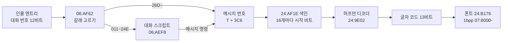
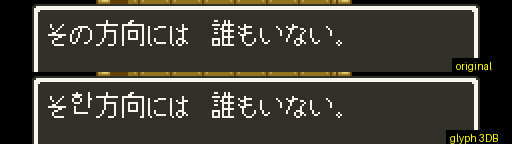

# DQ5(SFC) 메시지·폰트·대화 형식

보행 모드(필드·마을)의 메시지가 어떻게 들어 있고, 인물에게 말을 걸면 어떤 메시지가 나오는지 정리한 문서입니다. 찾아낸 과정은 일지에 있습니다.

- [2026-10-25-01: 메시지, 폰트, 대화 스크립트](../journal/2026-10-25-01-text.md)
- [2026-10-25-02: 보물상자와 이름 문자열](../journal/2026-10-25-02-treasure.md)
- [2026-10-25-07: 메시지 제어 코드, 대화 조건, 메뉴 문자열](../journal/2026-10-25-07-textctl.md)
- [2026-10-25-45: 끝 코드, 이름 변수, 몸짓, 일행 조회와 대화 조건](../journal/2026-10-25-45-text2.md)
- [2026-10-25-61: 대화 번호 000, 네이티브 호출 갈래, 창 머리, 몸짓 위치](../journal/2026-10-25-61-text3.md)
- [2026-10-25-77: 창 제목, 전투 글자, 인물 그림 어긋남, 늘린 롬의 SRAM](../journal/2026-10-25-77-text4.md)
- [2026-10-25-86: 늘린 롬의 교회 저장, 이름 길이, BG3 타일 칸, 창 머리 마무리](../journal/2026-10-25-86-text5.md)
- [2026-10-25-125: 창 머리 +2·+4 위 비트](../journal/2026-10-25-125-winbits.md)
- [2026-10-25-121: 네이티브 호출 「장면」·「호출」 갈래 실측](../journal/2026-10-25-121-text7.md)

기준과 검증:

- 기준 롬: `rom/dq5.sfc`([README](../../../README.md) 의 SHA-1). 주소 표기는 [dq5-map-format.md](dq5-map-format.md) 와 같습니다.
- 메시지: [sfc/dq5/tools/dq5text.py](../tools/dq5text.py). 메시지 3,200개가 모두 끝 코드까지 풀리고, 0x129 를 푼 64개 코드가 게임이 `7E:0E4B` 에 푼 값과 같습니다.
- 폰트: 같은 도구의 `glyph`. 롬에서 그린 메시지 0x129 가 게임 화면과 같습니다.
- 대화: [sfc/dq5/tools/dq5talk.py](../tools/dq5talk.py). 대화 스크립트 574개를 실행기 길이로 읽은 끝이 게임의 건너뛰기 규칙으로 찾은 다음 스크립트 시작과 모두 같습니다.
  선실의 파파스에게 말을 걸고(`012`), 그 슬롯의 대화 번호를 `02A`·`0F3`·`199`(스크립트), `26D`·`4BE`(직접 메시지)로 바꿔 말을 걸어, 처음 나온 메시지 번호 6개가 모두 예측과 같았습니다.
- 주소 힌트는 [「ドラクエ命」 SFC 版ドラクエ 5](https://showa-yojyo.github.io/dqbook/dq5.html) 의 텍스트 해석(`24:8BAF`, `24:AF1E`, `24:9E02`)에서 얻고 롬에서 다시 확인했습니다.


## 한눈에 보기



## 메시지 (`24:8BAF`)

메시지 번호는 0~3199(0xC7F)입니다. `24:8BAF` 가 번호를 A 로 받습니다.

```
색인  = 24:AF1E + (번호 >> 4) * 3 의 24비트 값
       하위 3비트 = 시작 비트 위치, 나머지 = 바이트 주소(24:8C8D)
번호 & 0F 만큼 끝 코드(1001·1010·1018)까지 풀어 버린다
```

색인은 200개(16개씩)이고, 첫 메시지는 바이트 주소에서 바로 시작합니다.

### 허프만 부호 (`24:9E02`)

- 비트는 바이트의 LSB 부터 읽습니다(`24:9E8C` 마스크 표). 바이트를 다 읽으면 다음 바이트로, 16비트 주소가 0 으로 넘어가면 다음 뱅크의 `$8000` 으로 갑니다.
- 노드는 2바이트입니다. 읽은 비트가 1 이면 `24:8CB6 + X`, 0 이면 `24:9472 + X` 를 읽습니다. 처음 X 는 `$07BA` 입니다.
- 값의 bit15 가 켜져 있으면 잎이고 `값 & 1FFF` 가 글자 코드입니다. 아니면 `(값 & 1FFF) * 2` 가 다음 X 입니다.
- `24:8B98` 은 코드 64개를 끝 코드와 상관없이 풀어 `7E:0E4B` 부터 16비트씩 둡니다.

### 글자 코드

| 코드 | 뜻 |
| --- | --- |
| `000` | 공백(`24:A623`, 폭 8) |
| `001`~`3DA` | 폰트 글자. 가나·한자·영숫자·기호 986자. 표는 `dq5text.py` 의 `CHARS` |
| `1000` | 줄바꿈 |
| `1001`, `1010`, `1018` | 메시지 끝 |
| `1002`~`101D`, `1100`~`1118` | 제어 코드. 아래 표 |

글자 코드는 가나 순서가 아니라 폰트 묶음 순서입니다(같은 크기 글자끼리 묶음). 글자표는 폰트를 그려 읽었고,
가나는 이름 입력용 글자 목록인 메시지 `061`(「あいうえお…ガギグゲゴ…ＡＢＣＤ」)의 순서로 맞췄습니다.
모양이 같은 쌍(へ/ヘ, ぺ/ペ, 二/ニ, 一/ー, 口/ロ, 夕/タ, が/ガ)과 々(「日々」「代々」)는 그 메시지와 문맥으로 갈랐습니다.

### 제어 코드 (`24:819D`)

메시지를 찍는 루틴(`24:8178` 고리)은 코드를 하나씩 꺼내 `24:819D` 로 넘깁니다. `1000` 미만은 글자이고, 제어 코드는 `코드 & FF` 를 색인으로
`1000`~`101D` 는 `24:8204`, `1100`~`1118` 은 `24:8240` 점프 표의 처리기로 갑니다(뱅크 24 의 16비트 주소, `dq5text.py --controls`).
이름·숫자 변수의 인자는 메시지 안에 없고, 메시지를 띄우기 전에 부르는 쪽이 `$F5`~`$F8` 에 넣어 둡니다. 처리기가 `24:889F` 로 한 바이트씩 꺼내면 뒤의 값이 앞으로 당겨집니다.
채우는 쪽은 보행 모드에서는 뱅크 06 의 가게·특수 기능(여관 값 `26` 을 `06:E3B9` 근처가 `$F5`~`$F7` 에 넣은 뒤 메시지 `072`), 전투에서는 뱅크 20(`20:843F`·`20:8A51`·`20:C6CA` 등이 몬스터 칸 `83`·`84` 따위를 넣은 뒤 전투 메시지 `24:8C39`)이었습니다(`$F5` 쓰기 감시). 롬에서 `STA $F5` 꼴은 뱅크 20 에 209곳, 06 에 78곳, 11 에 43곳, 05 에 25곳 있습니다.

말하는 사람 표시는 처리기가 아니라 줄 첫머리에서 다음 코드를 미리 보는 `24:8AF9` 가 정합니다.
첫 코드가 `1003`·`1006` 이 아니면 「＊「」(이름 문자열 바이트 `00`·`01`, `24:B270`)를 붙이고 다음 줄부터 들여 씁니다(`7E:0F0B` bit6 → 줄 첫 x = `10`, `24:9ECD`).

| 코드 | 처리기 | 쓰인 횟수 | 뜻 | 근거 |
| --- | --- | --- | --- | --- |
| `1000` | `8349` | | 줄바꿈. 줄은 `12`(18점) 간격, 셋째 줄 아래로 가면 한 줄 밀어 올림(`24:9EB0`, `24:A3EF`) | 실측 |
| `1001`·`1010`·`1018` | `8303`·`837D`·`82E4` | 2,624·559·17 | 메시지 끝. 아래 「끝 코드」 | 실측 |
| `1002` | `83AF` | 2,341 | ▼ 를 깜빡이며 버튼 대기(`24:841F`) 뒤, 지난 쪽의 줄 수만큼 밀어 올려 새 쪽 | 실측 |
| `1003` | (`24:8AF9`) | 2,014 | 「パパス「」 처럼 말하는 사람 대사. ＊「 를 붙이지 않고 다음 줄부터 들여 씀 | 실측 |
| `1006` | (`24:8AF9`) | 494 | 서술문. ＊「 도 들여쓰기도 없음 | 실측 |
| `1007` | `855E` | 14 | 들여쓰기 끄기. 다음 줄에 다른 사람의 「…」 를 이어 쓸 때 | 실측 |
| `1004` | `84BB` | 38 | 숫자. `$F5`(하위)~`$F7` 24비트를 10진으로(`04:AE7C`) | 실측 |
| `1005` | `853D` | 11 | 일행이 둘 이상이면 「たち」, 혼자면 아무것도 없음(「この者{1005}に」) | 코드 |
| `1008` | `84C0` | 182 | 이름. `$F5` 한 바이트: bit7 이 꺼져 있으면 일행 슬롯 `& 0F` 의 이름(bit6 이면 「たち」), `FF` 는 「まもののむれ」, 그 밖의 bit7 은 전투 몬스터 이름 | 실측(아래) |
| `1009`·`100A`·`100B`·`100C`·`1014` | `84D5`~`84E4`, `8537` | 0·55·1·0·0 | 이름 문자열 표 4(몬스터)·5(물건)·3(주문)·7·6(작전·마을)의 `$F5` 번째. 표 7 은 `30:8000` 으로 롬(1.5MB) 밖이라 `100C` 는 아무것도 찍지 않음 | 실측 |
| `100F` | `8506` | 1 | 몬스터 이름(표 4) 뒤에 `7E:1005 + [7E:0F23]` 이 0 이면 「Ａ」, 1 이면 「Ｂ」(이름 부호 `7B + 값`), 음수면 없음 | 실측(スライムＡ·スライムＢ·スライム) |
| `1011` | `8525` | 52 | 일행 슬롯 0 의 이름 | 실측(주인공) |
| `1012` | `852B` | 612 | 주인공 이름 `7E:2001`~(8바이트, `01` 에서 끝) | 실측 |
| `1016`·`1017` | `854C`·`8552` | 50·38 | 아들 `7E:2009`~, 딸 `7E:2011`~ 의 이름 | 실측 |
| `1015` | `8558` | 64 | 신부 이름. `7E:21B3 & 08` 이면 ビアンカ, 아니면 フローラ(`24:8A74` 의 두 문자열) | 실측 |
| `1013` | `8531` | 5 | 일행 레코드(`7E:2040 + 2A × i`) 8개 중 인물 번호(`+0`)가 `80` 인 동료(ビアンカ 가 이름 지은 고양이)의 이름. 없으면 빈칸 | 실측(마차 안이어도 나옴) |
| `101B` | `8585` | 0 | `BRK 88 3E` 로 주인공(일행 레코드 0)이 살아 있으면 `1012`, 아니면 `1011`(일행 첫째) | 실측(サンチョ 를 첫째로 두고 `7E:2041` = 0 이면 サンチョ) |
| `100D` | `84E9` | 99 | 31프레임 멈춤(「…{100D}が」) | 실측 |
| `100E` | `84FF` | 0 | 아무것도 하지 않음 | 실측 |
| `1019`·`101A` | `8566`·`8579` | 51 | `1019` 부터 `101A` 까지 글자를 기다림 없이 한 프레임에 찍음(`7E:0F11` bit7). `101A` 는 `0F11` 을 모두 끔 | 실측 |
| `101C` | `8598` | 11 | 느리게: 글자마다 3프레임(평소 1), 밀어 올리기도 1점씩(`7E:0F11` bit0, `04:9DB3`·`24:A3F8`) | 실측 |
| `101D` | `85A5` | 2 | 스크립트가 `7E:0F13`~`0F15` 에 넣어 둔 루틴을 `JSL`(예 `06:F9C4` 가 `06:F9D2` 를 넣음) | 코드 |
| `1100`~`1118` | `24:A855`~`AE46` | 1~13 | 말하는 인물(`7E:0F1E` 슬롯)의 몸짓과 창·화면 효과. 아래 「몸짓 코드」 | 실측 |

메시지에 한 번도 쓰이지 않은 코드(`1009`·`100C`·`100E`·`1014`·`101B`·`1102`·`1108`·`1109`·`110D`·`1111`)는 허프만 트리에 잎이 없어 지금 트리로는 쓸 수 없습니다(아래 「[한글 넣기 준비](#한글-넣기-준비)」).
그래서 `1009`·`100C`·`100E`·`1014`·`101B` 는 메시지 `008`(「{100A}ですね」)이 쓰는 트리 잎 `100A`(`24:91F4`, 파일 오프셋 `1211F4` 의 `0A 90`)를 그 코드로 바꿔 확인했습니다.

### 끝 코드

세 끝 코드는 모두 메시지를 끝내고, 그 뒤 창을 어떻게 남기는지가 다릅니다. 파파스 스크립트를 메시지 `129`(「その方向には　誰もいない。」, `1001` 로 끝남) 셋으로 덮고,
트리 잎 `1001`(`24:9420`, 파일 오프셋 `121420`)을 `1010`·`1018` 로 바꿔 세 번 띄웠습니다.

| 코드 | 처리 | 화면 |
| --- | --- | --- |
| `1001` | 줄을 내리고(셋째 줄 아래면 밀어 올림, `24:9EB0`) 창의 줄 수에서 이 메시지의 줄 수를 뺀 만큼 밀어 올림(`24:8351`). 버튼 대기 없음 | 앞 메시지가 위로 밀려나고 다음 메시지가 이어 찍힘. 셋째 메시지 뒤에는 한 줄만 남음 |
| `1010` | 찍은 글자가 있으면 `1001` 과 같이 밀어 올린 뒤 ▼ 버튼 대기(`24:841F`) | 메시지마다 ▼ 에서 멈춤. 스크립트가 서술문 뒤에 붙이는 빈 메시지 `013`(「{1006}{1010}」)이 이 대기만 함 |
| `1018` | 커서 Y(`7E:0E07`)를 18점 내리고 줄 수만 셈. 밀어 올리지 않음 | 세 메시지가 세 줄로 쌓임 |

`1019` 로 연 한 번에 찍기 중(`7E:0F11` bit7)에는 `1001`·`1010` 의 줄 내리기를 건너뜁니다(코드 읽기).

### 몸짓 코드

`1100` 번대는 말하는 인물(`7E:0F1E` 슬롯, 선실에서는 파파스 `0B`)의 인물 표 값과 창·화면을 바꿉니다. `7E:3180` 은 그림의 세로 어긋남이라 파파스 칸을 `FC` 로 고정하자 OAM Y 가 4 늘어(4점 아래) 그려졌습니다. `7E:3000` 은 가로 어긋남이고 위 3비트가 점 수입니다(`20`·`40`·`80` 이면 OAM X 가 1·2·4 늘고, `08`·`10` 은 그대로). 인물 표 `7E:31E0` 은 방향(`88` 위·`44` 아래·`22` 왼쪽·`11` 오른쪽, [dq5-map-format.md 「인물」](dq5-map-format.md#인물-128000)),
`7E:3260` 은 bit7 이 켜지면 아래 니블의 방향(`8` 위·`4` 아래·`2` 왼쪽·`1` 오른쪽) 모양으로 그리는 값입니다. `7E:326B` 를 `84` 로 고정한 화면은 `7E:31EB` = `44` 와 같고, `81`·`82`·`88` 은 `11`·`22`·`88` 쪽 모양이었습니다(`02` 가 평소 값).

각 코드가 든 메시지를 파파스에게 띄우고, 처리기 호출 프레임(`CALLS=2481A4`)과 인물 표 쓰기(`7E:31EB`·`326B`·`33AB`·`308B`)를 기록하며 화면을 찍었습니다.

| 코드 | 메시지(예) | 하는 일 |
| --- | --- | --- |
| `1100` | `5AC`「わっ！」 | 창 크기(`7E:0A43`~`0A46`)를 한 칸 키웠다가 되돌림. 창이 튀어 오르듯 커짐 |
| `1101` | `634` | 고개를 좌우로: `3260` = `81`·`02`·`82`·`02` 를 3프레임마다 |
| `1113` | `2E4` 등 13곳 | `1101` 을 10프레임 간격으로 두 번(천천히 고개 젓기) |
| `1103` | `638` | 두리번거림: `3260` = `82`·`81` 을 10프레임마다, 그 뒤 `31E0` = `22`·`44` |
| `1104` | `1ED` | 두 번 뛰어오름: `33A0` = `B7` 로 두고 `3080` 을 8·7·6·7·8·9… 로 31프레임 |
| `1105` | `698`「キリキリキリ……」 | 창이 위아래로 흔들림(`7E:0750`·`0752`) |
| `1106`·`1107` | `683`·`1DB` | `31E0` = `88`(위를 봄)·`44`(아래를 봄). `1108`·`1109` 는 `22`·`11`(트리에 없음) |
| `110A`·`110B`·`110C` | `718`·`256`·`791` | `3260` = `88`·`84`·`82`(위·아래·왼쪽 모양). `110D` 는 `81`(트리에 없음) |
| `110E` | `638` | `31E0` = 주인공 `31E0` & `F0`(선실에서 `80`) |
| `110F` | `256`·`791` | `3260` = `02` 로 되돌림 |
| `1110` | `84C` | 한 바퀴 돌기: `31E0` = `11`·`88`·`22`·`44` 를 3프레임마다 |
| `1112` | `758`「うー　さぶい」 | 몸 떨기: 인물 표 `7E:3000 + 슬롯` 을 `20`·`00` 으로 2프레임마다 8번 바꿈(`24:ABB9`). 그림이 1점씩 오른쪽으로 갔다 돌아옴 |
| `1114`·`1118` | `8FA`「ごほん」·`589`「ヒック」 | 인물 표 `7E:3180 + 슬롯` 을 3프레임 동안 `FF`(기침, 1점 아래)·`01`(딸꾹질, 1점 위)로 두었다가 `00`(`24:AE8F`). `1114` 는 두 번 |
| `1115` | `647` | 주인공을 마주 보는 모양: 주인공 `31E0` 이 위면 `3260` = `84`, 아래면 `88`, 왼쪽이면 `81`, 오른쪽이면 `82` |
| `1116`·`1117` | `774` | 맵 화면을 어둡게(`03:A6CB`, A = 7) / 되돌림(`03:A73D`). 메시지 창은 그대로 |

확인은 선실의 파파스 스크립트(대화 번호 `012`)의 거짓 분기 메시지 `41 2D`(`06:8139`, 파일 오프셋 `30139`)를 `ROMPATCH` 로 `6x yy`(bit5 → 메시지 `xyy` 그대로)로 덮어
아무 메시지나 띄우고, 화면과 처리기 호출 프레임(`CALLS=2481A4`, 코드를 A 로 받는 곳)을 본 것입니다.

- `1019`~`101A` 사이 공백 셋(메시지 `16B`)은 모두 136프레임에 찍히고, 앞뒤 글자는 한 프레임에 하나씩 찍혔습니다.
- 메시지 `1F9`: `100D` 뒤 다음 글자까지 31프레임(327 → 358), `101C` 뒤로는 3프레임 간격(499, 502, 505 …), `1002` 는 A 를 누를 때까지(136 → 314).
- `1003`·`1006` 은 처리기 호출 기록에 한 번도 나오지 않았습니다(`24:8AF9` 가 먹음). 처리기 표의 `24:81E4` 는 버튼을 떼고 누르기를 기다리는 고리입니다.
- `POKE` 로 `$F5`~`$F7` = `39 30 00` 을 고정하자 메시지 `058` 이 「12345ゴールド」, `$F5` = `05` 로 메시지 `008`(`100A`)이 「ブロンズナイフ」, 메시지 `18D`(`100B`)가 「ベギラマ」 였습니다.
  `1008` 은 `$F5` = `00`~`05` 가 모두 주인공(일행이 혼자), `40`·`41` 이 「ああああたち」, `80`·`81` 이 「スライム」+ 글자 하나였습니다.
- `7E:2001`·`7E:2009`·`7E:2011` 의 첫 바이트를 바꾸자 `1011`·`1012`, `1016`, `1017` 이름의 첫 글자가 바뀌었고, `7E:21B3` = `08` 이면 `1015` 가 フローラ 대신 ビアンカ 였습니다.


## 폰트 (`24:A609`)

```
24:B176 부터 5바이트 항목. 앞에서부터 개수를 더해 코드가 속한 묶음을 찾는다
+0~+1  하위 12비트 = 묶음의 글자 수, +1 의 상위 4비트 = 폭(점)
+2~+3  시작 주소(16비트)
+4     bit0-1 + 7 = 뱅크, bit2-5 = 높이(줄)
```

- 묶음 안 `n` 번째 글자는 시작 주소에서 `n × 폭 × 높이` 비트 뒤부터, 줄마다 폭 비트씩 이어 붙은 1bpp 그림입니다.
- 줄은 24비트를 읽어 비트 위치만큼 오른쪽으로 민 뒤 아래 `폭` 비트를 씁니다. 그중 높은 비트가 왼쪽 점입니다(`24:A756`).
- 높이가 `h` 인 글자는 `13 - h` 줄 내려 그립니다(`24:A6DA`). 그래서 「。」(9×3) 처럼 작은 글자는 아래에 붙습니다.
- 글자 묶음은 50개이고 986자가 `07:980E`~`07:D6xx` 에 들어 있습니다.

## 이름 문자열 (`21:955D`)

인물·몬스터·주문·물건 이름은 메시지와 따로, 1바이트 부호 문자열 표에 있습니다. 메시지의 제어 코드(예: `100A`)가 이 표에서 이름을 가져옵니다.

```
21:959B + 표 번호 * 3 = 표 시작(24비트)
표 = [길이][바이트 … ] 가 이어진 목록. n 번째는 앞의 n 개를 길이+1 씩 건너뛴 곳
```

| 표 | 시작 | 항목 수 | 내용(앞부분) |
| --- | --- | --- | --- |
| 0 | `23:C5CE` | 8 | 인물 이름: ビアンカ, サンチョ, ピピン, フローラ, パパス … |
| 1 | `23:C5F9` | 17 | 호칭: パパスのむすこ, やどやのむすめ … |
| 2 | `23:C690` | 3 | おとこ, おんな, ？？？ |
| 3 | `22:8000` | 171 | 첫 항목 ひとし(행동 `00`, 「ボーッとしているズ」, [dq5-data-format.md](dq5-data-format.md)) 뒤로 주문: メラ, メラミ, メラゾーマ, ギラ … |
| 4 | `23:C69C` | 236 | 몬스터: スライム, とげぼうず, せみもぐら … |
| 5 | `23:CE0E` | 222 | 물건: ひのきのぼう, たけのやり, こんぼう … |
| 6 | `23:D5B5` | 6 | 작전: ガンガンいこうぜ … |
| 7 | `30:8000` | — | 롬(1.5MB) 밖 |
| 8·9 | `23:D6A1` | — | 둘이 같은 곳 |
| `0A` | `23:C242` | 168 | 동료 몬스터 이름([dq5-data-format.md](dq5-data-format.md#동료-몬스터-이름-이름-표-0a)) |
| `0B` | `23:D5F3` | 23 | 마을 이름: ラインハット, オラクルベリー … |

항목 수는 표마다 다음 표의 시작에서 끝난다고 보고 `[길이][바이트…]` 를 세어, 끝이 다음 표 시작과 바이트째 맞은 것입니다(롬 구조). 표 3 은 뒤에 다른 표가 없어 행동 번호 수 171(`00`~`AA`)을 적었습니다. 표 `0C` 이후의 24비트 값(`C9:01A5` 등)은 표 주소가 아닙니다.

1바이트 부호는 `24:A7B6` 이 글자 코드로 바꿉니다.

- 보통 바이트 `b` → `24:B270 + b*2` 의 글자 코드
- `84 xx` → `24:AE9A` 에서 `xx` 를 찾은 순번 `i` 로 `24:B36E + i*2`(탁점 글자, 예 `84 29` = が)
- `83 xx` → 같은 표의 `28` 번째부터 찾음(반탁점 글자)
- `01` → 공백

상자에서 「はがねのキバ」(`14 84 29 18 27 84 1C 2F`)가 나온 화면과 디코더 결과가 같습니다.

## 대화 (`06:AF62`)

인물 엔트리의 대화 번호(12비트, [dq5-map-format.md 「인물」](dq5-map-format.md#인물-128000))는 인물 표 `7E:36E0`(하위)·`7E:3700`(상위)에 들어갑니다.
말을 걸면 `06:AF62` 가 그 값을 읽고 `06:AFF4` 가 갈래를 고릅니다.

| 대화 번호 T | 하는 일 | 낮 인물 수 |
| --- | --- | --- |
| `000`~`010` | `06:DBD2` 특수 기능. 아래 「특수 기능」 | 463 |
| `011`~`24E` | 대화 스크립트 `T - 011` | 336 |
| `24F`~`26C` | `06:B34F` 묻기: 메시지 `T + 3C6` 뒤 はい/いいえ, はい 면 `+1`, いいえ 면 `+2` 메시지(실측) | 6 |
| `26D`~ | 메시지 `T + 3C6`(`06:AFFB`) | 153 |

### 대화 스크립트 (`06:AEF8`)

```
06:AEF8 + ((T - 011) >> 5) * 2 = 32개 묶음의 시작(뱅크 06)
묶음 안에서 (T - 011) & 1F 개의 스크립트를 건너뛴다(06:AFA9)
  건너뛸 때 길이: 00·17~1C = 3, bit6 이 켜진 바이트 = 2, 나머지 = 1, 3F 를 만나면 스크립트 하나 끝
```

스크립트는 574개, `06:8129`~`06:AEF7`(11,727바이트)입니다. 명령은 `06:B065` 가 실행합니다.

| 바이트 | 길이 | 뜻 |
| --- | --- | --- |
| `40`~`7F`(bit6) | 2 | 메시지. `v = (b0 & 3F) << 8 \| b1`, bit5 가 켜져 있으면 `v & 1FFF`, 아니면 `v + 615` 가 메시지 번호(`06:B070`) |
| `07` | 1 + 조건 | 조건문. 아래 |
| `17` | 3 | `7E:2190 + idx &= mask`(플래그 끄기) |
| `18` | 3 | `7E:2190 + idx \|= mask`(플래그 켜기) |
| `19` | 3 | `7E:2190 + idx = 값` |
| `12` | 2 | `06:DBD2` 특수 기능(인자 1바이트). 스크립트 574개에 한 번도 없음 |
| `00` | 3 | 네이티브 루틴 호출 `06:주소`(`06:B129`). 아래 「네이티브 호출」 |
| `01` | 5 | 네이티브 루틴 호출 + 인자 2바이트. 스크립트에 한 번도 없음 |
| `3E` | 1 | 블록 끝 |
| `3F` | 1 | 스크립트 끝 |

조건문은 `07 <조건> <참 분기> [0B <거짓 분기>]` 입니다(`06:B15B`, `06:B1E5`).
분기는 `06` 으로 시작하면 `3E`(또는 `3F`)까지 여러 명령, 아니면 명령 하나입니다(`06:B214`, `06:B225`).

조건 바이트의 bit7 은 결과를 뒤집고, 아래 6비트가 조건 코드입니다. 길이는 `06:B27E` 가 정하고, 처리기는 `06:B15B` 가 고릅니다.
처리기가 A = 0 을 돌려주면 참입니다.

뜻은 파파스 스크립트(`06:812D`, 파일 오프셋 `3012D`)를 `07 <조건> 61 6B 0B 61 29 3F`(참이면 메시지 `16B`, 거짓이면 `129`)로 덮어 말을 걸고
`CALLS=248BAF` 로 나온 메시지를 본 것입니다. 「코드」 는 처리기를 읽기만 한 것입니다.

| 조건 코드 | 길이(조건 바이트 포함) | 쓰인 횟수 | 처리기 | 참일 때 | 근거 |
| --- | --- | --- | --- | --- | --- |
| `1B` | 3 | 772 | `06:B31F` | `7E:2190 + idx & mask` 가 켜짐 | 실측 |
| `05` | 1 | 79 | `06:B2DE` | はい/いいえ 창(`06:B383`, 창 `32`)에서 はい. 결과는 `$E8`(はい = 0) | 실측(はい → 참, いいえ → 거짓) |
| `03` | 2 | 55 | `06:B2FB` | 인물 번호 인자가 마차 밖 일행에 살아 있음(`BRK 8B 48 DB`, 아래 「[일행 조회](#일행-조회-brk-8093)」). 인자 `04`(어린 ビアンカ)는 `7E:2190 & 40` 이면 `03`(ビアンカ)으로 바꿈 | 실측 |
| `1F`·`1E` | 1 | 44·0 | `06:B2CC` | 신부가 ビアンカ(`7E:21B3 & 08`) | 실측(`08` 참, `00` 거짓) |
| `02` | 1 | 19 | `06:B2C5` | `7E:0F1D` 가 0 이 아님 | 실측(`0F1D` = 0 거짓, 1 참) |
| `13` | 2 | 2 | `06:B2EB` | 일행 레코드 인자 번째의 `+1` bit7(살아 있음)이 켜짐(`BRK 88 3E`, `$43` = 0) | 실측 |
| `11` | 2 | 1 | `06:B2B7` | 일행 누군가가 물건 인자를 가짐(`BRK 88 90`). 스크립트에서는 ドラゴンオーブ(`D1`) 하나 | 실측 |
| `1A` | 3 | 1~2 | `06:B33B` | `7E:2190 + idx` 가 값과 다름 | 실측(`7E:2191` = 1 에 값 1 거짓, 3 이면 참) |
| `20` | 1 | 0 | `06:B2D4` | 마차 밖 일행에 살아 있는 인물 번호 `02`(딸)가 없음(`BRK 89 4C 45`) | 실측 |
| `14` | 1 | 0 | `06:B314` | 낮: 시간대 `7E:075E` < `F0`(`21:8000`) | 실측(`075E` = `0100` 이면 거짓) |
| `16` | 2 | 0 | `06:B31F` | `1B` 와 같은 처리기. 처리기는 2바이트를 더 읽는데 길이 표는 2 | 코드 |
| `1C` | 3 | 0 | `06:B32D` | `mask \| 7E:2190 + idx` 가 0 이 아님 | 코드 |

쓰기 도구 `dq5talkwrite.py`([쓰기 형식](dq5-build-format.md#대화-스크립트-dq5talk1))로 바꾼 롬에서 파파스에게 말을 걸어 아래도 확인했습니다. 조건 바이트 bit7 은 결과를 뒤집습니다(원본 574개에는 없음, `1B` → `9B` 로 참 갈래). `17 62 0F` 는 `FF` 였던 `7E:21F2` 를 `0F` 로, `19 60 5A` 는 `7E:21F0` 을 `5A` 로 만들었습니다. else 없는 조건문은 참이면 분기를 실행하고 거짓이면 건너뜁니다(원본은 조건문 973개가 모두 else 가 있음). `00 A0 B3`(네이티브 `06:B3A0`)은 메시지 `1CC` 를 띄웠습니다.
갈리지 않은 분기는 `06:B23F` 가 명령 길이로 건너뜁니다. 블록 없는 분기의 `07` 은 1바이트로 건너뛰어 조건 바이트가 남으므로, 원본도 블록 없는 분기에는 메시지(1,045)·`00`(64)·`18`(1)만 씁니다(코드 읽기).

`BRK nn` 은 이 엔진의 공용 서비스 호출입니다(벡터 `00:8F80`). 지금까지 확인한 것: `BRK 0B a b` 는 `7E:2190 + b & a` 시험(위 `1F`·`1015` 로 실측),
`BRK 95 nn` 은 창 `nn` 열기(`STA $0A00`), `BRK 97+n xx` 는 메시지 `n << 8 | xx` 띄우기(`00:90FD`~`9117`, `24:8157` 호출)입니다. `BRK 80`~`93` 은 아래 일행 조회입니다.

### 일행 조회 (`BRK 80`~`93`)

`BRK 80`~`93`(`00:9197`)은 필드 읽기 루틴 `21:8AF8` 을 부르는 꼴입니다. 몬스터 레코드를 읽는 그 루틴([dq5-data-format.md 「몬스터」](dq5-data-format.md#몬스터-238000))이 일행 레코드도 읽습니다.
BRK 번호 bit0 이 켜져 있으면 먼저 한 바이트를 `$3F`(거르개)로 읽고, `00:920A[(번호 >> 1) & 3F]` 의 비트에 따라 다음 바이트를 `$38`(필드 번호)·`$43`·`$44` 로, 또는 부른 쪽의 A·X 를 `$42`·`$43` 으로 넣습니다(코드 읽기).
`BRK 88 f` 는 `$38` = f 만 읽고 `$42`·`$43` 은 부르는 쪽이 넣어 둡니다. `BRK 89 g f` 는 `$3F` = g, `$38` = f, `BRK 8B g f` 는 거기에 `$42` = A 입니다. 결과는 `$46`~`$49` 입니다. 필드 설명자는 `dq5talk.py --field` 로 찍습니다.

```
일행 레코드 7E:2040 + n*42 (n = 0~7, 묶음 0)
  +0 인물 번호(아래 표, bit7 = 동료 몬스터)   +1 bit7 살아 있음, bit6 (거르개 bit5 가 봄)   +2 HP
일행 순서 7E:2020[i] = 레코드 번호, 7E:201D = 모두의 수, 7E:201E = 마차 밖(앞쪽) 수
$3F bit7  $42 를 순서 번호로 보고 7E:2020[$42] 의 레코드를 씀
    bit6  살아 있는 사람만(21:92FF)   bit5  마비(+1 bit6)가 아닌 사람만   bit2  사람만(+0 bit7 꺼짐)
    bit4·3  범위: 3 만 = 순서 0 ~ 201E(마차 밖), 4 만 = 201E ~ 201D(마차 안), 둘 다 없거나 둘 다 = 전부
```

| 필드 | 묶음·자리 | 후처리 | 쓰는 곳 | 하는 일 |
| --- | --- | --- | --- | --- |
| `3E` | 0, `+1` | `21:99AA` | 조건 `13`, `101B` | `$43` 번째 상태 비트(`21:91F9` 표). `$43` = 0 이면 `+1` bit7 을 뒤집어 `$46` 에 둠 |
| `33` | 0 | `21:9734` | | 일행 레코드 `$42` 의 가진 물건 12칸(`7E:0BDC`)에서 물건 `$43` 을 찾아 칸 번호, 없으면 `FF` |
| `90` | 4 | `21:975E` | 조건 `11` | 일행을 차례로 `33` 으로 찾아 처음 가진 사람의 결과, 아무도 없으면 `$46` = `$49` = `FF` |
| `45` | 4, `+29` | `21:99FD` | 조건 `20`, 명령 창 고르기(`21:8014`) | 거르개를 지나는 사람 수(`$46`). 인물 번호 `02` 를 만날 때마다 `$49` 를 1 줄임 |
| `DB` | 4, `+29` | `21:9A40` | 조건 `03` | 범위 안에서 인물 번호가 `$42` 인 사람의 순서 번호(`$46`)·레코드 번호(`$47`), 없으면 `$49` = `FF` |
| `2B` | 0, `+0` | `21:94F8` | `1008`·`1009`~`1014` | 이름. `$43` 이 이름 표 번호 |

일행 레코드 둘째(`7E:206A`)와 일행 수·순서를 `SET` 으로 만들고 조건을 시험했습니다(파파스 스크립트를 `07 <조건> 61 6B 0B 61 29 3F` 로 덮음, 「참」 이 메시지 `16B`).

| 조건 | 일행 | 결과 |
| --- | --- | --- |
| `03 00` | 주인공 혼자 | 참 |
| `03 05` | サンチョ(`05`) 살아 있음, 마차 밖 / `+1` = 0 / 마차 안(`201E` = 1) / 없음 | 참 / 거짓 / 거짓 / 거짓 |
| `20` | 혼자 / 딸(`02`) / ビアンカ(`03`) | 참 / 거짓 / 참 |
| `13 00`, `13 01` | `7E:2041` = 0 / 둘째 `+1` = `80` / `40` | 거짓 / 참 / 거짓 |
| `11 42`, `11 01` | 주인공이 ぬののふく(`42`)를 가짐 / 첫 칸에 たけのやり(`01`) 넣기 전·후 | 참 / 거짓·참 |
| `14` | 그대로 / `7E:075E` = `0100` | 참 / 거짓 |

`+1` bit7 이 살아 있음인 것은 전투에서 주인공이 쓰러지자 `7E:2041` 이 `80` → `00`, HP(`+2`)가 0 이 된 것으로 확인했습니다.
인물 번호는 둘째 레코드에 번호를 넣고 `1008`(`$F5` = 1)로 이름을 띄워 읽었습니다.

| 번호 | 이름 | 번호 | 이름 |
| --- | --- | --- | --- |
| `00` | 주인공 | `07` | フローラ |
| `01` | 아들(`7E:2009`) | `08` | パパス |
| `02` | 딸(`7E:2011`) | `09` | ヘンリー |
| `03`·`04` | ビアンカ(`03` 은 조건 `1F` 와 함께, `04` 는 `03` 으로 바뀌는 어린 ビアンカ) | `0A` | ベラ |
| `05` | サンチョ | `0B`·`0C` | パパスのむすこ·やどやのむすめ |
| `06` | ピピン | `80`~`83` | 동료 몬스터(`80` 은 `1013` 의 고양이, `81` ボロンゴ, `82` スラリン, `83` ドラきち) |

스크립트에서 조건 `03` 의 인자는 `03`(25번)·`01`(8)·`47`(6)·`00`·`09`·`81`(4)·`02`·`07`(2) 입니다. `47` 도 같은 방법으로 띄우자 フローラ 였고, 스크립트에서는 「フローラさんの だんなさん」 처럼 결혼한 フローラ 와 함께일 때 씁니다.
같은 방법으로 `0D` 는 ラインハットおうじ, `0E` 는 「(주인공)のつま」, `10` 은 「(주인공)のむすこ」, `46`·`48` 은 ピピン·パパス 였습니다. 일행 레코드 `+1` bit6 은 마비입니다([dq5-data-format.md 「주문과 행동」](dq5-data-format.md#주문과-행동-268765)).
`BRK 8C f` 는 `$38` = f, `$42`·`$43` = A 의 아래·위 바이트입니다(`00:920A` 표 `A8`, 코드 읽기). `1013` 이 일행 레코드 번호를 A 에 넣고 `BRK 8C 2B` 로 그 레코드의 이름을 읽어 위 실험처럼 ボロンゴ 를 찍었습니다.

예: 대화 번호 `012`(선실의 파파스)

```
07 1B 01 01     if 7E:2191 & 01
06                블록 시작
41 3A               메시지 74F「パパス「そうか　港に着いたか！…」
18 02 80            7E:2192 |= 80
3E                블록 끝
0B              else
41 2D             메시지 742「パパス「父さんは　ここにいるから…」
3F              끝
```

`7E:2192 & 80` 은 17/00 에 인물을 놓지 않는 조건 플래그입니다([dq5-map-format.md 「이벤트 플래그에 따른 목록」](dq5-map-format.md#이벤트-플래그에-따른-목록-1282fb-128357)).

### 특수 기능 (`06:DBD2`)

대화 번호 `000`~`010` 은 `06:DBDB` 점프 표(17개, 뱅크 06)의 처리기로 갑니다. 처리기가 끝나면 `7E:0F20` 을 지웁니다.

| 번호 | 처리기 | 하는 일 |
| --- | --- | --- |
| `00` | `DBFD` | `BRK 95 00`(대화 창), `BRK 98 CC` 로 메시지 `1CC`「その方向には　ダレモイナイ。」(실측) |
| `01`~`10` | `DC04`·`E01F`·`E026`·`E4DE`·`E03E`·`E384`·`E95A`·`E02E`·`EBF7`·`ED01`·`EE34`·`EF70`·`F1E8`·`F226`·`E036`·`E375` | 무기점·도구점·방어구점·맡기는 곳·교회·여관 등 가게. 번호별 가게는 [dq5-data-format.md 「가게 종류」](dq5-data-format.md#가게-종류-06dbd2) |

대화 번호 `000` 인 인물 엔트리는 875개입니다(대체 목록 포함). 말을 걸 상대는 `05:82C0` 이 고르는데, 앞 칸(두 셀 앞과 그 좌우, 인물 표 `7E:31C0` bit0 이 켜진 인물은 세 셀 앞)에 X·Y·층이 같은 인물이 있어도
그림 번호가 `05:862F` 목록(`46`~`49`·`4A`~`4D`·`4F`·`63`·`78`~`81`·`83`·`84`·`99`·`12`·`24`·`35`·`98`·`A4`~`A8`·`FE`, 맵 04/03 에서는 `03`·`04`·`52` 도)에 있으면 건너뜁니다(코드 읽기). `dq5sprite.py` 로 이 그림 번호들의 스프라이트 세트를 그려 보니 횃불·불꽃·간판·항아리·책장·등·의자·접시와 빵·닭고기·물병 같은 물건이었습니다(`FE` 는 세트가 없음).

- 875개 중 443개가 이 목록의 그림입니다. 그런 인물(17/00 의 `A6`, 슬롯 `0C`)은 말을 걸 상대가 되지 않아 「その方向には 誰もいない。」(`129`)였습니다.
- 나머지 432개(인라인 스크립트가 있는 것 303개)는 말을 걸면 `000` 처리기로 갑니다. 17/00 의 뱃사람(그림 `2E`, 슬롯 `0A`, 대화 번호 `000`)을 `POKE` 로 주인공 앞에 옮겨 말을 걸자 메시지 `1CC`「その方向には ダレモイナイ。」 였습니다.
- 대화 번호를 실행 중에 바꾸는 코드는 슬롯끼리 값을 옮기는 `02:B531`·`12:927A`·`1E:DC08` 뿐이라, 대화 번호 `000` 인물이 다른 대사를 하는 길은 찾지 못했습니다.

### 묻기 (`06:B34F`)

대화 번호 `24F`~`26C` 는 메시지 `T + 3C6` 을 띄우고 `BRK 95 32` 로 はい/いいえ 창을 엽니다. `$E8` 이 0(はい)이면 메시지 `+1`, 아니면 `+2` 를 띄웁니다.
파파스 슬롯에 `24F` 를 넣고 はい 를 고르자 `615` → `616`, いいえ 를 고르자 `615` → `617` 이 나왔습니다(`dq5talk.py 24F`).

### 네이티브 호출

스크립트의 `00` 명령은 229번, 대상은 뱅크 06 의 142곳입니다(`dq5talk.py --calls`). 대상은 `06:B3AD`~`06:C501` 과 `06:F646`~`06:FDEB` 두 덩어리에 있습니다.
`dq5talk.py --calls` 가 대상마다 첫 `RTS`·`RTL`·`JMP` 까지 곧게 읽어(분기는 따라가지 않음) 띄우는 메시지·창, 켜고 끄는 플래그(`BRK 0C` = `7E:2190 + b \|= a`, `BRK 0D` = `&= a`), 부르는 루틴을 찍고 갈래를 붙입니다.
`BRK` 뒤 인자 길이는 처리기가 `00:8FAC` 로 바이트를 꺼내는 횟수로 정했습니다(코드 읽기). 갈래별로 모으면 이렇습니다.

| 갈래 | 대상 수 | 호출 수 | 기준 | 대상 |
| --- | --- | --- | --- | --- |
| 가게 | 8 | 40 | `04:D977` 뒤 특수 기능 처리기 | `C23C`(`DC04` 무기점)·`C244`(방어구점)·`C24C`(よろず屋)·`C254`(여관)·`C25C`·`C264`(교회)·`C26C`(도구점)·`C342`(`06:DB86`) |
| 메시지 | 52 | 56 | 창·메시지를 띄우고 플래그를 바꿈. 이벤트 대사 | `B3CB`·`B45C`·`B4F7`·`B604`·`B626`·`B68D`·`B6B3`·`B737`·`B83C`·`B8C7`·`B984`·`B9CF`·`B9F8`·`BA0A`·`BA23`·`BAAB`·`BC27`·`BC68`·`BC86`·`BC8D`·`BCB1`·`BD4B`·`BEBB`·`BED4`·`BEFE`·`BF56`·`BFD6`·`C087`·`C09B`·`C278`·`C2EF`·`C34B`·`C376`·`C3A4`·`C3C0`·`C478`·`F646`·`F664`·`F691`·`F6B0`·`F6EE`·`F7E4`·`F808`·`F89D`·`F8B0`·`FAC9`·`FBD7`·`FCCB`·`FD05`·`FD45`·`FDC0`·`FDEB` |
| 장면 | 24 | 28 | `BRK 0E`(프레임 기다림)과 맵을 다시 그리는 루틴(`00:C6D8`·`00:954A`·`01:85EC`·`01:86C3` 등) | `B417`·`B5C6`·`B5E3`·`B8EC`·`B91C`·`B944`·`B96C`·`BFB7`·`C027`·`C200`·`C297`·`C310`·`F729`·`F792`·`F8DF`·`F968`·`F9E2`·`FAF0`·`FB41`·`FB8F`·`FBA1`·`FBB3`·`FBC5`·`FC8C` |
| 값 쓰기 | 12 | 49 | 플래그·WRAM 만 고침 | `B3B9`·`B5AF`·`BD99`·`BDB5`·`C38D`·`C501`·`F6C1`·`F6DA`·`F78E`·`F831`·`F83B`·`F9C2` |
| 호출 | 45 | 55 | 다른 뱅크 루틴을 부르는 것이 주 | `B3AD`·`B3E6`·`B3EE`·`B3FC`·`B405`·`B4B1`·`B53B`·`B657`·`B666`·`B66F`·`B686`·`B8A0`·`B8AA`·`B8B2`·`BA7E`·`BAA4`·`BBB3`·`BBBC`·`BBF7`·`BC1C`·`BC7A`·`BCA8`·`BCF8`·`BD15`·`BD7F`·`BEB6`·`BFB2`·`BFEB`·`C00A`·`C017`·`C180`·`C274`·`C309`·`F841`·`F874`·`F8AB`·`FAE4`·`FB3C`·`FD16`·`FD21`·`FD28`·`FD2F`·`FD34`·`FD3B`·`FD40` |
| 빈 루틴 | 1 | 1 | `RTS` 하나 | `B3AC` |

갈래마다 몇 곳을 실측했습니다. 파파스 스크립트를 `00 <대상> 3F`(네이티브 호출 하나)로 덮어 말을 걸었습니다.

| 대상 | 갈래 | 실측 |
| --- | --- | --- |
| `B3CB` | 메시지 | 메시지 `605`(코드를 곧게 읽은 `604` 와 다른 쪽 갈래. `7E:21A4 & 80` 이 꺼져 있음) |
| `B604` | 메시지 | 메시지 `43A` |
| `F83B` | 값 쓰기 | `7E:19AE` 0 → 1 |
| `C501` | 값 쓰기 | 파파스 슬롯 `7E:330B` 0 → `10` |
| `F6C1` | 값 쓰기 | `7E:21A1` = FF, `7E:21A2` = `80` 이면 `7E:21BB` 0 → `40`, 아니면 그대로 |
| `BAA4`·`C309`·`FD34` | 호출 | 화면·맵 변화 없음(`23:E2F4`·`25:FD00` 을 부름) |
| `FB8F` | 장면 | `01:86C3`·`00:C6D8`·`00:954A` 를 한 번도 부르지 않고 `7E:21BB` 도 그대로 |

「장면」 갈래는 그것을 부르는 인물에게 실제로 말을 걸어 확인했습니다. `B91C` 를 부르는 대화 번호 `19E` 인물(31/00 (48,21))에게 `dq5warp.lua TO=31/00,48,23` 으로 간 세이브스테이트에서 위를 보고 말을 걸자, 메시지 `A52` 뒤 `06:B91C` → `01:85EC` 가 돌고 이벤트 전투(オーク 1마리)가 시작됐습니다. 「장면」 갈래 24곳 가운데 15곳이 `01:85EC`·`01:86C3` 을 부릅니다(코드 읽기). 나머지 9곳(`BFB7`·`C200`·`C297`·`F729`·`F792`·`F8DF`·`F968`·`F9E2`·`FAF0`)은 맵을 다시 그리는 루틴(`00:C6D8`·`00:954A`·`00:CE51` 등)만 부릅니다.

「호출」 갈래 45곳은 하나씩 파파스 스크립트로 불러, 띄운 메시지와 `7E:2190`~`220F` 쓰기를 기록했습니다(`dq5msg.lua WWRANGE`). 말을 걸 때마다 쓰는 `7E:21A1` = `71` 은 뺐습니다.

| 대상 | 띄운 메시지 | 플래그 쓰기 | 곧게 읽은 내용 |
| --- | --- | --- | --- |
| `B3AD` | - | 21A5=80 | flag 15|80, JSL 00:CF34, STZ $0F1B |
| `B3E6` | 22B | - | JSL 12:FE19, STZ $0F1B |
| `B3EE` | - | - | query 88 4a |
| `B3FC` | - | 21A1=F1 | flag 11|80, JSL 00:CF34 |
| `B405` | - | 21B2=20 | flag 22|20, flag? 18&01, JSL 21:8A07 |
| `B4B1` | 5D9 | 21AA=06,21B1=02,21B2=40,21B7=18 | flag 1A|06, flag 27|18, flag 21|02, flag 22|40, JSL 06:B4EB, |
| `B53B` | 5C1 | - | JSL 03:BFF7, JSL 12:8CFD, JSL 12:8CFD, JSL 00:E9CE, STZ $20C |
| `B657` | - | - | JSL 12:8CFD, JSL 00:E9CE |
| `B666` | - | 219F=40 | flag 0F|40, JSL 00:CF34 |
| `B66F` | - | 21AF=02 | flag 1F|02, JSL 06:CB48, query 88 8e, JSL 25:FD00, JSL 06:B4 |
| `B686` | - | - | JSL 06:B4EB |
| `B8A0` | - | - | STA $0F1E, JSL 24:A99D |
| `B8AA` | - | - | JSR B8A0, STA $0F1E, JSL 24:A9F6, STA $0F1E, JSL 24:A98F |
| `B8B2` | - | - | STA $0F1E, JSL 24:A9F6, STA $0F1E, JSL 24:A98F |
| `BA7E` | - | 21BD=01 | JSL 00:CF34, JSL 21:8000, STA $0F1E, JSL 24:A96F, flag 2D|01 |
| `BAA4` | - | - | JSL 23:E2F4 |
| `BBB3` | - | 21B3=20 | JSL 00:CF34, flag 23|20 |
| `BBBC` | - | 21BD=02 | JSL 00:CF34, JSL 21:8000, STA $0F1E, JSL 24:A96F, STA $7E203 |
| `BBF7` | - | 21AB=80 | JSL 00:CF34, JSL 21:8000, STA $0F1E, JSL 24:A96F, flag 1B|80 |
| `BC1C` | - | 21B0=01 | flag 20|01, JSL 23:E2F4 |
| `BC7A` | - | 21A1=F1 | JSL 00:CF34, flag 11|80, STZ $0F1B |
| `BCA8` | - | 21A1=F1 | flag 11|80, JSL 00:CF34 |
| `BCF8` | - | 219F=80 | JSL 24:A99D, JSL 24:A93E, JSL 24:A93E, flag 0F|80, STZ $0F1B |
| `BD15` | - | - | JSL 24:A935, JSL 24:A9E7, JSL 24:A9AB, JSL 03:BDEB, JSL 24:A |
| `BD7F` | - | - | JSL 02:B705 |
| `BEB6` | - | 219F=00 | JSL 06:CCF0 |
| `BFB2` | 2D4 | - | JSL 06:CD4F |
| `BFEB` | - | 219F=80 | STA $7E31A0,X, STA $7E31A0,X, STA $7E31A0,X, flag 0F|80, JSL |
| `C00A` | - | 21A6=C0 | flag 16|40, JSL 02:B0DC, JSL 06:CCF0 |
| `C017` | - | 2196=0C | JSL 03:C57C, flag 06|0C, STZ $0F1B, JSL 00:CF34 |
| `C180` | 25B | - | JSR C184 |
| `C274` | 0E9 | - | JSR E95A |
| `C309` | - | - | JSL 23:E2F4 |
| `F841` | - | - | JSR F892, JSL 03:B21E, JSL 02:B3B4, JSL 12:8CBE, JSL 03:B3B8 |
| `F874` | - | - | JSR F892, JSL 03:B21E, JSL 02:B3B4, JSL 12:8CBE, JSL 03:B3B8 |
| `F8AB` | 5B3 | - | JSL 03:FD44 |
| `FAE4` | - | - | JSL 05:F106, JSL 03:C688, STZ $0F1B |
| `FB3C` | 5CD,013 | - | JSL 03:FC6C |
| `FD16` | - | - | JSL 24:FF0F |
| `FD21` | - | - | JSL 21:8923 |
| `FD28` | - | - | JSL 21:8923 |
| `FD2F` | 603 | - | JSL 03:FBEC |
| `FD34` | - | - | JSL 25:FD00 |
| `FD3B` | - | - | JSL 03:FC30 |
| `FD40` | 606 | 21A1=F1 | JSL 03:FD1B |

#### 「장면」 갈래를 원래 맵에서

대상마다 그것을 부르는 대화 번호의 인물을 인물 목록(기본·대체, 낮·밤)에서 찾아, 장면 이동 도구로 그 인물의 **두 칸 아래**(`31C0` bit0 이면 세 칸)에 서서
30프레임 뒤 위를 누르고 말을 걸었습니다(말 상대는 `05:82C0` 이 두 칸 앞에서 고름). 대체 목록이면 그 플래그를, 밤 인물이면 `7E:075E` = `F0` 을 `SET` 으로 두고,
인물의 층(`7E:31A0`)이 1 이 아니면 도착 층도 맞췄습니다. 24곳 중 15곳에서 대상이 실행됐습니다.

| 대상 | 대화(맵 (셀)) | 일어난 일 |
| --- | --- | --- |
| `B5C6`·`B5E3`·`B91C`·`B944`·`C310`·`FBA1`·`FC8C` | 20F 32/0A (54,40)·210 32/15 (12,19)·19E 31/00 (48,21)·19F 31/00 (20,21)·05B 08/00 (29,28)·097 03/04 (10,10)·09C 03/0B (12,17) | 이벤트 전투. ゴンズ·ゲマ·オーク·キメラ·ザイル·へびておとこ·イブール(`7E:1001` = `52`·`57`·`8D`·`A5`·`E2`·`A6`·`E6`). `FBA1` 은 はい/いいえ 에서 いいえ 일 때 |
| `B417`·`B8EC` | 170 0B/03 (10,7)·22D 01/00 대체 `2190 & 20` (8,31) | 전투에 져 교회(02/01·06/01)에서 「おお 神よ」 |
| `B96C` | 1A0 31/03 (5,21) | 31/01 (13,18) 로 옮겨 「この塔には　いろいろと　しかけが」 |
| `C200` | 033 04/04 밤 (54,19) | 04/00 (14,71) 로 옮김 |
| `C297` | 055 22/01 (4,13) | 21/09 로 옮겨 파파스의 妖精の国 장면. `2193` `22` → `21`, `21A1` = `C1` |
| `F968` | 112 02/01 대체 `21AD & 08` 밤 (21,84) | 02/08 로 옮겨 아침(「坊っちゃん　おはようございます」). `21E8` = `40` |
| `FAF0` | 11B 02/07 밤 (29,24) | 같은 맵 (38,27) 로 옮김 |

조건 갈래 안에서 부르는 9곳은 그 조건을 맞춰 다시 했습니다.

| 대상 | 맞춘 조건 | 일어난 일 |
| --- | --- | --- |
| `FB8F` | 맵 임시 플래그 `21A1 \| 80`(`LATESET`, 대화의 `cond1B 11 80`) | 이벤트 전투(りゅうせんし 둘) |
| `F729` | `219F` = `C0`(`LATESET`, 「≠ C0」 갈래의 반대) 뒤 はい | 「ルドマンの家に　呼びだされた。」 장면 |
| `F9E2` | `21AD \| 04` | 아기 이름 넣기 화면 |

`BFB7`·`F792`·`F8DF`·`FB41`·`FBB3`·`FBC5`·`C027` 은 처음에 원래 인물로 대상까지 가지 않았습니다. 까닭은 셋이었습니다.

- **걸어다니는 인물**: `FBB3`·`FBC5`·`F8DF` 의 인물은 이동 간격이 있어 도착하자마자 자리를 떴습니다. 그 슬롯의 `7E:3300` 을 `POKE` 로 0 에 묶어 엔트리 자리에 세우고, 주인공은 두 칸 아래에서 `7E:31E0` = `80`(위)을 써 둔 채(위를 누르면 한 칸 걸어 버림) 말을 걸자 셋 다 실행됐습니다.
- **숨겨 둔 인물**: `C027` 을 부르는 대화 035 의 인물(04/00 밤 순찰, `05:98D2`)은 놓인 다음 프레임에 `12:917F` 가 `7E:2198 & 80` 이 꺼져 있으면 `12:8CCC` 로 X·Y 를 `80` 으로 치웁니다. `2198 \| 80` 과 밤(`7E:075E` = `F0`)을 두자 (21,46) 에 보였고, 위 방법으로 말을 걸자 `C027` 이 실행돼 전투에 져 교회였습니다. 롬 전체에서 `C027` 을 부르는 곳은 대화 035(`06:82C5`) 하나입니다.
- **도착 장면이 먼저 도는 맵**: 29/00 은 들어가자마자 「もう3日も　眠りっぱなしで」 이벤트(`7E:19B3` = `15:F47F`, `19AE` = `80`)가 돌아, A 로 넘기고 나서 침실의 수녀(대화 09D)에게 말을 걸었습니다. 수녀와 주인공 사이가 막혀 두 칸 앞이 맞지 않아 수녀의 Y 를 한 칸 당겨 두고 걸자 `BFB7` 이 실행됐습니다.

`F792`·`FB41` 은 앞 장면을 이야기 순서대로 돌린 뒤 대상 인물에게 말을 걸어 실행했습니다(`dq5msg.lua CALLS=06F792`·`06FB41`).

- **`F792` 신부 고르기**: 부르는 곳은 대화 1F6(ビアンカ)·1FF(フローラ) 의 はい 갈래입니다. 고르기 전의 두 인물은 1F/08 의 대체 목록 `10:C461`(`21AB.0`)에 있고(`10:C57A`·`10:C4D1` 은 고른 뒤 목록), 이 맵의 덮어쓰기는 `2190.7`·`21C1.2`·`21C0.3`·`2190.5`·`21AC.4`·`21B3.1`·`21B3.3`·`21AB.0` 순서로 먼저 맞는 것을 고릅니다. `dq5warp.lua` 의 `ADULT` 는 `2190.5` 를 켜서 앞 순위 목록 `10:C652` 가 놓이므로, 어른 차림은 `SET="2190|40;1948=02;21BE|20;21AB|01"` 로 따로 두었습니다. `TO=1F/08,29,20` 으로 도착하자 하인(대화 5B7)이 메시지 `35E`「皆さん　お待ちかねです」를 띄우고 이벤트 스크립트 `36` 으로 주인공을 방으로 데려갑니다(`21A0` = `40`). 이어 ルドマン 이 `35F`~`361`「結婚相手を　選んでもらおう！」 뒤 `21B3` = `40` 으로 조작을 풀었습니다. (4,11)·(10,11) 에서 위를 보고 말을 걸면 이렇게 됩니다.

  | 고른 신부 | 메시지 | 플래그 쓰기 | `F792` 뒤 |
  | --- | --- | --- | --- |
  | フローラ(대화 1FF) | `981` → はい `983` → はい `984` | `21AC` = `80`, `21B3` = `42`, `21DF` = `00` | 1F/08 을 다시 불러 (6,15). `21C7`·`21C8` = 1F/08. 사람 동료 칸 0 의 ビアンカ 를 데려왔다가 지워 일행 수는 1 그대로. 새 목록에서 ルドマン `363`「式の準備だ！」, ビアンカ `364`「私も　お手伝いします」 |
  | ビアンカ(대화 1F6) | `97E` → はい `980` | `21AC` = `80`, `21B3` = `48`, `21DF` = `00` | 같은 자리 (6,15). ビアンカ 를 칸 0 에서 데려왔다가 다시 칸 0 으로 돌려 일행 수는 1 그대로. ルドマン `363`, フローラ `5AE`「私も　お手伝いします」 |

  `F792` 는 `21DF` 를 0 으로 두고 `00:CE51` 을 부른 뒤 `$C1`·`$C2`·`$C3` = 6·15·1, `$BC`·`$BD` = 1F/08 로 맵을 다시 부릅니다(코드 읽기). 그 사이에 일행을 이렇게 고칩니다([dq5-data-format.md 「사람 동료 칸」](dq5-data-format.md#사람-동료-칸-7e294a)).

  ```text
  06:F7B0  LDA #$03 / STZ $42 / BRK 88 BD   ; 사람 동료 칸 0 을 일행에 넣음(21:AA63 → 21:A89F, 201D 를 쓰는 곳이 21:A8BC)
  06:F7B7  BRK 0B 08 23 / BNE               ; 21B3 & 08(ビアンカ)
  06:F7BD  BRK 8A 48 / BRA                  ; フローラ: 인물 번호 A(=03) 레코드를 찾아 지움(21:9F9F)
  06:F7C2  BRK 8A E9 / XBA / LDA $47        ; ビアンカ: 인물 03 레코드 번호를 $47 에(21:9FD8)
  06:F7C8  BRK 8C BC                        ;          그 레코드를 사람 동료 칸으로(21:A85C)
  ```

  물의 반지를 가져온 뒤 ルドマン 의 말 다음에 `05:F504` 가 ビアンカ 를 사람 동료 칸에 넣어 두므로, 실제 게임에서는 칸 0 에 ビアンカ 가 있습니다. 그 칸(ルイーダ 로 만든 ビアンカ 칸 `83 80 3D …`)을 세이브스테이트 첫 프레임에 써 두고 두 갈래를 돌렸습니다. フローラ 를 고르면 2,305프레임에 `21:AA63`·`21:A89F` 로 일행 수가 1 → 2, 곧바로 `21:9F9F` 가 ビアンカ 레코드를 지워 2 → 1 이 되고 칸 0 은 비었습니다(장비 넷도 맡긴 물건으로 가지 않고 사라짐). ビアンカ 를 고르면 2,425프레임에 1 → 2 뒤 `21:9FD8`(`$42` = `03`, 찾은 레코드 1)·`21:A85C` 가 돌아 2 → 1, 칸 0 에 같은 32바이트가 다시 들어갔습니다. 결혼식 뒤에는 フローラ 가 `05:F6D8`(`21:8042`, A = `47`, 인물 레코드 표)로, ビアンカ 가 `05:F6FF`(`BRK 88 BD`, 칸 0)로 일행에 들어옵니다(1F/0A 에서 실측, [dq5-data-format.md 「사람 동료 칸」](dq5-data-format.md#사람-동료-칸-7e294a) 실측 3).
  칸이 비어 있는 세이브스테이트(`dq5warp.lua` 로 만든 것)에서는 0 으로 찬 칸이 인물 번호 `00` 레코드로 들어오고, `21:9F9F`·`21:9FD8` 이 인물 `03` 을 못 찾아 일행 수가 2 로 남습니다.
- **`FB41` 노예 시절 소동**: 부르는 곳은 대화 083(03/05 의 채찍 든 감독 둘, 대체 목록 `10:A3E0` = `21AA.7`)뿐이고 메시지 `82C`「お前も　はむかう気だなっ！？」 뒤에 부릅니다. 앞서 `19AE` = `01` 이 풀리지 않던 것은 `21BA.2` 가 꺼져 있어서였습니다. 03/05 의 맵 루틴 `12:9EB8` 은 `21BA.2` 가 꺼져 있으면 `12:AD51` 로 `19AE` = `01` 을 두는데, `21BA.2` 를 켜는 도착 장면 스크립트(`05:94CB`)는 기본 목록에만 있어 `21AA.7` 목록으로는 끝나지 않습니다. `SET="2190|40;1948=01;21AA|80;21BA|04"` 로 (42,42) 에 내리고 위로 걸어 (42,39) 에 들어서자 소동 장면이 돌았습니다. 메시지 `2B5`「ドレイの女が　ムチで　うたれているっ！」·`2B6`(ヘンリー「オレは　もう　ガマン　できないぞ！」)·`2B7` 뒤 `21A1` = `80`, `19AE` = `00` 입니다. (41,31) 로 걸어가 위의 감독(41,29)에게 말을 걸자 `82C` 뒤 `06:FB41` → `01:85EC`(이벤트 전투 `10`, ムチおとこ 둘)가 돌았습니다.

  | 전투 | `01:85EC` 결과(A) | 플래그 쓰기 | 뒤 |
  | --- | --- | --- | --- |
  | 짐(주인공 레벨 1·HP 24 그대로, 전멸) | `80` | `21AA` = `C0`(`.6` 만) | 03/05 (34,32) 로 다시 불러 병사 장면 `2B8`~`2BD`「この２人は　牢屋に　ぶちこんでおけっ！」 |
  | 이김(`SET` 으로 HP 999·힘을 올림) | `00` | `21AA` = `A0` → `E0`(`.5`·`.6`) | 같은 병사 장면 `2B8`~`2BD` 뒤 감옥 03/08 (5,15) 에서 ヘンリー `2BE`「ムチで　うたれるより　マシかな」 |

  `FB41` 은 결과가 `80` 이 아닐 때만 `21AA.5` 를 켜고, `21AA.6` 은 늘 켠 뒤 `$C1`·`$C2` = 34·32, `$BC`·`$BD` = 03/05 로 맵을 다시 부릅니다(코드 읽기). `21AA.5` 는 다시 부른 03/05 의 맵 루틴 `12:9ED9` 만 읽습니다.

  `21AA.7` 을 `SET` 없이 켜는 앞 장면도 이어 걸었습니다. 03/07(노예 숙소)의 노예 아홉의 대화 `085`~`08D` 는 저마다 `21A1` 의 한 비트(`085` = bit7 … `08C` = bit0)나 `21A2.7`(`08D`)을 켜고 `06:F6C1` 을 부르며, `F6C1` 은 `21A1` = `FF` 이고 `21A2.7` 이면 `21BB.6` 을 켭니다. 인물 `05:964C`(대화 `075`)의 스크립트는 `21BB.6` 을 기다렸다가 주인공이 (14,8)-(20,19) 에 들면 메시지 `2B4` 뒤 `219F.3`·`21AA.7` 을 켭니다. `SET="2190|40;1948=01;21BA|04"` 로 03/07 (12,22) 에 들어가 아홉 사람에게 차례로 말을 걸자(명령 창 はなす) 마지막 `086`(침상 (22,6), (20,7) 에서 오른쪽) 뒤 44 프레임에 `F6C1` 이 `21BB` = `40` 을 썼고, (19,10) 에 들어서자 메시지 `2B4`, `219F` = `08`·`0C`, `21AA` = `80`(`21BB` 뒤 583 프레임)이었습니다. 이어 (12,26) 으로 03/06 (29,17), 03/06 의 계단(25,21) 으로 03/01 (15,16), 03/01 의 계단(34,15) 으로 03/03, 03/03 아래 (4~6,34) 로 03/05 (56,23) 에 걸어 들어가 (42,39) 까지 걸었습니다(1910 프레임, 소동 끝 2923 프레임 `21A1` = `80`). 03/06 의 (22,33) 이 잇는 03/05 (18,19) 는 절벽 위 턱이라 소동 자리로 내려가는 길이 없습니다. 감독(41,29) 대화 뒤 전투에서 전멸, 4908 프레임 `21AA` = `C0`, 6403 프레임 감옥 03/08 로 위 표의 「짐」 줄과 같았습니다. 도착 칸 (18,20) 에서 출발해도 같은 길로 닿습니다: 03/06 의 계단 칸 (25,21) 은 아래에서 위로 밟으면 지나가기만 하고, (24,19) 에서 아래나 (26,21) 에서 왼쪽으로 밟아야 03/01 로 갑니다. 03/05 오른쪽 통로에는 돌을 나르는 노예(인물 `05:92AC`, 스크립트 `05:92B4` 가 (42,42) → 계단 → (56,37) → (56,23) 을 걷고 순간이동으로 빠짐)가 `21A1` 비트를 차례로 기다리며 오가서, 주인공이 통로에 서 있으면 서로 막혀 멈춥니다. (58,24) 에서 900프레임 기다려 노예가 지나간 뒤 (56,37) → 계단 (48,37)~(44,42) → (42,42) → (42,39) 로 내려가자 2486 프레임에 닿았고, 메시지 `2B5` 뒤 `21A1` = `80`, `19AE` = `00` 이었습니다(`walk.lua`).


#### 「호출」 갈래가 바꾸는 WRAM

45곳 모두 파파스 대화(`06:812D`)를 `00 <대상> 3F` 로 덮어 실행했고(실행 횟수 1~2), 빈 대화(`3F`)와 700프레임 뒤 WRAM·VRAM 을 견줬습니다.
45곳 중 30% 넘게 같이 바뀌는 칸(대화 창·스택)을 빼고 남은 칸입니다. 빼낸 650칸 안에서도 값이 다른 것을 다시 보니 대부분 OAM 버퍼(`7E:0300`~)·타이머(`0F33`)·애니메이션 카운터였고, 뜻이 있는 것은 `19AE` 를 `80`(명령 창 막기)으로 두는 `BAA4`·`BD7F`·`BEB6` 과 `01`(조작 막기)로 두는 `B3FC`·`BCF8` 이었습니다.

| 대상 | 바뀐 것 |
| --- | --- |
| `B3AD`·`B3FC`·`B666`·`BBB3`·`BC7A`·`BCA8` | 플래그 한 바이트만(`21A5`·`21A1`·`219F`·`21B3`·`21A1`·`21A1`) |
| `B3EE`·`B405`·`B657`·`B686`·`B8A0`·`B8AA`·`B8B2`·`FD16`·`FD21`·`FD28` | `7E:5090`~`511B` 세 줄(창 타일 버퍼)과 `0B99`~`0BA8`. `B8xx` 는 `0F1E`(말하는 인물 슬롯), `FD21`·`FD28` 은 `294A`~`2989`, `B657` 은 파파스 슬롯의 인물 표 |
| `BA7E`·`BBBC`·`BBF7` | `0F1E`, `21BD`(또는 `21AB`), 파파스 슬롯 `31E0`·`3240`·`3260`(방향) |
| `C00A`·`C017` | 인물 표 한 슬롯의 자리·그림(`302D`… / `302A`…), `21A6`·`2196` |
| `F841`·`F874` | `7E:1967`~`1969`, `1EAE`~`1EB0` |
| `BEB6`·`BD7F` | `19B3`·`19ED`(`BD7F` 은 `19DB`~`1A12`, `21A3`) |
| `BCF8` | 셀 버퍼 `7E:C420`~`C4C8` 네 줄, `219F` |
| `BD15` | `7E:4001`~`50C3`(BG 버퍼). 선실 바닥에 검은 구멍이 생김 |
| `FD2F`·`FD40` | `7E:4801`~`4FFF` |
| `B4B1`·`B53B`·`BC1C`·`BFB2`·`C180`·`C274`·`F8AB`·`FB3C`·`FD3B` | 메시지 버퍼 `7E:0E00`~`0ECA` 와 창 칸(메시지를 띄움). `B4B1` 은 플래그 넷, `BC1C` 는 `21B0` |
| `BAA4` | 반짝이는 효과(`0D11`~`0DF3`), VRAM 2,675바이트 |
| `B3E6`·`BFEB` | 이벤트 전투(うごくせきぞう, スライム 셋) |
| `FAE4` | 세계 지도 화면, `21A5` = `40` |
| `C309` | 1A/04 로 옮겨 「おきて……」(`2193` `02` → `1A`, `21DF` = `80`) |
| `FD34` | `7E:1DA5`~`1DC3` 만 |

「호출」이 바꾸는 칸의 뜻은 이렇습니다. 실측은 위 비교와 아래 두 실험이고, 나머지는 읽고 쓰는 코드로 붙였습니다.

| 칸 | 쓰는 대상 | 뜻 | 근거 |
| --- | --- | --- | --- |
| `7E:1967`~`1969` | `F841`·`F874` | 필드에서 그릴 일행 슬롯 수(`1967`, 1 → 2). [dq5-field-format.md 「필드의 인물」](dq5-field-format.md#필드의-인물) 의 실측과 같은 칸 | 선실에서는 `7E:201D`(일행 수)와 슬롯 1 이 그대로라 화면에 사람이 늘지 않음 |
| `7E:1EAE`~`1EB2` | `F841`·`F874` | 여러 루틴이 함께 쓰는 임시 칸. `01:938A` 는 24비트 주소(`14 39 7E` = `7E:3914`), `02:E107` 은 창 사각형(왼쪽·위·오른쪽 = 왼쪽 + `11`·아래 = 위 + `0F`), `02:E295`·`03:91A6` 은 셀 좌표로 씀 | 선실에서 `14 39 7E` → `09 0D 08`·`09 0D 0A`. 두 대상이 부르는 창 루틴(`03:B21E`·`02:B3B4`)이 남긴 값 |
| `7E:19B3`~`19B5`·`19AE` bit7 | `BEB6`·`BD7F` | 이벤트 스크립트 시작 주소와 「스크립트로 움직임」([dq5-event-format.md](dq5-event-format.md)). `BEB6` 은 `06:CCF0` → `15:F305`, `BD7F` 은 `02:B705` 가 `7E:1A0D` 버퍼에 쓴 스크립트 | 두 루틴이 한 번씩 실행됨. 명령을 읽는 `00:BED2` 는 대화 창이 닫힐 때까지 기다림: 대화 뒤 A 를 누르지 않으면 400프레임 동안 돌지 않았고, A 로 창을 닫자 25프레임 뒤부터 돌았음(2,000프레임 동안 233번) |
| `7E:1DA5`~`1DC3` | `FD34` | 소리 드라이버 쪽 상태(`24:FFDB` 가 씀). `FD34` 는 `LDA #$38` 뒤 `25:FD00` 으로 곡 `38` 을 잠깐 트는 루틴 | 00/02 의 훈련하는 병사(대화 195, (8,38))에게 말을 걸자 `FD34` 가 기합마다 3번 돌았고, APU 포트로 지금 곡 멈추기(`04 01 7E`·`15`·`09`… [dq5-sound-format.md](dq5-sound-format.md) 의 대기열 `1A` 꼴), `16`·`0A`, `01 38`(곡 `38`)이 차례로 나간 뒤 맵 곡으로 돌아가는 `04 FF 7E`…`01 01` 이 나감 |
| `7E:0B99`~`0BA8` | `B3EE`·`B405`·`B657` 등 | 일행 조회 `BRK 88 xx` 의 결과 칸 | `B3EE` 의 곧게 읽은 내용이 `query 88 4a` 하나뿐 |
| `7E:294A`~ | `FD21`·`FD28` | 사람 동료 레코드(`$20` 바이트씩). `21:8923` 이 `23:C014 + 인물 × $2A` 에서 베끼고 `+0` 에 bit7 을 켬 | `FD21`(대화 0F0 ピピン) 뒤 `+0` = `86`(인물 6 ピピン, HP `50`), `FD28`(대화 111 サンチョ) 뒤 `85`(인물 5 サンチョ, HP `D6`). 인물 번호는 [dq5-data-format.md](dq5-data-format.md) 의 상태 창 실측과 같음 |
| `7E:4001`~`50C3`, `4801`~`4FFF` | `BD15`, `FD2F`·`FD40` | BG 버퍼 | `BD15` 뒤 선실 바닥에 검은 칸이 그려짐 |
| `7E:C420`~`C4C8` | `BCF8` | 셀 버퍼 네 줄(선실 폭 16칸) | `24:A93E` 로 셀을 고침 |

호출 수가 많은 것 몇 개(코드 읽기):

| 대상 | 횟수 | 하는 일 |
| --- | --- | --- |
| `C501`·`F831` | 7·8 | 말하는 인물(`7E:0F1E` 슬롯)의 `7E:3300` 을 `10` 으로 |
| `F83B` | 11 | `7E:19AE` = 1 |
| `F6C1` | 9 | `7E:21A1` = FF 이고 `7E:21A2` bit7 이면 `7E:21BB \|= 40` |
| `FD16` | 5 | `BRK 16 3713` 뒤 `24:FF0F` |
| `C38D` | 3 | `7E:219A`·`219B` 를 시험하고 `7E:21B9 \|= 01` |

갈래는 코드 읽기이고, 가게 갈래 다섯은 [2026-10-25-07](../journal/2026-10-25-07-textctl.md) 의 가게 실험과 [dq5-data-format.md 「가게 종류」](dq5-data-format.md#가게-종류-06dbd2) 로 확인한 것입니다.

## 메뉴 창 문자열 (`04:EB48`)

명령 창 같은 창의 글자는 메시지가 아니라 창 레코드 안에 [이름 문자열](#이름-문자열-21955d)과 같은 1바이트 부호로 들어 있습니다.

```
04:EB48 + 창 번호 * 2 = 창 레코드 주소(뱅크 04). 04:9C40 이 읽는다
레코드 +0 bit7 이 켜져 있으면 +2 의 창 번호로 다시 찾는다
명령 창(창 01) = 04:ED0C: 02 04 0C A9 00 04 | FE はなす 01 FE じゅもん FF | FE つよさ … FF
  FE = 항목 시작, FF = 줄 끝, 01 = 공백
```

- 명령 창을 여는 동안 `04:ED0C`~`04:ED11` 을 여러 루틴(`04:9C52`·`04:9F91`·`04:AFA1` 등)이 읽고, 항목 문자열은 `04:B0F0` 이 49번, `04:C6EA` 가 12번 읽었습니다(`rwatch.lua`).
- `ROMPATCH="26D13=1C2429"`(はなす → すなは)로 명령 창을 열자 첫 항목이 「すなは」로 나왔습니다.
- 작전 창(창 `0A`, `04:EE5E`)도 같은 꼴입니다(「ガンガンいこうぜ」…「めいれいさせろ」). 상태 창처럼 숫자 자리가 있는 창은 `FE` 없이 다른 바이트(`B0`·`B1` 등)가 섞여 있어 아직 풀지 않았습니다.
- 걷다가 멈춰 있으면 상태 창과 함께 왼쪽 위(주인공이 왼쪽에 있으면 오른쪽 위)에 작은 창이 뜹니다. 지금 작전의 이름입니다. `04:B912` 가 `BRK 88 4F` 조회 값을 `$42`, 이름 표 번호 6 을 `$43` 에 두고 `21:955D` 를 부릅니다. 04/00 에 서 있을 때 `$42`·`$43` = `05`·`06`, 곧 「めいれいさせろ」였습니다(`probe/trace.lua`·`wwatch.lua`).
- `dq5text.py --window N` 이 레코드 바이트와 항목 문자열을 찍습니다.

### 창 레코드 머리

명령 창(파일 오프셋 `26D0C`)과 상태 창(창 `02`, `26D44`)의 바이트를 하나씩 바꿔 명령 창을 열어 보았습니다.

| 바이트 | 명령 창 | 바꾼 값 → 화면 |
| --- | --- | --- |
| `+0` | `02` | `01`·`03` 이면 창이 왼쪽·오른쪽으로 8점. 아래 5비트가 창 X(타일). 일행 창 `0E`(`66`)에서 bit6 을 끄자(`26`) 일행 셋 가운데 한 줄만 나왔고, bit7 을 켜자(`A6`·`E6`) 창이 뜨지 않았음. bit5 를 끄자(`46`) 셋 가운데 둘만 나옴. bit6 이 켜진 창은 높이를 일행에 맞춤(`04:9FD3`): bit5 도 켜져 있으면 `BRK 88 45`(일행 수) × 2 + 3, 꺼져 있으면 `$09FF` 의 메뉴 번호(`1B`·`4C`·`28`·`2A`·`78`·`72`·`29`·`39`·`5B`·`46`·`4A` …)마다 다른 셈(`04:9FF6`, `04:AEC4` 도 같은 갈래). 코드 읽기와 위 실측(bit6 끄면 한 줄, bit5 끄면 셋 중 둘) |
| `+1` | `04` | `02`·`06` 이면 위·아래로 16점. 창 Y(타일). bit7 은 `$0A03` bit6 으로 감(`04:9CBC`) |
| `+2` | `0C` | `08`·`10` 이면 좁아짐·넓어짐. 창 너비(타일). 일행 창 `0E`(`C9`)의 위 두 비트를 바꿔도(`09`·`49`·`89`) 화면은 같았음. 위 두 비트는 `04:9FC7` 이 `$EC` 에 두고 `04:B240` 이 bit6 이면 타일맵 위 바이트를 `$ED` 로 씀(코드 읽기). 명령 창을 `4C`·`8C`·`CC`·`2C` 로 바꿔도 VRAM 타일맵 워드가 같았음(위 바이트가 어느 쪽이든 `20`). 상태 창(`C6`)에서 주인공 HP 를 최대의 1/4 아래(`7E:2042` = 2)로 두고 바꾸자 bit7·bit6 이 `00` 이면 글자도 테두리도 팔레트 0, bit6 이 켜지면(`46`·`C6`) 글자만 팔레트 1, bit7 만 켜면(`86`) 테두리까지 팔레트 1 이었음. 주인공이 쓰러지면(`7E:2041` = 0) 글자가 팔레트 2. 곧 bit6·7 은 상태에 따라 글자 색을 바꾸는 창이고 bit6 은 테두리를 그대로 둠(`04:AB54` 가 `$46`·`$47` 로 `$ED` 를 `24`·`28` 로) |
| `+3` | `A9` | 아래 4비트가 높이(타일): `A5`·`A8`·`AB`·`AD` 이면 그만큼. bit7 을 끄면(`29`) 항목 줄이 16점이 아니라 8점 간격으로 겹침. bit5 를 끄면(`89`·`99`) 창이 뜨지 않음. bit6·bit4 는 바꿔도 같음 |
| `+4` | `00` | 아래 4비트가 0 이 아니면 제목이 있는 창(아래). 명령 창에서 bit0~3 하나라도 켜면(`01`·`02`·`04`·`08`) 머리를 한 바이트 더 읽어 창이 뜨지 않고 멈춤. bit4~7 은 켜도 같음. 위 4비트는 `04:A984` 가 나눠 씀: bit6-7 → `$0B9A`(2 이상이면 `$0AE9 \|= 40`), bit4-5 → `$0B9B`(`04:AC86` 이 제목 자리에 `$0B9B - 1` 을 더함). 제목 창 `5A` 의 `03` 을 `13`·`23`·`33` 으로 하자 제목이 그대로·한 칸·두 칸 오른쪽, `43`·`83` 이면 창이 열리지 않고, `C3` 이면 깨짐. bit6-7 은 제목 뒤 건너뛸 바이트 수: 상태 창(`D1`, 3)의 제목 뒤 `12 12 12` 가 그 세 바이트이고, `11`·`51`·`91` 로 바꾸자 그 바이트가 「うう」·「う」·없음으로 창에 찍혀 나옴(1 이상이면 `$0AE9 \|= 40`) |
| `+5` | `04` | bit0·bit1·bit3 을 바꾸면(`05`·`06`·`00`·`0C`) 다른 창(물건 목록 등)이 겹쳐 뜸. bit5 를 켜면(`24`) 항목 글자가 한 칸 오른쪽으로. bit4·6·7 은 같음. 항목 줄 수(3줄 창 `19` 는 `03`) |

창 레코드 222개를 훑으면 `+4` 아래 4비트가 0 인 창은 첫 `FE` 가 `+6`(39개), 0 이 아닌 창은 `+7`·`+8` 입니다(`dq5text.py --window`).
`+4` 가 0 이 아닌 창은 `+5` 가 제목 번호, `+6` 이 줄 수입니다. 일행이 혼자일 때 さくせん 을 고르면 뜨는 창 `5A`(`06 08 0B 65 03 05 01`, 파일 오프셋 `273F7`)를 바꿔 확인했습니다.

| 바꾼 곳 | 화면 |
| --- | --- |
| `+5` = `05`(원래) / `04` / `01` / `06` | 제목 「さくせん」 / 「どこへ」 / 「どうぐ」 / 「さくせんをねる」 |
| `+6` = `01`(원래) / `02` / `00` | 「ならびかえをする」 한 줄 / 아래에 엉뚱한 줄이 더 / 창이 열리지 않음 |
| `+4` = `03`(원래) / `01`·`02`·`04` | 모두 같음 |

제목 문자열은 `04:AD78` 부터 `FF` 로 나뉜 목록이고 `04:ACC8` 이 번호만큼 건너뜁니다. `00` 「コマンド」, `01` 「どうぐ」, `04` 「どこへ？」, `05` 「さくせん」, `24` 「なまえをいれてください」 처럼 이어지고, 탁점 접두가 `84`·`83` 이 아니라 `92`·`93`, `E0` 이상은 이름 같은 자리입니다(`dq5text.py --window` 가 제목도 찍음).
`+4` 아래 4비트는 제목의 가로 자리(창 왼쪽에서 타일 수)입니다. 일행이 셋(`dq5warp.lua PARTY=02,05`)인 필드에서 どうぐ 를 고르면 뜨는 창 `0E`(`66 06 C9 65 03 01 81 BE FE D0 DD FF`)의 `+4` 를 `01`·`02`·`04`·`05`·`07` 로 바꾸자 제목 「どうぐ」 가 그만큼 옮겨 갔고, `0E` 면 창 밖으로 나갔습니다.
같은 창의 `+6`(`81`)을 `01` 로 하자 「ああああ」 한 줄만, `82` 로 하자 사람마다 두 줄(둘째 줄은 엉뚱한 글자)이 나왔습니다. `+6` bit7 이면 일행 수만큼 되풀이하고 아래 비트가 사람마다 줄 수입니다. 줄 수 바로 뒤부터가 줄 내용이라 `+7`(`BE`)은 내용의 첫 바이트(이름 앞 칸 타일)입니다. `00` 으로 바꾸면 그 칸이 투명해졌습니다(`BF` 는 그대로). 상태 창의 `83` 도 같은 줄 수 바이트(제목 뒤 세 바이트를 건너뛴 자리)라, bit7 이 일행마다 한 칸씩 늘어놓는 것이고 뒤 `0C B0 01 FF …` 가 줄 내용입니다.
상태 창의 `D1` 도 이 머리의 `+4` 입니다(제목 자리 1). 다음 바이트 `12` 가 제목 번호이고, 제목 `12` 는 `E1`(일행 이름 자리)이라 상태 창 맨 위의 이름은 창 제목입니다. `12` 를 `05`·`01`·`20` 으로 바꾸자 그 자리에 「さくせん」·「どうぐ」·「レベル」 이 찍혔습니다.

상태 창 `16 73 C6 49 D1 12 12 12 12 83 0C B0 01 FF 0D B1 01 FF 87 85 C6 01 FF` 는 `FE` 없이 숫자 자리가 섞여 있습니다. 바꿔 본 결과:

- `B0` 을 `B1` 로 → 「Ｈ」 줄에 MP(0), `01` 을 `B0` 으로 → MP 뒤에 HP(24), `C6` 을 `B0` 으로 → 「Lv:」 줄에 24. `B0` = HP, `B1` = MP, `C6` = 레벨 자리입니다.
- `0C` 를 `0D` 로 → 「Ｈ」 가 「Ｍ」(`0C`·`0D` 는 이름 부호 Ｈ·Ｍ). `+0` 을 `10` 으로 → 창이 왼쪽으로.
- `D1` 을 `D0` 으로 → 이름 대신 「ううう」(`12` = う)가 찍히고 줄이 어긋남. `+4` 아래 4비트가 0 이 되어 제목 없는 창으로 읽혔기 때문입니다(위).
- `83` 을 `82` 로 → 「Lv:」 줄이 없어짐, `84` 로 → 창 아래에 엉뚱한 줄이 하나 더, `03` 으로 → 그대로. 아래 비트가 그 뒤 줄 수(3)입니다.
- `87` 을 `86`·`88`·`07` 로 → 「Ex:」·「―:」·「5:」, `85` 를 `84`·`86`·`05` 로 → 「Lv｀」·「LvEx」·「Lv3」. 이 창에서 `85`·`86`·`87`·`88` 은 「:」·「Ex」·「Lv」·「―」 를 찍는 바이트입니다.
- `D1` 을 `D2` 로 → 이름이 한 칸 밀리고 짧아짐, `C1` 로 → 그대로. `12` 넷 중 첫째를 `13` 으로 → 이름 뒤에 「のどうぐ」 가 붙음. 나머지 셋은 바꿔도 같았습니다.
- 제목 뒤 `12 12 12`(`04:ED4A`~`ED4C`)는 명령 창·상태 창을 여는 동안 읽는 명령이 없었습니다(`rwatch.lua`). `+4` bit6-7(= 3)이 건너뛰게 하는 머리 바이트입니다(위 표).
- 이름 부호 표 `24:B270` 은 `24:B36E`(탁점 표) 앞까지 127칸이라, `7F` 이상 바이트는 글자가 아니라 이런 자리 표시입니다.

## 한글 넣기 준비

한글 글자를 넣을 때 걸리는 제약을 롬과 실험으로 정리했습니다. 「실측」 이 아닌 것은 코드 읽기입니다.

| 항목 | 지금 | 제약 |
| --- | --- | --- |
| 글자 코드 | `001`~`3DA`(986자) | `24:81B0` 이 `1000` 미만을 글자로 보므로 `3DB`~`FFF` 3,109자를 더 쓸 수 있음. 허프만 잎 값은 13비트(`& 1FFF`) |
| 폰트 묶음 표 `24:B176` | 50묶음 × 5바이트, 바로 뒤가 이름 부호 표 `24:B270` | 제자리에서 늘릴 수 없음. 묶음 수 제한은 없고(`24:A638` 고리는 코드가 누적 수보다 작을 때까지 돎) 표는 long 주소로 읽으니 옮길 수 있음. 피연산자 넷 `24:A63C`·`24:A660`(`B176`)·`24:A6C2`(`B178`)·`24:A673`(`B17A`)을 모두 고쳐야 함(실측) |
| 글자 그림 | 1bpp, `07:980E`~`07:D77B`(16,238바이트), 큰 묶음은 11×13 646자 | 묶음 `+4` bit0-1 + 7 이 뱅크라 그림은 뱅크 `07`~`0A` 에만 둘 수 있음. 지금은 그림 바로 뒤 `07:D77C` 부터 메시지라 빈 곳이 없음. 11×13 한 자 = 143비트(18바이트) |
| 허프만 트리 | 잎 991개(글자 946·제어 45), 노드 990개, 가장 긴 부호 17비트. 표 `24:8CB6`(1)·`24:9472`(0) 각 1,980바이트, 뒤는 전투 메시지 트리 `24:9C2E` | 쓰이지 않는 코드는 잎이 없어 메시지에 넣을 수 없음(제어 코드 10개, 글자 41개). 새 글자를 쓰려면 트리를 다시 만들어야 하고, 커진 표는 제자리에 안 들어감. 표 주소는 `24:9E1D`·`24:9E22`(`LDA abs,X`, 데이터 뱅크 24), 뿌리 `07BA` 는 `24:9E0D`. 안쪽 노드 번호는 13비트라 노드 8,191개까지 |
| 메시지 데이터 | 3,200개가 `07:D77C`~`0C:8020` 에 이어짐(메시지 하나 최대 846코드) | 색인 `24:AF1E`(16개마다 3바이트, 피연산자 `24:8BC8`·`8BCD`·`8BD2`)의 값 >> 3 이 21비트 주소라 뱅크 `00`~`1F` 까지. 롬은 1.5MB(뱅크 `00`~`2F`)이고 빈 곳은 `0B:FB99` 의 1,127바이트뿐. 롬을 2MB 로 늘려 `30`~`3F` 에 두고 풀 때 뱅크에 `20` 을 OR 하는 것을 실측함([dq5-hangul-format.md](dq5-hangul-format.md)) |
| 이름·창·전투 문자열 | 1바이트 부호, `24:B270` 127칸 + 탁점·반탁점 | 창 문자열은 바이트가 BG3 타일 번호 그대로. 한글은 127자 안에서 고르거나 2바이트 부호로 바꿔야 함([dq5-hangul-format.md 「1바이트 부호」](dq5-hangul-format.md#1바이트-부호)) |

새 묶음으로 글자를 하나 늘리는 것은 실측했습니다. `dq5text.py --hangul-test` 가 만드는 `ROMPATCH` 는 폰트 묶음 표를 빈 곳 `0B:FB99` 로 옮겨 51번째 묶음(글자 1개, 11×13, 그림 `07:CA9F` = 메시지에 쓰이지 않는 글자 `2E0`~`2E2` 자리)을 더하고,
피연산자 넷을 새 표로 고친 뒤 트리 잎 の(`399`)를 `3DB` 로 바꿉니다. 메시지 `129` 를 띄우자 「その方向には」 의 の 자리에 그린 「한」 이 나왔습니다.
처음에 피연산자 `24:A63C`·`A660` 둘만 고쳤을 때는 너비·높이·주소를 옛 표의 51번째(이름 부호 표 바이트)에서 읽어 아래에 작은 조각만 찍혔습니다.



## 남은 것

없음. 한글 넣기의 남은 것(창 2바이트 부호 등)은 [dq5-hangul-format.md](dq5-hangul-format.md) 에 있습니다. 트리 표 자리(뱅크 30), 글자 그림 자리(뱅크 `07`~`0A`), 1바이트 부호는 그 문서의 「메시지 옮기기와 트리 다시 만들기」·「한글 규모로 늘릴 때」·「1바이트 부호」에서 닫았습니다.
