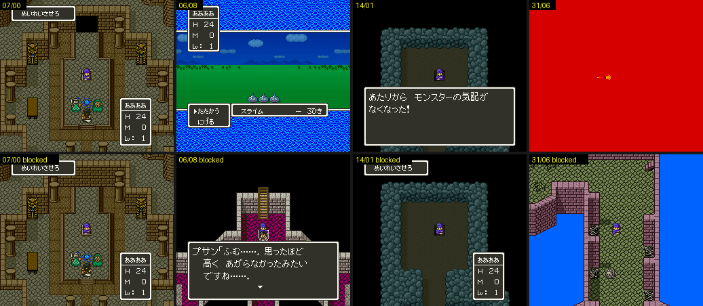

# 2026-10-25-112: 쉬던 매 프레임 루틴 돌리기

일지 2026-10-25-102 에서 매 프레임 루틴 39개를 막아 보았을 때, 배 선실 세이브스테이트의 플래그로는 조건이 맞지 않아 쉬는 것이 많았습니다.
이번에는 그 조건을 맞춰 실제로 돌게 하고, 원래와 막은 쪽을 같은 방법(8프레임마다 WRAM·VRAM·CGRAM·OAM 덤프)으로 견주었습니다.
결과는 [dq5-map-format.md 「매 프레임 루틴 39개」](../docs/dq5-map-format.md#매-프레임-루틴-39개) 에 있습니다.

## 1. 조건 맞추기

조건은 셋 중 하나입니다. 이야기 플래그(`BRK #$0B mask idx`), 주인공 자리(`$C1`·`$C2`), 다른 인물 슬롯의 자리입니다.

- 주인공 자리는 `TO` 좌표로 맞춥니다.
- 플래그는 `SET` 으로 켜고 갑니다. `7E:219F`·`21EE` 처럼 맵에 들어설 때 지워지는 것은 `SET` 이 소용없었습니다.
- 그래서 `dq5framedump.lua` 에 `POKEAT="프레임:주소=값;…"` 을 더했습니다. 맵에 들어선 뒤 정한 프레임에 한 번 WRAM 을 고칩니다.
- 인물 슬롯은 들어서고 16프레임쯤 지나야 채워집니다. 그래서 60프레임에 고쳤습니다. 10프레임에 쓴 값은 슬롯을 채울 때 덮였습니다.
- 슬롯 자리는 `3020+슬롯`(X)·`3080+슬롯`(Y)과 목표 자리 `30E0`·`3140` 을 함께 고칩니다.

```sh
pos8='7E3028=26;7E30E8=26;7E3088=1B;7E3148=1B'          # 슬롯 8 을 (38,27) 로
for d in a b; do
  R=""; [ $d = b ] && R=AFEFE=06F915                     # 14/01 항목의 +7
  STATE=$PWD/work/state/ship.mss SHOT_DIR=$PWD/work/perframe2/1401$d TARGET=14/01 TO=14/01,14,9 SETTLE=420 \
    ROMPATCH="$R" POKEAT="60:$pos8" "$MESENCE" --testrunner "$PWD/sfc/dq5/tools/lua/dq5framedump.lua" "$PWD/rom/dq5.sfc"
done
```

07/00 은 `TO=07/00,20,43`, 06/08 은 `TO=06/08,24,8 SET="21D4|04"`, 31/06 은 `TO=31/06,52,23` 입니다. 막을 때는 위처럼 그 맵 항목의 `+7` 에 `06F915` 를 씁니다.
그림의 디렉터리는 `work/perframe2/0700a`·`0700b` 처럼 맵과 a(원래)·b(막음)입니다.

## 2. 나온 것



```
07/00 02:B201  (20,43) 에 서면 위 벽 가운데가 열림. 슬롯 $1982 와 다음 슬롯을 두 칸씩 벌리고 219F bit0
06/08 02:9754  21D4 bit2 + (24,8) 이면 $1954 = 81(天空城), $1949 = 0 으로 필드로 나감
14/00~02       슬롯 8 을 스위치 칸에 놓으면 「あたりから　モンスターの気配が　なくなった！」, 비키면 「…ただよいはじめた！」
14/03 0F:D7B2  슬롯 8~0B 를 네 칸에 두면 같은 「…なくなった！」, 219F = 81
31/06 05:DF36  줄 23·27·31·35 에 들어서면 붉게 번쩍이고 HP 24 → 12
21/04 02:AD99  슬롯 9 가 처음 자리를 벗어나면 2194 bit5
10/00 03:EA62  슬롯 8 이 (30,66) 에 들면 지워져 (0,0)
53/51 05:F1BA  (25,15) 에서 21B8 bit3
32/04 1E:F3D8  21EE bit1 이면 슬롯 그림 번호 3240·3260 을 표로 돌림
04/06 02:A153  $C4 = 04, (40,12) 에서 21A1 = 80
1D/05 02:BA88  $1948 = 1 이면 솥 위의 흰 물체가 움직임
필드 02:AC98   첫 필드 이벤트 전에도 바다 타일과 색을 바꿈
```

06/08 을 막은 쪽에서는 06/08 에 그대로 남았고, 그 자리의 다른 이벤트가 プサン 의 대사를 띄웠습니다. 조종 자리가 天空城을 띄우는 일은 이 루틴이 하는 것입니다.

14/00 의 슬롯 8 은 처음부터 스위치 칸 (8,41) 에 있고, 들어설 때 `219F` bit0 이 켜져 있습니다. 슬롯 8 을 놓을 때의 창은 `02:F9C1`, 비킬 때의 창은 `02:F9D2` 가 띄웁니다.
놓을 때는 창 뒤에 `BRK 0C 80 15` 가 돕니다. 창을 닫는 입력을 주지 않아서, 그 뒤 `219F` 비트가 켜지는 데까지는 보지 못했습니다.

## 3. 바로잡은 것

- 일지 2026-10-25-102 의 문서에는 `02:AD99`(21/04)가 슬롯 9 가 (44~45, 34~35) **안**에 있으면 `2194` bit5 를 켠다고 적었습니다. 분기를 다시 읽으니 **밖**일 때였습니다. 제자리에서는 차이가 없고 (48,35) 로 옮기자 켜졌습니다.
- `02:AC98` 만 쓰는 필드는 첫 필드 이벤트 전투가 붙어 재지 못했다고 적었습니다. 이번에는 그 이벤트를 거는 맵 뒤 루틴(항목 `+4` `02:A94C`)을 `15:F906` 으로 막고 쟀습니다. 바다 타일과 색은 `02:AC98` 이 바꾸는 것이었습니다.

## 남은 것

- 01/00 의 `06:D1CA` 가 슬롯 `11`·`10` 이 주인공 곁에 들었을 때 하는 일 — 해결됨: ドラゴンキッズ 전투([dq5-map-format.md](../docs/dq5-map-format.md) 「자리·플래그로 일하는 것」)
- 31/07, 0A/00(`21EE` 가 들어선 뒤 다시 0 이 됨), 10/00 의 이벤트 갈래, 그룹 51 의 `1BBD`~`1BC4` — 31/07·0A/00·그룹 51 은 해결됨([dq5-map-format.md](../docs/dq5-map-format.md) 「맵별 루틴」). 10/00 의 이벤트 갈래도 해결됨: 수문 바퀴(속성 `D7`)를 とびら 로 돌리는 장면([2026-10-27-01](2026-10-27-01-sluice.md))
- 14/xx 에서 창을 닫은 뒤의 `219F`·`21A5` bit7 과 조우의 관계 — 해결됨: 몬스터 기척 스위치([dq5-map-format.md](../docs/dq5-map-format.md) 「맵별 루틴」)
