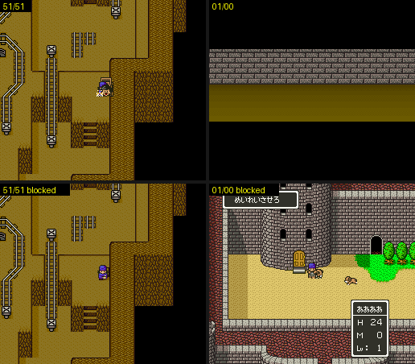

# 2026-10-25-123: 남은 매 프레임 루틴과 몬스터 기척 스위치

일지 2026-10-25-112 에서 남겨 둔 매 프레임 루틴 여섯 갈래를 같은 방법으로 돌렸습니다. 원래와 그 루틴만 막은 쪽을 8프레임마다 WRAM·VRAM·CGRAM·OAM 덤프로 견주었습니다.
14/xx 의 몬스터 기척 스위치는 조우 판정을 걸어서 세었습니다. 결과는 [dq5-map-format.md 「매 프레임 루틴 39개」](../docs/dq5-map-format.md#매-프레임-루틴-39개) 에 있습니다.

## 1. 몬스터 기척 스위치와 조우

`7E:21A5` bit7 을 읽는 곳 중 조우와 닿는 것은 `00:82A5` 입니다. 한 걸음마다 부르는 조우 판정 `00:82AB`(`01:84CF` → `23:E7C2`) 바로 앞에서 이 비트가 켜져 있으면 건너뜁니다.

그룹 14 에 들어설 때 `03:8030` 이 돌을 다시 놓습니다. `25:87F6` 이 부르고, 돌 자리는 `1BFF`~`1C0C` 에 남아 있습니다. 그 뒤 `219F` 의 맵 비트를 보고 `21A5` bit7 을 켜거나 끕니다(`BRK 0C 80 15` / `BRK 0D 7F 15`, 코드 읽기). 14/00 에 들어서며 쓰기를 지켜보니, 맵을 푸는 프레임에 `219F` = `01`, 3프레임 뒤 `21A5` = `80` 이 되었습니다.

걸어서 센 결과입니다. 조우 계수 표를 0 으로 덮어 전투가 붙지 않게 하고, `COVLO=0082A0 COVHI=0082B8` 로 실행 횟수를 셌습니다.

```
14/01 (12,12) 좌우 왕복 74걸음   21A5 = 00          00:82A5 74번, 00:82AB 74번
                                  150프레임에 = 80    00:82A5 74번, 00:82AB 0번
14/00 (16,40)                     21A5 = 80 (그대로)  00:82A5 74번, 00:82AB 0번
                                  150프레임에 = 00    00:82A5 74번, 00:82AB 74번
```

두 쪽 다 주인공 X 가 같은 꼴로 움직여, 이 비트가 실내에서 걷기를 막지는 않았습니다.
조우를 살린 채 `ADULT=1` 로 14/00 에서 `21A5` 를 0 으로 두자, `23:E7C2` 가 걸음마다 불리다 11번째 판정 뒤 ムーンフェイス 셋·ボスガルム 하나와의 전투가 붙었습니다. 그룹 14 의 구역은 `$1948` = 2 에만 있습니다.
그러니 「モンスターの気配が　なくなった！」는 말 그대로 그 동굴의 무작위 조우를 끄는 스위치입니다.

## 2. 나머지



```
51/51 02:88BC  1BBD = 03 + 위·아래 입력이면 주인공이 トロッコ 에 탐(자리 128,128, OAM 197바이트)
01/00 06:D1CA  청년기, 슬롯 11 을 (31,30) 로 옮기면 29번째 덤프부터 다른 장면. 코드: 창 + 메시지 0ED + 01:86C3, 21BC bit7
31/07 05:E237  슬롯 0A 를 (52,49) 로 옮기면 그 슬롯이 (128,128) 로 빠지고 21F9 = 80, 소리
10/00 03:EA62  21D1 = 30, (32,63) 이면 21D1 bit5 를 지움(30 → 10), 소리 BRK 10 41
0A/00 1E:F3D8  들어선 뒤 120프레임에 21EE = 02 로 두면 32/04 와 같이 그림 번호가 돎
```

- 0A/00 에서 `21EE` 가 다시 0 이 된 것은 맵이 지운 것이 아니었습니다. 들어선 뒤 30프레임에 써서 맵을 푸는 동안 지워진 것이고, 120프레임에 쓰자 그대로 남았습니다. 그 뒤 `21EE` 쓰기를 지켜보아도 아무것도 쓰지 않았습니다.
- 인물 슬롯은 들어선 뒤 60~80프레임에야 채워지는 맵이 있습니다(01/00). 그래서 이번에는 120프레임에 옮겼습니다.
- `$C4` 는 입력 쪽 값이라 `POKE` 로 매 프레임 고정하면 순간이동 경로가 망가져 17/00 에 머물렀습니다. 51/51 은 `TEST` 로 위·아래를 눌렀습니다.

```sh
STATE=$PWD/work/state/ship.mss SHOT_DIR=$PWD/work/perframe3/5151a TARGET=51/51 TO=51/51,56,53 SETTLE=100 \
  POKEAT="60:7E1BBD=03" TEST="up:16,down:16,…" "$MESENCE" --testrunner "$PWD/sfc/dq5/tools/lua/dq5framedump.lua" "$PWD/rom/dq5.sfc"
# 막은 쪽은 ROMPATCH="AF972=06F915"(51/51 항목의 +7)를 더함. 01/00 은 SET="2190|40" TO=01/00,30,30,2
# POKEAT="120:7E3031=1F;7E30F1=1F;7E3091=1E;7E3151=1E", 막을 때 ROMPATCH="AF9CC=06F915"
```

## 남은 것

- 31/07 의 `21F8` 비트·세 슬롯 갈래, 01/00 의 슬롯 `10` 갈래와 장면이 바뀐 뒤의 일
- `03:AA67`·`03:AB16`, `$194C` 값마다 OBJ 순서, `7E:2A66` 비트의 뜻
