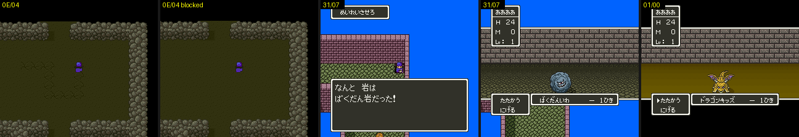

# 2026-10-25-130: 매 프레임 루틴 마무리(바위·ドラゴンキッズ·물결·발자국)

맵 문서 「남은 것」에 남아 있던 매 프레임 루틴 다섯 가지를 닫았습니다. 31/07 의 `21F8` 갈래, 01/00 의 슬롯 `10` 과 장면이 바뀐 뒤, `03:AA67`·`03:AB16`, `$194C`, `7E:2A66` 입니다.
결과는 [dq5-map-format.md 「매 프레임 루틴 39개」](../docs/dq5-map-format.md#매-프레임-루틴-39개) 에 있습니다.



## 1. 화면을 길게 찍기

창이 뜨고 그 뒤에 일어나는 일은 덤프 40번(320프레임) 안에 다 들어오지 않습니다. 그래서 `dq5warptrace.lua` 의 `LATE`(그 프레임에 WRAM 쓰기)와 `SHOTS`(그 프레임 화면)로 슬롯을 옮기고 길게 찍었습니다.
창을 넘길 때는 `TEST` 로 A 를 눌렀습니다. 화면만 보는 실험이라 기록용 스크립트가 끼어도 덤프 비교와는 상관없습니다.

```sh
pos='7E302C=24;7E30EC=24;7E308C=0F;7E314C=0F'    # 슬롯 0C 를 (36,15) 로
STATE=$PWD/work/state/ship.mss SHOT_DIR=$PWD/work/perframe4/s0c3 TO=31/07,58,11 SETTLE=250 MAXF=2000 \
  LATE="560:$pos" TEST="wait:40,a:6,wait:80,a:6,wait:80,a:6,wait:80,a:6,wait:120" SHOTS="760,860,960,1060,1160" \
  "$MESENCE" --testrunner "$PWD/sfc/dq5/tools/lua/dq5warptrace.lua" "$PWD/rom/dq5.sfc"
```

01/00 은 `TO=01/00,30,30,2 SET="2190|40" LATE="560:<슬롯 11 을 (31,30)>" SHOTS="900,1100,1400,1800"`, 0E/04 는 `dq5framedump.lua` 에 `TO=0E/04,10,25 TEST="right:48,down:48,right:48,up:48"` 로 걷고 끝 화면(`end.png`)을 견주었습니다. 0E/04 를 막을 때는 `ROMPATCH="AFB7A=06F915"` 입니다.

## 2. 나온 것

```
31/07 05:E237  슬롯 0C·10·11 이 제자리를 벗어나면 「グルルルルルー！」 → 「なんと　岩は　ばくだん岩だった！」 → ばくだんいわ 전투
01/00 06:D1CA  슬롯 10·11 이 곁에 오면 「ガルルー！」 → ドラゴンキッズ 1마리 전투(01:86C3, A = 11)
50/51 03:AA67  HDMA 7번을 7E:A000 간접 표에 걸어 BG1 가로 스크롤을 줄마다 ±48점 물결로 흔듦
50/50 03:AB16  03:AB71 이 C 를 켤 때 같은 표를 작은 물결(3·2·2·1…)로 채움, 아니면 HDMA 끔
0E/04 03:F928  방 안 지나온 칸마다 2A66+ 비트를 켜고 모래에 발자국을 그림. 0E/00·0E/04 에 들어설 때 03:FB0C 가 다시 그림
```

- 31/07 의 「돌」 셋은 밀 수 있는 바위입니다. 그중 구멍(X 50~56, Y 48~51)에 들어간 것은 일지 2026-10-25-123 처럼 빠지고, 제자리 (34,15)·(48,45)·(60,47) 를 벗어난 것은 ばくだんいわ 로 덤빕니다.
- 50/51 과 50/50 은 앞 일지에서 「화면 차이 없음」으로 적었습니다. 그때는 VRAM·OAM·CGRAM 만 견주었기 때문입니다. HDMA 는 레지스터를 줄마다 바꿀 뿐 VRAM 에 흔적을 남기지 않습니다. 화면 그림으로 견주니 전체 픽셀이 달랐고, WRAM 의 HDMA 표 `7E:A007`~`A1E6` 도 달랐습니다.
- `$194C` 는 그릴 OBJ 를 고르는 `00:EB3F` 의 견주기 방법입니다. 0 이면 둘 다 일행 슬롯일 때만 Y 로 견주고, 1 이면 늘 Y 로, 2 면 늘 층 값 `38A0` 을 먼저 견줍니다(코드 읽기). 18/00 의 루틴을 막고 `POKE="7E194C=00"`·`01`·`02` 로 고정한 채, 들어선 뒤 120프레임에 병사(슬롯 8)를 주인공 칸 (55,40) 에 겹쳤습니다. 0 과 1 은 OAM `40`~`B7` 의 순서가 달라 겹친 칸의 그림이 달랐고, 0 과 2 는 같았습니다.

이로써 맵 문서의 매 프레임 루틴 「남은 것」은 모두 닫았습니다.
