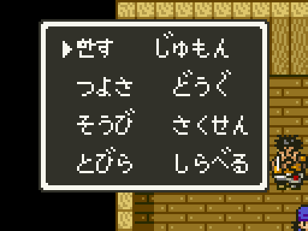

# 2026-10-25-140: 창 2바이트 부호의 두 길, 옮긴 레코드를 둘 자리

창 글자를 2바이트 부호로 넓히는 두 길(고정 가나 칸 바꾸기, 창을 열 때 그때그때 그리기)을 모두 재 보고, 긴 창 레코드를 복사해 두던 `7E:11A0` 이 빈 자리인지 쓰기 감시로 확인했습니다. 어느 길로 갈지는 포팅 단계에서 정합니다.
결과는 [dq5-hangul-format.md 「시제품」](../docs/dq5-hangul-format.md#시제품) 에 있습니다.

## 1. 고정 가나 칸이 어디서 쓰이나

창 레코드·창 제목·이름 표 0~6·전투 메시지의 바이트를 타일 번호로 보고 `01`~`8A` 칸마다 쓰는 곳을 셌습니다(탁점 접두 `84`·`83`·`92`·`93` 뒤 바이트는 그 칸으로).

```
쓰이지 않는 칸: 83
창 레코드·제목에서 쓰이지 않는 칸: 74 75 77 7B 80 83
가나 칸 105개, 그 밖: 공백·０~９·Ｈ Ｍ Ｐ Ｇ·？！·기호
```

한글로 다 바꾼다면 가나 105칸이 비므로, 창·전투에 쓰는 한글을 105자 안에서 고르는 길입니다.

## 2. 그때그때 그리기

무기점에서 메시지 창과 「かいにきた」 창이 함께 떠 있을 때 VRAM 타일맵을 보니 캔버스 `96`~`17F` 234칸을 모두 쓰고 있었습니다. 메시지와 창이 함께 뜨는 곳에서는 캔버스를 빌릴 수 없습니다.
그래서 시제품은 하나 남은 칸 `83` 에 글자 하나를 올리게 했습니다.

```sh
uv run --locked python sfc/dq5/tools/dq5hangul.py rom/dq5.sfc wintest -o work/wintest.sfc
STATE=$PWD/work/state/ship.mss PRE="b:4,wait:40,down:3,wait:20,a:4,wait:80" MAXF=160 VRAMDUMP=150 \
  SHOT_DIR=$PWD/work/hangul/wintest "$MESENCE" --testrunner "$PWD/work/wintest.sfc" "$PWD/sfc/dq5/tools/lua/dq5msg.lua"
```

창 문자열을 타일로 찍는 `04:B0F0` 의 마지막 갈래(`04:B11E`)를 훅으로 바꿔, 접두 `9F` 뒤 바이트를 한글 번호로 읽고 그 그림을 VRAM 전송 목록 `7E:4000` 에 넣게 했습니다. 목록은 `00:8CF9` 가 NMI 에서 보내는데, 처음엔 넣기만 해서 보내지지 않았습니다.
`04:E2A1`(전투 글자를 올리는 곳)이 `$1A` bit7 을 켜고 `JSL 00:958A` 로 기다리는 것을 따라 하자 올라갔고, 「한す」 가 찍혔습니다. 창이 다 그려지는 프레임(73)은 원래 롬과 같았습니다.



## 3. 7E:11A0 은 빈 자리가 아니었다

`dq5msg.lua` 에 WRAM 오프셋 쓰기 감시(`WRAMWATCH`, 뱅크 거울과 상관없이)를 더하고, 주소마다 처음 쓰기만 남기게(`WRAMWATCHBY=addr`) 했습니다. 처음 범위를 8KB 전체로 잡자 실행이 끝나지 못해 `1100`~`1EFF` 로 줄였습니다.
전투·필드 무작위 전투·무기점·교회 저장·이벤트 전투 다섯 실행에서 `7E:119F`~`13FF` 는 610바이트 가운데 609바이트가 쓰였습니다(전투의 `20:A782`·`21:FEB2`~). 덤프 27개에서 0 이었던 것은 전투가 끝나면 지우기 때문으로 보입니다.
다섯 실행 모두 쓰이지 않은 `7E:1C33`~(344바이트)로 복사 자리를 옮기고 명령 창이 같게 나오는 것을 확인했습니다.

## 틀렸던 것들

- 여러 덤프에서 0 인 자리를 빈 자리로 보았다: 전투가 쓰고 지우는 자리였다.
- VRAM 전송 목록에 넣기만 하면 NMI 가 보낸다고 보았다: `$1A` bit7 과 `00:958A` 가 있어야 했다.

## 남은 것

- 창 2바이트 부호를 여러 글자로(캔버스 빌리는 규칙 또는 BG3 타일 칸 넓히기)
- `7E:1C33`~ 가 정말 비어 있는지
