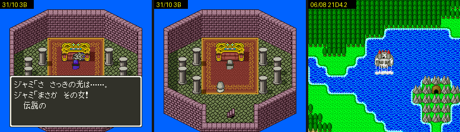

# 2026-10-25-189: 예외 표 플래그의 나머지 장면, 이벤트 3B 원래 흐름, 2190.6 의 ルーラ

ルーラ·リレミト 예외 표(`1F:F921`·`1F:FA3C`)가 보는 플래그 가운데 켜는 장면을 돌리지 않았던 12개를 돌렸습니다. [2026-10-25-144](2026-10-25-144-exscene.md) 가 남긴 둘(이벤트 3B 를 31/10 에서 원래대로, `2190.6` 을 켠 상태의 ルーラ)도 닫았습니다.
결과는 [dq5-data-format.md](../docs/dq5-data-format.md) 의 예외 표 플래그 표와 그 아래 「확인한 것」에 있습니다.



## 1. 켜는 곳에서 장면까지

켜는 곳(`BRK 0C`)을 부르는 쪽을 거꾸로 찾았습니다. 인물 스크립트의 네이티브 호출(`37`), 대화 스크립트의 호출(`00 lo hi`), 맵 준비 루틴 표(`12:B070` 의 `[BC][BD][주소]`)를 따라갔습니다.
장면은 `dq5warp.lua` 로 그 맵에 가서 목록 플래그를 `SET`, 인물이 기다리는 플래그를 `LATESET` 으로 넣고 돌렸습니다. 대화는 선실 パパス 의 대화 번호(`7E:36EB`)를 바꿔 `dq5msg.lua` 로 걸었습니다. 쓰기는 `WWATCH` 로 보았습니다.

```
플래그  맵·조건                         켜진 프레임·장면
2195.5  21/00 SET 2194|80;2195|40, (51,22) 아래로   1059  パパス「さっそく　出かけることにしよう！」 → 필드
2199.3  대화 04D(ポワン) 선실                       「引き受けてくださるのですね！」「ベラが　仲間にくわわった！」
21A9.5  05/02 SET 21AF|02 LATESET 21A4=80, (5,14)   419   일렁인 뒤 21/00
21AA.3  29/00 SET 2190|40;1948=01;21BF|80, 왼쪽으로 필드  525   일행 1 → 2(ヘンリー)
21AB.1  1F/08 SET 21AB|04 LATESET 21A1=88           2222  ルドマン「今夜一晩…選んでもらうのだ」 → 1F/03
21AC.3  23/06 LATESET 219F=40                       2996  ダンカン·ビアンカ 의 재회, 밤을 지남
21C0.3  35/03 SET 21D1|80 LATESET 21A2=80;21A1=80   7622  ブオーン 전투에 이긴 뒤(ブオーン HP 1 로 덮음)
21C1.2  1F/00 SET 2190|20;21C0|08                   386   맵 준비 12:A034 가 들어설 때
21D2.5  01/04 SET 2190|20 LATESET 21A1=01           1542  「コリンズ王子！…いたずらを　して！」
21D4.2  06/08 LATESET 21A4=42                       5345  天空城 이 호수에서 떠올라 뭍에 내려앉음(21D4 = 1E)
```

- `21C0.3` 의 문맥은 「무리 `26`·`2B`·`2F` 전투 곁」으로 짐작해 두었습니다. 실제로는 ルドマン 의 탑 꼭대기에서 ブオーン(무리 `26`)을 이긴 뒤였습니다.
- `21D4.2` 를 켜는 `03:CE01` 은 `BRK 0C 1C 44` 라 bit2~4 를 함께 켭니다. 같은 장면의 앞(3222프레임)에 켜지는 `21D4` = `02` 는 다른 곳의 bit1 입니다.
- `2192.1`·`.2` 를 켜는 곳은 `dq5flags.py` 가 `0F:F7F1` 하나로 드는데, 그 자리는 그래픽 데이터 속의 `00 0C 0E 02` 였습니다. 코드·스크립트에서 이 두 비트를 켜는 곳은 없습니다.
- `2196.4` 를 켜는 `12:F40E` 는 부르는 곳을 찾지 못했습니다(포인터처럼 보이는 바이트는 모두 데이터나 다른 명령의 피연산자).

## 2. 이벤트 3B 를 31/10 에서 원래대로

144 일지는 `TO=31/10,16,14` 로 들어가 신부를 찾지 못했습니다. 같은 자리로 다시 가 보니 주인공이 한 칸도 움직이지 못했습니다. 출구 옆 (14,22) 에서 들어가자 걸을 수 있었고, フローラ 가 왕좌 옆 (22,13) 에 서 있었습니다(`SET="21B3|02"`).
위로 8칸, 오른쪽 8칸 걸어 아래에서 말을 걸었습니다. 대화 `1A4` 의 フローラ 갈래가 「でも…。　来ちゃいけなかったんだわ。」 뒤 `06:B9CF` 로 이벤트 3B 를 걸었고, 스크립트가 차례로 흘렀습니다.

```
993   06:B9CF  이벤트 3B
1327  05:E4B8  ジャミ「さあ！　2人仲よく　死ぬがよい！」
1375~1412      21A1 = 80 → C0 → E0 (05:E5DA, 신부가 빛남)
1420  05:E542  ジャミ 전투
```

레벨 1 주인공은 이 전투에 져서 31/01 로 돌아갔습니다. 그래서 ジャミ 레코드 셋(`11`·`23`·`2F`)의 HP 와 수비를 1 로 덮고 다시 걸었습니다.

```
      「さ　さっきの光は……。　まさか　その女！　伝説の」
3151  03:AFAD
3743  05:E5A3
4200  05:E5BF   석상이 된 둘
5087  21A4.7
5111  05:FDCB
5162  2190 = 2A
      02/06 オジロン → 2B/02 석상 경매
```

스크립트가 기다리는 `21A1.5`·`21A2.7`·`21A2.6`·`21A4.7` 은 모두 장면 안의 인물·전투가 켰습니다.

## 3. `2190.6` 을 켠 상태의 ルーラ

144 일지의 07/02 장면 뒤 세이브스테이트(03/05, `2190` = `49`)를 그대로 썼습니다. `walk.lua` 드라이버에 주인공 주문 칸 `7E:2063` = `FF` 를 고정하고, 명령 창 → じゅもん → 일곱째 ルーラ → 행선지로 외웠습니다.
`11:80AC` 의 결과는 1(천장)이었습니다. 그룹 03 은 예외 표에 줄이 없어 맵 `+4` 로 정한 `$194D` 결과 그대로입니다.
이 세이브스테이트에서 `dq5warp.lua` 가 듣지 않은 것은 경로 때문입니다. 이 도구는 배 선실 사다리의 출구 항목(`2A:EFF5`)을 덮고 선실 안 (3,11)·(3,24)·(7,24) 로 걸어 사다리를 밟습니다. 선실이 아닌 곳에서 시작하면 그 경로가 맞지 않습니다.

## 남은 것

- `2196.4` 를 켜는 `12:F40E` 의 부르는 곳과 그 장면 — 해결됨: レヌール城 무덤 장면([dq5-data-format.md](../docs/dq5-data-format.md) 「확인한 것」 의 `2196.4`)
