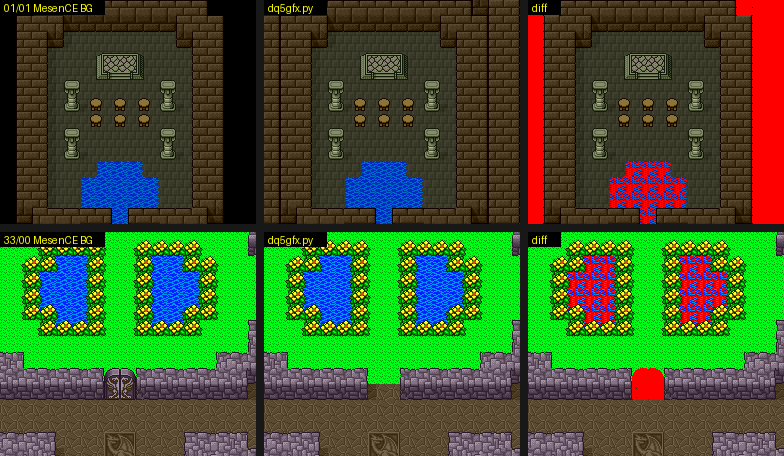

# 2026-10-25-28: 그래픽 내보내기와 갤러리

나중에 DQ4 인물·지형을 DQ5 엔진에 맞춰 찍을 때 원작 그림을 같은 배율로 찾아볼 수 있게, 지금까지 푼 그래픽 형식을 모두 PNG 로 뽑아 한 쪽짜리 갤러리로 묶었습니다.
맵을 게임 화면과 맞춰 보다가, 맵에 들어갈 때 이벤트 플래그에 따라 팔레트 세트를 바꾸는 표(`2A:8690`)를 찾았습니다.
결과는 [dq5-graphics-format.md 「그래픽 내보내기와 갤러리」](../docs/dq5-graphics-format.md#그래픽-내보내기와-갤러리) 와 [dq5-map-format.md 「플래그로 바꾸는 팔레트 세트」](../docs/dq5-map-format.md#플래그로-바꾸는-팔레트-세트-019771) 에 있습니다.

## 1. 디코더를 모아 그림으로

새로 푼 형식은 없고, 이미 있는 디코더를 그대로 불렀습니다. `sfc/dq5/tools/dq5gfx.py` 가 묶음마다 그림을 만들고 `work/gfx/manifest.json` 에 목록을 남깁니다.

- 실내 맵: `dq5map.Decoder` 로 셀 버퍼를 만들고 `dq5exit.apply_hook` 으로 맵별 루틴이 쓰는 값까지 넣은 뒤, 아래층·위층 타일맵 워드를 그립니다.
  VRAM 슬롯 번호를 CHR 번호로 되돌려 롬의 CHR 을 칠하므로, 슬롯을 주는 규칙을 몰라도 그림은 맞습니다(그룹 `$50` 이상 맵도).
  `dq5map.render` 는 픽셀마다 칠해서 느렸는데, (CHR, 팔레트 줄, 반전)마다 8x8 RGBA 를 한 번만 만들어 붙이니 364개 맵 낮·밤·속성·블록 모음이 30초 안에 끝났습니다.
- 필드: 세계 0 지도는 256x256 블록이라 4096x4096 픽셀입니다. 블록 512개를 먼저 그려 두고 붙입니다. 팔레트는 CGRAM 덤프 대신 롬에서 만들었습니다(아래 5절).
- 전투 몬스터는 `dq5mongfx.render`, 폰트는 `dq5text.glyph` 를 그대로 씁니다.

```sh
uv run --locked python sfc/dq5/tools/dq5gallery.py rom/dq5.sfc
```

```
dq5battlebg: 147
dq5sprite: 모듈 없음, 건너뜀
1736 items -> work/gallery/index.html
```

전투 배경(`dq5battlebg.py`, 배경 49개 × 세계 셋)과 인물 스프라이트(`dq5sprite.py`)는 다른 작업에서 만들고 있어, 모듈이 있을 때만 부르게 했습니다. 배경은 이 작업 중에 main 에 들어와 함께 뽑히고, 스프라이트는 아직 건너뜁니다.

## 2. 갤러리

`work/gallery/index.html` 은 그림 목록을 JSON 으로 품은 HTML 한 장입니다. 분류 단추, 그룹 고르기, 제목 찾기가 있고, 그림을 누르면 1~8배·맞춤으로 키워 봅니다(`image-rendering: pixelated`, 방향키로 앞뒤, 숫자 키로 배율).
그림은 상대 경로로만 가리켜 폴더째 옮겨도 됩니다. 헤드리스 Chrome 으로 띄워 분류 10개와 그림이 나오는 것을 확인했고, 목록의 그림이 모두 파일로 있는지 셌습니다.

## 3. 덤프 프로브와 BG 그리기

맞춰 볼 기준이 필요해 `sfc/dq5/tools/lua/dq5gfxdump.lua` 를 새로 두었습니다. 세이브스테이트에서 정한 프레임에 WRAM·CGRAM·VRAM·OAM·화면과 `emu.getState()` 의 `ppu.*` 값을 남깁니다.
`dq5gfx.bg_layer` 는 그 PPU 상태의 타일맵 주소·CHR 주소·크기(`doubleWidth` 등)로 BG 하나를 통째로 그립니다. 배 선실을 덤프해 보니 BG2 가 아래층, BG1 이 위층(둘 다 64x32 칸, CHR 워드 `$2000`), BG3 이 창(2bpp, CHR 워드 `$1000`)이었습니다.

```sh
export LIBDIR=$(tools/lua/seqlib.sh "$(uv run --locked krpatch sfc lua)" work/seqlib)
STATE=$PWD/work/d/d0603/s.mss MAXF=10 DUMPF=5 SHOT_DIR=$PWD/work/d/d0603 \
  "$MESENCE" --testrunner "$PWD/rom/dq5.sfc" "$PWD/sfc/dq5/tools/lua/dq5gfxdump.lua"
```

세이브스테이트는 맵마다 `dq5warp.lua` 의 `TO=<맵>,<폭/2>,<높이/2> SAVE=s.mss` 로 만들었습니다.

## 4. 맵 12개를 게임 화면과 맞추기

BG2 위에 BG1 을 겹치고 스크롤만큼 잘라 256x224 화면을 만든 뒤, 맵 그림에서 가장 잘 맞는 자리를 찾아 맵 안 픽셀을 셌습니다(창과 인물은 BG3·OBJ 라 빠집니다).
06/03·0B/00·12/00·18/02 는 모든 픽셀이 같았습니다. 나머지의 다른 곳을 빨갛게 칠해 보니 세 종류였습니다.



- 물: 디코더가 쓰는 CHR 중 몇 개가 VRAM 어디에도 없었습니다(01/01 86개 중 2개, 1F/00 368개 중 22개). 같은 슬롯의 타일을 게임이 프레임마다 바꾸는 것으로 보입니다.
- 닫힌 문: 맵 레코드의 문 자리는 열린 검은 통로인데 게임은 닫힌 문을 그립니다.
- 주인공이 없는 구역의 칸(01/01·1F/00 가장자리): 머리 `+4` 의 방식대로 게임이 검게 그립니다.

04/00 만은 1,088 픽셀(1.9%)밖에 맞지 않았습니다. 화면이 잿빛이었고 CGRAM 1~7번 줄 색 105개 중 19개만 `10:DE0B` 의 세트와 같았습니다.
덤프한 CGRAM 으로 같은 셀 버퍼를 칠하면 57,344 픽셀이 모두 맞아서, 그림이 아니라 팔레트만 다른 것이었습니다.

## 5. 팔레트를 바꾸는 표 `2A:8690`

덤프의 각 줄을 팔레트 목록(`10:E5C8 + n*32`)에서 찾으니 `0E 87 0E 88 89 8A 8B` 였고, 이 목록을 쓰는 세트는 `26` 하나였습니다. 그런데 `10:DEBC` 표에서 04 그룹은 세트 `00` 뿐입니다.
팔레트 로더의 다른 입구 `10:DDCF`·`10:DDB2` 를 부르는 `JSL` 을 롬에서 찾자 `01:97BA` 가 나왔고, 그 앞의 `01:9771` 이 맵 머리를 풀기 전(`01:93A0`)에 `2A:8690` 표를 훑고 있었습니다.

```
2A:8690  04 00 88 40 26 | 04 FF 88 40 27 | 22 01 80 40 01 | 22 FF 80 40 2A | 06 00 44 04 24 | 06 FF 44 04 00 | FF
```

`[BC][BD|FF][플래그|FF][마스크][세트]` 이고 플래그 규칙은 인물 목록 표와 같습니다. 선실 세이브스테이트는 `7E:2198` 이 0 이라 04/00 은 세트 `26` 이 됩니다. 이 표를 `dq5gfx` 에 넣어 걸리는 맵은 그 세트로도 그리자 04/00 이 57,344/57,344 맞았습니다.
시간대(`$075E`)를 `0002`·`0100` 으로 고정해 다시 들어가도 CGRAM 은 그대로였습니다.

필드는 `field-free.mss`(필드 (341,56), `$075E` = `0050`)를 덤프해 롬으로 만든 팔레트와 비교했습니다. 2·3번 줄은 색 15개 중 14개(오가는 색 14·15 하나), 4번 줄은 물결 단계를 하나 앞으로 두면 16개 모두 같았고, 화면은 57,344 픽셀 중 물 블록 415 픽셀만 달랐습니다.

## 틀렸던 것들

- 처음에는 디코더가 준 VRAM 슬롯(오프닝 두 맵처럼 `$BE` 부터)에 롬 CHR 이 그대로 있는지 셌는데, 00/00 은 159개 중 0개였습니다. 슬롯을 6칸 밀면 128개가 맞았고, 슬롯과 상관없이 VRAM 전체에서 찾으면 159개 모두 있었습니다. 맵마다 슬롯 시작이 달라 그림 비교는 슬롯이 아니라 CHR 내용으로 했습니다.

## 남은 것

- 실내 맵의 움직이는 타일(물 등)을 바꾸는 루틴과 원본 타일, 닫힌 문을 그리는 곳. 갤러리에는 아직 맵 레코드 그대로입니다.
- 35/03 의 보물상자 하나가 게임 화면에 없는 까닭.
- 창 테두리·메뉴 그림, 타이틀·로고 화면 같은 나머지 BG 그림의 위치.
- 맵마다 VRAM 슬롯 시작이 다른 규칙(실내 맵도 `$BE` 부터가 아닌 맵이 있음).
