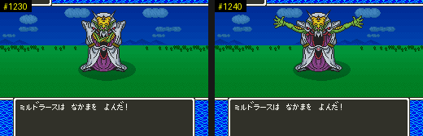

# 2026-10-25-51: E9 는 「なかまを よんだ」, 물결 HDMA, 1A 의 덜 맞은 줄

[앞 일지](2026-10-25-37-battlebg3.md)에서 남긴 전투 그림의 마지막 항목들을 확인했습니다. 결과는 [dq5-graphics-format.md](../docs/dq5-graphics-format.md) 의 「무리를 더하는 몬스터」「번호를 정하는 곳」「띠 펴기와 움직임」「확인」에 있습니다. 명령의 `battle` 함수는 [배치·그림자 일지 1절](2026-10-25-21-mongfx-layout.md#1-머리-값이-가는-곳)과 같습니다.

## 1. E9 를 그리는 때

무리 `2B` 에서 `2F` 로 넘어가는 길부터 찾았습니다. 무리별 전투 사건(`$1015` bit4, `20:E197`)의 목록 `20:E1B6` 은 `01`·`1E` 뿐이고, 실제 무리 `2B`(`dq5warp.lua` 의 `GROUP=2B`)로 붙여 `E7` 의 HP 를 1 로 고정해 쓰러뜨려도 전투가 끝나고 필드로 돌아왔습니다. `2F` 로 넘어가는 것은 전투 밖(이야기 진행) 쪽입니다.

그래서 `E9` 를 읽는 쪽을 거꾸로 찾았습니다. 몬스터를 다시 늘어놓는 `22:9638` 안에 `E7` 갈래(`22:9664`)가 있고, `22:9638` 을 부르는 곳은 행동 실행 코드 `20:C047`·`20:E9DC` 둘이었습니다. `E7` 의 행동 6개 `94 3B A6 73 B6 B7` 중 `B6`·`B7` 은 행동 표(171개) 밖의 번호라, 레코드의 행동 칸(파일 오프셋 `1196A0`)을 모두 이 값으로 덮었습니다.

```sh
mkdir -p work/p/aB6
RP="11D764=D0E7FFFFFF0100000000000000;1196A0=B6B6B6B6B6B6" battle sfc/dq5/tools/lua/dq5battledump.lua \
  SHOT_DIR=$PWD/work/p/aB6 AFTER=6000 MAXF=2620 POKE="7E204E=E7;7E204F=03" DUMPF=$(seq -s, 900 10 2600) FROM=850 TO=0 \
  WAYPOINTS="3,11;3,24;7,24;7,22;37,66;37,72;down:90;wait:300;a:6;wait:40;a:6;wait:40;a:6;wait:40;a:6;wait:300;a:6"
```

```
1230:E8  1240:E9  1250:E9  1260:E8 … 1290:E8  1300:E9  1310:E9  1320:E8      # 10프레임마다 OAM 에서 찾은 그림
```

「ミルドラースは なかまを よんだ！」가 나오는 동안 `E8`(팔을 모은 손) 대신 `E9`(팔을 벌린 손)가 같은 원점에 두 번 그려졌습니다. `B6` 은 あくましんかん 2마리, `B7` 은 キラーマシン 2마리를 불렀고, 둘은 `E7` 의 왼쪽과 오른쪽에 놓였습니다(`AE` x 24·168).



## 2. 물결 HDMA 와 8C 갈래

`$0DF2` = 1 인 배경을 `$1AA0` = `8C`(1A)·`8E`(1C)로 붙이고 `dq5hdma.lua` 로 채널 3 을 봤습니다. 둘 다 BG1 가로 스크롤에 간접 뱅크 `27` 표를 걸고, 표 `7E:0DB9` 의 구간만 달랐습니다.

```
8C  0DB9 = 38 9C FE  F0 9E FE  01 9C FE     # 38줄 0, 이어서 70줄 물결
8E  0DB9 = 70 9C FE  BA 9E FE  01 9C FE     # 70줄 0, 이어서 3A줄 물결
```

`27:FE9E`~ 는 `0 0 0 0 1 1 1 1` 이 되풀이되는 16비트 값이고, 950→1000프레임 사이에 간접 주소가 `FE9E` → `FEA8` 로 옮겨 갔습니다. 4줄마다 1픽셀씩 어긋나는 물결이 흘러가는 것입니다.

## 3. 1A 의 덜 맞은 24줄

물결이 원인으로 보여, 전투 배경 일지의 1A 덤프를 줄마다 띠와 견주며 -1·0·+1 픽셀 밀림을 허용했습니다. 펴진 112줄 중 60줄이 256픽셀 모두 맞았는데, 그중 16줄은 1픽셀 민 줄이었습니다. 나머지 줄의 틀린 픽셀을 OAM 으로 그린 OBJ, 왼쪽 64픽셀(상태 창), 그 밖으로 나누니, 그 밖은 152~159줄(메시지 창)과 149~151줄의 3~5픽셀(몬스터 그림자)뿐이었습니다.

## 4. 배로 바다를 지날 때

배 장면은 [2026-10-25-48 일지](2026-10-25-48-slot-ship.md) 의 방법대로 바다 위 (328,27)에 선 뒤 `LATESET=1954=80` 으로 만들었습니다. 왼쪽으로 열 번 저어 가며 WRAM 을 10프레임마다 덤프하고, 같은 길을 `probe/trace.lua` 로 걸음 처리 루틴을 세며 다시 돌렸습니다.

```sh
LIBDIR=$(tools/lua/seqlib.sh "$(uv run --locked krpatch sfc lua)" work/warplib ../../sfc/dq5/tools/lua/dq5warp.lua)
mkdir -p work/tr/ship
env LIBDIR=$LIBDIR STATE=$PWD/work/state/ship.mss FIELD=328,27 LATESET=1954=80 SETTLE=30 \
  TEST="left:24,wait:30,left:24,wait:30,left:24,wait:30,left:24,wait:30" FROM=300 STEP=10 MAXF=2200 \
  SHOT_DIR=$PWD/work/tr/ship "$MESENCE" --testrunner "$PWD/rom/dq5.sfc" "$PWD/tools/lua/wsnap.lua"
```

배는 (328,27) → (320,27) 로 바다(지형 0)를 지나 지형 9 까지 갔지만 `$1AA0` 은 내내 `A1`(선실 값)이었습니다. `TRACE=0184CF,0082AB,23E7C2` 로 세면 걷는 쪽은 필드에서 걸음마다 `00:82AB` → `01:84CF`·`23:E7C2`(조우 검사)가 돌았고(16걸음), 배로 가는 동안에는 한 번도 돌지 않았습니다(선실 안 걸음 24번만). 배로 갈 때는 걸음 처리 자체가 다른 길이라, 바다 전투의 배경 번호가 어디서 정해지는지는 남겨 둡니다.

## 틀렸던 것들

- `E9` 는 `E7` 이 쓰러지거나 `EA` 로 바뀔 때 쓰일 것이라고 보고 그쪽을 찾았습니다. 실제로는 부르기 행동의 몸짓이었습니다.

## 남은 것

- 배로 바다를 지날 때 배경 번호(`$1AA0`)를 정하는 곳(걸음 처리 `00:82AB` 가 돌지 않음).
