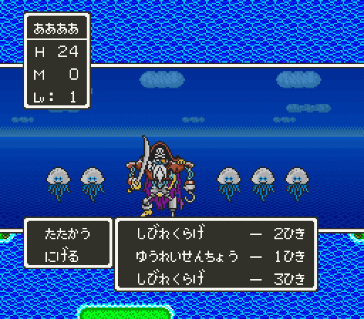

# 2026-10-25-87: 바다 전투

[앞 일지](2026-10-25-82-battletext2.md)에서 배로 바다를 저어도 전투가 붙지 않아 바다 전투 화면을 보지 못했습니다. 까닭을 조우 판정에서 찾고, 계수를 바꾸지 않은 자연 조우로도 바다 전투를 띄웠습니다. 결과는 [dq5-graphics-format.md 「번호를 정하는 곳」](../docs/dq5-graphics-format.md#번호를-정하는-곳) 과 [dq5-data-format.md 「전투 조우」](../docs/dq5-data-format.md) 에 있습니다.

## 1. 확률이 0 이었던 까닭

배 위(`LATESET="1954=03;21BE|01"`)에서 23 뱅크 실행 기록을 모으고, `probe/trace.lua` 로 확률 계산 끝(`23:E8B5`)의 `$00` 과 걸음 수 `$1A9A` 를 땅 위와 나란히 찍었습니다.

```
바다 500 23E7C2 A=0052 … 7E1A9A=0101       땅 499 23E7C2 A=000D … 7E1A9A=0101
     500 23E8B5 … 7E0000=0000                   499 23E8B5 … 7E0000=0000
```

둘 다 처음 몇 걸음은 확률이 0 이었습니다. `23:E7F2`~`E854` 가 걸음 수 `$1A9A` 로 조우율을 깎는데, 3 걸음 미만이면 0 입니다. 앞 일지의 시험은 위아래로 몇 번 저은 것뿐이라 걸음 수가 모자랐습니다. 구역은 `52`, 조우율은 지형 0 의 `23:F1E0[0]` = 2 였습니다(땅 위 풀밭은 12).

## 2. 계수 FF 와 자연 조우

같은 자리에서 위아래로 오래 저었습니다.

```sh
LIBDIR=$(tools/lua/seqlib.sh "$(uv run --locked krpatch sfc lua)" work/warplib ../../sfc/dq5/tools/lua/dq5warp.lua)
mkdir -p work/sea/nat40
env LIBDIR=$LIBDIR STATE=$PWD/work/state/ship.mss FIELD=328,27 LATESET="1954=03;21BE|01" SETTLE=40 \
  TEST="up:30,wait:5,up:30,wait:5,down:30,…" DUMPF=$(seq -s, 500 50 7800) MAXF=7850 SHOT_DIR=$PWD/work/sea/nat40 \
  "$MESENCE" --testrunner "$PWD/rom/dq5.sfc" "$PWD/sfc/dq5/tools/lua/dq5gfxdump.lua"
```

- 계수 `23:EA44` 를 모두 `FF` 로: 걸음 수 `17`(23)에 しびれくらげ 2마리.
- 그대로(`SETTLE=40`): 1,250프레임쯤 しびれくらげ 2 · ゆうれいせんちょう 1 · しびれくらげ 3.
- 그대로(`SETTLE=77`): 2,300프레임쯤 しんかいりゅう 3.

셋 다 `dq5encounter.py` 의 구역 `52` 칸(0·5·8)에서 나올 수 있는 무리였습니다. 바다 구역은 이미 `01:85D8` 표로 도구에 들어 있어 따로 넣을 것은 없었습니다.

## 3. 바다 배경

세 전투 모두 `$1AA0` = `00` 이었습니다. 덤프 이름을 `dq5battlebg.py --compare` 가 읽는 꼴로 이어 붙여 견주자 BG1 `$0CC0`·`$0DC0`, BG2 `$04C0` 의 256칸과 팔레트 38색이 모두 같았고, 아래 띠 타일은 몬스터 그림자가 칠해진 12개만 달랐습니다.



## 틀렸던 것들

- 「계수를 FF 로 해도 바다에서는 붙지 않는다」를 바다만의 조건으로 보았습니다. 걸음 수가 모자랐을 뿐입니다.

## 남은 것

- 없음(전투 메시지 `F9` 의 소리 `0C 32` 는 todo 에 남김).
