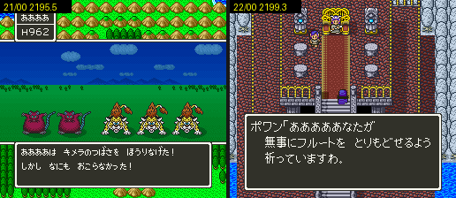

# 2026-10-26-03: 원래 장면으로 켠 2195.5 와 2199.3

[2026-10-25-198](2026-10-25-198-exflags3.md) 에서 남은 둘, `2195.5` 와 `2199.3` 을 원래 장면으로 켠 뒤 ルーラ 의 결과를 보려 했습니다. `2195.5` 는 끝까지 쟀고, `2199.3` 은 22/00 장면은 돌렸지만 장면 끝의 창이 닫히지 않아 ルーラ 를 외우지 못했습니다. 결과는 [dq5-data-format.md](../docs/dq5-data-format.md) 의 「확인한 것」에 있습니다.



## 1. 2195.5 — 걷기 도중 전투의 キメラのつばさ

21/00 이벤트 00 은 `SET="2194|80;2195|40"`, `TO=21/00,51,21,2` 로 들어가 아래로 걸으면 돕니다. パパス 가 이벤트를 걸어 `2195.5` 를 켜고, サンチョ 의 배웅 뒤 필드로 걸어 나갑니다. 이 걷기 도중 전투에서 キメラのつばさ 를 던져, 전투 도구 처리기 `20:BFEB` 와 `1F:F8D3` 의 결과(`20:BFF4` 의 A)를 읽었습니다.

```sh
R="11F1E0=FFFFFFFFFFFFFFFFFFFFFFFFFFFFFFFF"   # 조우 계수 표를 FF 로 덮어 전투를 붙임
T="down:20,(wait:100,a:6,wait:70,down:4,wait:15,down:4,wait:15,a:6,wait:40,a:6,wait:40,a:6,wait:150) × 40"
STATE=$PWD/work/state/ship.mss TO=21/00,51,21,2 SET="2194|80;2195|40;2056=A4;2042=E7;2043=03;204E=E7;204F=03" \
  ROMPATCH="$R" TEST="$T" AT_BFEB="1015=00;2195=40" ...   # AT_BFEB 는 대조군에서만
```

물건은 주인공 가진 물건 첫 칸 `7E:2056` 에 넣어야 どうぐ 목록 첫 줄에 나옵니다. 셋째 칸(`7E:2058`)에 넣으면 목록에 ひのきのぼう·ぬののふく 만 보였습니다. HP(`7E:2042`·`204E`)는 999 로 두어 전투가 길어져도 지지 않게 했습니다. 명령은 たたかう → どうぐ(셋째) → 첫 물건 순서이고, 메시지가 끝나기 전에 누르면 입력이 밀리므로 기다림을 길게 두었습니다.

| 조건 | `20:BFEB` 에 들어올 때 | `1F:F8D3` | 화면 |
| --- | --- | --- | --- |
| 그대로 | `$1015` = `00`, `2195` = `60`, `$19AE` = `80`, `2192` = `00` | 2 | 「キメラのつばさを ほうりなげた！ しかし なにも おこらなかった！」 |
| 들어올 때 `2195` = `40` | 같음 | 0 | 133프레임 뒤 `11:80AC`(`$1015` = `05`)를 지나 날아오름 |

`2192` 가 0 이라 필드 줄의 `2192` 갈래는 맞지 않습니다. 그러니 막은 것은 `$19AE` bit7 과 `2195.5` 입니다. 앞서 첫 필드 이벤트 뒤 걷기에서는 `$1015` bit7 이 먼저 막아 `1F:F8D3` 이 불리지 않았는데, 이 장면에서는 `$1015` 가 0 이라 WRAM 을 고치지 않아도 필드 줄이 막는 것이 보였습니다.

## 2. 2199.3 — 22/00 의 ポワン 장면

22/00 에 장면 이동하면 주인공이 위로 맵 밖까지 걸어 나가던 것은 장면 이동한 자리가 틀렸기 때문이었습니다. 이 맵은 들어서자마자 ベラ 가 맞이하고 주인공을 ポワン 앞까지 저절로 걷게 합니다. 걷는 길은 들어선 칸에서 같은 만큼 옮겨 가는 것이라, ポワン 앞(35,10)으로 들어가면 그만큼 위로 가서 맵 밖으로 나갑니다.

```sh
STATE=$PWD/work/state/ship.mss TO=22/00,35,55 TEST="(wait:40,a:4) × 40,wait:600" WWATCH="2199-2199" ...
```

| 들어선 칸 | 선 칸 | `2199` |
| --- | --- | --- |
| (35,55) | (36,16) | 855프레임 `10`, 1985프레임 `18`(`00:93F3`) |
| (34,55) | (35,16) | 같음 |
| (35,47) | (36,8) | 같음 |
| (35,58) | (36,19) | 같음 |
| (35,50) | (35,50) | 장면이 돌지 않음 |
| (35,10)·(35,11) | 필드 (107,100) | 그대로 |

(35,55) 로 들어가면 ベラ「来てくれたのね。 さあ ポワンさまに 会って！」 뒤 ポワン 의 부탁이 이어지고, A 만 눌러도 はい 로 답해 `2199.3` 이 켜집니다. `00:93F3` 은 `BRK 0C`(플래그 켜기) 처리기입니다.

그 뒤가 막혔습니다. ポワン「…無事にフルートを とりもどせるよう 祈っていますわ。」 창이 떠 있는 채로, A·B·X·Y·START·SELECT·L·R·방향 어느 것을 눌러도 닫히지 않았습니다. 600프레임을 더 기다려도 같았습니다. 선실 파파스 대화 번호를 `04D` 로 바꿔 켠 세이브스테이트도 같은 창에 머물러 있었고, 그래서 `dq5warp.lua` 가 그 세이브스테이트에서 움직이지 못했습니다.

같은 맵의 인물 `05:C848` 은 `21A6.6` 을 기다렸다가 (37,11) 로 옮겨 메시지 `0269` 를 띄우고 `219F.0` 을 켭니다. `21A6.6` 을 켜는 곳은 `06:C00A`(`BRK 0C 40 16`) 하나이고, 대화 스크립트 `06:8449` 가 부릅니다. 창이 이 줄을 기다리는지는 아직 모릅니다.

들어설 때 지키는 인물 `05:C86E` 는 주인공이 (34,35)-(37,35) 에 들어서면, `21B5.0` 이 켜져 있거나 `2199.3` 이 꺼져 있을 때 `06:C8EA` 를 부릅니다. 코드를 읽어 보면 `06:C8EA` 는 처음에 `21A2.7` 을 켭니다. `2199.3` 이 꺼져 있고 `219F.7` 이 켜져 있으면 `03:9747` 을 부르고 `21B5.0` 을 켭니다. `21B5.0` 과 `2199.3` 이 함께 켜져 있으면 `03:9747` 을 부르고 `21B5.0` 을 끕니다.

## 남은 것

- `2199.3` 을 장면으로 켠 뒤의 ルーラ. 장면 끝 ポワン 창을 닫는 조건(`06:8449` 대화와 `21A6.6` 이 단서). 22 묶음은 `SET` 으로 잰 결과(그대로 2, `2199.3` → 0)를 씀
- `06:C8EA` 가 부르는 `03:9747` 의 뜻(코드 읽기만 함)
