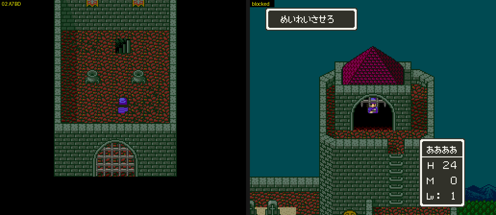

# 2026-10-26-03: 매 프레임 루틴 39개

맵별 루틴 표(`15:F907`)의 `+7~+9` 는 필드 주 루프가 매 프레임 부르는 루틴입니다(`$1AA6`). `03:D4B5`(움직이는 타일)와 `02:AE55`(첫 장면의 버튼) 밖의 39개를 하나씩 막아 보았습니다.
결과는 [dq5-map-format.md 「매 프레임 루틴 39개」](../docs/dq5-map-format.md#매-프레임-루틴-39개) 에 있습니다.

## 1. 재는 방법

루틴마다 쓰는 맵으로 순간이동해 같은 입력으로 두 번 돌립니다. 둘째 실행만 그 맵 항목의 `+7~+9` 를 `06 F9 15`(`15:F906`, RTL 하나)로 덮습니다.
맵에 들어선 뒤 8프레임마다 40번, WRAM·VRAM·CGRAM·OAM 을 통째로 덤프해 견줍니다. 일지 2026-10-25-88 에서 기록용 Lua 를 얹은 화면이 가짜 차이를 냈으므로, 이번에는 덤프 말고는 아무것도 얹지 않았습니다.
첫 실행에서는 같은 동안 루틴 둘레에서 실행된 PC 와 M·X 를 모아 `tools/listing.py` 로 읽었습니다.

```sh
export MESENCE LIBDIR=$PWD/work/warplib   # lib.lua 는 툴킷 것을 링크, boot.lua 는 sfc/dq5/tools/lua/dq5warp.lua 를 복사
P=AF9A4=06F915                            # 04/00 항목의 +7 (파일 오프셋 0xA8000 + 표 주소 - 0x8000)
for d in a b; do
  R=""; [ $d = b ] && R=$P
  STATE=$PWD/work/state/ship.mss SHOT_DIR=$PWD/work/pf/$d TARGET=04/00 TO=04/00,16,51 SETTLE=420 ROMPATCH="$R" \
    COVLO=02A7BD COVHI=02A9FF "$MESENCE" --testrunner "$PWD/sfc/dq5/tools/lua/dq5framedump.lua" "$PWD/rom/dq5.sfc"
done
uv run --locked python sfc/dq5/tools/dq5framediff.py work/pf/a work/pf/b
```

선 자리는 `dq5exit.py` 의 첫 출구 셀 왼쪽 칸, 출구가 없는 맵은 맵 가운데입니다(52/50 은 순간이동 칸이 보내는 (26,25)). 자리를 보는 루틴은 그 자리에 서지 않으면 쉬므로, 하나는 그 자리로 다시 갔습니다(4절).
`dq5exit.py` 는 그룹 `$50` 이상 맵에서 블록 먼저 올리기(`preload`)를 하지 않아 죽었기에, `dq5map.py` 와 같은 순서로 풀게 고쳤습니다. 그룹 `$50` 아래 346개 맵의 결과는 그대로이고, 위 18개 중 15개가 죽지 않게 되었습니다.

WRAM 에는 루틴이 하는 일과 상관없이 늘 바뀌는 곳이 있습니다. 실행한 명령 수만 달라도 바뀌는 DP·스택 임시 값(`7E:0000`~`00FF`, `0200`~`02FF`, `08C0`~`09FF`)이라, `dq5framediff.py` 는 기본으로 이 구간을 뺍니다.
`03:D4B5` 를 부르는 루틴은 그 루틴이 쓰는 `7E:1C0D`~`1C2D`·`1EC0`~`1ECE`·`2D00`~ 도 달라집니다.

## 2. 그룹 `$50` 이상 맵으로 가기

장면 이동 도구는 사다리 출구를 종류 `60` 항목 `[E0|BD][X][Y][층][BC]` 로 덮어 갑니다. 이 항목은 `$BD` 를 5비트에만 담아 `50`~`57` 을 쓸 수 없습니다.
`2A:F758` 이 `AND #$1F` 한 값을 `2A:F769` `LDA $01` 로 `$BD` 에 넣으므로, 이 두 바이트를 `A9 BD`(`LDA #$BD`)로 덮었습니다(파일 오프셋 `157769`). 51/52·51/53·51/54·51/55·51/57·51/51·50/50·50/51·52/50·53/51·53/52 에 모두 들어섰고, 이제 `dq5warp.lua` 가 `$BD` > `1F` 면 스스로 덮습니다.

02/06 항목(`02 06 00 80 …`)은 플래그 바이트 bit7 이 0 이라 `7E:2190 & 80` 이 켜졌을 때만 맞습니다. 선실 세이브스테이트는 꺼져 있어 처음에는 `15:F906` 이 들어왔고, `SET="2190|80"` 으로 다시 쟀습니다.
필드의 두 항목도 거꾸로 읽었었습니다. `FE 00 04 80`(`02:AB33`)이 `7E:2194` bit7 이 켜졌을 때, `FE 00 84 80`(`02:AC98`)이 꺼졌을 때입니다. 장면 이동 도구의 `FIELD` 는 이 비트를 켜므로 `02:AB33` 을 씁니다.

## 3. 나온 것

```
막으면 바뀌는 것                      루틴
VRAM 57C0~58FF(움직이는 타일)만       02:88B6 02:9754 02:A8F8 02:AD99 02:B201 02:BA84 03:8343 03:84AA 03:EA62 05:E237 05:F1BA 06:D1CA 1E:F3D4
OAM 우선순위 3 → 2                    2B:80AA(02/06) 02:952E(15/0B) 03:83D8(52/50) 03:8421(53/52, 0 으로)
OAM 우선순위 2 → 3                    2B:8087(1F/01)
VRAM 55C0~·5600~·5900~                02:A385(17/01)
VRAM 4080~·4280~·78C0~, CGRAM 5C~87   02:AB33(필드)
CGRAM 4C·4E·92·96~9F                  03:E7FE(0C/00~03, 16/03)
WRAM 38E8~390F, VRAM 65E8~            02:CE16(03/02)
$194C = 1 → 0                         03:81E4(03/0D)
1F10·1F11                             03:F928(0E/04)
차이 없음                              02:8654 02:88BC 02:BA88 02:A153 0F:D6FF 0F:D776 0F:D794 0F:D7B2 1E:F3D8 03:E7FE(15/0D)
```

우선순위는 `33A0+슬롯` 의 bit4-5 입니다. 02/06 의 `2B:80AA` 는 8프레임마다 모든 슬롯을 Y < `1B` 면 `B1`, 아니면 `A0` 으로 둡니다. 막으면 인물 넷의 `33A0` 이 0 으로 남았고, OAM 의 속성 바이트는 `30` → `20` 이었습니다.
1F/01 은 거꾸로 루틴이 `A1` 을 써서 우선순위 2 로 내리는 쪽이었습니다(주인공 `$C2` ≥ `0E`).

`03:E7FE` 는 15/0D 에서도 표에 올라 있지만 `$BC` = `15` 면 색을 바꾸지 않아 차이가 없었습니다.

차이가 없던 루틴은 조건이 맞지 않아 쉬는 것입니다. 실행된 명령을 읽으면 무엇을 기다리는지 보입니다.
14/00~02 의 `0F:D6FF` 무리는 8프레임마다 슬롯 8 이 멈춘 채 (8,41)·(38,27)·(6,59) 에 있는지 보고 `7E:219F` bit0·1·2 를 켜고 끕니다. 인물 자리 스위치입니다.

## 4. 자리로 맵을 옮기는 루틴

`02:A7BD`(04/00)는 `$C1` 이 `1F`~`21`, `$C2` < `0D` 면 `$BC`/`$BD` 를 04/0A, 자리를 (8,17) 로 두고 맵을 다시 부릅니다. 04/00 (32,12) 로 순간이동하자 833프레임에 04/0A (8,17) 에 서 있었고, 막은 쪽은 04/00 (32,12) 그대로였습니다.

```sh
for d in a b; do
  R=""; [ $d = b ] && R=AF9A4=06F915
  STATE=$PWD/work/state/ship.mss SHOT_DIR=$PWD/work/perframe/0400$d TARGET=04/00 TO=04/00,32,12 SETTLE=420 ROMPATCH="$R" \
    "$MESENCE" --testrunner "$PWD/sfc/dq5/tools/lua/dq5framedump.lua" "$PWD/rom/dq5.sfc"
done
```
04/00 은 성 지붕이고 (32,12) 는 탑 꼭대기 문간입니다. 이 탑에는 출구 셀이 없고, 이 루틴이 문간을 출구로 삼습니다.



## 남은 것

- 「자리·플래그로 일하는 것」을 조건이 맞는 장면(플래그·이야기 단계 1·슬롯 8 을 스위치에 올리기)에서 실측
- `03:AA67`·`03:AB16`(50/51·50/50) 이 하는 일, `$194C` 값마다 OBJ 를 늘어놓는 순서, `7E:2A66` 비트의 뜻
- 그룹 51 의 `1BBD`·`1BC2`~`1BC4` 상태
- `02:AC98` 만 쓰는 필드(첫 필드 이벤트 전과 세계 1·2). `SET="1949=02"` 로는 `$1949` 가 0 으로 돌아가 세계 2 필드에 서지 못했습니다
