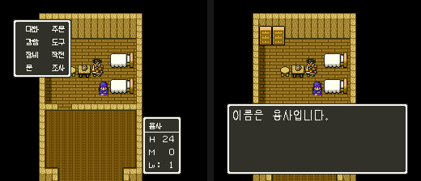

# 2026-10-26-04: 한글 시제품(메시지 한 줄·이름·명령 창)

[2026-10-25-66](2026-10-25-66-hangul.md) 의 실현성 확인에 이어, 늘린 롬에 직접 그린 한글 글꼴을 넣고 메시지 한 줄, 주인공 이름, 명령 창 하나를 한글로 바꾼 시제품을 만들어 덤프로 확인했습니다.
함께 전투의 BG3 타일 `B0` 이후와, 바꿔도 화면이 같던 창 머리 비트를 읽는 곳을 찾았습니다. 결과는 [dq5-hangul-format.md 「시제품」](../docs/dq5-hangul-format.md#시제품) 과 [dq5-text-format.md 「창 레코드 머리」](../docs/dq5-text-format.md#창-레코드-머리) 에 있습니다.

## 1. 글꼴

남의 글꼴을 쓰지 않으려고 `sfc/dq5/tools/dq5hangulfont.py` 에 자모를 선분·타원 좌표로 적고, 초성·중성·종성을 글자 칸에 배치해 점 그림을 만들게 했습니다. 세로 모음은 오른쪽, 가로 모음은 아래, 받침은 맨 아래 띠입니다.
같은 정의로 보행 모드 글자(11×13)와 창 글자(8×8)를 뽑습니다. 8×8 은 거칠지만 읽을 수는 있습니다.

## 2. 시제품 롬

```sh
uv run --locked python sfc/dq5/tools/dq5hangul.py rom/dq5.sfc proto -o work/proto.sfc
STATE=$PWD/work/state/ship.mss BG3FONT=26528:8A POKE="7E2001=5E;7E2002=5D;7E2003=01" \
  PRE="b:4,wait:40,down:3,wait:20,a:4,wait:80" MAXF=160 SHOT_DIR=$PWD/work/hangul/proto-menu \
  "$MESENCE" --testrunner "$PWD/work/proto.sfc" "$PWD/sfc/dq5/tools/lua/dq5msg.lua"
STATE=$PWD/work/state/ship.mss BG3FONT=26528:8A POKE="7E2001=5E;7E2002=5D;7E2003=01" \
  PRE="b:4,wait:40,down:3,wait:20,a:4,wait:40,a:4,wait:150" MAXF=260 SHOT_DIR=$PWD/work/hangul/proto-msg \
  "$MESENCE" --testrunner "$PWD/work/proto.sfc" "$PWD/sfc/dq5/tools/lua/dq5msg.lua"
```

`proto` 는 `retree` 에 새 글자 8자와 메시지 129(`{1006}이름은 {1012}입니다。{1001}`)를 넘기고, 명령 창 항목과 이름에 쓸 8×8 글자 15개를 창 글꼴 `04:E528` 의 타일 `50`~`5E` 에 써 넣습니다.
이름 「용사」 의 바이트는 창 타일 번호(`5E 5D`)와 같게 두고, 이름 부호 표 `24:B270` 의 그 두 칸을 11×13 글자 코드로 바꿔 메시지에서도 같은 바이트가 한글로 나오게 했습니다.
명령 창은 같은 레코드 길이 안에서 항목을 다시 쓰고 너비를 가장 긴 줄에 맞춰 9 로 줄였습니다.



VRAM 덤프의 BG3 타일맵에서 명령 창 첫 줄은 `8E 7C 50 51 01 01 52 53 8E`, 상태 창 제목은 `8E 5E 5D 01 01 8E` 였고, 타일 `50`~`5E` 의 점 그림이 롬 바이트와 같았습니다.

## 3. 처음 잘못 나온 것

- 「이름은」 은 맞게 나왔는데 「입니다」 가 뭉개졌습니다. 폰트 묶음 안의 n 번째 글자는 n × 폭 × 높이 비트 뒤에서 시작하는데(`24:A631`), 글자마다 바이트를 채워 붙여서 한 글자에 1비트씩 밀렸습니다. 비트를 채움 없이 잇자 맞았습니다. 앞 실험의 「한글」 두 자도 둘째 자가 1비트 밀려 있었습니다.
- 명령 창의 커서가 「사」 로 나왔습니다. 처음 고른 타일 `6F`~`7D` 에 커서 ▶(`7C`)와 ▼(`7B`)가 들어 있었습니다. 가타카나 칸 `50`~`5E` 로 옮겼습니다.
- 화면 오른쪽 위에 빈 상태 창이 하나 더 떴습니다. 새 항목 뒤에 옛 바이트가 남아 레코드 끝 `80` 까지 이어 읽었기 때문이고, 항목 뒤에 `80` 을 쓰자 없어졌습니다.

## 4. 전투 타일 B0 이후

필드에서 전투를 붙이며(`dq5warp.lua FIELD=341,56 BATTLE="00:2"` 를 드라이버로) `dq5vramlog.lua` 로 VRAM 워드 `1580`~`15FF`(타일 `B0`~) 쓰기를 기록했습니다.

```
f00502 pc 00:8ECA ch0 B=18 src 7E5800 size 0750 vram 14B0
f00550 pc 00:8ECA ch0 B=18 src 7E5800 size 0750 vram 14B0
```

`7E:5800` 은 보행 모드 글자를 그리는 캔버스이고, 549프레임에 `24:80B4`(`24:80C3`)가 그 자리를 0 으로 지웠습니다. 전투의 타일 `B0` 이후는 고정 글자가 아니라 이 캔버스입니다.

## 5. 바꿔도 같던 창 머리 비트

명령 창을 여는 동안 레코드 바이트를 읽는 PC 를 `rwatch.lua` 로 모았습니다. `+0`~`+3` 은 `04:9F8E`~ 가 아래 5비트만 `$0A43`~`$0A46` 에 두고, `+2` 의 위 두 비트는 `04:9FC7` 이 `$EC` 에, `+4` 는 `04:A97D` 가 `$0B99` 에 둡니다. 상태 창 제목 뒤 `12 12 12` 는 읽는 곳이 없었습니다.
`+4` 의 위 비트를 제목 창 `5A` 에서 바꾸자 bit4-5 는 제목을 더 오른쪽으로 밀었고(`23`·`33`), bit6·7 은 창이 열리지 않게 했습니다. 일행 창 `0E` 의 `+0` bit5 를 끄면 셋 가운데 둘만 나왔습니다. `+2` 위 비트는 명령 창에서 타일맵 워드가 같았습니다.

## 틀렸던 것들

- 새 글자를 글자마다 바이트 단위로 붙였다: 묶음 안 글자는 비트로 이어진다.
- 창 글자 타일을 비어 보이는 칸이라고 짐작해 `6F`~ 를 골랐다: 커서·▼ 타일이 있었다.
- 레코드 줄 수(`+5`)만큼만 읽는다고 보았다: 끝 표시 `80` 까지 읽는다.

## 남은 것

- 창 글자 타일을 바꾼 롬을 전원부터 켜 같은 화면 찍기, 세 자 이상 항목으로 레코드가 길어질 때 옮기기
- 2바이트 부호 코드
- 네이티브 호출 「장면」 갈래를 그것을 부르는 인물·이벤트로 실행하기, 「호출」 갈래 루틴의 장면별 실행 기록
