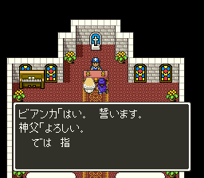
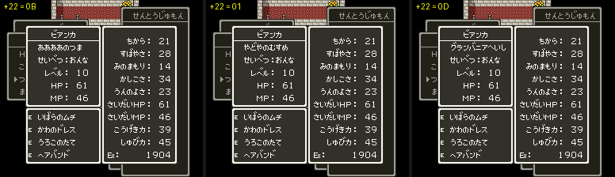

# 2026-10-26-51: 닫힌 문 하나와 결혼식, ルイーダ 로 돌아오는 아내, 칭호 `+22`

[일지 2026-10-26-35](2026-10-26-35-party5.md)의 남은 것 셋을 실측했습니다. 신부를 고른 뒤 하인·신부가 멈춘 것은 1F/08 계단 쪽 문이 닫혀 있어서였고, 그 문을 열어 두자 결혼식(1F/01)까지 이어졌습니다. 석상 뒤 칸 0 의 아내는 ルイーダ 의 なかまをくわえる 로만 돌아오고, 레코드 `+22` 는 つよさみる 창의 칭호입니다. 결과는 [dq5-data-format.md 「사람 동료 칸」](../docs/dq5-data-format.md#사람-동료-칸-7e294a)의 실측 6~8 에 있습니다.

## 1. 모두가 기다리는 칸 (29,23)

`dq5npc.py rom/dq5.sfc 1F 08 --flags …`(고른 뒤 세이브스테이트의 `7E:2190`~ 를 그대로 줌)로 1F/08 목록 `10:C4D1` 을 보았습니다. 신부 둘과 하인의 스크립트가 모두 같은 곳으로 끝납니다.

```text
하인 10:C53C  … 13 1d 11 / 14   (29,17)
              13 1d 17 / 14     (29,23) 도착 대기
              2b 36 15          (54,21) 로 순간이동
              37 55 f5 05 / 40  05:F555, 조작 풀기
신부 10:C4E0·10:C51F  … 13 1d 17 / 14 / 28   (29,23) 도착 대기 뒤 숨기
```

앞 일지에서 본 멈춘 자리 (29,22)·(29,20)·(29,18) 은 이 줄의 맨 앞이 (29,23) 에 한 칸 못 미친 모양입니다. 맵 그림(`dq5gfx.py --only maps --maps 1F/08`)에서 (29,23) 은 방 오른쪽 아래 문 자리였고, 문 표 `01:D2FC` 의 1F/08 항목은 셋이었습니다.

```text
1E 0B 3B 13   1D 15 46 00   ← (29,21) 2×3 문, 플래그 바이트 00 = 7E:21C2 bit0
12 0D 3B 14
```

고른 뒤의 세이브스테이트에서 `7E:21C2` 는 `00` 이었습니다. 신부 고르기 세이브스테이트는 선실에서 `dq5warp.lua` 로 1F/08 에 바로 내려 만든 것이라, 그룹이 바뀌며 문 플래그가 지워진 채입니다.

## 2. 문을 열어 두고 다시 고르기

앞 일지와 같은 입력(도착 인사를 A 로 넘기고 신부 앞으로 걸어가 A 를 56프레임마다)에 첫 프레임 `SET` 으로 `21C2|01` 만 더했습니다.

```sh
STATE=$PWD/work/state/dq5-bride-1f08.mss SET="<칸 0 의 ビアンカ>;21C2|01" PRE="…" MAXF=6000 \
  CALLS=06F792,05F555 LOG=7E21C2 DUMP="5900:7E3020:14,5900:7E3080:14,5900:7E19AE:1" \
  SHOT_DIR=… "$MESENCE" --testrunner "$PWD/rom/dq5.sfc" "$PWD/sfc/dq5/tools/lua/dq5msg.lua"
```

```text
            고름        05:F555   5900 하인·신부              19AE
ビアンカ 닫힘  1763        없음      (29,22)(29,20)(29,18)    01
ビアンカ 열림  1763        2917      신부 X=80 숨음, 하인 (54,21)  00
フローラ 닫힘  1652        없음      멈춤                      01
フローラ 열림  1652        2777      숨음, (54,21)              00
```

열린 문은 실제 게임에서 어디서 오는지도 보았습니다. 방 아래 계단 (29,24) 에 내려 위를 보고 とびら 를 고르니 문이 열리고 `21C2` 가 `00` → `01` 이 되었습니다(그냥 위로 걸어서는 열리지 않음). 이 방에 계단 쪽에서 들어오려면 문을 열어야 하고, 같은 그룹 1F 안에서는 플래그가 남습니다.

## 3. ヴェール 를 받아 교회로

`05:F555` 는 ルドマン 의 「山奥の温泉村 의 ほら穴에 シルクのヴェール 를 주문해 두었다」(`365`~`367`)를 띄우고 `21BE.4` 를 켭니다. 그 뒤는 대화 스크립트(`dq5talk.py`)로 길을 찾았습니다.

```text
1AA (23/07 장인)    21AC.7 이고 21AC.5 가 꺼지면 991 → 06:F7E4(물건 99, 369, 21AC.5)
1CD (1F/00)         21B3.2 면 997, 21AC.5 면 06:F808, 아니면 98A「シルクのヴェールを 受け取ったら また 来て下さいね」
1F7 (1F/05 신부)     36E「ヴェールを かぶせた」, 21B3.2 를 켜고 06:F841
1D0 (1F/00 문지기)   21B3.2 면 998「教会の準備が やっと 終わりましたよ」, 아니면 986「立入禁止」
```

먼 길(23/07 장인, 1F/05 별장)만 `dq5warp.lua TO=` 로 건너뛰고 나머지는 걸었습니다. 1F/05 에서 ヴェール 를 씌운 뒤 신부가 뒤따라 걷고, 별장 문으로 나가면 필드 (65,304) 이며 위로 걸어 (65,301) 입구로 1F/00 (100,29) 에 들어갑니다. 필드에 나가자 파파스와 슬라임 전투가 붙었는데, 세이브스테이트의 `7E:2194` bit7 이 꺼져 있어서라(핸드오프의 필드 이벤트) `SET="2194|80"` 을 주었습니다. 1F/00 에서는 `walk.lua` 로 `76,29;76,26;66,26;66,25` 를 걸어 교회 앞 문지기에게 말을 걸고, 교회 문(문 표 `41 12 40 10`)을 とびら 로 열어 들어갔습니다.

```text
96    998 (문지기)
1918  05:F594  BC/BD = 1F/01   372·373
2594  05:F5C8  374      2714 05:F5E1  375   2990 379 …
3802  05:F60B           4334 05:F648 → 4404 1F/0A
5697  05:F6FF → 21:AA63  7E:201D 1 → 2
```



1F/0A 에 선 뒤는 앞 일지의 1F/0A 장면과 같았고, 칸 0 은 32바이트 모두 0, 들어온 ビアンカ 의 `+22` 는 `0B` 였습니다.

중간 세이브스테이트는 `work/state/` 에 두었습니다. `dq5-1f08-free-bianca.mss`(문을 연 채 고르고 조작이 풀린 1F/08), `dq5-church-1f00-bianca.mss`(ヴェール 를 씌운 신부와 교회 앞 (66,25)), `dq5-wed-1f01-bianca.mss`(1F/01 식이 시작될 때)입니다.

## 4. 석상 뒤 칸 0 을 읽는 곳

칸에서 일행으로 데려오는 루틴 `BD`(`21:AA63`)를 부르는 `00 88 BD` 를 롬 전체에서 찾으니 `05:F6FF`(결혼식 뒤)·`06:EE26`(ルイーダ)·`06:F7B4`(신부 고르기) 셋뿐이었습니다. 석상 장면 뒤 칸 0~4 의 다섯을 꺼낼 수 있는 곳은 ルイーダ 하나입니다.

석상 세이브스테이트에 칸 0 의 グランバニア 뒤 ビアンカ 칸과 `21B3|08` 을 두고 A 를 넘기자, 02/07 에서 아내의 말과 병사의 「オジロンさまが お呼びです。」(`57F`)가 나온 뒤 조작이 풀렸습니다. 칸 0 은 그대로였고 일행은 주인공 하나였습니다. `57F` 를 넘긴 이 장면을 `work/state/dq5-wife-0207.mss` 로 두고, 여기서 02/02 ルイーダ 앞에 내렸습니다.

```sh
STATE=…/dq5-wife-0207.mss TO=02/02,4,57 SET="21AD|10" SAVE=g1.mss SETTLE=60 … dq5warp.lua
STATE=…/g1.mss PRE="wait:60,up:12,wait:40,a:4,wait:120,…" CALLS=06EE26,21AA63,248BAF LOG=7E0042,7E201D \
  DUMP="5:7E294A:160,2290:7E294A:160,2290:7E2040:84" … dq5msg.lua
```

```text
1258 06:EE26 → 21:AA63 ($42=0)   7E:201D 1 → 2
칸 첫 바이트  83 81 82 85 86 → 81 82 85 86 00
레코드 1      03 80 3D 00 2E 00 1C 15 0E 22 17 70 07 00 … +22 = 0B
```

`up:2` 로는 주인공이 돌아서지 않아 「その方向には 誰もいない。」(`129`)가 떴습니다. 길게 눌러(`up:12`) 위를 본 뒤에야 「ここは ルイーダの店。」(`470`)가 나왔습니다.

## 5. 칭호를 바꿔 つよさみる 창 보기

3절 결혼식 뒤 1F/0A 에서 つよさ → つよさみる(서브 창 셋째) → 사람을 골라 창을 열고, 첫 프레임에 `+22` 만 바꿨습니다.

```text
ビアンカ 7E:208C  0B ああああのつま  01 やどやのむすめ  0D グランバニアへいし  03 ああああのつま
주인공   7E:2062  00 パパスのむすこ  0D グランバニアへいし
```



`03` 이 「ああああのつま」 인 것은 이름 표 `01` 의 `03` 과 `0B` 가 같은 문자열 「！のつま」 라서입니다(`dq5text.py` 의 `string(rom, 1, n)`).

## 틀렸던 것들

- 앞 일지는 1F/01 을 `dq5warp.lua` 로 못 가는 맵이라 보고 1F/0A 로 건너뛰었습니다. 1F/01 은 교회 문으로 걸어 들어가는 맵이었고, 멈춘 까닭은 결혼식장이 아니라 1F/08 의 문이었습니다.
- 주인공의 `+22` 를 `03` 이라 짐작했는데 실제는 `00`(パパスのむすこ)이었습니다. 레코드를 덤프해 다시 셌습니다.

## 남은 것

- 석상 장면 뒤 オジロン 이 부르는 장면. 석상 세이브스테이트가 `dq5warp.lua` 로 만든 것이라 플래그가 모자라, 02/06 이 처음 왔을 때의 기본 목록(`10:9A2F`, 「王の ゆくえは まだ わからんのかっ」)으로 열렸습니다. — 해결됨: `21AD.4` 가 빠졌던 것, [2026-10-27-06](2026-10-27-06-party7.md)
- フローラ 갈래의 ヴェール·교회 단계(1F/08 의 문만 실측). — 해결됨: [2026-10-27-06](2026-10-27-06-party7.md)
