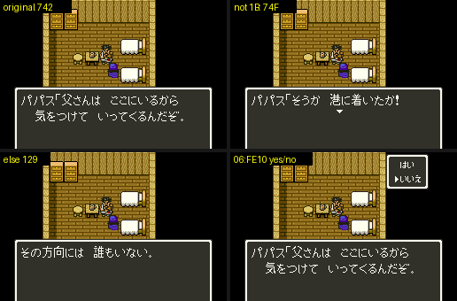

# 2026-10-27-20: 대화 스크립트 쓰기

DQ4 의 마을 사람이 플래그와 일행에 따라 다른 말을 하게 하려면, 인물이 말을 걸 때 도는 대화 스크립트를 고쳐야 합니다. 읽는 도구 `dq5talk.py` 는 있었지만 쓰는 도구가 없었습니다. 스크립트 574개를 JSON 으로 내보내고 다시 부호화하는 `dq5talkwrite.py` 와, 고친 롬에서 말을 걸어 보는 `dq5talkcheck.py` 를 만들었습니다. 입력 형식과 배치 제약은 [쓰기 형식](../docs/dq5-build-format.md#대화-스크립트-dq5talk1)에, 새로 실측한 명령의 뜻은 [텍스트 형식](../docs/dq5-text-format.md#대화-스크립트-06aef8)에 있습니다.

## 1. 원본이 쓰는 문법부터 세기

`dq5talk.py` 의 파서는 명령을 줄로 찍기만 하고, 블록인지 명령 하나인지는 남기지 않습니다. 다시 부호화하려면 이 구분이 있어야 해서, 분기 모양을 세어 보았습니다.

```
조건문 973   else 있음 973   블록(06 … 3E) 836
블록 없는 분기: 메시지 1045, 00 호출 64, 18 플래그 1
블록이 3F 로 끝남 0, 블록 밖 3E 0, 블록 없는 분기의 조건문 0
메시지 1,930: 615 이상 1,640 은 모두 40~5F 꼴, 미만 290 은 모두 60~7F 꼴
조건 코드: 1B 772, 05 79, 03 55, 1F 44, 02 19, 13 2, 11 1, 1A 1 (bit7 뒤집기 0)
```

원본은 생각보다 규칙적이었습니다. 메시지 번호 하나를 두 가지 꼴로 쓸 수 있는데(`615` 를 더하는 꼴과 bit5 를 켠 꼴), 원본은 번호만으로 꼴이 정해집니다. 그래서 JSON 에는 번호만 두고 꼴은 부호화할 때 고릅니다. 이렇게 해도 원본 574개(11,727바이트)를 내보냈다 다시 넣으면 쓰기가 0개였습니다.

JSON 에서 분기는 목록이면 블록, 객체 하나면 블록 없는 명령입니다. 날바이트로 남겨 둘 명령은 없었습니다. 원본 574개가 모두 메시지·조건문·`17`·`18`·`00` 으로 풀렸기 때문입니다.

## 2. 스크립트를 읽는 세 길

같은 바이트를 게임은 세 군데에서 서로 다른 규칙으로 읽습니다. 쓰기 도구가 지켜야 할 제약은 모두 여기서 나왔습니다(코드 읽기).

| 루틴 | 하는 일 | 길이 규칙 |
| --- | --- | --- |
| `06:B065` | 명령 실행 | 명령마다. 조건 처리기는 인자를 읽은 만큼 |
| `06:B23F`·`06:B27E` | 갈리지 않은 분기 건너뛰기 | 명령별 길이 표. `07` 은 1바이트, 조건은 따로 표 |
| `06:AFA9` | 묶음 안에서 앞 스크립트 건너뛰기 | 명령을 보지 않고 `00`·`17`~`1C` = 3, bit6 = 2, 나머지 1, `3F` 에서 멈춤 |

- `06:AFA9` 는 인자 바이트도 명령처럼 셉니다. 조건 `03` 의 인자가 `3F` 면 거기서 스크립트가 끝난 것으로 보고, 다음 스크립트를 엉뚱한 곳에서 찾습니다. 부호화한 스크립트마다 이 규칙으로 세어 길이가 맞는지 봅니다.
- `06:B23F` 는 블록 없는 분기의 `07` 을 1바이트로 건너뛰고 조건 바이트를 남깁니다. 조건문을 분기로 쓰려면 블록에 넣어야 합니다.
- 조건 `16` 은 실행 처리기(`06:B31F`)가 3바이트를 읽는데 건너뛰기 표는 2바이트입니다. 받지 않습니다.
- `06:B065` 는 블록의 첫 바이트를 끝 표시인지 보기 전에 실행하므로 빈 블록도 받지 않습니다.

## 3. 뱅크 06 에 묶음째로

스크립트를 길게 늘리려면 어디에 둘지가 문제였습니다. `06:AF93`·`06:B05D` 가 데이터 뱅크를 `06` 으로 두고 `($F9),Y` 로 읽습니다. `$F9` 도 묶음 표 `06:AEF8` 도 16비트입니다. 다른 쓰기 도구처럼 늘린 뱅크(`30`~ 나 `60`~)로 보낼 수는 없고, 뱅크 06 안에 두어야 합니다. Y 는 8비트(`06:B061`)라 스크립트 하나는 256바이트까지입니다.

표에는 32개 묶음의 시작만 있습니다. 길어진 스크립트 하나만 옮길 수는 없고 묶음을 통째로 옮겨야 합니다. 뱅크 06 의 빈 자리는 [빈 자리 지도](../docs/dq5-build-format.md#원래-롬)의 `06:FE10`~`06:FFFF` 496바이트뿐인데, 묶음은 316~1,069바이트입니다. 그래서 두 가지 길을 두었습니다.

- `--at 06:FE10`: 길어진 묶음만 그 자리로 옮깁니다. 묶음 0·3·17 처럼 작은 묶음에 맞습니다.
- `--repack --at 06:FE10`: 묶음 전부를 `06:8129` 부터 다시 채우고, 넘치는 마지막 묶음 17(385바이트)만 빈 자리로 보냅니다. 큰 묶음이 길어져도 원래 자리와 빈 자리를 합친 만큼 쓸 수 있습니다.

`--at` 은 빈 자리 지도 안(이번에 다시 옮기는 묶음이 원래 자리 밖에서 쓰던 곳 포함)만 받고, 옮긴 묶음끼리나 그대로 두는 묶음과 겹치면 거부합니다. 옮긴 묶음은 차이만이 아니라 통째로 씁니다. `check` 는 빌더로 롬을 만들어 다시 읽고, `dq5talk.script_address`(게임의 찾기와 같은 규칙)가 574개 모두 같은 주소에 닿는지, 같은 입력을 다시 패치하면 쓰기가 0개인지 봅니다. 롬 없이 도는 단위 검사 17개(가짜 롬의 묶음 옮기기·다시 채우기·빈 자리 밖 거부 포함)도 붙였습니다.

대화 번호 → 스크립트 번호는 `T - 011` 계산이라 바꿀 표가 없습니다. 인물에게 다른 스크립트를 쓰게 하는 것은 인물 레코드의 대화 번호(`dq5npcrecord.py` 의 `talk`) 몫입니다.

## 4. 파파스에게 말을 걸어 확인

선실 세이브스테이트에서 파파스(대화 번호 `012`, 묶음 0)에게 말을 걸었습니다. 다른 대화는 파파스 인물 표의 대화 번호(`7E:36EB`·`7E:370B`)를 `POKE` 로 바꿔 불렀습니다. 대화 시작 `06:AF62`, 묶음 시작을 `$F9` 에 넣는 `06:AF9C`, 메시지 `24:8BAF` 를 적었습니다.

| 장면 | 메시지 | 묶음 시작 | 플래그 |
| --- | --- | --- | --- |
| 원본 | `742` | `8129` | `7E:2192` = `00` |
| 조건에 `not` | `74F` | `8129` | `7E:2192` = `80` |
| else 메시지 → `129` | `129` | `8129` | |
| 긴 스크립트, はい(`--at`) | `742 616 1CC 74F` | `FE10` | `21F0`~`21F3` = `5A 81 0F 01` |
| 긴 스크립트, いいえ(`--at`) | `742 617 1CC 74F` | `FE10` | `21F0`~`21F3` = `5A 81 0F 00` |
| 긴 스크립트, はい(`--repack`) | `742 616 1CC 74F` | `8129` | `21F0`~`21F3` = `5A 81 0F 01` |
| `015`(같은 묶음) 원본 / `--at` | `747` / `747` | `8129` / `FE10` | |
| `120`(뒤로 밀림) 원본 / `--repack` | `A23` / `A23` | `9350` / `936A` | |
| `24E`(넘친 묶음 17) 원본 / `--repack` | `C6E C7D` / `C6E C7D` | `AD77` / `FE10` | |



긴 스크립트는 원래 15바이트를 41바이트로 늘렸습니다. 플래그 세 명령(`flag-off` 를 보려고 `7E:21F2` 를 미리 `FF` 로 둠), 메시지, はい/いいえ 조건문, else 없는 조건문 둘(참이면 `call B3A0`, 거짓이면 블록을 건너뜀), 메시지 순입니다. 원본에 없던 조건 bit7 뒤집기, `19`, else 없는 조건문의 뜻이 이 실측으로 정해졌고, 원본에도 있던 `17`(3번)과 블록 없는 분기의 `00` 호출(64번)도 실제 값으로 확인했습니다. いいえ 에서는 건너뛴 블록 안의 `flag-on 63 01` 이 실행되지 않아 `7E:21F3` 이 0 이었습니다. 바꾸지 않은 대화 셋은 옮긴 롬에서도 원본과 같은 메시지였습니다.

`dq5talkcheck.py` 가 입력 생성부터 빌드·대화·비교까지 12장면을 재현합니다.

## 틀렸던 것들

- 형식 문서는 스크립트가 `06:AEE6` 에서 끝난다고 적고 있었습니다. `06:AEE6` 은 마지막 스크립트의 시작이고 끝은 `06:AEF7` 입니다. 바로 뒤 `06:AEF8` 이 묶음 표입니다.
- 처음에는 길어진 묶음을 빈 자리 `06:FE10` 으로 옮기기만 하면 된다고 보았습니다. 묶음 크기를 세어 보니 496바이트 안에 드는 묶음은 셋뿐이어서 다시 채우기를 더했습니다.

## 남은 것

- 원본에 없는 명령 `01`·`12`, 조건 `16`·`1C`, 블록 끝 `3F`, 블록 밖 `3E`, 빈 스크립트의 실측. 지금은 받지 않습니다.
- 256바이트에 가까운 스크립트의 실측(한도는 Y 8비트를 읽은 코드 읽기).
- 스크립트 수 574 의 증설과 뱅크 06 밖 배치. 데이터 뱅크 `06` 을 전제로 한 실행기·네이티브 루틴을 바꿔야 합니다.
- 네이티브 호출 대상 142곳 가운데 뜻을 확인한 것은 일부입니다(`dq5talk.py --calls`).
