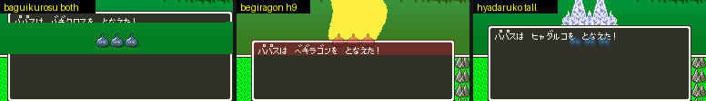

# 2026-10-31-04: 넓히거나 높인 전투 메시지 창으로 이벤트 전투·동료·주문 연출 돌리기

[일지 2026-10-30-32](2026-10-30-32-msgwin2.md)에서 넓히거나 높인 전투 메시지 창(18·25)은 スライム 전투 셋으로만 확인했습니다. 이번에는 이벤트 전투, 동료가 있는 전투, 주문 연출 열한 가지를 같은 도구로 돌렸습니다. 글자·격자·효과 층 전송 훅(`00:FD92`)은 모든 장면에서 맞았습니다. 다만 창을 21줄보다 위로 올리면(높이 9 이상) 주문 연출 여섯이 HDMA·색 더하기·OBJ 로 창을 화면에서 깨뜨리는 것을 찾았습니다. 원래 21줄 창과 X·너비만 바꾼 창은 깨지지 않습니다. 결과와 알려진 문제는 [이벤트 전투·동료·주문 연출 실측](../docs/dq5-build-format.md#이벤트-전투동료주문-연출-실측)에 있습니다.

## 1. 장면 고르기

`dq5warp.lua` 의 첫 필드 이벤트 전투를 바꾸어 장면을 만들었습니다.

- event: `GROUP=1E`(ジャミ). 주인공이 쓰러지자 무리별 전투 사건(`20:E197`)이 돌아 「なんと フローラが せんとうに おどりでた！」와 フローラ 의 빛 메시지가 나왔습니다. 사람 동료가 전투에 들어오는 이벤트 메시지입니다.
- party: `BATTLE=00:3 PARTY=05,04` 로 ホイミン·マーリン 을 넣고(`dq5aicheck.py` 의 틀), 주인공 HP 를 2 로 두었습니다. ホイミン 이 ホイミ(행동 `27`), マーリン 이 マヌーサ(`1A`)를 걸었고, 행동 여섯 칸을 ラリホー 로 채운 슬라임이 ラリホー(연출 `4B`)를 걸었습니다.
- papasNN: `GROUP=01` 에 `SET=101A=01` 을 더하자 둘째 판 사건대로 「なんと パパスが たすけにきた！」가 나오고 손님 파파스가 싸웠습니다. 파파스의 행동 여섯 칸(파일 오프셋 `11958D`)을 주문 하나로 채우고 슬라임 HP 를 200 으로 두어 여러 번 걸게 했습니다. 공격 `01`·`03`·`04`·`06`·`09`·`0B`·`0C`·`0D`·`0F`·`10`·`11`, 보조 `1F`·`22`, 회복 `2A` 입니다. `12` ミナデイン 과 `21` スカラ 는 파파스가 걸지 않아 뺐습니다.

`22:D73C`(연출 시작)를 기록하자 ホイミ·マヌーサ·スクルト·ベホマラー 는 이 루틴을 부르지 않았습니다. 화면 효과가 BG3 를 쓰지 않는 주문입니다.

## 2. 도구 넓히기

`dq5msgwindowcheck.py` 에 위 장면과 h9((2,19) 28 × 9)를 더하고, Lua 프로브가 남기는 것을 늘렸습니다.

- `00:FDA1` 의 모든 전송을 VRAM 자리·크기($4375)와, 효과 층이면 `7E:8A1D` 에 그림이 있는 첫·끝 줄로 적습니다.
- 덤프 프레임마다 OAM 과 OBJ 크기 모드(`ppu.oamMode`)를 남겨, 메시지 창이 떠 있는 동안의 OBJ 상자 아래 끝을 셉니다.
- 16프레임마다의 스크린샷에서, VRAM 에 창 테두리가 다 있는 때 화면의 왼쪽 테두리가 흰지와 창 안쪽에 다른 색 점이 있는지 셉니다.
- `--hlog` 이면 원래 롬 실행에서 보이는 줄의 PPU 레지스터 쓰기를 프레임·레지스터마다 첫·끝 줄로 모읍니다. 처음에는 `$2100`~`$2133` 을 모두 걸었더니 한 번 도는 데 20초가 6분 25초가 되었습니다. VRAM·CGRAM 데이터 포트(`$2118`·`$2119`·`$2122`)는 DMA 로 바이트마다 걸리므로 빼자 47초였습니다.

## 3. 맞은 것

133번(장면 19 × 롬 7) 실행에서 기존 검사와 새 검사가 모두 지났습니다.

```text
효과 층 1CE0 크기      원래·left·right·wide 380, h9 300, tall 280, both 200 (모든 장면·모든 전송)
BG1·BG2·18E0 전송      모든 롬 380 (0CC0·04C0·05C0·0DC0, ベギラゴン·バギクロス 의 18E0 둘씩)
VRAM 창 ≠ 버퍼 8프레임  0 (모든 장면, 원래 롬 포함)
옛 격자 쓰기           모양 바꾼 롬 0
X 만 옮긴 롬           창 워드 다름 0, 화면 비교 68~136 장
번호가 같은 메시지     event 6/9·7/8·6/8(h9·tall·both), 나머지 장면 7/7~14/14
```

창 안쪽에 OBJ 가 비친 점은 ギラ·ヒャダルコ 말고는 0 이었습니다. 원래 롬에서 메시지 창이 떠 있는 동안 OBJ 상자 아래 끝은 160점(슬라임)에서 192점(イオナズン 폭발)까지였습니다. 높이 9(Y 19)면 8~40점, 높이 13(Y 15)이면 40~72점이 창 뒤에 숨습니다. BG3 효과 층은 マヒャド 전송 149번 중 142번, イオナズン 88번 중 86번이 19줄 아래까지 그려, 높이 9 부터 대부분의 큰 주문 아래쪽이 가려집니다.

## 4. 깨진 화면

같은 스크린샷 검사에서 높인 창만 깨진 프레임이 나왔습니다. バギクロス 를 건 both 롬에서는 창 가운데 줄이 빠지고 그 자리에 전투 화면(슬라임)이 보였습니다. ベギラゴン 의 h9 롬은 창 맨 위 줄이 붉게 물들었고, ヒャダルコ 의 tall 롬은 대상 슬라임 셋이 창 글자 위에 나왔습니다.



`--hlog` 로 연출마다 줄마다 쓰는 레지스터를 모으자 까닭이 보였습니다. バギクロス·ベギラゴン 은 BG3 가로 스크롤(`2111`)을 55~167줄에서 줄마다 바꾸고, 여러 연출이 고정색(`2132`)과 메인·서브 화면(`212C`·`212D`)을 54~168줄에서 바꿉니다.

HDMA 로 줄 S 에 쓴 값은 다음 줄부터 보여 스크린샷 y = S - 7 부터 적용됩니다. tall 롬의 マヒャド 에서 `2132` 쓰기 줄과 매 프레임 스크린샷을 맞춰 보자, 163줄의 파랑은 스크린샷 156줄부터, 167줄의 `E0`(세기 0)까지 159줄까지 물들고 160줄부터 원래 색이었습니다. 그래서 54~168줄은 스크린샷 47~161줄이고, 168줄에 쓴 값은 원래 창 맨 위 1줄(스크린샷 161줄, 위 테두리)에 닿습니다. 창을 올리면 창 줄이 이 범위에 깊이 들어갑니다.

원래 창은 이 1줄이 겹쳐도 깨지지 않았습니다(스크린샷 실측). 168줄부터 쓴 값을 모았습니다. 168줄에는 고정색 `E0`·BG1·BG2 세로 스크롤 `00` 말고도 ベギラゴン 의 `2130` `02`·`2131` `47`, イオナズン 의 창 자리, ルカニ 의 CGRAM 주소가 있었습니다(줄마다 나눈 값은 [일지 05](2026-10-31-05-battlewinfix.md)). 169줄부터는 ベギラゴン·バギクロス 의 색 더하기 설정(`2130` `02`·`20`, `2131` `47`·`03`)과 BG3SC `1C`(원래 값), イオナズン 의 창 자리(`2126` `00`·`FF`, `2127` `00`), ルカニ 의 CGRAM 주소 `F1`(OBJ 팔레트 칸)이었습니다. 창 맨 위 줄의 고정색이 이미 `E0` 이라 더해지는 색이 없는 것으로 보입니다. 이 까닭은 레지스터 값으로 본 추측입니다.

```text
연출  레지스터(첫~끝 줄)                                     h9·tall·both 깨진 스크린샷
03    212C 54~166, 2132 54~168, 2130·2131 4~130              21·21·21장 (위쪽이 물듦)
04    212D 54~166                                            다른 색 점 8·8·8장
06    2111 55~167, 212D, 2132, 2130·2131 130~173, 2109 132   6·6·9장
0B    212D 54~166, 2130·2131 32                              다른 색 점 7·7·6장
0C    2132 55~167                                            26·22·21장
0F    2111 55~167, 2132, 2130·2131 93~182, 2109 132~184      1·7·12장
01·09·0D·10·11·1F  (212C·2126·2127·2132·2130·2131·2121)       0
```

깨진 수에서는 전투가 끝나 어두워지는 스크린샷(원래 롬에도 있음, 롬마다 때가 어긋남)을 뺐습니다.

イオナズン·ライデイン·ギガデイン 도 `2132` 를 줄마다 쓰지만 높인 창도 물들지 않았습니다. 색 더하기를 켜는 층(`2131`)에 BG3 가 들어가는 연출만 창을 물들이는 것으로 보입니다(연출 중 `2131` 값은 재지 않음). 이것은 [알려진 문제](../docs/dq5-build-format.md#알려진-문제-높인-창과-주문-연출의-hdma)로 형식 문서에 적었습니다. 고치려면 연출의 HDMA 표를 창 맨 위 줄에서 끊거나, 더 높은 번호의 HDMA 채널로 창 줄의 레지스터를 되돌려야 합니다.

## 틀렸던 것들

- 처음 돌릴 때 MesenCE 를 여섯 개 함께 띄우자 몇 실행이 선실 상태에서 순간이동하지 못하고 아주 느리게 돌거나, 시작하자마자 255 로 끝났습니다. 같은 입력을 혼자 돌리면 늘 전투가 붙어 게임 쪽 문제가 아니었습니다. 도구는 전투 메시지가 없거나 MesenCE 가 0 이 아니면 그 실행의 출력 폴더를 비우고 세 번까지 다시 돌리며, 다시 돌릴 때마다 stderr 에 적습니다. 마지막 133번 실행에서는 다시 돈 것이 없었습니다.
- 창 테두리가 깨진 것으로 센 프레임 가운데 아래 두 줄만 다른 것은 피해 흔들림이었습니다. 원래 롬도 화면 전체가 1~2점 위아래로 움직이는데, 16프레임마다 찍는 때가 롬마다 어긋나 높인 롬에서만 걸렸습니다. 두 줄까지는 세지 않습니다.
- 창이 열리고 닫히는 동안에는 맨 위 모서리만 VRAM 에 있고 아랫줄이 비어, 그때를 깨진 것으로 셌습니다. 위 모서리·세로 테두리 `8E`·아래 모서리 `97` 이 다 있을 때만 봅니다.
- 이벤트 장면에서 높인 롬은 「あらわれた」 뒤 기다림부터 난수가 갈려 첫 턴 메시지가 달랐고, 앞에서부터 같은 메시지를 세는 기존 잣대는 0 이었습니다. 메시지 번호가 같은 첫 메시지끼리 견주고, 셋 이상 같고 다른 것이 견준 것의 1/3 이하면 맞는 것으로 봅니다.
- 처음에는 연출 줄 54~168 이 BG3 7~20줄이라 원래 창(21줄)과 겹치지 않는다고 보았고, 고친 뒤에도 OBJ 의 줄 대응(OAM y + 1 줄, 스크린샷 y = OAM y - 7)을 그대로 써 「줄 = 스크린샷 y + 8」 로 적었습니다. HDMA 쓰기는 다음 줄부터 보여 스크린샷 y = 줄 - 7 이고, 168줄 값이 원래 창 맨 위 1줄에 닿습니다(4절).
- 깨진 수에 전투가 끝나 어두워지는 스크린샷을 함께 셌습니다. 테두리 전체가 흰색이 아닌 스크린샷은 따로 셉니다(イオナズン 의 h9·tall 1장이 이것이었음).
- X 만 옮긴 롬의 화면 비교가 ベギラゴン 장면 2960프레임에서 어긋났습니다. 전투가 끝나 어두워지는 프레임이었고, 원래 롬 창 테두리가 흰색이 아닌 프레임은 견주지 않게 했습니다.

## 남은 것

- 알려진 문제(위 4절)를 고치는 것. 연출마다 HDMA 표(`5C00`·`5D00`·`5E00`, 채널 4~6)를 끊을지, 창 줄을 덮는 HDMA 채널을 더할지 실측으로 고릅니다.
- ギラ·ヒャダルコ 에서 대상 OBJ 가 창 앞에 나오는 까닭(OBJ 우선순위·서브 화면)을 레지스터 값으로 재지 않았습니다.
- 몬스터가 거는 주문 연출(`4B` 말고)과 ミナデイン·スカラ 계열은 돌리지 않았습니다.
