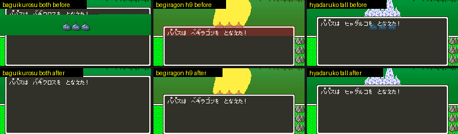

# 2026-10-31-05: 높인 전투 메시지 창을 주문 연출에서 지키기

[일지 04](2026-10-31-04-battlewin3.md)에서 전투 메시지 창을 21줄 위로 올리면(높이 9 이상) 주문 연출 여섯이 창을 화면에서 깨뜨리는 것을 찾았습니다. 이번에 까닭을 레지스터로 다시 재고 `dq5windowwrite.py --effects-at` 으로 막았습니다. 창을 높인 롬에서 이 여섯 장면을 매 프레임 찍어 창이 깨진 장은 0 입니다. 창을 안 바꾼 롬과 X·너비만 바꾼 롬은 출력 바이트가 고치기 전과 같습니다. 형식은 [높인 창과 주문 연출(해결)](../docs/dq5-build-format.md#높인-창과-주문-연출해결)에 있습니다.

## 1. 까닭 다시 재기

원래 롬의 각 연출에서 PPU 레지스터 쓰기를 줄·값·PC 와 함께 모았습니다(HDMA 쓰기는 표 항목이 바뀌는 줄에만 걸림).

- メラゾーマ·マヒャド·ベギラゴン: `$2131` 에 BG3 비트(`47`·`07`)를 켜고 고정색 `$2132` 를 줄마다 바꿉니다. 창도 BG3 라 색이 더해졌습니다.
- ギラ·ヒャダルコ: `22:E16D`~`E175` 가 `$2130` = `02`(서브 화면 더하기), `$2131` = `44`(BG3, 반으로)를 두고, HDMA 가 서브 화면 `$212D` 를 54줄 `10`(OBJ)·166줄 `00` 으로 바꿉니다. 창의 BG3 점에 대상 몬스터 OBJ 가 반씩 섞여 [일지 04](2026-10-31-04-battlewin3.md)의 「창 앞에 나온 몬스터」가 되었습니다.
- ベギラゴン·バギクロス: BG3SC 를 `19`(64칸 맵, `22:E70D`)로 두고 간접 HDMA 가 `$2111`(BG3 가로 스크롤)을 줄마다 바꿉니다. 표 머리 `7E:5C80` 은 `22:8EC1` 이 한 번 만들고(0~54줄 `0100`, 112줄 물결 `7E:5D00`·`5E00`, 72줄 `0100`), 물결은 `22:BF71` 이 두 벌에 번갈아 채웁니다. `0100` 은 64칸 맵의 오른쪽 화면(`1C00`)을 0 에서 보여 창이 제자리에 있습니다.

연출이 고르는 HDMA 채널(`22:8FBF`)은 1~6 이고, 전투 배경이 1~3 을 씁니다. ベギラゴン 은 1~6 을 모두 썼습니다(`$420C` = `7E`).

## 2. 막는 법

창 줄에서만 막아야 창 위의 연출과 몬스터가 원래와 같습니다.

- 물결: 표 머리를 만드는 `LDA #` 두 자리(`22:8EC7`·`8ECC`)의 줄 수를 창 맨 위 줄 앞에서 끊습니다. tall 이면 물결 80줄, 뒤 104줄입니다.
- 색 더하기: 창 줄에서만 `$2131` 의 BG3 비트를 빼면 됩니다. 창 줄의 BG3 는 창뿐이고(효과 층은 창 위 줄까지만 올림), BG1·BG2 의 색 더하기는 그대로입니다.
  - 연출이 `$2131` 에 쓰는 23곳(`STA long`)과 전투를 열 때의 3곳(`STA abs`)을 새 코드 `color` 로 돌려, 쓴 값을 HDMA 표에 남깁니다.
  - HDMA 채널 7 이 0줄에 그 값을, 창 맨 위 줄에 BG3 비트를 뺀 값을 씁니다. 표는 WRAM `7E:A900` 의 직접 표입니다.
  - 연출이 화면을 그리는 중에 쓰는 `$2131`(ベギラゴン 은 130~173줄)은 지금 줄(`$213D`)이 창 줄보다 아래면 `color` 가 바로 BG3 비트를 뺍니다. 창 줄 바로 그 줄이면 H(`$213C`)가 274 이상, 곧 그 줄의 보이는 부분이 끝난 뒤일 때만 뺍니다. 보이는 부분에서 빼면 창 위 한 줄(스크린샷 `y*8-9`)까지 빠집니다.
  - `color` 는 NMI 가 전투 NMI(`$1944` = `00:8952`)일 때만 표와 채널 7 을 다룹니다. 필드·메뉴의 NMI(`00:8926`)이면 원래 `STA $002131` 만 합니다. 전투를 열 때의 3곳 중 `00:8AD3` 은 `00:8A45`(PPU 거울 갱신)의 한 줄이라 필드·메뉴에서도 돌 수 있어, 이 검사로 막았습니다.
- 채널 7 켜기: `$0D83`(연출이 `22:8B21` 에서 `$420C` 에 쓰는 값)에 bit7 을 더합니다. `$0D83` 은 전투 연출을 처음 둘 때(`22:8424`·`84CB`) 0 이 됩니다. 채널 7 레지스터(`$4370`~`74`)는 bit7 이 꺼져 있을 때, 곧 처음 켤 때만 씁니다.
- 채널 7 끄기: 전투 NMI 를 놓는 `00:87E6` 의 `00:87EA` 에 훅을 걸어, 전투가 아닌 NMI 로 바뀔 때 `$0D83` 의 bit7 이 남아 있으면 지우고 `$420C` 에 `00` 을 씁니다. `$0D83` 에 남은 채널 1~6 을 쓰면 필드에서 연출 표를 다시 읽으므로, 게임의 전투 끝과 같은 `00` 을 쓰고 필드가 제 HDMA 를 다시 켜게 둡니다. 재 보니 전투가 끝날 때(2,959프레임) `$0D83` 은 이미 `00` 이었고, 게임의 `22:8B21` 이 그 프레임 247줄에 `$420C` = `00` 을 먼저 썼습니다. 훅은 그렇지 않은 길을 위한 안전장치입니다.
- 채널 7 은 NMI 의 GP DMA 루틴 넷(`00:FCF0`·`FD32`·`FD75`·`FDB0`)도 씁니다. 이 넷의 레지스터 19곳과 시작 4곳을 채널 0 으로 옮겼습니다. 채널 0 은 NMI 의 OAM·BG3 부분 전송도 쓰지만 차례로 쓰므로 겹치지 않습니다.
- 채널 7 을 쓰는 다른 GP DMA(`0F:EBA5`·`EC00` 부근, `2B:84B0` CGRAM, `1F:D28B` RLE, `2B:8000`~`807C`, 뱅크 `01`~`04`)는 옮기지 않았습니다. `$4370`~`74` 쓰기의 PC 를 장면 12개(이벤트 전투, 동료, 파파스 `03`·`06`·`0B`·`0F`, 필드, 지원 몬스터 등장, 몬스터 행동 `58`·`63`·`6F`·`8E`)에서 전투 처음부터 끝 페이드까지 잼 결과, 전투 중에는 이 도구의 코드만 썼습니다. 전투가 끝난 뒤 필드의 `1F:D2DE` 는 2,970프레임에 처음 돌아, `$420C` = `00` 뒤였습니다. 전투 뒤 필드의 VRAM·CGRAM·OAM 은 `03`·`06`·`0C` 에서 고치기 전 롬과 같았습니다.



## 3. 실측

`dq5msgwindowcheck.py` 에 `--shot-every` 와 연출 시작을 맞춘 창 위 비교(`effect_above`)를 더하고, 파파스 장면은 8비트 난수(`00:9878`)를 `80` 으로 고정했습니다. 연출 그림(マヒャド 얼음 기둥 자리 등)이 난수와 CPU 시간에 따라 갈려, 롬끼리 프레임째 견주려면 고정해야 했습니다.

```text
주문 여섯 × h9·tall·both, 매 프레임    창 테두리 깨진 장 0, 창 안 다른 색 점 0 (장면마다 2,033~2,382장)
133번 전체(16프레임마다)              모든 롬·장면 0, 재시도 0, 효과 층 전송 크기·VRAM 창·격자 검사 그대로 통과
left·right·wide·다른 창만 옮긴 롬      고치기 전 도구로 만든 롬과 바이트가 같음
```

창 위 화면은 고치기 전 도구로 만든 같은 모양의 롬을 같은 입력으로 돌려 연출 시작을 맞춰 견주었습니다. 도구의 `effect_above` 는 원래 롬과 견주므로, 이 표는 도구 밖에서 잰 것입니다.

```text
연출   h9          tall        both
03     4/756       4/756       4/724
04·06·0F  0        0           0
0B     114/291     3/291       3/291
0C     216/450     0/450       0/450
```

h9 의 `0B`·`0C` 는 효과 층 전송이 한 프레임 늦어진 것입니다(`0C` 2178 → 2179). 같은 코드에서 채널 7 비트만 빼면 늦지 않았습니다. 창 줄(151줄)이 127 보다 아래라 표에 0줄 말고 한 항목이 더 있는데, 그 HDMA 한 번이 걸린 것으로 보입니다. 그 항목을 뺀 시험 롬에서는 늦지 않았습니다.

`--hlog` 꼬리를 줄마다 나눠 적자, 일지 04 의 「168줄에는 고정색 `E0` 과 BG1·BG2 세로 스크롤 `00` 뿐」은 틀렸습니다. 168줄에는 그 밖에 ベギラゴン 의 `$2130` `02`·`$2131` `47`(CPU), イオナズン 의 창 자리 `$2126`·`$2127`, ルカニ 의 CGRAM 주소 `F1` 도 있었습니다. 원래 창이 깨지지 않은 것은 실측 그대로입니다.

## 4. 피해 흔들림

피해를 입으면 화면 전체가 1~2점 움직입니다. 원래 롬에서도 창 위 테두리가 스크린샷 160~162줄 사이를 오갔습니다. 높인 창도 같이 움직이고, 연출 막기와는 상관이 없습니다. 도구는 테두리 세로줄을 좌우 2점 안에서 찾되, 모든 줄을 같은 거리만큼 옮겼을 때만 맞은 것으로 봅니다. 줄마다 따로 옮겨 찾으면 물결이 창에 번진 것도 통과합니다. 위아래 흔들림은 보는 줄(`border_rows`)을 테두리 꼭대기에서 2점 들여 잡아, 창이 1~2점 내려가도 첫 줄이 테두리 안에 들게 했습니다. 그리고 창 위 화면은 테두리 위 세 줄을 빼고 견줍니다. 흔들리는 동안 테두리가 빈 줄을 깨진 것으로 세던 것이 0 이 되었습니다.

## 틀렸던 것들

- 채널 7 을 `22:8B21` 이 `$420C` 를 쓸 때만 켰습니다. マヒャド 는 그 루틴을 두 프레임에 한 번 불러, 사이 프레임에는 창 줄에서 뺀 BG3 비트가 다음 프레임 위까지 남았습니다.
- NMI 첫머리에서 채널 7 을 끄고 NMI 끝에서 다시 켜는 훅을 걸었습니다. HDMA 를 켜지 않고 코드만 돌려도 マヒャド 의 효과 층 전송 프레임이 2176·2178 → 2177·2179 로 밀렸습니다. 난수를 고정하지 않으면 전투 메시지까지 8~12프레임 밀렸습니다.
- 창 줄의 V·H IRQ 로 `$2131` 을 쓰려 했습니다. 게임은 IRQ 를 쓰지 않고, 전투 중 프레임 끝에서 CPU I 플래그가 1,401프레임 중 1,382프레임 켜져 있어 IRQ 가 들어오지 않았습니다.
- 화면 중간의 `$2131` 쓰기를 원래 값으로 먼저 쓰고 BG3 비트를 뺀 값을 다시 쓰자, 그 사이 44점쯤 한 줄이 물들었습니다(both 의 ベギラゴン). 지금은 BG3 비트를 뺀 값만 쓰고, 16비트 쓰기면 높은 바이트를 `$2132` 에 따로 씁니다.
- 창 위 화면을 원래 롬과 프레임째 견주면, 창을 높이기만 한 롬(고치기 전 도구)도 공격 연출 `73` 이 창 바로 위에서 조금 달랐고 both 는 거의 모든 프레임이 달랐습니다. 그래서 고친 롬은 고치기 전 같은 모양의 롬과 견줍니다.
- 처음 만든 버전은 BG3 비트가 꺼지는 `$2131` 쓰기에서 채널 7 을 껐습니다. メラゾーマ 는 BG3 비트를 껐다 켜, 다시 켜는 프레임에 창 위 줄까지 BG3 비트가 빠졌습니다. 지금은 한 번 켜면 전투 연출을 다시 둘 때까지 켜 둡니다.
- `color` 가 `$2131` 을 쓸 때마다 채널 7 레지스터를 다시 썼습니다. 값은 같아도 화면을 그리는 중에 쓰면 그 프레임 HDMA 가 흐트러져, tall 의 ベギラゴン 2,185프레임에 창이 물들었습니다. 테두리 검사를 모든 줄이 같은 거리만큼 옮겼을 때만 맞게 바꾸자 드러났고, 처음 켤 때만 쓰게 고쳐 0 이 되었습니다.

## 남은 것

- h9 의 ヒャダルコ·マヒャド 는 효과 층 전송이 한 프레임 늦어, 창 위 화면이 고치기 전 롬과 다른 프레임이 있습니다(291장 중 114장, 450장 중 216장). 창 줄이 127 보다 아래일 때의 HDMA 한 항목을 없앨 방법을 찾지 못했습니다.
- メラゾーマ 는 시전마다 한 장, 창 위 효과의 붉은 기(R 239·255)가 고치기 전과 다릅니다. CGRAM 과 연출의 레지스터 쓰기는 같았고, 프레임 끝 PPU 상태는 `colorMathEnabled` 만 달랐습니다(창 줄에서 BG3 비트를 뺀 값이 남은 것). 처음 켜는 프레임에 `$420C` 를 쓰지 않는 것이 까닭인지 보았으나, `$0D83` bit7 은 2,160프레임에 한 번 켜졌고 다른 장이었습니다. 까닭은 찾지 못했습니다.
- ヒャダルコ 의 tall·both 3장도 다릅니다(까닭 미확인).
- 몬스터가 거는 주문 연출(ラリホー 말고)과 ミナデイン·スカラ 는 돌리지 않았습니다.
- 연출의 `$2131` 쓰기는 뱅크 `22`·`2B`·`0F`·`00` 만 걸었습니다. 다른 뱅크(`02`·`03`·`11`·`12`·`17`)의 쓰기는 걸지 않았습니다. 잰 전투 장면에서는 돌지 않았지만, 전투 중에 도는 길이 없는지는 코드로만 보았습니다. 건 자리는 전투 NMI 일 때만 막으므로 필드·메뉴에서는 원래대로 씁니다.
